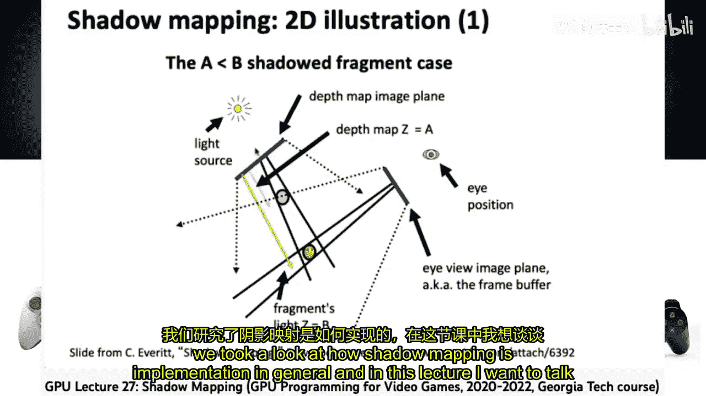
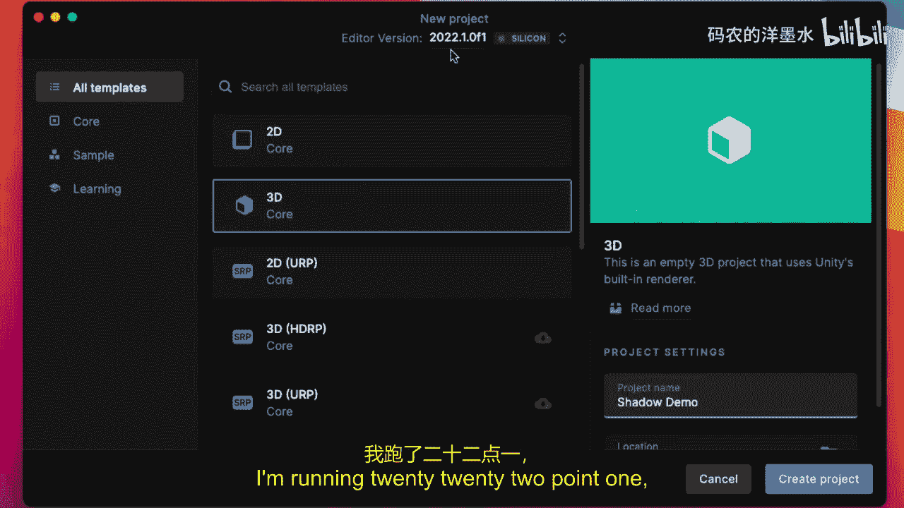
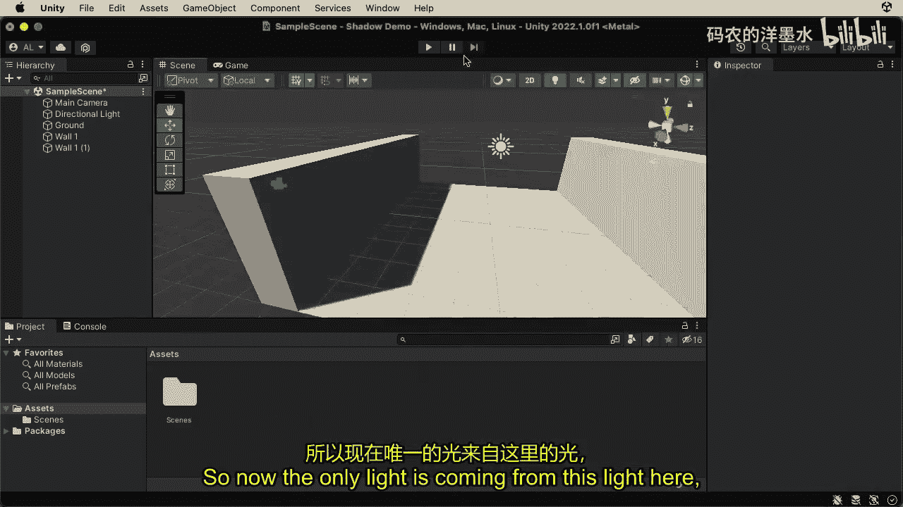
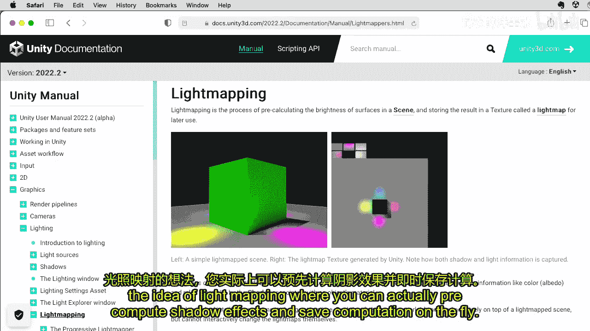
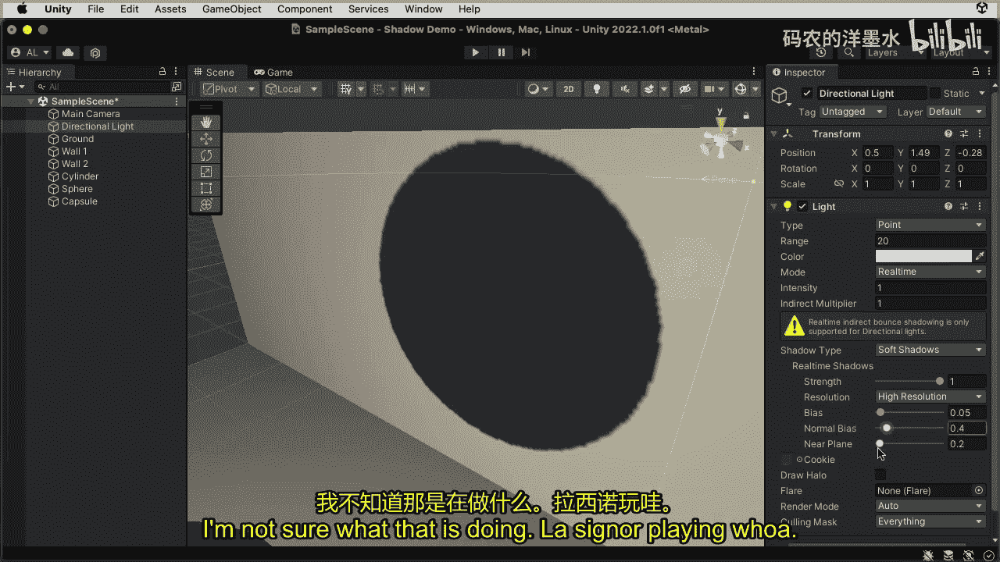
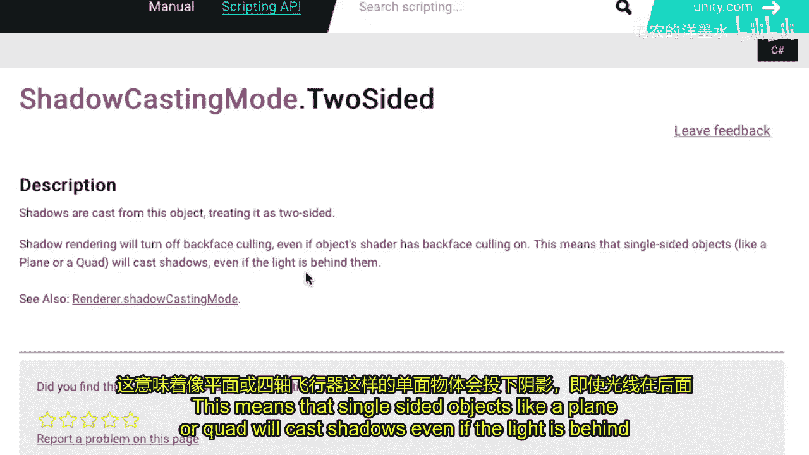
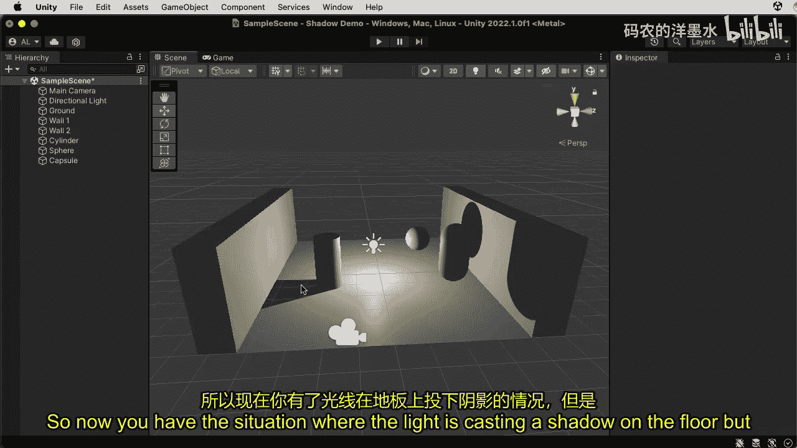

# 【全集】佐治亚理工学院-GPU编程：视频与游戏-中英字幕-p30-Lecture-30---Unity-中的实时阴影--BV1GZfyBbEQn_p30-

Hi there， my name is Aaron Lanchman， I'm a professor of electricallect and Comp engineering at Georgia Tech and the last lecture of GPU programming for video games。

 we took a look at how shadow mapping is implemented in general。

 and in this lecture I want to talk about its implementation and Unity in particular I'm going to start up a blank 3D project using the builtt in pipeline。

 I'm running 2022。1， but this should be similar in other versions of Unity。

First thing you should always do in opening up a new project like this is go to Edit。

 project settings， playerer， and then scroll down to where it says rendering color space and change this from gamma。

 which is a bad thing to linear， which is the good correct thing。

I can't believe you still have to do that in 2022。All right， let's create a 3D object。

 namely a plane。That gives us something to put objects on。

 And let's see the plane is not where I want it。 Let's put it at 0，0，0。 whoop， where are we now。

Alright， so that's a good place to put a plane。 And let's put down a couple of other objects。

 How about let's put down a cube。 And let's see what we'll do with this cube is we'll take the cube and we'll。

Put it at zeros， Why is it putting the cube like？Okay。

 let's put it there to start with and let's stretch it over to here。And。😔，Let's putut it up here。

 maybe。Yeah， let's have it。Have a height of 0。5。 Is this a unit cube。

 I guess it is something like that。 And what we'll do is I want to make something like a wall。

 So actually let's scale it vertically by 2。 actually。

 let's scale it vertically by 3 and we'll give it a height of。1。5， something like that。

 and now let's scale it in the X direction。 Yeah， okay。

 so now I have a wall over here and why did it call the ground F。

 let's call it ground and we'll call this wall 1。And let's duplicate it。

So I should be able to say duplicate。And move that over here， something like that。Okay。

 let me go ahead and round this。There we go。 All right。

 So now we have a ground and a couple of walls。Now to really see what's going on as far as our understanding of how lighting and unity works at this point in the course。

 I want to get rid of the skybox if you'll notice there's kind of a blue tint to thingses coming from the Skybox and I don't really want to talk about that yet。

 so let's go to window rendering， lighting and then we'll click on the environment tab and we'll click on Skybox material and turn that off。

So now the only light is coming from this light here， which is a directional light。

 because it's tagged as directional， I can actually move the light around and it doesn't change anything because directional just has a direction associated with it。

Now， notice that we do have some shadows here。 So if I were to take the light and change how it's rotated。

 So let's grab this。 there you go。So you'll see different parts of the wall。

 different parts of the walls being lit and you'll see different shadows on the floor Let me change this to a point light。

That looks a little more dramatic and let me soosh the point light in here。

 So'll put the point light here and we'll have the light down here somewhere。 Actually。

 let me change the rotation here and make it a little easier to move around。All right， there we go。

 and let me increase the range a bit。All right。 so now we have a point light sitting here。 Now。

 let me put in some objects that will cast shadows first， to make me happy， let's rename this wall。

 too。 All right， so now let's create a cylinder。😊，So we'll put a cylinder over here。Let's see。

There we go， and let's put the cylinder up here。And I'll put the cylinder over here。

 something like that。 ah， that's very dramatic now， isn't it？

So you'll see it is indeed casting shadows。And how about let's make a sphere。 Spes are always fun。

All right。So let's put a sphere。Over here。There the sphere is casting shadows。

 and how about a capsule？Let's see， let's put a capsule。Somewhere over here。😔，All right。

 so there's a capsule。Casting shadowows。That's kind of neat。Now。

 the thing I want to point out here is that real time shadows are very expensive。

 but what you need to use if you do want shadow effects where the objects may be dynamic or the objects are moving around。

In a later lecture， we'll look at bake lighting， the idea of light mapping where you can actually pre computeute shadow effects and save computation on the fly。

 But those will only work for static lights and staticout objects。

 because here I can move the light around。 Oh， that's kind of neat。

And the shadows will change appropriately。 The thing I want to point out here is this particular mode is called mixed。

 I'll talk about what mixed means in later lecture。

 it has to do with how it deals with bake lighting。 baked means you precompute it。 again。

 we'll look at that later。 for right now， Mi should be equivalent to real time。

 as far as how I have this set up currently。 anyway， to save computation time。

 you might want to have some of your lights not cast a shadow at all。

 or you might choose to do so for some sort of artistic effect。

 in which case you can select no shadows And as usual， everything here is scriptable from C sharp。

 you can change all of this from your script。 And this might be something you would want to do if you have a temporary light that you make appear to indicate。

 say， a fireball flying across the screen or something where the players not going to be paying attention to the details。

 Okay， so let me put this back on soft shadows， which was its original setting。

So we have different settings we can play with here。 One is this strength setting。

 So if you turn the strength setting down， that blends between having shadows and not having shadows。

Technically speaking， that's not realistic according to the underlying model。

 but it can be helpful to have shadows that aren't completely blacked out。All right。

 let me zoom in one of these shadows a little bit。All right， there we go。

I got rid of the assets window down here to be able to blow up the scene view here and make things easier to see。

 Let's try switching soft shadows to hard shadows。Okay， so with hard shadows。

 you can see the distinct pixel structure with soft shadows， you see the pixel structure。

 but it's been filtered out a bit at the edge， let's see resolution， let's play with that。

Low resolution here you can definitely see the pixelated structure arising from using a shadow map。

 especially if we put in the hard shadows， actually this doesn't look very different。

 the filtering can't really filter out。Something that blocky。 It just changes things a little bit。

 Anyway， let me leave it on soft shadows， medium resolution。High resolution。Very high resolution。

 so it looks like if I use quality settings。That looks like it corresponds to the high resolution。

 there's probably a quality setting somewhere that you can use to set this to different resolutions。

Let's put that back to high resolution。 Let's play around with these other settings。 Let's see bias。

Oh， bias is changing a few things on the edge there。What about normal bias。

I'm not sure what that is doing。 Let's see near playing， whoa。

Okay， actually， let me zoom out a bit。And let's see what the near plane does。A。

So it looks like what the near plane does is that shadows that are near。 Oh， I see。

 it will not bother to cast shadows for objects。😔，That are pretty nearer。Cause if I put it out here。

Let's see if I move the near plane out， then only。This capsule here is castting shadowows。

 let's check that out。So let's take a look at the docks for the light properties。 All right， shadows。

Here we go。 Near plane。 Use the slider to control the value for the near clip plane when rendering shadows。

 Okay， so that's the near clip plane for the viewing fstum。 have re pronounced that word。

 from the point of view of the light used to create the shadow map。

 So that's a distance from the light。 Let's see what else we have here。 biasas。

 use the slider control the distance out which shadows are pushed away from the light defined as a value between0 and 2。

 This is useful for avoiding false self shadowing artifacts。 Nor bias。

 Use the slider to control distance out which shadow casting surfaces are shrunk along the surface normal。

 Oh， that's an interesting trick， defined as a value between0 and 3。

 This is useful for avoiding self shadowing artifacts。 Okay， there you go。

 Another thing we can do in terms of saving computation。

 is we might turn off shadow casting for individual objects。

 So here I'm going to leave shadows on this light on。

But let's click on say the cylinder and I can turn off。Cash shadows。Let's see。

 I had some other settings。 What do those do。 Let's see。 there's two sided， Not sure what that does。

 Anyway， shadows only。 Oh， that's interesting。 That's a neat effect。

 So shadows only means the object itself will cast a shadow。

 but the object itself is not being viewed。 So if I take that cylinder and move it around。

Oh that's really interesting so imagine something like a first personson shooter game or third person shooter or whatever where the enemies cast shadows but you don't see the enemies themselves and you would have to triangulate by different light sources in the way the shadows land and try to figure out where the enemy is that could be kind of interesting。

And let's see what's up with that two sided mode。Shadow rendering will turn off backface callinging even if the object shader has backface calling on this means that single-sd objects like a plane or a quad will cast shadows even if the light is behind them okay that could be useful in addition to controlling whether or not an individual object cache shadows I can also change rather an individual object receives shadows so for instance I can turn that off for the wall so now you have the situation where the light is caing a shadow on the floor。

 but not the wall if that's something you want to do。

