# 【全集】佐治亚理工学院-GPU编程：视频与游戏-中英字幕-p31-Lecture-31---Cook-Torrance-高光模型--BV1GZfyBbEQn_p31-

E than a little bit of hand waving about perfect specular mirror reflections in the lecture about environment mapping。

 we've been strictly talking about diffuse lighting models。

 and this lecture we'll look at the Cook torrents model。

 which is the most popular model for specular reflections and physically based rendering。

Some time ago I mentioned a Georgia Tech grad named John Habel who has an amazing set of blogs。

 where really now it's just one blog filmilmmic Worlds that sort of encompassed his earlier blog filmilmic Games。

 John has a degree in computer science from Georgia Tech。

 and I wanted to give him a special shout out， not only is a good portion of the material Im presenting here from his blogs。

 reading his blogs has had a large influence on the way I think about physically based rendering。

As of the end of 2019 he was working at Epic Games， it's July 2020 as I'm taping this。

 I assume he's still working there， if he's not， and you are a company that is looking to hire somebody to do computer graphics programming。

 you should look him up and hire him immediately because he is awesome。

Now PPR is not about trying to do a perfect physics simulation we're not solving Maxwell's equations here What we're doing is we're trying to move towards results that are physically plausible but still computable in real time because the closer we get to physically plausible results。

 the easier it is for us to change materials and move lights around and have results that seem predictable The first thing you always want to make sure you're doing if you're using unity is to make sure we're using linear color space and not gamma color space so always go doubleche that and then the main important thing from the point of view of our materials is that unless you have a material that is amissive i。

e。 it is its own light source it can't be reflecting more energy than is coming in that's energy conservation Also there's the principle of helmholt reciprocity which says you need to be able to swap the viewer and the light source and get the same answer。

Atistic workflows and physically based rendering make a strong distinction between materials that are metallic and those that are dielectric Now if you're coming from an electrical engineering background like I am you will see the word diallectric and automatically think of these special materials that are placed into capacitors We're going to be using the term diallectric in a much more general sense basically a diallectric is anything that's not a metal one thing that John points out in his blog is that people will often say things like well things like chalk and cardboard don't have specular reflections Well。

 they actually do particularly at wide grazing angles， so if you want a realistic result。

 you need to put them in a couple of lectures ago I looked at a fake fl effect from the CG tutorial that we use to create mixtures of reflected and refracted light in the context of environment mapping using cube maps here we're using the term fl in a different way it has some of the same ideas。

We're going to be a little more specific about it and essentially apply it to everything。

 not just things that are refracting Now if you actually implement all of these things and try to put in some realistic light sources and materials。

 you will find that the kinds of light your camera is receiving will cover an extreme dynamic range previously when people weren't trying to go for physically based rendering they're just trying to go for something that look decent。

 you would take a lot of time scaling your light sources to try to not blow out your image but if you are trying to do something somewhat realistic。

 you have to encapsulate the fact that you will have some very dim parts of your scene and some very bright parts of your scene。

 so you may need a high definition render buffer that can handle this high dynamic range and then various techniques such as tone mapping or bloom to take that high dynamic range information and compress it into what can actually be shown on a display。

Man， I'm glad the semester is almost over， you can really hear my voice starting to give out。

Much earlier in the course， I introduced the idea of a bidirectional reflectance distribution function also called BRDF。

 this will occasionally be miswritten as BDRF， and earlier versions of the slide had this tyypo a lot。

 because I want to think about bidirectional reflectance function。

 but no it's really bidirectional reflectance distribution function。Anyway。

 this is a function of the viewing angle and the angle of the light coming in and for all of the light sources that we've been dealing with。

 there's a magic factor of pi that shows up in front and for the purposes of what we're doing in this class you can take that pi as magic Just know that there are other kind of light sources like area light such as rectangular lights and sphere lights that might have something more complicated going on。

 remember this weird times with the circle around it。

 This is a colorwise multiplication with the color of the light so you multiply red by red green times green blue times blue we always multiply it by the dot project of n dot L which gives us the cosine of the angle between the normal of the surface and the light vector pointing out of the surface remember you do need to normalize each of these to have unit norm for that to work we also include this max operation so we don't light thingses from the back Now the diffuse light we've been looking at is fairly simples。

The color of the material is conveniently it happens to have a pie in the denominator。

 but quite conveniently when you plug this in the pies wind up canceling so we'll quite often just leave them out I'll come back to that point This covers that original diffuse sliding case。

 that diffuse sliding model that we've been using throughout the course for many years people would often add to this diffuse model。

 something called Bnfong specular I've written it here to try to put it in this BRDF format but it was usually not thought of that way If you think about what's happening with this NL。

If I plug this in， this N dotl cancels with this n。tl。

 and the way to think about it is that you would take your diffuse model and then add to it this term。

 again， the pies wind up canceling。And this term here was called the Bnfong specular model The addition of this N L down here in this pie is just a little trick to try to put it in this BRDF format because we're going to try to movice to make it a little more physically plausible in the second。

 but this model was introduced as a hack that gave you kind of decent looking results but didn't take a lot of computation time。

The H here is the half vector this is the unit length vector that's halfway between the light angle and the viewing angle Unfortunately it's not physically plausible for a couple of reasons a physically plausible BRDf needs to have this reciprocity where it can switch the light vector and the view vector around and that's obviously true for diffuse lighting because that's just a constant doesn' it have an L or V in it anyway unfortunately that original blendfong model does not have this reciprocity property it certainly does from the standpoint of the half vector because you just take the light vector and the view vector and you average them and normalize them again so I can obviously swap those around but if we look at the denominator here well n dot L is not in general the same thing as n dot v so it does not have this homehold reciprocity so later when people introduce。

The idea of physically based rendering， they thought， how can we give it reciprocity。

 and the obvious thing to do is just drop this denominator。

The net effect is that it's like we compute that original blendfong model。

 but we also include this Lamberian term here， which is convenient because you probably already computed it to do diffuse lighting anyway there's a parameter here that lets us scale the width of this spot and that's this S parameter here so if it's fairly small I'll get a broad peak but as I increase S I can make this peak narrower and narrower and that occurs because the quantity in here is less than one so by taking it to a higher and higher power I'm making it smaller and smaller so S lets us control the spot and we use a similar trick a couple of lectures ago for a spotlight effect。

So we now have something that has helmhol reciprocity。

 but there is a problem with this S in that in general， this is not energy conserving。

So there does tend to be some confusion over this issue We've said that the BRDF for diffuse lighting is this material number divided by pi I'm not going to slog through all the scary math here but it turns out that to maintain energy conservation you technically need to have your diffuse material color here be less than one over pi but if you think about the way it shows up in the equation there are sort of this pi that we usually get from most light sources like directional lights and from point lights and from spotlights and they usually just cancel out so quite often people will just ignore this business with the pi and just pretend that all of your lights are just pi times brighter than whatever numbers that you're plugging in for light intensity Nowadays unity and engines like it will give you the option to actually use specific physically meaningful units like lumens and whatever and in those cases they do treat this a bit。

More carefully。But this is convenient from the point of view of an artist in that if you practically say just let this be less than one。

 then it means that if you hit something head on you'll get a one back out Now if you are implementing some sort of global illumination scheme where there's calculations relating to light bouncing around。

 you do need to be more careful with this if you have something that's sending out more light than it's taking in when it's not supposed to that can cause your numeric solutions to freak out So this is a problem with the modified blendfong we solve the problem of it not having reciprocity but there is a energy conservation issue。

It turns out if you work through a bunch of multidimensional integrals。

 you can figure out that if you stick this factor out in front。

 then the reflected energy is going to be conserved as you change S， which is very convenient。

And we'll practically say that we need our specular color here to be less than one so here we have a formula for the specular reflection equivalent to what we had for diffuse sliding。

 but this part here is now a lot more complicated we still have this Lamberian term。

And having S in the numerator means that as we shrink the spot， we're making that spot brighter。

So we can combine our diffuse lighting with our specular lighting here to make sure we have that energy conservation property。

 we'll make sure that these material colors add up to something less than one Now in practice people tend not to actually do that and it kind of works out okay。

 but again， if you're doing some sort of global elimination， you want to be more careful with that。

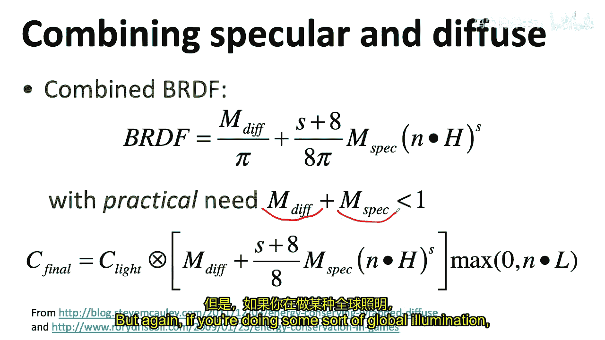

So the illustration here from this excellent book called Realtime rendering that I very， very。

 very strongly recommend， it has a great color plate section in the middle shows why it's a good idea to have that S in the numerator。

 if you don't， as you shrink the spot， the intensity of the spot pretty much stays the same and each individual local component。

 but if you include that normalization factor as you shrink the spot it gets brighter。

 so the total overall brightness winds up staying the same if you think about integrating over the surface。

 and it turns out just from a practical artistic standpoint。

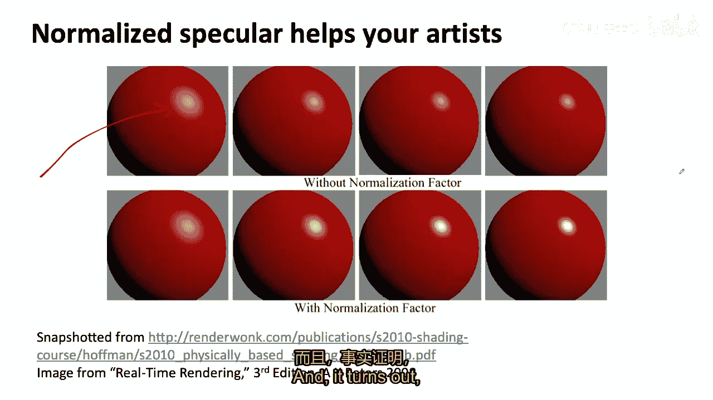

This is easier to deal with for reasons I don't entirely understand otherwise if you mind up changing your S but you don't change the brightness automatically。

 then you're tempted to go in and manually jack up the brightness which becomes really cumbersome but the flip side of having something that can get very。

 very bright like this is that you could very quickly blow at your image in this area。

 so that's why it's useful to have a high dynamic range buffer that has some sort of say film make cinematic tone mapping curve or you could employ some sort of bloom effect。

 so those really bright parts of the image are somehow noticeable as such。

So we're splitting materials into things that are metals and things that are not metals。

 and those things that are not metals are called diallectrics。

 the main difference between these is that although diallectrics can have diffuse reflections and will in fact be a combination of diffuse and specular reflections。

 metals only have specular reflections。Also these specular reflections for dielectrics are white This is something that took me a while to get used to because it's tempting to make interesting weird artistic effects by giving your materials non-white specular reflections。

 but if it's a dielectric i。e。 if it's not a metal。

 these specular reflections are white just because physics says so metals on the other hand。

 can have specular reflections that have a color tin to them particularly if you're looking at them head on。

 however， as you look at them at larger and larger grazing angles。

 they will increasingly look like they are the color white。

 just as is the case with diffuse reflections。

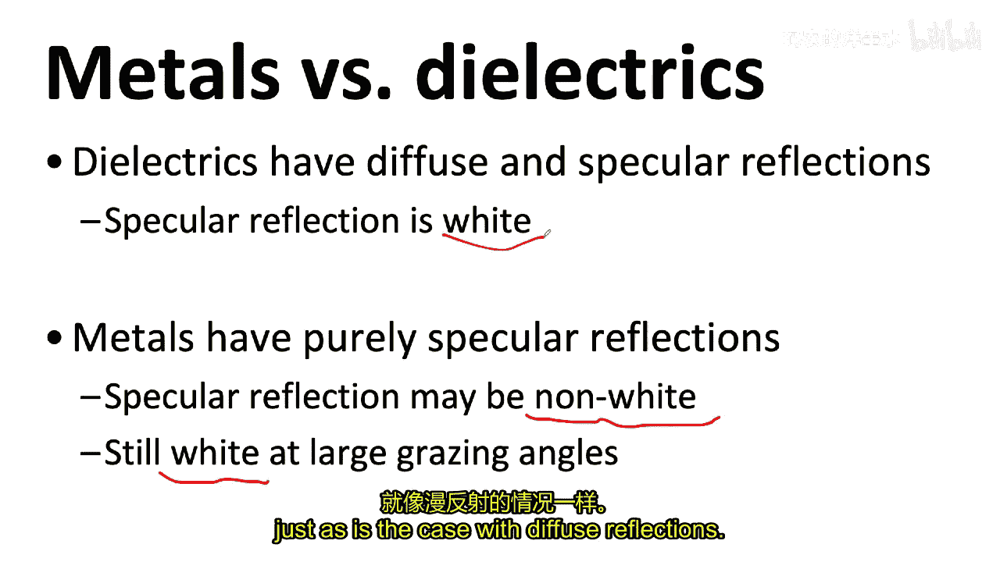

So here are some images that John Hable took using different filters with different polarizations in order to split out the specular and diffuse reflections from different objects now this isn't perfect but it will give you the general idea you can see that for this plate there's this dark gray that's pretty consistent over the plate this is kind of leaking through that's really a specular reflection but whatever and then you have these strong specular reflections notice that you have very bright highlights but most of these specular reflection is actually black over the course of the plate and then you have the combined image and you would expect a metal plate to have this big shiny object but you would probably not intuitively expect that something like a brick would also have specular reflections but here you see the diffuse reflection that's pretty consistent over the course of the surface。

But you can see there is some speculular reflection coming off the top of the brick。

But now think about something like cardboard， it's hard to think about anything less shiny than cardboard。

 but by the way that professors frame questions during the lecture， you can guess， yes。

 they can be shiny。They will in fact have some specular reflection on the left we have the diffuse on the right。

 we see that there is some specular reflection coming off of this cardboard。

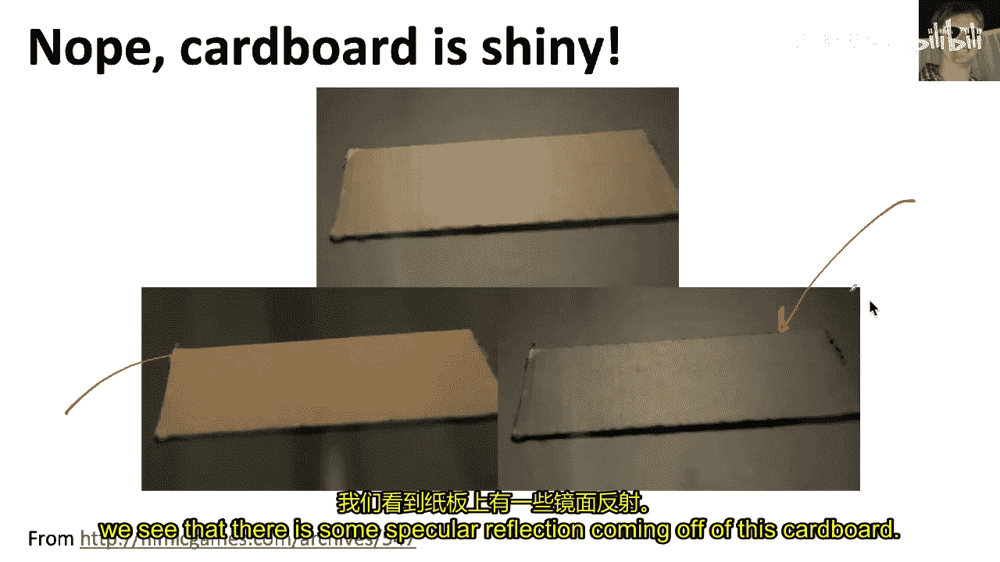

So if you don't get this reference， you need to go out right away and watch the TV series Firefly。

 and then after you've watched the TV series， watch the movie serenity。

 it won't take you long to get through the TV episodes of Firefly because sadly they did not make very many episodes because the heads of the Fox Network were clueless。

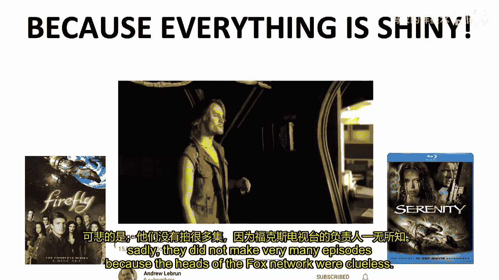

Normally， I hate just reading off PowerPoint slides。

 but I just love the way John put this or cardboard。 so misunderstood。

 It always gets referred to as a pure diffuse material。

 even though it actually deserves to hang out with its shiny friends。

 John probably doesn't sound like that。 A couple of lectures ago。

 we looked at a fake frenel effect to mix the reflecteded light and refracted light in the context of using cube maps to do environment mapping But the Frenel effect is really something that applies to everything here。

 thinking about it from the standpoint of specular reflections。

So if you look up the fnel equations on Wikipedia， you'll see that they're pretty complicated and nobody actually tries to implement those in shader code。

 there's a pretty good approximation called the Schchick approximation and there's a couple ways to write it you can either use V dot H or L dot H and these are equivalent because remember the half vector is the vector that bisects the viewing vector and the light vector so by the definition of being a bisector。

 H has the same angle to both V or L。We take one minus it and we take it to the power of five。

 so this gives it a really aggressive slope off near the edge。

So this gives it a really aggressive slope off near the edge。

 essentially then this becomes an interpolation factor。

If your camera is lined up with the light source， so you can imagine taking a flashlight and the camera and strapping them together with some duct tape。

 then this is equal to 1， this whole theme is equal to zero and this goes away。

And what you're left with is F not F not is what you see when you view something direct on with the light。

 so this is usually a fairly dark gray for dielectric materials。

 but metals will typically have a stronger reflection and they can also have a colored reflection。

But now imagine you have a situation where the light and the viewing vector have a very wide angle。

 so that's like you're driving along and you're looking down at the road at either sunset or sunrise。

 so you now have a very wide angle relative to the light source In that case。

 this term here is pretty close to zero and mostly what you're getting out is this term。

Now one thing that's confusing is you'll often see a different formulation used here。

 they'll use the same overall formula， but instead of V dot H， you'll see in dot V。

And this is interesting because the original form I just described to you does not have the normal vector in it。

 you just have V and U of L this includes V and n but there's no L and this was what we used earlier in the fake fl effect that I got from the CG tutorial so as far as I've been able to figure out this is a special form of the frel effect that you use for global illumination effects where you know where the camera is and you have a normal vector associated with your surface but the lights coming from all over in some sense you don't really have an L vector that you can use so this is for global illumination but this form is for cases where you do have the light coming in from a distinct direction so you'll see both versions of this formula used。

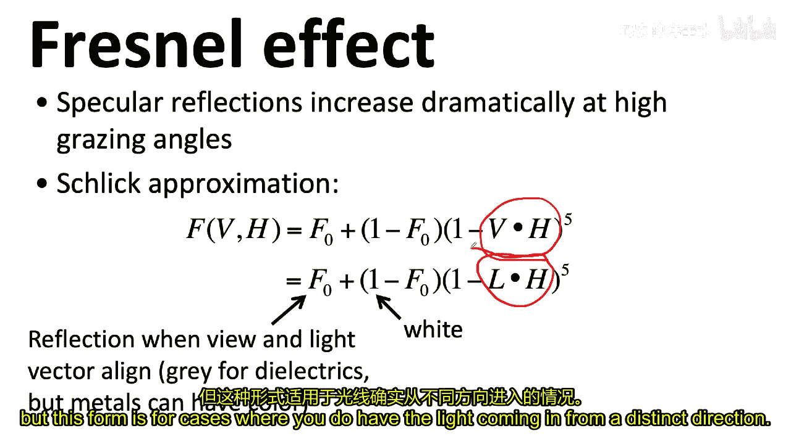

So John also used his polarized photography rig to take some pictures of in this case a dielectric a brick at different viewing angles。

 and as you can see when viewed straight on， you don't get a very strong specular reflection。

 but when viewed at a wide angle relative to the light source。

 you do get a strong specular reflection， so Fll is in effect you get with all materials。

 not just metals。Here's the Fnel effect with cardboard， again。

 not a very strong reflection as you would expect for dielectric when looked straight on。

 there's some but not much， but at a wide grazing angle relative to the light source。

 here's a pretty big specular reflection。Now this particular example is really fascinating here we have a black PVC pipe。

 it is black， it is not something you think of as something that would be reflecting light。

 but here we get specular reflections and we have this really strong specular reflection along the edge here and the Fnel effect will tend to do this。

 it will give you highlights along the edges if you have a light in the background relative to the camera。

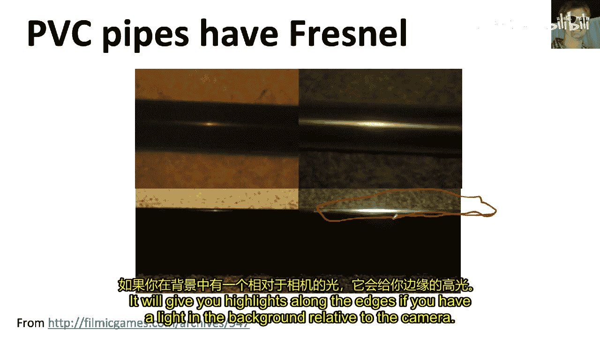

So all materials exhibit a Fl effect and so we might as well incorporate it if we can。

So here are some examples of F knots for various dielectrics remember this is what you get if the camera is lined up with the light skin here is listed as 0。

028， so not very strong head on specular reflections。

 which is because we are not made of metal diamond and crystal have higher F knots but still not huge。

Things like ice and water have F knots pretty close to what you might have with skin Anyway。

 these numbers are all not very big and as a result a lot of game engines don't even really let you select this。

 it's just built into the shader code somewhere because these small little variations are hardly noticed remember dielectrics only have white specular reflections。

To have tinted specular reflections you need to look at metals notice that metals have much higher numbers than we have for dielectrics。

 we have the smallest number on this list is 0。44 for blue for titanium so that number is bigger than all the numbers you saw on this table the other thing to note is that that 0。

44 is in a particular spot it's in blue。Meals can have colored specular reflections。

 most of these tend to tip toward the red， things like silver and aluminum are pretty even。

 so those are closer to white gold is very much tilted towards the red end of thingses。

Copper is not as strongly tilted towards red， but is definitely tilted towards red。

Platinum is very slightly tilted towards red， but not very much let's see if there's anything that's tilted towards something that's not red。

I guess technically speaking aluminum is ever so slightly tilted more towards the blue end of things。

But probably not enough that anybody would ever notice。h。

I wonder if there's some weird fundamental law of physics slash chemistry that describes this behavior。

 there probably is， but anyway， we'll just take these numbers on faith。Remember though。

 that for both dielectrics and metals， the specular reflections tend towards white as that angle between the light and the camera increases。

 so the color is something you only see when you have the light source and the viewing angle lined up。

I found this list of F not properties of various diallectrics and metals from this excellent blog post called Feing a Ph Bayshady model by Sebastian Laard。

 there is a lot of amazing material on Sebastian's blog。

 at the time that Sebastian was doing this work， I believe they were working for electronic arts on the Frostbite engine。

Sebastian also did a presentation at Siggraph 2014 about moving frostsspite to physically based rendering。

 and there's an excellent set of course notes and PowerPoint slides for that which I would invite you to check out I believe Sebastian went to work for Unity Paris。

 which seems to be a trend a lot of the top players in the video game industry seem to be moving to Unity Tech。

All right， so let's put in that fl term we basically have the expression we did previously except now I've added this fl expression from a couple of slides ago in there here we're still using this modified blend fog where we've included this normalization term with the S and the numerator and if we wanted to be particular about energy conservation we could try to enforce this property。

And we're not really going to use this expression anyway because we would like to take a few more steps and do something a little bit more complicated。

Here's an interesting example from the blog of Christian Schuler here we're looking at the asphalt walking along its sunrise or sunset so the sun is at a rather wide crazy angle relative to us and this gives us the nightmare scenario that happens when we're driving when we're blinded by the sun reflecting off the road and is particularly weird here because this road is black asphalt and it's been raining so there is water on top and as you would expect the main issue is that theres water on the blacktop and the sun is reflecting off of the water now it's weird about this is that the refractive index that F not that we're looking at earlier it's actually higher for the asphalt than it is for the water so it makes you wonder why are the puddles reflecting more than the places without puddles Well all other things being equal it would the asphalt would be more reflective than the water。

But the main difference here is that the water will pull and form smooth surfaces。

 whereas the asphalt is fairly rough， so we're getting strong reflections off of the water。

 even though the water technically has a lower F not because those surfaces are smoother than the surfaces formed by the asphalt。

 so we would like to take this effect into account。

We can imagine that we have a lot of light rays coming in， essentially parallel。

 and when they hit the surface， they'll all reflect in a slightly different direction because of variations along the surface。

Now for a relatively smooth surface， the reflections might be going in different directions but they'll more or less be going in a similar direction。

 there won't be a lot of variation， but if you have a rougher surface they'll reflect in a whole bunch of different directions and the net result is that although they'll reflect over a wider area。

 those reflections will be less intense so we have two different objects here built out of the same material but one has been sanded down to a finer grain than the other and we'll bathes our mathematical description of this based on this half vector which is this angle between the viewing angle and the light angle and with that in mind we can now reveal the general form of the cooktorrrent specular term。

 which is given here and we'll add that to our diffuse reflection term。

 assuming we have diffuse reflections which as I mentioned earlier， metals don't。

So we'll talk about the G term， the geometric term later。

This is a magical thing that shows up in the denominator and you can look up the original Cook torrentance paper and see what's going on there Now interestingly there's an error in the original Cook torrentance paper that puts a pie here。

 there shouldn't be a pie here， there should be a four here。

 but because that error is in the original paper that error appears in a lot of other sources。

 we just talked about the frel term。The D here is the distribution term。

 so this is a term that encapsulates the effect we saw on the slide about the asphalt and the water。

 it's something that is parameterized by smoothness。

So one term we might use is this modified Bfong term。

But you might be saying to yourself wait a minute Laernman on an earlier slide。

 this was an8 and you had an8 down here， not a tube so this gets very confusing。

 the s plus8 over 8 factor that we saw earlier that is calculated under a set of assumptions then are different than the assumptions that you use when computing this D used in the full cooked torrentance form。

And I say that because I've read the writings of people who are more knowledgeable about this than me and they write things that sound like that and I'm just taking their word for it if you want to know more details you can take a peek at this blog entry called the Bn Fong normalmalization Zoo by Christian Schuler who created that water asphalt example。

Now this S term is fairly difficult for artists to deal with directly。

 we would like to give them a knob to turn that lets them change the characteristics of the reflection。

 but in a way that feels natural so we would like to give them a parameter that goes between zero and1 and that way they can build texture maps to this that indicate how the smoothness of an object varies over the surface and I ran across a presentation that said call of duty black ops use this kind of exponential mapping between this smoothness parameter G and the actual S used in this formula。

But as it turns out， people tend not to use this modified Blingfong that much anymore anyway。

A different G called GGX has become much more popular and is pretty much the dominant distribution term that you'll see in cooktorrrent specular models in modern game engines。

Now this modified Blinkfg model was inspired by this earlier Blinf model which was basically a hack that looked okay and was reasonable to compute unlimited hardware that was available at the time。

 but this GGX term isn't really derived from any equations from physics either it's an empirical fit to data that is more complicated to compute than the modified Bfg model but not unreasonably more difficult。

 the main thingme people observed is that whatever you are getting out of your Bfg model wherever you set the S。

 real objects tended to have a much quicker fall off right around the peak and then very long tails that will go out a lot further than you could get from the modified Bfg model。

 this is not a great drawing， hopefully you get the idea。

 so you've got narrower tighter spots but a very wide dim halo around it。

The GGX formula is shown here in terms of a roughness parameter alpha。

 artists do not like to think in terms of roughness， they like to think in terms of smoothness。

And some early work by Disney showed that just taking one minus some value between zero and1 and then scoring that came up with an alpha that mapped well to how the artist interpreted smoothness as they varied this G factor between zero and1。

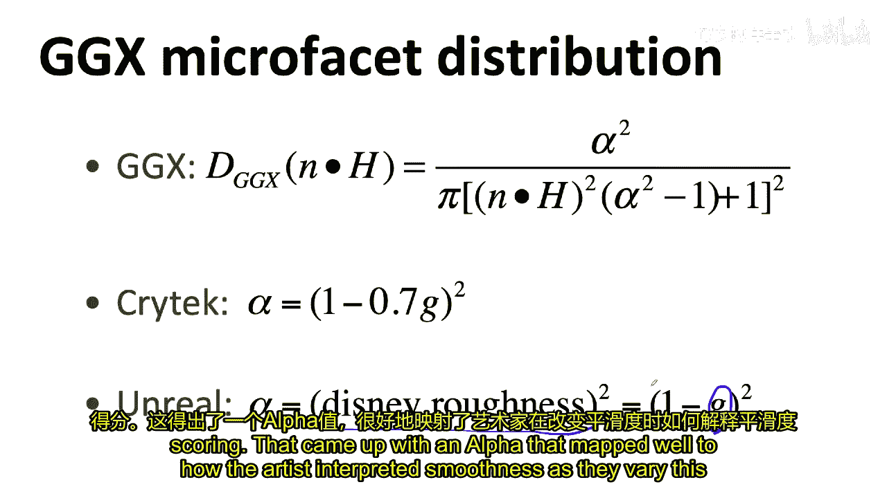

I came across this presentation by Nilas Schultz about using the Cririch engine in the game Re son of Rome。

 and in their formulation， they use something similar to the Disney formulation。

 except they multiply that G times 0。7， and I imagine different engines and game companies have their own special sauce。

 So there are other choices of D term， there's like the Beckchman term， and there's a Gaussian term。

 and you'll see those in books and papers， but pretty much nowadays everybody just uses G GX。

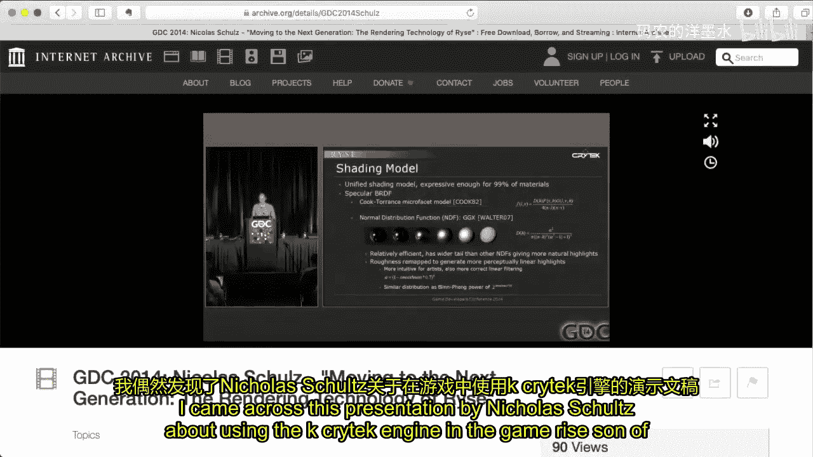

So the last thing we need to look at is the G term and this is trying to deal with the effect that variation of height has both blocking light coming in and blocking light that's trying to come out Now the kind of effects we're talking about here are at an even smaller level than the kinds of effects we're trying to achieve with normal maps this is trying to capture the effects of roughness。

 variations that you couldn't see with the naked eye。

The original cook torrance paper derive this fairly complicated form。

 It has some strange issues with it。 There's these weird breakpoint where suddenly the behavior changes and another odd thing about it is that for something that intuitively should incorporate the effects of varying roughness across the surface theres no alpha kind of parameter in here。

 So people have looked at creating other geometric terms。

 some of which are trying to be based on reasoning about the D term that you chose and what that might imply。

 So if you do this with the GGX term you wind up with this kind of form Now something I want to point about this and a lot of other geometric terms is that it's expressed in this form of factors and the way this is often written is that there's some core formula that you'll write in terms of either n do L or n dot V as shown here but as the user。

needed to know that your full G term is not just this n dot V term take the same formula。

 but wherever you see n dot V here plug an n dot L and multiply that by what you get from this n do V term so it's a product of two factors that look like this Now not all G terms can be factored like this。

The original cook torrentance form cannot be factored like this， it's its own thing。

I haven't seen this particular full GGX form used in very many games。

 I did find a paper on its use in the game the Order 1866 and this game looked really cool it this steampunkky kind of game where and you go fight supernatural creatures with weapons created for you by Nicola Tesla and how could that not be awesome the graphics were praised but the game got some midddling reviews it was a PlayStation 4 exclusive and I was very tempted to buy PlayStation 4 just to play this really cool looking game but decided not to。

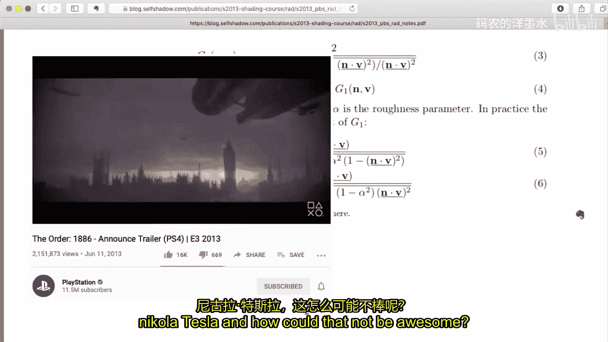

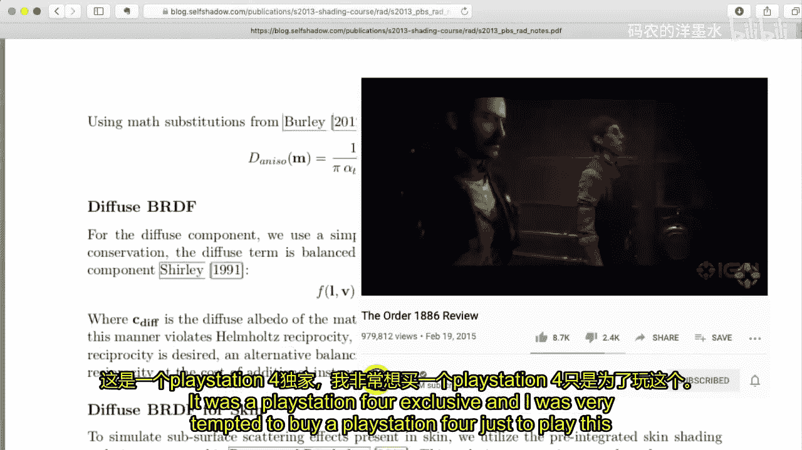

Now if you remember this cook torrance formulation。

 there's this n do L n do v with a4 sitting here in the denominator。

 and then if you look at this term， we have this two n dot v in the numerator。

 so when I multiply this by the n dot L version， well there would be a4 n do L n dot v sitting in the numerator。

 which we cancel with this4 n do L n dot v sitting in the denominator。

 now not every G term has that and hence not every G term will have that kind of cancellation。

For instance， the original Cook Torrentance term won't do that。

But in the cases where that cancellation does occur， this kind of formulation is very convenient。

 let's define a visualization term that's my G term divided by4 n dot L n dot V。

 this is like predividing that denominator from the cook torrent shader and what happens is that for ntL n dot V term automatically cancels and we'll have that visualization term with the factors in terms of n dol and n dot V that were originally expecting。

 but the whole thing is now a bit more compact and we've saved some computation。

Now this particular square root does potentially take a while to compute。

 so maybe we would want to come up with a variation that doesn't require that square root。

So folks have figured out a variation that doesn't have the square root where they have a geometric term that's a product of n dot L and n dot V factors。

 but doesn't have that square root， and in fact it takes the overall form of that D GGX term it's a little bit different though。

Now there's a couple of choices for K here， Disney took two approaches。

 one was this g minus1 squared divided by2， so this is like this alpha divided by  two。

 and then they also had this variation that they called hotness remapping and if you look at the original white papers about this from Disney。

 they can explain it， basically they were coming up with a variation that their artist found more appealing。

 your mileage may vary。Now， imagine for a second that you picked this geometric term。

 you just let it be for L n do V。That comes out of nowhere really。

 there's no reason why you might expect that to be useful。

 but it just happens that if you plug that in for your actual G and then divide that by for nl dot via that all cancels。

 then you get one。If you're on a resource limited platform。

 you might want to use this Klumman geometric term。

Which is basically chosen because it gives you something that's decent looking， but very importantly。

 it's easy to compute。After you compute V doth， you just square it。

The final thing I should mention is that all the formulas I've shown you have been isotropic。

 you can make anisotropic versions， for instance， for materials that have grains running along a particular dimension。

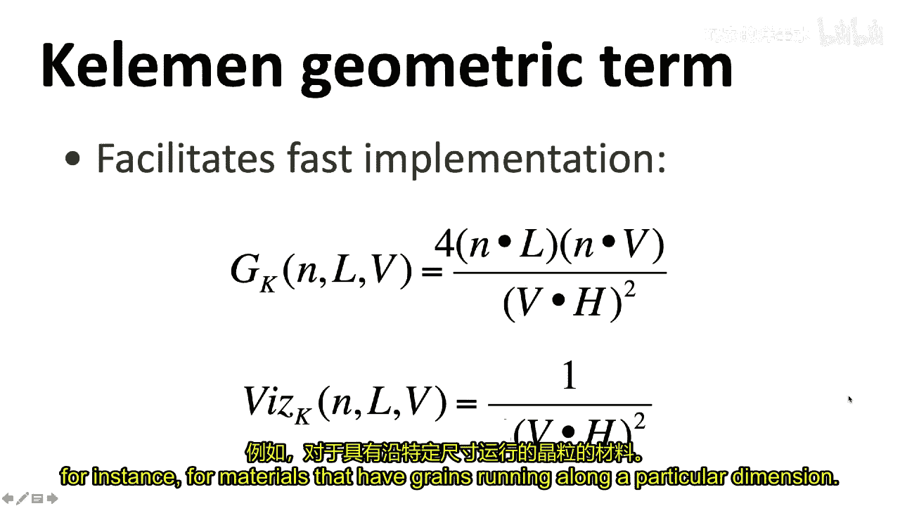