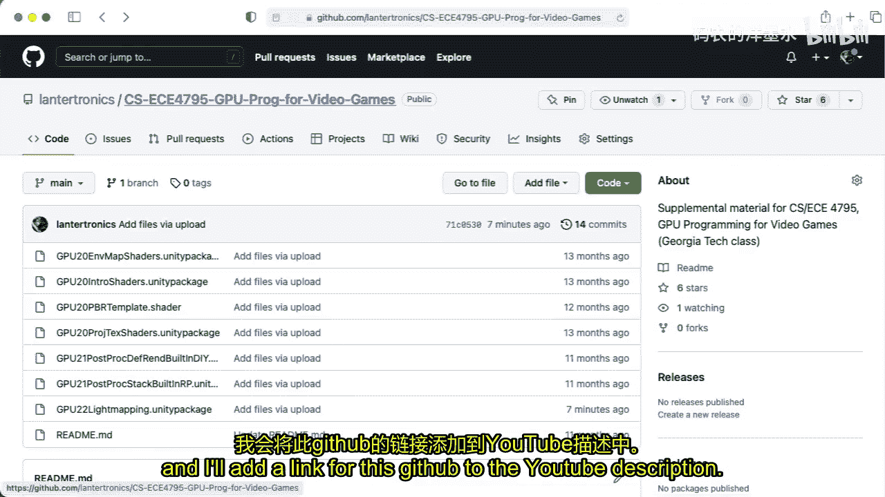
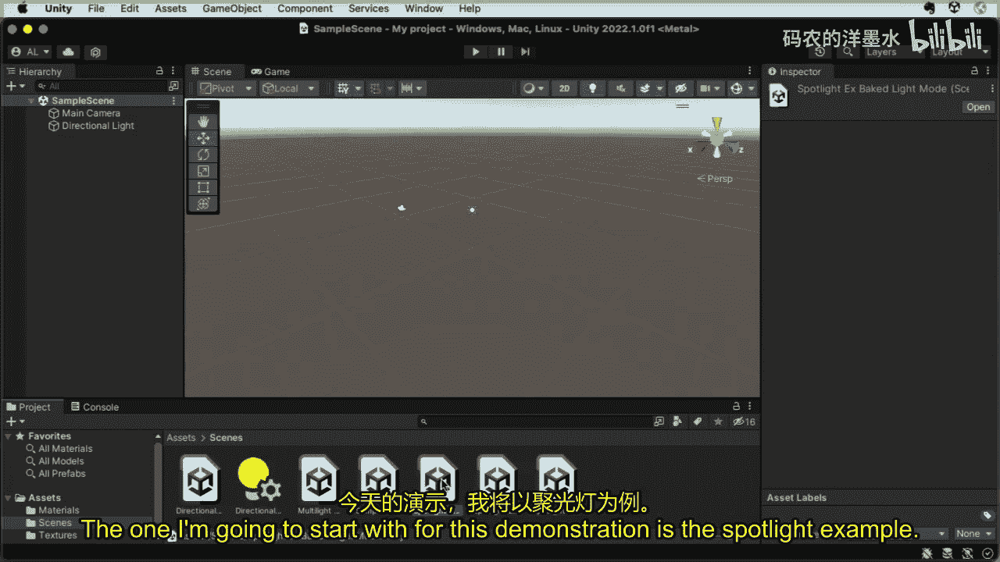
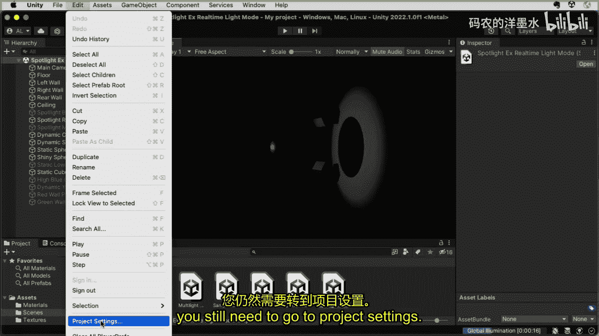
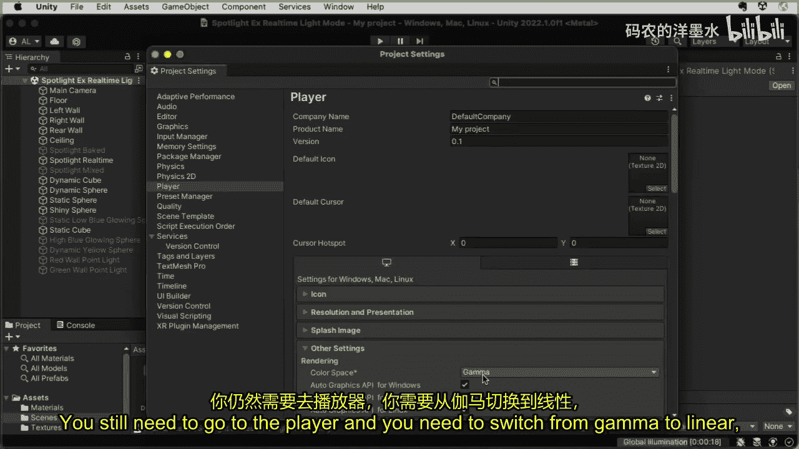
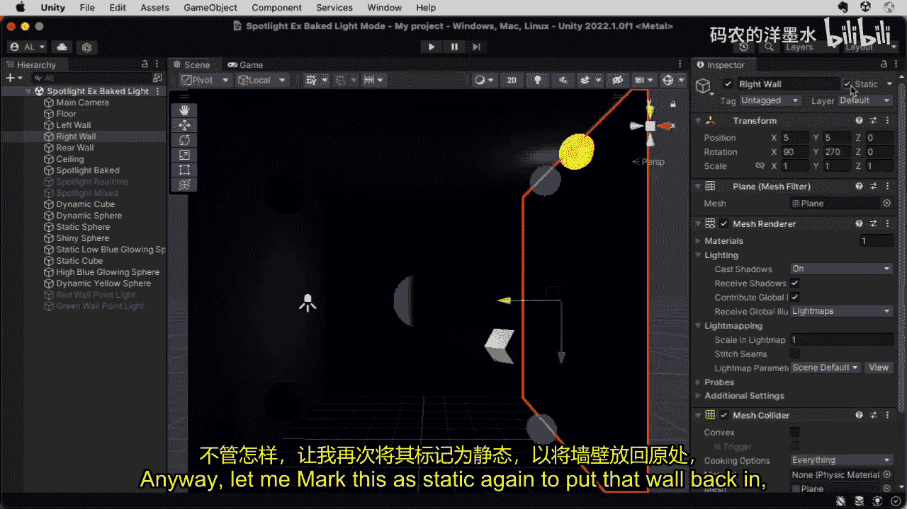
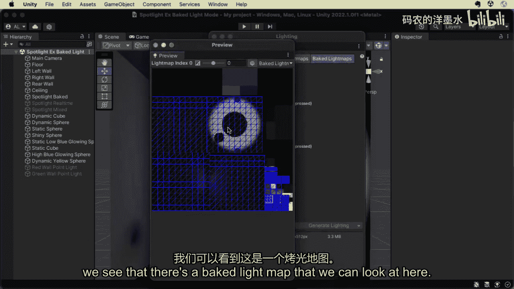
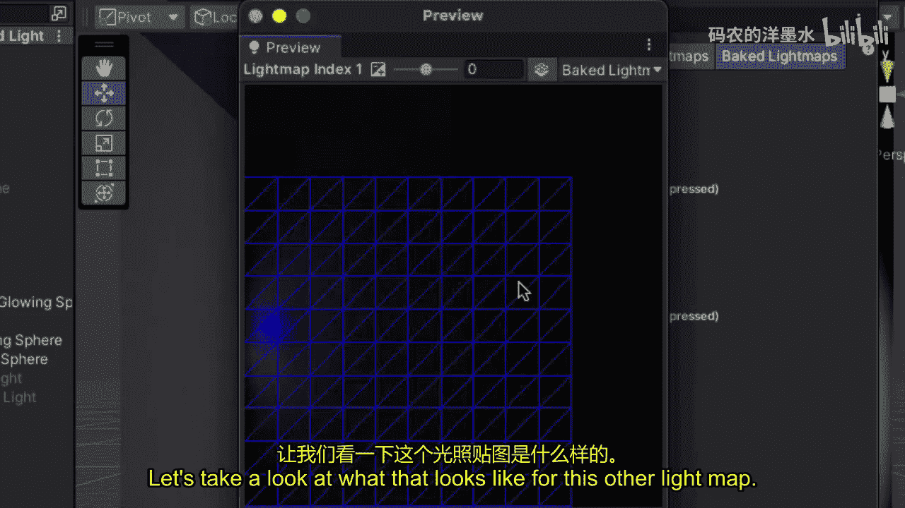
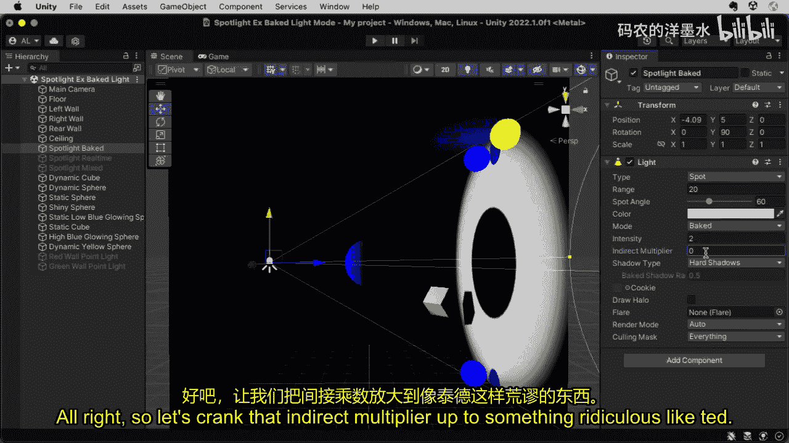
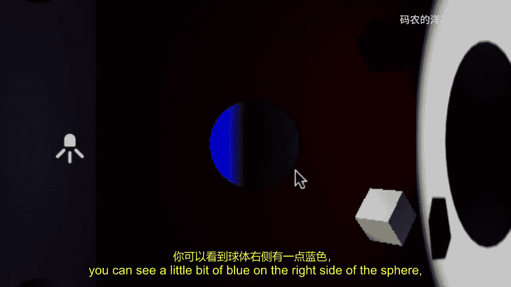
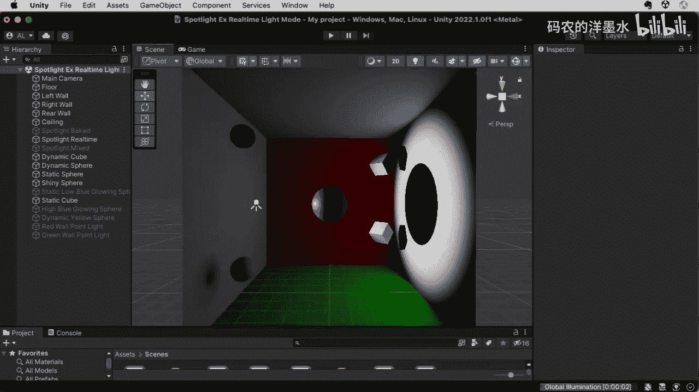

# 【全集】佐治亚理工学院-GPU编程：视频与游戏-中英字幕-p32-Lecture-32---Unity-中完全烘焙光照贴图--BV1GZfyBbEQn_p32-

Hi there， my name is Er Lancherman， I'm a professor of electricallect and computer engineering at Georgia Tech previously in this class on GPU programming for video games。

 all of the lighting effects that we've seen have been computed in real time and this lecture we explore precomputing light effects and baking the effects of those lights into special textures called light maps。

The demo scenes I'm going to show you in this lecture are from the Unity package GPU 22 light mapping dot Unity package。

 which you can download from my Gitthub for the course。

 and I'll add a link for this Github to the YouTube description。 Okay。

 so I'm going to grab that unity package and drag it on my assets folder and say， yes。

 let's import all of this stuff。 I import import。

And let's go to the scenes folder。 Doub click on that。 And there's a whole bunch of scenes in here。

 The one I'm going to start with for this demonstration is the spotlight example。

 realtime light mode。 right。 So let me double click on that。

 And if I go to game to look at the scene。 It looks too dark。

 That is because unity has not properly set up lighting for their default 3D built in pipeline projects。

 Now， I think the lighting model is correct for the new scriptable render pipelines。

 The high definition render pipeline and the universal render pipeline。

 But as far as the built in pipeline goes， you still need to go to project settings。

 Youll still need to go to the player。 and you need to switch from gamma to linear。

 So let's change from gamma to linear。

And now things look correct。 Why do you still do this unity， I do not know。

Here's the scene in the scene view。 The cameras out here。

 And if I spin this and zoom in a little bit， we can see that I have a sphere that's sitting here in the middle。

 And there is a couple of blocks。 and there's some walls。 and there's a single spotlight。

 Now I can change the angle of that spotlight。 And if I blow that out a bit。

 you'll see that the floor is green and this wall is red。 But you don't notice any of that， because。

The spotlight is so tight that it's really only shining on this wall。

So the two blocks here are set up to cache shadows， as is the sphere here。

And one thing I want to point out， that's kind of fun that I just noticed。

 Not that as I blew this out。look at how blocky the shadow on the wall there gets。

 So that's an example of the kind of artifacts you can get from shadow mapping。

 because as I am increasing the effect of the light here。

 is having to use the pixels for your shadow map and take those and spread those out further。

 Let's see， Can I make that look better by changing the quality settings just a little bit。😊。

Let's see I'll put that back on use quality settings。 Anyway。

 let me put this back to something reasonable。 Let's see。 what was that originally。Okay， it was 60。

 we'll stick with that。Okay， that was a bit of a side quest。 Anyway。

 I would like to point out that the material for the sphere here is deliberately a little bit unrealistic。

 I've set it up so that it has a blue albedo color。 but it has a red specular color。

 This is not something that a real life material would do。

 but it makes it easy for me to illustrate when there is a specular reflection or not。

 Keep this speckular highlight in mind because it's going to disappear in the next scene。

 I'm going to show you。 The next scene I'm going to show you is called spotlight example。

 bait light mode。 So let me double click on that。 And you'll notice that it looks a little messy at first。

 Theres some spots up here。 That's because it has to compute some global illumination things first。

 And let's see it has another 8 seconds or so to go。 It looks like。

 Notice I have added some other things to this scene。All right。

 so there's a lot going on this scene and the main thing I want to point out is that the spotlight is still just shining here。

 but notice that we have light hitting the walls back here。

 there's also light hitting the back of the sphere over here。That's because I set this light to bait。

 If I set it back to real time。Notice all of that stuff goes away。 Wait。

 why is the green floor still there， Oh， wait， I think the lighting calculation needs to update that floor should disappear in a second。

Okay， let me put it back on bait。So something that you can do with the baked light calculations that you can't do with the real-time calculations we've seen so far is you can actually have bounced light。

 so the reason you're able to see a little bit of blue on the other side of the sphere from the light is that there's light that's hitting the wall and I guess a little bit hitting the ceiling on the walls over here but it's probably mostly from over here that's bouncing onto that sphere similarly the reason you're able to see this wall back here is there's light that's hitting this part here。

 this right wall that's bouncing over to the left and up here and down here and this is all bouncing around。

 so that's all a very complicated calculation that happens before you're running your actual game you actually just saw it happening。

I just noticed that there were some objects missing in the scene。

 So I zoomed out a little bit to show those。 I also close the asset windows down here so we can have a bigger image。

 So there's a lot going on in this picture。 First off， notice these two blue spheres。

 These spheres have an amissive color of blue。 So they don't need a light source shining upon them to appear。

 They just show up as blue。 But in general， they don't act as real time lights themselves。

 The reason you see a little bit of blue reflection here on the wall down there and appear and a little bit of blue on the ceiling is that these spheres have been marked as static。

 And what this does is it tells unity that you are promising that these spheres won't move。

 So it knows to include them in the baked lighting calculation。Now。

 the wall itself also has to be marked as static。 If I were to take this wall and unmarked static then wait for it to redo the computation。

 Ohh， that looks kind of like Halloween spooky。 That's kind of neat。 Okay， let's wait for a bit。 Oh。

 because the rest of the light in the scene as largely dependent on the light bouncing off the wall。

 When they marked it as not static and it took it out of that big light computation。

 The rest of the room got very dark。 Notice you do have a little bit of blue over here and a little bit of blue up here。

 as a result of the light from these amissive colors。 Let's see the floor is not marked as static。

 So the floor here is not getting some of that night's blue light。 Anyway。

 let me mark this as static again to put that wall back in。 All right。😊。

Notice that the yellow sphere here just appears as yellow， again， it's an amissive color。

 but you don't see any yellow on the wall or any the ceiling here again because here that's marked as not static。

 so unity is not including that in the bake light calculation。

What about shadows so here I have a sphere the cube here is marked as not static。

 so unity is not going to include its shadow in the bake light calculation。

 the cube down here is marked as static， so it is including that shadow in the bake light calculation。

Down here in the lower right， you will see that as I click on these different points in the scene。

 you can actually see the various light maps that are created。

 I think at some point I accidentally mark this as not static when I was supposed to be static。

 let me mark that as static。There we go you can actually see the light map being filled out。

 so for the wall over here， this wall， other stuff at the scene。

You can see the light map here and essentially unity has tried to go in and automatically figure out what chunk of a given light mapap texture to allocate to different objects in the scene to try to optimize that in some way so you can clearly see the ring here in the center corresponds to the wall and it looks like down here in the lower left that may correspond to the ceiling up here。

Down here， it looks like there's one light map for the floor here。

 That's probably the blue that you see here is probably blue showing up on the floor， maybe。

I'm not really sure and there's other bits up here， I'm not sure what those correspond to anyway。

 that's something unity is handling for you。Notice that this sphere up here doesn't have a black albedo color。

 It's just not showing up because it's not marked as static。

 So it's not receiving any bounce light and it's also not casting any shadows。

 It's just not part of that computation at all。 down here。 We have a similar sphere。

 But it is marked static。 So it's receiving some bounce light。

 So you can see the right side of it here， and it's also casting a bit of a shadow on the wall。

 Notice that the light that is being cast as a shadow here， is not direct from this light。

 It's light that's bouncing off of other parts in the scene。 and then hitting the wall。

 And that's what this is shadowing。Now I want to give you a caveat about marking objects as static。

 there is nothing in the engine itself that will stop a script from taking this object and moving it。

And。Here， when I do that in the editor， it will recalculate all of the various bits about sliding。

 so now it's making a shadow up here， etctera， etctera， etc。

But when the game itself is actually running， it doesn't do that。

 It will just keep using whatever the prebate map is。

 So it will still show the shadow down here from the cube in its original position that it was in when you bake the light even if you move the cube。

 So the final thing I want to point out here， is that if you were to look at the left side of the sphere。

 Notice you don't see that purple specular highlight。

 That's because the baked lighting calculations can only handle diffuse light reflections because diffuse light reflections。

 Don't depend on where the camera is。 Specular reflections。 depend on where the camera is。

 And when unity is sitting here doing that big bounce light calculation in order to compute the light maps。

 It doesn't know where the camera is going to be during the gameplay。

 The camera may be moving around all over the place。So light maps don't include specular reflections。

But they do let you include bounce lighting， they do let you include the effect of lighting from a mess objects。

 and they're extremely computationally efficient during gameplay。

We can dig into the light maps a little bit more by going up to window， going to rendering。

 say lighting。 and then we can go over to this tab called baked light maps。

 So here we see the two light maps it created for the scene。 and if we double click on one。

 we see that there's a baked light map that we can look at here。

 I don't really understand what all the stuff in here is doing。

 but the main thing I want to point out is that there's another kind of texture here。

 There's one called the baked directionality。 So this is something I havet talked about before。

 Basically， in addition to this kind of map containing a color Unity will also create this other map that sort of indicates if most of the light was coming vaguely from one particular direction。

And this kind of map will encode information about that direction and it will also encode information as to just how directional that light is if the light is coming in mostly from every direction and just slightly from a particular direction that information will be decoded but if most of the light is very much coming from a particular direction it will encode that information as well and then the shader can use that when actually computing the light。

 let's take a look at what that looks like for this other light map okay so there's the color and here's the directionality map I don't see a lot of variation in here so that suggests that there's not a lot of variation to the directionality across the scene but when I look at the directionality map for this map。

 I do see some different kinds of information being provided I do not know what the mapping from color to direction information is。

Don't ask me， you can go look that up probably if you want to。

There is another interesting parameter that I should talk about that you can click on this light。

 having to do with this bake lighting。 That's the indirect multiplier。

 That indicates just how much light bounces when it bounces。 So if I take that multiplier down to 0。

 that basically kills all of the bounced light。 And if we wait for a second， the screen floor。

 which appears to be the last thing that gets computed for some reason， should disappear。Come on。

 come on， come on， disappear， disappear， disappear。There you go， all right， you disappeared。

All right， so let's crank that indirect multiplier up to something ridiculous like Ted。 Okay。

 so that's completely absurd。

wow， okay， okay。 So there we completely blew out the scene。 So light hit here。 It hit out here。 Wow。

 okay， so maybe that's not a thing that you want to do。 All right， let's see。

 what about an indirect multiplier of two。So this is a bit more sane。

Let me put it back on an indirect multiplier of one just to have a baseline。Okay， now with that。

 let's try something。Lower than one， but not  zero， so 0。5。All right， so。Let's see。

 I think this green floor updates late。 so we'll have to wait on that。 Okay。

 there's the upper left part of the wall。 So we are seeing the ceiling and the wall over here。

 and we are seeing a little bit of the floor， But it's much darker than it was previously because there's less of this light being allowed to bounce there。

If you look really close， you can see a little bit of blue on the right side of the sphere。

 but it's pretty dark。

Before we close out， I wanted to remind you of this initial demo scene I showed you that used real time lights。

 So although this couldn't have any of this cool bounce lighting effect。

 it did allow you to have a specular highlight。In the next lecture。

 we'll look at a different kind of light mode called Mi。

 which allows you to mix some of the benefits of the bake light mode。

 namely bounce light with some of the benefits of real time mode by allowing you to compute things like specular highlights in real time。

