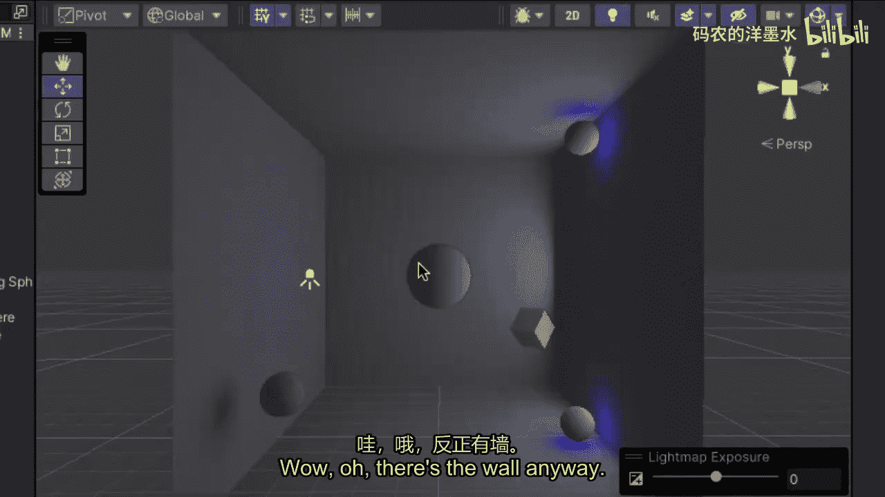
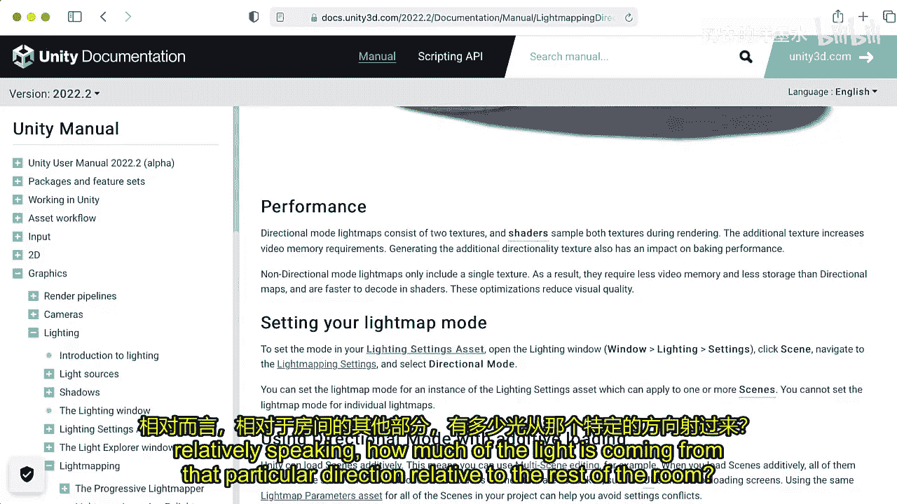
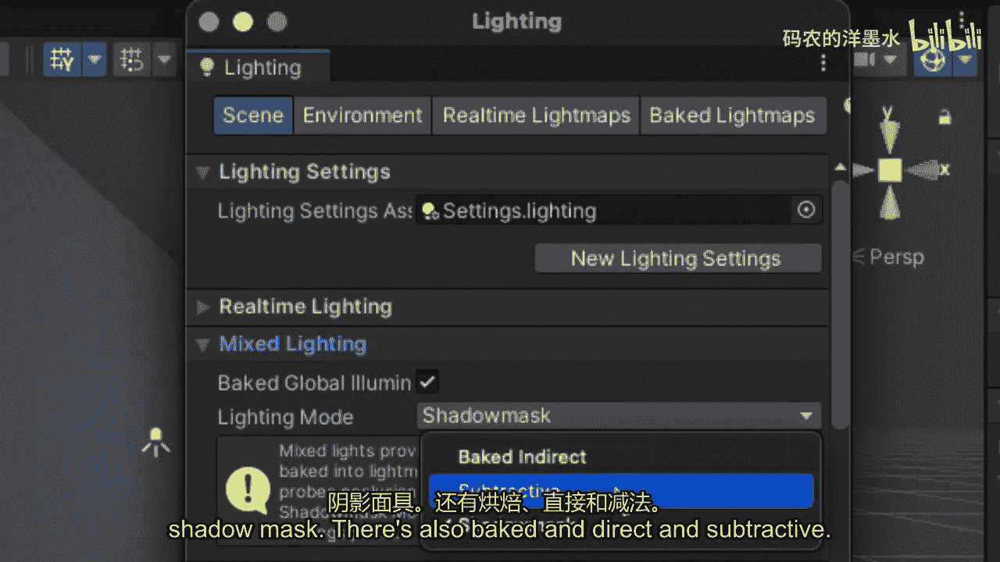
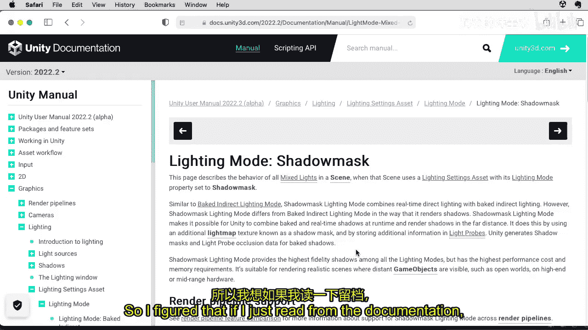
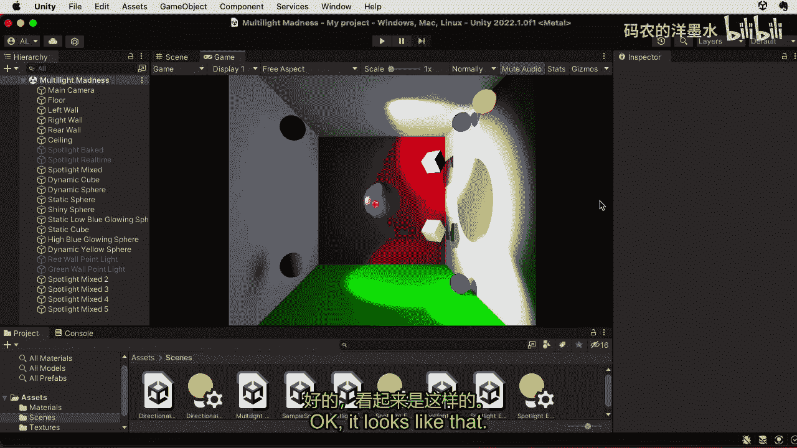

# 【全集】佐治亚理工学院-GPU编程：视频与游戏-中英字幕-p33-Lecture-33---Unity-中混合模式灯光的光照贴图--BV1GZfyBbEQn_p33-

Hi there。 My name is Aaron Lanchman。 I'm a professor of electrical and computer engineering at Georgia Tech。

 and I began the previous lecture with this demonstration of a real time light。

 which is the sort of light that we've been looking at through the rest of the course so far。

 and that light gave us this nice purple specular highlight and here I have a blue diffuse color。

 And this isn't very realistic as far as how real objects work。

 but it will demonstrate a particular point in that my next example will not have this specular highlight。

 So the next thing I did in the previous lecture as I pulled out this。😊。

Bate light mode demonstration， so let's。Go ahead and say save anyway。 let's load that in。

 And now this is using baked lighting。 So we set the light here to bait。

 And now for the scene to look correct。 we have to wait for this global illumination computation to finish and we' eventually get the rest of the wall here。

 So now we have all sorts of cool effects where we have the blue light from the amissive color here。

 This blue sphere and this blue sphere are having some effects on the rest of the scene and making them appear blue in a way that wouldn't normally with real-time lights because just an amissive object on its own isn't a light source in the regular sense。

 It's only picking this up through the bake light calculation and that bake light calculation also deals with bounce light。

 So the light source in the scene is actually just making this white ring that you see here。😊。

And the fact that you can see the other walls， the floor。

 this wall back here and even a little bit of the back of the sphere you'll see is lit all of that is part of bounced light that you only get from this bake light calculation Now the sacrifice we've made here is that that bake light calculation doesn't know anything about where the camera is and knowing where the camera is is necessary for dealing with specular lighting so bake lights can only really deal with diffuse lighting effects。

But there is another light mode in here called the mixed light mode。 So let me load that in。

 and we'll have to wait for a bit。 Let's see it got the green floor already。

 but it needs to work on the rest of the scene a little bit。It starts out a little spotty。

 but then it gradually works。 And it seems to get this part of the wall later。 Not sure why。 Anyway。

 here， the light mode is set to mixed。 And notice here。

 we do indeed have that purple specular highlight。 So what kind of magic is this。😊。

To see what's going on here， let me first go back to that bake scene。So。

I can go up here to this debug graphics menu here， click on that and if I click onBa light maps。

 you can actually see the light map information in the scene so you'll see the bright light here。

 you'll see the bright light here， this ring here， you'll see the bright light here but you'll also see all of that reflected light so you'll see a little bit of the back of the sphere and you see the walls and such。

You also see some blue up here coming from the immissive blue light of the spheres。Now。

 let's see what this looks like if we instead check out the mixed scene。

So it will take a second to compute。And let's go back to the shaded mode just to watch that come in。

All right， so we have to wait a little bit for this wall to appear again。Actually no we don't。

 let's just go ahead and look at the big light while that's going。

 I can go ahead and make the point well， oh， there's the wall anyway。So here。

 notice that you don't have that bright ring on the right and you don't have the bright surface showing here。

What N light does is it will only put into the light map。The result of bounce light。

 it doesn't include any direct light in the light map。

So you'll get the effect of the direct light from a real time lighting calculation and that real time light calculation can include specular highlights。

Now we can play some of the games that we played previously in terms of choosing the amount of indirect bounce light。

 so let's take this indirect multiplier and crank that up to five and see what happens。Okay。

 it does something completely absurd。Okay， maybe let's not crank it up quite that much。

 how about three， let's see what happens if we crank it up to three。

So it's going to take a minute to compute。And this is what's happening in the light map。

 Let me go look at the original scene。 There we go。 So here we have all sorts of crazy bounce light。

 And it looks like the upper left wall again is the last one to fill out。So there you go， all right。

 let me put this back on one。Let's take a look at the actual maps themselves again for the bounce light。

So the shadow map down here looked pretty much like the shadow map we looked at in the previous lecture for the purely bake light case because the floor that seems to be mostly represented here。

 Wait there is some other stuff up here。 I don't know what that is Anyway。

 the floor down here is pretty much only lit by bounce light。

 but if I click on something like the wall over here。

 if you remember from the previous lecture there is a big bright white ring here that you could actually see。

 but you don't see it here， because that's the result of direct light and the mixed mode doesn't put direct light into the light map。

So this ring here is being computed in real time。Similarly， this sphere here on the left。

 if you take a look at it， you will see a specular highlight because it can compute that in real time。

 but the light on the right， that's part of the light map。So wherever that is， okay。

 so it's somewhere in this light map， Unity figures out how to allocate all of this for you。Okay。

 let's delve more deeply into these light maps。 Let's go up to window。

 go down to where it says rendering。 go to lighting。 click on baked light maps。

 So heres the complicated one。 So there's the baked light map。

 and we can take a look at the directionality map。 This is something we looked at last time。

 And this basically encodes a sense of whether or not a good portion of the bounce light coming into a particular point on a light map is kind of coming from everywhere in the room。

 or is more coming from a particular direction。 And if so， relatively speaking。

 how much of the light is coming from that particular direction relative to the rest of the room。

 So this gives you a rough way of including some directionality information into the eventual lighting of the scene。

😊。

Now， there is something else new that's called the shadow mask。

 And this gets complicated to provide context for this。 the shadow mask is something we need。

 if we're using a particular setting for mixed lighting that we can find in the scenem tab of this lighting window。

 And let's see。 here we have lighting mode， shadow mask。 there's also baked indirect and subtractive。

 So here we're using shadow mask。

So let's take a look at the documentation。 Shadow mask lighting mode combines real time direct lighting with baked indirect lighting。

 Howeverever， shadow maskask lighting mode differs from baked indirect lighting mode in the way at render shadows。

 shadow mask lighting mode makes it possible for unity to combine bait and real time shadows at runtime and render shadows in the far distance。

 It does this by using an additional light mapap texture known as a shadow mask and by storing additional information in light probes。

 We'll look at light probes in a future lecture， Unity generate shadow mask and light probe occlusion data for bake shadows。

So for the purposes of my students in this class， you don't really need to worry too much about the details here。

Let's scroll down a little bit and get to one other interesting point。

 Shadow mask implementation details。 At runtime， Unity uses the shadow mask to determine whether a pixel as in shadow or not。

 The shadow mask texture contains inclusion information about bake lights， et cetera， et cetera。

 It contains inclusion information for up to four lights per textel。

 So those are texture pixels stored in RGBA format。

 If more than four lights overlap in the additional lights fall back to bake lighting。

 The baking system determines which lights fall back to bake lighting and which stays constants across bakes unless you modify one of the overlapping lights。

 light probes also receive the same information for up to four lights。 Again。

 we'll look at light probes in a future lecture。So that was a bit of a mouthful the main thing I want to say to my students is for the purposes of this class and the assignments I'll give you。

 you don't need to worry a whole lot about the details here if you do I'll be very specific about it in the assignment and the reason I was reading directly from the unity documentation which I don't do very often is because I personally don't actually understand all of this very well myself so I figured that if I just read from the documentation I would be less likely to get it wrong so looking at that shadow mask again。

 we can see there is definitely some information here about the shadow that would have been cast from that light directly。

Allright， let's now also take a look at the other。Light map。 Let's see it's not that one that I want。

 It's the one that's associated with the floor here。 Y， let's look at that one。 All right。

 so let's take a look at instructionality map， Not very interesting。

 And if I look at its shadow mask。 Oh， here's only a little bit from that direct light that looks like it's over here。

We can go up here and take a look at the directionality map as it would be seen projected onto the actual surfaces of the scene from the point of view of this scene camera here。

Let's see there's the original scene and let's see and let's also take a look at the shadow mask。

 so I sort of interpret this as indicating how much of a real time shadow calculation should be involved in computing shadow effects for any given pixel。

At least that's my understanding of it。 And as I mentioned， my understanding is fairly vague。

 So take what I say there with a grain of salt。 So I wanted to explore that shadow mass question a little bit more。

So I created the scene called multi light madness。 All right， so there's all the madness。 I have 1，2。

3，4，5。Spotlights in this scene， and I picked five because remember the shadow mask could only handle four。

And let's see all of the lights here are set to be mixed。

 so they're all competing to potentially be included in the shadow mask。

So before I go to the debug menu and start looking around。

 let's see what looks like in the game view。 O， it looks like that。

 I just wanted you to be able to see it for a moment without all the scene view stuff getting in the way。

All right， so let's see what the bake light map looks like。Okay， there's a little bit of red here。

 and there's a little bit of green here。 So that's light。 that's bouncing off of。

Various places like the red wall here and the green wall here。

 And we can now get that kind of light bounced effect because we now actually have spotlights that are directly hitting the red wall。

 So there's more obvious light that can bounce off of it and hit other places。

 So you see there's the little bit of red here， a little bit of green here。 green here。

 There's green there。 So that's kind of neat。 Let's take a look at the directionality map。

 I don't particularly have a good way of interpreting that。

 The fact that there's a interesting feature here is probably coming from the fact that it's telling us that there's light coming from this direction。

 but I don't want to get too deep into trying to interpret this here。 Unity knows what's going on。

 And that's what matters。All right， so now if I look at the shadow mask。Oh。

 it needed a second or two to sort things out。 I'm going to guess that it's giving us RGB in this way of showing the information。

 the gray is the alpha channel。 I'm guessing for four of those lights。 Again。

 this RGB alpha isn't associated with a particular color。

 Each of those channels represents a particular light。Okay， let's try to sort this out。

 So I think this light here looks like it's associated with the blue shadow mask。This light here。

Looks like it's associated with the red shadow mask。This light here。associated with gray。

The light up here is associated with green。And it looks like the one down here didn't get any shadow mask on its own。

 so it decided that these lights were more important to give a shadow mask。Now， just for fun。

 let's see what happens if I were to take this light and shut it off。

Does it recompute things here and give this guy its own shadow mask。Oh， I bet it does。Yeah。

 now there's four shadow masks available。 So this guy got a shadow mask。Let's see。

 What about if I were to take that original light over here。 Let's see。

 Wheres that light that I just turned off。 Oh， it's this one here。 All right， let's put them back in。

All right， and give it a second or two to recompute。Now let's try turning off the green light。Now。

 this guy gets a shadow mask and this guy gets a shadow mask。

 And these are both pointing to similar parts of the scenes。

 You can see them kind of overlapping here。 That's interesting。

Let's see what the shadow masks look like in the inspector。 So let's see here I can say。

 look at the shadow mask， okay。And what about the other shadow mask， Sos？Open this up， Sa。

 look at the shadow mask。 There we go。Let me put that fifth light back in。

 So let's turn that back on， and it should compute these shadow masks。

And I think we might even be able to see it happening here。Ah。

 so there's the new version of the shadowow maskask， same thing， let's look down here。

And now look at what the shadowow mask looks like with all five lights， there you go。All right。

 there's another scene here for demonstration purposes。

 and that's this directional versus non directional scene。So what's going on in here？

So the light here is a baked light。 The light at the top is a real time light。

 and the light at the bottom here is a mixed light。

 So the real time light and the mixed light both exhibit this purple specular highlight。

 But the baked light in the middle can't produce a specular highlight。 Now。

 if I were to take a look at the wall here， I see that I put the buzz texture here as the albedo。😊。

But down here， what I did is I just let the color for this be regular white。

 And here I created a normal map based on the buzz texture。Now。

 a thing to note here is that there's no direct light on the floor。

So any information you're seeing here in terms of this buzz outline that you're seeing。

 that's coming from indirect lighting。And here's where having directional light maps is important。

So if I were to take a look at the light map here in a little more detail， let's open it up。

And take a look at the shadow mask just for fun。 But mainly。

 I want to talk about the baked directionality texture information。

 So it doesn't change over the scene， but it is there。

 And for this normal map to have an interesting effect。

 it needs to have a sense of where the light is coming from。 Now。

 if I were to go up to the window menu and go to lighting。I can select mixed lighting， shadowow mask。

 Let's see。Let me scroll down here。There we go。 directional mode。

 If I switch this to non directionional。Then the directionional light map here goes away。

 notice I can no longer click bake directionality。Now we can see a little bit of the effect of that normal map。

 but not very much， so this is a case where that directional light map definitely helps with details。

