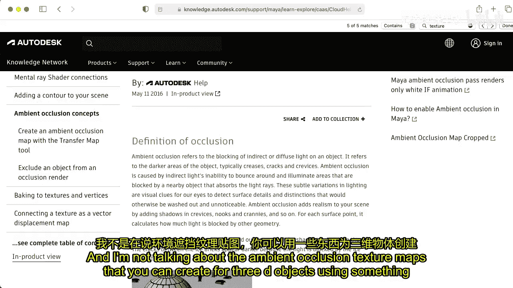
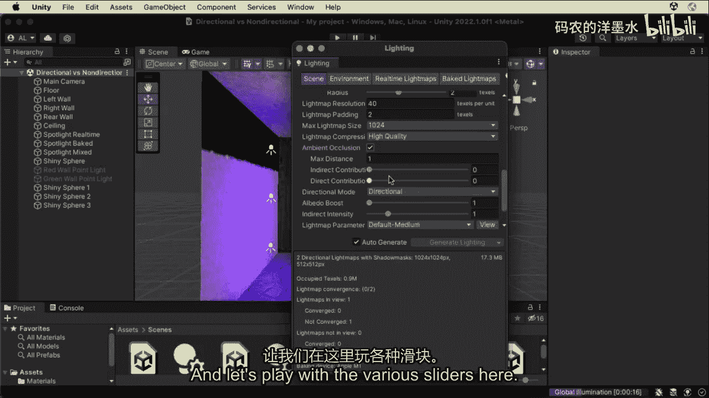
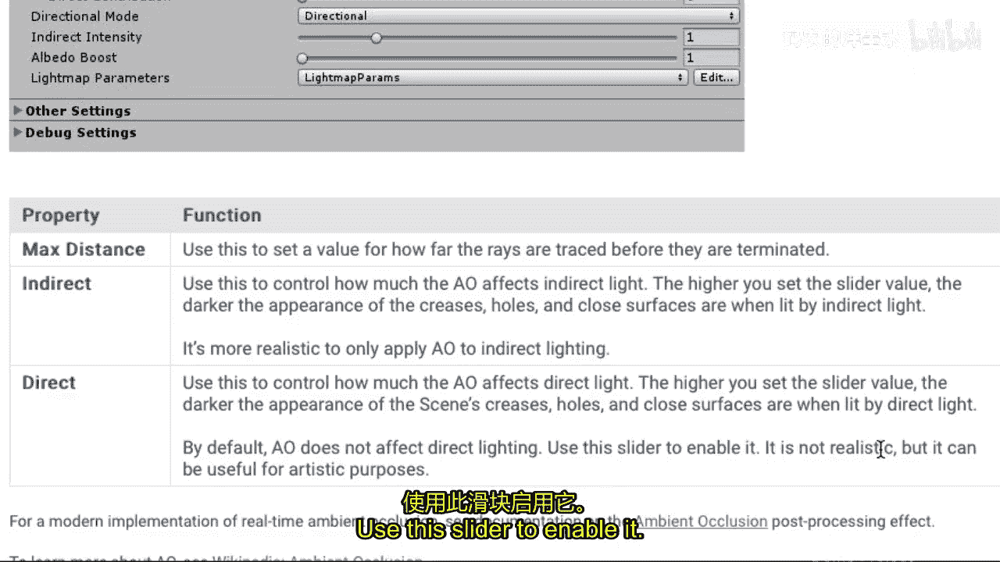
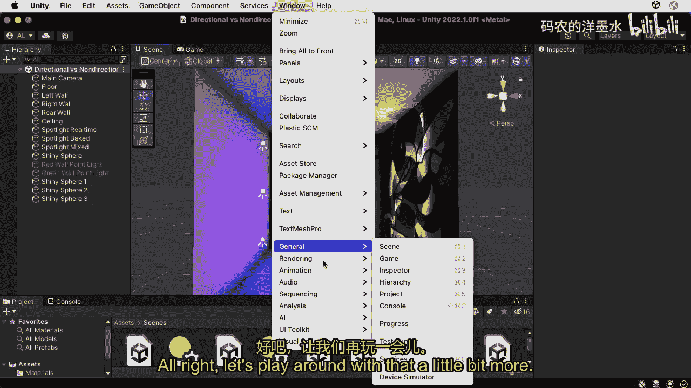
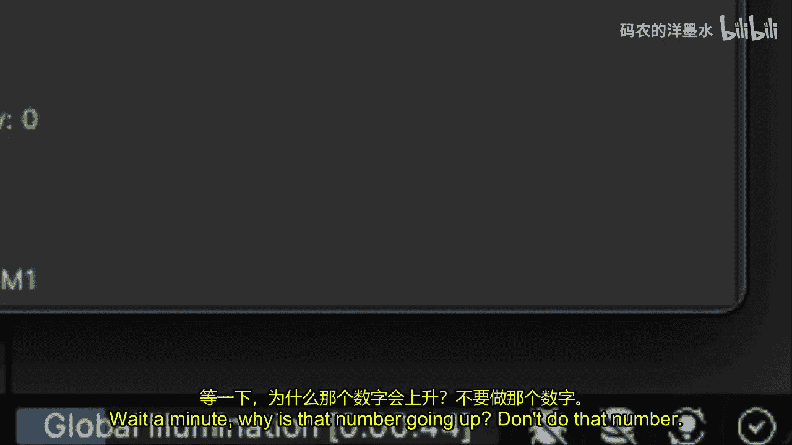
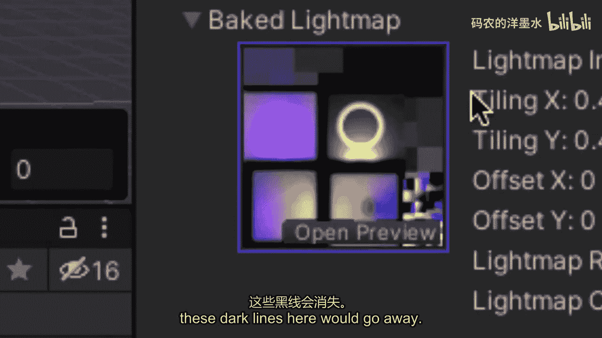

# 【全集】佐治亚理工学院-GPU编程：视频与游戏-中英字幕-p34-Lecture-34---环境遮蔽光--BV1GZfyBbEQn_p34-

Hi there。 My name is Er Lanchman。 I'm a professor of electrical and computer engineering at Georgia Tech。

 and in this lecture for GPU programming for video games， I'm going to talk about ambient occlusion。

 You have to be careful with ambient occlusion。 It's a cool effect。

 but it's one that's easy to overc。 in particular， I'm going to talk about baking ambient occlusion effects into light maps and unity。

 I'm not going to talk about any fancy realtime ambient occlusion calculations。

 I'm not going to talk about screen space ambient occlusion， which is a realtime postpro effect。

 although I'll probably hand wave about it in a future lecture。

 and I'm not talking about the ambient occlusion texture maps that you can create four 3D objects using something like Maya。

 So this is a demo scene。 you can download this from Github。 and I use this in the previous lecture。

 Here we have a realtime light on the top。 and in the middle。 we have a。😊。

Baake lightAnd down at the bottom we have a mixed light Allright so what I'm going to do is I'm going to turn on baked ambient occlusion effects and when I do so。

 I want you to pay attention to the corners of the room here and I want you to pay attention to the places where the ceiling。

 the walls and the floor meet。All right， so let's go up to window rendering lighting。We scroll down。

 down， down， down down。 here we go。 Let's turn on ambient occlusion。Scroll down。

And let's play with the various sliders here。

Let's see what the documentation says。 So in terms of our parameters， we have an indirect slider。

 use this to control how much the ambient occlusion affects indirect light。

 The higher you set the slider。 The darker the appearance of the creases。

 holes and close surfaces are when lit by indirect light。

 It's more realistic to only apply ambient occlusion to indirect lighting。

 And then we have a similar slider for the direct light。

 and it says by default ambient occlusion does not affect direct lighting。

 Use the slider to enable it。 It is not realistic， but it can be useful for artistic purposes。 Okay。

 so let's play around with this indirect contribution slider。 cink it up a little bit。

 and will need to wait for unity to think for a bit。

Hi there， this is me dropping back in after an edit for some reason the amount of time it would take to compute the estimate kept going up。

 so I turned ambient occlusion back off and then turn it back off and put this here and now it seems to work All right。

 so with a setting of 1。89， you see that you now have darkened corners and you see that the seams where the walls and the ceiling and the floor meet are now a little darker。

 the idea of ambient occlusion is that if you're thinking about the effect of this general diffusage kind of light bouncing around the scene。

If you're in a corner like this， you have less places for the light to come in from。

 you have things that could block it， so it winds up kind of artificially darkening these areas and the way it figures out how to do that is it picks a particular point in the scene and it shoots out a bunch of rays from that point and then it sees if it hits an object within some particular distance that's this max distance setting I think。

 and if it is， it assumes that oh light may be blocked coming in。

Let me click on the game view so you can see what that looks like without all of the same view Guk。

All right， let's play around with that a little bit more。

 so let's pull that lighting setting back up and let's put the direct contribution at 1。89 as well。

Actually that was 1。84， not sure that looks any different。

To really compare out need to take screenshots and put them side by side。

 let's turn the indirect contribution down and just leave the direct contribution。Wait a minute。

 why is that number going up， don't do that number。

Okay， I feel like something went off the rails， let me turn this down and let me turn that off。Okay。

 so now it's running without the ambient occlusion。Let me go ahead and let that play out。Okay。

 now let me turn ambient occlusion on and let's turn up the direct contribution。

 but without also turning up the indirect contribution and just see what that looks like。

 see now the number's going down。I have no idea why it seems to get stuck and then wants me to turn it off and then back on if anybody knows what's going on there。

 please leave a comment below。Ah， let's turn this a whole lot up。Ohpe， nope， it didn't like that。

 see it's doing that freak out again， okay， let me turn it all the way back down。No。

 it's still going up。Okay， let me turn it off。And then what I'm going to do now is I'm going to turn it back on。

And now I'm going to crank up the direct contribution question， but maybe not all the way。

See here the number is going down。Okay， actually， let me do what I probably should have done earlier。

 which is screenshot this， so this is just with direct contribution， ambient occlusion。

And see if this winds up actually being any different than when I switch ambient occlusion off。

 Allright， so let me turn ambient occlusion off。Whatever the effect here is。

 as far as the direct light， this may not be the best scene to demonstrate that， whatever it is。Yeah。

 I don't really see a difference there。 Okay， at least for this scene， I declare that uninteresting。

 All right， let's turn ambient occlusion back on。I'm going to crank down the direct contribution。

Okay， now let me take the indirect contribution and crank it way up。

AThere you see that we now have this big set of black bars here as I mentioned this is an effect that's easy to overcook remember ambient inclusion is kind of a way of faking some aspects of global illumination but it's not a real proper global illumination computation it's a hack and remember ambient inclusion really deals with diffuse lighting it doesn't really deal with specular effects one thing I want to emphasize is that the way unity handles this baking of ambient inclusion into the light maps is it bakes it into the light maps the ambient inclusion effect is not included in some sort of separate light map texture to take a look at that if I go up here and say let's look at the baked light map you can see the darkened edges here。

And you can also see it here in the light map actually with the way that the grid is shown here。

 it's actually a little easier to see over here， you can see these dark lines。

 if I were to take out the ambient occlusion effect， these dark lines here would go away。

