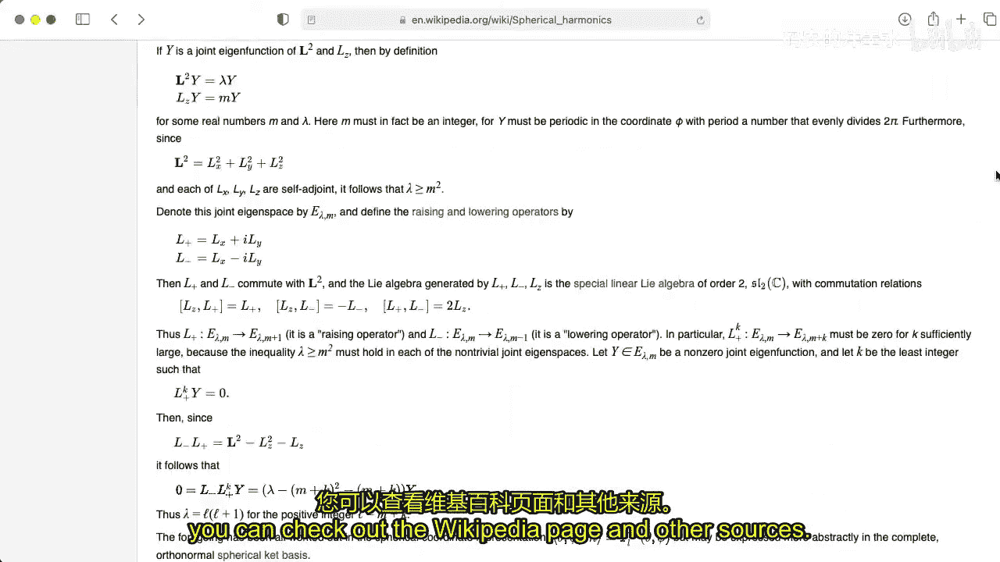
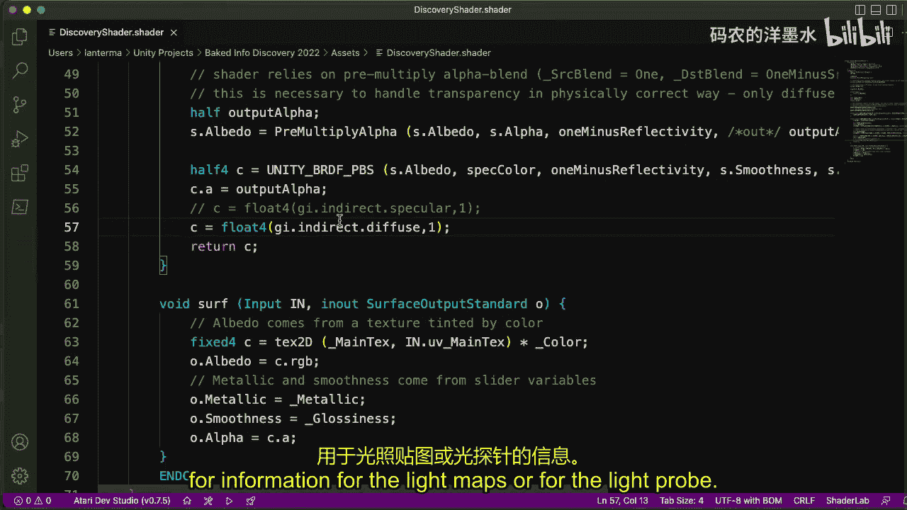
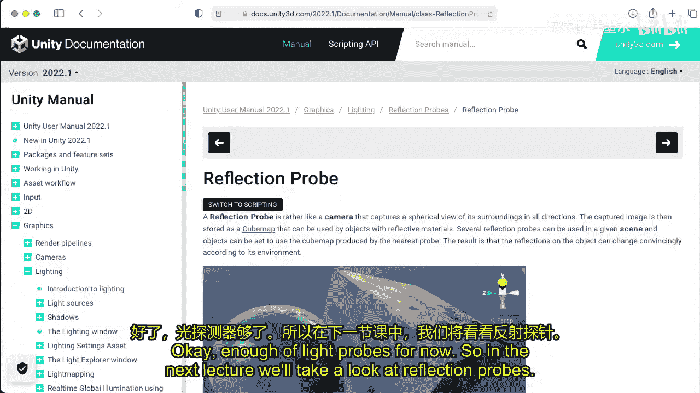

# 【全集】佐治亚理工学院-GPU编程：视频与游戏-中英字幕-p35-Lecture-35---Unity-中的光探针与球谐函数--BV1GZfyBbEQn_p35-

Hi there。 My name is Er Lanchman。 I'm a professor of electrical and computer engineering at Georgia Tech In this lecture of GPU programming for video games。

 I would like to talk about light probes and spherical harmonics In the previous three lectures。

 we looked at light maps in unity。Light maps allow us to save computation at runtime by precomput the effects of lighting and storing those into special textures。

 This also has the advantage of giving us the ability to include bounced lighting effects。

 We talked about setting lights to mixed mode， which allows us to put the effect of bounce light into the light map。

 but compute direct light in real time to be able to handle things like specular effects。

One problem with the LightMap approach is that you can only create light mapps for game objects that have been Marx static。

e。 you are guaranteeing unity that those won't move。

So this is a demo scene I created that you can download from my Github。

 It's called something like bakeked infofo discoveryy Unity package。

 Most of this is not original to me。 The main carpentry scene you see going on here。

 is a demo scene that at least in some of the earlier versions of unity。

 if not the current one could come up automatically if you asked to have a demo scene。

 When you create a built in 3D pipeline project。 Let's see up here。

 we have a spotlight that set to mixed。 And I should mention I might have said something incorrect in a previous lecture。

 It looks like it doesn't matter whether the light is set to static or not in terms of whether it bakes things。

 It's the objects that it's casting light onto。 it matters whether that is set to static or not。

 All right， And then I have a light over here。 That's red。 It's a spotlight。 and very importantly。

 it is baked， so。The wall over here is marked too static。 Actually， that's kind of complicated。

 Let's see what's marked to static。 I need to move this over for you to see it。Okay。

 there's a bunch of stuff here。 How about let's just to make it really clear。

 let's just click static。 So now it's static， everything。 All right， anyway。

 the wall is marked to static。 So there's light maps being created for it。Now。

 the capsule here is also marked as static。 So it's also part of the light maps being made。

 So you get some red light here。 and also notice that the capsule makes the shadow。 Well。

 it's hard to see because I have these things in the way。

 These little spheres here are called reflection probes。

 And they're actually the topic of a future lecture。 So let me get rid of those for now。

 And we'll talk about those later。 All right。So the capsule here does cast a shadow。

 and you'll see when I move it， you'll see that it recalculates this light map here。

Now let me take the capsule here and turn off the static setting。Now。

 it's not casting a shadow any more because the unity light Maper can't rely on its location stain still。

 so it doesn't know where to put the shadow。 It can't leave it in the computation。

 But here's something interesting。Notice that。 It's shaded red。It is receiving light from this light。

 even though it's baked， so what sorcery is this？This is the sorcery of light probes。

Let me move the capsule out of the way for a second and I'm going to click on something we haven't seen before in this scene we have a light probe group。

If you don't have a light probe group in your scene already。

 you can create one by going up here to the plus menu here， go where it says light。

 and then you can say light probe group， and then that will make one。

Now to actually see the light probes， we need to go up here to the gizmotheummahoit。And scroll down。

 down down， let's see。Here we go， Light probe group。

 So let me click on that to show the light probe group。 All right， So what are these light probes。

 Well， to edit the light probes， you might want to click on one。

 but that doesn't work because I forgot you need to go over here and click on edit light probes。

 So with this showing here， I can take one of the light probes， Select it and start moving it around。

Let me turn off show wire frame for a moment。What does remove ringing do I'm not sure I'll have to look that up later anyway。

 each of these light probes and if you wanted we could add light probes。

 let's add some more light probes here， we can put one here。We can take this one here。

 We can put one over here。 Let's add another one just for fun。 Yeah， and let's put it way over here。

That's probably a bad idea， but whatever， all right， and you can also select some light probes。

You can delete them， you can duplicate one and then make another light probe and move it over and there's a fine art to deciding where you want to put your light probes these are the light probes well before I started messing with them that came with that demo scene so here's the idea。

When Unity is running that baked light calculation and it's computing all the bounce light and it's computing light maps for static objects in the scene。

It also takes a look at each of these light probes and just generally asks。Broadly speaking。

 what kind of light is coming to this point shining through it from various different directions。

 and it tries to store a summary of what that light profile at that particular point looks like。

So when you have a dynamic object at some point in the scene。

 Unity will try to look at the light probes nearest it and interpolate that representation of sort of the overall global light structure going through these different points to come up with an average associated with wherever the object is actually at and light that object using that information。

Of course， it will also use whatever other lights you have in the scene， real time lights， et cea。

 et cea。Now that lighting like with the light map just contains diffuse light information。

 this is very broadly what's bouncing around in the scene if you want precise specular reflections of details in the scene for that you really need a reflection map which we'll talk about on another occasion。

If I click show wirereframe。It'll sort of show how Unity will decide to choose what light probes to average together。

Okay， let me turn off that editing mode。 Let me grab my object here again and kind of move it around the scene。

 So because I have show light probes turned on in the gizmos。

 you'll see that as I move the object here around。You'll see that there's these little balls that appear in the scene。

 and they appear and disappear as I'm moving in around that shows you which light probes are contributing to that particular lighting calculation at that particular point。

 so as I move it around， it's selecting from different light probes to interpolate that information between。

Notice it is also putting a little sphere in the middle that's representing sort of that composite light probe。

 Let me see if I can take the me renderer for that and turn it off。 there we go。Now， let's see。

 let me also turn off the capsule collider。I can't make it disappear entirely。

 let me try to zoom in a little bit here。Oh， come back here。Oh， there we go。 All right。

 So now as I move it around， you'll see these aren't just yellow spheres。

The spheres themselves look like lit structures， so here it's showing you a representation about what the light flowing through that bit of space is from that bake light calculation。

 and then the sphere here in the middle is showing you the result of all of that interpolated light information that's then used to render the actual object。

So let me turn off the gizmos for that， let's see where is that that's the light probe group。

 let me turn that off now we just see the object。One thing to note is that being lit by the light probes here。

 you have this very broad red color on the left hand side。 Now。

 if I were to switch this back to static， and it winds up baking it。

 You'll see that there's a much more distinct pattern from the spotlight。

 The main thing to remember about light probes is they're not very precise。

 Light probes aren't early capturing that level of detail we got from the baked light map。All right。

 let me show you something else cool in this demo。 Let me switch the material to have a different shader。

Right now we have the standard shader associated with the built in pipeline。

 Let me go to custom and let me go to Discovery shader。

 What the shader does is it shows you the raw light probe result over the surface without any other lighting information included。

So I can squoosh it out this way， squishsh it this way。Scosh， squ， squoosh。Scrush it this way。

 Scsh it this way。Okay， that's enough squooshing。Okay。

 now let's take this light here and switch it from baked to mixed。So now。

 if I were to take a look at the light probe kind of information。

 you don't see that red on the left here anymore more。 You see a little bit of red on the right。

 because remember in mixed mode。 Both the light map and now also the light probe are only containing information about bounce light。

 It relies on real time computations to handle direct light。

 So the only thing that's stored in here now is the light that's bouncing off of the wall here。Now。

 if I were to take this object and switch it back to using the standard shader。

Of course now I do see some red on the left， but that red isn't from the light probe information anymore。

 it's from a direct light computation that's happening in real time and you may have a little bit of red here on the right that's part of the bounce light。

To emphasizephasize that again， let me switch this back to the discovery shader and let me switch this light back from mixed to bait。

So now you'll see that it has that red light in here on the left。

The direct light is now part of the information in the light probe。

So how does an individual light probe store the lighting information about the light flowing through a particular point。

 If we take a look at the documentation here， it says light probes individually do not store a large amount of information From a technical perspective。

 each probe is a spherical， panoramic HDR image of the view from the sample point encoded using spherical harmonics L2。

 which is stored as floating point values。So now let's take a look at spherical harmonics。

 If you're in electrical engineering， you're probably already familiar with the idea of Fourier series spherical harmonics are kind of like FourE series。

 but while Fourier series let you represent functions on compact intervals。

Spherical harmonics are designed to represent functions whose domain is the sphere。

And spherical harmonics are very useful for representing in a broad sense how light coming in from different directions varies spherical harmonics aren't very good at precision for precise mappings of light coming into a scene you really need something like a cube map。

So for the purposes of this class I've decided not to get too much into the nitty gritty mathematical details of spherical harmonics if you're interested in that kind of thing you can check out the Wikipedia page and other sources。

 the main thing I want to point you to here is this visualization of the spherical harmonics。

So here we have level zero， level1， level2， and level three。Remember。

 the unity documentation said it only included the first two levels， so we'll have1，2，3，4，5，6，7，8。

9 coefficients， where the blue portions represent regions where the function is positive and yellow portions represent where it is negative。

 but remember we have more than9 because we need to have a separate set for each of the red。

 green and blue color channels， so we actually have 27 spherical harmonic coefficients in total to represent the light information at a particular light probe。

In case you do download this Unity package and play with it。

 I should talk a little bit about my discovery Shar。Don't worry about the details here。

 This has a whole bunch of material in it that I have not covered so far。

 and how much of this I do cover， I'm not entirely sure yet。 But in any case。

 the main thing I want to point out is just these two lines here， most of this is boiler platelate。

 So if you have this line commented in the C equals float 4 G dot indirect do dius comma1。

 This gives us the information for light maps in spherical harmonics。

If I were to comment that out and comment in this line instead where it's indirect do specular。

 that's for visualizing the effect of reflection probes， which I'll talk about next time。

So for what we're doing here you want to have this line don't worry about the rest of the code Basically this G do indirect stuff has been filled in by previous commands and a whole bunch of other code that unity wrote。

 in this case， for information for the light maps or for the light probe。

Now I'm left wondering about this Remove ringing checkbox。

The term ringing makes me think this is referring to some kind of Gibbs phenomena。

 My electrical engineering students will know what I'm talking about there。

 If you're one of my C S or computer engineering students， don't worry about it。

 But I do want to look this up。 Let's take a look。 All right， let's see。 What does the dock say。

 Let's scroll down。 we have remove ringing。 when this property is enabled unity automatically removes light probe ringing from the scene。

 Great， for more information， See ringing。 Okay， let's see ringing later in this section。

 under certain circumstances， light probes exhibit an unwanted behavior called ringing。

 This often happens when there are significant differences in light surrounding a light probe。

 For example， if you have bright light on one side of light probe and no light on the other side。

 the light intensity can overshoot on the backside。

 This overshoot causes a light spot on the backside。😊，There are several ways to deal with this。

 and the light probe group component enable remove rigging Unity automatically removes the unintended light spots。

 However， this generally makes the light probes less accurate and reduces light contrast。

 so you must check the visual results。 Place and game obstacles in such a way that players can't get to a position where they can see the light spot。

Avoid baking direct light into light probes。 Direct light tends to have sharp discontinuities such as shadow edges。

 which makes it unsuitable for light probes to only bake indirect light usemic lightinging ah。

 check this out。Dr lighting tends to have sharp discontinuities。 So yeah。

 that ringing is referring to some kind of gibbs phenomena that refers to overshoot you get in a Fourier representation when you're trying to reconstruct discontinuities。

The last thing I want to try here is just for fun。 Let's click on the dry wall over here and switch this from the standard shader to the。

Oh， let's see。 There's actually two materials here。A little confused by that okay， anyway。

 it looks like it consists of two materials， let me set both of them to be this discovery shader。Oh。

 I guess that's the top part of the wall。And let's change this here to also be the discovery shader。

啊。So now this is showing the light map。So that's what's in the GI do indirect dot diffuse。

 so for dynamic objects we're getting the result of spherical harmonics， the light probes。

 and for a static object， it's giving us the light map。Okay， enough of light probes for now。

 so in the next lecture we'll take a look at reflection probes。

