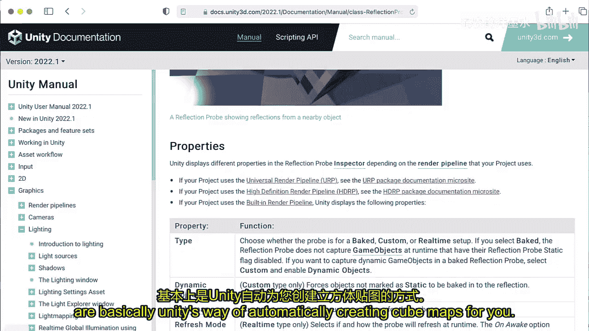
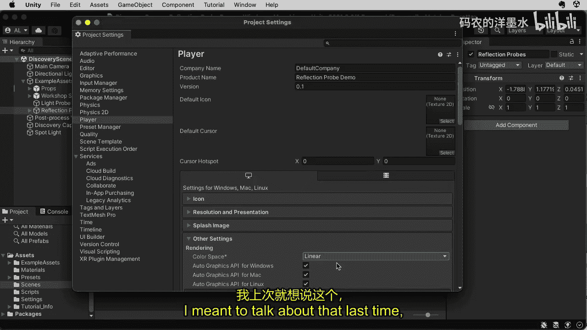
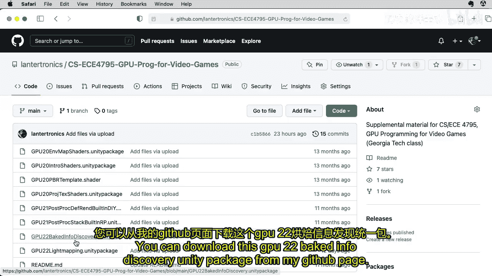
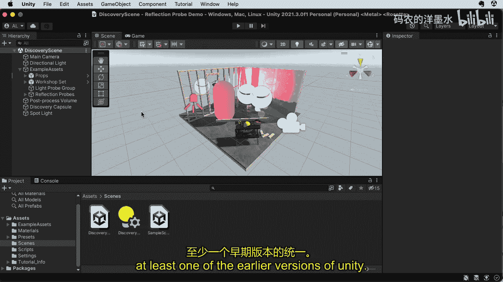
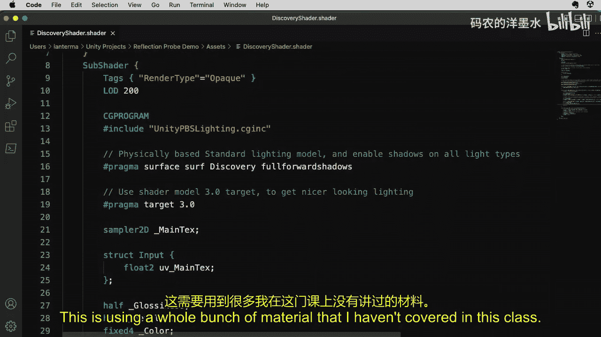
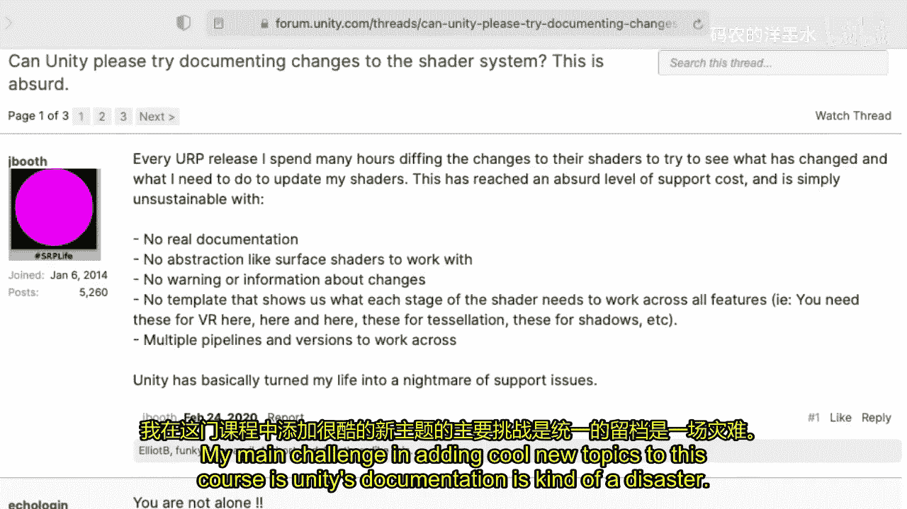
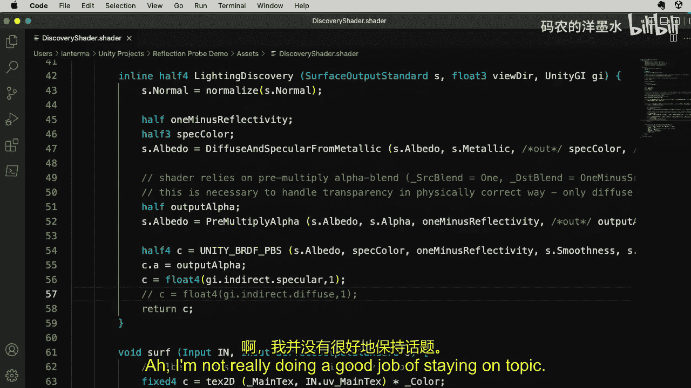
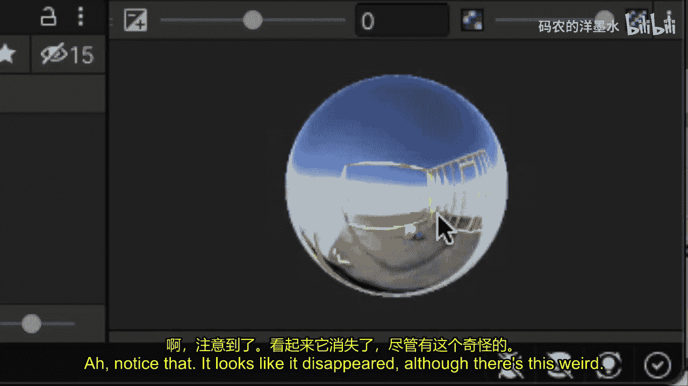
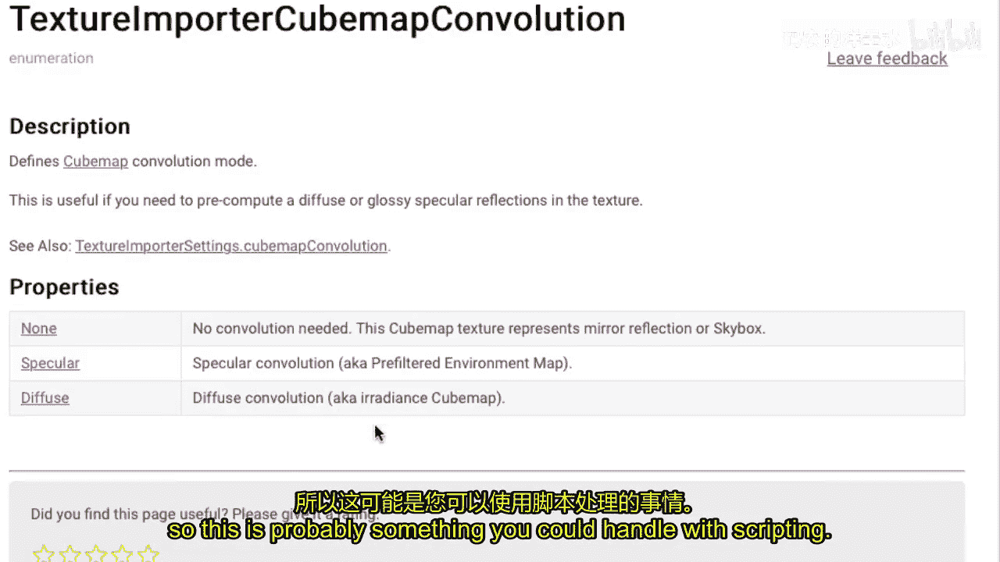

# 【全集】佐治亚理工学院-GPU编程：视频与游戏-中英字幕-p36-Lecture-36---Unity-中的反射探针--BV1GZfyBbEQn_p36-

Hi there， my name is Er Lanchman， I'm a professor of electrical and computer engineering at Georgia Tech and in the last lecture of GPU programming for video games we took a look at light probes。

 light probes were a way to encapsulate baked light information for a scene including bounce light using spherical harmonics。

 in a way that could be applied to dynamic objects。

 unlike static objects that could use more precise light maps。

Both light maps and light probes can only deal with diffuse style lighting effects。

 they can't handle specular lighting effects that depend on camera position。

 and this lecture will take a look at reflection probes that are useful for specular reflections and are basically unity's way of automatically creating Q maps for you。

So this is the demo scene I use to talk about light probes， which we looked at in the last lecture。

 and today we're going to talk about reflection probes。

Now I want to remind you that you should always go to project settings。

 go to Play and make sure that the color space is set to linear I meant to talk about that last time。

 but I forgot。

You can download this GPU 22 bakeked Info Discover Unity package from my GitHub page。

The main construction scene you see here isn't original to me。

 This is a demo that you could select to have appear when creating a 3D scene。

 in at least one of the earlier versions of unity。 I do have a skybox here。

 This is something I remove for the light probe demo because I thought it made things clearer there。

 But in the various things I'm about to show you the resulting cubebox look weird if you don't have a skybox。

 So I'm putting in the skybox。 Notice that the skybox in this particular scene is not a skybox applied by a skybox component。

 This particular sky box is set in the rendering lighting dial box。 Let's click on environment。

 Skybox material。 So to get rid of the skybox。 What I did as I I put none here。

 but I don't want to get rid of the skybox this time。

 So I'll put the skybox back The skybox material that came with the scene。 Let's see。

 This is a procedurally。

Oh， look at all the stuff you could do here。 Let me change the size of the sun。

I guess I can change how thick the atmosphere is， oh， that's kind of fun。Okay。

 let me not get distracted。 Okay， so in this scene， I have one light here that is a baked light。

 that's a red spotlight。 I have another light up here。

 that's the mixed directional light and then I have the skybox and then here I have these three reflection probes So we'll talk about what those are in a second and this is a little object I created to try to visualize what was happening with the reflection probes。

 And the last lecture I used it to discuss light probes that you can see here。

 let me go up to gizmos and turn off the visualization of the light probes。 All right， there we go。

Alright， now this is currently showing the kind of lighting information that the diffuse light probes are providing for it。

 that's not what I want to look at。 so I want to take a look at the discovery shader code that's my visualization code for these demos edit it and what I'm going to do is I'm going to comment out the line that says Gi do indirect diffuse this is for global illumination so I get rid of that and I'm commenting in the line that says Gi do indirect do specular so that's going to get the information from these new reflection probes instead of the light probes now for the purposes of what we need to do in this lecture don't worry about what the rest of this code is doing。

 this is using a whole bunch of material that I haven't covered in this class and at this point I'm not actually sure I want to cover it because it involves surface shader technology which is。

of doing things in the built in pipeline that unity is supposed to come out with a replacement with at some point。

 So I've been kind of waiting for unity to get on the ball on that。

 So I would cover this new cool thing instead of the old thing。 I don't know。

 I may change my mind on that。 My main challenge in adding cool new topics to this course is unity's documentation is kind of a disaster。

I'm not really doing a good job of staying on topic。 I guess in that way。

 this is a pretty good emulation of what my live lectures are like。 Anyway。

 Now this capsule is illustrating the information it's getting from the reflection probes。

 I have three reflection probes in the scene。

Basically， the reflection probes are cube maps that unity generates for you automatically。

 so I can manipulate this here and try to visualize it on this sphere。

And the idea here is if I set this debate baked， essentially， whenever I move something in the scene。

 For instance， let me take this wall and move it over。Then it will recreate this cube map。

So let me take this wall here。And move it over this way。Now if I click here。

 you should see this change now。Okay， so it's recomputing， and it's recomputing。啊。

There you see the change。Let me put all of those things back with my powerful control Z。

Let's see what happens if I take that wall and set it so that it's not static any more。 O B， S panel。

 Let's set that to nothing。All right， now if we looked on here。

Notice that it looks like it disappeared， although there's this weird。

Kind of edge here。 Is that the stud frame， There we go。 So that still marks static。

 So this frame here is included in the reflection probe。So let me mark it static again。

Both of these things， and then we'll go back and watch it recompute。

So the wall should come back once they marked it static， so since this is set to baked。

 it can only include things that are static in the scene because those are the only things it can rely on all of the various dynamic objects are going to move so those won't be included。

I put another reflection probe out here， and for the reflection probe over here。

 I actually did something a little weird。 instead of having it set to baked， I had it set to custom。

 and I actually selected this Basilica cube map that I used in a previous lecture introducing the idea of Q maps。

So now we can use information from the Q maps in these reflection probes in order to handle specular reflections。

 This is in addition to whatever specular lighting you're doing using point lights and spotlights or whatever。

 Now， for each of these reflection probes here， you notice when I click on them， there's a box。

 So over here， this one has a box that's essentially on this side of the wall skeleton over here。

 The one in the middle has a pretty big box that's covering the whole scene。

 The basilica one is a little bit further out， but it's another box。 And notice the overlap in here。

So what happens is as I move this around， you'll see that it cross fadedes between the various maps。

So notice that on the left here， you see the reflection of the wood studs associated with this wall。

But when I go over to the other side， now you see the reflections of the studs on the other side because we've switched to using this Q map instead of this Q map。

And once I push this further out， you'll notice the studs will suddenly disappear because I'm outside the range of this cu map and now it's just using the skybox。

But if I start sliding at the other direction。Well see that we had this overlapping region associated with the original cube map here in the middle and the basilica。

 So watch this as I slide it to the right。 You notice that the basilica starts to fade in。

And the Q map associated with the carpentry scene starts to fade out。

There is a whole bunch of settings that you can select to change the size of the box and that controls the way the cross fading works。

 I'm not going to worry about the details of that here。

In terms of how unity actually creates the cube maps， you can select a bunch of settings here。

 notice that the cube maps tend not to be super high resolution here it's 128。 Again。

 you're just generally getting some overall feel of cool specular lighting effects。

 your player hopefully is not looking at this in a huge amount of detail and you do have the option of selecting a realtime mode in which case。

 while the game's running， it will create all of these little snapshots for you。

 That is hugely computationally intensive So one thing you can do is instead of taking all six faces of the cube at once。

 you can round ro in it where it will go through one face and then on the next frame it will do another face and so on。

 and hopefully the player won't notice anything odd going on but again， this is a very computation。

Expen thing to do， but if you want your reflections to include objects that are dynamic and moving around in the scene。

 that is something you might want to try and actually I should say what I just described is probably a thing that happens when you select every frame。

Let's see。 you can also have some scripting control over this。

 I haven't really gotten into this in detail myself。 Anyway， I'm going to put it back to baked。

Hi there。 This is future Erin popping in at the editing stage。

 It's a little bit more complicated than what I said。 So if I read under time slicing， it says here。

 the options are all faces at once spreads update over 9 frames。

  individual faces Upates over 14 frames， and no time slicing。

 the update happens entirely within one frame， So there you go。

How exactly it spreads the update over nine frames or over 14 frames， I'm not exactly sure。

So in a previous lecture where I talked about the Cook torrent specular model。

 I talked about parameters like smoothness and roughness。

If I look at any of these Q maps down here in the inspector。

 you'll see that there's a slider where I can slide this to the left， and you'll see MIP 1， MIP2。

 MIP3， and so on， and notice as I'm pushing the slider to the left。

 I get a blurrier and blurrier version of the Q map。

You can see the same thing here for the basilica you get a blurriier version。

The idea of this is that you want to be able to indicate the way the roughness of the surface blurs out the specular reflection。

 so you have these pre-blurred versions of the cube mapap for that and then you can linearly interpolate or I guess if you're also interpoolating across the Q mapap itself and then interpoolating between different cube maps that's trilinear interpolation anyway。

 that gives you the ability to encapsulate the roughness of the surface into the way this thing looks。

 so if I click on my cylinder here and zoom in。And scroll down a little bit。

 you'll see in the discovery shader。The metallic doesn't do anything here because I'm not using that parameter。

 but there is a smoothness parameter where when I start to crank it down。

 you'll see that it gets blurriier and blurriier。So this is like a perfect mirror reflection and this is a rougher mirror So if I move over here where the basilica is in effect。

 let me soosh over here， soosh gooosh soosh。Need more sishing， Ssh。 soosh too far。 All right。

 so let me play the same game。 I'm going to start taking the smoothness and start drinkinging that down。

 and you can see it blurring。And the idea is you might have a smoothness map。

 So some parts of the surface would look blurriier than others。

That blurring uses a bunch of complicated math called Specular convolution。

 which I won't get into here。This overall technique falls in the realm of what's called image based lighting。

 Anyway， let me click on this for a second and take off the discovery shader because remember the discovery shader is showing me the raw Q map information projected onto the surface basically。

 and what I want to do is actually put it back on the standard shader to see how it sort of actually responds in a lighting scenario。

Whoops， not the nature terrain， that's not what I want。I went standard standard。All right， let's see。

 so let's take a look here， let me crank up the metallic。So。By cranking up the metallic。

 I'll get pure specular reflections。 And now if I crank the smoothness here。

 you'll see that not only am I getting that blurred cu map。

 but I'm getting a spot here from the spotlight that's up here。There we go。

 and now if I move it in this direction。Let's see。I don't wind up with any red light here because this is marked。

 not static。 It's dynamic， so it doesn't know how to handle the red light here。 Just for fun。

 let me take this and switch it to mixed mode。So at least I'll now get。A red spot。 there we go。

 So here's a little red spot from that light。And I can take the smoothness here and play with that again。

 Not if I。Cank down the smoothness。 I get very tight。

 bright spots here associated with the red light and the spotlight。

 But as I take the smoothness and lower it and make it rougher， those spots become dimmer。

 but they spread out。In addition to the cube map in the scene being blurred。

So that's what it looks like with more lights in play。Now， in general。

 as an alternative to the light probes that we looked at in the previous lecture。

 let me actually pull those back up for a second to talk about light probes instead of having this big light probe set where you're using spherical harmonics。

 You could use cu maps for diffuse light。 That's a variation of image based lighting that to my knowledge is not really built into unity。

 but you could probably hack it if you wanted。This texture importmer QMap convolution page does list a diffuse convolution option。

 so this is probably something you could handle with scripting。

