# 【全集】佐治亚理工学院-GPU编程：视频与游戏-中英字幕-p37-Lecture-37---Unity-的标准着色器--BV1GZfyBbEQn_p37-

Hi there My name' is Er Lancherman， I'm a professor of electricallect and computer engineering at Georgia Tech in previous lectures in GPU programming for video games we've mostly looked at custom shaders that I wrote to illustrate some concept and these shaders weren't very flexible for instance they would require you to use just a single point light or just a single directional light and if you use the wrong light type then your object would disappear and then my students would get frustrated so in this lecture we're going to look at unity's standard shader this is something that I've referred to or used on occasion but we haven't really looked at in detail here I want to just give a general summary of what it can do and then in the next couple of lectures we'll actually look at the source code that creates this fancy shader。

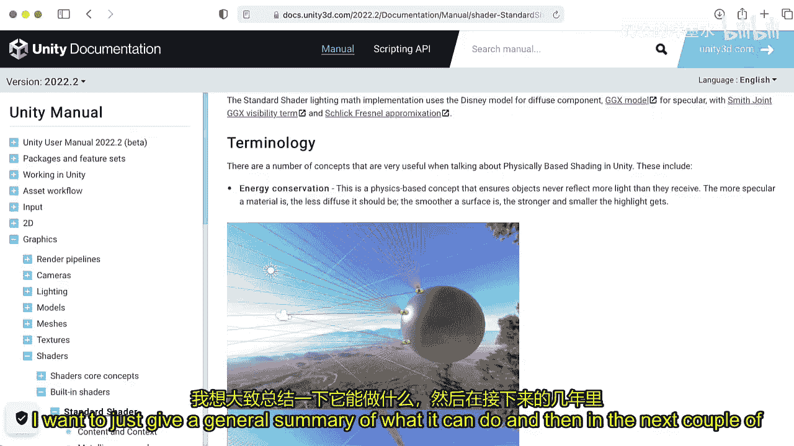

I've started a blank 3D builtin rendering pipeline project and as usual we want to go to the project settings。

 I already set this to linear， it usually comes up with gamma， you have to set it to linear。

 I'm going to keep emphasizing that because people often forget to do that。

So let's go to the Unity asset store。

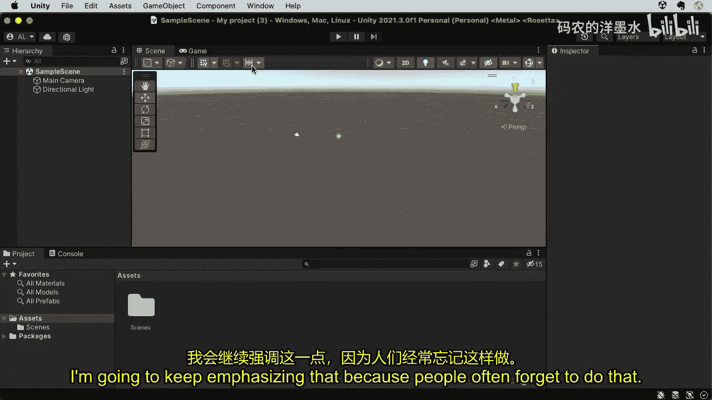

And let's look for a zombie。

Stylized zombie， No， I want free zombies， so let's crank this slider here all the way down。Ah。

 there we go，ooh， that's a pretty scary looking zombie。

So this could be for your zombie survival game， something like that。

 the world has been taken over by zombies， all right。

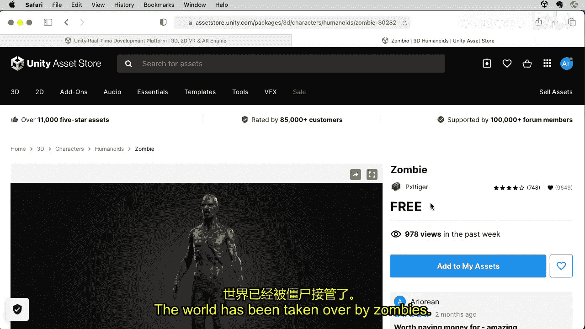

So the reason I want to use this particular model is if we look at the package content and look at the textures。

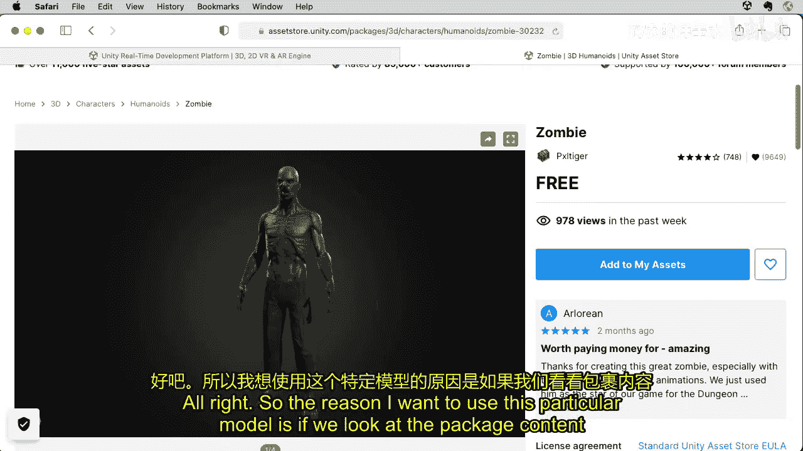

This is pretty much batteries included， so I have a diffuse texture， an ambient occlusion map。

 that's something we haven't really talked about very much。Here there's an emissive texture。

 I guess that's for the eyes maybe to the eyes glow or something。

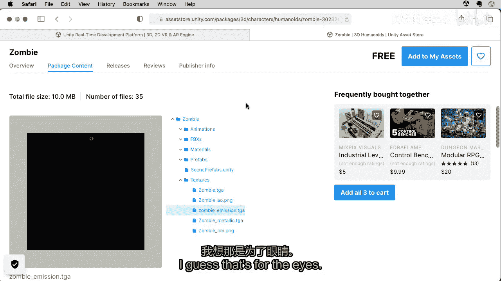

I don't really know， okay， maybe it's the eyes that glow。

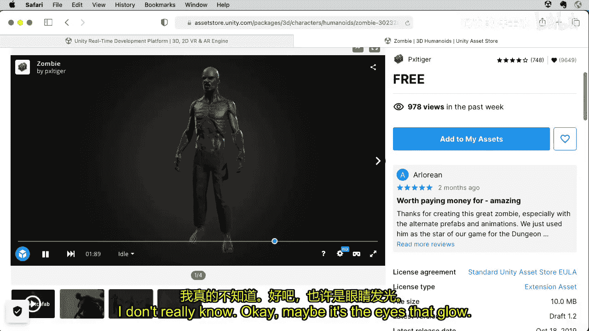

There's a metallic map which doesn't seem to be doing anything。

 but maybe that's just in terms of what's showing here。

 we'll check that out in more detail in a bit and there's a nice normal map。

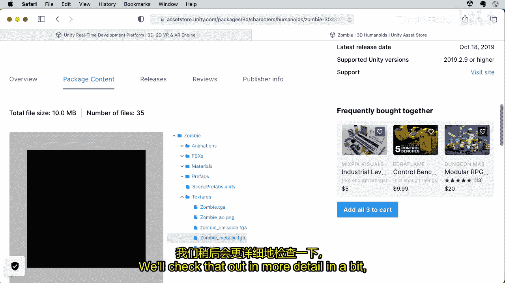

Okay， let's add to my assets， yes， except。

Open in unity。

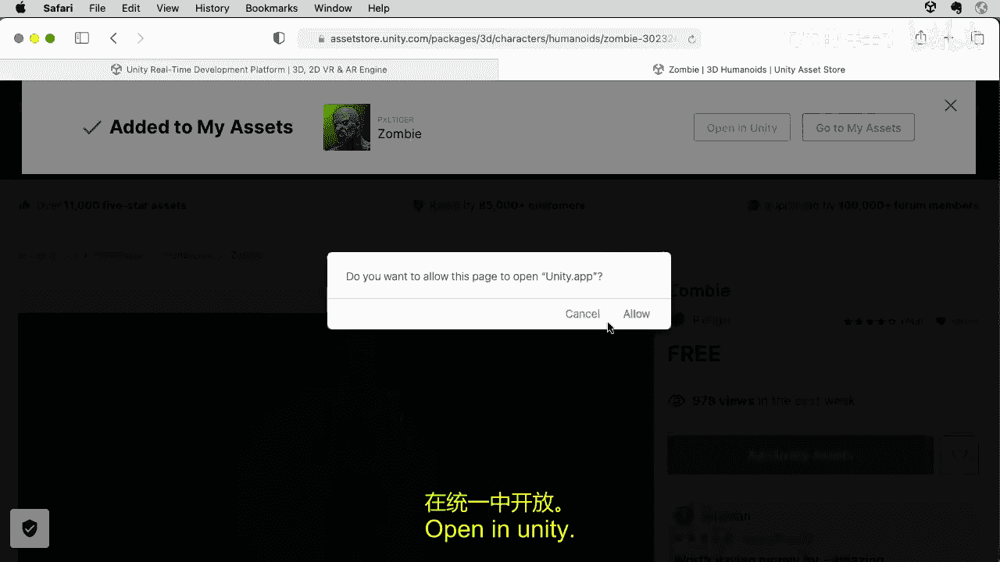

Okay， so let's go to the package manager and we should be able to find our zombie。My assets。

Ftching assets， zombie。Ah， there's a bunch of zombies here。Oh。

 I think these zombies are from some other download I did at some point。

 I think this is the zombie that I want。Import。Import。

And that's some other zombie that I don't want now。Let's take a look in the scene folder。

 there's nothing new in the scene folder， let's take a look in the zombie folder。Let's see。

There is a scene with a bunch of zombies。 Okay， that's great。 Let's see。

 And what did they put in the scene， There's the camera。

There's a bunch of light probes that's kind of nice。

 And then here we have the reflection probe and now we have a directional light。

 you see it's casting some shadows from that light。And here I've got a bunch of zombies。

 are these all the same？What happens when I play this scene are these zombies animated？Oh， yeah。Okay。

So the zombies are coming for you， now they're running， now they're falling over。

If I look in the prefAabbs folder and in the FBX folder， there are three different zombie models。

 so there are probably some differences between these I'm guessing。Can't really tell what they are。

 but anyway， let's take a look at one of these in some detail。

 Let's click on this zombie dude over here。

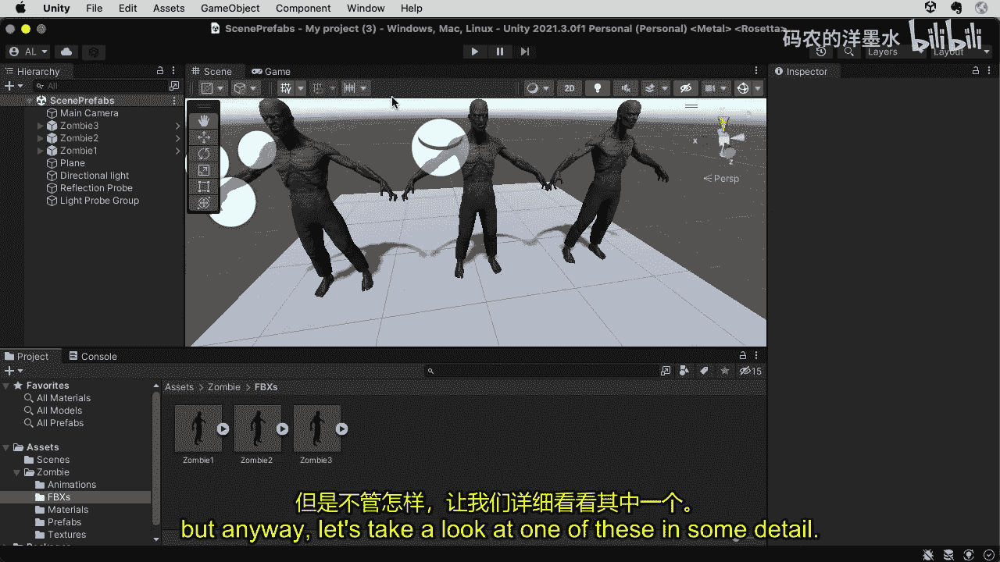

And expand it out。 And let's see。 we have a whole bunch of various body parts here。

 And if I scroll down here， I'll see that they all use the zombie material。

 which uses the standard shader。 Oh， notice when I click on something。

 It's putting this little ball here to show me which light probes are contributing。

 let me go up to here and select the gizmos and turn off the light probe group gizmo。 All right。

 so now I can click on the various zombie aspects without having that sphere here for the light probes。

 And since it looks like everything uses the same material， I can pick pretty much anything here。

 adjust the material here。 and then it will change it for the rest of the zombie。

So let's play around with this a little bit。 Let's first focus on the eyes。

 My theory is that the eyes are glowing。 So， so if I were to actually take the light source here and turn it hoth。

Ah there we see the eyes glowing here， let me also turn off the skybox。

 I don't want to have any lighting from the sky box confusing things right now。

Let me also shut off the reflection probe to get rid of any speckular lighting from the reflection probe。

 Let me also turn off the light probe group。 Actually， does that stay permanent。

 Do I need to rebake something in order for that to work。Let's see。

 What if I were to take the main directional light an hour were to switch it to real time so that nothing's baked。

 All right。 So why am I still seeing some zombie here。

Does the amissive map have something in it that I don't know about？Let's see。No。

 I just see something that looks like an eyeball there。And just as a brief sanity check。

 let me take that emissive map and set it to none。Oh， that was very interesting。

So the emmissive color should naturally， I guess， be black。But now it's turning white。

That was a very odd default for it to have。Okay， why am I still seeing zombie if I've turned off all the lights。

 Let me take another look at the lighting dialo box here， environment。

Is there another color I need to get rid of， like even though I've taken out the skybox。

 is there an ambient color that's being included in here？If so， let's turn that all the way down。Oh。

 there is。It's not sufficient just to get rid of the skybox material。

 there's another color you need to get rid of that's part of the ambient lighting in the scene。

I did not know that。 That's good to know。 All right， so with that in mind。

 we now have no lights in the scene。 Very exciting。 Now， let's go back to our zombie。

 Let's pick part of the zombie and let's put that creepy eyeball。 amissive color back in。

 So that's this one here。 there we go。 Look， creepy eyes， creepy eyes。 All right。

 that was educational。😊，Now， I bet if I turn on the reflection probe， this will turn a little bluish。

 I'm right。 It's hard to see， but you can see a little blue outline here because I killed off the sky box。

 Unity has a default to use sort of a background of blue。 Let's see。

 I just turned the color for the background for the main camera to black。 Oh， you know what。

 The reflection probe has its own cameras that it uses to create the scene。 Here we go。

 I need to turn this down。All right， there we go。Now I have everything the way I want so the reason I just spent an absurd amount of time on all of that is I want to be super explicit about what light sources are doing what so I wanted to just kind of get rid of everything So now the only thing we have here is the emmissive texture of the eyeballs。

Okay， so now let's start adding interesting things。 What I'm going to do first of all。

 is I'm going to go turn that main directional light back on alright。

 so now we actually have some light on the subject and now let's play around with the textures So the first thing I want to do here is play around with the normal map so if I were to take the normal map setting here and set it to zero。

 notice it now looks a lot smoother but as I start increasing the numbers here。

The map has more and more of an effect， I can increase this past one。

And start doing really crazy things。Here I'm essentially breaking everything drastically。

 so that can be kind of fun though， for some special effect。Now to illustrate that again。

 let me take the albedo here and set that to none， so here you just really see the effect of that normal map。

 so there it's perfectly smooth。Et cetera， et cetera， et cetera。Now。

 if I were to look at the zombie metallic smoothness map， it doesn't look like there's anything here。

But that's only displaying the red， green blue image。

 there's also an alpha component that I can look at here in the inspector down here。

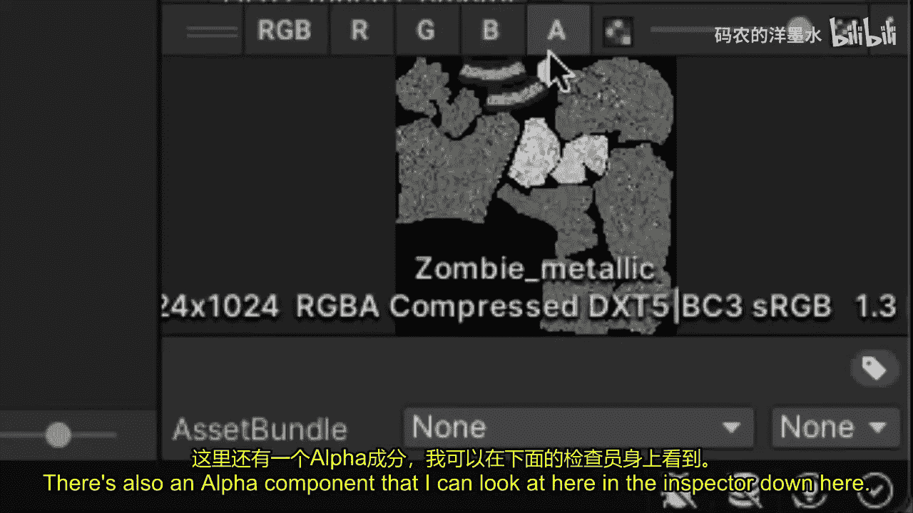

So the standard shader that doesn't have the word specular in parentheses after it is referred to as the metallic mode of the specular shader and in that case you can provide a metallic parameter using a texture or with a slider and then there's a separate smoothness provided with a texture or the slider and basically the metallic parameter indicates whether it's a dielectric。

 so it's zero or if it's metal and it's one remember that dielectric materials have diffuse and specular aspects whereas metallic materials just have specular aspects So if you want to know about how to handle textures with it。

 let me look up the word alpha here we go So there's a texture usually called metallic specular and let's see instead the metallic levels for the material are controlled by the values in the red channel of the texture。

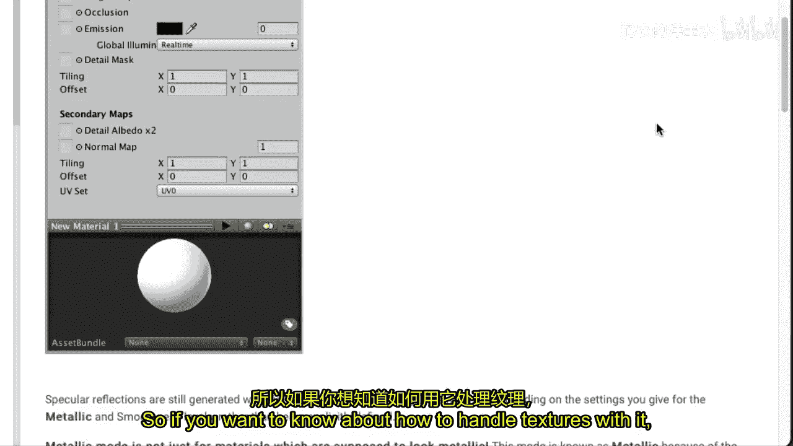

And the smoothness levels for the material are controlled by the alpha channel of the texture。

 and the green and blue channels are ignored。 So if we take a look at this particular texture。

 there's nothing here。 So there's no metallic aspect to the zombie。

 which is actually kind of disappointing。 I was hoping to be able to demonstrate metals。

 But the zombie is cool， So let's keep going。 All right， so the alpha。

 this is the smoothness parameter， Now， what do these brighter regions correspond to。

 what is it consider smooth。 Well， to get a sense of that， let's go over and look at the albedo map。

AhThere we go。So there's the head。Are these eyelashes。 What are those， Okay， that was the eye。

 So maybe these are the eyelashes。So the eyelashes are smooth。

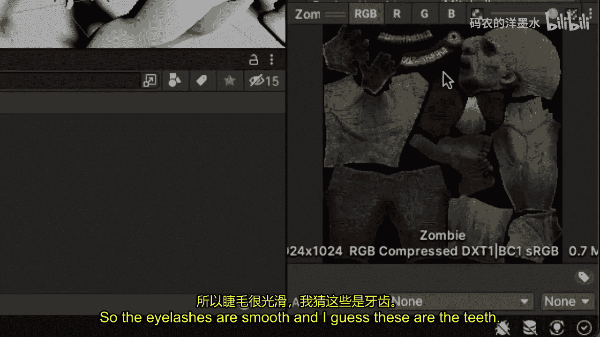

And I guess these are the teeth。 I don't know。 Let's go back to the model and put the albedo texture back in。

Yeah， I'm guessing that's the teeth。 sorry。Maybe that's the teeth。So the teeth are considered shiny。

Oh， at some point I turn smoothness all the way down to zero here， let me turn smoothness back up。

Ah there you go， so you can see as I'm turning up the smoothness slideer。

Then you'll see more specular reflection effects。 So this is multiplying whatever we're getting from that texture。

 And just to emphasize that， let me take the albedo back out。Let's see。

 Let me try that smoothness slider again。 Oh， you know， it's interesting。

 It's a lot more obvious what the effect is with the albedo map in。There we go。All right。

 let's also see what happens if I were to take out this texture again。

 there is a smoothness texture and here you don't see it because it's in the alpha。

I do see a difference here， watch as I hit control Z， yeah。Okay。

 so what I'm going to do is I'm going to use。Rdo。😔，Undo。Redo， undo。

 so you do see the effect of including that smoothness map。

I just realized I had the reflection probe turned on。

 so I wasn't just lighting the scene with the directional light。 Sorry about that。

 I don't think that messed up any of the main points I was making。 Anyway。

 let me turn off the reflection probe and confirm that the directional light is the only thing that's lighting the scene。

Okay， that sets us up to talk about the main topic I want to conclude with。

 which is the ambient occlusion map， so let's take a look at what that looks like。

The idea of an ambient occlusion map is that you basically want to have it be a little darker in places that represent nooks and crannies and crevices。

 things like around maybe the eye here or in the ear here basically places where it would be hard for light in general to reach relative to other parts on the zombie So what this allows us to do is to darken the contributions of indirect light sources such as the light probes and the reflection probe This doesn't affect direct light Now you could have your artist try to hand draw a texture like this but usually something like this is computed in a 3D program like Ber or Maya and basically over the course of the surface it will shoot out a bunch of rays from each point and then follow those rays out a small distance and then it will see how many of those rays smack something along the way Now that calculation。

And is a static calculation， of course this zombie here is moving， it is dynamic。

 it's chasing you and clawing at your or whatever and that ambient occlusion map is only really accurate for whatever pose it happened to be in in the software when they made that map there is a real-time ambient occlusion technique called screenspace ambient occlusion that I'll discuss later when we talk about postproces Also notice this is different from the idea of ambient occlusion that we saw as a parameter in creating light maps where there the ambient occlusion was baked into the map here it's a separate texture。

In addition to the ambient occlusion map， I have a slider that controls the amount of effect it has now right now as I move the slider。

 it doesn't seem to do anything because I only have one source of light in the scene a directional real time light so that's direct light so the ambient occlusion map isn't playing a role there。

 but if I were to say go turn on the reflection probe， so let's go turn on the reflection probe。

You'll see there's more light on the scene。Let me turn it back off。 Let me turn it back on。 Now。

 if I were to go play with that slider， then you'll see that。As they cran it up。

It's a very subtle effect， look at the neck here， as I crank it up。

 you'll see that the neck is darkened。Look around the eyes here。You'll see that that's darkened。

Kind of under the armpit here。Similarly， let me turn off the reflection probe and turn on the light probe group。

So there is with the light probes。There's without theres with the light probe。 So remember。

 this is handling bounce light going around the scene that we can use to represent indirect light on dynamic objects。

 things that we can't use a light map with and the representation of that light through various points in space of the light probe is handled by spherical harmonics。

 So with that light probe in play， let us go back to our slider and crank it up and down。Oh。

 that's a very subtle effect。Look right here。There we go。

 you can see a little bit of it on the cheek hair。All right。

 let me turn on both the reflection probe and the light probe。 So the light probe， remember。

 handles diffuse kind of light， and the reflection probe handles specular kind of light。

 So let me turn on both and now play with a slider。 All right， so。Yong。😔，There we go。

I wonder if it will be easier to see the effect if we get rid of the albedo map。All right。

 so I have my reflection probe and my light probe in place。

 and now let's go play with the slider for the ambient occlusion。Let's see。

 Ope actually took out the ambient occlusion off camera。

 let me put the ambient occlusion map back in。All right。Ah。

 that makes it easier to see the ambient occlusion effect。Oh， let me not have the reflection probe。

 right？Right on it。You can see it in the neck here。Definitely now can see it in the armpit here。

I've been blabbing for almost 20 minutes and I've just really scratched the surface of the standard shader。

 there's things like height maps and detail masks， and then there's secondary maps and all sorts of stuff。

You can check out the documentation for such things。

 there is also a lot of YouTube tutorials about the standard Shar and in the next couple of lectures we'll actually dig into the code。

In order to illustrate the ambient occlusion， I had turned down the normal map effect to 0。

 Let me put the normal map back in。 All right， there we go。

 The last thing I want to mention is that the standard shader here uses what unity calls the metallic workflow。

There is an alternative where you say specular setup。

 and this just has some variations in how it interprets the various textures。

 And you can check out the unity documentation for the differences there。 So for the standard shader。

 it says the shader exposes a metallic value that states whether the material is metallic or not。

 And the case of a metallic material。 the albedo color controls the color of the specular reflection and most light reflects as specular reflections。

 nonmetal materials has specular reflections that are the same colors then incoming light and barely reflect when looking at the surface face on。

 So it's confusing about this particular notation here is that in the case of a metal。

 the albedo is not really the albedo。 It's the head on for now reflection。But whatever。

 So for the standard specular setup， we have choose this shader for the classic approach。

 Use a specular color to control the color and strength of specular reflections in the material。

 This makes it possible to have a specular reflection of a different color than the diffuse reflection。

 So this year would allow you to do some things。 I think that are technically not physically plausible。

 but could be fun anyway。