# 【全集】佐治亚理工学院-GPU编程：视频与游戏-中英字幕-p38-Lecture-38---解析-Unity-的标准着色器part1--BV1GZfyBbEQn_p38-

Hi there， my name is Er Lachman， I'm a professor of electricalical and Comp engineering at Georgia Tech and in the last lecture of GPU programming for video games。

 we looked at the standard shader that is part of Unity's original quote unquote builtil in pipeline This is not to be confused with the scriptable render pipelines that have an equivalent shader that's called the Li Shar。

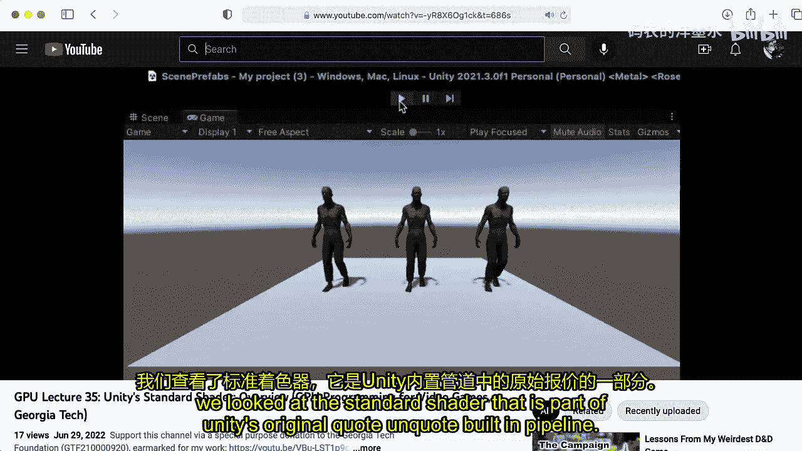

In this lecture I want to take a look at the actual code that implements the standard shader and try to sort through it This is going to be different than most of my other lectures where I have a lot of stuff planned out ahead of time here I'm going to download the code and just start poking at it this way my students can hopefully see a little bit of my thinking process when I look at Shar code。

So I went to unity3d。com/unity/down/archive and let's take a look at the longterm release 2022。1。6。

 I'm running the Mac so I'm going to say built in shaders for the Mac。

 but the shaders should be the same for all of the various versions。All right。

 so I'm going to say built in shaders。Okay， so here's the source code for the builtin shaders and I have a folder called default Res extra。

 which very confusingly is the folder that we want to look at so most of what's in here。

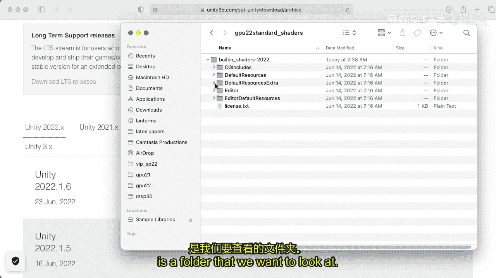

Consist of the legacy shaders from the unity four days。 Those are still available。

 although nobody really uses them nowadays。 nowadays。

 people use this standard shader or a variant called the standard specular shader。

 If you look at some of the older videos that unity has on YouTube。

 that was part of getting ready for the unity 5 release。 they call this the Uber shader。 Okay。

 as usual， I started a blank 3D built in pipeline scene。 I went to project settings。

 Let's change this from gamma to linearar。 tired of having to do that。

 but I want to emphasize you'll always need to do that。 All right， to have something to test。

 let's download this jammo character。 I am select it because it has a metallic smoothness map and an ambient occlusion map。

 an albeo map and a normal map。 So this is all the kind of maps that I want。 Sure。

 let's add this to my assets， except。

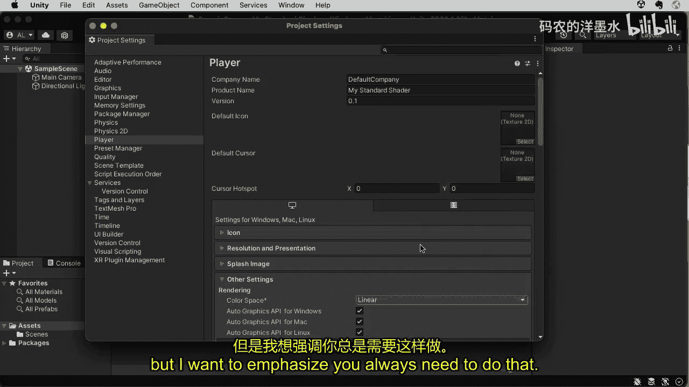

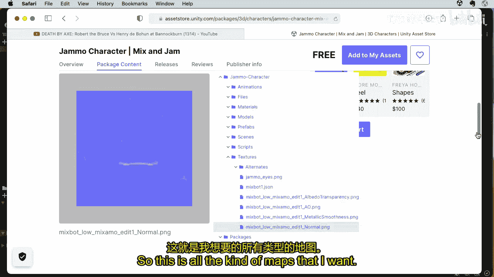

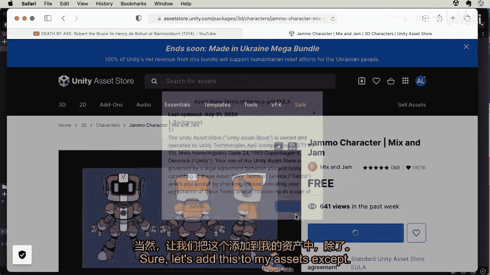

Yes， let's open in unity。Okay， let's download。And import。

Has package manager dependencies install upgradeho， whatever those are？And yep。

 I would like to import all this stuff， import。All right， let's take the Jamo character folder。

 take a look inside of it， there's Jamo， okay， zoom in on Jamo here， there we go。

 let's see what kind of shader Jamo uses。Lots of different parts here。

 and they all appear to be standard shaders great， I want to be able to replace the shaders with some variant of it that we make。

And check that out。 Allright， so now we have something to test with。

 Now I'm going to go to the assets menu and I'm going to create a new folder。

 and I'm going to call this folder my shaders。All right。

 and now what I'm going to do is I'm going to take shader and shader specular and I'm going to copy them into the My shaders folder。

And now this is going to be my version of it， so I'm going to go in and I'm going to change this to my standard shader specular。

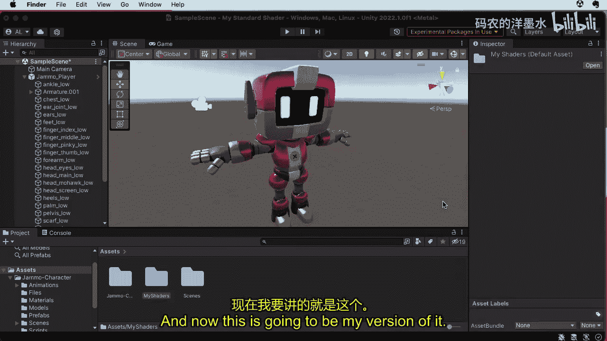

And I'm going to change this one to my standard。All right， now very importantly。

 I'll probably have a name conflict now， so now I'm going to go in and edit this and I'm going to call this my standard。

It's now my standard speculatorular setup。And for the other one， I'll have just my standard。

So now I won't have any name conflicts。

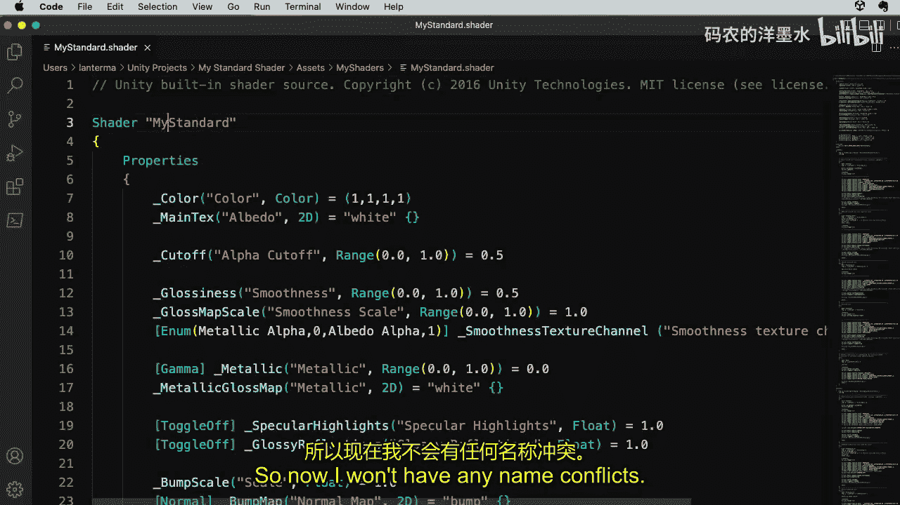

And the idea here is I want to be able to modify these， I want us to be able to create our own。

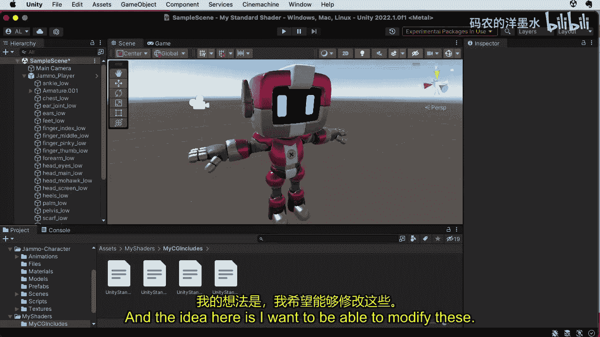

Twisted version of the standard shader， so I'm going to change all of these to start with the word my When I'm done with this I'll provide this on my Github right so this is my and this is my。

And then for this to work， I need to go into my original shaders here， the my standard shader。

 and I need to do a global search and replace on things that say unity standard and make it my unity standard All right。

 I'm going to do that。Okay， off camera， I just did that for the My standard shader。

 and I need to do the same thing for the My standard specular shader。Okay， similarly off camera。

 I just did that for the My standard specular shader and I should probably emphasize that both the standard shader and the standard specular shader both have specular the specular here just refers to a specular workflow versus a metallic workflow I would like to start to get a handle on the vast number of passes in each of these shaders so what I'm going to do is I'm going to duplicate them。

And I'm going to add the word pass in front of their file names Now these pass shaders are not actually going to be things that I'm going to keep as shaders。

 so I'll get rid of this， this will go away in a second I'm going to have these pass files be basically have nothing but comments in them this is just my way to try to get a handle on what's going on so let's see rename this I'm going to rename this pass my standard。

Speccular。Al right， so I have these two pass versions here。 Okay。

 let me open up the pass my speccular。 And what I'm going to do is I'm basically stripping out everything。

 All I am keeping is information about what the passes are。 Let's see。

 So I'll have a base forward pass。 and that's called forward。And getting rid of all of this here。

 actually， do I want to get rid of all that， actually， let me leave the tags in。

And we'll get rid of this， get rid of this， and let's get a sense of what the vertex and fragment shaders are and what the include is。

The next pass here is called4 Delta。And again， I'm going to get rid of everything here。

 So I got rid of all of that。 Okay， the next one will be the shadow rendering pass。

 And what I'm going to do is I'm going to basically do this for the rest of the passes。

 and then I'll join you again。 Okay， that was tedious。 Anyway。

 I came up with this compact summary of each of the passes。 There's nine passes total in the file。

 and the only real important ones are the first five。 So there's a base forward pass。

 This happens once， and it includes the most important directional light things like emissive textures and light maps。

So then there's addity forward passes and this is one pass per light。

 so that's any remaining directional lights， point lights， and spotlight。

Then we have the shadow rendering pass。 that's called shadowcaster。

 I should say the first one is called forward and then for Dlta。

 and that's with these light modes for base forward added in shadowcaster。

 And that's all for forward rendering。 for deferred rendering。

 that's something we'll look at later in the class。 but if you need it。

 here's the deferred rendering pass， which is just called deferred。

 I have no idea why they use camel case here with shadowcaster but that they use uppercase for the rest。

 I don't know。 anyway， the final thing here is actually not for actual rendering during the game。

 This is a metapas that's used for the global illumination computations。Now。

 the thing that I thought was interesting is that these all have a target shader model of 3。0。

And the remaining passes are the same things except targeting shader model 2。

0 and each of these if you dig into the details has certain features that were removed so basically I think what it does is it says okay。

 let's start at the top and try to find a pass that accomplishes the forward base or the forward a or whatever。

 but if the shader model of what you're running it on can't support that。

 then it will keep going and try to find something that it can run。

But nowadays pretty much everything you're going to be writing your game for should be able to handle shader model 3。

0 or above so if I were you and I was adopting this shader。

 I would just go ahead and get rid of the shader model 2。

0 stuff Okay so I just took a look at the specular workflow version of that file and it has all the same passes so I'm going to go ahead and delete that and just use this pass my standard shader as our guide to what the different passes do and again there's really five there's base add shadowowcaster deferred and meta。

Before I start digging into the code， let me make sure I can take an object in the scene。

 like the head of the robot here and switch it from the standard shader to the my standard shader。

 Where is the my standard shader。 Oh， it doesn't like something。 What doesn't it like。

 Couldn't open include file。Oh， I probably need to change some paths。okay。

 this is bad programming practice But how about let me take all of the stuff in the My CG includes folder here and just stick it in the my shaders directory。

 And if that works， I'll get rid of my CG includes。 All right。

 so let's go back and take a look at the My standard shader。 let's see it still doesn't like that。

Okay， it looks like I couldn't avoid having to add the full path， so I had to make this assets。

 slash my shaders， slash， blah， blah， blah。

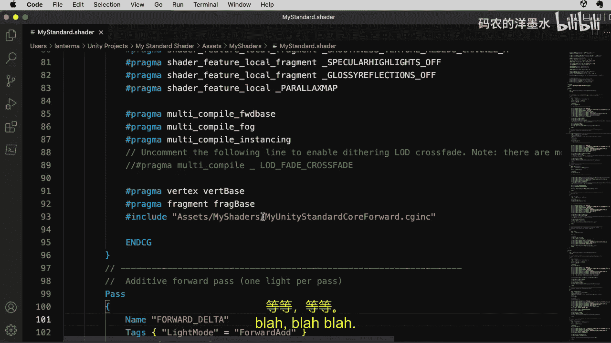

All right， so I did that on all of the includes in my shader。

 I also did it and all of the includes in my shader standard。

 and let me go ahead and delete this folder here。

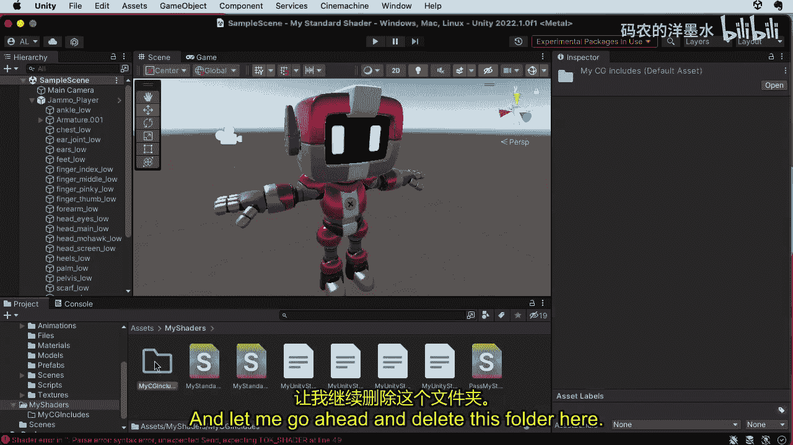

All right， so at least now that works， so when I click here and I look at the head， let's see。

Can I get just the head there all right， so let's go down here and now try taking this and changing it to my standard。

Aha， that worked。Now， there's something I want to be really cautious about， though。

 This my standard uses a custom editor to make this all look very nice。 Let's see。

 that's this standard shader Guy。 If I were to comment this out and then go back to unity。

We will see that the resulting shader in the editor looks kind of messy。

 Now all those parameters are just spread out without that nice interface。Okay。

 let's put that back in and let's change it to use something like my standard Shar Gui Now I don't actually have that in there so unity should complain about it。

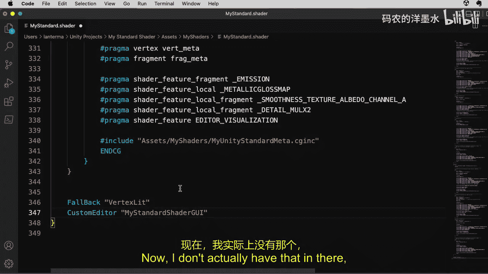

Is it complaining about it？It's not complaining about it。So if I go down here， oh， you know what。

 it can't find it， so it's just saying， oh， here， have the standard interface。Okay。

 let me create a folder in the assets menu called Edor。

And what we'll do is we'll take the editor that's in the editor folder， that's the standard Shar Gui。

Pull that into the editor folder in here。And I'm going to change this to my standard shader。

And let's actually take a look at that my standard Shadr Gi。 All right。

 I probably need to change this to my standard Shadr Gi here。

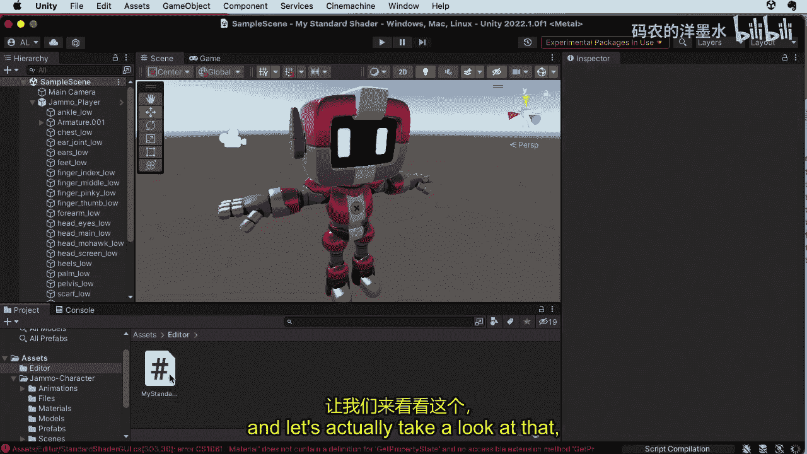

So this is a C sharp script， and I'm not going to get into all of this for the purposes of this class。

 If we do want to play with it at some point， essentially。

 you can find something like what you're looking for and cut and paste and modify it until the compiler stops complaining。

 At least that's how I handle C sharp and unity。 Oh， wait a minute。 It doesn't like something。

 And my standard shade or goy。 Ma serialized property is inaccessible due to its protection level。

Material does not contain a definition for Gi property state。Oh sadness， okay。

 let's go take a look here。So line 303。Get property state。 Oh。

 I don't want to have to figure this out。 I may give up。If anyone knows what's going on here。

 let me know in a comment below for now what I'm going to do is I'm going to declare defeat and surrender and take this and change it back to standard shader Gui so we're cheating a little bit by using what's built into unity here instead of our own version but whatever this is all a side quest to what I really wanted to do in this lecture anyway so let's move on Okay so here's the nice editor back So to get a handle on what the actual shader code is doing let's check out my unity standard core forward because that has the vertbase and Fbase invert add and F add functions。

Okay， so let's take a look at this unity standard core forward。And oh。

 it looks like our princess is in another castle， this just refers to a bunch of other stuff。

 so let's see what's going on Okay， so I guess if we don't have a full standard shader。

 we'll use the simple shader。So the sy shaders are in standard core forward simple。

 I need to go find that。And if we're using the non simple shader。

 I guess the full shader that's in Unity standard core， okay， and then we have Unity standard config。

 we're going to need that also。

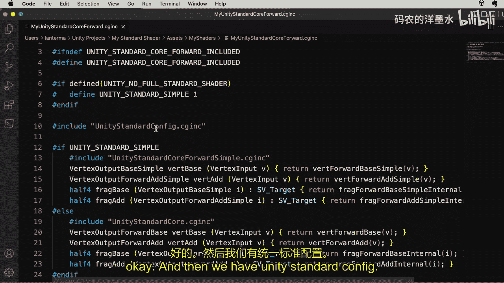

Okay， so in the CG includes folder， I'm going to need the Unity standard core forward simple。

 so let's copy that over， and then I'm also going to need Unity standard config。

 so let's copy that over。And we'll call this my unity standard。Wait a minute。Wait a minute。

 It looks like I'm missing something。 Do this not copy over， Do I need to copy that again。😔。

I guess I didn't copy over the first time， all right。

 so let's make this my unity standard core forward simple。All right。

And let me slide this slider this way so I can actually see the full file names。

And let's take a look at the my unity standard core forward again， okay， to be thorough。

 let me change all of this to my my my， and let's see， okay。

 so the vertex input structure has the name vertex input maybe that's in the standard config。

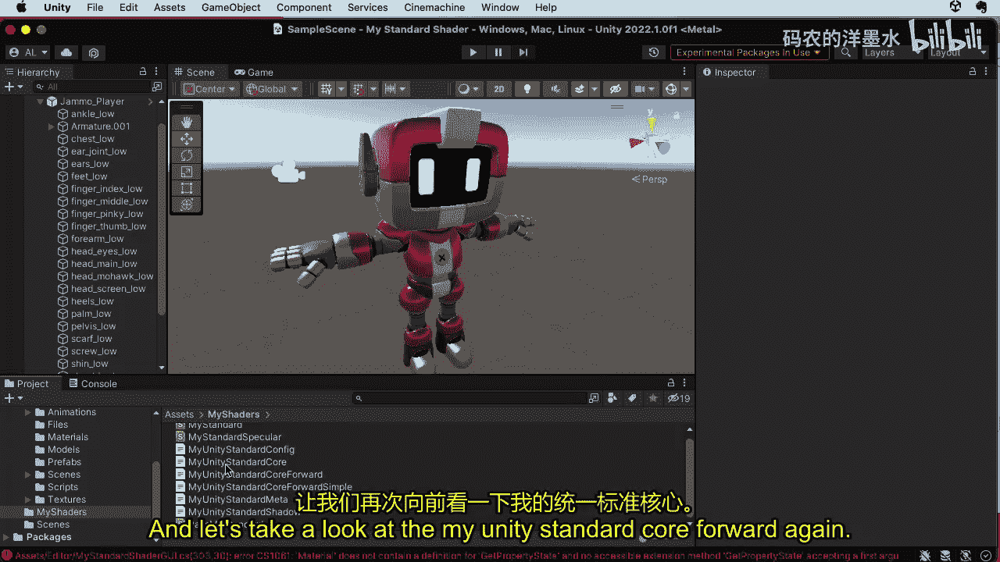

Let's check it out， okay， let's see。This looks like it just has a bunch of defines。

And one thing I've never really figured out is where the defines are selected， let's see。

 shade or target surface analysis。If shade or target is less than 30， maybe that indicates 3。0。

 it undefins some stuff。Let's see。Something about spherical harmonics。Something about G GX。Let's see。

 this isn't very helpful。

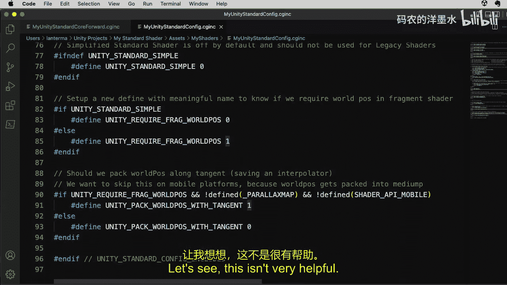

Okay， that did not have what we were looking for。 So let's check out the unity standard core。

 do do do。 Oh goodness， gracious。 It's turtles all the way down。

 How many files does unity need to define this shader。 What made me think this was a good idea。

 You see， I haven't actually really try this before at this level of depth。

 I really wanted to make a my version of all these shader code so that we could modify it without stoppingom on the original version。

 And actually， the original version that's in unity is built into unity。

 You can't actually change that？ So let's see， what do we need， Okay， so we need unity C G， K。

 so we'll copy that over。Hi there。 This is future Aaron dropping in here。

 In my first draft edit of this video， I wound up with about four minutes of going， oh wait。

 we need this file。 Oh wait， this file also refers to this file so we need to copy that over。 Oh。

 let me put the word my in front of all these things。

 So instead of boring you with all that I'm just going to fast forward through it。 O。

 that was tedious。Anyway， I think I have my in front of all the file names and when I look in all of the individual files。

 then I see my in front of any of the references to the various files。

 so I think I finally have a completely self contained version of the standard shader。

If you are one of the probably three people in the world who have watched this point， thank you。

 since everyone has stopped watching anyway， I think it would be a good idea for me to cut the video here and start fresh with a part two of the series where we actually really dig into the code。

