# 【全集】佐治亚理工学院-GPU编程：视频与游戏-中英字幕-p39-Lecture-39---解析-Unity-的标准着色器part2--BV1GZfyBbEQn_p39-

Hi there。 My name is Aaron Laantterman In the last lecture of GPU programming for video games。

 we started to take a look at Unity's standard shader for its builtin pipeline I took the shader code downloaded from unity's website copied it over to a blank unity project where I also loaded in a simple asset in order to have something to test with and basically what I did is I took all of the files and changed them to have the word my in front and then changed the references in the files themselves So starting with the standard shader we discovered that there were nine shaders in it only five of them were really of value to us the remaining four are variations of it for simpler GPUs so these main ones that we're looking at target Shar model3 so the ones we're going to start looking at are this base shader that corresponds to unity standard core forward。

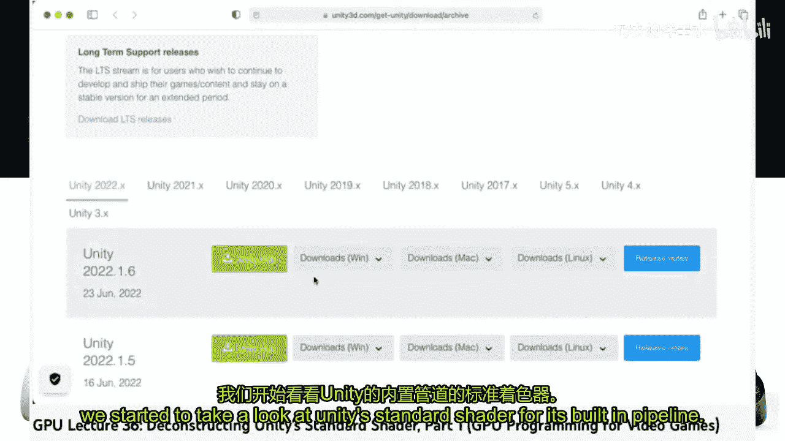

And the add shader that corresponds to Unity standard core forward So in the base pass。

 it basically handles the main direct light， amissive effects and light maps。

 whereas the remaining lights， rather their directional or point lights or spotter whatever。

 are handled individually in different a stages。So unity standard core forward basically doesn't do very much。

 it basically passes things along to a simple version of the shader or the more regular version of the shader。

 and so we're going to be looking for ver forward base ver forward add。

Fragford base internal and Fg For add internal in this unity standard core。

 As I mentioned in the last lecture， this set of lectures is more improvisational than most of my other lectures where I have a lot of things planned out ahead of time。

 Most of what I'm talking about here， I'll be discovering as I talk about it。

 So let's first see what's up with the input structure。 vertex input。

 I found vertex input in a file called unity standard input。 It was pretty near the top here。

 here we go。 So vertex input has vertex positions， normals。Texture coordinates for01，2。And tangents。

 apparently there's a tangent to world defined in here somewhere。

And I should note that when things are compiled， I think if you don't use something。

 it's not included in the code， so it doesn't hurt to have stuff here that you don't use。

So let's go to unity standard core and look for the functions vert forward base and vert forward addd to see what it does with that vertex input。

 Okay， so vert forward base is going to produce a vertex output forward base。

 Let's see what that structure looks like。 Fortunately， the structure is right above it。All right。

 so there's a macro， great unity position。Then there's some lighting cords。 That's another macro。 Oh。

 boy， I don't want to track all that it down。 You can go look for that if you want to。 Let's see。

 We also have texture coordinate， I vector stored in a texture coordinate。

 tangent world and packed data， okay。So there's a whole bunch of stuff in there。And let's see。

 what are they putting in texture coordinate5？Ambient or lightmap U。 Okay。

 so this is somehow holding information about spherical harmonics or light maps。

 And then there's a couple more macros here， Unity vertex input instanceense ID。

 Unity vertex output stereo。Okay， so what I want to do is I want to just kind of get an overall feel for things you can search through the code and try to figure out what these various macros do if you want and I might do that if at some point I want over the course of this lecture or maybe I shouldn't call this a lecture。

 maybe I should call it a meandering， a guided meandering anyway let's meander together。Okay。

 so we're computing a position in the world space by multiplying our vertices by this unity object to world matrix。

There's something about this tangent to world impact data that I don't feel like trying to figure out。

This O dot position is equal to unity object2 clip position。

 so let's look this up and make sure we know what it does。Here's Unity object to clip position。

 and there's something about stereo Q maps。Not sure what's going on there。

 Does that have something to do with， I du't know， maybe virtual reality or something。

 I see some half stereo separation， whatever that is。 All right。

 the main thing we have here is we're going to take the position。

 Str off the W and add in a one here。 I'll talk about why they're doing that in a second。

 multiply by the object to world matrix to get into world coordinates and multiply by this unity underscore matrix underscore Vp to convert it into the view space and then into the projected clip space。

 And the reason they're doing this is this provides a hint to the compiler that winds up producing more efficient code。

 If you look at the final assembly。 Okay， what about the texture coordinates。

 They're taking the input structure and giving it to this tech chords function。

I could maybe title this video。 Georgia Tech professor reacts to extremely confusing unity code。

 Everything is spread out all over without a whole lot of logic。 O。

 techcords is in unity standard input。 This is where they use that transform。

 underscore tech macro in order to be able to do the tiling。Okay， for the I vector。

 they're taking the position of the vertex in the world。

 and they're subtracting the position of the camera in the world space。

Why are they using this function here and not just saying normalize？Okay。

 I actually found it defined in the same file， this standard core。

 So we have skips normalization per vertex and expects normalization to happen per pixel。Okay。

 so if you're doing things normally， it doesn't actually normalize that vector in the vertex shader。

 but I assume it's going to use this in the pixel shader or normalize in the pixel shader。

But it looks like that's only the case if you're using shader Model 3。0 or above。

 if you're using a shader model less than that， or if you're using some sort of special simple shader setting。

 then it will normalize it in the vertex shader side。

 but apparently it won't bother to do any normalization of it in the pixel shader。

So that's the thing they're doing to save computation time in the pixel shader。

 even though it produces results that are wrong， but that's a way to save computation， I guess。

So if I was going to use the standard shader here as the basis for my own custom shader。

 the first thing I would probably do is just strip out all of the code having to do with anything with a shader model less than 3。

 You don't really need any of that in the year 2022。 Okay。

 the next thing we do is we take the input normal。 That's in the object space。

 And we want to convert that to world space。 Let's look up unity object to world normal。

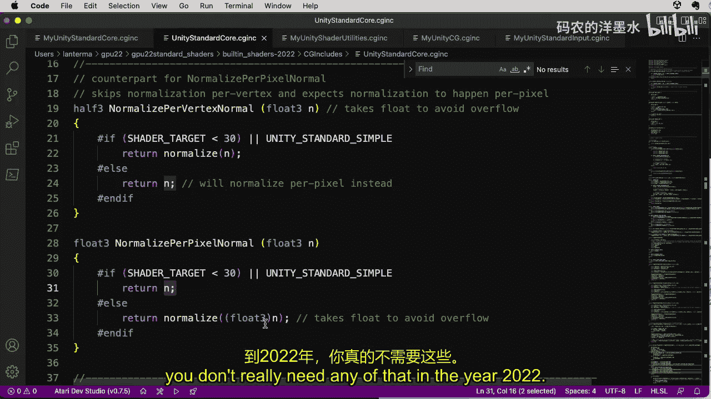

I expected to find that in unity shader utilities because that's where we found unity object to clip space。

 but nope， it's not here。So it's actually in unity CG。 There you go。 So unity object world normal。

 If we've set a define that says we're assuming that we're not scaling all of our objects。

 it's sufficient to transform a direction vector for the normal by just multiplying by the upper three by three matrix of the object world matrix。

 but if you can't assume uniform scaling， as we saw in a previous lecture。

 this gets more complicated， and then we can sort of use a trick of the way multiplication works in HLsL。

 to facilitate multiplying by a matrix transpose。 So this is all pretty complicated。

 this is something we talked about in a previous lecture。 so I won't belabor it here。

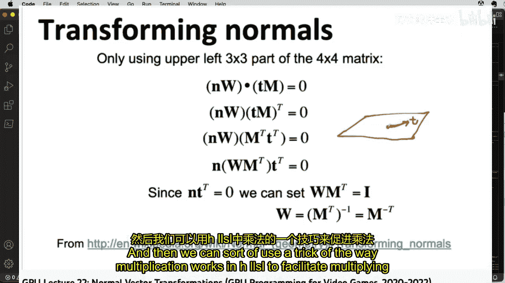

Next， there is a whole bunch of stuff about tangents that I'm not going to try to figure out。

 All right， let's keep going。 Yeah， I'm giving up on that part。 All right。

 next thing we have is unity transfer lighting。 We need this for shadowy saving。

I'm going to give up on this part too。 You can go look this up if you want。 All right。

 what about this ambient or lightmap U Okay， that's coming from this vertex GI forward。

 so what is that about？

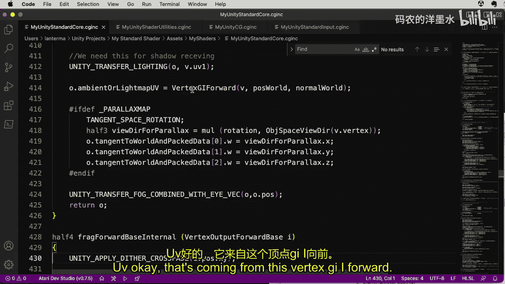

Okay， so here's vertex G forward it is in the same file this unity standard core and this is going to get complicated so it's going to return ambient or lightmap U and that's pretty much what it says on the tin what's confusing is that this represents two very different kinds of information if you have a light map for this particular object that you're rendering then ambient or lightmap U contains texture coordinates looking into that lightmap but if it isn't doing that then it does this business of this ambient stuff and here it's actually returning a color Now to talk about what's happening here I have to talk a little bit more than I wanted to talk about about these specifics of how the built and pipeline interprets lights So let's check out this documentation on the forward rendering path Now you're going to see some reference。

pher harmonicThe spherical harmonics discussed on this page aren't the same as the spherical harmonics that we talked about in the lecture on light probes Well。

 they are the same in terms of they're the same mathematical concept。

 but the light probes are handled separately。Al right， so in forward rendering。

 some number of the brightest lights that affect each object are rendered in fully per pixelite mode。

 Then up to four point lights are calculated per vertex。

 The other lights are computed as spherical harmonics， which is much faster。

 but is only an approximation， Rather a light will be a per pixelite or not as dependent on this。

 Light that have the render mode to set to not important are always per vertex or spherical harmonic。

Brightestional light is always per pixel。 Light that have the render mode set to important are always per pixel。

 If the above results in fewer lights than current pixel light count quality setting。

 the more lights are render per pixel in order of decreasing brightness。

 renderndering of each object happens as follows。 base pass applies one per pixel directional light。

 and all per vertex spherical harmonic lights。 Other per pixel lights are rendered in additional passes one for each light。

 And then it gives this nice little graphic here。 talking about it。

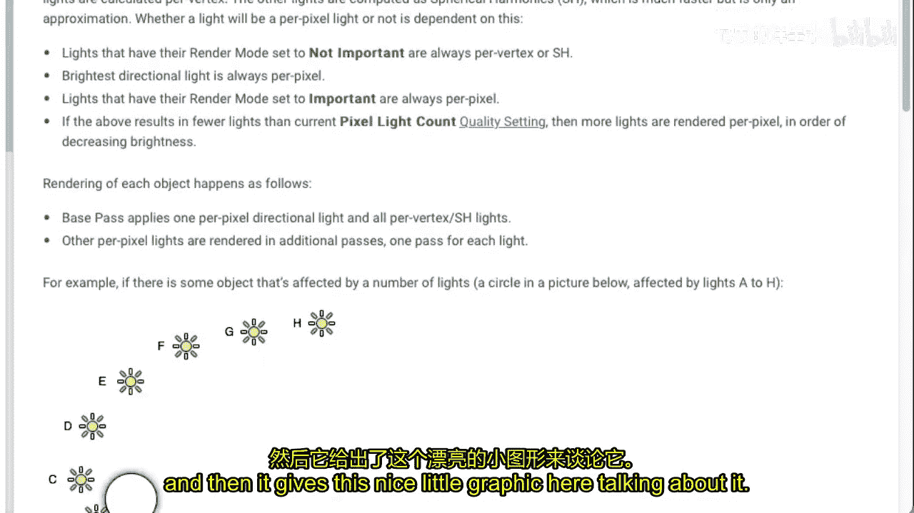

The shade 4 point lights routine is actually in unity CG。

 and it pretty much does all the stuff you expect。 The way it's written is a little weird because of the way the data is packed。

 but it does all of your usual diffuse computations。

 So there's also this shade S H per vertex function。 which is not in unity Cg。

 because unity apparently delights in being completely inconsistent as to where they put their code。

 Actually， wait a minute， I'm not sure what I said about this just including various unimportant lights in these spherical harmonics is correct。

 because says here， sample light probe for dynamic objects。

 So when it says sample light probe that suggests that it is the actualile light probes。

 So I'm not sure I think we'll have to dig a bit deeper to figure that out。 Okay。

 shade S H per vertex。 That's in the unity standard u。

Oh and this is interesting it looks like if we are saying that we are handling these spherical harmonics on a per pixel basis。

 we don't actually do anything here in the vertex shader and then there's other variations that involve this shade SH9 or this S Val linear L2 that does some spherical harmonic stuff you can go look these up I think these are in the unity CG。

 let's see shade SH9 there it's computing a bunch of spherical harmonic stuff actually it's calling something else let's look up SHG VL linearar L2 all right here we go。

 there we're actually computing some sphericalhar harmonics。And to be straight up。

 I'm not sure I'm entirely following the logic of the code here。 Parallax is a really cool effect。

 but it's not one that I've covered in this class that I'm not planning on covering it。

 So I won't talk about that Now。 Let's see。 The last thing we do here is unity transfer fog combined with I vector。

 All right。And that's defined in unity CG。So it looks like there's some fog information that's stored in some Z component of something or the other。

 and that gets stuck into the W component of the I vector with the XYZ containing the actual I vector。

Something like that。Okay， so that's what happens in the vertex shader for the base pass。

 although truth be told I probably skipped more than I actually covered。

 let's see what's different for the additive pass。 So let's look up vert forward add。 All right。

 so a lot of similar stuff。Actually， this looks like a subset of the base pass。Basically。

 it has all the same stuff， except it doesn't have that ambient computation with the spherical harmonics and the four per vertex lights。

Okay， so that was all about the vertex shaders， let's look at the pixel shaders。

 we want to look at F For base internal and F forward add internal and Unity standard core。Okay。

 so here's F forward base internal， there's some macros that set up some stuff a we have something called the main light and that is a structure unity light。

 so let's check that out。AhOkay， so whatever a unity light is。

 it will have a color that it's getting from our underscore light color 0。

GB and it has a direction and remember that for directional lights。

 the world based light position isn't actually the position。

 it's actually the direction vector of the light， that's just one of unity's conventions。

And then we have this macro Unity underscore light underscore attenuation。Oh。

 I don't see attenuation defined earlier， so it probably assigns this in the macro。

And that Unity light attenuation macro is apparently in this autoL library。All right， so we have。

A destination， so that a1 variable was being written， some input and some moral position。All right。

 so we wind up doing some transformations with the world to light matrix。

 so this is converting coordinate systems associated with the light。

 and there's stuff in here having to do with shadows that I'm not going to try to figure out。

And let's see。 I have this light coordinate dot product with itself。

 This looks like it's computing a distance， and then it's doing a texture look up。

 What is happening here。Okay， I just did some digging。

 it turns out unity is using that underscore light texture zero business as a lookup table to save computation。

Very interesting anyway that gives us an attenuation factor somehow。

 let's find this occlusion and this emission function。Here's the occlusion function。

 It looks like if you're using shader Model 3 or above， it looks up the value in the occlusion map。

 and then it will linearly interpolate between one and that occlusion map value based on that occlusion strength slider。

 but if you're using a shader model that's less than three。

 it doesn't include that occlusion strength slider effect， it just returns the raw occlusion map。

 and incidentally it's pulling it out of the green。

 although your occlusion maps are generally grayscale so they can pull it from anywhere。

 but just notice it's pulling it out of the green。Oh。

 I should mention I found this in unity standard input。 What about that emission。All right。

 so it looks like if you're not using emissive textures you return nothing， if you are using。

 then you take whatever's in the emission map， but you also multiply it by a color that you might set in the inspector for tenting Okay。

 so the emisssive texture just gets added in after everything else that's not too surprising。

Let's check out fragment G， which sets this GI variable and that GI variable is used in this unity underscore B RDF underscore PBS。

 And this is the main macro I want to focus on。 This is where the real work happens。

So it takes this S structure that has a bunch of stuff in it that was set in fragment setup。

 we should probably go back and look at what fragment setup is doing。Takes in the occlusion。

 this ambient or light mapap UV intenuation mainlight， all right， so let's check that out。Wow。

 there is a lot of stuff here， so we have something called a unity GI input and it defines things like the light。

 the world position， I vector attenuation that's probably getting passed on to something else。

Something about whether or not we're using light maps。 Oh， here we have speck cube。

 So we have unity speck cube blending。 So this is all stuff having to do with reflection probes in some way。

Let's see and if we're using reflections， then we do something with this unity glossy environment setup。

And that calls a bunch of stuff， and then we run unity global illumination。

Or we just run Unity Global illumination without the reflection business so let's first check out what this glossy environment data setup is doing so Unity glossy environmentron setup is in Unity image based lighting。

We actually do the reflection command in here。 And we're also running smoothness to perceptual roughness。

 So let's look that up。 smoothness to perceptual roughness。 Oh。

 is that really in another file seriously。Okay， so smoothness to perceptual roughness is in unity standard BRDF。

 and it's just one minus smoothness。Great。Like， I understand that it's good programming practice to break your program into a bunch of small functions and give those functions meaningful names。

But at some point， it gets really hard to track down what's happening。

 especially when stuff has spread over so many different files。

And then we call Unity global elimination， Oh wait a minute， these are different signatures。

 so this one has one， two， three， four， five arguments。Okay。

 and then that will call this four argument version or this three argument version。

 let's see here's a four argument version and what does that do？It calls the one， two， three， four。

 five argument version wait， what's going on here。Let's see， Unity global illumination。

 Unity global illmination。Okay， here's a four argument， unity global illumination。

 so we can't just count arguments so we have to look at the types also oh good grief okay。

 so this is calling Unity GI base or Unity GI indirect specular to set our specular and stuff。

All right， this version of it， with these two arguments just calls Unity GI base。

 so I think these are the main things I need to think about。

 so what's unity GI base and Unity GI underscore indirect specular。Okay。

 so Unity GI base is a unity global elimination。here's a bunch of stuff having to do with light maps and shadow masks。

 which I don't really understand that much anyway， so let's move on and let's see if we're sampling spherical harmonics per pixel。

 then that's happening here in the pixel shader， so we're setting our indirect diffuse there。

Something about light maps。Wow， there's a whole lot of stuff here。Okay。

 so here we're setting indirect diffuse light， subtract main light with real time attenuation from lightmap。

To code directionional light mapap。All right， here's something about dynamic light maps that we haven't really talked about in this class。

Then at the very end， we multiply that by the occlusion， all right。

So that indirect light is attenuated by the ambient occlusion factor。That's a lot of stuff。Okay。

 so that sets stuff in the base pass for the diffuse。

 what about this unity GI underscore indirect specular for the specular？Okay。

 so all of the stuff here involves looking up things in cube maps。

 so that has to do with our reflection probes。And at the very end。

 we multiply it by the ambient occlusion map。Oh， I should say it may be the ambient occlusion map or that may be modulated by that slider。

And all of that was to create this global illumination information that is going into Unity BRDF。

 PBS， along with a bunch of other stuff， and this looks like where the actual final physically based shading is taking place。

Well， not yet， Unity BRDF PBS， which is in Unity PBS lighting。

 is itself a bunch of FNNs that choose between a bunch of BRDF functions。

Let's see those BRDFs are in Unity standard BRDF。And let's see。

 B RDF3 is old school dot microfacet based modified normalized blend Fong。

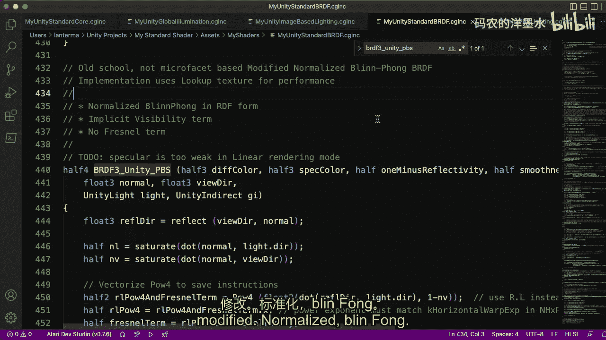

Implementation uses lookup texture for performance。

 I bet you that is not the one that's standardly used。 What about B RDF2。

So this one is a minimalist cook torrance BRDF。It says implementation is slightly different from original derivation。

 let's check out this website。All right， so this is an article called the Bin Fong normalization Zoo I've seen this article before it's excellent。

All right， so let's scroll down a bit。And a here we go， minimalist cook torrents。

So you can check this out and see what's implemented in unity。

 although the actual comments here say it's slightly different than that。

 but it looks like that website was the inspiration for this。

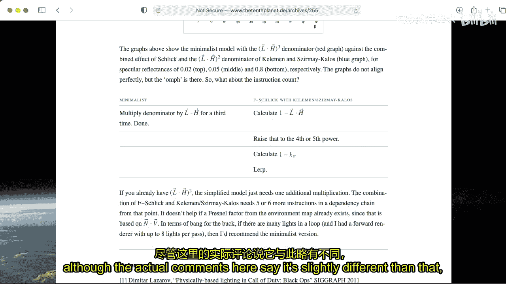

So let's check out BRDF1。All right， here we go， now we're cooking with gas main physically based BRDF derived from Disney work based on the torrent sparrow macrofacet model。

Ah here we go。Okay， so depending on rather unity underscore B， R D F underscore G G X's set。

 it uses normalized B Fong or G G X。 For remember from one of the config vials。

 it's set to use G G X Smith for visibility term Schchook approximation for Fll。 All right。

 let's take a look here。 Oh， this is interesting。 There is a comment here。

But first smoothness to perceptual roughness is one minus smoothness， okay。

 so we take one minus smoothness to get our perceptual roughness。We get the half vector。

 which is the normalized average of the light and the view vectors， but we don't just normalize it。

 we unity underscore safe， normalize it。So what is Unity underscore safefe normalize？

Why are we doing this， Okay， so we're taking a dot product。

 but we don't let that dot product get too small。Oh， it's avoiding a divide by zero issue。

 so if the result of the dot product is too small， then it clamps here so we don't wind up dividing by zero okay。

 and here we're going to compute in dot V， but there's this lengthy comment。

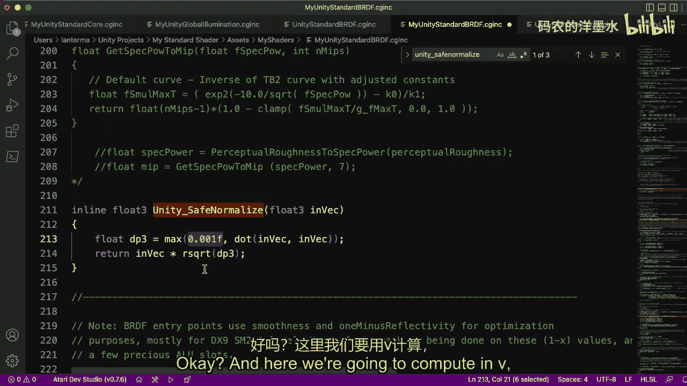

NDtV should not be negative for visible pixels， but it can happen due to prospective projection and normal mapping。

in this case， the normal should be modified to become valid I。

e facing camera and not cause weird artifacts。 But this operation adds a few A L U and users may not want it。

 Alternative is to simply take the absolute value of N dot V less correct， but works， too。Hah。

 I've never thought about this issue before。I'm pretty sure I don't want to have to think about this issue now。

 Anyway， let's keep going following define allow to control this， set it to 0。

 If Au is critical on your platform。 This correction is interesting for a G G X with Smith's joint visibility function because artifacts are more visible in this case due to a highlight edge of rough surface。

Edit， disable this code by default for now， as it is not compatible with two sided lighting used in speedre。

😀ははははは。😊，So whatever this is doing， it looks like they default to having this be off。Really， okay。

 because of speedry or something。 If we did do it， what would we be doing here。

 Besides taking the absolute value， we would be shifting something by a certain amount then saturating it。

 O， let's pretend it's magic。 We just take in do fee。😊，All right。And we compute n dot L， N do H。

 L dot v， L dot H， all the various things we need to do physically base lightinging。All right。

 now we actually have the BRDF。We'll have a specular term and we'll have a diffus term。

This is usually max0a N dot L， but this is something more complicated， this is a Disney diffuse Oh。

 and it includes the roughness。That's unusual， roughness is usually something we only think about with the cooktorrrent specular model。

 so let's check this out。Okay， so the actual diffuse was this Disney diffuse function times n dot L。

 so what is this Disney diffuse function doing， so we computing something called F90？

That's twice L dot H squared times our perceptual roughness plus a half。

And that's used in these fl style terms， but this is not a ferl effect。

 The ferl effect is part of the cooktorrrent specular term。 This is the function form。

 but it's being used for something else， including an n dot L and an N dot V。

 and then it multiplies those together。 So I have seen this before。

 Let's go look at this at its source。Okay， so here's that highly influential article physically base shading at Disney by Brent Burley。

 and let's do a search on the word diffuse a， here we go。

As seen in the major data and based on our studio experience。

 the Lambert diffuse model often looks too dark on the edges and adding Fl factor to make it more physically plausible only makes it darker。

 based on our observations we developed a novel empirical surface model for diffuse retroreflection that transitions between a diffuse Fl shadow for smooth surfaces and an added highlight for rough surfaces。

A possible explanation for this effect may be that for rough surfaces。

 light enters and exits the sides of microsurface features。

 causing an increase in refraction at grazing angles， and in the event our artists like it。

And it is similar to features we have。 We used to have in our ad hoc model。

 except that it is now more plausible and has a physical basis In our model。

 we ignore the index of refraction for the diffuse forl factor and assume no incident diffuse loss。

 This allows us to directly specify the incident diffuse color。

 We use the Schchick forll approximation and modify the grazing retrorele response to go to a specific value determined from roughness rather than0。

 Our base diffuse model is， oh， this is it。 So this is what you see in the code。

 There is that twice the。😊，Roughness， whatever。 All right。

 this produces a diffuse for now shadow that reduces the incident diffuse reflectance by 0。

5 at grazing angles for smooth surfaces and increases the response by up to 2。5 for rough surfaces。

It was found to be artistically pleasing okay， so this is what that is and if I remember correctly。

 this is not energy conserving， but Disney likes it anyway， and I guess the unity folks liked it too。

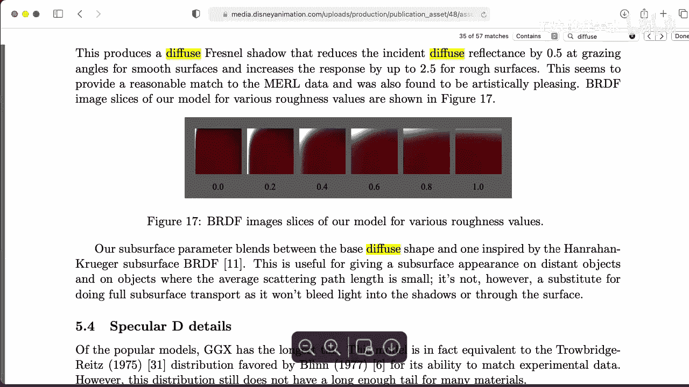

All right， so that's what that is。Okay， and heres the specular term。

We will first turn our perceptual roughness into roughness and how do we do that？Will we square it？

So this is one of those cases where I think it would be clear just to have this perceptual roughness times perceptual roughness just right here in the code。

And here we can choose between a normalized blendfong or GGX， which is the modern standard。

 although I notice that they clamp the roughness so it doesn't go below 0。

002 Let's see GGX with roughness to0 would mean no speckler at all。

 using max roughness002 here to match HD render loop roughness remapping have no idea what that is。

Also note the comment here that sayshack theoretically we should divide diffuse term by pi and not multiply specular term。

 but that will make the shader look significantly darker than legacy ones and two on the engine side。

 nonimportant lights have to be divided by pi 2 in cases when they are injected into ambient SH。

 so basically this business with pi is always confusing。All right， so let me scroll down。

And here's our final specular term where we multiply the visualization term times the distribution term。

We're also multiplying by pie。 that refers to the comment we just talked about。 Actually。

 it's not the complete cook torrents because there's no ferl factor here。 that probably comes later。

 some nonsense about gamma， gamma is bad， so I'm going to ignore that。

So here we take the specular term， it's the cook torrents， but it doesn't have the fl yet。

 and we multiply it by n do L。 so this is the limberian term。

 remember that your actual specular color is going to be a limberian N do L times your cook torrentance BrDF。

 so this is where they do the multiply by n dot L。 There's an option to actually just turn off specular highlights altogether。

And then there's something about surface reduction。What is this， I've not heard of this before。

So let's come back to this。All right， to provide true lamppert lighting。

 we need to be able to kill specular completely， okay。

 this is an option of killing specular completely， I guess。There's a grazing term。

Which is smoothness plus1 minus reflectivity。Oh， this is very odd， what is this grazing term？

All right， so what is the final answer， So we have our diffuse color times。

 the color of the light times our Disney diffuse。And then we're going to add to that the diffuse from the global elimination。

 either from the light maps or from the spherical harmonics。All right。

Then we're going to add to that our specular term and that was pi times the visualization terms times the distribution term times n dot L。

 and here we're multiplying by that fl term， so here we are actually multiplying by the fl factor。

And they werere multiplying that by the light。And then in the last term here。

 we add in the specular aspect of the global illumination， so that's coming from the cube map。

 and that's where this surface reduction thing comes into play。

And the ferl factor for that is coming from something that includes this grazing term。

So this is interesting， I'm not familiar with what this is doing。

So the surface reduction is apparently something you get from integrating over the region where n dot L is non zero。

N dot H times the distribution function， and you integrate over H。

 and that apparently gives you one over roughness squared plus 1。And then for some reason。

 this one over roughness squared plus one is something you want to multiply your cube map by。

I don't get that。Okay， so let's look up forll term， is this in this file？Yes， it is Okay。

 one minus an angle to the fifth power， Okay， so this is a standard for now term calculation。

Now we have the Fnel lurp。 This is a little bit weirder。

So this one here is basically lurping between F0 and1。

Here we're going to alert between F0 and this F90。Where F 90 is this grazing term。

 So if we did a standard for now function here， it would be going from speck color to one。

 But now it's going from spec color to grazing term。 Whatever this is， this feels very a hoc to me。

 I've not seen something like this before。 I don't understand it。

The one thing that I do want to point out that I don't necessarily understand。

 but it's standard to do is the Fl term you use for something like a standard light source。

 you use L dot H， the Fnel term that you use for something involving your Q mapap in image based lighting。

 you use N dot V， that's just what people do。Okay， before leaving this function。

 I want to drill down a little bit on what one minus reflectivity is。

 That appears to be set by this fragment setup macro。 So let's check that out。

So fragment setup creates a structure called fragment common data。Let's see。

 here's the sort of stuff you'll see in fragment common data and in order to fill that out。

 the macro that is the capital fragment_ capital setup calls a function and Caml case fragment setup。

 how creative。All right， there's a bunch of stuff here。

 I bet you a lot of stuff is happening in unity setup BRDF input。All right。

 Unity setup behind Df input is actually just a macro that points to the function specular setup。

And that function is here。So it looks like this is going to do some texture lookups to get the specular gloss albedo let's check those out okay。

 this looks like it will get specular colors and smoothnesses based on probably various settings that you have in the inspector I should mention this specular gloss function is in unity standard input and let's look up that albedo function。

All right， so albedo， this can get a little complicated if you're using detail masks。

 but if not it's basically just a texture lookup and while I'm here。

 there's this metallic gloss function that pulls out various things based on how things are set in the inspector。

But I want to know what it's up with this one minus reflectivity。Let's see on the next line。 Oh。

 energy conservation between diffuse and specular has an output parameter。

 That's what's setting 1 minus reflectivity。 All right。

 so let's check out this and maybe we'll be at the bottom of the pile of turtles， finally。Okay。

 so the one minus reflectivity is one minus specular strength of the spec color。

 so what specular strength？Oh， so it looks like it's the maximum of the red。

 the green and the blue and the specular。This feels extremely ad hoc to me。Anyway。

 so if you want to conserve energy。You return their albedo times1 minus the reflectivity。

But that's if you want to do it in a monochrome way， if you want to do it in a colorful way。

 you take the albedo and you multiply it by one minus the specular color。Oh， okay。

 I see what they're doing， they're trying to balance the diffuse and specular aspects， interesting。

Or you have the option of not conserving energy and it just spits back the albedo。

And I feel like I missed something along the line because there's also things here like one minus reflectivity from metallic。

 diffuse in specular from metallic， but I'm not sure what refers to these。Oh。

 and I should mention that these functions are in unity standard u。Okay。

 I think we can pop the stack all the way back up to this F For bases internal。

The only thing we have to talk about here is the fog， but I'm getting tired of talking about this。

 so it does something with fog and then it gives you the output， fantastic。

All of that was for the base pass， let's take a look at the add internal pass。

So it looks pretty similar。We have something here it's additive light。

 So that's extracting light parameters。 And the rest of this is pretty much the same as for the base pass。

 except there's this thing called0 indirect that， as we can probably guess。

 creates a zero indirect light because this is for the additive pass and all the indirect light stuff it happens in the base pass。

And we do this BRDf。Fg， et cetera， et cetera。 So this is just basically a simplified version of what we saw in the base pass。

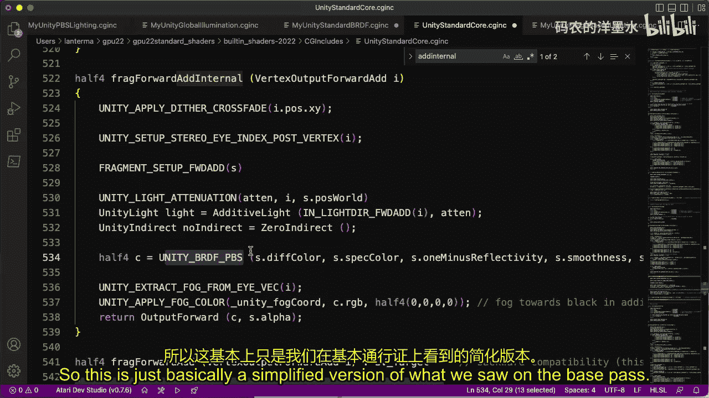

So all of that was just for the forward pass and the additive pass There is also code we could look at for shadows and for the metapass that's only used by the global illumination system that's not run real time during your game and there's also information in here about the deferred pass but we haven't talked about deferred rendering yet anyway。

 so I'm not going to go through the other passes now because I'm actually completely exhausted and brainfred from looking at this code I'm going to take this code here。

 which is basically unity standard shader where I've changed everything to my and package that up as a unity package so if somebody does want to create their own version of the standard shader they can do that here。

 I think the main place to look if you're trying to make a modified version would be the BRDf functions and the unity standard BRDf file。

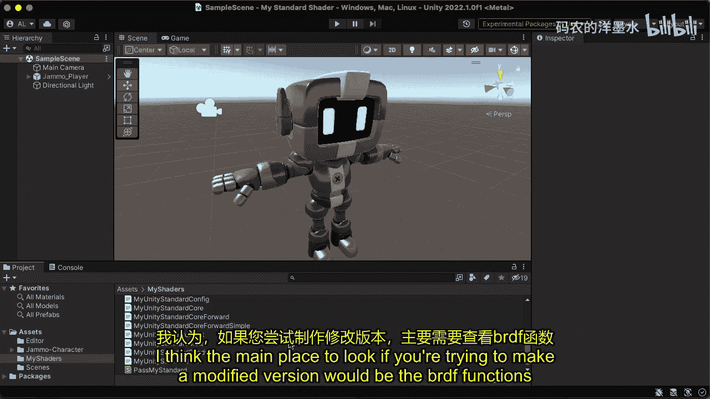

Overall impression of this code is that it's a mass。

 This is clearly something that has evolved over many， many years。

 I think there's parts of code in here that aren't actually called by any other parts of code in the standard Shar itself。

 but they probably need to leave them around in case there's assets on the unity asset store that depend on those functions。

 thingses are spread out among a bunch of different files with no real coherent vision as to what goes in what file。

It's really pretty painful。And that was for the full version of those shaders。

 we didn't even talk about the For base simple and For add simple and all of that from the simple version of the shaders。

If I were to dig into this more， I would probably start by stripping out all of the simple stuff。

 just get rid of this altogether， I would get rid of any code that involves Shar Model 2。

0 or below it's 2022 you can assume pretty much that anything that you'll want to write a game on has Shar Model 3 or above support。

And I'll probably try to take some of the macros and start just substituting them back into the main code just to make it easier to follow what's going on so you don't have to jump from file to file to file looking through macros。

