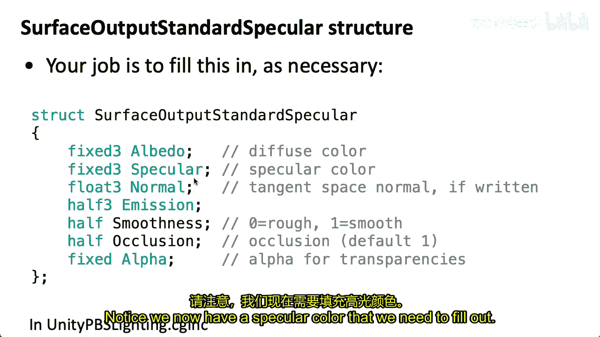
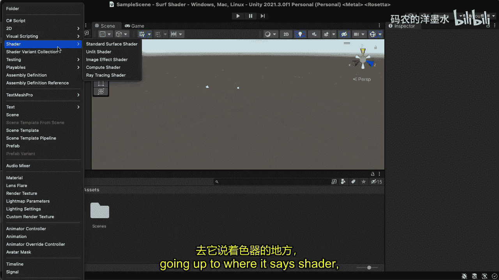
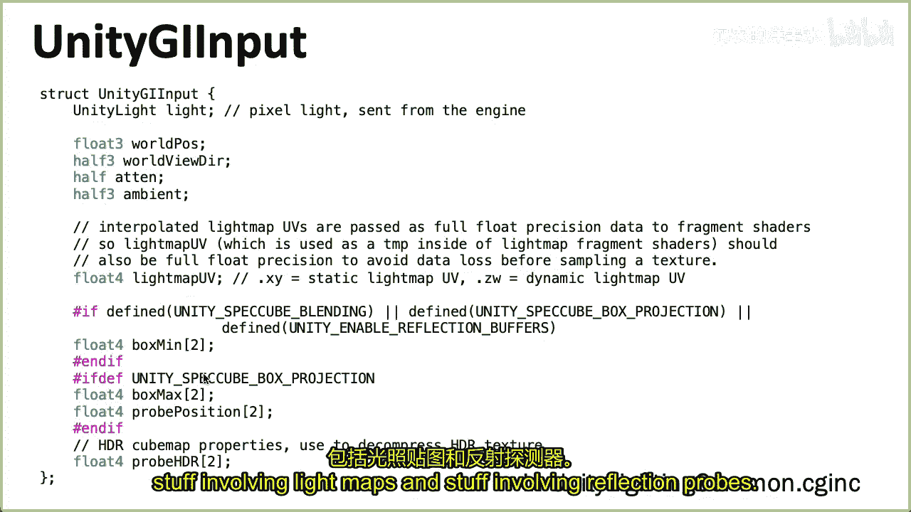
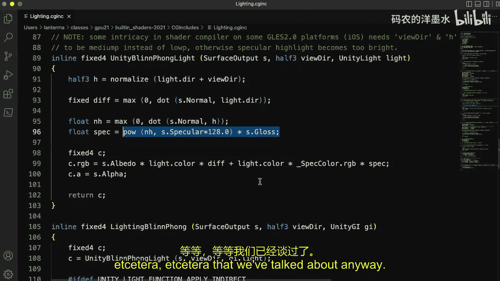
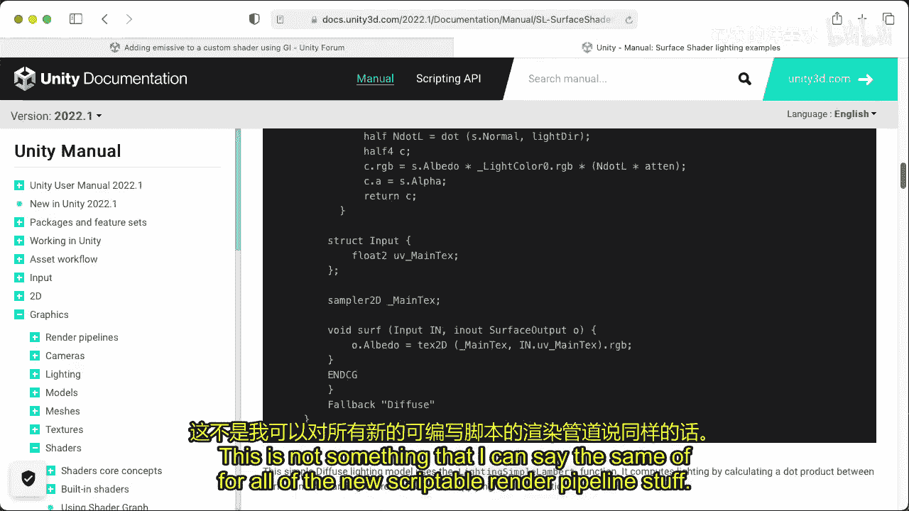
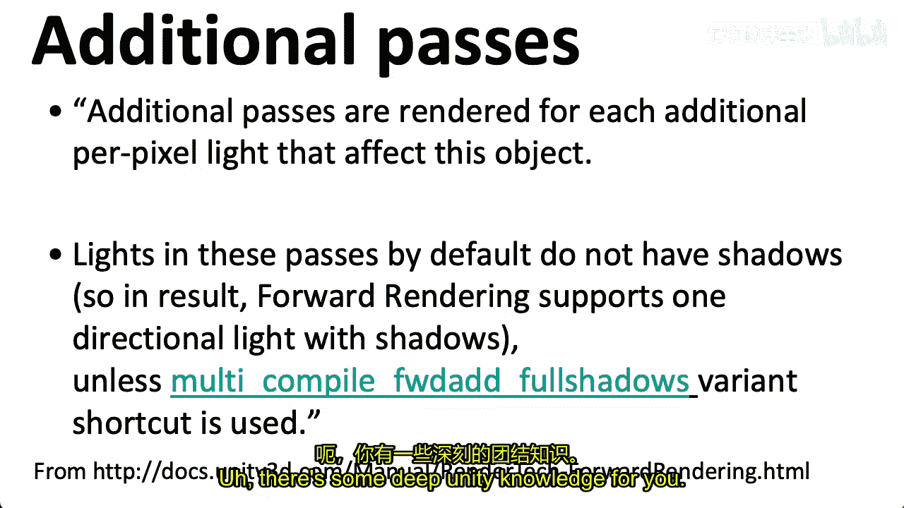
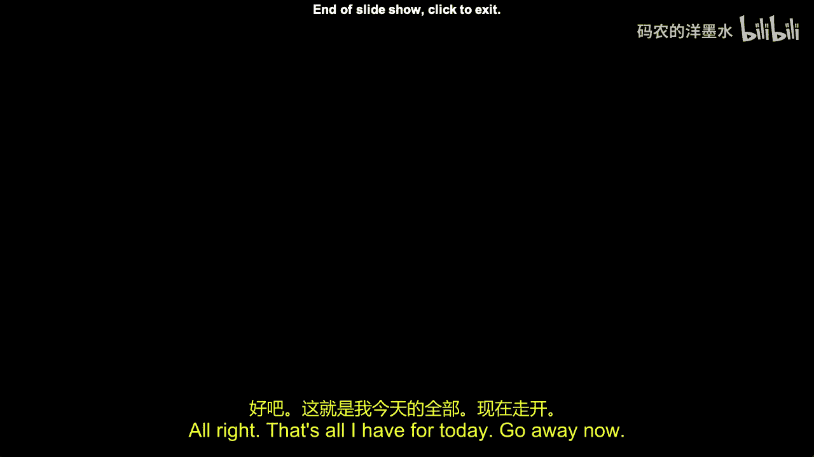

# 【全集】佐治亚理工学院-GPU编程：视频与游戏-中英字幕-p40-Lecture-40---Unity-中的表面着色器--BV1GZfyBbEQn_p40-

Hi there。 My name is Er Laterman， I'm a professor of electricallect and computer engineering at Georgia Tech and it's July 4。

 2022， so you might hear some fireworks outside。In this lecture I'm going to talk about surface shaders I'm a little conflicted about covering surface shaders in this class because this is a unityspec feature that you won't find in other game engines and I want this to be a class on general GPU programming and not a class on unity in particular however a lot of engines will have a similar kind of technology and to be honest way back in 2019 I wasn't expecting to be talking about surface shaders now because it wasn't expecting to still be talking about the builtin pipeline Unity was wanting everyone to switch to the new scriptable render pipelines but unfortunately the transition to these new SPs has been a complete disaster and I'm nervous about subjecting my students to the scriptable render pipeline when the documentation is so poor or non-existent now the scriptable render pipelines do support a new graphical way of creating shaders called shader graph but。

Shadergraph is not really a substitute for the original surface shaders。

 There are some significant limitations and problems associated with using shader G as one of unity's engineers noted Shaddergraph doesn't yet have the flexibility or power to do everything that the surface shader system in Unity did for the Bel and renderer and later Jason Booth noted quite frankly a graph will never get there and forcing us to use a graph for everything to make shaders maintainable is just wrong。

 Another commmoder named transact noted。 I really hope that this question will be followed by a statement along the lines of we've read the hundreds of posts about this have heard you all and will be reintroducing the concept of Sur shaders Asap to lessen your pain rather than we'll try to figure out some convoluted and unsatisfactory workarounds which you will see implemented some time in the next couple of years。

 This was posted in March 2020。 guess which Pa Unity took anyway。

Enough soapboxing despite surface shaders being officially out of style。

 according to current unity dogma， they're incredibly useful。 so let's talk about them。 Okay。

 so quoting from the unity documentation。 Why did they come up with this surface shader technology W shaders that interact with lighting is complex There are different types of lights。

 different shadow options， different rendering pass forward and deferred rendering。

 We haven't really talked about deferred rendering yet， but I'll talk about it later in the class。

 and the shader should somehow handle all that complexity and we saw a big portion of that complexity in the previous couple of lectures when I dissected the standard shader for the built in pipeline that's a massive amount of code has a massive amount of passes and it needs all that complexity largely to handle all those different kinds of lights。

Surface shaders and unity is a code generation approach that makes it much easier to write lit shaders than using low level vertex pixel shader programs。

 There are no custom languages， magic or ninjas involved in surface shaders。

 It just generates all the repetitive code that would have to be written by hand。

You still write Shadar code in HLSL。Before we go further I want to go on a brief side quest about data types pretty much all the examples I've given you so far in this class have used floats that's your standard 32 bit float there are also 16 bit floats and a special fixed low precision floating point value that can go between minus2 and 2 Nowadays pretty much you could probably just use floats on everything if you look in the unity documentation they'll talk about the fact that some older GPUs and some mobile GPUs may specifically have half support。

I'm just mentioning all of that here because you'll see these terms half and fixed。

 you could just substitute float in your head。So the standard shader that we looked at in the past couple of lectures supported a couple of workflows referred to as the specular workflow and the metallic workflow and the surface shaders provide similar kinds of workflows in their available lighting models and as I'll show you you can also define your own custom lighting models so I want to review those here I also want to emphasize that the metallic workflow isn't specifically for metals。

 it's for metals and dielectrics， this is just the name of it so for the metallic setup that's usually just called standard calling the albedo map。

 the albedo map is a bit of a noomer so for diffuse reflections。

 this is the actual albedo but for metals this albedo map doesn't actually contain the albedo it contains the direct headon reflectance of the specular reflection that we called F the metallic map should be zero for dielectrics i。

e diffuse material。And it should be one for metals and in theory， it should be just zero and one。

 although if you look at the way the code set up， there's no reason you can't set this to something like 0。

5 for artistic reasons， even though that's not really physically plausible。

Now diallectrics do have specular reflection， but instead of specifying the F not in that particular case for diallectric。

 you'll see that there is a fixed value in the shadedr code， I think it's something like 0。04。

 we'll take a look at that later and remember that for diallectrics F0 is some sort of grayscale。

 it's not an actual color。Now there is this standard specular setup that's more general than the metallic setup here you have an albedo map that really is the diffuse color。

 this should be black for metals， but you can set it to something that's not black if you want。

If you have an artistic reason to be doing that， and there's a separate specular map and again。

 for dielectrics， F not should be gray， but again there's nothing stopping you from putting a color in there if you have an artistic reason to do that。

 it's not physically plausible， but you can do it。So the underlying architectural concept behind surface shaders is that there's a separation between the material description of a surface and the lighting model that interprets how that material interacts with the light So your main job is to fill out some sort of structure that contains surface information that depends on the lighting model if you use the standard lighting model。

 then you fill out this surface output standard structure and you'll have surface output Xyz structures for other kinds of lighting models So here we can fill out the albedo。

 the normal the emission， the metallic0 is non-metal one is metal smoothness there's this point here that it's actually technically speaking perceptual smoothness。

 but the user doesn't want to constantly see the word perceptual there inclusion and alpha for transparency Now the normal information is。

If you the user write to this， it expects you to be writing this intangent space。

 so something that would be0 comma 0 comma 1 is sort of a normal map that's pointing straight up that won't perturb the vertex normal。

Now if you're using the standard specular lighting model， this is a little bit different。

 notice we now have a specular color that we need to fill out。

You can get an example surface shader template by going to the assets menu。

 hitting the plus symbol going up to where it says shader and then selecting standard surface shader。

And that will produce this template code So in this particular example there is an input color。

 a slider for glossiness a metallic from the inspector and then a main texture We define a surface shader using the pragma surface construction and notice we don't have pragma vert or private f because the surface shader compiler will create the vertex and the fragment shaders for us The structure is that we're going to use the word surface that's a keyword and then we're going to give it the name of our surface shader which in this particular example is going to be surf you can call it Fred if you want it doesn't matter All right then you need to specify what lighting model you're going to use we're going to use the standard lighting model for the surface shader and I'll show you in a little bit how you can write your own custom lighting models and then。

Some keywords you can give it here it will allow for shadows。

Now there's an input structure which I'll talk about in a second， and it's very specific about this。

 you need to call this structure capital I NPUT。And then if you want to be able to access texture coordinates for a texture。

 you need to call it UV and the name of your texture here。

 which in this case is underscore main tech。Now the surface shader compiler is very picky about the text strings that it looks for。

 so you can't deviate from that。All right， so now if we look into the actual surface shader itself。

 well actually if you look before that， there's some stuff about unity instancing。

 this is a more advanced feature that I haven't really talked about so don't worry about that anyway here we have something that takes that input structure here it has the texture coordinates and it's going to fill in that surface output standard structure。

So here it looks up the appropriate texture color， multiplies it by the color that you set in the inspector and sets the RGB of that to the albedo。

 the metallic and smoothness， it gets from the sliders and then the alpha it gets from the alpha channel of that main texture and the idea is you could handle this a bunch of different ways。

 you could have textures that you use to define the metallic and the smoothness or whatever。

 or other kinds of sliders that do this that and the other operation。

Now the input structure in that example is fairly simple， it just gave us texture coordinates。

 but maybe you want the direction to the camera， maybe you want the position of a pixel in screen coordinates or in worldspace coordinates maybe you actually had vertex colors and you want to get that information Well。

 if you use the correct magic incantations of these particular strings。

 then you can get that information I thought it was interesting that for the color all you need to do is add colon color and you could actually give the variable。

 whatever name you want， but for these other things you have to use the string V IDW capital DIR。

 etc cea， etc ce。It looks to see if you've defined that and it only fills it in if you're using the appropriate string。

So there's other things that you can include， so this is a little freaky in terms of trying to figure out。

 so we have float3 world reflection will contain the world reflection vector。

If the surf shader does not write to0。 normalmal， so if you write to0。normal。

 you need to do something else， you need to use floatat3 world reflection。

 and then you need to use this internal data macro。

 and then you have to be able to get the reflection vector using world reflection vector parentheses in comma O。

 normalormal。Similarly， if you don't write to O dot normal。

 then you can get the world normal from float through world normal。

 but if your surface shader does write to ODt normal。

 you have to add this internal data and you have to use this world normal vector， so yeah。

 this is awfully complicated。So why would you be writing to Odot normalormal， well。

 probably if you're doing some sort of normal mapping。

So what about the lighting model that interprets that material information Well。

 what unity will do is it will take the word in this position here， in this case it's standard。

 and it will append the word lighting before it， so it's going to look for a function called lighting standard。

So I found lighting standard in Unity PBS lighting。

Now lighting standard takes in this surface output standard structure。

 it also takes in this variable that has the direction to the camera and it also takes in this unity GI structure now GI suggests that this is global illumination information that's a bit of a misnomer。

 this unity GI structure has both global illumination information and information associated with specific point lights or spotlights or whatever。

And let's see what it does。 It normalizes the normal。

 So I'm guessing it's not trusting that the normals actually come in normalized。

And then basically it computes this BRDF function for the physically base shader this is the same function that we looked at in the last lecture when we looked at the builtin standard shader。

 now the standard shader is not itself written with surface shader technology。

 it is a custom piece of HLSL shader code， but here we have a surface shader that's using a lot of the same helper functions that the standard shader used。

There is some code here involving the physically correct way to handle transparency。

 I don't feel like thinking about that right now， so I'm going to move up。Now。

 this Unity underscore BRDF underscore PBS macro， needs an albedo， a specular color。

 and something called one minus reflectivity。This is a little bit confusing because the albedo is computed from an albedo and a bunch of other stuff。

 so I think this has to do with the fact that in the metallic workflow。

 the albedo texture that comes in， is not necessarily the albedo。

 it can also have specular color information in it。

So it looks like diffuse and specular from metallic will produce an albedo as its actual output of the function。

 and then it produces the speck of color using an output variable in the parameter list and it's also going to output this one minus reflectivity。

 so let's take a look at diffuse and specular from metallic。Remember that in the metallic workflow。

 the user doesn't specify the F not for dielectrics that's assumed to be some small value in this case 0。

4， and that's defined in Unity_ color space diallectrics spec in Unity CG。

 and the alpha of that they also have1 minus that。So if you look at diffuse and specular from metallic。

 we see that the speck color is the result of alertp between this 0。4 and the actual albedo。

 which here isn't really albedo right it's storing f not information according to the metallic parameter so if metallic is 0 if it's purely dielectric。

 you get 0。04 if it's one， it's purely metallic， you get what is in this albedo component that isn't really the albedo and technically speaking metallic should be 0 or1 and not something in between。

 but there's nothing stopping you from setting it to something in between if that's an artistic thing you want to do。

Okay， so one minus reflectivity is going to be one minus reflectivity from metallic。

And one minus reflectivity from metallic stores 0。96。Ie1 minus 0。04 in1 minus dielectric specular。

 okay， that makes sense。And it's going to return。One minus diallectric specular。

 minus metallic times 1 minus diallectric specular。

I guess you could also write this as metallic times one minus one minus diallectric specular。

Maybe there's some sort of optimization reason that it's written like this。Okay。

 so let's think through the extremes。So if the metallic parameter is one， if it's a pure metal。

 then this will return zero， so what will actually return for the albedo is albedo times zero。

 which is just zero， which makes sense for a metal。Now。

 if it's purely dielectric and metallic is zero， then we're going to return 0。96。

So we don't return the full albedo we'll return 96% of it because the idea is 4% of that potential is being taken up by that specular reflection that diallectrics do indeed have I think that's an energy conservation thing and so you can。

 if you want to be a rebel let metallic be something between zero and1 and then it will balance out accordingly。

 so this is the equivalent lighting function for the specular workflow and it pretty much looks like for the metallic workflow I should mention that if I change code I'll put that in redt to make things clear。

Except here it's using the energy conservation between diffuse and speccularular function。

 which feels less motivated to me。 There's this thing called specular strength that takes the max of the red。

 green and blue channel， which you can use if you're conserving energy。

 but doing so in a monochrome fashion。Or you can conserve energy in a colorful fashion。

 and I'll leave this to the viewer to sort out。Now let's talk about what kind of information is in this unity GI structure。

 it has a light component and an indirect component that it passes into the BRDF function。

So the light component is a unity light structure that has a color and a direction。

 and then there's this unity indirect structure that has diffuse and specular aspects。

 the diffuse aspects are going to come from spherical harmonics and light maps and the specular information is going to come from reflection probes now to actually fill out this unity GI structure we need some additional code associated with our lighting model。

 is not sufficient to just have a lighting standard。

 say you also need lighting standard underscore GI and what the lighting standard underscore GI function does here is it will take some information in this unity GI input data and then it will fill out unity GI。

So this is a lot of complicated stuff and I'm not going to get into details of it here。

 basically you need to fill out the various bits of indirect lighting information。

And here that's going to come from functions like Unity global illumination and Unity glossy environment setup。

 etca， etc cea， this is something we looked at a little bit in the previous lecture so Unity will take the name of your lighting model。

 add lighting before it and then it will put and underscore GI after it。

 so you need to have a function like this。And for the specular workflow。

 you would need to have a similar kind of function， except here it's now standard specular。

And I should mention these functions I found in Unity PBS lighting。 Now。

 what is the unity engine providing in this unity GI input structure， Well。

 it's the sort of stuff you'll expect。 So for simple lights。

 there's this unity light light information。 and then we have things like world position。

 attenuation， I guess the direction of the camera and world coordinates。

 some sort of ambient color information， stuff involving light maps and stuff involving reflection probes。

I've talked about the standard and standard specular lighting models。 If you look in lighting。t HLsL。

 there's also some legacy models。 there's a Laert model that's just diffuse。

 There's a specular model that isn't the fancy cook torrent specular that we've talked about。

 This is an old school Bn Fong specular。 It's an ad hoc specular that's not like the modified normalized blendfong。

 et cetera， et cetera that we've talked about。

Anyway， the main point is that you can define your own custom lighting models。

And there are quite a few examples of custom lighting models in the Unity documentation。

 this is not something that I can say the same of for all of the new stripable render pipeline stuff。

As I mentioned previously， you can add some options to your pragma surface definition line in your surface shader file。

There is a whole bunch of options that you can select， for instance。

 if for some reason you don't want to have any ambient lighting or light probes。

 there's a no ambient option you can pick。There's something about adding decals。

 I don't really know much about that。 After you do all of the various passes with all of the various lights adding up。

 you can add an additional function that will tweak the final color in some fashion。

 And there's also the ability to modify the vertices before you actually go into the pixel shaders。

 I'll actually do an entire lecture on this。 So I won't talk about that more now。

Looking behind the scenes a little bit， if you look in Unity CG。

 you'll see some of the kinds of structures that Unity will use to pass data from the application and to the vertex shader that depends on what that particular shader needs。

 again， this isn't something you need to worry about really this is something you might want to look at if you are doing some vertex modification。

 but again， we'll talk about that next time。While we're here。

 I thought it might be a good idea to review this Unity underscore BRDF_ PBS thing。

We looked at this in the previous lecture， but that was a long。

 complicated lecture with lots of stuff in it， and I thought it would be a good idea to review it here。

The main physically based BRDF in Unity is this BRDF1 underscore Unity underscore PBS。

 so let's look at that。So Unity uses a special diffuse model that's not Lierian。

 it's called the Disney diffuse， we'll talk about that in a second。

 and it also uses a cooktorrrance specular model and then remember after we compute the BRDF。

 we need to multiply it by N doL。And actually it's a little bit confusing because this routine actually doesn't compute the BRDF itself。

 it computes BRDF times n dot L， this luberian term All right， so if we dig into this a little bit。

 we convert smoothness to perceptual roughness by just taking one minus the smoothness。

There's this safe normalization of our computation of the half vector and that safe normalization is basically set up to void issues with division by zero。

And then we compute the various dot products that we need it turns out there are some weird issues associated with computing N dov。

 which I never actually thought about until I did the previous lecture。

 basically occasionally there' are some weird conditions where n dot V will become negative when it's not supposed to and an ad hoc way of fixing that is just to take the absolute value so there you go and we compute nl and do H L dotv Lth and then we compute this Disney diffuse term so if you look at the original paper by burley about this。

 it says the Lamert diffuse models often too dark on the edges and adding a fl factor to make it more physically plausible only makes it darker based on our observations we developed a novel empirical model for diffuse retrorefle that transitions between a diffuse forl shadow for smooth surfaces and an added highlight for rust surfaces。

And if we look at what this Disney diffuse function is， it has all of this stuff in here。

 there is L dot H squared times the perceptual roughness times 2 plus a half。

 and it uses this in these two fl style terms， but this is not the fl effect per se。

 That's part of the crytorrrentance model， it's just using these same mathematical form。

 So it computes these things， multiplies them together。Burle goes on。

 A possible explanation for this effect may be that for rough surfaces。

 light enters and exits the sides of microsurface features。

 causing an increase in refraction at grazing angles。 In any event， our artists like it。

 and it is similar to features we used to have in our ad hoc model。

One thing to note about the way this is coded is this Disney diffuse is then multiplied by N L。

 so this is the immerion term， so Disney diffuse by itself is the associated BRDF for the diffuse model。

 but then we also multiply it by N dot L here to get the full diffuse term。

 and then we compute the specular term， I want to emphasize this comment hackck。

 theoretically we should divide diffuse term by pi and not multiply specular term。

 but that will make shader look significantly darker than legacy ones。

 and on engine side nonimportant lights have to be divided by pi2 in cases when they are injected into ambient spherical harmonics。

This is all complicated， I don't want to think about it more here， I just wanted to point it out。

So we're going to compute a roughness and we'll take our perceptual roughness。

 which is one minus the smoothness and to convert perceptual roughness to roughness。

You just square it This is one of those situations where I think the code would be a lot clearer if they didn't use a name function here。

 although technically this is good programming practice because you're giving a name to what's actually happening。

 but I think it would probably be easier to interpret the code if you just wrote perpetual roughness times perpetual roughness in this spot because then you're not having to bounce around different functions so much。

Okay， for their actual cook torrents， the distribution term is G G X。

 The visualization term is this special G G X。 This is not the one with the square root in the denominator is the one where it has the G G X kind of form。

 I do notice that they limit the roughness to be at a minimum of 0002。 And apparently， they say here。

 that's to match H D render loop roughness remapping。 And I have no idea what that is。 Now。

 I want to emphasize this is not the complete cook torrentance term yet。

 The Fnel factor is applied later。 here they are multiplying it by pi that relates to the comment above。

The other thing that they are doing here is they're taking that cook torrance term。

 and they are multiplying it by the lumerian factor in DoL。All right。

 there's also a flag you can set where you actually just zero out this specular term。

 notice that it goes through all of this computation anyway， just to set it equal to zero huh。Okay。

 now let's take a look at how we compute the V and D factors。Okay， so here's our GGX term。

 nothing particularly surprising here， oh， notice that they do add a tiny number here to avoid division by zero issues。

And let's see for the visibility term， again， there's an addition of a tiny constant to avoid division by zero problems。

Now I get into parts of the code that I don't understand。

There's this computation of something called surface reduction。

 which is1 over the roughness squared plus 1， and this winds up getting multiplied by the specular global illumination information from the reflection probes。

There's also this grazing term here。And I've never seen this before。

 I don't know where this comes from。 Anyway， the fnel calculation you see here。

 So here I have f plus 1 minus f times1 minus the cosine of the angle。

 but really this is computed as a dot product to the fifth power Now when you're doing things with standard lights like point lights。

 you use L dot H and this expression， but if you're using reflection probes if you're doing a global illumination kind of computation。

 you use n dot v in this expression， but there's this weird variation with this grazing term where instead of morphine between f and1。

 you morph between f and this f90 or f90 is this grazing term。

 that's this smoothness plus1 minus1 minus reflectivity So I guess it's smoothness plus reflectivity。

 that is kind of funny it's1 minus1。And mine is something。And it's saturated。

 which means it's limited at one again I don't know where this comes from if you know where this comes from。

 what this is doing， let me know in the comments below， I'd really like to know。

Okay so what do we have here we have the specular from the global illumination AkaA reflection probes。

 and here we have the specular from specific light sources like point lights or spotlight or directional lights so there we multiply by the light color and here's the result of that cook torrentance calculation and then we have our diffuse lighting which consists of what's coming from a specific light so there we multiply by the light color but we also add to it whatever information we're getting from light maps or light probes and then we multiply that by our diffuse color which comes from our albedo map。

Before we close out， I wanted to review some basic aspects of how the built in pipeline and unity works。

 There is a deferred shading option。 This isn't something we've talked about yet。

 this is a more advanced topic that we'll talk about later in the course Right now I want to talk about the forward rendering path。

 There's a base path and then additional ad passes for additional lights。

 So quoting from the documentation in forward rendering。

 some number of brightest lights that affect each object are rendered in fully per pixel lit mode。

 Then up to four point lights are calculated per vertex。

 The other lights are computed as spherical harmonics， which is faster but is only an approximation。

 This is in addition to whatever spherical harmonic information you're getting from bakeit light probes。

Lights that have the render mode set to not important are always per vertex or spherical harmonic brightest directional light is always per pixel。

Lights that have the render mode set to important are always per pixel。

And then there's something about quality settings。 This is getting kind of boring。

 so let's keep going。All right， in the base pass and there's only one base pass。

 the base pass renders object with one per pixel directional light and all spherical harmonic vertex lights This pass also adds any light maps。

 ambient and amissive lighting from the shader directional light rendered in this pass can have shadows。

 note that light mappped objects do not get illumination from spherical harmonic lights。Now。

 each of the remaining lights is part of an additive pass。

Additional passes are rendered for each additional per pixelel light that affects this object。

 Light in these passes by default do not have shadows， So in result。

 forward shadowing supports one directional light with shadows unless multi compile forward。

 add full shadows variant shortcut is used。There's some deep unity knowledge for you。

All right， that's all I have for today。 go away now。

