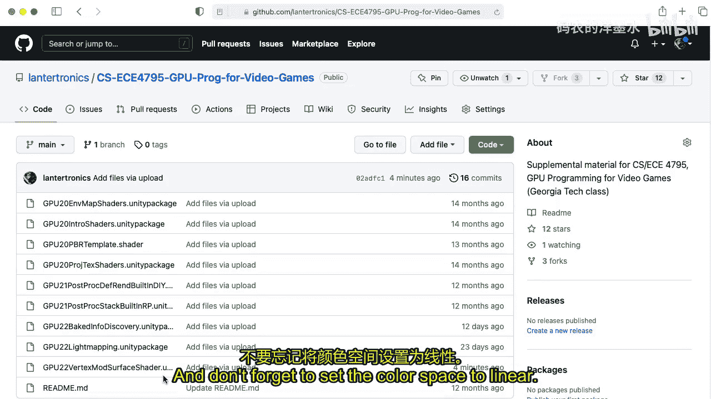
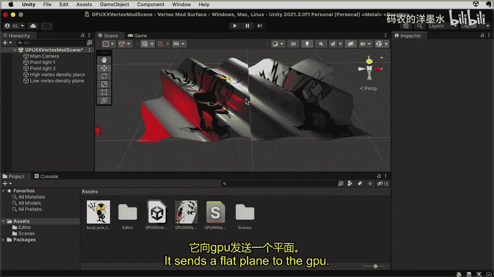
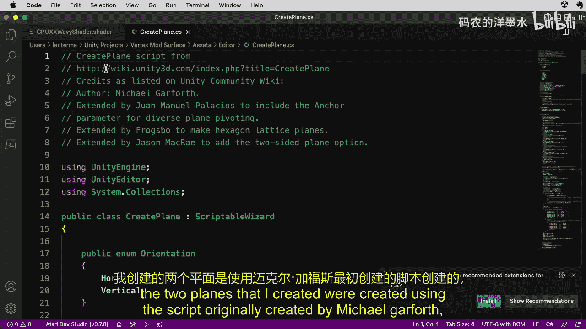
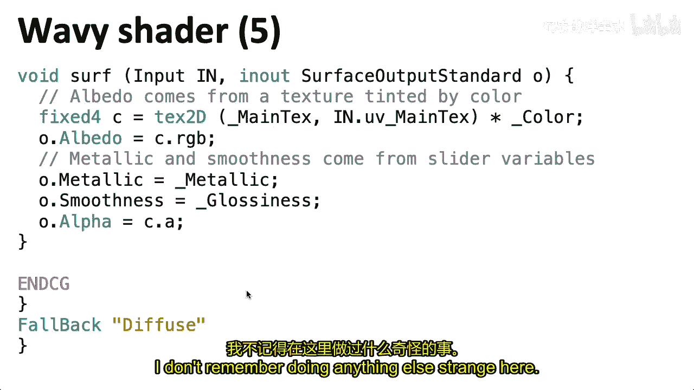

# 【全集】佐治亚理工学院-GPU编程：视频与游戏-中英字幕-p41-Lecture-41---表面着色器中的程序性顶点修改--BV1GZfyBbEQn_p41-

Hi there， my name is Erin Laterman， I'm a professor of electricallect and computer engineering at Georgia Tech and in this lecture I'm going to show you how to perform cool procedural animation effects like this on the GPU。

In the last lecture of GPU programming for video games， we looked at surface shaders。

 which is a technology that Unity provides that allows you to write a function that specifies some material properties and also create custom lighting functions that describe how lights interact with those materials and then the surface shader compiler will create all of the vertex and fragment shaders you need and all of the various passes that it needs to support those light sources shadows etc。

 etc ce。 this lecture will talk about how to inject vertex modifications into that process If you would like to try out my code yourself。

 you can go to my Github My CS EC4795 repository and get the GPU22 vertex mod surface shadeder Unity package just load it up in a standard 3D builtin pipeline project and don't forget to set the color space to linearar I'll leave a link to the Gitthub in the description below。

So this object in the scene view here is really a flat plane as far as the CPU side is concerned。

 It sends a flat plane to the GPU。 The wave effects that you are seen here are happening on the GPU。

 What I would like to do is to click on the material that I've placed on these flat planes。

 and I'm going to click this little triangle here， so that the time animation effect happens in the scene view and not just when I press play。

So my scene consists of two lights， I have a red light over here and zooming out a little bit。

 you'll see that I have a white light up here， let's see this is a point light and this is a point light。

 so they're both point lights。And I should note that I have two copies of the basic structure。

 However， one of them is a plane that has a tessellation that's a lot denser than the other。

 So the one on the left is a very dense set of grid points。

 The one on the right is a much coarser set of grid points。

 I should mention that I actually created these using a special script。

 If you look in the editor folder。 the two planes that I created were created using the script originally created by Michael Garforth。

 and you can find this script on this unity wiki。

Oh， and it looks like I lost my animation in the scene view。 Let me click that triangle again。 Okay。

 now we're animating。 So let's take a look at the parameters I have for that particular shader。

 So here's a smoothness parameter。 Here's the metallic parameter。 Oh， that's kind of fun。Yeah。😔。

That's neat。 Anyway， let me put that back。 All right， now I have an amplitude slider。

 and what this does is it changes the amplitude of the wave。

So here we have the original perfectly flat planes and now as I increase that。That's kind of fun。

All right， now I also have something called the temporal frequency。

 and this is basically how fast the wave goes。So now that's going very fast。

We'll talk a little bit more about what's happening on the right here later。All right。

 so let me slow that back down。hLet's see， let me try to make it very slow， so that's pretty slow。

Now I have something called a wave number， and that's a spatial frequency。

 So that controls how closely spaced the waves are and let's crank that up。

So now it has like a folded accordion kind of effect。 And now if I crank it back down。

If I drive this all the way to zero， it should just move up and down。 There we go。 Yeah， all right。

Now。Notice that something very interesting happens on the right here， if I keep cranking this up。

It turns into a total mass。And in fact， it now looks like a very different frequency wave and by frequency I mean spatial frequency and it's going the wrong direction So is what's called an aliasing effect basically on the left there's enough points to capture the details of this wave but on the right it's a much coarser grid and there's not enough samples of that function to correctly capture what's going on so this is something my electrical engineering students will be well familiar with from EC 2026 and possibly EC 3084 and some of my computer engineering students may have taken EC 2026 so they may have seen this my computer science students are less likely to be familiar with this concept but it's an important concept to become familiar with anyway。

 so look up aliasing it's a lot of fun I also have this direction slider so as I change the direction slider I can change the direction of the wave。

Now， these are what you can think of as planar waves， I can also have circular waves。

 so this is vaguely reminiscent of something like a drop falling in a pond or something like that。

Notice that the issues with the coarse teslation on the right seem a lot more evident with this particular kind of wave compared with the planar wave。

 So let's play with this here。 let's crank up the amplitude。Ah， that's crazy。

It's getting love crafty in or something。 All right， the end of the world is nigh。

 Caot's cranked that amplitude back down。Now， for the planar wave。

 the direction slider doesn't have any effect。 Let's play with the temporal frequency。Okay。

 it's getting faster。But we can definitely get some more AAC effects if we crank up the wave number。

 so this is the spatial frequency。So here we now have a very tight set of waves over here on the left and what's happening on the right is complete mess。

But it's starting to become a mess， even on the left。

It looks like there's some really odd things going on。Yeah， that's interesting up here。

 It looks pretty O down here， but up here， it's a little weird。 All right。

 let me crank the wave number back down。Okay， so how do we implement this。

 the mathematics that the shader implements are solutions to the wave equation。

And before all my students start freaking out， don't worry about understanding the details of this here。

 I just want you to get a general sense of what's going on。

I should warn you that the shader I'm about to show you only works for these flat surfaces going along the x coordinate and the z coordinate。

 and the deformation is happening in the y coordinate。

 If you wanted to put this on some more general shape， some more general surface。

 you would have to do some more complicated coordinate system transformations。

 So the code implements solutions to the two dimensional wave equation。

 and you can just take this solution to the wave equation on faith。

 this is the solution associated with plain waves。 as expected， it's sinusoidal in nature。

 the amplitude a sits here in front。 The two dimensional coordinates we're going to use our X and Z。

 and what the formula does here is it dot products that two dimensional coordinate with what's called a wave number vector。

 So K here is our wave number。 That's our frequency in spatial terms。

 and the magnitude of this K vector that consists of。

KX and KY is just labeled K without anything else。Now this omega。

 that's what's called a temporal frequency， omega is equal to2 pi f where f is the frequency in hertz cycles per second Again。

 this is something my doE students will be very familiar with if your copy or computer science and haven't seen this don't worry about it。

 you can just take this on faith So all I've done in this expression down here is expand out this dot product because that's what we're going to put into the code and this gives us a function that tells us how much we'll displace the Y coordinate。

So for that raindrop spreading out a wave in the puddle kind of effect we want to have circular symmetry。

 So here our sinusoidal function is a function of just this radial component and we only have a single K placed here Now this isn't the actual real formula for the solution to the wave equation that involves something called beel functions which I'm really not going to get in here so I decided to fake the effect by just using a sinusoid the main difference between the plane wave that we looked at in the previous slide and this circular solution to the wave equation is that there's a division by the radial component here So the overall energy in the wave is getting spread out over the total circle forming a particular part of the wave as you get further and further out from the origin and I've added a certain epsilon here。

To avoid division by zero issues。So if you look in Unity CG。

 you will find a bunch of structures that have the name app data， underscore， something， something。

 something。And basically we'll be able to modify things in the structure before they go into the standard vertex manipulation routines associated with 3D graphics。

So the properties list isn't terribly surprising。 We went through those earlier。 Now。

 if we look at the actual start of the code， we see it is indeed a surface shader。

 and we're using the standard lighting model。 The new interesting thing here is that we have this vertex colon make wave。

 So this vertex option with the colon here， says we're going to define a function make wave that will define some sort of vertex modifications。

So this makeway function has this app data underscore a full structure as its argument and it's declared in out because we need to be able to overwrite what comes in。

 All right， so the first thing I do here is I use this sineco function This one has a couple of output arguments and basically this will take this first argument here which is this direction and it will put the sine into KX and the cosine into Kz。

 I then take that and multiply it by my wave number K in order to get my wave number vector that's used later in the formula。

Note that this direction is the same for every vertex。

 so it doesn't really make a whole lot of sense for me to compute it here。

 I should really compute it once on the CPU side and actually pass in the sine and the cosine but I was feeling lazy so I'm just doing it here anyway the next thing I do is I compute what goes into the sinusoid and that changes depending on whether we're using a planar or a circular wave so here's the formula that goes into the sinusoid if we have a planar wave and here's the formula that goes into the sinusoid if we have a circular wave。

Okay， so I then take that sinusoid argument， plug that into the sine co function to compute the sine。

 I also am computing the cosine here because it turns out we need that to process the normals。

 I'll talk about that more on the next slide。So I take the result of that sign。

 multiply it by the amplitude。If I'm using a planar wave。

 then I add that result to the y coordinate of the vertex， if I'm using a circular wave。

 then I first divide it by 0。5 plus R so that 0。5 is my epsilon， I should have made this a parameter。

 but I just hardcoded it here。So that deforms the surface。Now， what is all of this？

So when I first coded this up， I didn't have this here and the surface deformed appropriately。

 but the light looked wrong， and I realized， well Ill still rendering everything as if the normals were pointing straight up。

 I really needed to also adjust the normals so they're coming out perpendicular to the surface。

The math needed to do that gets complicated， it involves taking partial derivatives。

 and I don't really want to get into that here。So if you're one of my students in the GPU programming for video games class。

 you can just take this on faithith Now for fun， whether you're one of my students or someone from the broader community watching this。

 you can try to drive this result yourself and see if what you get matches the equations here that could be fun again for the purposes of this lecture the exact mathematical details aren't that important I just wanted to give you an example of vertex deformation in a surface shader Of course you can use the same kind of code here in some sort of custom handwritten vertex shader where you just put this kind of deformation in before you do the world space transformation and the view space transformation and the projective transformation and all of that。

To close this out， of course， we also need to define the actual surface shader。

 And if I remember right， this is pretty much what comes with unity surface shader template。

 I don't remember doing anything else strange here。

Okay， if you're not one of my Georgia Tech students taking this class for credit。

 you can check out here。 If you are one of my students， go to Canvas。

 There is a quiz for this lecture， and I want you to tell me four things。 First。

 I want you to tell me what class you've taken at Georgia Tech that you've liked the most。

 Not including any class that I've taught。 Second， tell me what aspect of that class did you like the most。

Third， I want you to tell me what class you've taken at Georgia Tech that you liked the least。

Not including any class that I've taught。 And fourth。

 I want you to tell me what you disliked the most about that class。

 I will keep this information to myself。 This is just for my own personal interest。 Again。

 tell me what class you've liked the most。 What class you've liked the least， Why， in each case。

 and don't include any classes that I've taught in either category。

