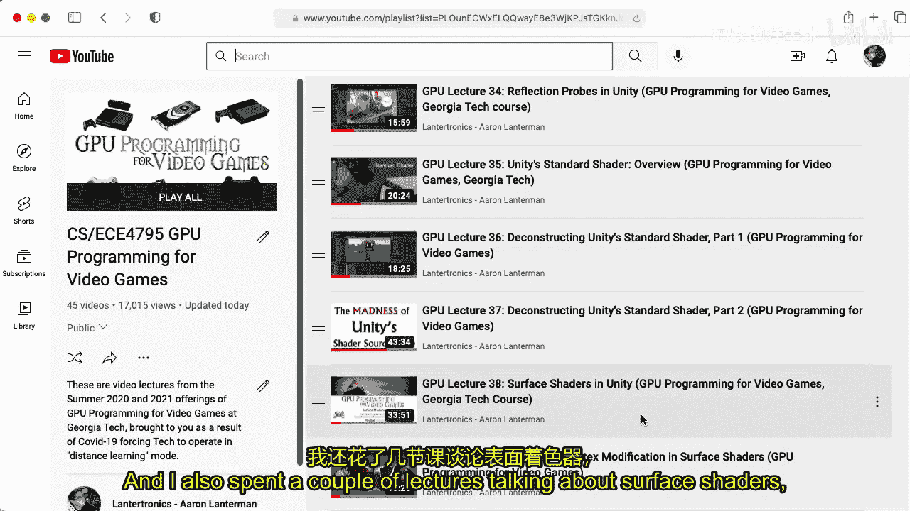
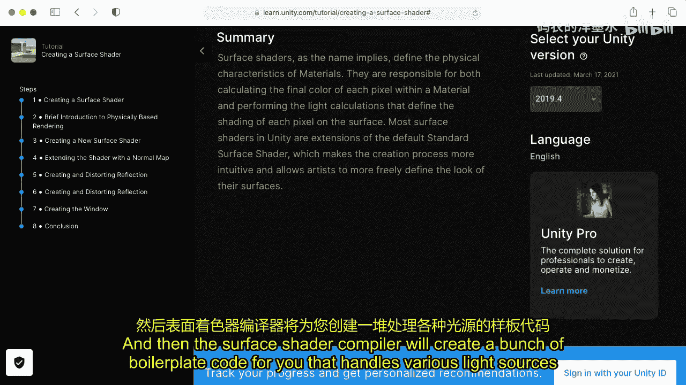
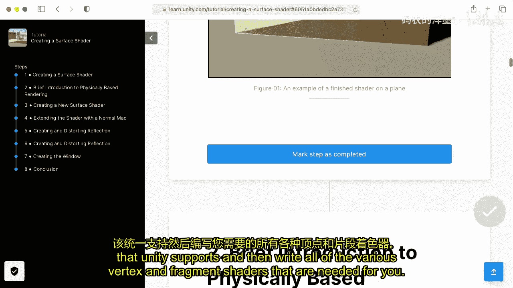
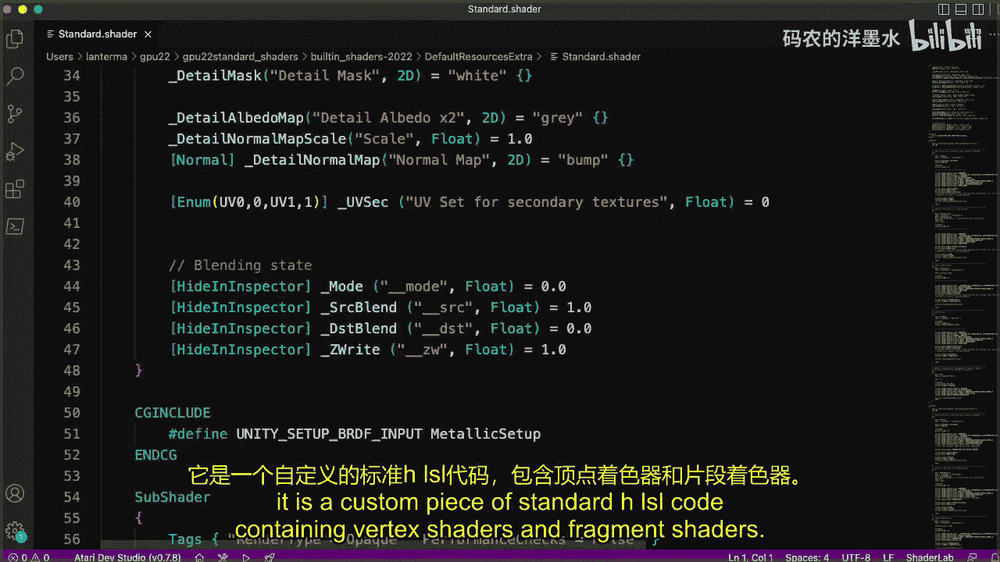
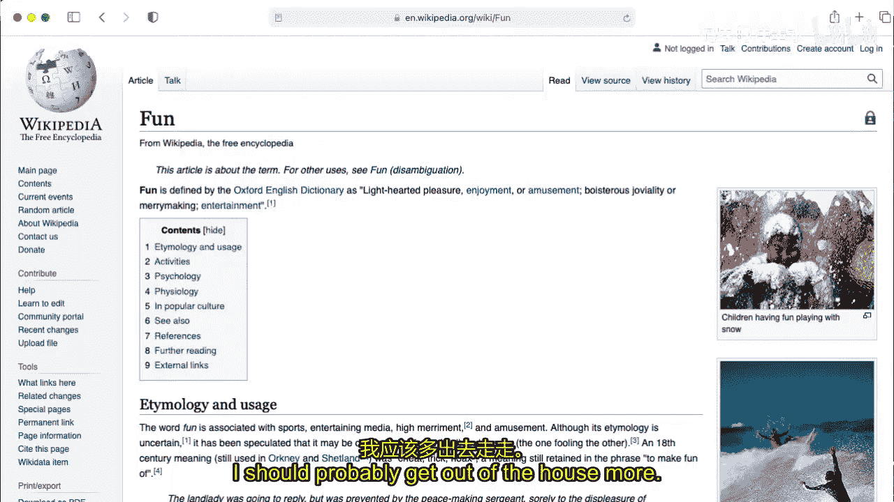
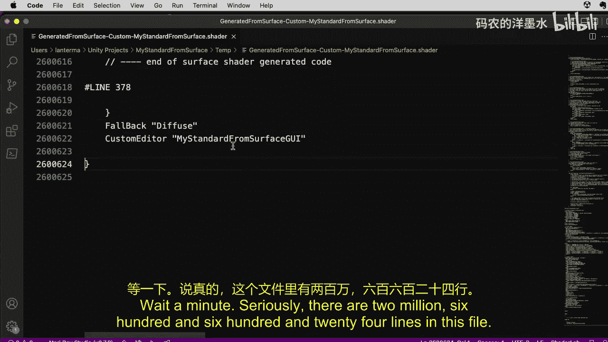
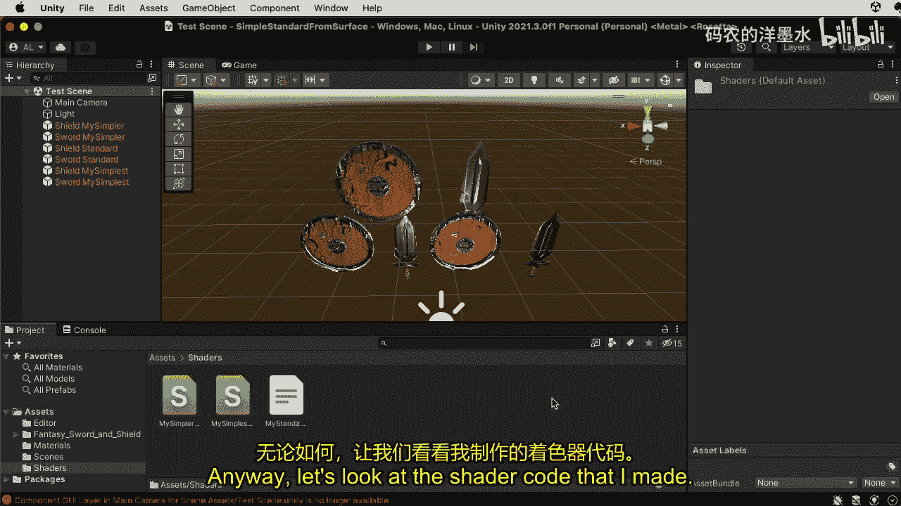
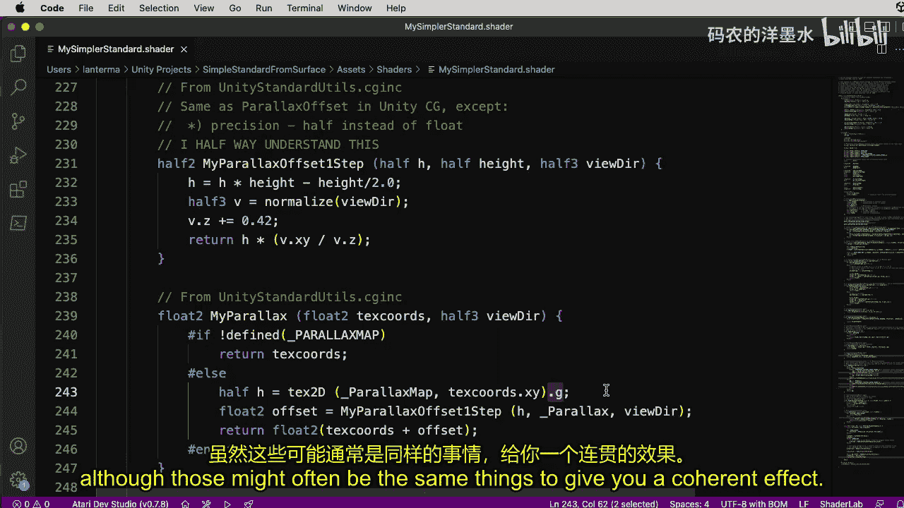
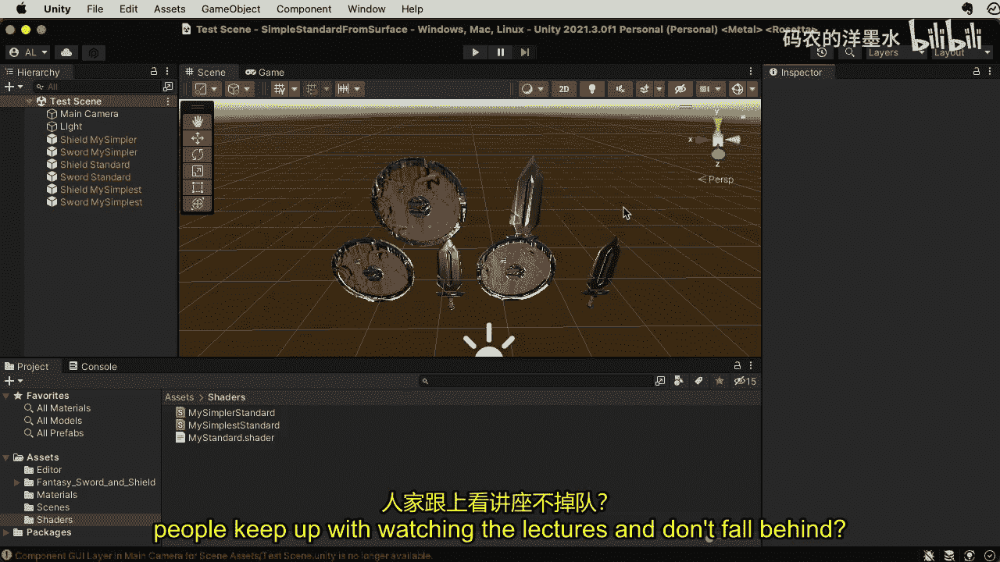

# 【全集】佐治亚理工学院-GPU编程：视频与游戏-中英字幕-p42-Lecture-42---标准着色器重写为表面着色器--BV1GZfyBbEQn_p42-

Hi there， my name is Er Lancherman， I'm a professor of electricallectical and Comp engineering at Georgia Tech and in this class on GPU programming for video games。

 I spent three lectures talking about unity standard shader that's part of their builtin pipeline and I also spent a couple of lectures talking about surface shaders which is a technology that unity has that allows you to write a snippet of code that specifies material properties and potentially a custom lighting function that describes how light should respond to those material properties and then the surface shader compiler will create a bunch of boilerplate code for you that handles various light sources that unity supports and then write all of the various vertex and fragment shaders that are needed for you。

Now the standard shader isn't a surface shader it is a custom piece of standard HLSL code containing vertex shaders and fragment shaders so I thought it would be educational to try rewriting unity standard shader as a surface shader both to try to better understand the standard shader and to provide an example of a surface shader so on the left here I have a sword and shield using unity standard shader and on the right I have a sword and shield that uses something called my standard from surface and that's my version of the standard shader using surface shader technology you can get the unity package for this demo from my GiHub It's called GPU22 standard from surface shader Now I haven't done a detailed comparison between the original standard shader and my surface shader。

Vion of the standard shader so I don't know if everything works。

 I don't know if everything matches exactly one thing I do want to point out is this idea of the height map and parallox mapping so let me turn down the normal map here I'm going to crank it down to zero on the shield。

You'll see there's some interesting effects here coming from the height map。

 so let me change the amount of the height map， so here I'm going to put it down at zero and here I'm going to start cranking it up and let me zoom in a little bit。

Make it easier to see what's going on here。All right， so let's crank the height map up and down。

So this is an interesting effect called Parallax， it's not something that I've talked about。

 it's a more advanced effect than the other things that we've addressed in this class so far。

 but it is in the standard shader so it is part of what I've implemented here。Let's see。

 let's turn the normal map back on and now we can also add the parallax， okay， that's fun。You know。

 if this is my idea of fun， I should probably get out of the house more。

I sat down to engage in this task of creating a recreation of the standard shader using surface shader technology and while sorting through my hard drive。

 I discovered I already did this way back in 2018 I had just forgotten I had done that So this my standard from surface shader begins with properties that I copied right out of the original standard shader and now instead of having vertex and fragment shaders we're now defining a surface shader。

 of course， I called the custom lighting model， my standard Now don't get this confused with the my standard shader from one of the previous lectures in that previous lecture I just took the original shader code copied it all over an added mind front of everything。

 what we're doing here is different This is creating a lighting model for the surface shader。

 I am importing from Unity C。And Unity PBS lighting， but for other things we need。

 I'm actually going to take code and copy it into this file to try to get everything in one spot so the shader features I copied from the original standard shader。

Similarly， all of these various declarations here are copied。

 and here I define the my surface output standard structure。

So I copy this from the surface output standard structure in Unity PBS lighting。

 and I should note that for your own custom lighting models。

 you can put whatever you want in the structure if you want to add something called Fred， Sure。

 you can add something called Fred。Whatever so let's take a look at what else we have here。

I have a bunch of other stuff that I copied in from other files and when I did so I usually stuck my in the name just to try to differentiate what we have in this file from what's in Unity main include files so we can modify things here if we want so here I have the function defining the lighting model for the my standard version of the standard lighting model and let's see here I have the call to the BRDF function。

 etc， etc， etc and up here I have the lighting My standard underscore Gi global illumination function let's see and if I scroll down a bit I have a bunch of functions that I put into here just to have here in this file so here from unity CG I have my impact normal and I put this here and I call this by impact normal so I can have everything in one。

And not have to bounce around from file to file and trying to trace through the code。In some cases。

 I took a couple of functions and sort of recombine them into one function to try to make things clear。

All right， so scrolling down here， I have some stuff about unpacking normals。

Let's see something about blending normals together。

Here we have something to do with reading detail mask textures。

 that's a more sophisticated surface shader feature。Let's see my normal intangent space。Oh。

 here's a bunch of complicated stuff。Let's see Okay， here are the texture extraction function。

 so here we have the emission map， here we have the alpha extraction。

And let's see here we have the albedo map extraction。

 this includes a bunch of stuff having to do with detail masks。Here's the occlusion texture。

Metallic gloss。Oh here's that parallax effect that uses the hyp map。

 I don't really understand how this works I mean if I put in the effort I could understand how this works。

 I just don't feel like it， so let's move on。So here's the actual surface function and let's see it's always fun to take a look at code you wrote four years ago。

 what did I say here， the style of using XY for the main map UV coordinates and ZW for secondary map UV coordinates is used throughout the standard shaders subroutines okay。

 that's a good observation Er from four years ago。All right。

 insufficient hack for this demo code and the actual standard shader。

 this is done in a text code routine and Unity standard config that is used in a vertex shader。

So this texture coordinate assignment is probably going to happen in the fragment shader when the actualgile surface shader gets compiled。

 so this is going to be a little less efficient， but whatever。Okay。

 so apparently there's something in the standard shader about using alternate UV sets and I don't really remember what the issue is。

 but apparently I had a problem with it so I just took it out All right。

 let's see we look up things in the various textures。We handle parallax， albedo， alpha。

 We get the normals。 I have a comment here。 If you write to the normal。

 write the tangent space normal。 That's part of what the surface shader structure expects。

And here we have my normal in tangangent space， that's one of the helper functions from earlier。

Let's see here we get the emmissive texture， occlusion， metallic gloss。

 and set all the things accordingly。And that's it oh。

 I should mention that there is a custom inspector for the standard shader。

 which I copied over and changed the name to my standard from Surface Gui。

That custom editor has to live in the editor folder， so if we take a look at it。

 we have my standard from Surface Gi and as far as this class is concerned。

 you don't need to worry about the details of how to make a custom inspector like this if you don't have one you'll just have a regular boring inspector and that's fine。

Now I did make a note up here that says modified by Er Lanchman so it would compile Let's see。

 I don't really remember what I had to change。 I do remember that I had issues just trying to get the original Gui for this to work a couple of lectures ago I must have four years ago figured out what to fix anyway。

The surface shader compiler will take your surface shader code and write a bunch of vertex and fragment shaders for you。

 and we can actually take a look at the code that it creates。

 Let's click Show generated code All right， and here's the resulting code。

And there's a lot of it here。Let's see if we scroll down， down down。How much is there here？

You've got to be gettingd me。Wait a minute， seriously， there are 26 and624 lines in this file。

You know what， What I should do is I should make a stripped down version of this that doesn't have as many features and maybe gives us a smaller compiled file。

And fortunately it looks like I did that four years ago too if you go to my GitHub。

 I put the code there GPU 22 simplified standard from Surface shader。

 so again I had forgotten that I had done this， I just discovered it while going through my files。

I just realized when I record these late at night and I'm tired， I sound a bit like William Shatner。

Okay， new 3D project， as always， we go to project settings and set the color space in the player to linear because gamma is bad。

 we want this to be linear。Let's import GPU 22 simplified standard from surface shader。Yep。

 let'itz import all this stuff and check out the test scene。Oh， I have a bunch of stuff in here。

All right。 So let's see here I have a sword and a shield that are using the standard shader。

 And then here I have a sword and a shield that uses my simpler standard shader。

And then here I have a sword and a shield that use my simplest standard shader。

 so it looks like I created shaders with two different levels of simplification。Oh。

 I should note that I used a normal map based on this picture of buzzuzz from DragonCon from a few years ago。

 I made a normal map out of it， and I used that on the shield to make the normal map effect more dramatic。

Anyway， let's look at the shader code that I made Let's see I have something here called mystandshadert text Oh I remember when I did this four years ago。

 this took a long time to compile now this isn't the my standard that I created a few lectures ago this is what in the file that I just showed you I called standard from Surface shader and I put Txt here so that unity wouldn't actually try compiling this Okay。

 so the simpler shader let's take a look at that。

What did I write， stripped out code related to transparency blending modes， secondary maps。

 and the checkbox options to turn off specular highlights and reflections。Okay。

 so I have less stuff here now。There's my lighting models。Helpper routines get things from textures。

Pllax stuff。There's the surface function。Okay， and let's take a look at the code generated by the surface shader compiler。

 So the resulting code instead of having over 2 million lines。Not only has 66，533 lines。Okay。😊。

Let's see what we have here in the inspector。Okay， so we have the albedo metallic smoothness as usual。

 but we don't have any of the secondary map stuff。Ah and yes， as I thought。

 each of these variations of it needs its own separate GuUI file for the custom inspector。O。

 and for the my simplest shader， I've got albeo， metallic smoothness and a normal map。

 And if I look at the code， I have a note here that I stripped out code relating to transparency blending mode。

 secondary maps。 Okay， that's the stuff I already stripped out for the simpler version。

 But for the simplest version， I also pulled out the height maps， the parallax effect。

 occlusion maps and a。So this code should be a lot tighter and a lot easier to wrap your head around。

 although there's still a lot of stuff here to wrap your head around。Okay。

 let's take a look at the code generated by the surface shader compiler for the simpler version this now only has。

It only has， oh， it's still going， it only has 14，867 lines of code。Now， I could take this file。

 save it， change the name here to something else。 And now this is just a standard unity shader file。

 and then you could modify it， optimize it， whatever you want。

 And this time now that it's not completely ridiculous。 Let's take a look at the code。

 Here we have a whole bunch of comments that the surface shader compiler added in in terms of what it needs。

Let's see it added some includes in here the autoitete。cgi and C。Something about internal data。

 et cea， et cetera。Dummy preprocessor to work around HLSL compiler line handling。😀あは。😊。

All sorts of insanity here。All right， so let's see if I can actually find where the compiled code is because all of the stuff in here is my original code。

Let's see。Well， and I should say it's not my original code。 It was code in the original file。

 This all started out as Unity code。 All right， At some point。

 we should get the functions that the surface compiler itself made。 Oh， here's the structure。

Let's see this is the vertex2 fragment structure， so this is what it uses to pass through the interpoator。

 world normals， world positions。Is this about shader targets？V2F surface。

Something about fog coordinates and shadow coordinates。Oh。

 there's a whole bunch of variations of these Oh， it looks like we're in some compiler directive so it will pick different versions。

 here we go。 Okay， here's the actual vertex shader。

 here's the sort of stuff we expect we're converting the vertices from object coordinates to clip coordinates we're passing along texture coordinates。

😊，World positions， world normals， we're transforming tangents。

 competing by normals if you need that kind of thing。Something about dynamic light maps。

 some more light map stuff。Here's the stuff about those four point lights that can be computed per vertex。

 stuff with spherical harmonics。Bunch of stuff about fog。And now we have the fragment shader。

Some more stuff about fog。Here we're looking at the light direction， world view direction。Let's see。

 We have a bunch of stuff that's getting initialized to 0。 I suppose later。

 we actually do the texture lookups。Where are my texture lookups a stuff involving that lighting structure？

Global illumination stuff。 And here it calls the actual lighting function whose job it is to fill in those various things that were initialized to 0。

So that was the HLSO code created by the Sur shader compiler。

One thing I haven't shown in any of these lectures is the actual assembly code that's created for one of these shaders。

 so let's hit compile and show code。All right， so this is not a valid shader file。

 the contents are provided just for information and for debugging purposes only Okay。

 so let's start scrolling down here and see what we can see whoa， look at all of this。This is crazy。

So we have things that look like。You underscore XLAT 39， you underscore XLAT， oh。

 I bet these are registers。Let's see FMA， this is probably some sort of multiply an ad。

So this doesn't look like assembly code the way you're used to assembly code looking。

 but these all map to assembly instructions， here's some sort of dot product。

 here's some sort of reciprocal square root。Oh， this is really interesting， okay。

 here's a texture lookup operation。And not something you would ever want to write by hand。嗯。😊。

Before we close out， one thing I should clarify， the height map is conceptually a scalar map。

 I put this RGB image of a buzz here。The routines associated with parallax mapping pull out the green channel to use as the height map。

Again， this is separate from whatever height map you might have used to generate the normal map。

 although those might often be the same things to give you a coherent effect。

Okay， if you are not one of my Georgia Tech students taking this class for credit。

 you can check out here， but if you are one of my students。

 I would like you to go to Canvas because there is a quiz associated for this lecture and there's just one question and I would like you to just give me a couple of sentences。

 what are your suggestions of things that I and other professors teaching asynchronous courses could do to make sure that people keep up with watching the lectures and don't fall behind。

