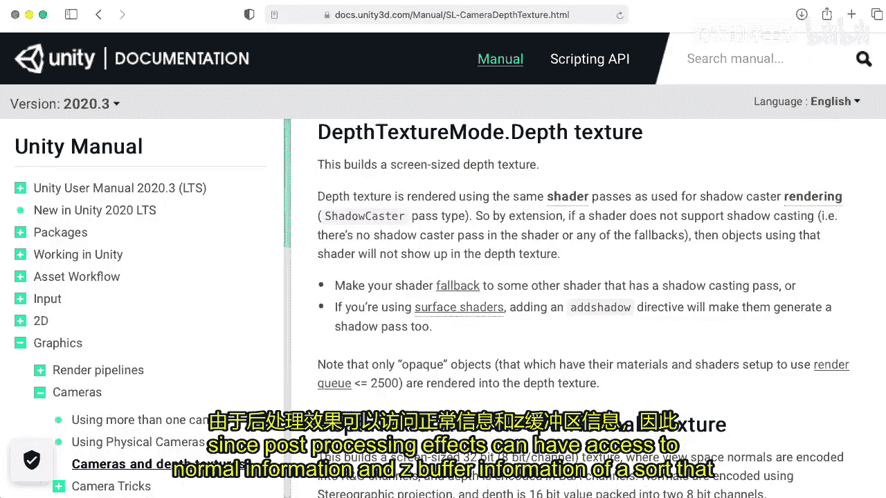
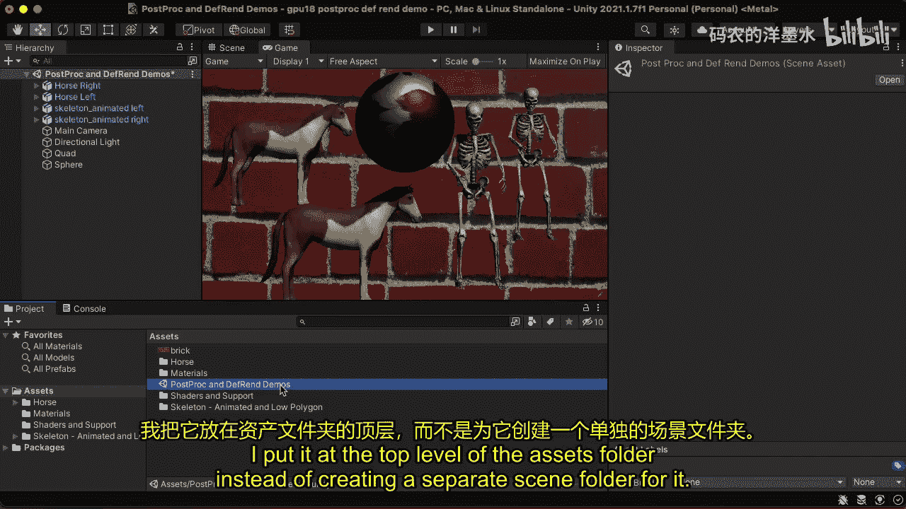
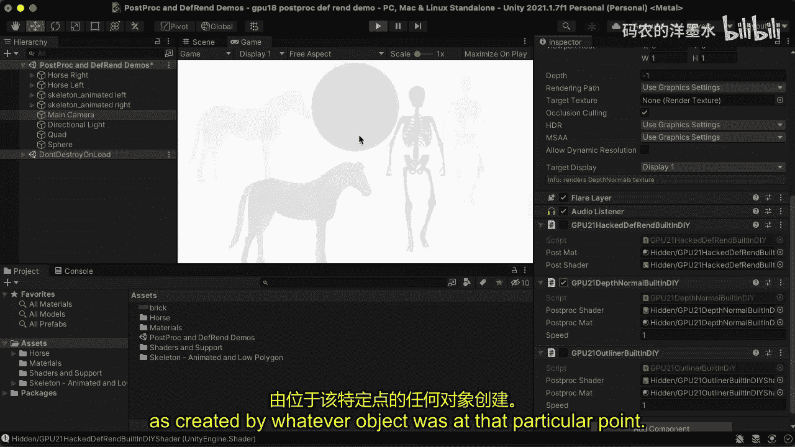
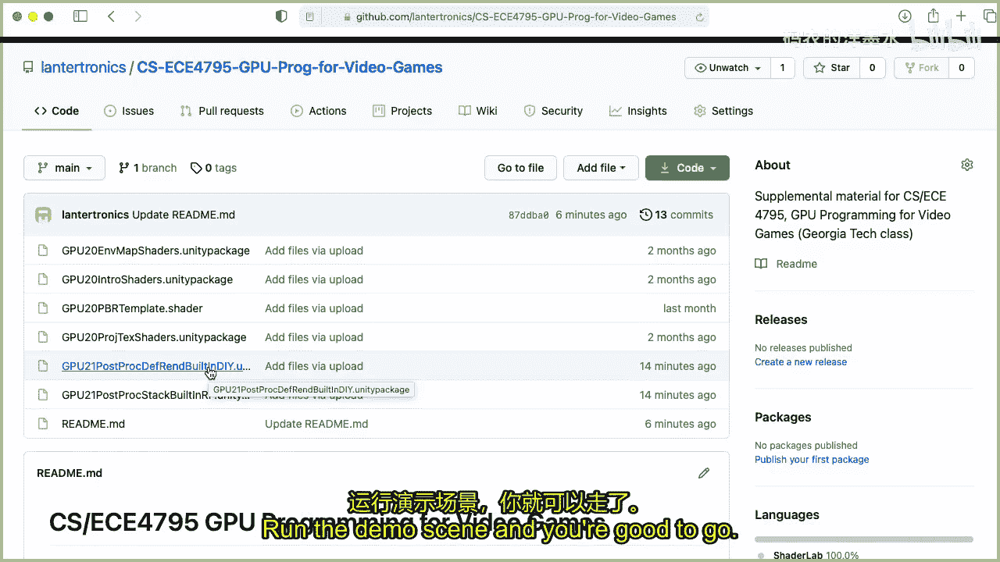

# 【全集】佐治亚理工学院-GPU编程：视频与游戏-中英字幕-p43-Lecture-43---基于内置流水线的-DIY-后期处理--BV1GZfyBbEQn_p43-

Hi there， my name is Erin Lagerman， I'm a professor of electrical and computer engineering at Georgia Tech and I would like to look at you to GPU programming for video games。

Postpro is basically like applying a Photoshop filter to every frame。

 I got this particular example from the X andA website back when I was teaching this course using X andA instead of unity and here we see this weird tank before a bloom effect and here we see it after a bloom effect where the brighter parts of the image get more blur if I remember correctly the tank was rotating in the demo。

 which is why the tank is also at a slightly different orientation。

 I also found this presentation by valve about motion blur in portal and other kinds of postprocesing effects in portal。

 this link is dead， but if you use your favorite search engine for a minute or two you can find a PDFf of the presentation slides Now motion blur can be handled several different ways。

 one would be to actually render a series of frames and average the result of those frames together with earlier frames having a lower weight。

 you can also perform an accurate motion blur effect by computing vector fields where there。

A different vector for each pixel what's used in a lot of games is a more straightforward effect where you just basically are applying something like a Photoshop filter with different blurrs based on what the motion of the camera is I love this this is something you can do in portal where you shoot a portal above you in a portal below you and if you line yourself upright you can basically fall forever Now postproces isn't just limited to the kinds of effects that you could implement in Photoshop since postpro effects can have access to normal information andzebu for information of a sort that Photoshop wouldn't have access to。

The scene consists of a couple of horses that we've seen before， a couple of these creepy skeletons。

 And I took the horse texture and wrapped it around the ball here。

 And then we have a wall in the back with a boring brick texture。

 I love the fact that these things animate happily in the scene view while the game is running。

 Anyway， as you can see by the little spot here。 I set that ball to have a metallic texture。

 It is kind of creepy to have the horse texture wrapped around it like that。 But anyway。

 there you go， the other objects are pretty much diffuse。

 I should mention that we're looking at this postpro and if for rendering demo scene。

 Since this demo package only has one scene。 I put it at the top level of the assets folder。

 instead of creating a separate scene folder for it。😊。

And all of the objects in the scene are using the standard shader that's associated with the built in rendering pipeline。

 So I have three scripts attached to the camera。 One is designed to illustrate an advanced rendering concept called deferred rendering。

 and we'll look at that later in this lecture。 The last one is called the outlineer script。

 and basically it morph so over time between the original image and a version of the image where I took the absolute value of the first differences in the horizontal direction。

 and the first differences in the vertical direction to get an edge detection kind of effect。

The one in the middle here isn't really a traditional postpro effect。

 but it's used to illustrate other information we can get from these pixels that we can use in our postproing effect。

 one is a copy of the Z buffer which you see when the image looks black and white。

 pixels that are closer to the camera are darker than pixels that are further away from the camera。

 and the color image that you see basically as a representation of the view space normal of a particular pixel as created by whatever object was at that particular point。

There's a speed factor on both of these that you can either use to slow down the morphine or speed it up here's an example for that depth normal shader。

 if I use this outliner， here I can speed that up drastically。

Don't be fooled by the fact that I have a material and shader here shown in the inspector。

 those are actually assigned by a script， I made these public for debugging purposes。

The code for each of these components is in this folder titled Shars and Support I did this so I could easily associate each script with its associated shader。

So let's take a look at the code first I want to emphasize that this is not what you would want to do if you're actually writing a unity game with the built and pipeline in real life you would want to use the postprocesing stack package that Unity provides here I'm showing you this DIY version to emphasize some of the things taking place behind the scenes that Unity's postprocesing stack code would take care of for you。

All of the shaders that I'm going to show you include this unitycGcG and C file in postproces essentially you're rendering a complete frame as usual。

 then snarfing that entire image treating it as a texture and then rendering another frame that consists of nothing but two triangles that fill up the entire space of the screen so unity CG provides our vertex shader for us and all it really needs to do is pass along texture coordinates we won't worry about the details so the shaders we're going to right now aren't like the regular shaders we had before where we would assign those shaders to a material and then attach that material to some 3D object so we use this special hidden feature that causes the shader to not appear when you click on the shader entry for a material and that big list of shaders in your project shows up here I've defined。

peed property and there's also this main texture that again we're not going to externally define。

 we're not going to pick a texture for this as usual This is something that our postprocessing code will handle and basically what it's going to do is it will tell the GPU to render the frame as usual all your various 3D objects then take that resulting image and treat it as a texture and that's what becomes main tech Now it's important to note that all of this is handled by switching pointers around on the GPU you don't actually have to read all of the pixels back from the GPU memory to the CPU's memory and then form a texture in CPU memory and then send that back to the GPU at least in terms of architectures that maintain separate memory for the GPU some systems will have a unified memory architecture。

So it is our job to define the fragment shader and this is where we put our post processing effect so here I'm doing a bunch of texture fetches from main tech。

I have the original texture that I sample here and here I grab the texture coordinate and then for original left original right original up and original down。

 these represented the image shifted slightly in different directions Now if you've ever written programs to do image processing this is going to look a little weird because you usually think of your pixels as being indexed by integers so you have i plus1 or i minus1 or J plus1 or j minus1 or whatever but remember most of the data on your GPU is represented as floating point numbers So unity fortunately fills in the screen prams vector 4s Sc prams do x basically gives you the width of the image and underscore screen prams Y gives you the height of the image1 over that will then give you a value between0 and1 that represents the floating point increment that you need to take in order to get to the adjacent。

Pixel in the texture， so that lets us go left or right or up or down。

 depending on whether we're dealing with the x coordinate or the Y coordinate and whether we subtract or add。

So in these lines throwing away the alpha value， I compute the horizontal and vertical differences。

And then I take the absolute value of those differences and add them up。

 and here I interpolate between that edge detected image and the original image as time passes。

The add component menu bit here is what lets us organize our various components。

 so here it will show up in like a folder titled GPU 21 built in DIY effects when you click on add components on any game object。

Since this is a script that is meant to be attached to a camera。

 we include this required component line so that Unity will complain if we attach it to something that doesn't have a camera component。

So the start routine basically assigns our shader and material variables。

 I should note that the name here in this string in shader。

 fine has to exactly match the name here in the shader line at the top of the shader file itself。

 including things like the hidden or whatever path information might be here。

 it needs to have all of that or it won't be able to find it。

 if it won't find it then this variable winds up being null and then needed you will complain that the argument passed to this constructor is null。

 etc， etc。Notice when it's finding the shader， it's not looking at the file name of the shader。

 you could name the file Fred， although it certainly is helpful if you give the file name a name that matches the actual name of the shader。

It's important to keep in mind that there is a speed variable that exists out on the C sharp side that's the variable that you actually edit in the inspector that is different than this underscore speed variable that exists in the shader itself so the update routine basically takes that material and it says。

 hey， inside of the shader， there's a variable called underscore speed。

 but that has no meaning outside of that shader code here on the C sharpp side we have to treat that as a string and then set floatat will know how to take the underscore speed variable in the shader code on the GPU side and set it to the speed variable that exists out here on the C sharp side。

And now here is where the real work happens the built in pipeline has a set of callbacks that you can use to do various things at various points in the rendering chain。

 most of the built in pipeline is a black box but they let you inject behavior at different points。

 so on rendernder image is a callback that gets run after your boring 3D objects have been rendered。

 but before it actually shows an image to the user。

 so these two render textures are actual images that are living on the GPU。

And so the bllip method here basically tells the GPU to take this source。

 which is that frame that was rendered by the normal rendering process and copy it to the destination。

 but do it through this material that is using our fancy outlining shader。

And all of that adds up to this cool effect。So now let's take a look at the code that displayed the depth and viewbased normal information。

 so the only thing that's really new here is that we're declaring a 2D texture called camera depth normals texture this is something that unity fills in for us that contains information about the depth and the normal at each pixel in this particular shader we won't actually use maintch because all we're doing is display the depth than normal information and in a more general context you might use the depth information for something like a depth of field effect where there's a specified focal plane and objects that are at the distance of that focal plane are in focus and objects that are closer or further away are blurry and normal information is used in advance effects like screenbased reflections。

So here's the pixel shader。 I left in the line where we extract the main texture。

 that's your regular scene of rendered 3D objects， even though I don't actually use it in the shader。

 and then we extract the associated pixel from the camera depth normals texture The depth and normal information is encoded in the RGB alpha of that texture The unity CG include file conveniently provides this function to take that data that's in that RGBA texture and pull out the associated depth and normal information since the function needs to return two results we can't use the result equal function kind of coding style so we wind up using this facility in HLSL or where it can actually return values through the parameter list That style can be confusing so I put out in comments here to let the reader know what's going on We'll take a detailed look at what's in this function in a moment。

The normals of each component go between -1 and 1。 So here I scale them to fit in a 0 to1 range to display them as colors。

 And then in the final line， I cross fadeade between the representation of the normals and the depth。

 which is just a number between 0 and 1。 and that cross fadeade proceeds as time progresses。

 actually come to think of it， I don't think I need this float 3，1，1，1 here。

 I think if I just put a float here。 Itll automatically promote that up to a float 3。As promised。

 here's that decode depth normal function from the Unity CG include。

It looks like they're storing the depth information in the z value or the W value that's actually a little weird to me since it's a texture I think it'll be more natural to write this as blue and alpha but that's what they decided to do and it passes that along to this tocode float RG routine the way to think about this is that colors and the texture are generally stored in an8 bit integer value but that's a fixed point representation of a real number going between0 and 1 so here what they're trying to do is basically use a 16 bit fixed point value for something going between0 and 1 where Z is storing the most significant byte of those 16 bits and W is storing the least significant byte。

This is basically computing z plus W divided by 255。

 So I'm not going to slog through all the details of this Decode view normal stereo function that's used to pull out the normal from this texture map。

 I'll just note in general that although this function uses Z。

 it's not actually storing normal information in Z。 remember z's encoding depth information。

 So by the fact that it is using Z down here that tells you that it's somehow changing the way it's storing the X and y of the normal depending on what the depth is and it winds up reconstructing the Z component of the normal from the X and y components。

 So you can dig into this function and other functions in the unity Cg file if you want to actually work out the details about what the mappings are。

 And actually I should clarify that the0 to1 value that you get out of this routine and that we display in the shader here。

 that's just like a raw Z buffer。VWhat we actually need to do to get the distance to the camera is to run it through this linear Id function and it uses the information in the Z buffer parameters variable here to scale and shift that accordingly and then you actually have to take the reciprocal of it in order to get the distance in view space units so that tells you that the GPU is using a non nonlinearar mapping for the buffer basically to try to best use that 16 bits of precision and have a more accurate representation of depth at the depth for which it is more important The associated C sharpp script that defines the component is basically what we had before for the outliner script The only additional thing that we need to do is to set the depth texture mode of the camera to what's called depth texture mode depth normals so we actually go through the extra work of storing and extracting that depth and normal information So the third effect I'm going to show you isn't。

A post processing effect It's designed to give you a taste of an advanced rendering technique called deferred rendering All of the rendering we've looked at in the course so far goes under the category of forward rendering and deferred rendering you don't actually do any lighting calculations when your first rendering your 3D objects What you do is you store in something called a G buffer。

 all of the information that you need to do lighting calculations that you do later hence the term deferred rendering and the example I'm going to show you here are G buffer information is just the depth and the normal map a real deferred rendering implementation will also have additional information in the G buffer and other G buffer textures like diffuse material color specular color basically the F0 for now parameter that we saw in the cook torrentance lecture There will also be things like a metallic parameter indicating rather a material is a dielectric or metal and maybe another。

Again in this example， I'm effectively using a G buffer that just has depth and normal information and all of the other parameters I'm just going to have be uniform across the whole scene。

So here's the shader code， all of the parameters that I have are going to be set by a C sharpp script。

 so since they're not things I set in the inspector in theory I shouldn't have to list anything in the properties list but if I don't include these colors in the properties list then something goes wrong in setting the parameters and everything winds up looking incorrect and sorry I haven't been able to figure out why that is。

 but I just know that I have to have them here。Anyway， if somebody knows what's going on here。

 let me know。So you'll see here in the HLSO code， I have the line where I define that diffuse color and specular color that matches these properties。

 but I have a bunch of other stuff like these light positions， this shininess parameter。

 this camera data vector， these are also defined by the C sharpp script。

 yet I don't have to define them as properties， so not sure what's going on there。Let's see。

 let me fix the formatting here， there we go。In this demo I'm completely bypassing Unity's lighting system。

 I'm doing my own thing， so here I have a bunch of values for different lights。

 notice I can have up to six lights with this code， you can of course add more。

So here's the actual pixel shader code， as in the last example。

 I get the depth and the normal information。I found that the Z coordinate of the normal was facing opposite of the way I expected。

 so I negate that。 I really confess that this is a thing that I often do when writing code。

 which is something's minus what I think So I just negate it where I need to to get it going the direction that I think it should be for what I'm doing and I move on without thinking about it much further。

 Do I actually need to normalize it， I'm not sure， but it's always good to be safe。

 If I was really trying to optimize this code， I would investigate that more thoroughly and see if normal V S is absolutely certain to be normalized。

 Okay， the next three lines took me ages to figure out。

 Remember that when you do perspective projection， you divide by the Z coordinate。Now。

 essentially here what we need to do is to take each pixel on the screen and find the associated position in view space so we need to undo that transformation。

So here I take the texture coordinate that is going from zero to 1， multiply it by two。

 and then subtract one， so I now have coordinates into that image that are running from minus1 to 1。

 and then I take that and multiply it by my Z distance to essentially undo that perspective division。

 then I multiply it by Xy in this camera data vector。

 in order to get what the Xy coordinates and view space R。

 and I can append the z coordinate to that to get the position in view space。

If you didn't catch all of that， that's fine。 I went through the suffering myself so you don't have to suffer。

 All right， so now we can compute the various vectors we need to do lighting calculations。

 so for specular reflections we need the I vector in order to be able to compute a half vector so that's a vector pointing from a point on an object to the camera and here the camera is at zero so essentially this is zero minus the position in view space because the camera is at the origin and view space and then we need to normalize that in order to use it in lighting calculations。

So here's where I finally compute the lights， Basically I took a piece of code and copied and pasted it five more times to handle all six lights。

For the first light， I declare the variables， and then I don't declare the variables later since I've already declared them。

 and I reuse these variables。 the main difference with the color is that for the first light。

 I compute a color and for the remaining lights， I use a plus equal because I need to add the colors for the additional lights。

The red dots here indicate that there's four more blocks of code that look kind of like this one。

 except instead of having VS0 or VS1， it has VS2，3，4 and 5。

All of my lights here are point lights so I just grab the Xyz and then I subtract the position of the pixel and view space to get the vector pointing towards the light and from that I can compute the half vector which is the normalized average of those used in a specular lighting calculation for the diffuse calculation I just take the dot product of the normal and the light direction both in view space and then do the max0 in order to deal with the situation where the light is pointing to the back of a facet and here I'm faking the specular effect this is the original blendfong model it's a much older way of faking a specular effect then the more modern multiplication of a BRDf by a limberian and dot L term with a cook torrentance formulation for the BRDf that we looked at in the previous lecture this is much simpler than that there's no ferl term there's no geometric term although technically speaking you can have an。

Is a geometric term where you wind up with a visualization term that's just like multiplying by one？

Now this dot product of the normal with a half factor and taking that to some power that does look like what we call the modified blendfong。

 but that would have a normalization term that would be parameterized by what we call shininess in order to maintain energy conservation and the whole thing would need to be multiplied by an Ndot L term which we're not doing here。

 this is a much older way of faking a specular effect and they used it here just for its simplicity。

Okay， and here is the C sharp script that drives it。 I set this up so that at this level。

 the number of lights is generic。 But in the start routine， I commit to having just six lights。

 You could， of course， make that more complicated and flexible if you wanted。

So this on prereer is a callback that we haven't seen before in this lecture。

 this gets run before the main rendering of the scene。

 and here we use it to set up the camera data that we need in order to properly decode the depth and normal information and also undo the prospective projection effect in order to figure out where various pixels live in view space this is the sort of stuff that in the previous examples unity set for us but here since I'm bypassing unity's lighting system I need to set this for myself and then here we have a series of commands that set these parameters inside the shader。

So my update routine basically moves the lights around and there's not a whole lot of reasoning behind how I move these I just wanted to have some cool lights moving around If I wanted to I could set up another array that contains light colors and modify those colors as the program runs。

 but for the purposes of simplicity in this demonstration I just hard coded a bunch of different colors in the shader itself。

Here's the new on render image。 This line we've seen a couple of times already。

 and really the only new thing I'm doing here is setting the various new light positions in the shader based on what happened in the update routine。

 So unity first updates， then it runs the rendering routine。

 So this now make sure that we're rendering the scene with the updated light values。

 And come to think of it。 I don't think we need this line here for the camera data because we already set it in the on pre render routine here。

You could probably just comment out this line。Something kind of interesting that I noticed is that these effects will apparently cascade so I can turn on the depth normal effect and turn on the outliner effect at the same time。

 and you will then have the outliner effect running on top of the result of the depth normal effect。

 similarly I can run the outliner on top of the hacked def rendering demo so you'll see these little spots inside of the spec highlights here appear when the outliner effect kicks in and you can also see it down here on the body of the horse there it is。

So that's kind of neat。So if you would like to try this out。

 just head over to the Lanterntronics GitHub page， find the CSEC 4795 repository。

 and you will find the GPU 21 postPro Deafri built in DIY。Okay， sorry， that is an absurdly long name。

 but I want to distinguish it from things like the GP 21 post Proc stack built in RP。

Unity project which we'll look at in the next lecture anyway as far as this lecture is concerned。

 you could just download this， start a blank 3D project in Unity and drag this onto your assets folder。

 run the demo scene and you're good to go。

