# 【全集】佐治亚理工学院-GPU编程：视频与游戏-中英字幕-p44-Lecture-44---Unity-内置流水线的后处理栈--BV1GZfyBbEQn_p44-

Hi there。 My name is Er Lanterman， I'm a professor of electricallect and computer engineering at Georgia Tech in the last lecture of GPU programming for video games。

 we looked at some simple code that implemented post-processing effects at the time I noted that you wouldn't want to actually implement post-procesing effects this way because unity has something called the postprocessing stack which works in the built-in pipeline and lets you write your own custom effects that also play nicely with the post-processing effects that unities already provided Last time I showed you some scripts that defined some components that you could add to your camera that would do various postprocessing effects but these wouldn't really play nicely with the rest of unity structure。

I'm running 2021。1 and let's create a new unity project just a standard 3D project。

 I'll call this the postproces stack test Let's create that you can go to the Github page link below and grab this postpro stack built in RP package don't get the DIY package that's the package for the previous lecture and drag drop it on top of the assets folder import everything。

And it's going to complain。 I'm going to get a whole bunch of errors because to make your life easy。

 there's something you need to do first， which is to go to the window and the package manager。

And go up to where it says packages and select Unity registry to see all the stuff Unity provides and scroll down to the postpro package Now this postproces package only works with the built in pipeline it used to work with the universal render pipeline but as I will complain about in the next video unity broke that at some point Now the universal pipeline does have a postpro setup built into it thats very much like what I'm going to show you here but it is different so if you are using the URP you don't separately download this postprocess package anymore it's now built into URP。

 but it's its own thing that's not compatible with this anymore and in particular the URP does not support custom postpro effects right now the HDRP the high definitionfin render pipeline also has its own separate postprocess framework。

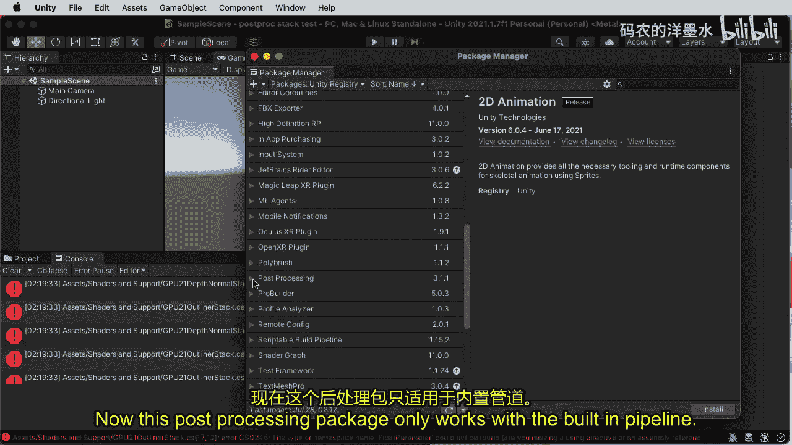

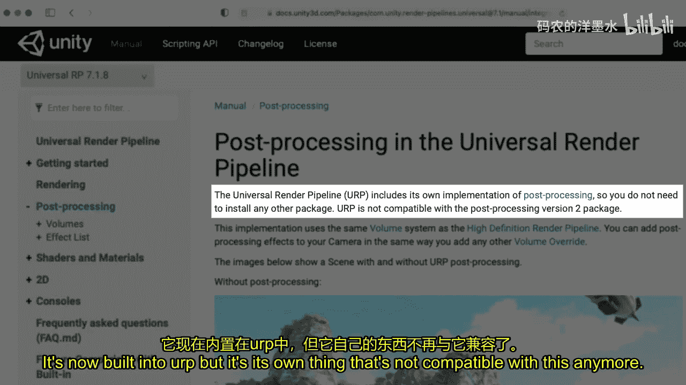

That's built into the HDRP package， but that's totally separate from the postproces stuff that's built into the URP and is also totally separate from this postpros package that goes with the built-in render pipeline so yes that's all confusing the main thing to know now is we're running the builtin pipeline not one are these fancy scriptable render pipelines and we need to install this postproces package。

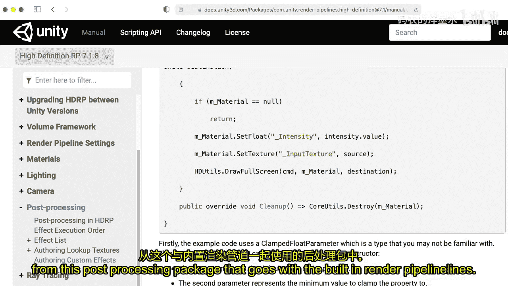

Okay， now we have that installed， so let's go back to our project and let me load up the scene。

 I put it on the main assets folder instead of in the scene folder since I only have one of these scenes。

 post Bro demo scene， double click that and let's see if this works。Let's see。

 let's go over to the main camera and if I scroll down here。

 you'll see that we have this outliner stack， but it doesn't work。

 and we have the depth normal stack and it doesn't work。

Because there's something else I need to do here， because I imported the package first。

 I actually need to go to the shaders， and I think I can just reimport the shaders， but maybe not。

 let's see， let's just try to reimport that shader and then we'll reimport this shader。Okay。

 so that made the errors on the shaders themselves go away All right， I have a warning but whatever。

Let's see if I go back to my camera。And turn these on， do they work？h that one works。

And this one works。Fantastic。I sort of knew ahead of time that just reimporting the shaders will fix it because I've done this before。

 But in general， if you run into problems like that， it's probably best just to do a reimport all。

 which you can actually do by clicking anywhere in the assets folder。

 And I just realize this goes down the bottom of the capture screen。

 So let me move this up for a moment and show you what I'm talking about。

 And if I move this up a little bit more。 Hopefully I can right click there's the reimport all。

 the problem with reimport all is that it usually takes a while But sometimes when unity gets confused that will fix things。

 Again， best bet is to just install that postpro package first。 then install my demo package。

 So let's take a look at what's attached to the camera。 I have this thing called postpro volume。

 which I'll talk about in more detail in a second。 the main thing to know right now is that I can click on the little checkbox next to GPU outlineer stack and turn on this effect。

 Now something I don't quite understand。 is that。It looks like this off is selected。

 which I think would turn the effect off， but if I click this to on it looks like the effect is off so I don't know if this is actually doing what I think it should be doing or if it's and is doing it wrong or if it is actually controlling something else that I don't quite understand here's that depth normal stack effect so again。

 if I have this button set to off then the effect is working if I turn it on than the effect goes off so I talked about what these different effects are in detail in the previous lecture and in fact in this lecture I'm going to assume that you've seen the previous lecture so please go watch that already if you haven't and then come back here just as a bit of of this effect is cross-faading between the original scene and an edge detected version of the scene and I can use this speed parameter to change it Now something that's new we didn't have last time。

I have to click this little checkbox to actually change the speed parameter。

 so let's make this a little bit faster。If I uncheck that。

 then it goes back to that default value of one this is called an override and overrides are a fundamental concept in the postprocesing stack structure that unity provides for us I'll come back to that later All right。

 same thing with the normal depth stack in this particular example it's fading between a representation of the Z buffer。

 the depth information and that's what you see when it's in gray scale so things that are closer to are dimmer and things that are further away from you are brighter and again。

 if I click this override I can change the speed of that effect。But if I turn off the override。

 then it goes back to the default。One thing to notice is that these are not components anymore in the previous lecture in the DIY package。

 those were actual components created in a C sharpp script that you would attach to a camera using the ad component These custom effects that I wrote are part of this postprocess volume that incidentally is part of the camera I attached that component to the camera。

 but that's not necessary， and in fact that's usually not considered best practice I went ahead and attached it to the camera because it matched the structure that I had in the DIY postprocess chain or demo I showed you last time。

 but usually this is attached to something else。Now。

 it probably would not surprise you to notice that if I turn off this component。

 the effect goes away。It also goes away if I turn off this post process layer component。

 So the post process layer component， that is something you do actually have to attach to the camera。

 And then that winds up talking to the various post process volumes that you have in the scene。

 Why is this called a post process volume and not just post process effect list or something like that。

 Well， if we go over to the scene view here。 Oh， look at that。

 looks like the shader actually runs on the scene view here。Hh， in my little post processing shader。

 what about the depth normal stack？Oh。That's really interesting。Okay， but there's something。

 let's see。Okay， so。The main camera shown here in this little view down here does not have the effect。

 but if I look at it in the game view tab， it does have the effect。

 Let me make sure that's the same in the outlineers effect。 Okay。

 so you see the outliner effect here when I go to the scene view。

 it's not including the outliner effect here， but it is in this。Grand scene view。

 that's kind of neat。I wonder if my D I Y shaders did that， too。 I'm not sure I checked that。

 I'm not sure I actually thought to try that。 Oh， and the other question is。

 does this only happen when the game is running。 So if I turn off the game and go to the scene view。

Oh， it looks like it does。 It looks like the effect is in play。 Wait a minute。

 it will be a lot more obvious with the depth normal effect。If I turned that on， oh。

 the whole thing go oh， nope， there it is。 It looks like my effect is， in fact。

 running on the scene view here。Except the time variable doesn't animate unless I actually have the game running。

I really need to have the game running for it to actually be working in the same view anyway。

 that was just a little fun aside。So what's up with this volume business If I go up here。

 I can say create a 3D object and the 3D object I want to create is a post process volume。

So the volume is going to have a scale parameter。Something like this。

And it has a position and rotation as usual， the main thing about the scale is it lets me define the extent of this volume and what it means is that the various effects that I add here。

 and in particular the parameter overrides I create basically take effect inside this volume so I can add various effects here。

 I can add something like the builtin effects in unity。

 let's try something like chromatic aberration。And let's also try bloom， that'll be fun。

So let me go over to the game view here and I'm going to pull out that main camera and I'm actually going to turn that off because I don't want things interacting here yet。

Let me go to the post process volume and turn on the various effects here。

So I have chromatic aberration and I have Bom， let me play the game。

 let me click on intensity to override that parameter。And I'll set it to something like 30。Or not。

Let me make sure that my camera is in the post process volume， so I squooed it over there。Oh。

 wait a minute， there's something I need to do with the post process layer here I forgot。

 says no trigger has been set the camera will be only affected by global volumes。So as an aside。

 that's why I had is global selected down here。 So the particular volume I had attached to the camera affects everything in the scene。

 But this one isn't global， It has a limited extent。

 So what I need to do is to go to the post processing layer here and attach one of these transforms。

 And oh， it's not being very picky about that， Is it， All right。

 so let me take the post process volume here and put it in here。And now if I go to the game view。

 ah there you see the chromatic aberration， good， good， good。

 let's also turn up some bloom here about let's start blooming at an intensity of zero point no。

 they're not the intensity， I want the threshold。Let's start blooming at a threshold of 0。5。

And let's turn the intensity up to 100， I， maybe Ted。Five， two， okay， let's bloom everything， no。

 let's only bloom light things， but let's bloom them a lot。😀へ。😊，That's my。It's 245 in the morning。

 al right， yeah， okay， that's fun here's what happens if we bloom。

 turn off the chromatica aberration， there we go。There's all sorts of little stuff here。

 can I change the color of the bloom？Let's see。Yeah， there's red bloom。Here's Blue Blo。Prople bloom。

All right。No for that。Hi there， so I paused recording just to play around with these parameters for a bit。

Let me crank up the bloom effect to make it even more dramatic and what you'll see is that I can go back to the camera here。

 turn on my post process volume that I made for my effects Now again。

 it's very weird for me to be attaching this to the camera。

And if I turn on this outliner stack effect， you'll see that it's stacking on top of the chromatic aberration and the blur effects My outliner effect is coming after those built in unity effects because of something I set in associated scripts that's why they're showing up here under the after stack category in this postproces layer。

 there's also a before stack category I could assign things to。The way I have this set up。

 the ordering here， the depth normal sta comes last， and that just overwrs everything。

So if I wanted to， I could take the order here and swap them。

And now if I turn on that depth normal stack， now I'm running the outliner effect on top of the depth normal effect。

Let me switch these back。

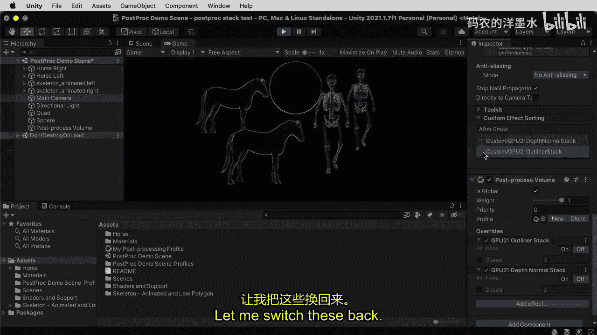

So with these post process volumes， you can define a bunch of these of various sorts。

Let me turn off my own so we can see what's going on。

You can actually have a whole bunch of these postprocess volumes with different parameter overrides and then unity will cross fadeade between the various parameter settings for these different volumes as the camera moves between different elements of the scene so you could have one part of your scene where the fog is a lot stronger or whatever effect changes you want I'm not going to get into such details here so I'm actually going to delete this particular postprocess volume Okay。

 let's take a look behind the scenes at the code。So in the DIy post processing lecture。

 we used a C G include file that a lot of stuff in the built in pipeline uses。 and in theory。

 we would use that here， but this was originally a transitional package that also needed to be compatible with the universal render pipeline。

 Of course， as I ran about next time， Unity broke the way this works in the universal render pipeline。

 This now really only works with the built in pipeline。

 and as part of originally trying to maintain that compatibility， which they later broke。

 they're instead using this standard library dot Hlsl。

 I guess So the first structure here basically corresponds to something that I used to call a2 V going from the application layer into a vertex shader。

 This variances default corresponds to what I previously would call something like V2 F going from the vertex shader to the fragment shader。

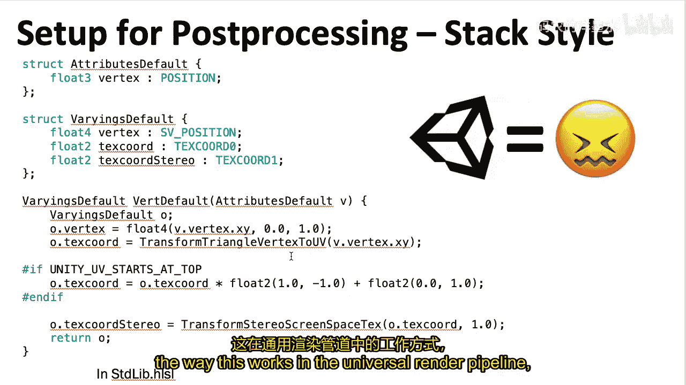

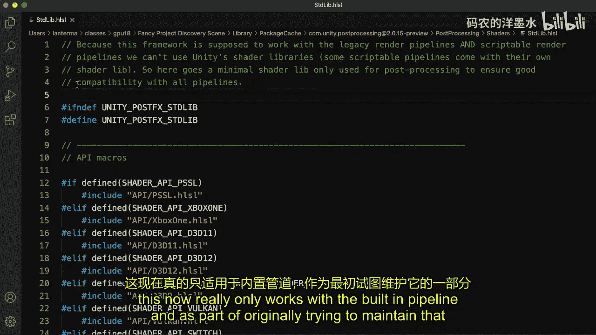

New unity style seems to be to call stuff like this attributes and stuff like this variants I don't know why I would not have picked those names。

 but there you go and since all the post-processing shader really needs to do is paint two triangles forming the rectangle of the screen you don't really need much here and in fact we really don't have to look at this at all。

 this is just providing some background， we can take it on faith we can believe that unity is doing right by us anyway。

 the vertex shader here， this vert default basically takes texture coordinates and passes them along and perhaps flips them around as needed to deal with various platform specific things but in general there's not much going on here and not much we need to worry about anyway we can just believe that this will work。

Here's the boilerplate for the outlinelinr shader。I'll go into the details of the actual fragment shader where the work is done on the next slide。

For some reason unity style for writing these custom shaders is put all this HLSL code first and then put all this stuff about the pragmas down here。

 not sure what's going on there。 I guess is just a different style that they like to use here。

 the main difference compared to what you might have seen before is that where we used to have something like sampler 2D main tech Here we have this weird texture 2D underscore sampler 2D macro that also includes main tech with the word sampler in front of it I'll talk more about what that is on the next slide。

 It's a different style of defining these kinds of textures。

And the code is basically the same as what I showed you in the DIY post processing lecture I get the value of the texture at a particular pixel。

 I pull out the values at the neighboring pixels in order to do that we have to use this one divided by screen parameters。

 x trick。Remember screen parameterm X is basically the width of the image and screenprem y is the height of the image。

 so if I take one over the number of pixels that gives me the floating point value。

 I need to move over in those texture coordinates in order to get the next pixel again if you're doing image processing you're used to just having an array and you add or subtract one to get the neighboring pixel。

 but most things on the GPU are represented as floating point numbers including texture coordinates going from zero to1 here I'm computing a first difference in the horizontal direction and a first difference in the vertical direction。

Getting rid of the alpha value while I'm at it， then I take the absolute value of each of those and add it up to get the outline image。

And then in the last line， I cross fadeade between the outline image and the original image over time。

Besides using a different structure here， the only thing that's really new is this sampler texture 2D macro。

So in the DIY lecture， we wrote a line like this along the lines of flow original equal tech 2D。

 main tech， high tech chor， something like that here we have a macro with three arguments。

 so what's going on here。So the style we've been using in the whole rest of the course。

 the sampler 2D style basically has parameters like what kind of interpolation mode do you want to use。

 If you access a texture coordinate outside the0 to one range。

 Does the texture coordinate clamp at the edge or does it wrap around stuff like that。Essential。

 this new style of defining textures lets you define those parameters like clamping versus wrap around and nearest neighbor versus bilinear versus whatever else interpolation。

 in a separate structure from the texture itself。 So if you have a bunch of textures that basically then I'll share the same texture look up parameters。

 then you don't have to waste memory on having multiple copies of the same parameter。 Now。

 I don't think this is a lot of data。 So I'm not sure why it's actually that big of a deal。

 but it's now the preferred way of doing things in new unity code because apparently it matter。

up with this DX 11 style syntax and this is even for if you're running on a Macintosh right that is not using Directx it's using metal or metal2 or whatever or if the underlying API talking to the GPU is actually Vulcan or even something older using OpenGL it's still using the syntax specified by Microsoft Oh sorry wait a minute the answer to my question is right here。

 it turns out Directx 11 has limitations on the number of sets of sampler parameters you can have so by default if you use this mini textures。

 some of these are going to need to share。So apparently this Dx 11 stth syntax also addresses textures using this dot sample notation。

 so that looks more like a method call in something like Java or Char or whatever that's weird I've never actually seen that in shader code before and it looks like that's not necessarily universal because unity really wants you to deal with things through these macros it wants you to use macros so it can switch to various different styles depending on what your target platform is or whatever。

 although even these macros are not the same as the macros in the postprocess demos that I found so who knows anyway if you keep going down here it shows examples of the various mode so here's an example of different kinds of interpolations and here it shows the clamp mode versus the tile mode and it looks like you can clamp in one direction while tiling in another and also clamp or tile with different mirror effects so。

All kinds of fun Anyway I bet you could take all of this code and rewrite it in this older style with the tech 2D and it would work fine。

 but the original unity example code I base this off of use the new style so I figure I might as well use the style while we're at it I will note that all of the new examples I've seen for general shaders for 3D objects for the new universal render pipeline and the high definition render pipeline they all use this new format。

When it comes time to teach this class again， I'm debating rather to stick with the original tech 2D or just go ahead and switch to this new format right at the beginning。

 I'm not sure。So here's the script associated with our custom effect。 Of course。

 it needs to inherit it from this postpro package。 Here we have various boilerplate bits。

 This postpro directive refers to a class that I'll define on the next slide this postpro event after stack that unsurprisingly makes this effect happen after whatever built-in unity effects you've selected occur。

 and this string here specifies the name of the actual shader that it uses。

 instead of just a good oldfashed float， for some reason。

 this fancy postpro thing has a float parameter type， which gives it extra coolness or something。

 and I found you could even add a toolt for it that will show up if you hover or over it in the inspector。

 Okay， so this GPU21 outlineer stack renderer method is defined on the next slide here。 And again。

 you don't really need to know all of the details here。 I don't know the details either。

I basically copied and pasted example code from Unity's documentation and changed what I thought I needed to change A you need to get some sort of property sheet。

 something or the other and then you can set that float parameter using this line and whatever that property sheet is referencing to whatever the actual variable name is in the shader code and this is the magic command that actually takes the original image of your 3D objects that were rendered in the regular way and then copies that to the destination texture using your particular fancy custom shader。

Now let's take a look at the depth normal shader。 The boiler platelate is the same as what we had for the outliner effect。

 except we do need to declare this texture to get the depth and normal information。

 I also wanted to explore what it's like to just get the depth information without the normal information So I included this line here。

 although right now you could just actually comment that out and things would be fine。

 If we look at the next slide， there is some complicated stuff going on that I'll talk about in a second。

 but for right now， ignore the stuff that I originally had commented out。

 So we get the main texture as before now we get this depth normal texture that's encoded。

 and then we need to apply various bits of processing to it in order to get the right information out。

So this line here basically takes the range information that's encoded in the Z and W coordinate of this fancy depth normal texture and interprets it as a 16 bit fixed point representation of a number between zero and1。

 that's something we talked about last time and this is a fancy routine that we'll look at in a later slide that actually pulls out the normal information。

The normals go between -1 and 1， so I add one to them to scale it between 0 and 2。

 and then I multiply it by 0。5 to make that run between 0 and 1 so I can display the normal information as a color。

 and then I cross fade between them here I'm taking the depth。

 which is a float and I'm repeating it three times。Because this is already a float3。

 I think I can actually take this out and it will promote naturally Before we go on。

 let me double check that that works。 So let me go to my main camera for the sole reason that I have the post processing volume I'm using attached to it。

 let's turn on that depth normal stack shader。

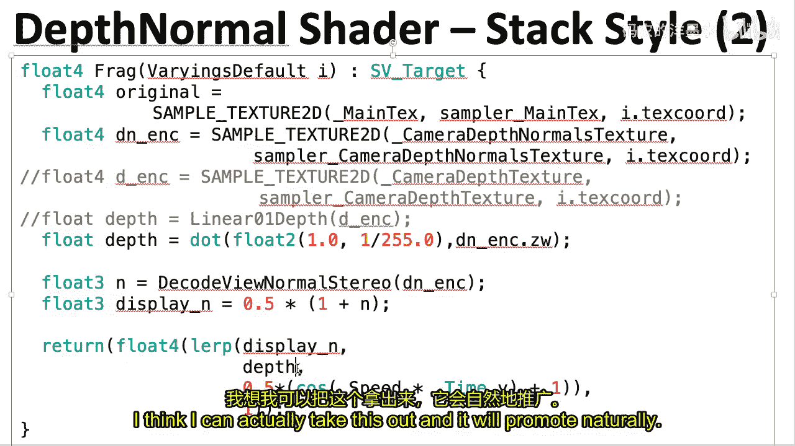

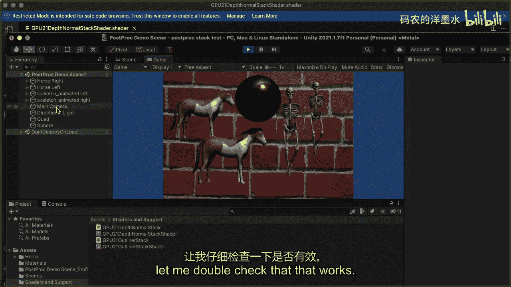

And now let's try to make that change and see if something explodes。

 So I'm going to get rid of those。

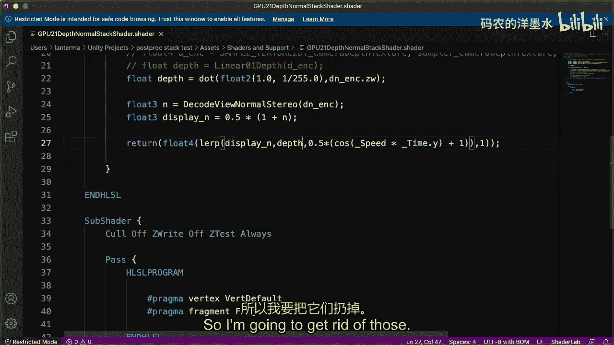

Is it still running， Let me double check to make sure it has in factory compiled and isn't complaining about something。

 Yep， it's still happy。

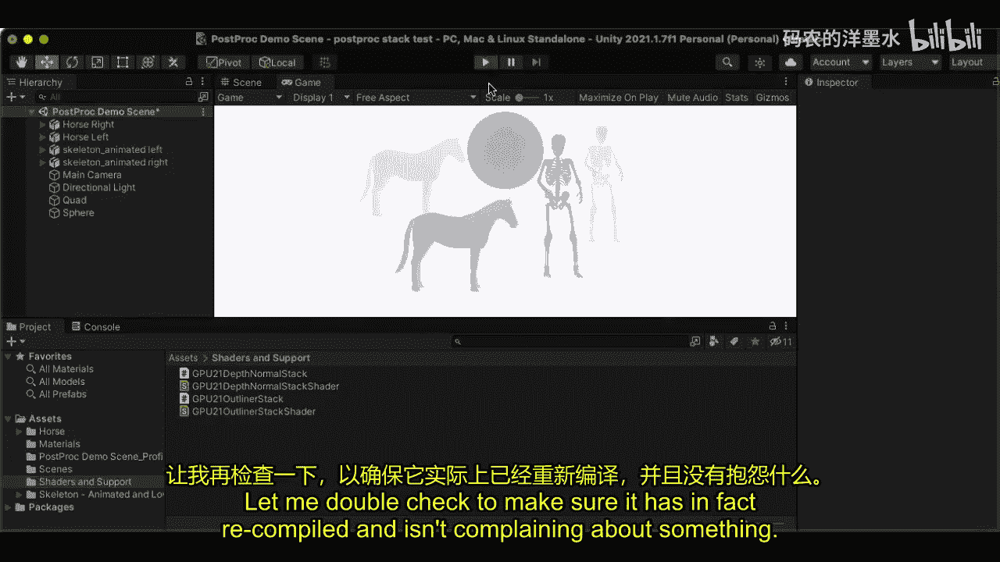

So here is that Decode view normal stereo routine remember the depth information here is stored in the Z and the W。

 so X and Y story normal information and it winds up reconstructing the normal information in Z but thecoding is fairly complicated because notice they need to use some of that depth information in order to get the actual normals back out。

 and just like in the DIY postprocess lecture， I'm not going to try to sort all this out here we can believe that unity sorted it out for us。

The associated C sharpp script looks pretty much like what we had for the outliner effect。

 the only thing really need to add here that's new is that we have to override some built in method called Gitca flags in order for the GPU to actually go through the bother of saving that depth normal information for us。

So last thing。 What's up with these commented outlines。

 So there is a mode where you can get just the depth information and not the normal information as well。

 And so I wanted to experiment with that。 And that's why you have this other declaration here to get just a depth texture。

 And what I found out is that if we played around with that， something interesting happens。

 And we have to do something else to get the depth information out。

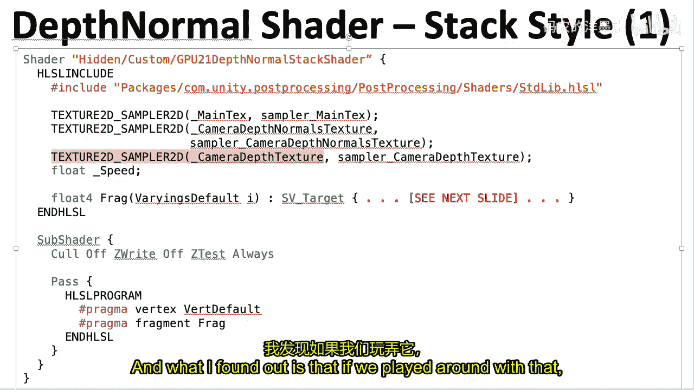

Let's explore that a bit， so what I'm going to do here is comment out the line that cross fadedes between the normal information display and the depth information display。

 and I'm just going to return the depth information here I think I do need to have this construct in order to get a float3 out of it Okay。

 and then I'll add the one in for the alpha so we don't actually need this normal stuff now。

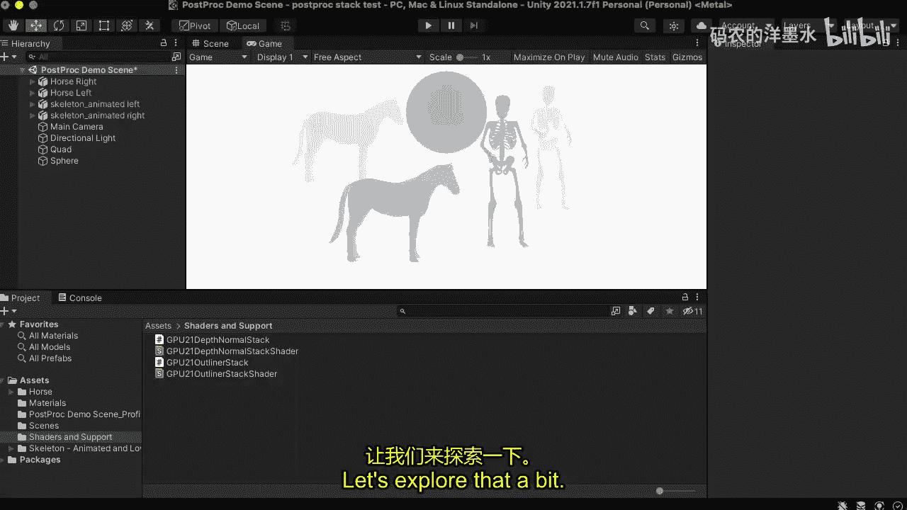

Now， let's take a look at what happens when I comment out this and comment this in。

What happens if I were to take this line here and copy it？And get rid of the end there。

So we're doing the same thing of taking the Z and Y。

 interpreting it as a 16 bit fixed point representation of a number going between0 and1。

 but using the Z andW from this depth texture instead。It gives me an error。 O。

 why am I getting an error here， Oh， I don't have this here anymore。

 Let me just comment this out since we're not using it。

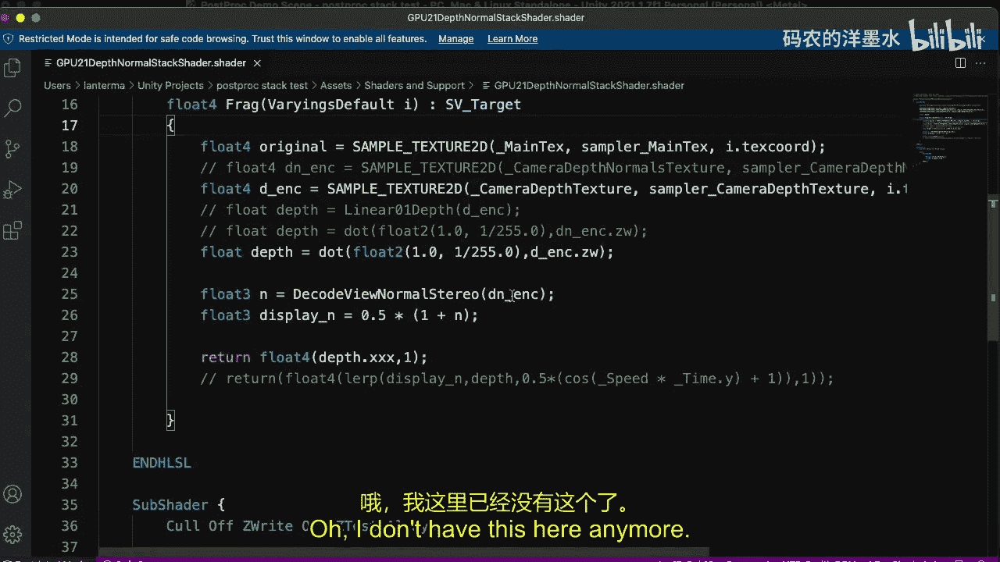

There we go。 So this looks neat。 but it is different。

 So now things that are closer to the camera look brighter and things that are darker than the camera are further away。

 but I wanted to get this consistent。 So it turns out to do that。

 We need to use a different method of extracting the depth information， And that's in this linear 0。

1 depth function， which I'll show you in a second， And when I do that。

 now it looks the way we expected。 So depending on whether you're using just the depth texture or the depth normal texture。

 you need to use a different procedure to extract the actual depth information。

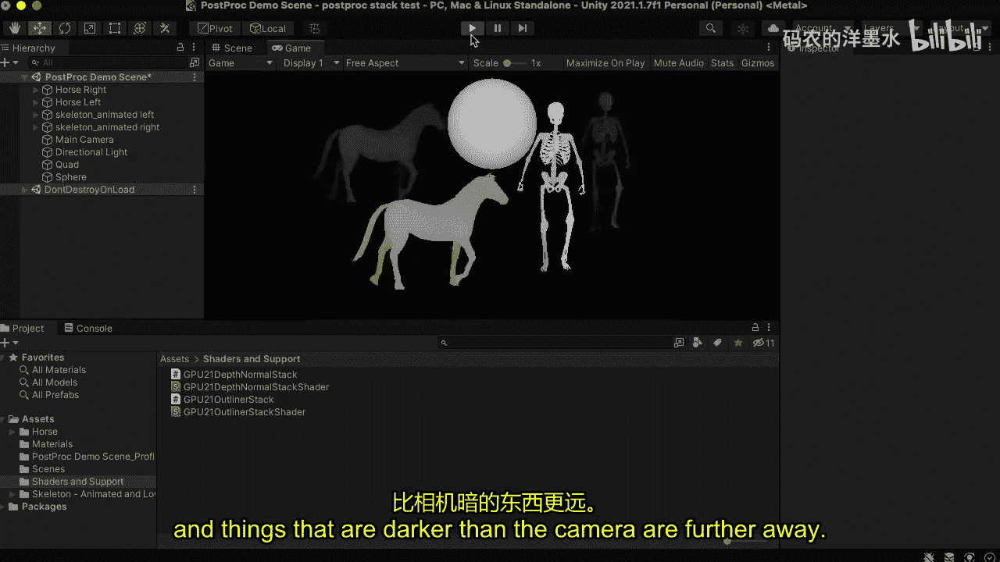

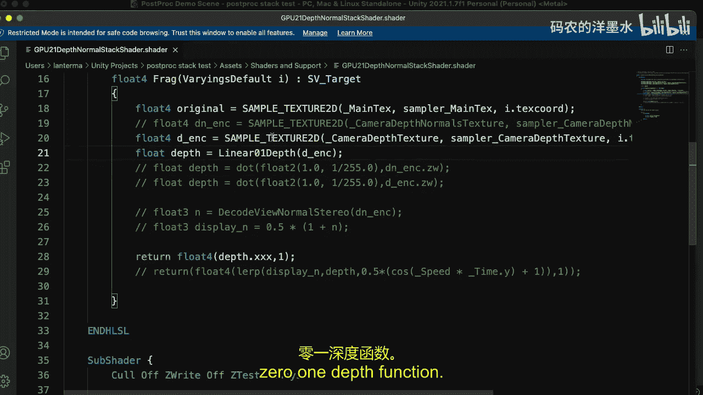

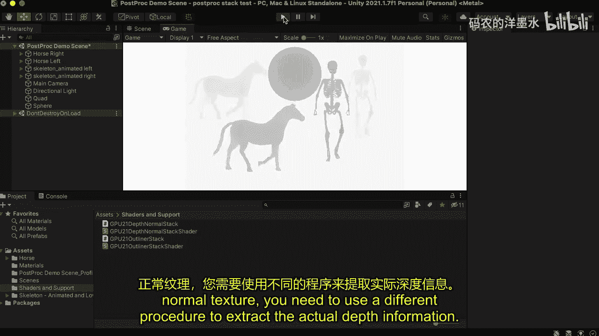

So I'm not going to worry about sorting all of this out， and I don't think you should either。

 and if you ever do need to understand it more， well。

 the code's right here and you can go look up the unity documentation， but for our purposes here。

 we'll believe that Unity has done this correctly。

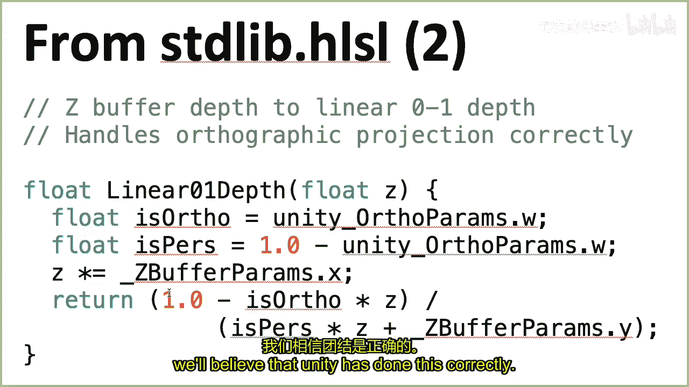