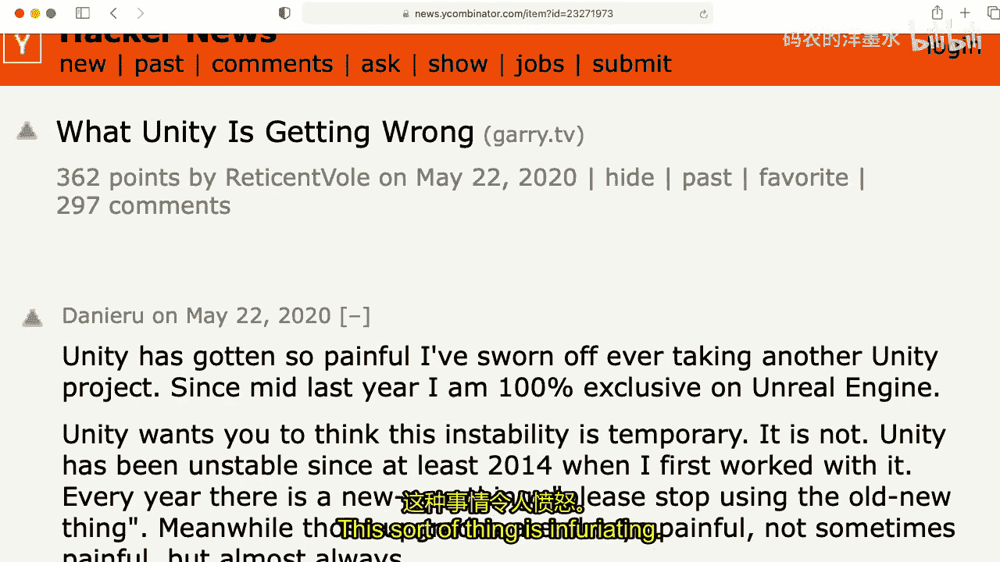
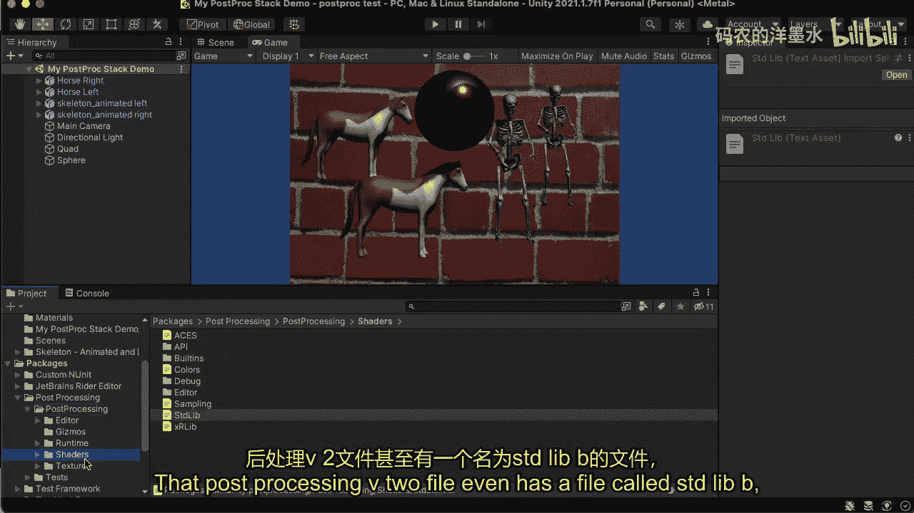
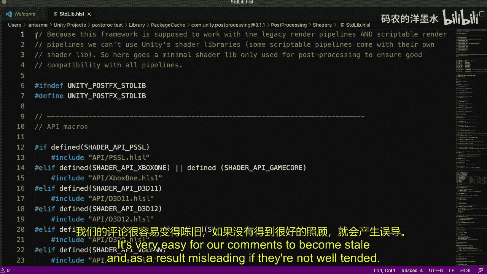
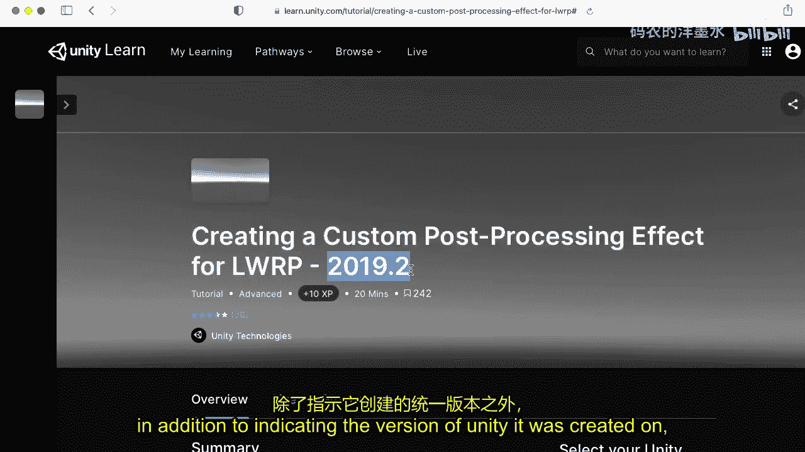
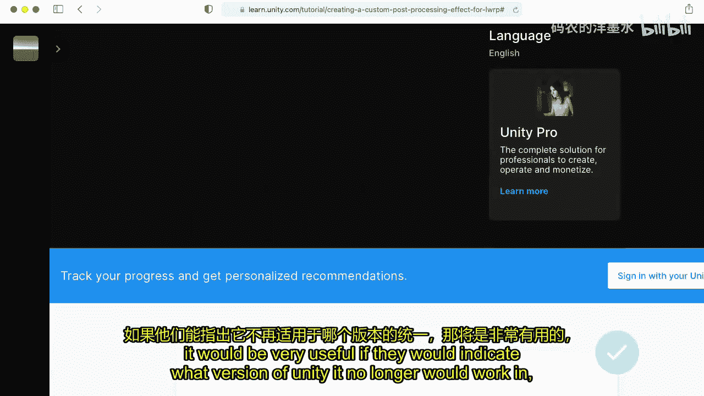
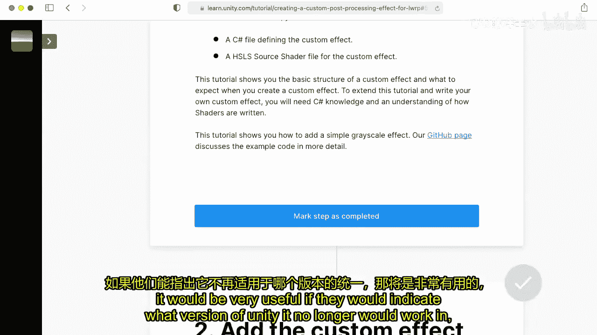
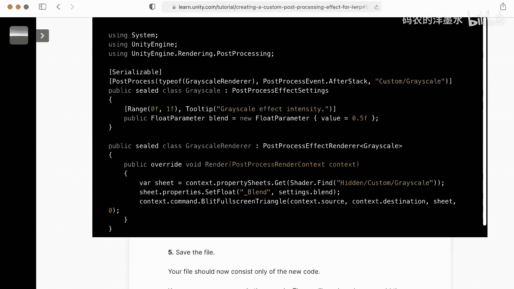
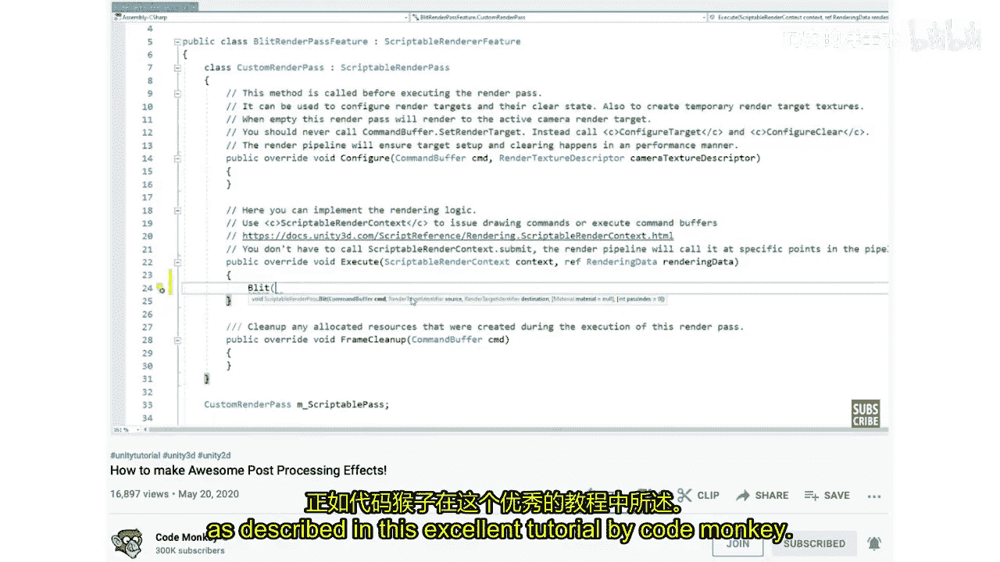
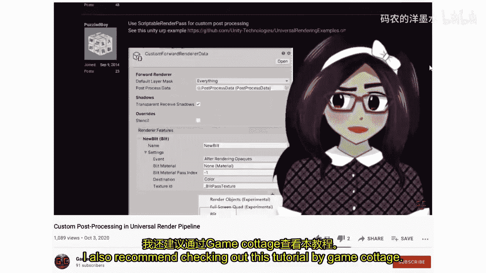
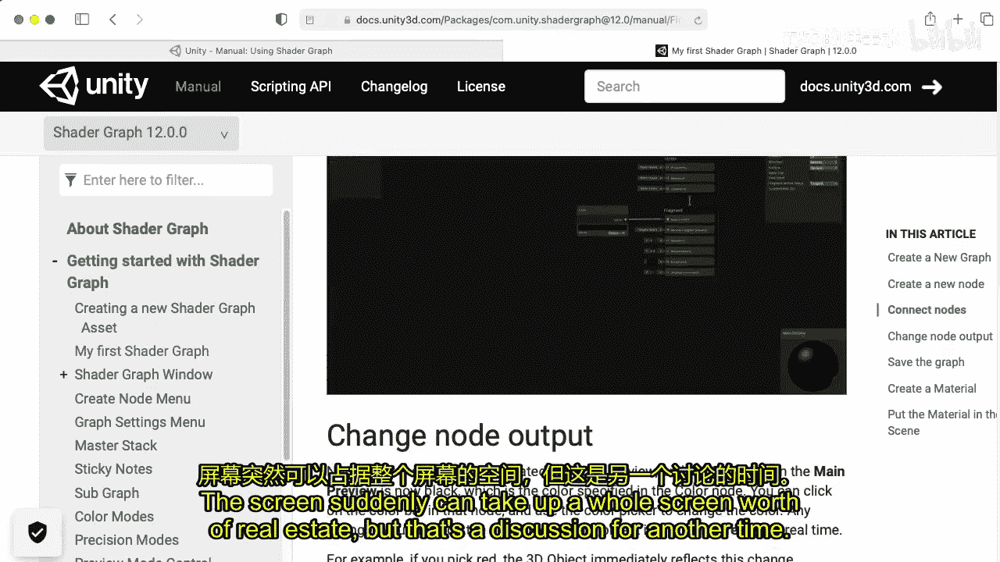

# 【全集】佐治亚理工学院-GPU编程：视频与游戏-中英字幕-p45-Lecture-45---URP-中的自定义后处理--BV1GZfyBbEQn_p45-

Hi there， my name is Er Laterman I'm a professor of electricallectical and computer Engine at Georgia Tech and I would like to welcome you to the GPU programming for video games As you can probably guess from the title。

 this is going to be a bit more of a rant than a usual lecture。In the summer 2020 semester。

 I taught this class and ECE 3084 my signals and systems class in purely distance learning formats。

 that was my first semester teaching entire classes remotely， and it was a semester from He。

 so there were a few topics that I typically covered near the end of this class such as postpro that I just wound up not covering in the 2020 offering。

 So now in 2021， I looked back at my 2019 folder， and in looking at my folder of unity packages。

 I found this demo of custom postproces effects using the builtin render pipeline。

 and I also found this package of post-pro effects that claimed to use the lightweight render pipeline。

My custom post processingces demo code for the built-in render pipeline seemed to work fine in the 2021。

1 version of Unity， but when I took the version I wrote for the lightweight render pipeline and tried to run it in Unity 2021。

1 using the Uni render pipeline which is essentially a rebranded version of the lightweight render pipeline。

 it didn't work at all Now of course spending a couple of days waiing andashshing your teeth while you're trying to take a piece of code and update it to work in a new version of Unity is not an unfamiliar experience to anyone who's worked with Unity for any length of time。

 so I buckle down to do the work to make the necessary changes。

So after a seemingly endless amount of suffering， I came across this。

 URP does not currently support custom post processing effects。

 if your project uses custom post processing effects， these cannot currently be recreated URP。

 custom post processing effects will be supported in a forthcoming release of UP。

So I thought that maybe in 2019， I had taken my custom postpro demo that I had written for the builtin pipeline and started to try to create a version of it for the lightweight render pipeline。

 but never finished it because it turned out to not be possible or at least not straightforward。

 But if that was the case， why did I actually bother to export it as a unity package as a sanity check。

 I went to the summer 2019 version of this course on canvasvas。

 which is the learning management system that we use at Georgia Tech and found that indeed。

 there is a postpro lightweight render pipeline package sitting here。

 So it must have worked enough for me to think that I should upload it so the students could download it。

 And I was further confused when I found this excellent tutorial by Dtzelgas， Dtzel gamess。

 Not sure how to pronounce that anyway， in this tutorial。

 I see some code that looks very much like the custom postpro saying code I wrote for。

The built in render pipeline。And look here， heres something that says post processing in the universal render pipeline。

 It says that although it contains its own integrated post processing solution。

 this version of the universal pipeline also supports the post processing version to package。

 which is what I was using for my built in pipeline。 and when I imported my LWRP Unity package。

 that's what I saw I was trying to use。 and it even says for backwards compatibility with existing projects。

 So what gives。Well， it turns out it matters which version you're looking at。

 Let's see if we go to 7。3。 We see the same relevant text。 What about 7。6。 Yep。

 here's all this stuff about the post processing stack，7。7。Still good。What about 8。

 And here's where the pain starts。 When we switch to the next number dot release。

 Then it suddenly says U R P is not compatible with the post processing version 2 package。

 so they broke it between 7 and 8。This sort of thing is infuriating。

 it means that when you're googling for information on unity。

 you have to put your current year and maybe if you're lucky the previous year along with your search terms and try to really focus on recently created information since any information you find that's more than two years old may be obsolete。

And that's particularly tricky with something like a YouTube search。

 since older videos will tend to have a lot of views and those may as result show up higher on your search results。

 and those are then more likely to be obsolete。That post processing V2 file even has a file called STD LIB。

 which， among other things， has this comment， because this framework is supposed to work with the legacy render pipelines and scriptable render pipelines。

 We can't use unity shader libraries。 And there's no comment in here to note that this is no longer true in later versions of the package。

 And you'll see this lot in unity， not just unity but code in general。

 comments are basically code that doesn't get executed。

 It's very easy for our comments to become stale and as a result misleading if they're not well tended。

 At the very least， if we have something like a tutorial called creating a custom post processing effect for L WRP。

 In addition to indicating the version of unity， it was created on it would be very useful if they would indicate what version of。

It no longer would work in just so that you would know to move on to something else。

Now， it's not impossible to do custom post processing effects in the universal render pipeline。

 It's just really tricky right now。 It involves digging into the guts of the scriptable render pipeline architecture。

 As described in this excellent tutorial by Codemonkey。

 I also recommend checking out this tutorial by gain Co。 Of course， some clever people out there。

 have created some frameworks to try to make this process easier， but however。

 clever their efforts may be， iss very likely that they'll break in some future version of unity。

 or will become kind of a necessary when unity gets around to doing what they should have done to begin with。

 If you look at the road map for the universal render pipeline。

 You can see the things that they have in progress， and that includes postpro custom effects。

 that's kind of bewildering to me because they already had it working。 As noted here。

 it says currently， with 2019。3 Up package version 7。2。

You can use postpro V2 and its custom effects， but they just broke that in URP version 8。

 and I think we're now on URP version 12 and I'll also note that it is the year 2021。

It does say you can use render passes to achieve some custom effects， but again。

 this involves digging pretty deeply into the guts of the universal render pipeline and the overall scriptable render pipeline structures。

The feature I'm most excited about on the plan list is actually this business with Sur shaders。

 This was something that the builtin pipeline had， and it was fantastic。 It let you in text code。

 write functions describing the material properties of a surface and then a separate function describing the light model and then it would pair those together and produce the code for all of the different combinations that you need to handle all of the light sources that unity provides。

 It helped you avoid having to deal with a lot of boilerplate code and avoid having to do a lot of cut and paste。

 but this disappeared when they went to the scriptable render pipelines for some reason。

 but now they want everyone to use shadergraph， which is this new graphical way of writing shaders。

 but as I'll rant about in another lecture。 It kind of graphical programming languages can have a lot of problems。

 namely what might take three or four lines of code that would take up a very small。

Amount on the screen suddenly can take up a whole screen worth of real estate。

 but that's a discussion for another time。

