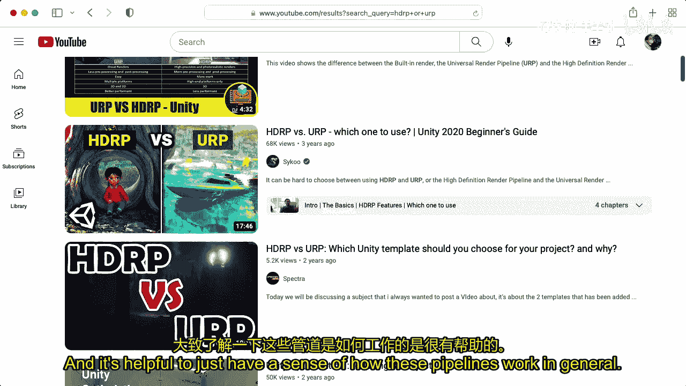
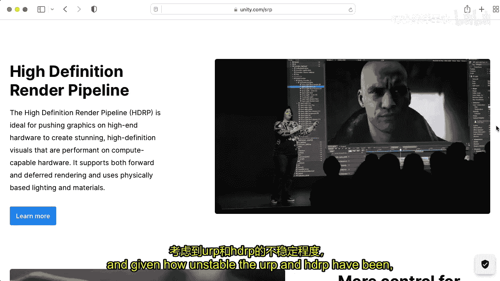
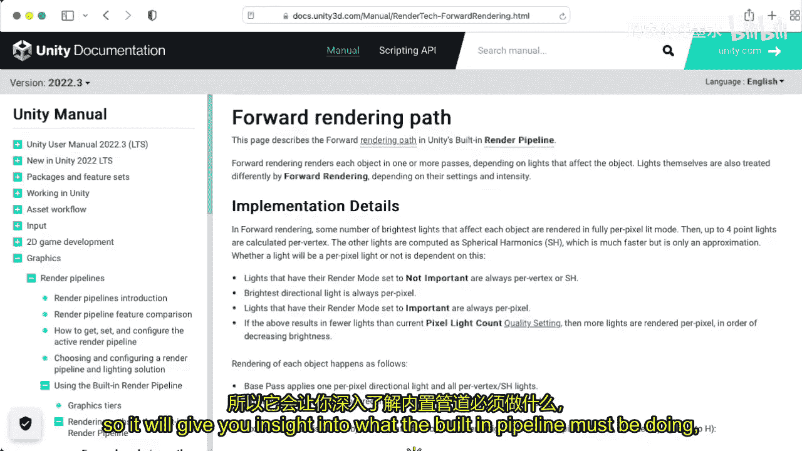
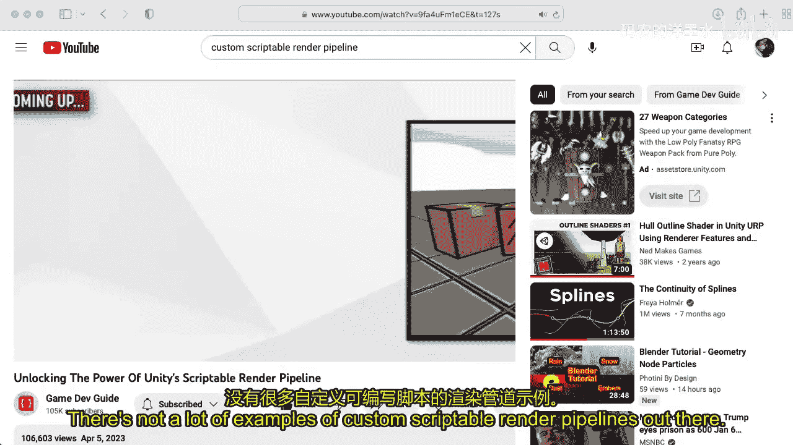

# 【全集】佐治亚理工学院-GPU编程：视频与游戏-中英字幕-p46-Lecture-46---Unity-的脚本化渲染流程--BV1GZfyBbEQn_p46-

Hi there My name is Er Landterman I'm a professor of electricallect and Comp engineering at Georgia Tech and in the next several lectures of GPU programming for video games we'll take a look at unity' scriptable render pipelines so we're not going to look at unity' Uni render pipeline or high definition render pipeline these are the pipelines provided by unity we're going to be creating one from scratch the skills we learn while looking at this pipeline made from scratch would be helpful if you wanted to hack the URP or the HDRP and it's helpful to just have a sense of how these pipelines work in general Now if you're making a game。

 I would generally not recommend writing a scriptable render pipeline from scratch unless you have very particularly weird rendering needs I would suggest choosing either the universal render pipeline or the high definition or render pipeline and given how unstable the URP and HDRP have been Unity。

Tends to break them with different updates You might actually just want to stick with the built and render pipeline that we've looked at so far in the course because it's reasonably stable but even if you're not using a scriptable render pipeline in your game I think studying SPs is useful because it gives you a general sense of what a renderer needs to do under the hood。

 so it will give you insight into what the builtin pipeline must be doing， or for that matter。

 the renderer in another engine like Unreal or Godot there's not a lot of examples of custom scriptable render pipelines out there。

 I recommend checking out this video unlocking the power of Unity scripttable render pipeline by Game dev guide。

 although I don't see anything here that you couldn't hack into the builtin pipeline There's this talk calledBuilding aCustom render pipeline by Alex Williams that I think deserves more attention but I particularly like to point you to this talk on Battleplanet judgmentment day at Unite Copenhagen 2019。

There's some stuff going on here that would be very difficult to do in the builttton Pipe and this talk Mark Mayers gave to the Boston Unity Group about the game Deis。

 there's some stuff going on here that would be extremely difficult to do in the builtton Pipe。

