# 【全集】佐治亚理工学院-GPU编程：视频与游戏-中英字幕-p47-Lecture-47---Unity-中的自定义前向脚本渲染流水线--BV1GZfyBbEQn_p47-

Hi there。 My name is Er Landman。 I'm a professor of electrical and Comp engineering at Georgia Tech。

 and in this lecture of GPU programming for video games。

 we'll look at a custom forward scriptable render pipeline and the next lecture will' look at a custom deferred scriptable render pipeline。

 If you want to run the demo I'm about to show you yourself。

 You want to go to the 4795 archive on my Github。 and let's see if we scroll down a bit。

 you'll see GPU 23 SRP 4 unity package。 That's what you want to get So I'm going to make a new project here。

 and it's going to be a basic 3D project and let's call it SRP 4 demo。

 You could call yours whatever you want。 Before I import that unity package。

 I want to go to window the package manager。

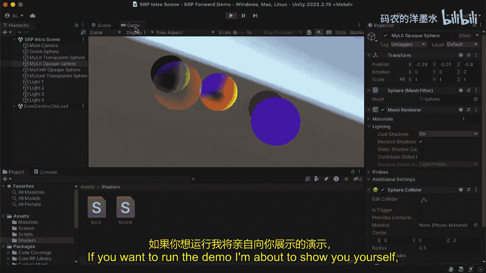

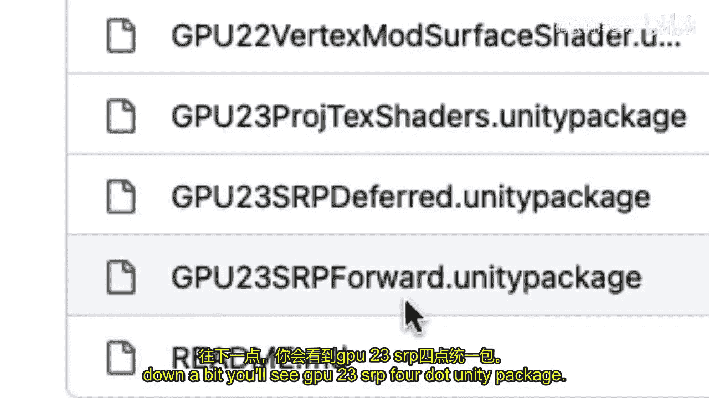

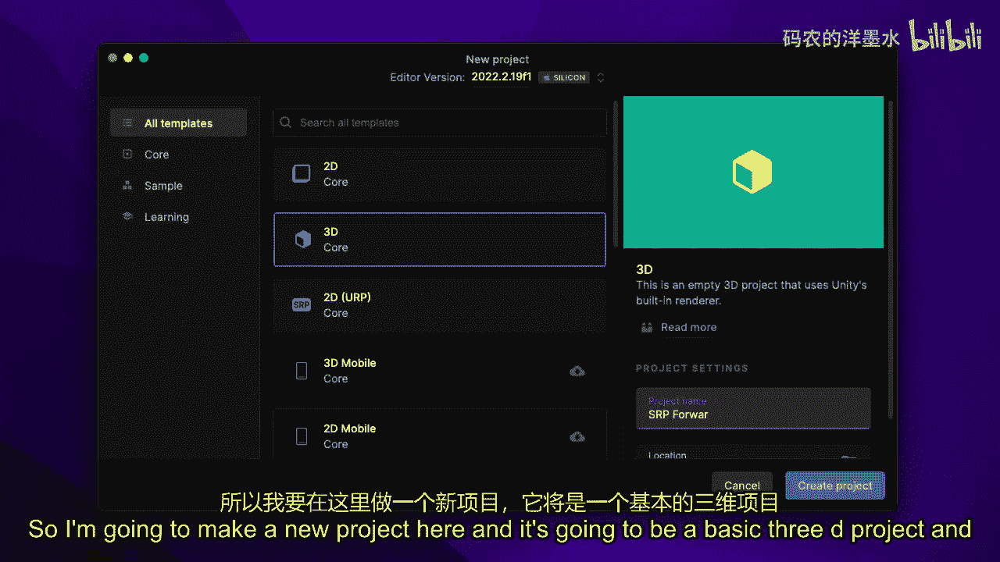

In the upper left corner here， let me go to the Unity registry and I want to look up the core RPRP package so this is all the basic stuff for the scriptable render pipeline。

 if you're using a universal render pipeline or the high definitionfin render pipeline you can import the packages for those and I think those will automatically install the core RPRP library but here I just need the core RPRP library and surprisingly although the URP and the HDRP have changed a lot with individual releases from year to year。

 the core RPRP library has remained fairly stable for a while。

 the demo I'm about to show you I actually created back in 2019。

Okay let me take my GPU 23 SRP forward Unity package and drag that onto the S folder here Yep。

 let's import all of this stuff Now you don't have to import the core RPp library before importing the unity package but if you import the unity package first Unity will give you a whole bunch of error messages you'll then have to import the core RPp library and then do reimport all So let's go to scenes and look at this SRP intro scene and you'll see that I have a red sphere。

 a blue sphere and the blue sphere is translucent but over here we have some black spheres and these should not be black What's happening is this has some shaders designed for the scriptible render pipeline but we're still using the built in pipeline so we need to go to edit go to project settings and we need to do a couple of things the first thing we need。

To do is go to player and select the linear light space as we always do because linear is good and gamma is bad let's also go to graphics notice I have this thing here that says scriptable render pipeline settings and it says none so it's defaulting to the building pipeline so let me click over here and we'll select my custom pipeline changing the pipeline yep and if we do that we'll go over here and we see that there's some nice spheres and if I press play you'll see that I have one of the lights is animated by a little script that just moves the lights back and forth and this also works in the scene view let me zoom in a little bit here。

There you go。Notice our SRP shaders work both in the game view and in the scene view there's a little bit of extra work needed to make this work in the scene view Well not really extra work it's just a couple of lines but it's something you need to do I'll talk about that later so I told the graphics engine and unity to use my custom pipeline and that's this little weird little symbol here let me click on that we see that it has a couple of options for dynamic batching and instantcing these are various optimizations that the unity renderer can implement in some instances so you can turn them on or you can turn them off for the purposes of this class I don't want to get too much into the details of these things we'll just talk about how to set up things in order to support them now I included this my custom pipeline asset in the unity package but if I hadn't done that what you can do is you can go to the plus sign here and you can go down to this rendering menu and select my pipeline。

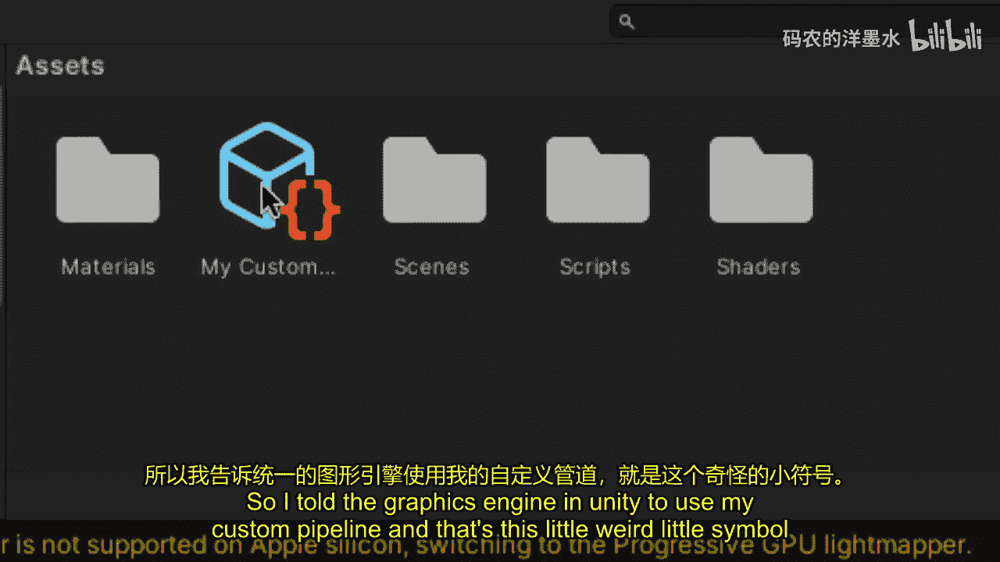

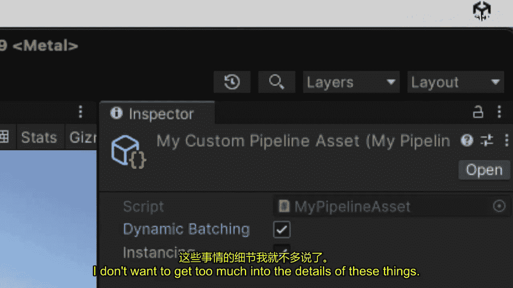

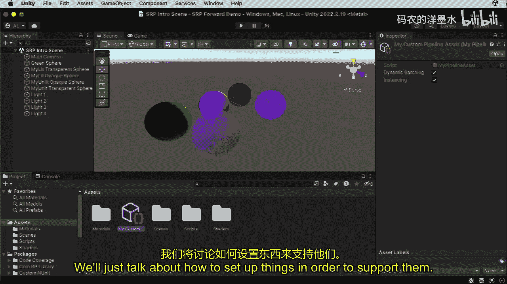

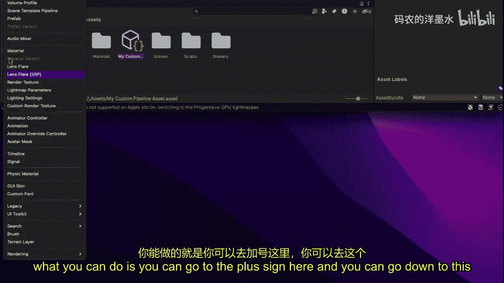

Now this doesn't come with unity I included some code that puts this entry into the asset creation menu and selecting that I now have a new my pipeline notice the new pipeline has dynamic patching and incing defaulting to off so if I want I could switch those on the code I'm about to show you is pretty much taken straight from the scriptable render pipeline tutorial on the catlike coding website notice this particular tutorial is for unity 2018 so it's really kind of remarkable that this code works in 2023 it's been a while since I made this demo so I can't remember if I had to do any tweaking on it to get it to run there's a note here about this series being removed shortly and it says go to the custom SRP series instead so that's a newer tutorial for pedagogical purposes I'm sticking with the older tutorial because while the newer tutorial has better software engineering in the sense that thingses are broken out into functions etc。

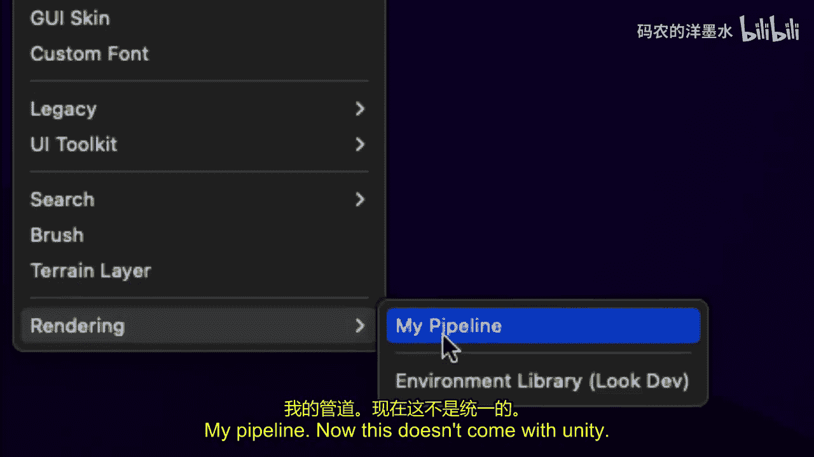

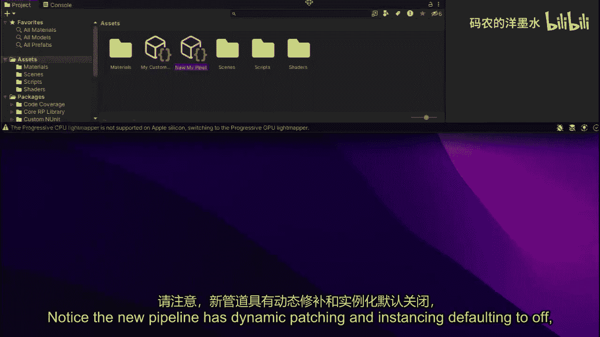

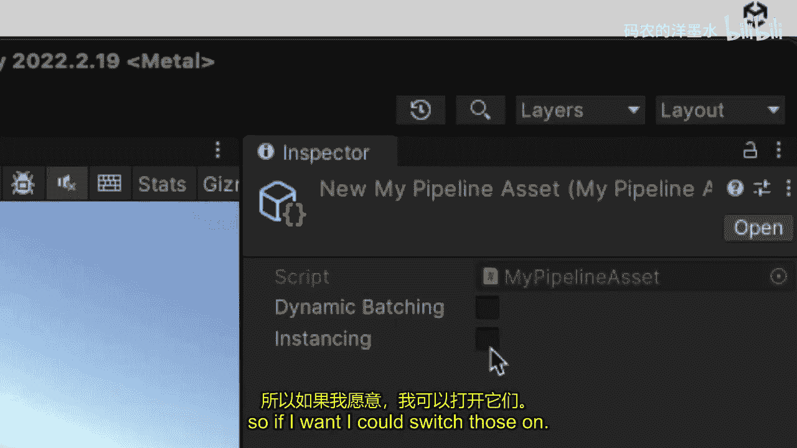

for my current pedagogical purposes， it's convenient to have the code as tight as possible。

 so I think the older code actually works better。 The entire catlight coding website is an absolute gold mineine so I suggest checking it out so taking a look at the scene here we have five spheres now two of the spheres are using what I call the unlit shader and those are just producing colors and two of the spheres here are actually reflecting light well actually three of them are reflecting light but notice that only three of the spheres。

 the three in the back here are opaque and the two in front are transparent notice that I don't have to have different shaders to handle transparent and opaque objects and let me show you what's going on there so if I scroll down a little bit here at this particular material you'll see that we have this source blend and this destination blend and。

ZiteSo Zite indicates whether we're writing into the Z buffer so that's handling obscuration now here I have source blend as one and destination blend as zero and you can click on these and set these to all sorts of stuff。

 what that is basically saying is that when we're writing a color to a given pixel。

Zero of the color is coming from the destination i。e。

 what's already there whereas all of it is coming from the source that we're writing to it so that's appropriate for opaque objects but if I click on the transparent objects what I see is that we actually have zeroite being off because for transparent objects we're not worrying about the Z buffer and the source blend is set to source alpha and destination blend is set to one minus destination alpha so that allows us to handle transparent effects so let's start by looking at the shader code so I'm callinging this mylit don't get this confused with the lit shader of the high definition render pipeline or the universal render pipeline this is a much more primitive shader with just one color setting there's no textures or anything else in there here we set up some enumerations to select the blend modes and the Zite mode。

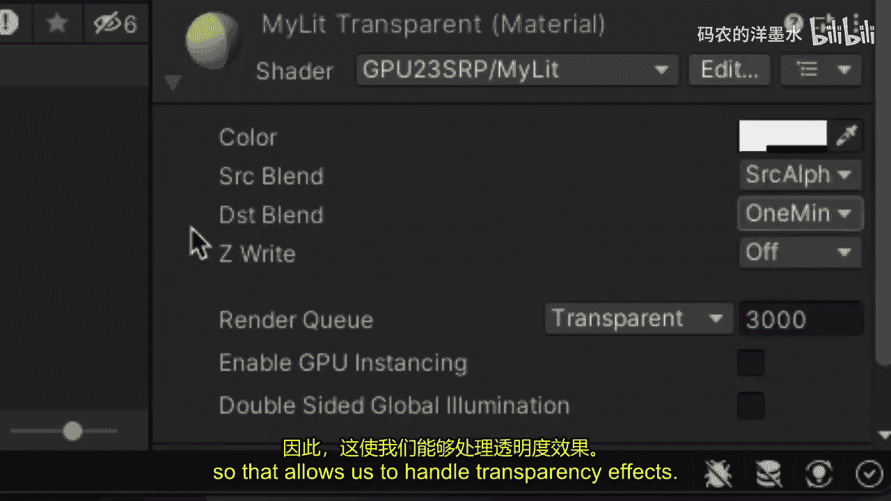

And those are just applied right here， so this particular shader is going to use model 3。

5 and we need to specify that because unity defaults to 2。

5 So we're going to import this commont hlSl library that's basically taking the place of the CG includes library that we've used previously with the built in pipeline。

And now we have to get into some unity specific weirdness We're going to use Unity matrixtri M and Unity matrixtri IM instead of the Unity object world and Unity world to object matrices。

 and this has to do with some strange stuff unity is doing with GPU instancing。

 it might have to redefine these as something else。

 so we're just going to use these uppercase variables later in the code。

Now we do need to declare unity object world and unity world to object Unity will fill this in for us we're also declaring unity matrix VP that's a combination of the view transform and the projection transform that unity will fill in for us so even in the scriptable render pipeline unity is filling in some stuff for us Now the color that was something we declare in properties Now the C buffer start end blocks here are not things that are required but it allows unity to do certain optimizations for instance。

 individual objects in your scene may have different object to world matrices but that view projection matrix that's going to be the same for all of the objects you're drawing in a particular frame we're assuming here that we have up to four lights being rendered and unlike the builtin pipeline where various different lights or handled in different additive passes here。

We're going to handle all of the lights in one pass So here we have the colors of the lights in an array and these directions or positions where the W coordinate indicates whether it's a point light or a directional light Now remember in the built in pipeline unity filled out some lighting information variables for us here we're going to actually have to do that explicitly in ourRC sharp script we're going to have to explicitly set these variables。

So for our vertex input structure and our vertex output structure we have things we've seen before we're going to take in positions and normals and here we're going to output positions in clip space and positions in world space as well as normals and this is the structure that's handling going from the vertex shader to the fragment shader so these various quantities here are going to become interpolated the variable names we're using here differ from those that I've used in previous lectures I decided to stick with the naming scheme used by catlike coding so in case you go and look at the original code here things will match up there is something new and strange here and that's this unity vertex input instance ID macro this is some bit of unity magic needed for GPU instancing to work just put it in your structures and then don't worry about it So our vertex shader starts with a bit of unity。

Magic that's this unity setup instance ID macro that will tweak things as needed associated with the GPU intanncing again。

 don't worry about it just make sure that later on you're using unity matrix M instead of unity object to world and similarly you're using unity matrix I am instead of unity world to object So the rest of this is all stuff we've seen before we get the position to worldspace by multiplying our input position by unity matrix M Now the input do position coordinates are four vectors and they should be coming in with their W component automatically set to one but by putting the one here and constructing it this way that acts as a hint to the compiler where the compiler now knows that W position is one and it can potentially do some optimizations you don't have to do it this way but it's kind of nice we take those positions and assign。

them in the output structure and we also take those positions and multiply them by the view projection matrix to get the positions in clip space so this isn't actually something that's used directly by the fragment shader to compute colors。

 but of course it's needed for the GPU itself to know where things are going on the screen。Next。

 we need to transform the normals and if you need to remember how to do that。

 you can go back and review this lecture I made called normal vector transformations so to transform the normal if we interpret the normal as a column vector we need to premply it by the transpose of the inverse of the object world matrix Now the inverse of the object world matrix is the world2 object matrix but here we're using unity matrix I am instead of world2 object but that's just because of this weirdness of the instancing oh and I should have mentioned that we're taking the upper left3 by3 subset of that matrix Now we generally don't see an explicit transpose command used in HLSL code instead we're going to take advantage of the way that matrices are stored in HLSL and realize that if we multiply by putting the vector first in the multiply command。

It's like we're taking the column vector and multiplying it by the transpose of this matrix。

So here's the fragment shader as with the vertex shader we start with this unity setup instance ID macro it's just a weird magical unity thingme that deals with GPU instancing。

 you can take it on faith All right so we have the normals coming in but remember this is coming in through a texture coordinate and when it goes through the interpolation hardware there's no guarantee the result is going to be normalized so we need to normalize it ourselves there's nothing fancy about this obbedo color here that's just going to be the color we set in the inspector you could add fancier things to this like texture lookups or whatever Now the final result is going to be this albedo color times this diffuse like calculation that we do in this loop here。

The alpha is going to be whatever alpha we choose in the color in the inspector。

Now as far as this lighting loop goes， we're going to deal with all of the lights at once through this four loop。

 possibly up to four lights assuming we set max visible lights to4 as we did earlier in the code but you can of course change that note that this is a very different way of handling multiple lights than we had in the built and shader or each light was handled in a separate additive pass so this is a usual diffuse calculation we're not worrying about specular light here so we're taking the dot product of the normal vector and the light vector and we're using saturate here to clamp that between0 and1 Now of course this computation here shouldn't go above one so we could have used max 0 all this stuff instead but they use saturate so we'll use saturate so we'll take that and we'll multiply that by the light color and add that to the diffuse light that we initialized to zero so what about this light vector calculate。

Well， the W component of the light has zero or 1 in it， and it has zero if it's a directional light。

 so if it's zero， this whole second term here winds up disappearing and we're just left with visible light directions or positions and for a directional light。

 this indicates the direction now we wind up normalizedizing it and it's already normalized but normalizing it again doesn't hurt。

Now， if it's a point light， this W component has a one in it。

 so we wind up with the position of the light， which is what is stored here。

 minus the position of the coordinate from the facet in world space。

 So that gives us our vector pointing from the facet to the light and we do need to normalize that probably。

 Now， when we looked at shaders for the built and pipeline。

 We could kind of just look at the shaders。 but we're dealing with scriptable render pipelines now。

 So we need some C sharpp scripts to drive all of this。

 We need a pipeline asset script and we need a script for the pipeline itself。 unsurprisingly。

 the pipeline asset script is what you use to make one of these little pipeline asset thingies。

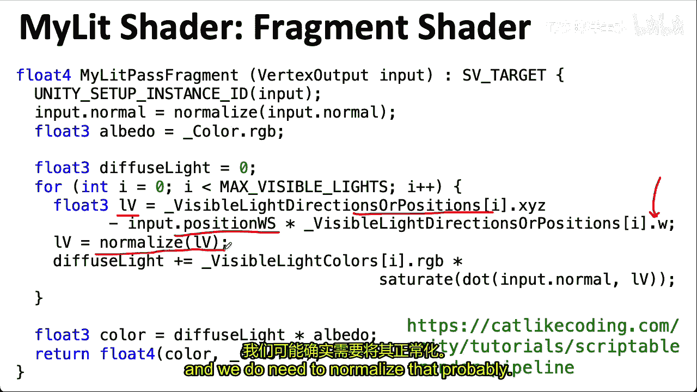

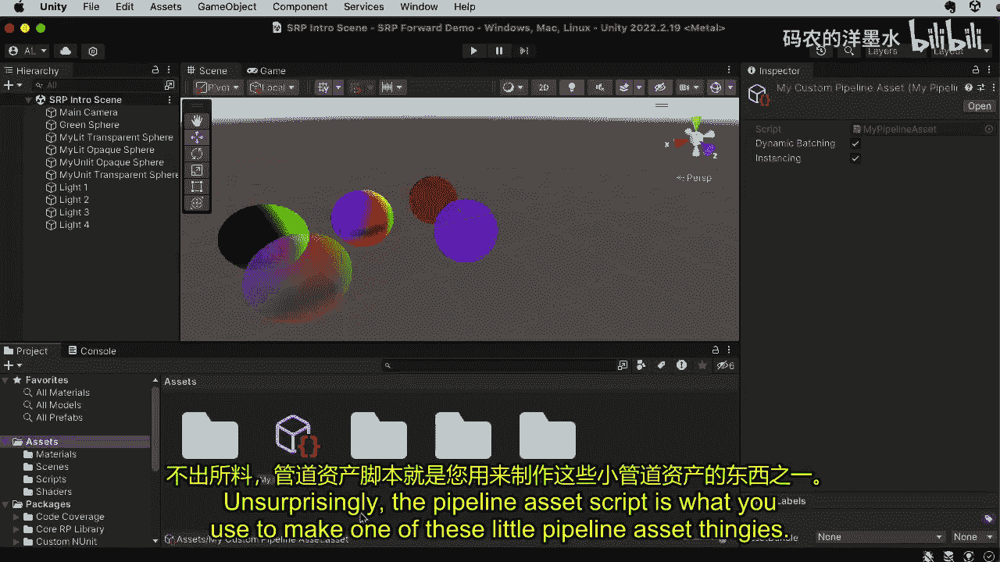

And there's not much to that particular script this is it So we're using the unity engine dot rendering package that has all of our scriptable render pipeline goodness and we're inheriting from render pipeline asset to create the my pipeline asset The actual my pipeline object is defined in this my pipeline script that we'll look at in a second and all we're really doing here is overriding this method create pipeline that basically just creates one of these My pipeline assets Now the constructor for the my pipeline asset needs this dynamic batching variable on this inscing variable and those are just ruless that we'll set up here。

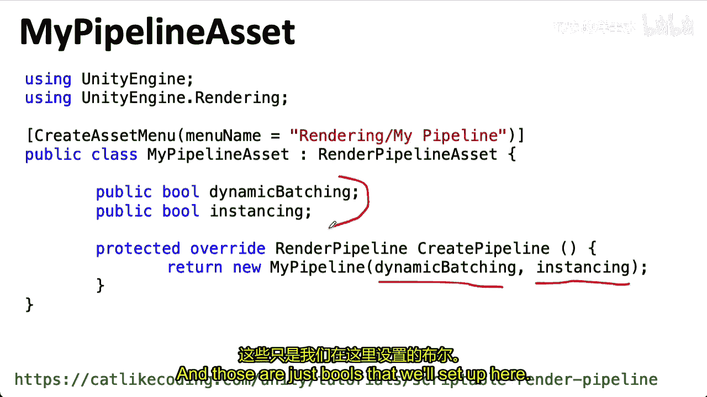

And those are the bulls you see up here in the corner in the inspector。

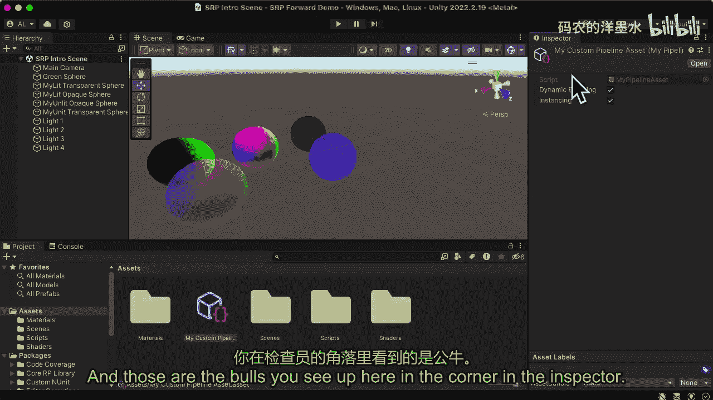

The final important bit is this unityism here， where we have C asset menu。

 menu name equal rendering and slash My pipeline that is what creates this menu option in the asset menu that lets us create one of these pipeline objects from the menu here。

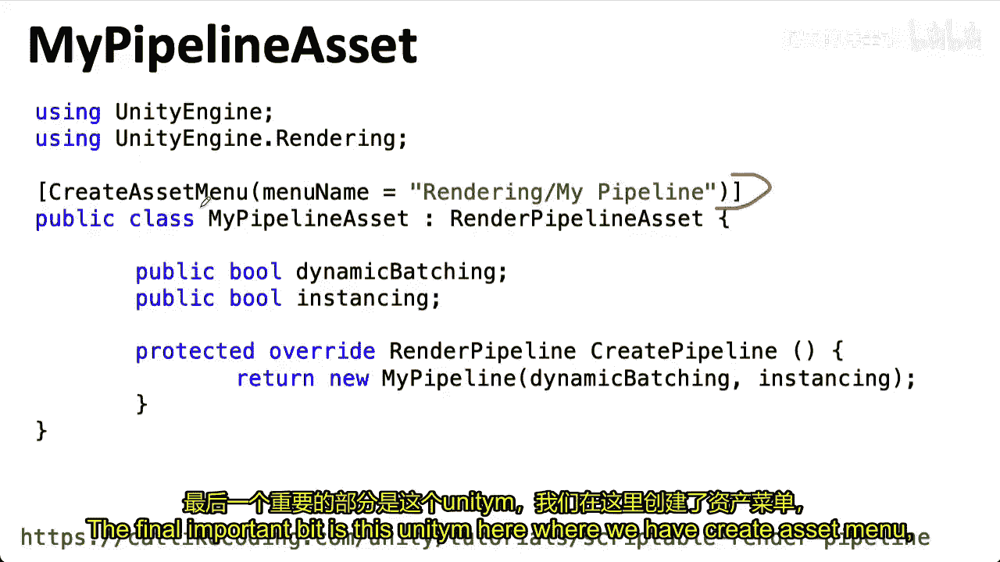

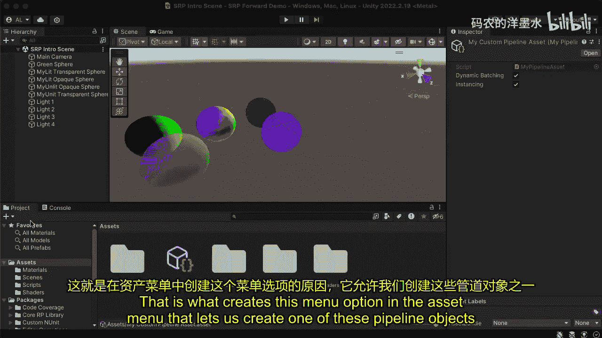

So here's the Eile code for the My pipeline pipeline it inherits from render pipeline and it goes on for many more pages this is by far the most complicated bit of C sharpharp we've looked at all semester we'll set this max visible light constant for to match the for that we set in the shader and at this point we also have some data structures for our light data so what we have here are the structures on the C sharpharp side but this isn't automatically set in the shader side we'll have to do that ourselves now in some of the code that we looked at previously we referred to variables in the shader code and set them by string but that's not very efficient so here we're using this property to ID method in the shader class that takes this string and spits back a number and we can use that number to efficiently assign the variables so later you'll see code where we copy the C sharpp side。

Light data to the shader side light data。Now there's not much to the constructor it takes the variables that we pass in when this is executed from the my pipeline asset script。

 namely these dynamic batching and inscing variables and assigns those values to the local variables up here actually I didn't do the tabs here very well did I okay let's put this here and let's go do Okay。

 I like that better Yeah what about that？So every time this comes out， I have to think about things。

 the dynamic batching and inscing variables on the right correspond to the variables in the parameter list here。

 this dot dynamic batching and this dot instancing refer to the variables up here。

We're also going to set graphic settings， lights use linear intensity to true because linear is good and gamma is bad。

So what good is a render pipeline if it can't render objects。

 so to describe how we want to render objects， we want to override this render method。

There's an assumption that there might be multiple cameras。

 so there's a camera array passed in here and all we're going to do in this particular method is just loop through all of the cameras and then run another render method that just has a single camera in the second parameter Now the first parameter is something called a scriptable render context that we're just going to pass along。

Thescriptable render context is extremely complicated。

 it basically has all of the data and methods needed to actually render the scene。

Before moving on we'll define a couple of variables。

 one is a command buffer named my rendernder camera， you can name it whatever you want。

 so basically when you're communicating with the GPU you want to avoid the overhead of setting up just talking to the GPU so instead of sending one command at a time and having each executed individually。

 you develop a buffer of commands that get bundled up and sent off and executed in a row。

 at least that's my understanding of it。Okay， I'm actually not fond of code where you have two words in a row where one has an uppercase and the other word has a lowercase。

 and that's the only difference， but it is a common coding style and it's what cat light coding use so I'm going to stick with it anyway。

 we're creating a shader tag associated with the shader tag string SRP default unlit So you can define light mode tags in your shader code and be able to select different bits of shader code based on their tags or not and this one here this SRP default unlit this is a special one that gets executed when you don't define any shader tags in your code and in the HLsl code I just showed you。

 we didn't define any shader tags so this is a good one to use Oh don't worry about the fact that this documentation page here says universal render pipeline this statement about SRP default unlit applies to SRPs in general Now don't be thrown by。

The fact that there's the word unlit here we are using this in our lit shader so here's the main guts of our code。

 the render function for a single camera Before we do anything else。

 there's a tweak we might want to do to the scriptable render context that gives it the ability to operate in the scene view and that's this line here with this emitit world geometry for scene view method now we only execute this if the camera type is a scene view camera type。

Now we only need to check any of this at all if we're running in the editor so that's why this whole thing is wrapped in this if unity editor bit and that means that if you're actually compiling this game and running it as a standalone thing outside of the editor it doesn't waste time doing this check Next we're defining this calling parameters variable that's this very complicated data structure called scriptable calling parameters So the scriptable calling parameters are basically bits of information from the camera and the scene needed to figure out what parts of your scene are actually visible by the camera So we go to the camera and say camera run your try get calling parameters method and the calling parameters are actually set by using the out keyword in the calling structure here and this method returns to our false depending on whether it was successful or not。

 so if it wasn't successful， we give up and just return into。

Do anything you would probably also want to put some sort of error message on the log or something then ask the allce all knowing render context to call the various objects in the scene based on these calling parameters Now Col parameters is a big data structure so rather than pass by value and shoving all that data on the stack we use REF here to pass by reference so it's a little more efficient Col results contain information about what survived that callinging operation Now these callinging results don't just contain information about what objects are visible it also contains information about what lights are relevant so your total scene in unity might consist of 20 lights but it's going to give you just the relevant ones as far as lighting the objects in your scene viewed by the camera Okay so now what we're going to do is we're going to look at the callinging results。

What light survived that process and then assign the appropriate information to our variables on the C sharp side so the first thing we're going to do is actually ask the calling results how many lights did you find with this dot length method and there's a possibility that there are actually less lights than we have with our max visible lights？

Now， you might have actually had more lights survive the cooling process than our max visible lights。

 but we're going to clamp things at a maximum number of visible lights。

 and that's generally okay because what unity does is it will order the list of lights。

 the various arrays we're going to look at here in terms of order of importance by some criteria unity as decided。

 So the most important lights come first in the list and hopefully the lights that we wind up ignoring in this process are less important。

 So going through this for loop， we get each of the visible lights from the cooling results。

 assigning those to a light variable。 those are part of the visible light class。

 and then we'll grab the final color from the light and assign that to the appropriate entry in our visible light colors matrix。

 Note that the final color is the light color multiplied by the intensity of the light。

To get the direction of a directional light or the position of a point light。

 we need to ask the light about its local to world matrix so if the light type is a directional type for directional lights。

 the light is thought of as pointing down its local Zax。

 so to get the actualile direction of the light in worldspace。

 we need to get the third column which since the columns start numbering at zero， we use git column2。

Now our light vector is supposed to point in the direction of the light。

 so we need to reverse our vector now for a point light that's thought of as a translation。

 so that's going to be in the last column of this world transformation matrix so we use git column3 for that Now remember that the w component has zero in it for directional lights and it has a one in it for a point light and this works that out automatically because the lowest row of the matrix is going to have a zero in it in this third column and again the numbering here is a little confusing because the numbering starts at zero whereas the last column of your world matrix is going to have a one in that lower right entry because you need that one there for translations to work with homogeneous coordinates。

This works out automatically， I think that's pretty clever。

So the next thing we do is we go to our scriptable render context and we ask it to set up camera properties so what does that do according to the docs that schedules the setup of cameraspec global shader variables this function sets up view projection and clipping plane global shader variables okay so now we're going to load some commands into the command buffer the first one clear render target is just going to zero out the Z buffer the first argument indicates rather to clear out the Z buffer。

 the second argument indicates rather to clear the color buffer and notice that said to false so it's actually ignoring this color here which is what it would set the color buffer to if the second argument was true but you can't ignore this argument you have to put something there now there is a fourth optional argument which is what you set the Z buffer to but if you don't include that defaults to zero so we're clearing out the Z buffer but we're leaving the color buffer alone and I think they。

The color buffer alone because later they draw a skybox anyway Now remember the light data variables in the HLSl code。

 we need to set those。We do that via these property ID numbers that we created earlier because that's more efficient than always referring to things by strings。

 So here we use the set global vector array commands to set those variables。

 assigning the data from the C sharpp side variables to the HLSL side variables。

 and then we actually execute this command buffer to run these commands。

 Then we clear the command buffer so we can use it for something else later。

Unity has a sorting setting structure to describe the methods to sort objects during rendering。

Taking a look at the different criteria we can sort by。

That's not very useful I guess I got to click on rendering dot sorting criteria a here we go let's see some commonly used sorting combinations are provided for convenience use common opaque for opaque objects this combination of flags includes optimization for reducing drawing state changes and draws roughly front to back to reduce drawing over the same pixels many times use common transparent for transparent objects which need to be sorted from back to front before being drawn for them all to be visible we'll first draw the opaque objects so we're going to create a sorting settings variable that has the criteria set to sorting criteria dot common opaque。

This is a C Shaism where you can set the instance variables like this during the construction Next we'll create some drawing settings consisting of this common opaque sorting setting。

 and we also need to give it a shader tag ID remember it's this default SRP default unlit light mode which is what gets run when you don't actually specify a light mode in your shader code。

Our C sharpp script knows whether we want to use dynamic batching and or instancing。

 but our renderer doesn't actually know that， so we need to tell it by setting the appropriate instance variables here in these drawing settings。

And oh look， we need to create another variable。 This time， it's called filtering settings。

 So what are those， Let's see a filtering setting struck describes how to filter the set of objects that scriptable render context dot draw renders receives so that unity draws a subset of them。

 And we're giving the constructor the parameter render Q range dot opaque。

 Let's see rendernder Q range。Static properties opaque， a range that includes only opaque objects。

 Okay， that was informative。I feel like it would be really helpful if the Unity docs would give us a little more context。

Okay， finally we draw some objects， we ask our scriptable render context to run this draw renderers method。

 the Col results variable is going to contain all of the various bits of information about the objects we need to draw。

 and it also is going to need drawing settings and filtering settings， these are structures。

 and for efficiency instead of passing these by value， it uses reference to pass them by reference。

Once we've drawn the objects， we're then going to draw the skybox。

 this may seem a little counterintuitive， you might think you would first draw the skybox and then draw the objects。

 but by drawing the objects first， that means it's not going to bother drawing the skybox pixels where there's already an opaque object。

Now， remember when we cleared the render target and we set some variables on the HLSL side。

 we needed to do those using a command buffer。But for whatever reason drawing the skybox is special。

 you can just ask your scriptable or render context to do that without using a command buffer Now the last thing we do is draw objects again。

 but this time we're only going to be drawing the transparent objects。No。

 I haven't been entirely accurate when I said that we were drawing the opaque objects。

 and then I said we're drawing the skybox and then we're drawing the transparent objects。

Those operations didn't happen right at that particular command。

 it's basically queuing everything up and stuff doesn't actually happen until you submit to the scriptible render context。

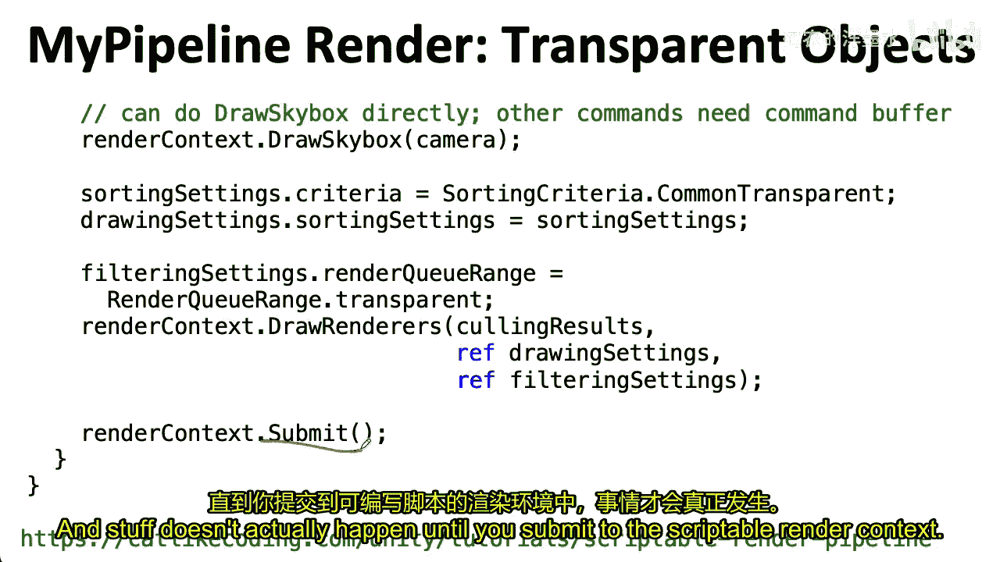

One thing I should mention that makes working with this scene a little difficult is you'll notice that the lights are in the scene。

 but they don't have the little light gizmos that you're used to seeing that's because this is being rendered by our scriptable render pipeline and I didn't include the code needed to actually make those little icons appear if you want to try adding that yourself you can check out drawaw gizmos。

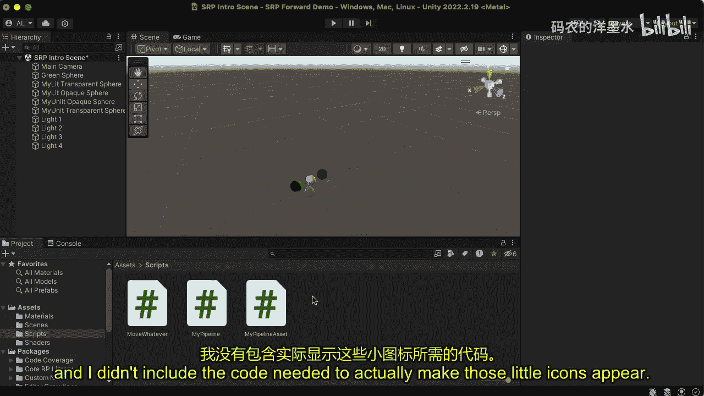

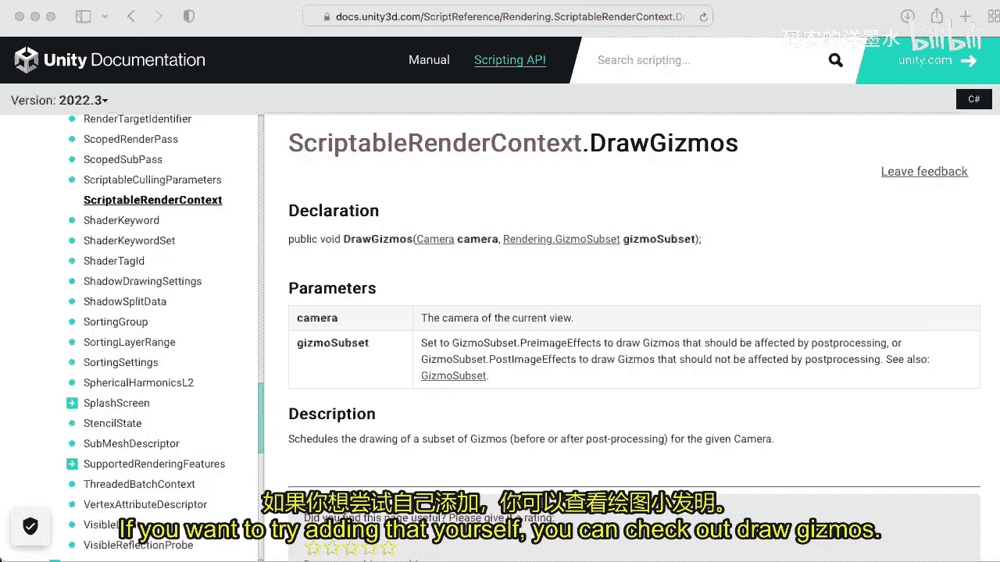

Oh， one more thing。

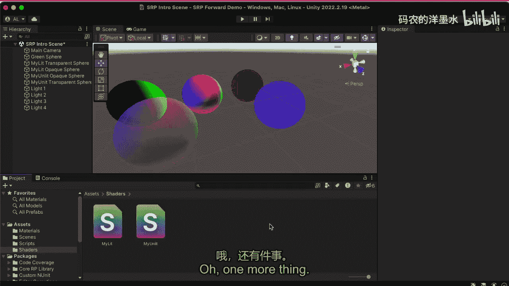

In addition to the milelit shader we've been talking about。

 this unity package also has this My unlit Shar and there's nothing really fancy going on here。

 it's basically the same as the lit Shar code I showed you except it just returns the basic color。

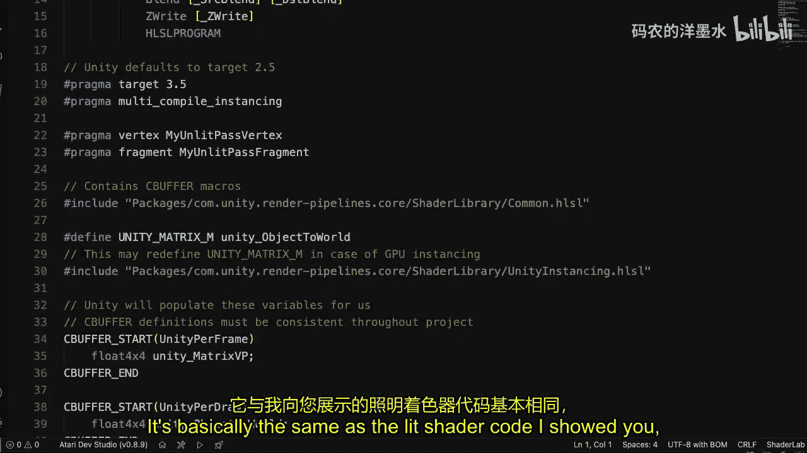