# 【全集】佐治亚理工学院-GPU编程：视频与游戏-中英字幕-p48-Lecture-48---Unity-中的自定义延迟脚本渲染流水线--BV1GZfyBbEQn_p48-

Hi there。 My name is Er Landrumman。 I'm a professor of electrical and computer engineering at Georgia Tech and in the last lecture of GPU programming for video games。

 we looked at a scriptable render pipeline and unity that implemented For rendering in this lecture we'll look at a scriptable render pipeline that implements deferred rendering This lecture uses some code snippets from the previous lecture and it leverages some ideas from that lecture so I'm going to assume that you've seen that previous lecture So if you haven't seen it go watch it and then come back here to run my demo code go to my CS E 4795 Github page scroll down a bit and you'll find GPp 23 SRPde unity package go grab that Before we load in that unity package we want to go to the package manager make sure we have the unity registry selected and load in the core RP library Now if we wanted to do。

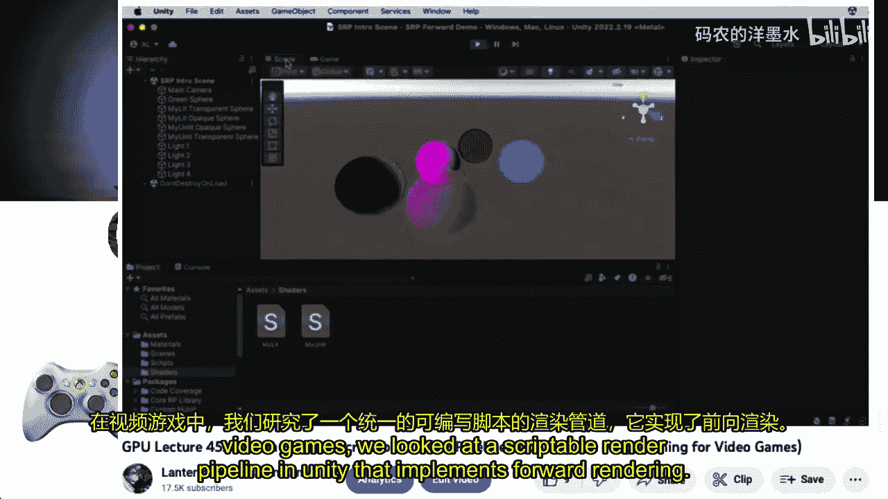

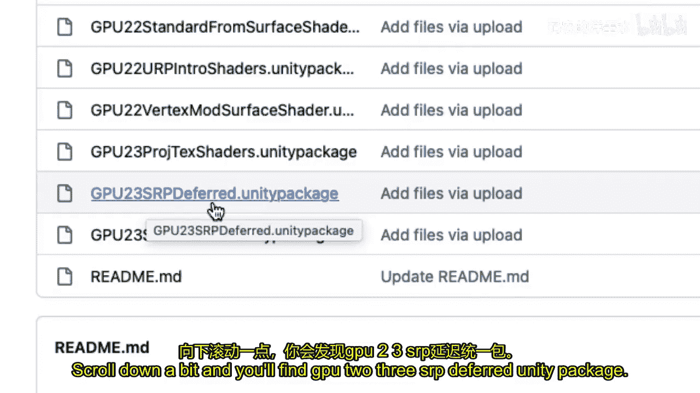

some with a high definition render pipeline we could go get that or if we wanted to do something with the universal render pipeline we could go get that but we're developing an entirely custom scriptable render pipeline so we just need the core RPp library and let's install that okay let's load in this demo and here we'll look at the deferred rendering scene and we don't actually see anything of course it's still trying to use the builtin pipeline and we have a new special custom pipeline that we need to use so let me go up to let's see it's edit right edit project settings and we do a couple things first thing always go to player make sure this is set to linear because linear is good and gamma is bad and we want to go to graphics and select this myde pipeline okay let's change the pipeline and now we can see our things and here we。

Have our scene notice that the scriptable render pipeline we have does work in the scene view。

 let's press play and you can see I have a little script that moves one of the lights back and forth。

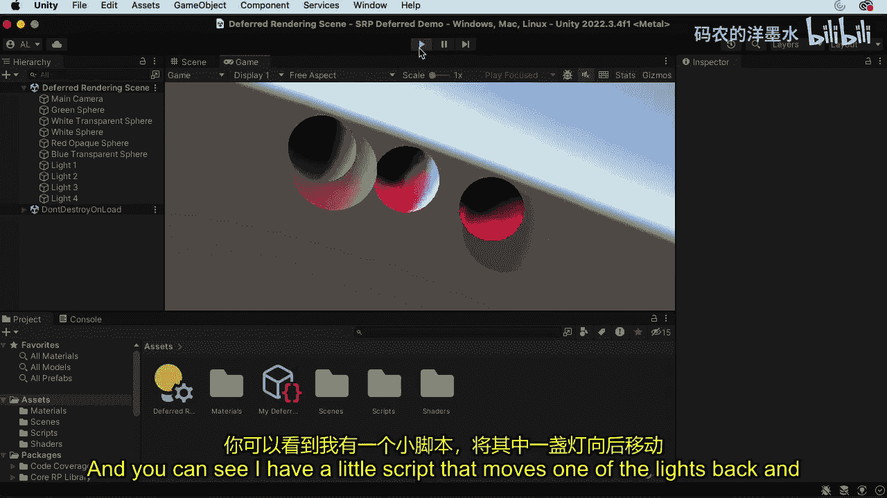

I have four lights in the scene， unfortunately these don't have the little light gizmos that you're used to seeing in the scene view that requires some additional draw gizmo code that I haven't included here just because I wanted to keep the amount of code I'm showing you relatively small because even though I'm trying to keep the amount of code I'm showing you small。

 it's still a lot of code。Now in the forward rendering demo we did we had one shader that we called mylit that could handle both opaque and transparent objects Here we need two separate shaders。

 one shader to handle opaque objects and a separate shader to handle transparent objects because deferred rendering can't really handle transparent objects So we're going to deal with transparent objects using usual forward rendering and will' handle opaque objects with deferred rendering So myli opaque is actually going to just fill in the G buffer values that include the albedo and the normal information whereas my deferred is what's actually going to run through all of the lights and do the lighting calculation based on the G buffers that were filled out by this myli opaque shader If you look in the materials folder you'll see I have three opaque materials of different colors and two transparent materials of different。

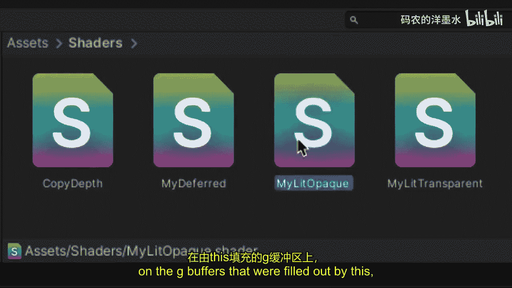

But I also have two special materials， one called copy depth and one called my Def These are special materials used in the deferred rendering process and these aren't materials that you would actually assign to a 3D object directly。

The copy depth material uses the copy depth shader I'll talk about what that does a little bit later and the myde material refers to the myde shader notice that the lit shaders are part of a GPU23 deferred menu and the shader list but the copy depth and the myde shaders those I put in a menu that I called GP23 deferred utility to try to indicate that these aren't things that we actually put on objects they're handling other aspects of rendering So let's take a look at the myde pipeline asset we have dynamic batching and instancing that we can turn on and off these are associated with various optimizations unity can do behind the scenes I'm not going to worry about the details of these here Now there is this slot here to assign the copy depth material and there's a slot here called deferred material that we're assigning this myde material and basically these are just materials that have those associated。

Ss attached to them。 They don't really have any parameters。 Now。

 I had this pipeline available already in the unity package。 If I didn't。

 we could go to the assets here and click on plus to add an asset go down to rendering and select my pipeline。

 Now this isn't something built into unity we have to write code to create this menu item All right。

 so let me select my pipeline and just for fun， let's go to the edit menu。

 go to project settings and see what happens if we try to switch to this new pipeline asset aha everything goes away and it's having some sort of weird freak out Okay so what's going on here Well。

 if we actually click on the new asset we created we see we don't have the correct materials installed here。

 so there's just weirdness going on we need to change this to copied up and we need to change this to my deferred and now everything works。

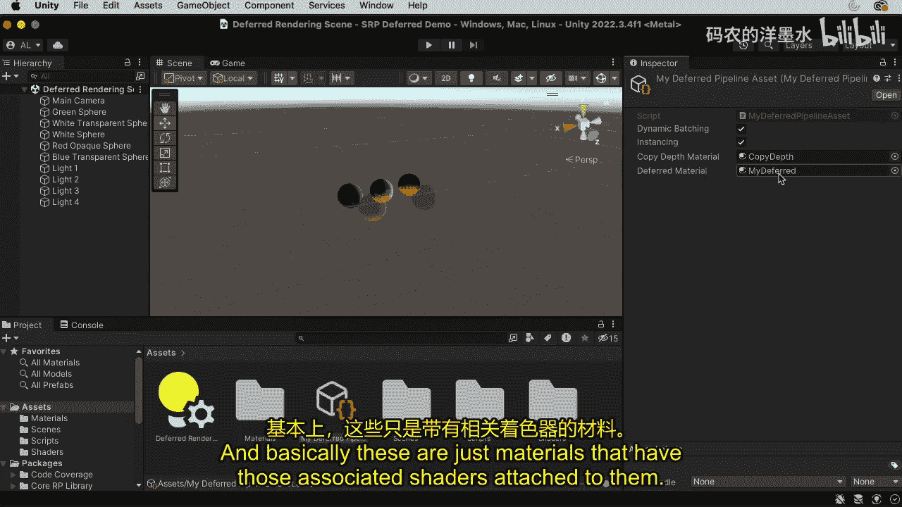

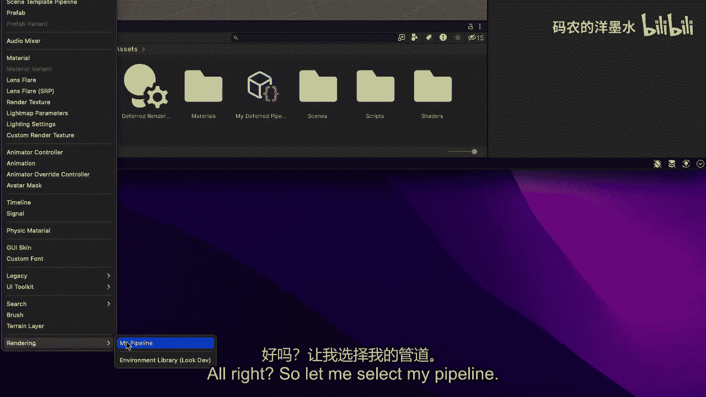

Now， just for consistency with my original demo， what I'm going to do is I'm going to delete this particular asset and everything should disappear and let me go set that back to the original。

 my deferred， there we go。

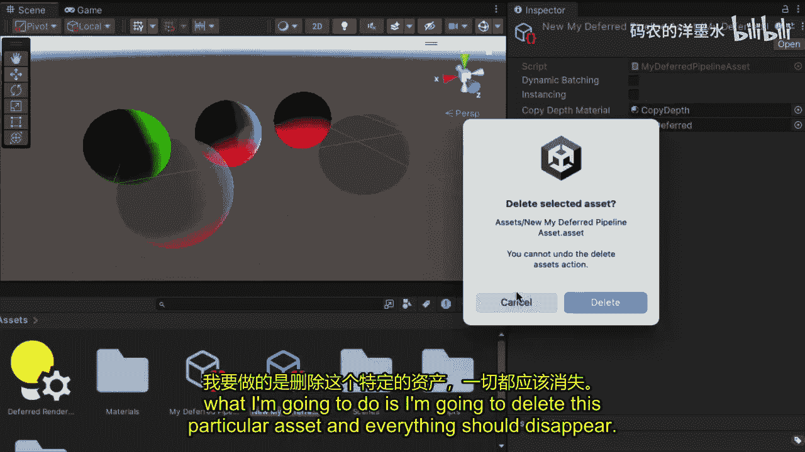

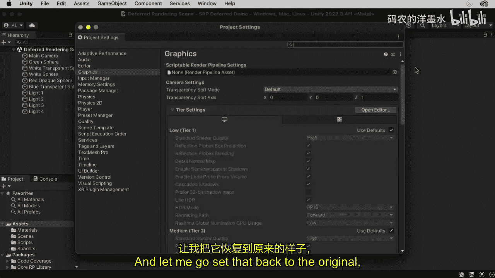

So I have three objects in back that are opaque。 I have two here in front that are translucent and now it's time to take a look at some code。

 some snippets from the code I'm about to show you are from this tutorial by Catlight coding but the bulk of it is from this tutorial by Peter Baybaschin from his SRP from Sct repository here on Gitthub I did rearrange the code If you look in the S folder here some of the stuff is from this scratch library。

 the scratch hLSso file that I basically pulled out and pasted directly into the main part of the code and the main part of the code you can find in solutions part5 deferred because the milet opaque shader is dealing with opaque objects and not transparent objects we're going to set the render type tag to opaque and the job of this shader is not to compute the final color that the player sees The job of this shader is to fill out the giba for information name。

The albedo and the normal map information so we're going to use a light mode tag of G buffer We'll come back to this point later。

 Much of the rest of this is the same as what we had in the forward rendering demo。

 We have this weirdness associated with the GPU inscing capability of unity。

 This is an optimization unity can do behind the scenes where sometimes it will have to take this unity object to world matrix and do something weird with it。

 So instead of using this nomenclature， we're going to use these capitalized tos。

The rest of this is the same as what we had in the forward rendering demo。

 This setup up here is also the same as what we had in the forward rendering demo。

 We have some variables associated with the lights。

 and these are variables that we need to actually set in the C sharpp code。

 This isn't like the case in the built in pipeline where unity handled this for us。

 We have the data structure associated with going from the application side into the vertex shader and then we have another structure associated with going from the vertex shader into the fragment shader where this kind of information here is getting interpolated。

But we are going to need a new kind of structure。 This is going to be the output of the fragment shader。

 So Rt0 is going to handle the albedo and R t1 is going to handle the normal。

 So this is something new。 We're used to fragment shaders explicitly returning the final color that we're drawing onto the screen。

 and usually there's also Z buffer being written， but we don't generally have to think about that ourselves。

 The vertex shader has all the standard stuff。 and in fact。

 this code is exactly the same as the vertex shader in our for rendering demo。

 The clip position that we're computing here isn't explicitly used by anything in our fragment shader。

 but of course， it's needed to figure out what pixels are actually being painted on the screen and what Z buffer values to write。

 and then there's not much to the fragment shader。 We start with this bit of unity magic。

 This unity set。Instance ID， this has to do with GPU instancing， you can take it on faith。

We have normal information coming in that's interpolated and there's no guarantee that's going to be normalized and in fact it probably won't be。

 so we need to normalize it for the albedo， we're just going to use the color that set in the inspector。

 you can of course add textures and other fancy things to this。

And then basically all we need to do here is output that information so our G buffer output type here is going to have Rt0 set to the albedo where we'll stick1 and the alphaordant here because it's an opaque object and for RT1 will encode the normal information remember the XYz of a normal maybe minus1 to1 so we'll divide it by two and then add half to that to scale that to be between0 and1 but we'll have to remember to expand it back out later and that's it later in this lecture we'll look at the C sharp scriptable render pipeline code that actually sets up these render targets runs the rendering routine to render the objects to them and then uses the information in the render targets to actually create the final colors the lighting calculations that formulate those final colors or compute it in this myde shader this deferred render。

Pass is a spiritual cousin to a postpro effect we're turning Z right off because the Z buffer is no longer relevant and we're using Z test always。

 which means we're always going to write to the color buffer without doing any sort of Z checks and similarly backface calling is no longer relevant so we turn that off so we have the same sort of boilerplate having to do with GPU incing and the definition of the combined view projection matrix and the object world and World I object matrices are the same and for this to work we're going to need some inverse matrices here we have the inverse of the projection matrix and here we have the inverse of the view matrix。

So we have the same data structure for the lights as we had in the Ford rendering shader that we did earlier。

And now we define some textures， so we're defining G buffer for0 and G buffer for one。

 but the style we're defining this with is a little bit different than what we've used before。

 previously we used tech 2D where tech was in lowercase and here we didn't have a separate data structure associated with sample from the texture。

 but in this new style where we use this texture 2D macro。

 we also used the sampler macro where we prefix sampler to the name of the texture。

The sampler contains information like whether you're using nearest neighbor interpolation or bilinear or whatever。

 If you want it， you can take the name of a texture and add underscore textel size to it and that will give you certain bits of information So Z and W contains the width and height of the texture in pixels respectively and X and Y contained one over width and one over height。

 Our code is going to use the X and y fields。 We're also going to needze buffer for information。

 So we also declare camera depth texture。 I don't know why they use this underscore float here。

 Last time I looked it seem like texture to d underscore float just map to texture2D but there may be something subtle that I missing。

 So there's not much to the vertex shader It's just like what we had in postpro because we're just drawing a rectangle to the screen。

 noticeice we didn't define any structure。For passing information into the vertex shader because we don't have normals or texture coordinates or stuff like that we just have a position in object space represented as a float3 and this is going to spit out a float4 that represents a coordinate and clip space and that float4 is input into the fragment shader here and we'll call it position C to indicate that it's in clip space Now the fragment shader is going to return to float4 that's a color Now I'm going to confess that in the btting operations that we look at later in the C sharpp code that runs this particular shader I don't really have a good sense about what the actual coordinates of the rectangle going in are or what's in these particular matrices or how any of this actually maps to what's going on in this clip space but there's something about this that feels very weird to me because ultimately to get this to work out you need to multiply by this textile size and that's one over。

in one over height so after you do this multiplication。

 you wind up with something that goes from0 to1 in U and0 to1 in v so the clip space here doesn't really operate the way we usually think about clip space for 3D objects there's something else going on but let's just take it on faith that if we run through all these operations you get something where you can look up things and textures here G buffer for0 in order to get the albedo by looking up this U coordinate and by looking in G buffer for1 by looking up in this Uv coordinate。

 we can get the normal but we have to remember that normals go from minus1 to1 whereas colors go from0 to1 so we need to take that0 to one and multiply it by two and then subtract one to get something that goes from minus1 to1 So the rest of the code here where we loop through the lights and do the diffuse lighting calculation is the same as what we had in the forward renderer with the exception of。

fact that in order to get the position in a world space to do the lighting calculation of world space。

 we need to reverse engineer that from whatever the UV texture coordinate is and our Z buffer information。

That's performed by the sample depth as world position function and we'll take a look at that now so the position in DC that stands for a position in normalized device coordinates。

And here that corresponds to our UV that's going from zero to1 there's potentially some weirdness having to do with particular hardware things and API things that may involve us needing to flip that upside down luckily unity takes care of that for us so we then sample the depth texture and I think the dot R here is it necessary because when I check the HLSL support library it looks like sample depth texture just maps to a tech 2D lookup with a dot R in it already There may be some particular hardware or API weirdness where we need to flip the Z coordinate around and it looks like the resulting device depth runs between zero and1 but the remaining computations expect us to be using an openGL convention where the depth runs from minus1 to1 versus the zero to1 used indirect 3D。

So we have this code here to map ranges from zero to one to minus one to one。

So we run this compute View space position function in order to take the available information and return a position in view space。

And then we can use the Unity camera to world matrix to turn this view space coordinate back into a worldspace coordinate。

 this matrix is the inverse of the view transformation and notice that we need to add a one here for the W coordinate。

So the first thing this compute view space position function does is it runs this compute clip space position function and there's not much to it device depth is already between0 and1 so for the third coordinate here it can just return device steps however the normalized device coordinates run between0 and1。

 so we need to multiply by two and subtract one to map those NdCs into a coordinate running between minus1 and1。

 and there may also be some API hardware weirdness whatever where we have to flip y upside down。

So we can take those points in clip space and multiply them by the inverse projection matrix to get the positions in view space and because life is confusing。

 we need to negate Z I find it's better not to think about things like this and just trust the code examples。

Now we still want to correctly handle perspective projection。

 but that's not being handled by division hardware handled when we render to the screen。

 so we need to do that ourselves by dividing by W here Now I just spent over three minutes talking about all these coordinate transformations if you didn't follow all of that that's okay because frankly I didn't either the main thing to notice that we can take this sample depth as world position function plug these things in and it will magically give us the coordinates we need in worldspace for the purposes of this class you can take that on faith Before we go on。

 I think it would be cool to be able to visualize the G buffers let's go to our deferred lighting shader and let's see let's take this last line here and instead of returning the diffuse light times the albedo let's just return the albedo so I'm going to take out diffuse light here。

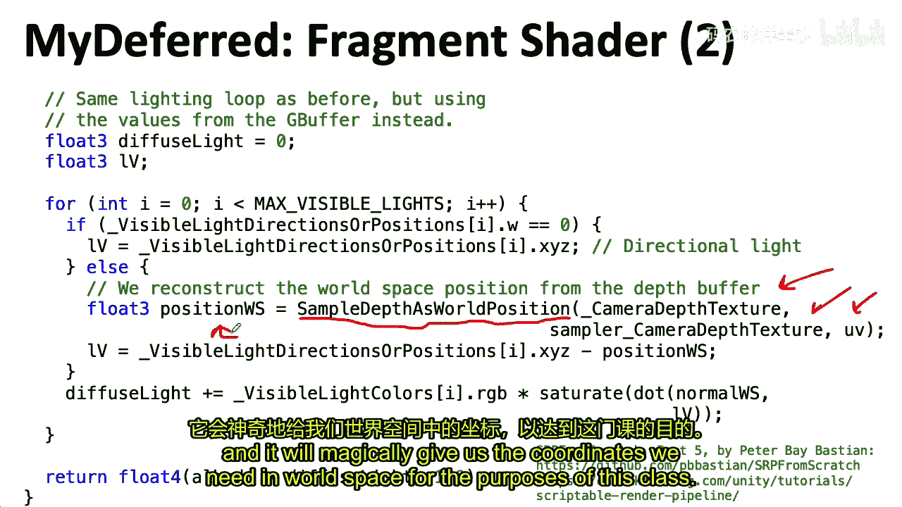

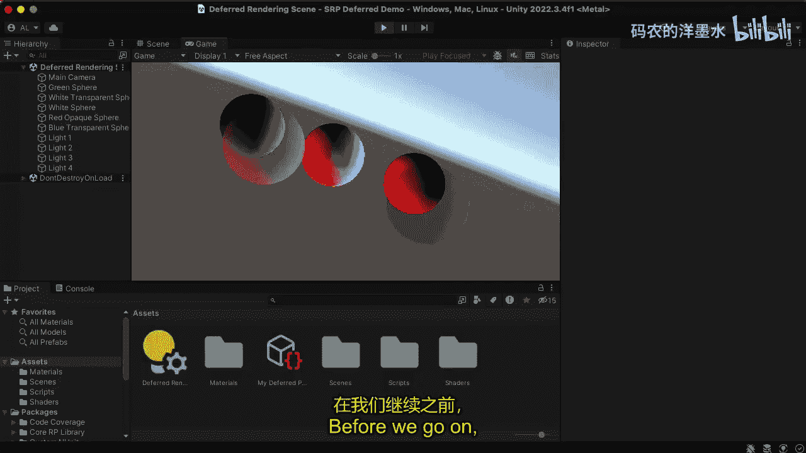

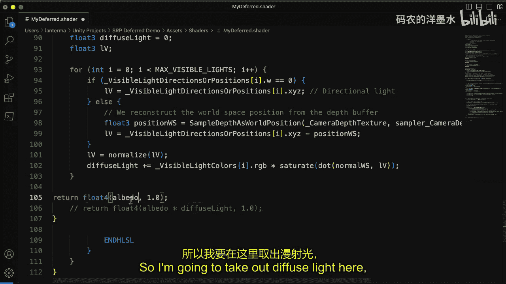

So here we see the albedo of our opaque objects remember that the transparent objects are being handled in a separate forward pass。

 so those are the same Now let's visualize the normal information let's see here we scaled it to be between minus1 and1 let me just take this bit here and paste it in here so we'll look at the compressed normal information that's going from zero to1。

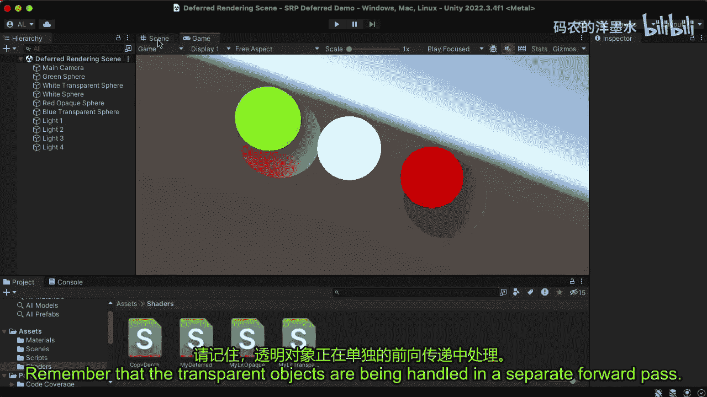

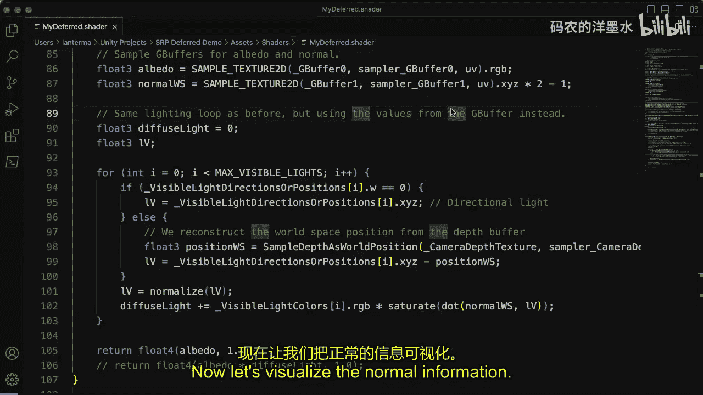

Okay， here we have the compressed normal information and actually I think it might be easier to see what's going on if we use the minus one to1 where we just truncate everything below zero when displaying it so it shows up as black so let me try taking all of this here and replacing it with just normal WS okay。

So red indicates the x normal， green represents the y normal and blue represents the Z normal。

 but remember this represents the normal in world space not the normal and view space which is the kind of normal we typically use in a postproces effect and we should be able to visualize this camera depth texture that's just a float so what I'll do is I'll go down here and let's say float 3111 times。

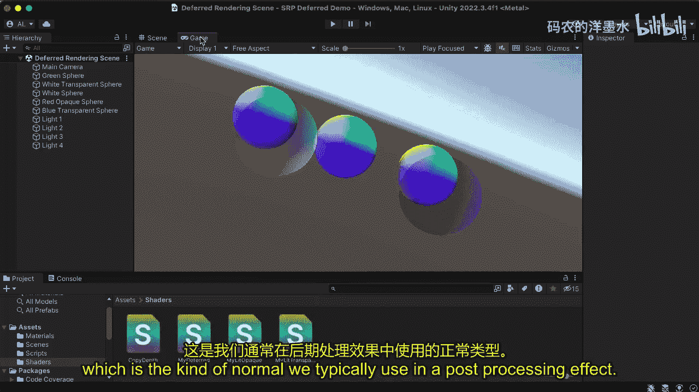

That all right， camera depth texture。Wait， that won't work that's the actual texture I need to do a texture lookup so that's something like texture 2D。

Let's see texture 2D， what's the clone structure a sample texture 2D。

 so let's do sample texture 2D and we'll need that in the first argument and then we'll need sampler that underscore。

Camera depth texture and the second argument， let's see， so let's put that here。naturallyat。

 do we need underscore sampler， or is it just sampler， right。

 is's just sampler that I need comma UVv。

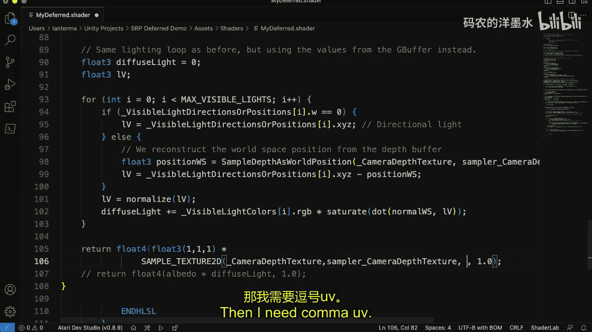

Okay， I think that should work。Okay， so that's not very illuminating。

 let's see if I zoom in a there we go。There I zoom in， here I zoom out。Zoom in。Zoom out。

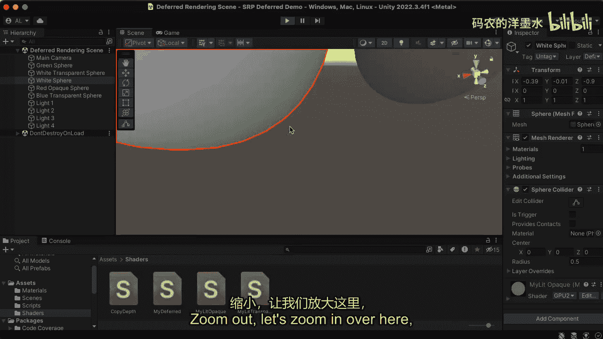

Let's zoom in over here zoom all right so when I zoom in it gets closer so I'm seeing that as a one and it looks like when we're further away then that's like a zero okay。

 so things are weird in terms of how I was expecting that to be I was expecting it to be white further out but it's whatever it is that's kind of a hardware thing and it switches things around as needed internally。

Okay， so that was all about opaque objects What about transparent objects Well transparent objects have to be rendered using forward rendering。

 we can't render those with deferred rendering， so the code for handling transparent objects is the same as the code that we had for our forward renderer except we set the Zite and blend modes here directly instead of setting those in the inspector so notice that we're using Zite off so we're not writing to the Z buffer when handling transparent objects。

 but we are still defaulting to running a Z test， so transparent objects that are behind opaque objects won't be drawn。

This time we'll explicitly set the light mode to Ford， but other than that。

 the rest of this code is exactly the same as all of the code that we had in the previous lecture where we did For rendering so you can go back to that lecture to see a description of this code We're going to need one more utility shader and that's this copy depth shader。

 I'm not 100% sure why this is actually necessary but let's just go with it for now I'll talk about that more later。

 So most of the code for this is just the kind of boilerplate we've already seen。

 and really all this shader does is take our camera depth texture and just spit it right back out because apparently we will need to copy this camera depth texture and to the actual Z buffer associated with the actualgile camera that's being rendered I'm not sure why but we'll talk about that later。

 Okay， 20 minutes in and we're finally getting to some C sharpp code。

I have no illusions about what making such a long video does to my watch time。

 but I like each lecture to be self-contained and the C sharpp code doesn't make any sense without seeing the shader code and seeing the shader code makes no sense without seeing the C sharpp code so this is the script associated with our render pipeline asset and it has our variables for dynamic batching and instancing that we looked at in the forward rendering lectures。

 we also have a couple of instance variables to handle the copyd material and the deferred material to keep the code simple。

 these are being initialized to null and you have to manually assign these in the inspector if this was more along the lines of production code we would include some scripting in here to assign these automatically but I wanted to keep the code short and here we have the unityism that allows the script to be run from the add asset menu and unity So our code is making use of render text。

Those are bits of video memory that we can write to using one of our shaders but then take that chunk and interpret it as a texture to use in another shader We will often refer to render targets with render target identifiers which provide a consistent interface for various parts of your code that need to deal with render targets This is the biggest and most complicated chunk of C sharpp code we've looked at all semester so I'm not going to go through every single line I'm just going to point out the most interesting bits Here we're creating an array of render target identifiers associated with our two g buffers Here we're declaring the variables for our copyd material and deferred material in our render pipeline object note that these aren't automatically assigned to what we had in the render pipeline asset we'll need to do that in code and here's that code our constructor takes the materials from our pipeline asset。

And our GPU optimization variables from our pipeline asset and copies that information to our local variables We have two render functions one takes in an array of cameras and just loops through the render functions for an individual camera for each of those cameras so that's what we need to focus on Okay here's our main render function we have this bit of code that we talked about last time that lets our scriptable render pipeline work in the scene view and not just the game view the rest of the code here is basically what we had in the four scriptable render pipeline demo from the last lecture and this figures out information about what objects can be viewed by the camera remember that our rendering code made use of two G buffers G buffer0 and G buffer one as well as this camera depth texture here we're defining references to those textures on the C sharp side。

And we're also creating some render target IDs that will let us refer to those textures as render targets so you give the constructor render target identifier a texture and it'll spit out one of these IDs Now I don't necessarily have to put a property number here I don't have to use these kinds of property numbers at all I could just put a string here I could put underscore G buffer zero string but using the properties as a little bit faster we're doing the same kind of setup for this color Rt buffer and that's what we're actually going to write colors to from our deferred rendering shader I'm not entirely sure why we need it just as I'm not entirely sure why we need this camera depth texture we'll see a little bit later we'll need to take this information and copy it to the final texture buffer used by the camera that's actually shown to the player and we need to do the same thing for the Z buffer。

I'm not sure why we can't just write these things directly if you have some insight on that。

 let me know in the comments below。Okay， so we need to send some commands to the GPU In the last lecture we allocated a command buffer using the new keyword here we're getting one by sending the command buffer pool class a message for the static method git and I have no idea why you would use one approach over the other if you have any insight about that please leave a comment below so we need to tell the GPU to allocate memory for our various render targets and we do that with this gett temporary RT method。

In addition to giving it a render target identifier， you give it the width and height that you want。

 and here that's going to be the width and height of the camera。

The fourth argument here is the bit depth of a depth buffer The only places this is relevant is in the fourth command here where we want a depth buffer of size 24 and we can just stick zeros in here as dummy values because it's not relevant we're using filter mode。

 point because we want to process each individual pixel and not do anything weird like by linear interpolation all of our various render targets。

 match each other in terms of their width and height。

The last argument is the data format so dot AGb32 indicates that we're using 8 bits per channel that's what we're using for G buffer 0 that stores albeo color information and our final color render target Now for G buffer1 which stores normal information we're using something else we're using this weird AGb2101010 format So this uses only two bits for alpha but it uses 10 bits for ourG and B so that's two additional bits of precision for the RG and channels over AGb32 and that's helpful here since here RGB don't represent colors they represent the X Y and Z of normals and for our Z buffer render target we use the dot depth format so now we're going to take our G buffer render target IDs and assign them to our G buffer。

TIDs array and that's what we're passing to this set render target command and this will mean that the next time we draw objects we will run a shader that can write to these G buffers and instead of the Z information going to the usual Z buffer for the main camera initially shown to the player it's instead going to write that information to our depth render texture Okay so we then clear the render target the first true says that we want to clear the depth buffer and we could give this a fourth argument if we wanted that would indicate what we want to clear it to this default to a one if you don't have something here which is basically all the way back it's the furthest you can get the second true says that we want to clear our color buffer and that's all this stuff in here and we're going to clear that to black。

Notice as a matter of coding style， Peter Bastian， who wrote this code。

 put these lines inside these curly braces that creates a local scope and in later bits of code he puts code in a different set of curly braces so he can reuse this var command structure I'm not sure why he did it like that but he did it like that。

Okay， so the code that starts drawing opaque objects looks like the code for drawing opaque objects in the forward rendering demo we looked at in the previous lecture。

 however we have one main difference which is we have to do this in two passes and the first pass we need to fill out the G buffer so we're going to use drawing settings using this G buffer shade or tag ID。

So that's going to grab shaders with this light mode equal G buffer tag。

 Remember that shader code is going to fill our G buffer render targets with albedo and normal information All of this code for setting up the light information in our shaders is basically the same as what it was in the forwardd rendering demo we looked at last time with the minor difference that we're using this command buffer pool dot gett style。

OkayNow we need to run this bit of shader code that takes the albedos and the normals from the G buffers and that does all of the lighting calculations that's done here in the split command so Bllit takes a source and then writes to a destination according to this material in the third argument and that third argument here has this deferred material with that shader that does all those lighting calculations based on the albedo and normal information in the G buffers Now this calling structure here is a little bit misleading indeed color RTID is the render target that we're writing to but this first argument here you could put any render target ID in the spot this isn't used your first argument is considered the source and it gets plugged into something called underscore maint in your shader but there is no underscore maint in that shader。

This first argument here is just a placeholder The real information sources for our shader here are these render textures the G buffers and this camera depth texture so now we've put all the correct colors with our various lights into our color Rt render texture but we still need to draw the skybox and the transparent objects but we previously set our render targets to draw into the G buffers so we need to run set render target again so that future things that are drawn are drawn to our color Rt buffer now there's this note here that we need to set the render target after doing the b because the b will change the render targets this doesn't make a whole lot of sense to me because we set the destination to be color RTID you would think that it would leave that as the render target that it's set to but there may be something going on behind the scenes I don't know so let's just assume that the b command was not。

About render targets if you have some insight about this。

 please leave a comment below Okay so after drawing the skybox。

 we want to render the transparent objects and this is rendered just the same way we rendered transparent objects in the forward rendering demo that we looked at in the previous lecture the only thing we have here is we want to make sure we're using this forward shader tag。

Now you might feel like we're done We have the colors that we want to show the player in the color render texture We have depth information and the depth render texture but alas we're not done these are just render textures that we created and then wrote to as render targets these are not actually associated with what is being shown to the player so we need to copy this color information and this depth information to the buffers that are actually being shown to the player you can reference what the player sees by this builtin render texture type camera target variable so we're going to write to that that's our destination and we're going to write to it using our copy depth material Now the first argument here isn't really relevant to what we're doing it's just a placeholder the first argument is associated with the variable underscore maint in your shader code but there is no underscore main tech in our copy depth shader code。

Instead， the source of our information is the camera depth texture How does unity know that we want to write to the depth texture here and not the color texture It knows that because we use the SV depth semantic as our return variable in our fragment shader for our copy depth shader we copy the depth information now we need to also copy the color information into the render target associated with the camera Here we leave out the third argument and when you do that it doesn't go to any particular shader you wrote this is just a straight pass through it just takes whatevers here and copies it to whatever is here So here finally this first argument for the source it is actually meaningful Now we finally have all of our information displayed to the player We're not quite done yet these render targets exist outside of the C sharpp do data。

So they don't get cleaned up by the donet garbage collector We need to explicitly release these render textures so that memory on the GPU is freed up for other uses Now this lecture was at the very edge of my understanding about rendering and unity So there's a lot that remains mysterious to me in particular I don't quite gr why we need to do all of this copying Why couldn't we just directly write into the depth buffer here and use that information in our lighting pass Why did we need this color Rt buffer Why couldn't this rendering operation right directly into the final buffer shown to the player Why can't it directly write to the color buffer for this dot camera target thing。

Granted， I haven't thought about what the code for this would look like。

 maybe there's no way to take this dot camera target into here and break it out into the separate color buffer and depth but I don't know that just seems weird to me if you have any thoughts about this let me know in the comments below。

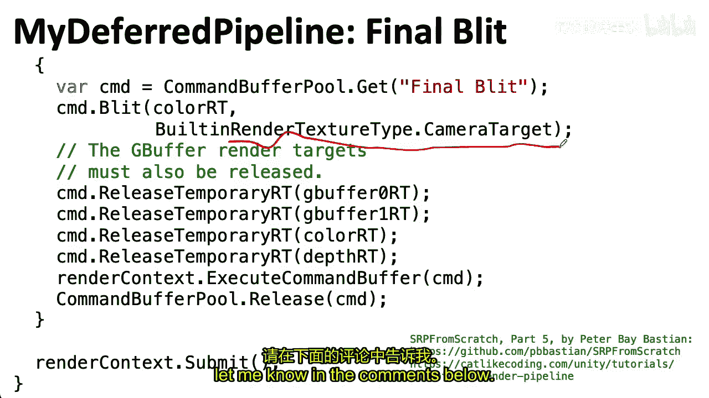