# 【全集】佐治亚理工学院-GPU编程：视频与游戏-中英字幕-p50-Lecture-50---GPU-Bonus-A--BV1GZfyBbEQn_p50-

Hi there。 My name is Er Lanchman， I'm a professor of electrical and computer engineering at Georgia Tech。

 and this is GPU programming for video games。In this lecture。

 what I'm going to do is I'm going to take some shader code I wrote to create what I call the Intro shaders package that I created for the built in rendernder pipeline in Unity。

 and I'm going to try to upgrade those to work with the universal render pipeline。

And then if I'm lucky， maybe in a future lecture， we can take that and make it work with the high definition render pipeline。

Now I'm using the term lecture somewhat loosely， this isn't going to be as well planned as most of the lectures in the series because what I'm going to do is I'm essentially going to start with my introductory shader code for the Bin pipeline and without really doing a whole lot of research first I'm just going to start hacking it basically I want to give you a sense of how I approach programming problem like this so this is not going to be as polished as most of my other lectures。

I think I just figured out I'm not supposed to be here。So I'm running 2021 point1 point， something。

 something， the point， something， something probably doesn't matter a whole lot。2021。

2 is still in beta， so that's why I'm sticking with 0。1 for now。 I'm going to create a new project。

 and I'm not going to create a universal render pipeline project。

 And the reason is I want to go through the experience of taking an existing set of HLSl shaders that were written for the built in pipeline and convert those to work with UP。

 So I'm first going to create a good old fashioned。

3D project。 Let's see。 I've been putting off upgrading for a while。 We're already up to dot 15。

 but I don't feel like doing that now， which is pretty much whatever I say whenever that comes up。

Anyway， we now have。Our standard opening unity window。

 and I'm running this dual screen where there's sort of。

My main laptop screen that's actually running Camtasia， or I should say， I'm running。

The laptop of course is running Camtasia， I'm showing most of the Camtasia stuff on my laptop screen and my actual unity stuff I'm doing here up here on the second screen。

 but it's a little tricky because the actual screen is much bigger and I'm only capturing a。7。

20 by 1280 subset of it。 So that's why you'll occasionally see me dragging things from the side like this。

 like this in shaders Unity package。 You can get that from my Github account。

 which I'll put a link to。In the。Youube description here， so let's load all of that up。

And before I start mucking about with it， let me make sure that the scenes still run。 Let's see。

 lighting examples。I do feel like。Unity is running slower。

 especially when first running a scene on the。M1 that I'm running。

 So this is running under Rosetta with Intel emulation。

 which is odd because most other programs that I've tried on the M1， including Camtasia。

 actually either run as good as or sometimes better and quite often smoother。

 Cammtasia in particular on my 2015 Intel， which I inherited from my father。

 My father had completely maxed out maxed it out when he bought it。 So most processors most dra。

 etc cetera， et cetera， et cetera。It tends to start to really get very hot。

 and the fan starts to sound like a jet engine when not just exporting， but sometimes after a while。

 just editing video， but on the M1， it never really breaks a sweat。

Let's see here's my simple shader scenes。Okay， so those are still working。

The more complicated examples ran， so certainly all of this should work。No。

 I think this is actually the version of unity I did the。Actually， no。

 let's see the lectures I recorded for this original intro shader set I recorded last year in summer 2020。

 but I have tried these out recently because I've been using the same set of code this semester in 2021 All right。

So let's see if we can upgrade our project to the universal render pipeline。

So I think I'll need to go to the package manager since I started a vanilla 3D project。

 let's look at packages， let's look at all of the packages we can get。Scrtable build pipeline， no。

 no， no， no， no。Universal render pipeline that sounds like a useful thing to get。 Let's install that。

And if this goes well， and we successfully upgrade to the URP， maybe in a later lecture。

 I'll try upgrading to the high definition render pipeline。

 but there is something else we need core oh did it already install that for us？Okay， that's good。

 It looks like it kept track of the dependencies。 so when we installed the URP it installed the core RP library for us。

 and if we look down in our packages now， yes， there's universal RP and if I go up here there's core RP library。

 excellent。All right， now that I have those packages installed。

 I should be able to add an asset and we should be able to go to this rendering menu。

Here's the Universal rendernder Pi submenu and I have pipeline asset。Let's see。

 I have a Ford renderer and a pipeline asset with For renderer and parentheses。

 I think I want to create the pipeline asset。And it looked like it created a render asset for me and let me rename these。

 I'm going to call it my universal render pipeline asset。 Well， how about this， my URP asset。

And then I'll call this。My universal， let's see， my URP asset underscore renderer。

 very creative name there。Okay， so I had to expand my capture window a bit。

 sorry this will probably make the resulting text a little more sped looking on your YouTube screen。

Because when I go to the menus up here。This would fall down the bottom of my capture window Otherwise。

 Anyway， this render pipeline menu item appeared。 and I have universal render pipeline that says upgrade project materials to universalver R P materials。

 I'm not really sure what this does， Or if it's something I want to do。

 especially since all the shaders I have in the project that I'm using are custom shaders I want to upgrade。

Let's see what it does， upgrade will overwrite materials in your project。

 be sure to have a project backup before proceeding。嗯。Yolo。TPL is not upgraded。

 There's no upgrader to convert。Oh， okay， so。So certain materials were not upgraded。Let's see。

 What is the console。 Oh， let's see。Aha， so it looks like。

My guess is that it will take whatever materials we're using the various built-in standard shaders that Unity created and the old way of doing things。

 and automatically tries to upgrade those to whatever the new version of the standard shader is。

 whatever they're calling it and the universal render pipeline。

 but since all of my materials in this project are using these fancy custom HLSL shaders。

 it just threw up its hands， which I was kind of expecting it to do。All right。

 let's do the switcheroo。 So I'm going to go up to edit。 Let's take a look at the project settings。

In particular， let's look at oh， unity bad， you should never be creating default projects that are set to gamma anymore。

Maybe if you just have a 2D game with no lighting or something， okay， let's set that to linear。

Why would it take a significant amount of time， I just just set the color space correctly。 All right。

 anyway， all right， so for some reason， this color space thing。

 which you would think would have to do the graphics is not， in fact， in the graphics menu。

 It's in the player menu。 I believe I've ranted about that in some other videos。Graphics， a so none。

Render pipeline asset here， which is why it's still defaulting to the。Built in Piline。

 let's use my URP asset and say yes， let's please do that。And now。When I go back here。

 it should stop working。Why is it still working？That's still working。 Okay， that's surprising。

See if I click on one of these objects， yeah。Material GP P20 textured。Wow。

So everything here is still working。I was not expecting that。I was expecting everything to break。😊。

Let's see。 This is all about upgrading shaders to the UP。

 Are you telling me that my custom HLSL is actually working。Can't believe that。Let's go to scenes。

Let's see。 simple shader examples。Why are those still working？😔，All right。

 so let's try the lighting examples。Ah there， okay， something broke。Normal map example。

 that will be even more complicated。 This should also be broke。 Okay， so let's fix the broke things。

 Now the other question is。Are all of my shaders still even compiling？

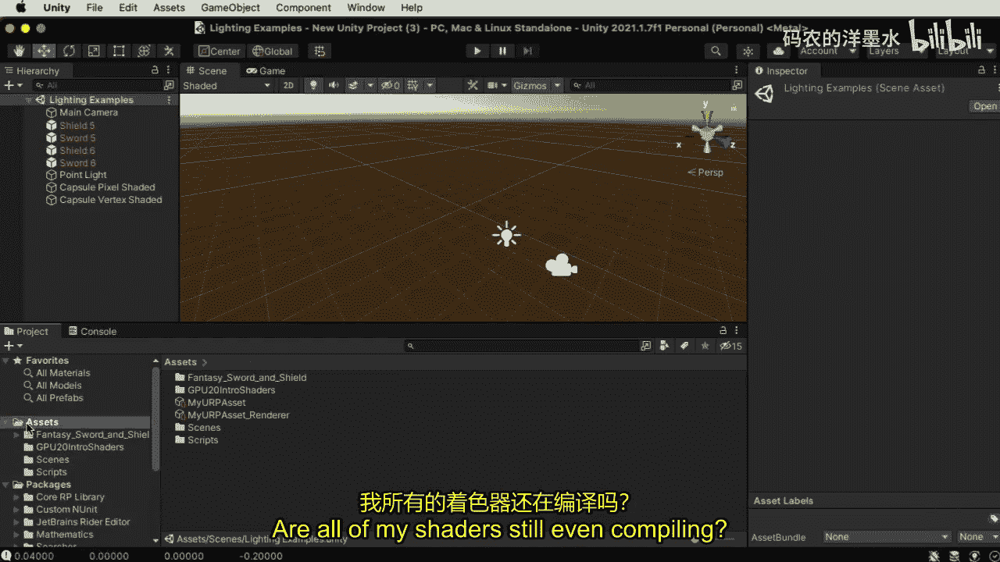

Let's see。Normal color， compile and show。See builtton property found in another sea buffer then。See。

 this looks like a warning， it doesn't look like an error though。

It's not compatible with the SRP batchcher that's something we could worry about later。See。

 is this compiling， that compiling， that compiling， that compiling， that compiling， that compiling。

 so I'm not actually getting any compiler errors。Let's start with the least complicated of the inter shaders I made that use lighting vertex lit。

So Unitycg。cG and this include file， this is sort of the main include file for Unity built in pipeline。

So what I want to do is figure out what the equivalent include is for the URP。

 put that in instead and then see what the compiler complains about。

 so I'm going to comment at this out。

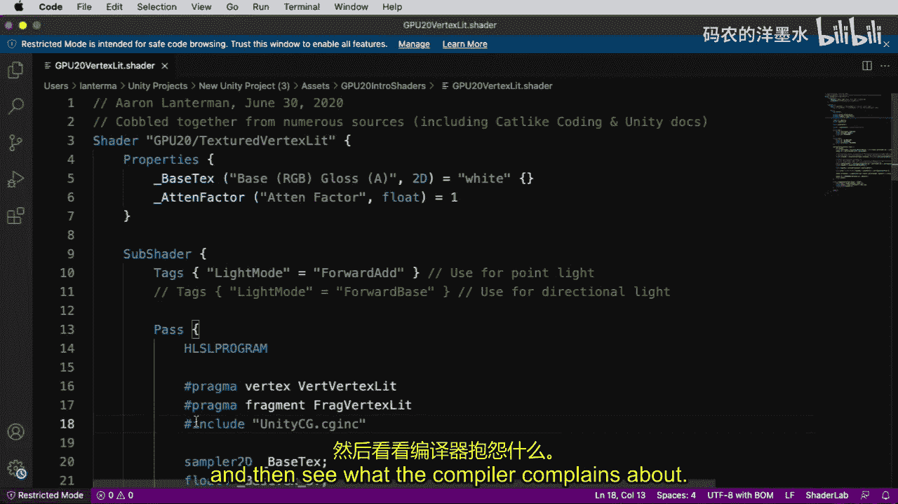

And according to these docs on the Unity website。There's an include。

 do I really need to include all of this probably because of the way it comes and the form of a package。

 so packages/com。unity。 rendernder pipelines。univeveral/shaderlibrary/co。hlsl。

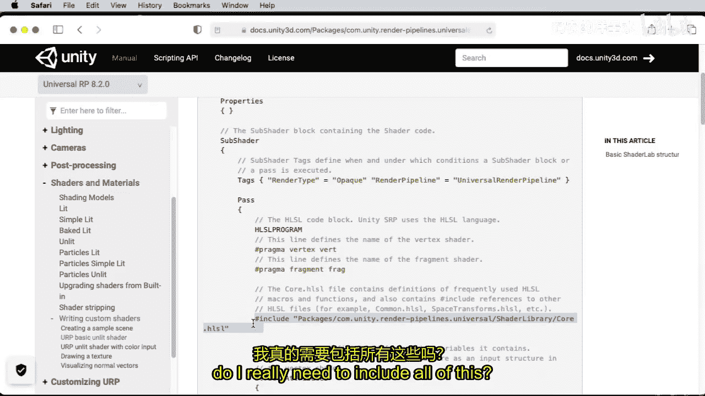

Okay， I'm going to guess like the HDGRP probably has its own version of this core HLSL。

 and you probably need all this stuff to potentially distinguish between these things。

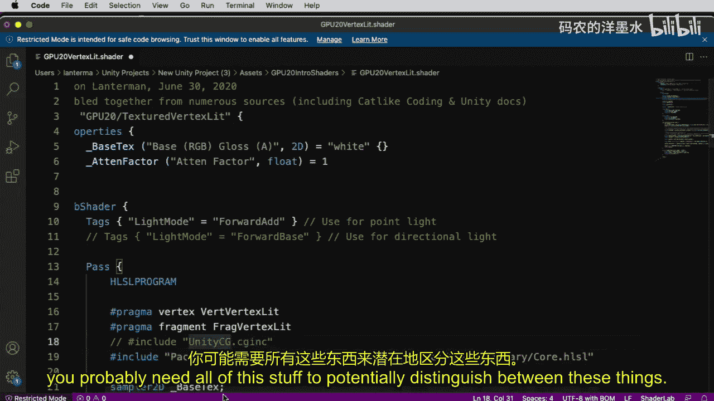

And while I'm at it。There's a different set of tags here that they use in whatever their basic example is。

 All right， so。

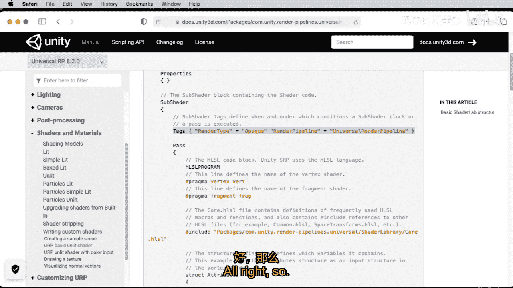

I'll change the tags to that。 see if that makes it happier as well。

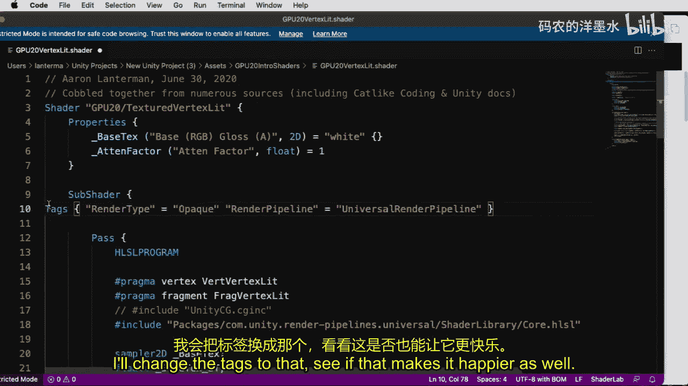

All right， now I've got some pink stuff here， we're making progress。Let's see。

 I think in the scene that this is in the set of three objects over here on the left uses my vertexlit shader and the set of objects on the right uses the pixellit。

 so it makes sense to me that the stuff on the right isn't appearing but the stuff on the left is giving us a compiler error and now since showing up in peak and actually is giving us just a single compiler error really。

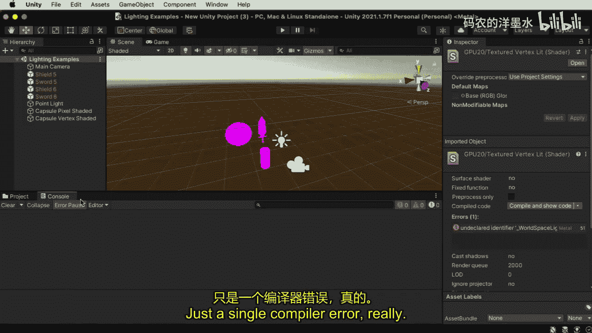

Oh， actually， I bet there's a lot more errors。 The compiler just gave up on this first error。

 which is at line 51 world space light position。 Okay， so now the real work begins。

 We're going to have to replace various things in here with whatever the U R P version of these variables are。

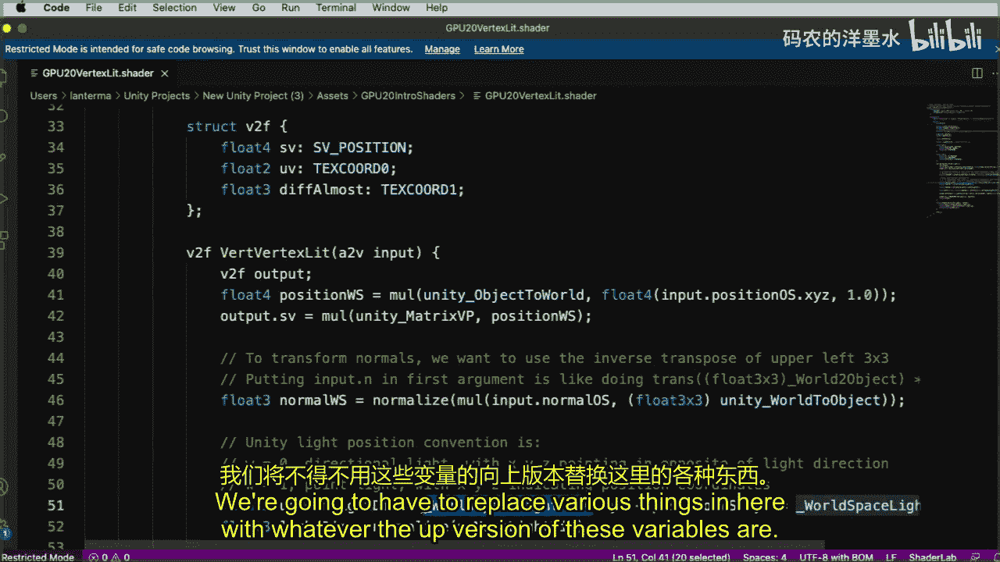

Okay， my Google searching has led me to Twitter。Have mercy on my soul。 All right， it says here。

 this person declares， if you declare a property named main light position as a vector 4。

 you you may get a light position from the engine and assuming this works what coordinate space is this in。

 Is it world space， let's hope it's a world space and let's try this。

So I have no idea if this is a best practice to use main light position or not。

 assuming this is even a thing。But I generally go from a strategy of make it compile。

And then make it work。 And while you're trying to make it work。

 go back and make it compile if you made it stop compiling and trying to make it work。

And then go back and try to make it fit whatever the new coding standard is in terms of variable names and things like that。

 and which nice abstracted macros you should use instead of accessing things directly。

 that sort of stuff can wait。All right， so I think I also need to declare it in the variable list。

 let's say floatat 4 underscore main light position zero。Wait， I don't think it had a zero on it。Oh。

 it's complaining about a redefinition of underscore mainlight position。

So maybe we don't actually have to declare that ourselves。

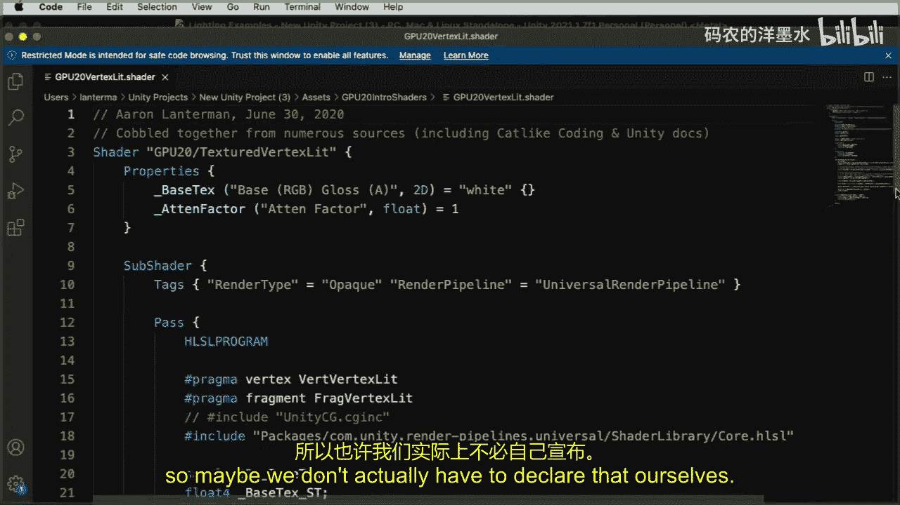

Ah， it's at least compiling now it's showing up as black， but this is progress。

You know what I wonder， I wonder if this main light is only usable as a point light and that this will work if we turn it into a directional light look at that。

 let's see。Okay， so the directional light is shining right at it。

 let me take this and turn it oh look at that yeah， yeah， yeah。Let's turn it around the other way。

Ha ha okay， so what's going on here so why did I randomly say let's switch it to directional and see if this will work Well remember it was called main light Now in the original OG built in render pipeline back when they just didn't even say anything about it before because it was created before their scriptable render pipeline so they didn't need to make a distinction。

 they generally in forwardd lighting mode did two passes actually they did a bunch of passes they did a base pass that could potentially include a directional light if you had one and also the spherical harmonic global illumination effects and we'll come back to what those spherical harmonics are doing later in the course and then most of your other lights were actually computed in separate passes。

So my suspicion was just by the terminology main light position that the Scable render pipeline has something of a similar structure the original built in pipeline rendered that original strong directional light in a base pass and then it would render most of the other lights in separate individual passes the universal render pipeline does everything in one pass but it looks like they kept a similar overall data structure format for the lights and that there's some main light and then other lights we need to add and the main light by the way they have the setup is a directional light so what happens is when we switch this to point essentially there is no light as far as that main light is concerned so we need to figure out where unity puts the information for the other lights in the scene that aren't this one directional light before we do that though I。

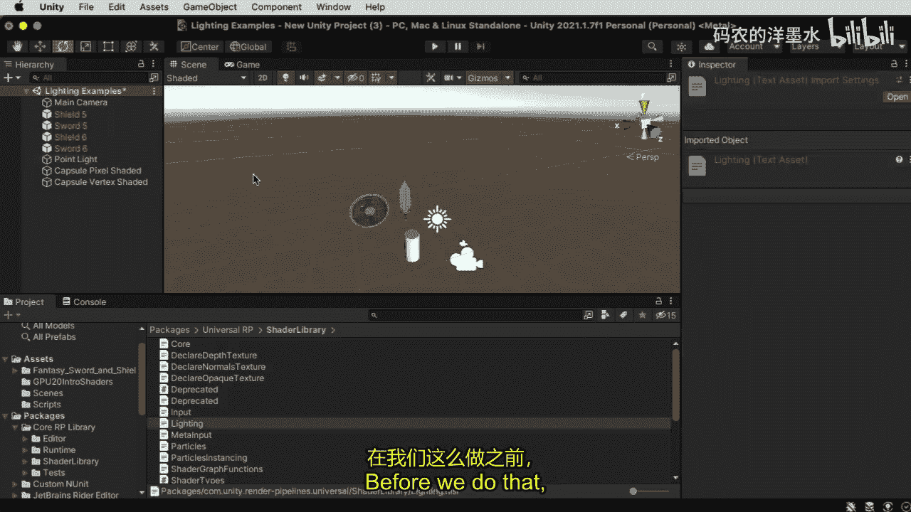

Check out the light color if it changed the color， does this change？啊。

So that does change that means that this light color zero is still valid that makes me nervous。

 though， let's see。If there is a main light color。Such that I wouldn't really need this anymore。

 and I guess I wouldn't really need this either。All right。

 let's see if that compiles and still works08， mink light color zero， Oh。

 there's a zero I forgot to get rid of。

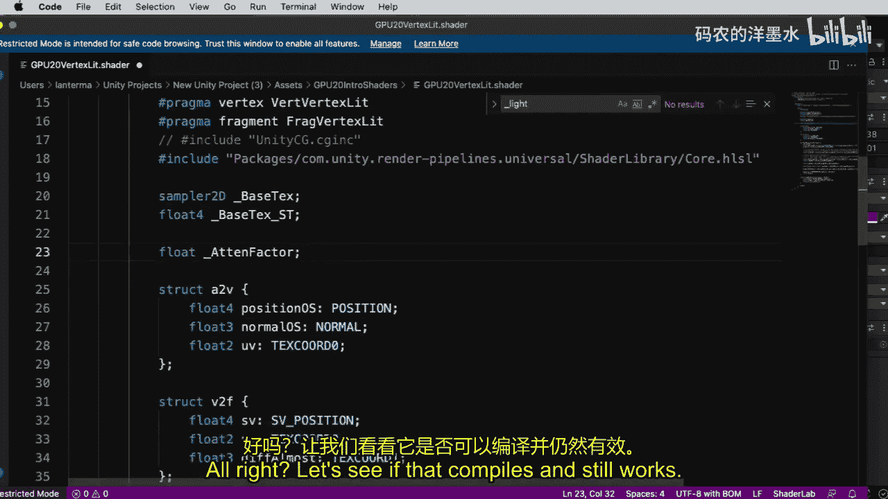

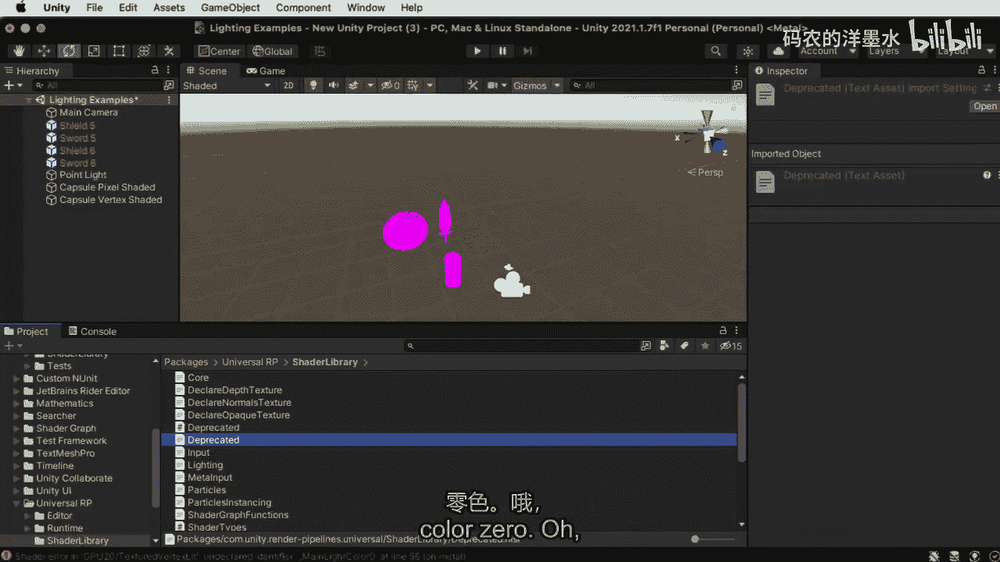

AhOkay， now if I do this， does it compile？Ah， that looks like that works， okay。I like that better。

 That underscore light color 0。 that sort of appears in various places in the original pipeline source code。

 It looks like something is still filling that in， even in the new universal render pipeline。

 But I bet this is the preferred variable name nowadays。 All right。

 let's go on a hunt for the lighting information for those additional lights。

 So I found a H LSO file called lighting and the shader Library and the universal render pipeline code。

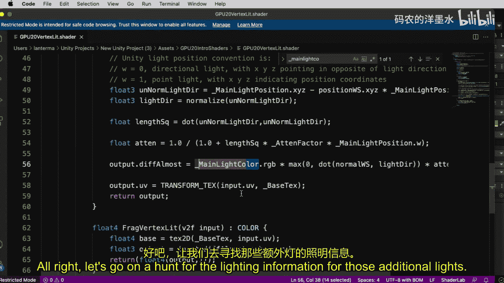

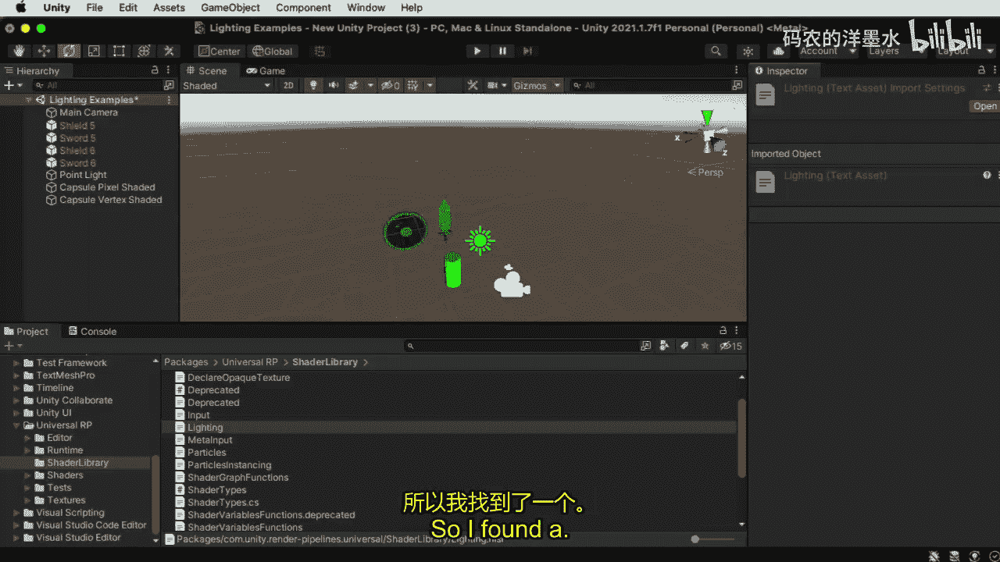

And if I pull that up and I look for underscore main。

I'll see that it looks like they really want us to get a light data structure through a git main light routine and that this will assign say direction in the case of the directional light okay so if you're in my class you've seen my confusing explanations in an earlier lecture about how this main light position can contain either position or direction information depending on whether it's a directional light or a point light and that's indicated by what's in the W coordinate。

 I'll talk about that again in a bit if you're just jumping in on this lecture I'll review what's going on there in a little bit too so you're not completely overwhelmed let's see distance attenuation shadow you know I'm not using any of that in this demo code anyway again this is code I created to demonstrate things fairly early in the class and I overall don't want to get too much into unity specific things。

So my attenuation factor for point lights isn't really designed to match whatever kind of attenuation unitity uses。

 it's just generally demonstrating the concept so since I'm pretty much just using these variables directly more or less。

 I think I'm going to avoid using this particular gi main light abstraction for now and just use these variable names directly。

 all right， what about additional lights？Let's see， what about get something light， here's get light。

 get main light， oh， something with shadows that's complicated I don't want to get into that。

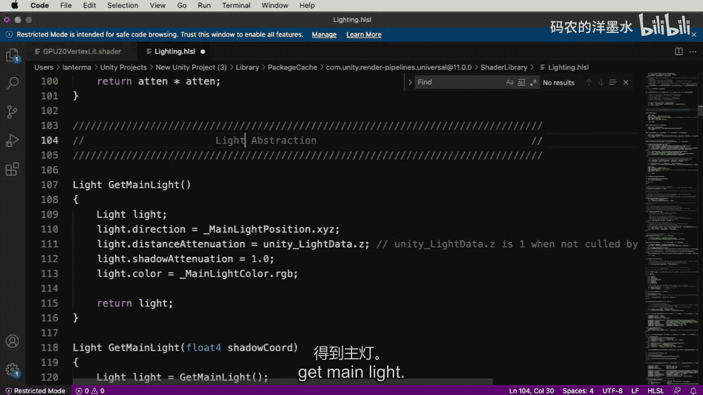

Oh， there's a whole bunch of overloaded， different overloaded versions of the function。Okay。

 now we're cooking with gas， get additional per object light that sounds like the sort of thing we want。

Oh， oh， pain and suffering， calamity。Okay， so it looks like it looks like for this at least there's a good reason why they wanted to use this additional abstraction of going through this function instead of just accessing variables directly。

 and it looks like it has to do with the fact that the universal render pipeline the main lit shaders in the UP。

 all deal with all of the lights and a single pass。

 so that means the shader has to take in a giant data structure that is all of the information for all of the lights。

 and then it has to loop through those and sum of the results。

I don't want to get into looping through all of those and summing those in this particular bit of demo code because this is the first lit shaders that students in my class will have seen。

 and I don't want to confuse them with multiple lights at that moment。

I also don't want to confuse them with whatever this is。Let's see。

It looks like there's two different approaches that Unity will take to passing in light data。

 one is actually declaring different variables for the different kinds of information like position and color。

And the other is declaring one single variable that has an array of structures with different fields in them and you can pull out。

The bits of information by pulling out the individual fields。

So why does it have these two different versions I wonder if one of these approaches is for some reason more or less efficient on some platforms than others。

Or maybe one of these is flat out， not supported in some way， I'm not sure。Now。

 if you are writing a shader to use in your unity game。

 you should use this function and all of the various other macros and functions provided to offer abstraction here。

I'm trying to get the code as compact as possible for what I present to the students so I can fully explain what the code is doing without having to show additional helper functions I want to be able to fit the code on as few slides as I can so let's see all of this stuff about attenuation I'm not using spot direction。

Not doing anything with spotlights。 Let's see。 I also don't need all of this stuff about computing light vectors and distances。

 because to the extent I need it， I am doing it in my own code here。Let's see。

 I'm not really using most of the things here。 I really don't need them。

 So let me take this bit of code here and copy it over into my shader。

 and then we'll try to figure out what to do with it once it's in there。😔，Okay。

 don't need this stuff for the。Distance and spot attenuation， we're just getting colors here。Boy。

 this is complicated。Now， in addition to sorting out what in the world is going on。Here。

We also need to deal with the fact that there are basically two scenarios。

 one where we have a single。Light in the scene that's a directional light in which case I want to use main light。

 or we have a single light in the scene that's a point light。

Or we have a single light in the scene that's a point light in which case I'll need to use all of this mess。

 Now this came up before this is certainly an issue in。

My original shader code that I wrote for the built in pipeline， let me pull up an example of that。

 so if I go to my intro shader package， let's just look at the pixel it for the moment。

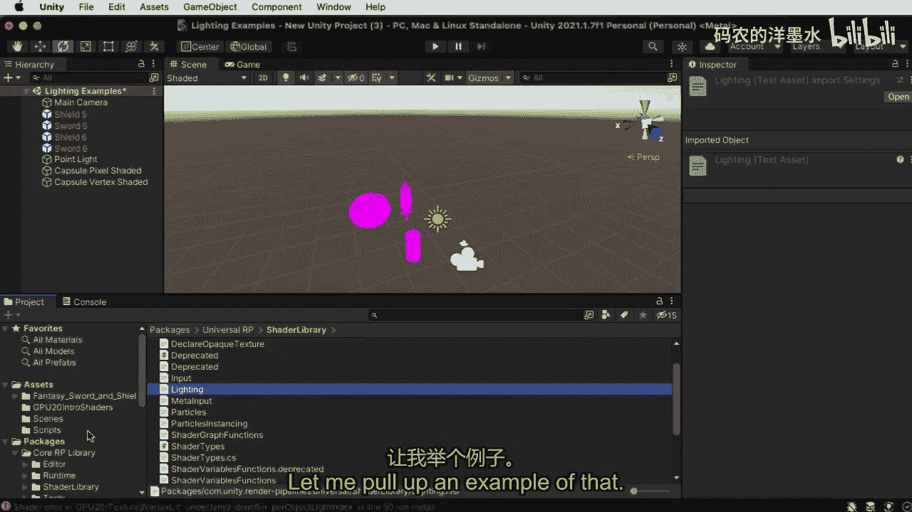

All right， so in that particular case， I didn't actually have to change any of the code down here because rather it was a directional light or a point light was indicated in this。

Da。Was indicated in this single universal world light space position，0 variable。

 whether it's directional or point。 And it wound up sticking that information about。

Rather it was directional light or point light in this W coordinate。

And all I had to do there because those two kinds of lights were handled in different passes。

Is I just set up this bit in front here where you could comment out or in whichever line you needed to deal with point or directional light。

 so it would compile this for the appropriate pass basically to handle both kinds of lights without this commenting and an out trick I would have to cut and paste the code where one of the copies says for base and the other says For add and I just think having two copies of the code in these files would be very confusing。

And of course， the right thing to do is to have some sort of include file where you have the code that you would cut and paste in that include file and then just have two versions of this file。

 one with the forward add tag and one with the forward base tag that then include that external file。

 but again， I'm trying to get all the code in one spot for the students。

A big frustration in trying to sort out Unity's own shader code is everything is spread out in so many files。

So many different includes， which of course is the right thing to do。

 it's the only real way to manage that level of copy and paste complexity。

 but again I'm trying to get everything in one spot for when students are first looking at this。

But I don't think I really want to use the same comment in and out trick here because these are big chunks of code that we would be commenting in and out。

So I think what I'm actually going to do here is set up a drop down menu。

So let's say that I've got keyword nu。Kword and numb。And we'll have two keywords， we'll have point。

And directional。let's see it actually needs to be declared like that， that's right。

How about underscore light type for the type of light， how creative？See， this is light type。

And we'll be able to use it in the shader as a float。

Although I don't think we actually need to use this variable in terms of using it in an actual HLSL if then statement where both branches are compiled and the if statement is executed as part of the running code。

I think we can use the multi compile features of unity shader system。 Let's see。

 I think it does something like this。 We'll have light type underscore point and then。

Underscore light type， underscore directional， and everything's capitalized。Okay， unity。

 what are you complaining about unexpected ID？Line7。Oh， I think these need to not be strings。

 I think they just need to be。Not things in quotes。Okay。

 now it's complaining about something further down， which I totally expected。All right。

 How about this， Let's go down to where we're messing about with lights。Will say。If defined。

Light type point， and then we'll do a separate。El if define light type directional。

 And I'm leaving this fairly open ended like this instead of a if else。

 because I want to potentially be able to add other lights later， I'm not actually going to do that。

 But imagine there's a universe where a future me did want to indeed do that。 Okay。

 so here's the code that I'll want to run。 if we have a point light。And let's see。

 since we have some compiler level ifs built into other ifs， I'll go ahead and indent those。

And if we have the directional light， then we'll say F4 light position WS is equal to this main light position dot X。

 Y， Z。 Let's just change that to float3。Float 3， float3。

 and then we'll say floatat 3 color equal main light color dot RGB like that。And then down here。

 instead of using main light position， we now have this generic。

Light position and world space variable that we can use。

We'll make this light position rolled space again， this dot W component stores rather the light's directional or not。

 and so if it's directional， it's0。 So this term zeros out and the X， Y。

 Z is actually just storing the direction， not the actual position。

 but if the W component of this light position Ws variable is one then indicates it's a point light。

 So this is left in the subtraction and that's how we get the light direction。

So this needs to be light position。😔，WS and this now just needs to be color。Actually。

 let's make that light color that will make me much happier， say light color。Light color。

And we'll make all of this light color。Light color。All right。

 and since we've already pulled out the RGB of the light color。Don't really need a dot RGB here。Okay。

 since we only have one light， I'm tempted to just replace all these instances of per object light index with the number zero。

But before I do that， I want to dig a bit deeper into the lighting HLSO code to see if I can。

Better suss out what's going on to make sure that that really does make sense。

 So let's gooosh down a bit and see what else is here。We have get per object light index offset。

 okay， the fact that there's something called index offset here。

This makes me nervous that we might have to think about this a little bit more。

Here we have Git per objectject light index， which is taking an index in。Oh boy， okay。

 so this all may be a bit more complicated because we have an index and then we have an index and we have this routine that will take an index and。

Give us an index now the per object light index， that seems to be this thing here。

 at least conceptually assuming unity isn't being pathological with their naming conventions。

So this abstracts the underlying data implementation， okay， structured buffer path。

So if you have this use structured buffer for light data。We need to add some sort of offset。

To the actual index that we want oh。That's even worse， though。

 it looks like there's a whole other data structure that's just indices into that light data structure。

Great， what is this all doing Currently all non mobile platforms take this path。

There are limitations on mobile GPs what what is all this do I have to think about this。

 I don't want to have to think about this， I mean that's part of why all of these functions are here。

But remember that if this is code for the first lit shader。

 I'm going to show my students in my 4795 class， having to have all of these helper routines really does kind of get in the way if I have to constantly explain what these things are doing。

I'm just going to roll with it here， let me copy this over to this bit of code where it says use structured buffer for light data。

And we'll go back to this and try to figure out what we can get rid of We have just one light in the scene so we can set this to zero and see what we can simplify from there let's see this was a function so this returned an int I believe。

 so say int per object light index equals yada yada blah， blah blah。And let's see。

 what about the other path here。嗯。Okay， this isn't as nasty as it looks， believe it or not。

So it looks like the main thing that's happening here is that these light indices themselves are scrs and the way it's packing them in is that it's packing them in in groups of four。

 so this is how you get the correct4 tuple within this big list of four tus and this is how you get the correct element of a particular4tuple using a divide and mod operations。

 but these divided mod operations are probably basically best implemented as bitwise operations and it looks like they're doing some fancy magic down here to avoid those bitwise operations。

 there may be some earlier GPUs that don't have this kind of integer mod operation。

So all of this mess looks like they're just trying to in the most efficient way they could come up with。

 implement these kinds of inherently integer operations。Using standard floating point orrithmetic。

So I'm going to assume that whatever my students are running this code on can handle these kinds of operations。

Let's copy and paste that in here， and again this is going to beentt per object。Light index。嘟嘟嘟。

So as an aside， I looked and found elsewhere in the code that unity indices is defined as a。

Length to array of float4s， so as to find like this。

And basically if you wrote something like this where you index if you index the first of the two elements in that array of F4s and you do dot R。

 that's the same thing as indexing it with zero here， or if you did dot G。

 that would be the same thing as putting one here， and what's interesting about this is that essentially this would give you a way of picking out the dot R。

 the dot G or the dot X or the dot Y components， but doing it programmatically at runtime。

And technically speaking， what I actually saw on the code was something that looked like this。

This is not standard HLSL， but Unity has some compiler switches that turn real fort into either float for or half four depending on the platform for everything I'm doing in this class。

 just float for is fine。All right， so I think we can safely here change this index divided before to 0 since we only have one light source。

 Let's change this to0。 We can take this out。 No， we can't take out the offset。

 We can take out this index because that equals 0。 Now。

 what is this offset actually doing this unity underscore light data dot x。Hi there， I'm back。

 I just spent about a half hour Googling trying to figure out exactly what Unity_ light data is。

Or more to the point what unity underscore light data do x is I found things that would say things like dot y is the number of lights。

 but dot X I can't find a lot of info on I mean， obviously it is computing some sort of obviously it is storing I should say some kind of offset that we need but why do we need this offset I don't know I'm going assume that we need it let me take that and just plug it in here。

Actually， you know what， let's try to figure out what it actually is。

 so I'm going to make a floating point variable。Called dude。And I'm going to say dude。 No。

 I'm just going to declare dude here。 And what we're going to do is we're going to say that。Actually。

 let's make it a float 3。 And what we'll do is we'll say that something or the other is red。

 so we'll say red。Wait， what am I doing， I'll say dude is equal to float 3。 So it's going to be。

Actually， let's make it。Yellow， so it's going to be yellow if we're running this used structured buffer for light data path。

And then it's going to be。Blue。If we're using this other path。

I'm just curious about what's going to happen， so I should say because this is probably some very。

Platform specific thing I'm running。On an Apple MacBook Pro with the new M1 Apple silicon。All right。

 so on the way we'll probably debug a bunch of compiler errors。

 This is due dude has been declared Actually， let me not do the dude stuff here。

Let me do it down in the pixel shader so then I can just directly output it as a color。

So I'll say dude。If light point， okay， well， I don't really need any of that。

I just want to know how is this variable set？Sees how we can get rid of all of this。 and then else。

Dude is blue， so dude is yellow or dude is blue。D do do do do。All right。

 don't need the rest of the stuff either， this is all going to be nonsense in our current context。

And this should be end if。

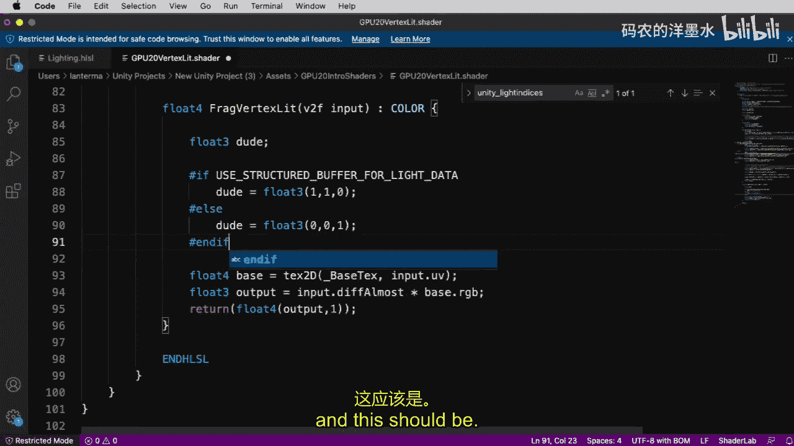

Okay， what are you complaining about？Let's see invalid a conditional expression at line 48。Oh wait。

 I think this needs to be if defined。Will it become happier if I make those D's？Whoops。

 let me get the correct scene up。Am I actually running the code I think I'm running？

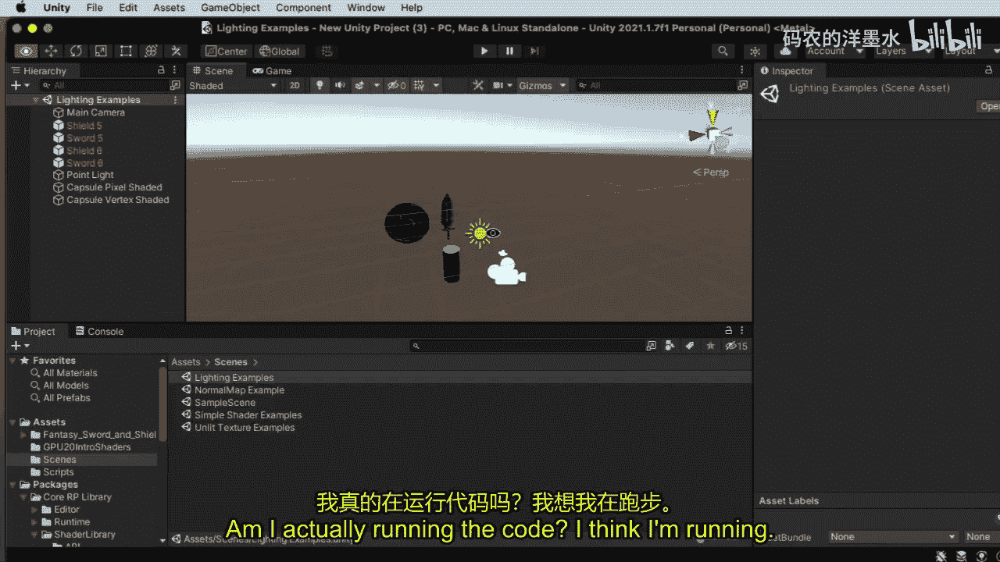

Oh， no， I'm not because I forgot to actually set the output here to dude。Okay。

 if I set the output to dude。It's blue， so what was blue？

Blue means that it's not using the structured buffer for light data。So it's running。

This bit of code in here。It's running this stuff in here。So the thing is。

 I would be really tempted to。Just keep this bit of code。In here。And get rid of all this other stuff。

But who knows if that's going to work on every student's computer。

 I don't understand enough about what this is and when it does or doesn't use it。In any case。

 let me take out all of this dude stuff。No more dude。No more dude。 sorry， dude， you also gotta go。

And down here， let's say I wasn't actually using all of that anyway。

 that was just my original source for the copying and pasting。No， for my sanity。

 I'm just going to get rid of this。Let's just not look at that anymore。

And let's return this to outputting the actual output that I want。

 and let's see what happens if we do that。

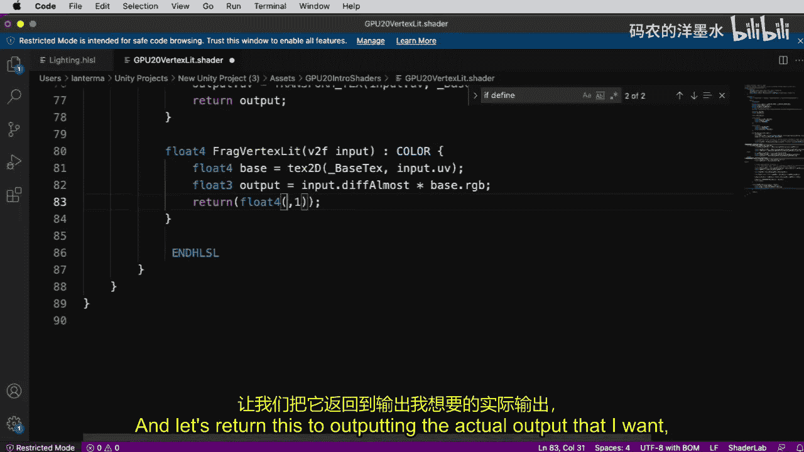

Did anything break horribly？I don't think so。The color's not changing。 Oh， wait， do I have to。

Change some stuff here。 Let's go to the actual material itself。

And look at the various thingses within the shader。So if it's not a point light。

 this is really a directional light， so I should set it appropriately and turn it to pink because now it's unhappy about something。

 what is it unhappy about？Cannot implicitly convert float 3 to float4， okay？O。Okay。

 so here I really don't want this dot X， Y， Z， since in the current way the program is structured。

 this light position WS should still have the dot W component todicate rather a light is directional or not。

 I could。Change this around。And take some of the logic here and move it up here。

 but I don't want to do that because I would really like to keep this overall logic about how it's treating the directional versus the positional light contained within the discussion associated with this code。

So let's go with that and see what it complains about now。Oh， is it complaining？No。

 I don't think it's complaining。WellThat was very exciting。Let's see if I change the color。Oh yeah。

 it looks like the color is changing， let's put this back to white here。Now。

 what about changing the direction of the light， Does it respond sensibly， Oh， I think it does。

 Let's go up and down here we。Okay。That is a happy sign， let's change this back to a point light。

We need to go back into the material。This is awkward， I know。Let's change this to a point light。

Let's see now that we have this point light here， it doesn't really have a direction anymore。

 but we should be able to move the light around。Is this changing anything？Okay， that's a problem。

 This is no point light R。lightight type here is now a point light。

Let's see if I were to move the light to 0，0，0 and then look at it from that standpoint。

I think we're getting something more reasonable if I put the light there。

 So I suspect that the light information we're actually getting is0。

 so we need to investigate that next。Okay， this is embarrassing。

 I just spent something like an hour looking for a bug that was staring me in the face。

You may already have seen it， you may have seen it quite a while ago。

 of course the main clue is that it was working for directional lights but not working for point lights and do you see it？

I forgot to change the main light position here to light position WS I remember to do it over here。

 but not over here so。When light position WS and main light position were the same thing as they were in the case of the directional light。

 everything worked， but of course， if you had a point light， it didn't。

 and I wound up wasting a ton of time trying to understand all this stuff and like what unity_ light data。

 x is， etca， etc ce， etc， when that was of course not the right place to look。Oh。

 and this needs to not have an underscore。Okay， let's see if I have a properly looking light， I mean。

 properly working light and it looks like I do yay， great rejoice saying。Great rejoicing。

 does this work in play mode as well？Come on， Play the game。There we go。

I have my little script that's moving the light around。All right， let's see。And。

Let's make sure that the color changing works。Looks like it does。

Let's make sure that it still works in the directional mode， but now I have to know。

For it to work correctly， I need to go into my light， not my light， I need to go into the material。

And switch it to。This mode that handles directional light， okay？

So that shouldn't make a change now if I move the position of the light since it's a directional light。

 but I should be able to rotate the light。Ah， there we go。

Why am I not seeing the shield in the sword。Feel like the textured ones should be brighter。

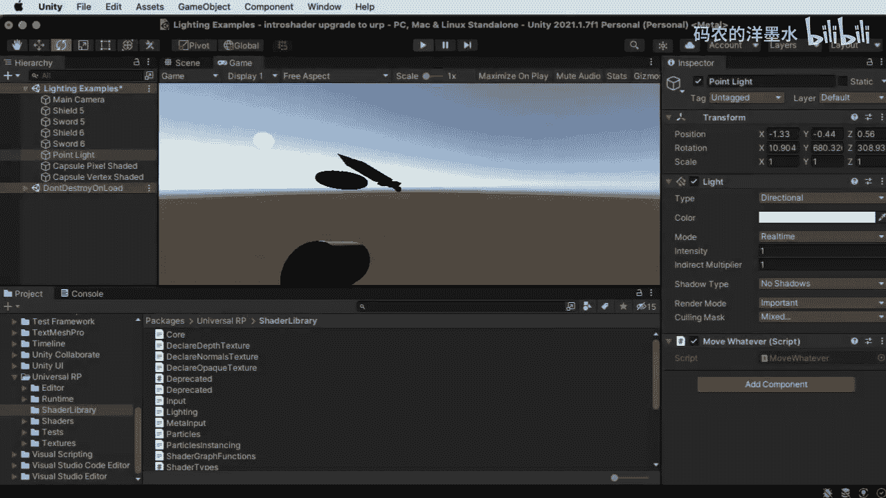

Oh， of course， they should have thought of this。 These have a different texture。

 so they have a different material， so they actually need to be switched to directional as well。

I didn't notice that before。So let's switch this to directional。Boy。

 that's problematic Now I could have the C sharp script that would sort of globally set this to either directional or point depending on the status of the light。

 but at that level of complication I might as well do the thing of having the two almost identical versions of the code。

 one for the point light and one for the directional light case。哈。With that in mind， I'm thinking。

 let's get rid of this as a menu item。So we can't change this on the fly while unity is running。

Uncomment one of the following two lines as appropriate。

So this is kind of going back to what I originally had in my original code where there is just a line that would switch。

 rather it was in the forward at or forward base pass for the point or the directional light respectively。

 so we'll just say in one case we'll define。Light type point in the other case will define light type directionional and since I already have the light set directional。

 let's test this first All right， so this is just go to compile and turn into something that can only handle point lights。

Not point lights， directional lights， okay， and let's see if I take this and I start rotating it around。

Okay， it looks like that works okay。What about if I do like this， okay。

 now we're lighting from the top， now we're lighting from the bottom。Okay。

 that's all looking reasonable to me。鱼。Let's check the color again just as a sanity check。 Yep， okay。

 I can change the color。Now， let me switch the light to a point light。Everything goes away。

 but that's as expected， because now to make this work。

 we would have to comment out directional light。And come at the light height point back in。

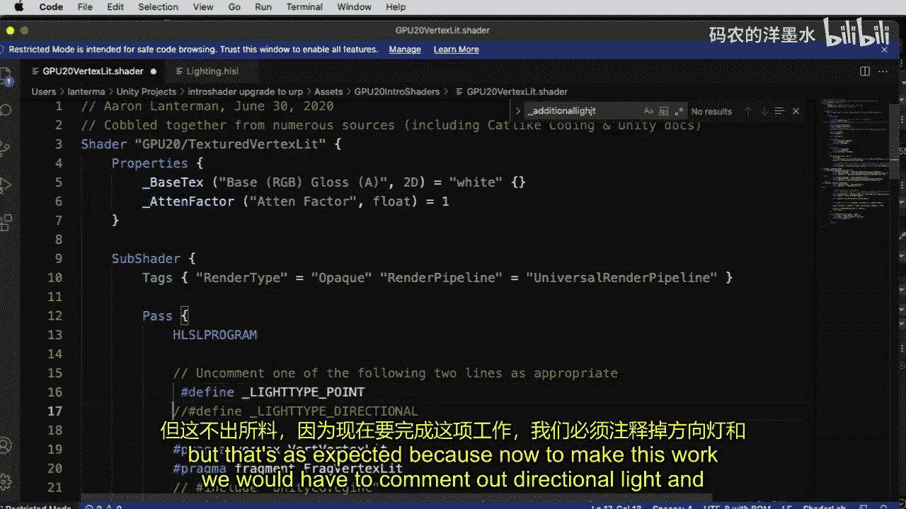

All right， and now we should be able to move the light around。A there we go。Okay。

Now we're cooking with gas。秋。And while I'm at it， first， let me put it back to being white light。

 all right。Let's play with the attenuation that I have in the script Now this doesn't match unities built in attenuation I think in any form in any of its pipelines。

 it's just something I got out of I don't know some tutorial somewhere it was a fairly standard thing I just wanted to hardcode it to show the students。

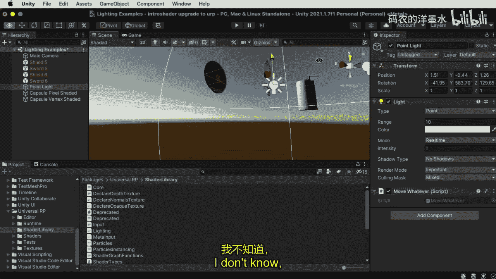

Unity has this spread out among many， many different functions。 Let's see。

 what did I do with the attenuation。 I had an attenuation factor that I could set。

To zero and basically zero this out， or if I increase the attenuation factor。

 I should increase the effect of the attenuation。 so let me click on one of these so I can get the material and。

The attenuation factor here， let's see， I think this will be let's change that to five now it's different for each of these objects so to make it consistent I would have to go to all of these things and change that to five。

And that would be a good reason to have it be。Something that's not in the parameter of the texture itself。

 but through some other。More global thing。So there's good reason unity handles it the way it does。

I don't need this include here anymore， let me change this to say。😔，Earon Laantterman。July 19th。

 2021。Is the latest version of this。Let me put a note to say that this only。Works for scenes。

With a single point or a directional light。And。You must manually include the appropriate。Light type。

Define below。😔，And let me also' change this to URP texture vertex lit and let's make this GPU 21。

 so it's current here。And whoops this should be July。Through the power of sped up video。

 I'll make the appropriate tweaks to the unlit shaders just to make the style consistent。

 I should also note that I've made no real attempt to try to change the kinds of names of variables that I'm using here or various data structures to match whatever unities conventions are for the U P。

 This is a good place to declare temporary victory and wrap up。

I will deal with the basic pixellit Shar and the normal map shader in a future lecture So this is very different than most of my lectures where I present a set of finished code that's been nicely formatted into a set of PowerPoint slides。

 but I thought it would be useful to at least once show you the kind of process I go through when thinking about shader code you've probably figured out by now that I am not a coding superstar very few actual professors probably are so in the comments below let me know if more presentations like this would be useful。

Where you actually see the behind the scenes process of me approaching something new。

 like the universal render pipeline that I hadn't dealt with before and seeing how I tackle updating a set of code to work with something like that。

 or maybe it might be useful to have a lecturer to that's somewhat in between the styles where I have a set of code that I know works and that I know where it's going but where I actually type the code in live and build up a final program slowly instead of what I did in my intro shaders package where I have a series of programs each of which is finished in and of itself。

 but which builds up to large more complex shaders， anyway， let me know what you think。

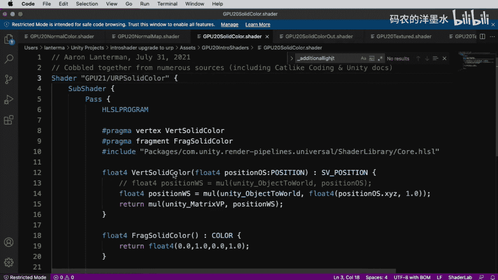