# 【全集】佐治亚理工学院-GPU编程：视频与游戏-中英字幕-p51-Lecture-51---GPU-Bonus-B--BV1GZfyBbEQn_p51-

Hi there my name is Erin Lancherman， I'm a professor of electricallect and computer engineering at Georgia Tech and a year ago I took some code that I had written for Unity's original built in pipeline and I started to try to port that over to work with the new universal render pipeline that code is part of what I call the Intro shaders Back which I created for my GPU programming for video games class。

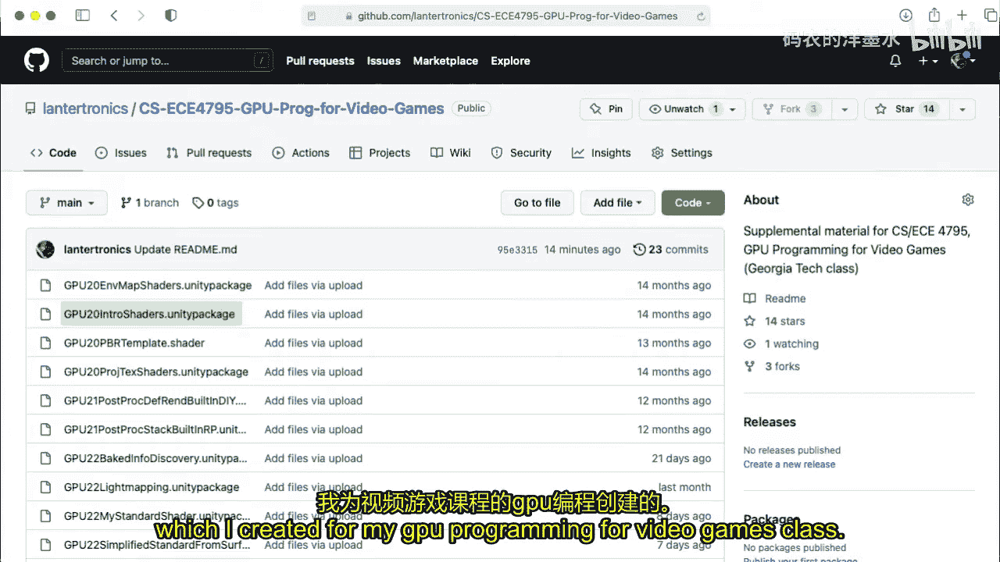

On the left I have the code for my vertexlit lighting example where I converted this over to using the URP and on the right I have my original builtin pipeline Plit lighting example code and I want to make the same transformations for this pixellit code that I did for the vertex lit code so let's see let's change this to GPU 22 and let's change this to July 14 2022 and let me put URP here in the title to indicate that it's now the UP version of the code let's see I have some comments here this only works for scenes with a single point or directional light you must manually include the appropriate light type defined below okay that will probably still be relevant so let me take those comments and put those here and as you can probably guess this is not going to be as polished as most of my main lecture videos I'm looking at this code for the first time in。

About a year， at least as far as the Up version goes。

And so you'll see me figuring out stuff as I go now the tags are going to be rendertyopaque。

 render pipeline， universal render pipeline， so let's replace the tags over here with that。

Let's see in the original we had two separate tags I was commenting in and out。

 depending on whether you were using a point light， you wanted For add。

 if it was a directional light， you wanted For base。

 because the built in pipeline has these separate base and additional additive passes。

 whereas the universal render pipeline does everything in a single pass。Allright。

 so we have our HLSO program down here。 It looks like I have something I added here before the pragmas。

 Let's see， uncomment one of the following two lines is appropriate。 here's where you decide。

 Is it a point light or a directional light。Instead of this particular include file here。

 this unity CG， it looks like we have a new include file we want。

 and that's this packages slash Com dot unity blah， bh blah， bh， blah blah， blah Core dot HLSL。 Okay。

 we'll assume we still need that looks like we don't need this underscore light color anymore。Okay。

 so it looks like I'll need to copy some code from my vertex shader and the vertex lit version to the pixel shader in the pixel lit version。

 so let's see there's a whole bunch of stuff involving light data， let me copy that over here。

Before the equivalent code。All right。And let's see。

 so world space light position in this normal line， okay， this is now light position WS。

 so let's put in light position WS。And let's see there's all of this stuff。

 let's see this no light position， WS again。And that goes in here。

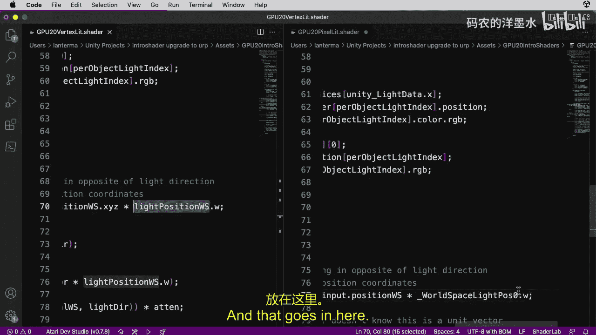

Let's see。 It looks like we need a new light color instead of underscore light color 0。

 we have just light color like this。 And is that equivalent to the code we have over here。 Yeah。

 and will the rest of this just magically work。Let's see if this magically works。

It did not magically work。 Let's see。 On the left here。

 I have my vertex lit shader upgraded to the U P。 On the right， I have my pixel shader。

 but it is showing the evil pink。 All right， so I missed something on line 84。Here we go， line 84 a。

Let's change this to Blight position WS。Okay， now will it work。Ah， look at that。I think it's working。

So we now have a vertex lit shader on the left and a pixel lit shader on the right。

Let me crank up the light intensity a little bit。Let's see point light， where's my light？Maybe not。

 whoa， not that much。Yeah， how about that， let's change that to three。AhThere we go。

 I like that better。So neither of those had normal mapping， let me check out my normal mapping demo。

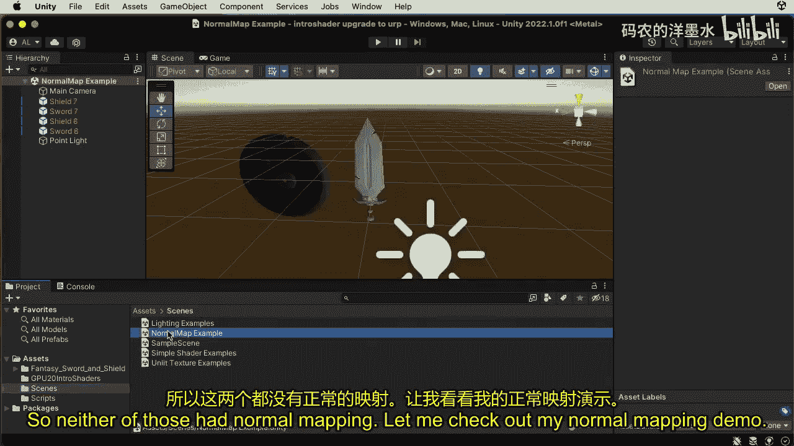

So on the left here we have my original pixellit shader， and on the right。

 we should in theory have normal mapping， but these have not been updated yet。

So now I have my upgraded pixel at Shar on the left and I have the normal map shader we need to upgrade on the right。

 so this is now going to be the URP texture normalmal map， it's July 14th。

 2022 and let's see we need to update the tags accordingly because now there's just one pass and we need to include this stuff about the light heightight point either point or direction。

So let me paste that in here。Right， so scrolling down， down， down， down。

 we also need this new include instead of the old unity Cg includes。

We're not going to need light color zero anymore。So we need to paste in all of this stuff involving getting the lighting information。

So let's paste that in here。And I think for the rest of this， we can make the same changes。

 so this is now light position。WS， then I'll have light position Ws here， light position WS here。

 and then I think this is now just light color。Now will this magically work？Oh， I think that worked。

 Let's take a look at what it looks like when the light is going back and forth。

 let's see to make this more dramatic， or I should say， make it more obvious。

 let me drag onto it a normal map I created based on the Georgia Tech logo。Yeah， there we go。

All right。Let's see， something else we might like to do is to change some of our naming conventions to better match what is in Unities code。

 so what I called A2V。The application to vertex structure， let's see， and the lit forward pass。

 that's called attributes。Sure， let's change that to attributes and V2 f vertex to fragment。

 that kind of structure is called variants， I like my version better。

 but I would like to be consistent with unity's notation。So it'll change this to attributes。

 we'll change this V2F here to variances。And this here should be variants and let me do that for the other shaders as well。

And let's see in their lit shader Unity uses the term base map and butt map。

So let's change this to something like base mapap。Oh and actually I don't really use any gloss stuff in this particular shader。

 so let me get rid of that， so base map and for the pixel it shader again we'll change this to base map。

And in the normal shader， let's change this to base map The reason I'm doing this is so now if a student looks at my demo code here and then later looks at Unity's actual UP code。

 they'll see familiar naming conventions。And of course。

 I need to change this throughout the rest of all the programs。 I'll be right back。 Okay。

 now that I change the names of the textures， I have to manually reassign all of the textures。

 reassigning textures。 This is kind of boring。 Okay。

 and let me take the normal map here and assign it to the original shield normal map。

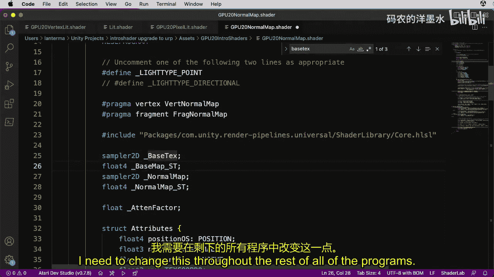

Oh， and why I'm at it， let me change this from GPU 20 to GPU 22。

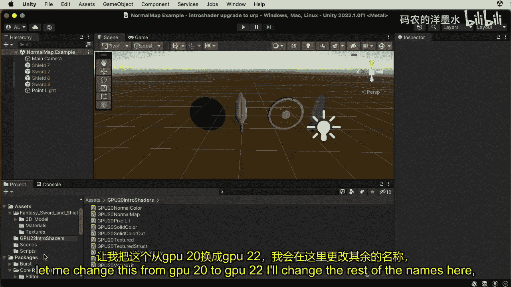

I'll change the rest of the names here too。 Actually。

 I just did that for the shaders that I changed the rest I left as GP20 just so I can keep track of this。

 Okay， what else So apparently the new scriptible render pipelines have something called an SRP batchcher and that's apparently good or something and it's good for your shaders to be compatible with it。

 but our shader is not compatible， So it looks like there's some additional lines we need to add。

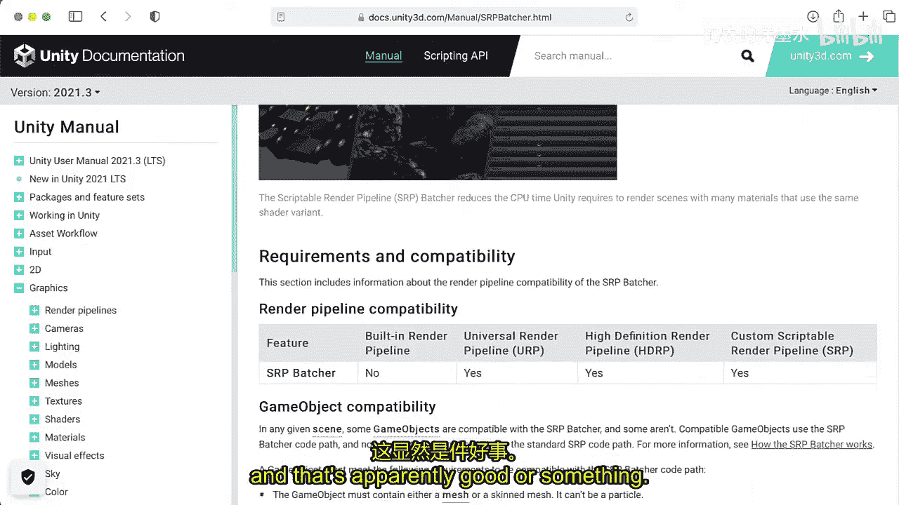

So digging around online a bit， it looks like you're supposed to add the macro C buffer underscore start and then the word unity per material。

And then add a C buffer underscore end。And use those to wrap all of your various uniform variables so it looks like I want the float factor in there too。

 so let's put that in there。Okay， did that make anything explode？

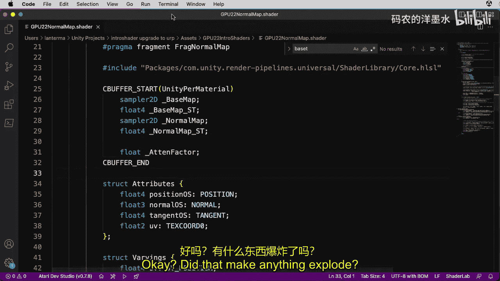

Okay， nothing exploded。 And if I were to look at the shader code， Oh。

 look it now says SRP batchcher compatible。 That's very exciting。 Okay。

 let's work the same sorcery on the vertexlit and the pixellit shader。

So we need this C buffer line up here， and we need this C buffer line down here。

And that was for the pixellit shader， so I need to do the same thing for the vertex lit shader。Okay。

 let me make sure nothing exploded， and indeed these are now listed as compatible。

So I also made some shaders that don't actually use Unity's lighting system so these worked right out of the box。

 but to be consistent what I'll do is I'll go through and change these to use the same kind of nomenclature as our new updated shaders。

 and why I'm at it， let me also change this to GPU22， how about let's call this URP intro shaders。

Okay， I updated the naming conventions in all of the files and it looks to me like everything works。

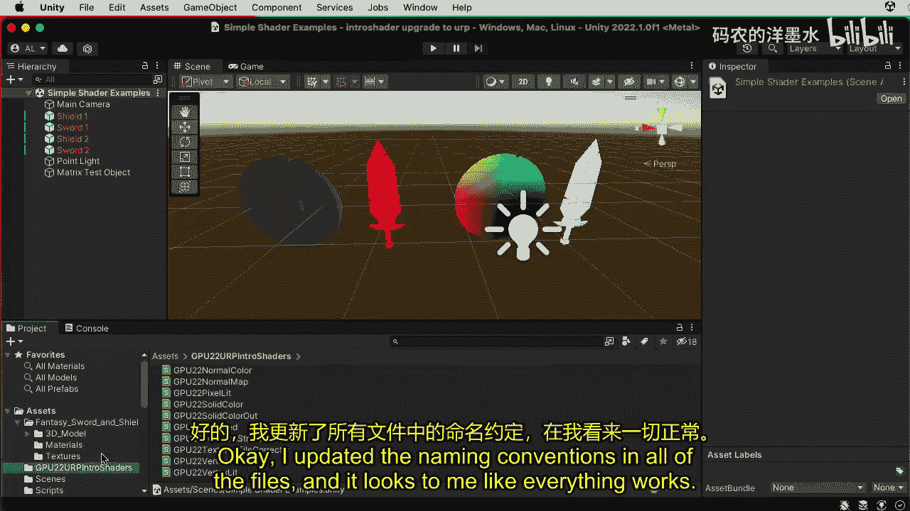

Wop， stuff the presses A I was wrong about something you're supposed to actually declare the textures outside of this sea buffer block So while I'm doing that。

 let me clean up the space in here a little bit， so let me fix that on the other two files。

And apparently they don't want us to declare textures like this anymore。

 they want us to say texture 2D underscore base map。And then we have the word sampler in capital。

 so this is all running some sort of macro and then we put sampler in front of base mapap Ug。

 and then instead of using tech 2D， we're supposed to use a macro texture 2D sample。

Actually wait note it's supposed to be sample underscore texture 2D Okay。

 let me make those changes to the other files I should emphasize that the underscore ST versions of these texture variables that handle the tiling though still stay in this C buffer start structure。

Pdagogically， I don't really w to have to talk about all of this early in a course on shaders。 Oh。

 look， Pur vomit。 What did I mess up， Let's see， sample underscore texture 2 D。 too few arguments。

 Oh， right。 I think you're supposed to put sampler underscore base map here。

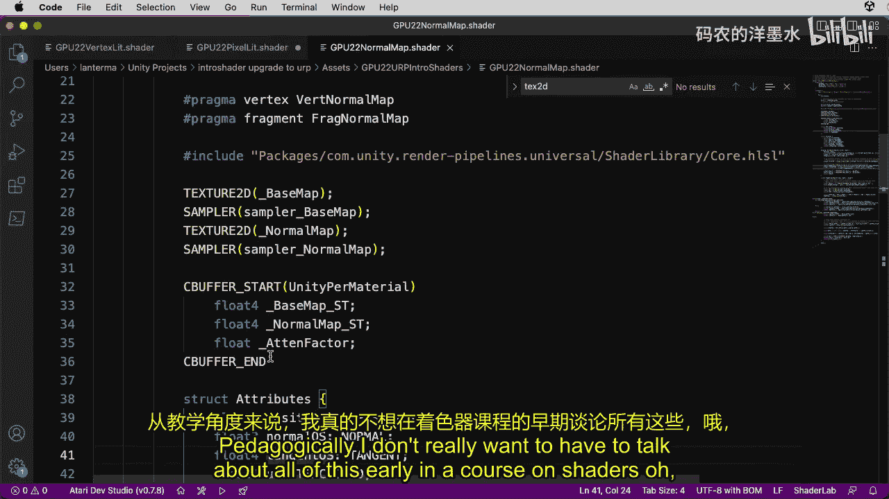

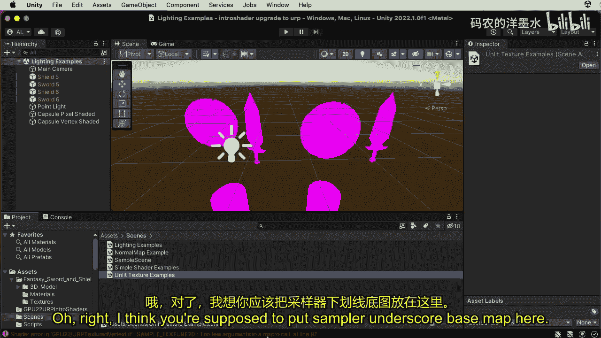

And let me make the related changes to the other files。 Okay。

 it looks like the purple vomit has been cleaned up。 Let me check out the other scenes。

 So here is the normal map example， though we have my simple shader scene and my unlit texture scene。

 Okay， it looks like everything's working。 Okay， before exporting all of this。

 I would like to turn off the sky box。 Let's see where does the sky box live。

 Is that in the environment， let's check that out。

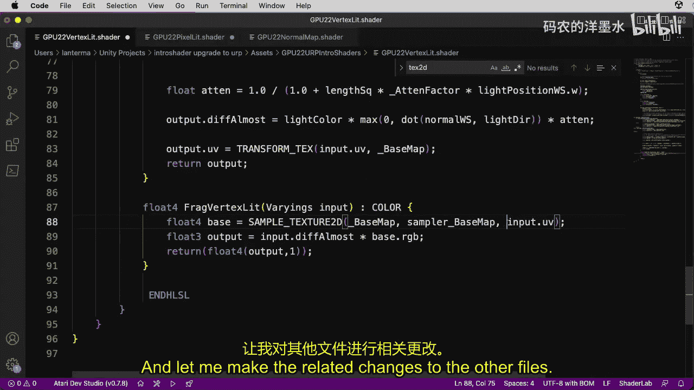

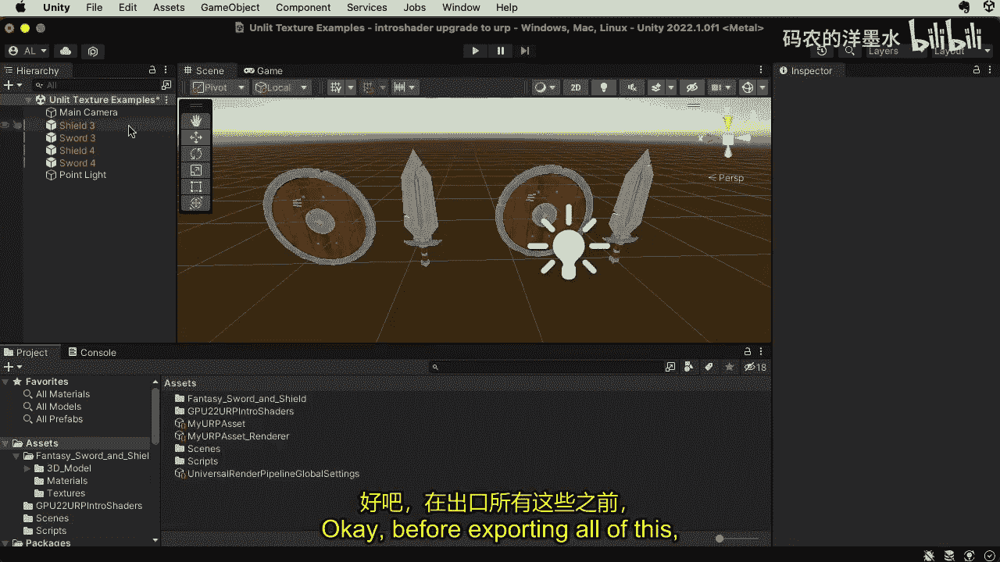

Okay， so let's say solid color。Oh but I want to get rid of it altogether even from the scene view okay。

 so let's say we're going to use the skybox， but I should be able to go into the rendering lighting dialogue box and change the environment to have no skybox at all and let's also take this ambient color and turn it all the way down so there shouldn't be any ambient color okay there we go。

Okay， let's go to assets and let's say export package and we'll include everything except for the built in scene that comes with unity sample scene。

 and let's export。I'll call it GPU 22 URP Intro shaders Unity package。

 and I'll upload that to my GitHub so you can download these demos and try them out。

