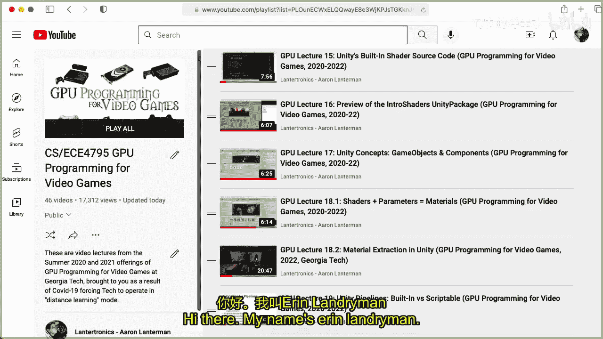
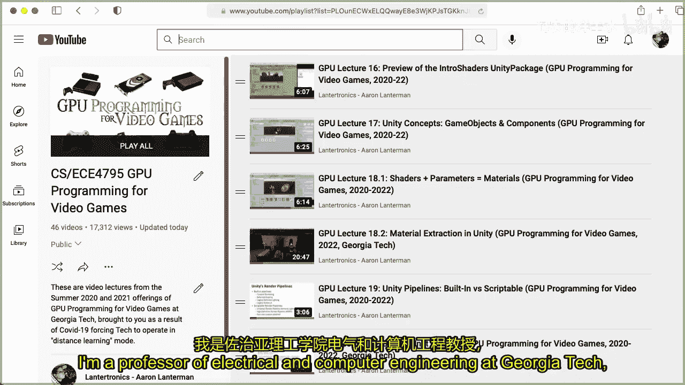
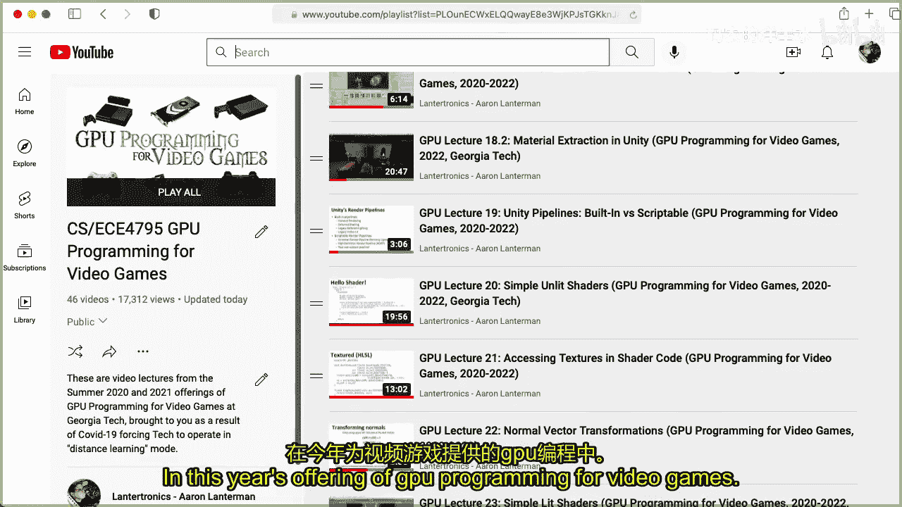
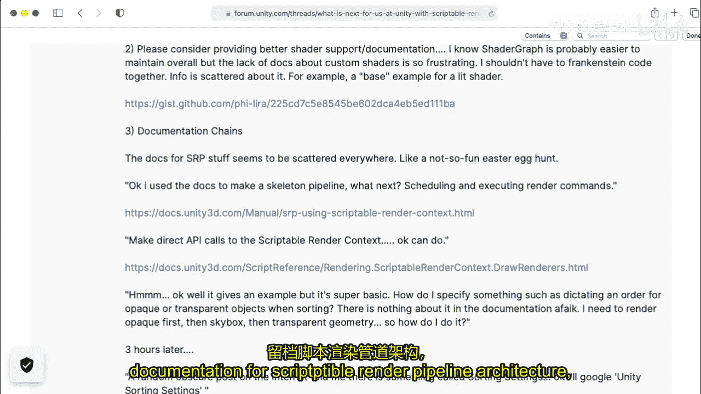
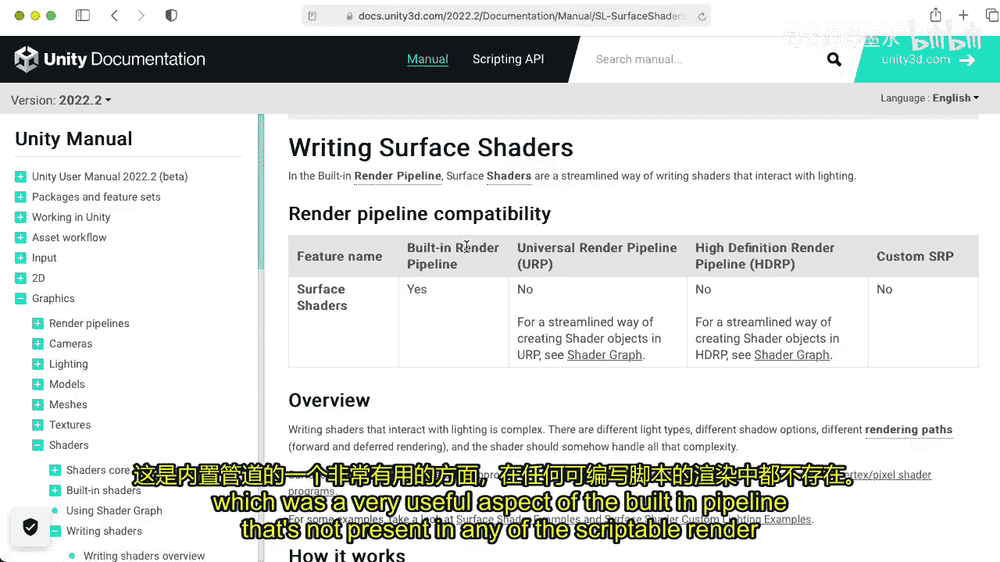
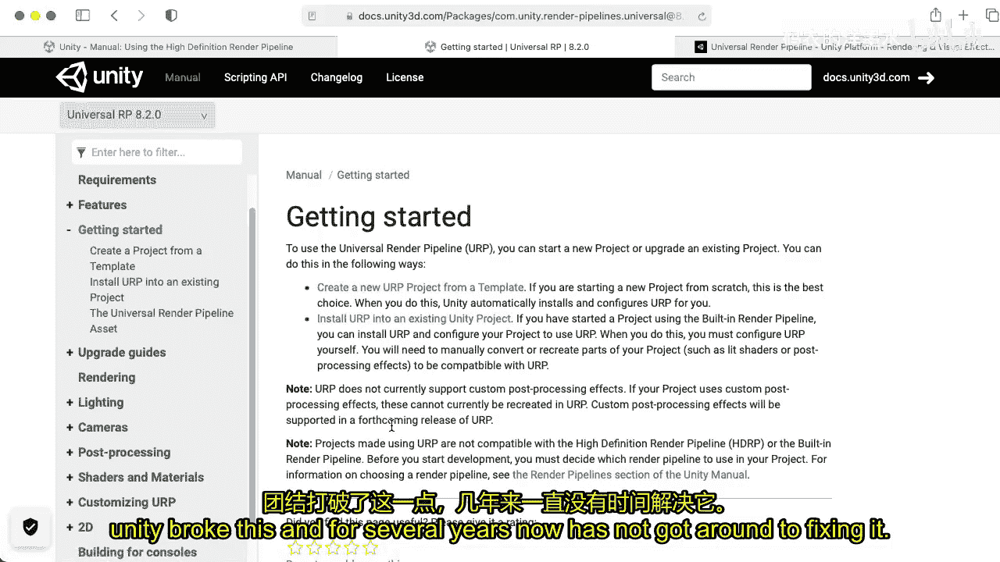

# 【全集】佐治亚理工学院-GPU编程：视频与游戏-中英字幕-p52-Lecture-52---GPU-Bonus-C--BV1GZfyBbEQn_p52-

Hi there。 My name' is Er Laantterman， I'm a professor of electrical and computer engineering at Georgia Techch and I'm recording this in the summer 2022 semester in this year's offering of GPU programming for video games。

 I've stuck with unities built in pipeline even though unity really wants everyone to switch over to these newfangled scriptable render pipelines。

 namely the universal render pipeline or the high definition render pipeline and for several years now I've been telling my students things like。

 oh this year will stick with the builtin pipeline but next year I'll probably switch to the scriptable render pipeline but those statements have always been predicated on the assumption that unity would actually get around to providing some decent documentation for the scriptable render pipeline architecture。

 and that they would eventually provide some sort of equivalent for their surf shader technology。

 which was a very useful aspect of the builtton pipeline that's not present in any of the scriptable render pipelines and。

ump that they would bring back custom post processing effects for the universal render pipeline these used to work in the URP。

 but at some point along the line， unity broke this and for several years now has not got around fixing it anyway。

So although Unity bungled the transition to the scriptable render pipeline。

 I think that the SRP looks pretty cool on paper and I do hold out hope that it will be worth switching the class over to the SRP eventually。

 so I did want to start digging into SRP code。If you start a blank URP project。

 you can go to the packages and search for the lit Shar， let's scroll down down down down here we go。

 so you can double click on this and get the lit Shar code and you can do the same thing for an HD project to get the HDRP lit Shar code。

So on the left I have the litshar code for the universal render pipeline， the URP。

 and on the right I have the litshar code for the HDRP the high definition render pipeline and the lit shaders are meant to be equivalent to the standard shader and the original built in pipeline so taking a look at the code here I do expect to have some differences the HDRP is supposed to have a whole bunch of features that the URP doesn't have and that's fine it's targeting higher end hardware。

 but in the places where there is common behavior you would expect there to be some common conventions like we have something called a base color and here we have something called a base color now here we have a texture called a base map。

But over here in the HDGRP， it's called the base color map。Why are these named different things？

 They serve the same basic function Now I can imagine why they might want to use the term base map here because if I recall correctly。

 this was the terminology used in the original built in pipeline with the standard shader。

 but they've already declared that these new scriptable render pipelines aren't going to be compatible with the original built in pipeline anyway。

 so if you are taking this opportunity to make a fresh start， you should have your fresh start。

 have common naming conventions， so why not call this base color map also in order to be consistent between the two。

Okay， yes， really， you are not going to be able to take the same code and use it in both pipelines。

 but you might have snippets of code that you could share why not let us share those snippets by having a common naming convention？

Let's scroll down a little bit oh look at this all right。

 so here we have butt map which represents the normal map for the URP。

 but over here in the HDGRP normal maps are called underscored normal map again。

 why not use the same name， why do we have different names？

Let's see scrolling down a little bit here， we have height maps same thing over here on the left it's called parallax map over here on the right。

 it's called height mapap。 Why would you call these different things， Okay。

 what about emissive textures。Oh， same thing here we have a mission color。

 but on the right we have emissive color。On the left with the ERP， we have a mission map。

On the right， we have amissive color map， Why are we using two similar but slightly different words？

It really feels like unity created a URP team and they created an HRP team Well actually back in the day URP was called LWRP。

 the lightweight render pipeline anyway， it created two teams to create these two different pipelines and it looks like they didn't allow the teams to talk to each other somebody at unity should have been fired for this It's mind blowing that this was mismanaged so badly。

