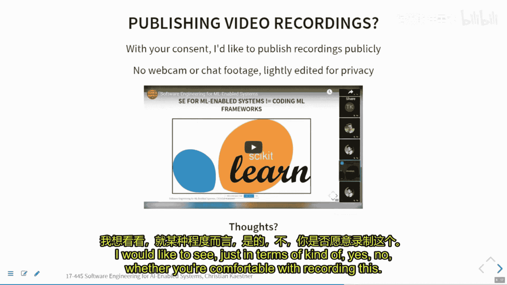
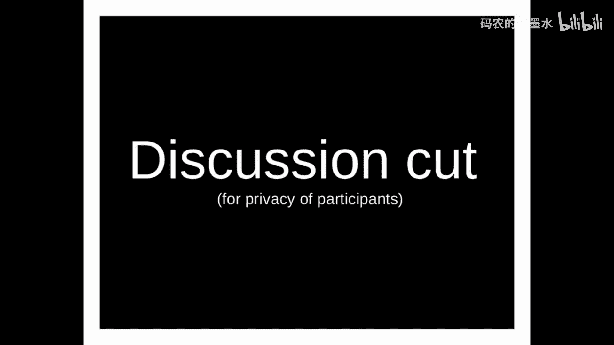
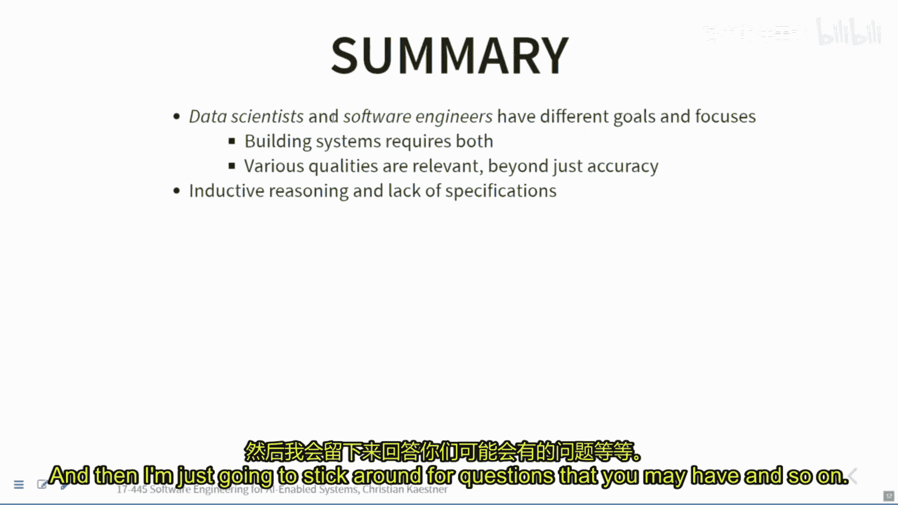

# 【全集】卡内基梅隆大学-AI驱动系统的软件工程-中英字幕-1080P-p01-Lecture-1---课程概述--BV1JS6gBcEBF_p1-

All right， welcome。 So this is the first lecture of。

This class So engineering for AI enabled systems we can talk about the title another time a bit more why it's so complicated or what the appropriate title would be before I get started I we chat it already a little bit and I assume it's working but I just make sure that everybody can hear me and can find the participation screen and just click the yes button just w to。

Kind of figure out logistics。😔，All right， most people， one or two missing， but let's just go with us。

😔，So I already posted this on Canva before。Just very briefly before I get started。

Want to have this as a class where we can have a lot of discussions this is the。

If you've taken a software engineering class at CMU before we do this in most of pretty much all of these classes。

 the idea is always that it's important to understand trade offs and there is not a single right answer so we need to discuss things。

 so I think this is really。Kind of being interactive。

 being able to talk about things ask questions is important and I don't want to turn this into a class where we just have prerecorded lectures。

 but I want to often have a conversation I want to discuss cases and so on so I really。I'm trying。

 even though we are staying all at home， I'm still trying to kind of simulate an in class experience to some degree。

And so I want to use the following mechanics which also which I also posted before right so let's use the chat in Zoom for a bunch of things。

 you can also ask a question just with your voice that's fine you can raise your hand if you don't want to interrupt immediately crons who'sty the class with also monitor the chat and would point out to me things if needed。

So that's an easy way to have a conversation and I might just ask you if you raise your hand to speak up or things like this or if I don't understand things from the chat。

It helps if I can see your name or you have your name in there if you have a preferred name or you want to be called this might help to put it there I would like you to keep your camera on if you can so this might just for a better experience so I can see you you can see each other this feels much more like actually being together and doing something together less isolating if you can't turn your camera off on if you want to turn it off for a bit that's fine kind of consider this like if you're stepping out of the room during class or if you're not attending class it's also fine with me and if there's any external reason that this is kind of problematic kind of privacy reasons or something like this just talk to me and we can work something out but I would like to set the baseline expectation that we can see each other throughout the lectures and assignments。

So I would recommend always have the list of participants open so that you can vote for things and have the chat open if you can have a second monitor that's probably helpful the slides are also all online I tend to post them before class on the webage。

And I might point you to other resources at some point， if not that's also going to work but。Right。

 so if any of this doesn't work for you。Like if you're in an environment where you don't feel comfortable turning on your camera if you don't want to speak out loud during a session or something like this。

 just let me know about it if you can't take the classes life for whatever reason we can talk about accommodations。

嗯。find most again。This is a problem with multiple screens， though。😔，Alright。

I mentioned this in the preface a little bit， this is still a somewhat experimental class this is news this is the second time I'm teaching this and I'm making quite substantial changes so I taught this for the first time in the fall last year kind of out of an urge we need to teach this it's kind of an important topic we need to think about how to design software we have more and more machine learning components in systems。

 we need to think about how do we design those systems。

 how do we assure those systems and what can we as software engineers maybe offer。嗯。

I'm trying to make changes specifically this summer。

 I'm focusing on much more of a software engineering perspective。

 assuming that you have more of a background there teaching a little bit more data science and going quite a bit more into some details like robustness fairness。

And kind of more specific forms of testing for machine learning。

 so a little bit more depth than I did in the previous class。But again。

 this is the first this is the second time I'm offering this。

 but it's still a relatively new class so expect some hiccups， expect some things that。

May not be ideas some homeworks that don't quite work as I intended them and let's just work through this together so feel free to give me some feedback it's also the good thing about a relatively new class is that it's flexible so if there are topics that you would like to see covered i'm happy to kind of address this things like that。

All right， so in terms of framing， a theme that you will see going throughout the entire semester will be that。

is there are different perspectives on how to build systems with machine learning and I'm going to simplify a lot and I'm going to explain this more later。

 but you have the classic software engineering perspective。

 so people who are building systems who are thinking about kind of tradeoffs， scaling。

 deploying things， building solutions under constraints。

Then you have data scientists who are good at machine learning math statistics， building models。

 evaluating them and if you want to build a system with a machine learning component you kind of need both。

 you need somebody who knows how to build the system but you also need some experience of actually running not just building the model but actually building the entire system deploying it making it run there's also operations in there and I'm simplifying here massively。

不。A theme is that we kind of need both and we need to work together。

There's kind of this unicorn perception that for a long time people wanted to always hire those people that have both data science and software engineering expertise that really understand both sides well。

 but those people are relatively rare people often specialize in one or the other side and I think what I'm trying to do with this cause is give you an idea of what the overlap is。

 and I'm not going to make you into for data scientists。

 but I'm of trying to give you the vocabulary， the ideas， the kind of how they might be thinking。

 how you can help them so that you can effectively work together with data scientists that you understand their language that you can communicate effectively that you understand the constraints but also can support them from a software engineering perspective。

And you hear my bias here already and how I'm talking about this。

 I'm coming from a software engineering background。And I。

Backed very little data science background from you， actually none。

 so we' are going to teach this from scratch and I'm going to always be biased a little bit by the software engineering view。

But I'm trying to give you a perspective of。Often probably oversimplifying but how a data scientist might approach this。

 we're not going to go to a level where we're going to really fine tune deep neural networks and come up with crazy new or innovative new learning solutions right so we want to think about if we work with a data scientist who comes up with these models。

 how can we integrate them into a system， how can we support them， what do we need to think about。

All right， I want to get into this with a case study。

 and I want to start a discussion in a second about kind of possible problems。

I want to start with a case study of a transcription service。 So this is the kind of thing that。

As researchers we use from time to time， where we go out and interview people， for example。

 we have done interviews with data scientists about how they are developing software notebooks。

 right but also with open source developers and all kinds of things。

 so you sit down with them for an hour you talk about things。

 you have a recorder running used to be a physical device， now you record over Skype or something。

And then the way that we typically do research is we need to transcribe this。

 turn the audio recording into text。And then analyze this and there are a bunch of research methods of how you properly analyze text and you can go into kind of the methods。

 things like grounded theory and so on and not really relevant here。

 but there's always a step of taking the audio and turning it into text。Right so you have maybe。

An hour long interview and you need to turn this into text and you have a bunch of these interviews and transcribing this is really annoying。

Like sitting down listening to the audio that of the interview and typing it it takes a while for a one hour interview it probably takes four or five hours to transcribe it yourself。

 it's a pretty annoying task right PhD students sometimes do it。But rather than paying a PhD student。

 you can actually ask somebody to transcribe it for you。

So you can either hire somebody professional or this has been crowdsourced for a long time。

Things like this web page here， I think I have this open actually。

Allow you to do transcriptions essentially by uploading。

This two monitor thing is maybe not idea for me。I had a mouse somewhere there。

So this is a service where you can upload。An audiophi and then they have humans transcribed this The way that this usually works these days is that they split the audio file into smaller audiophis and give it to crowdwork typically through a mechanical tu or something like this and they integrate this maybe do some quality assurance and put this back together I have no idea about this specific company and the typical rates that you see is something between a dollar and $2 per minute to pay for this right so if you have an interview of 60 minutes maybe that costs you about。

60 to 100 dollars to transcribe。 And then you have a couple of these interviews， maybe 20 right。

 So you're paying some money for this。 It's it's not the most expensive part compared to paying。

PD student to transcribe those in their time， but it mounts up two things， right？

So this is something that most obviously we can automate right and we have made huge progress in this。

 so let's assume。You have done some research。 Let's assume the data science perspective。

 You have done some research， you've built some。Crazy new machine learning mechanism that can detect kind of voice to speech things with a focus on technical jargon right so this could be a PhD where maybe you have taken some public PBS interview data you train deep neural networks and you did some innovative things that you can actually very well recognize medical jargon or the specific vocabulary used in poverty and inequality research or about Ruby programming at conferences right so the things that are kind of hard that are domainspec where you know that these are communities that you need to do something special and you found a way to take this big neural network and trained for adapted for these specific terms and communities and you've shown in some papers that you have much much better resides and kind of the state of the art models that are not trained for these specific communities。

Right and now that you know the market， you know。People charge like $60 an hour， $100 an hour。

This should be something where you can make money right build this as a service。

 offer this to academics and maybe also some other markets like conference organizers might want to do live transcriptions。

Zoom in the background might transcribe what I'm saying YouTube definitely does right for videos。

 so there is a market for kind of these things and there might be a market for something more specialized。

Right so。Let's say we have this research， right， We have built these models。

And we want to build a service similarly。Like the crowdsourcing thing where you can go to a webage。

 you upload something， you pay some money。I want to start by just thinking about。

 think about you would do this as a startup， what are the kind of problems that you would expect？

And would I would like to try the following。Write an answer in the chat。

One or two challenges that you can think of， but don't pressent yet。So instead of sending this。

Just vote yes that you have typed something I'm going to wait until a bunch of you have some ideas。

 just think about the scenario， what kind of problems would you anticipate。

 what's going to be difficult。嗯。So again， don't type yet， but just vote yes。没有的。I see one yes vote。

 is the question too vague or。Yeah， the chat isn't great， I agree。Three yess。火啊。5。8ight。你还冇啊。

All right， press enter。So let's see a couple of things I can see here。

W things are scrolling so it's going to be challenging to do this in real time right give quick round return times storage you may need a lot of storage。

Finding the right training data， yes， identifying mistakes that are actually happening long development cycles。

 can somebody else develop this much faster to market， right？

The barrier to entry seems pretty low but there might be a bunch of competition honestly these days this is actually a pretty big market。

 there are a bunch of services that are doing this。Dialects， what is。Yeah， dialect accents。嗯。

Non English languages， all right， so so a bunch of challenges that we see here and a lot of things that you mentioned were not directly around the building the model。

But about around buildingdding a larger service。All right。And again。

 I want you to think about this from two perspectives。

 so there's the software engineering perspective。And the data scientist perspective， and let me just。

Oops。I'll be back in a second。No。All right， I'm going to simplify here oversimplify。

 but I want to kind of create this contrast of these different two culture so if you have taken a machine learning course before。

This is maybe what you might think of as a data scientist so typically you work on a fixed data。

 for example get you download all these PBS interviews， you code them。

 you learn based on them and then you focus on getting accuracy as high as possible right so you're trying to build models evaluating this is what you typically publish things by right achieving slightly better acuracies than some of the adss showing that in this field it works better there's a lot of prototyping。

 often people work in Jupyter notebooks or something similar。

And data scientists often really understand these modeling techniques。

 they understand deep neural networks to the degree possible。

 and they are experts in feature engineering。They typically。

Don't really care about how big the model is， they don't really update things much in most courses。

 so the focus is really can we improve accuracy on this？

And we're going to talk about all of this more if you don't if this seems kind of vague and but the software engineer on the other side and again I'm oversimplifying here but these are people who are good at building products right so they are typically concerned about cost performance stability release time like you have constraints you want to have you have a deadline you need to release something quickly right。

You want to identify a solution that's good enough to satisfy the customers。

But you also don't want to spend arbitrarily amounts of money on getting a slightly better solution than what the customer really needs right so you need to understand how much quality assurance do do when US stop They really think about this must scale right It must handle large amounts of data。

 need to detect and handle mistakes in some form needs to maintain this。

 evolve this and really run this as a product over a long time。

 support this right and typically focus on things like security， safety， maybe fairness。

So what you see here and again， I'm making an artificial contrast here， but this。

People who come at this problem with a different mindset。

One side tries to solve a modeling problem and get very accurate models。

 and the other side tries to bid， maintain and deploy a software product。所。

I want to ask again about challenges that you can foresee and now specifically about challenges that you foresee when these two groups work together on this transcription service。

So you have kind of people with different backgrounds， you have the PhD who has developed the model。

 they may have hired somebody who needs to actually build the website and deploy it。And again， type。

 but don't send it yet and vote yes when you have。 So what kind of collaboration challenges can you see。

Can you expect。See one gas spot。2。5。Alright，10， let's press enter。呃。Alright。

 disagreement on features。Communication， trade of conflicts。

Time taking to build the model versus deployment time。Different programming languages， different tus。

 different frameworks。 Yes， the relative value of accuracy and cost。 I think that's an important one。

How modular the structure is， how you deal with mistakes。

Different different development environments， how do you integrate this， yes。All right。

 lots of good things。 So this is this is the kind of themes that we're expecting right。

 so this is what I want to cover throughout the class。 and I don't want to。Let's see。

So I think one important theme is that there are many qualities that we care about right so the quality。

It's not just。How well are the predictions of the model doing， but it's actually let me just。

Quick back to this and you don't need to type this time， but maybe how quickly can I update my model。

 how quickly can I answer or transcribe the service to how many customers can I scale if they are mistakes。

 how quickly can I detect them， How where can I detect them How big are my models where can I update them。

 can I train them incrementally does training take a week each time can I fix things can I understand why bugs happen and fix them quicker right so there are all these kind of things that we care about that are not just accuracy。

嗯。And a lot of them are conflicting。Right so the question is really how do we design a system。

 how do we care about this， how do we。Bitiness so I don't want to go through them。

 but I have no multiple slides just with questions that we could ask what are unacceptable mistakes and how can they be avoided is there a safety risk here Can we debug and fix problems How quickly transcriptions sometimes crash what do we do in this case can we achieve high availability。

Tsorflow， the framework gets updated with our stuff Still work。 How do we do this。

 The models are continuously improved， but when should like somebody is experimenting all the time。

 When should we deploy， Can we roll back。Can we handle different accents。

 can we handle mail and female speaker equally？Can we handle different domains equally？

Should we learn from customer data？Can we learn from things that the customer gives us or is this too private。

 right？ Is there any chance we might lead customer data to competitors。 So lots of problems。

 There are actually multiple systems that have been built。

 This is this is a fairly large market these days。 I think one service I have used this teammy。

This is a this was the site that I want， but there are multiple of these。

 so this is essentially they have built what we discussed maybe without the domain specific part。

 although they have competitors that do this specifically for medical services as well， so this is。

Exactly this kind of thing you upload an audio file。And now you don't wait three days， seven days。

 but you get to reside within 10 minutes or something like this。Instead of one to$2。Per minute。

 they charge 25 cents per minute。They actually raised their prices since I last checked when I first saw this。

 they asked for $10 cents a minute， so $6 an hour instead of $100 an hour。

Which hints at another problem here that。If you're building these systems。

 you actually want to build a business。It需要 one。Accuracy is one thing。

 but what you really care about is can you make money？

How expensive is it to run your infrastructure to build updates what's a price point per prediction per transcription that you can actually support right and then you can potentially raise prices or you can lower your cost so where are you in the spectrum。

嗯。There are lots more lessons we're coming back to Tim later。

It's also an interesting lesson about telemetry design， for example。

 of how do you figure out how well you're doing in production？They have a nice editor。

 so this is actually what an output looks like， this is when I tried to transcribe a podcast earlier right so you see the output it's looking very well actually but it also says that there are certain words that they can't recognize and you can use this as an editor to fix things。

All right。So what I wanted to do with this case study。

 and we're coming back to this later in the class is just introduce to you kind of the theme of the class that we're trying to think about building products that have a machine learning component。

So we're not focusing really on how to build the machine learning component。

 how to do transcriptions better， but how do we build a system。

A web service that scales it has an appropriate quality and meets the user's requirements and maybe turns a profit。

 how do we build a system that has a machine learning component somewhere in it？

And the machine learning component can be small or big， like in this transcription service。

 this is a service that I built around a machine learning component。

So the machine learning component is kind of central and then a bit kind of payment infrastructure and a webend and things like this around。

But we can also think of systems where the machine learning component has a very small part and that's something very common these days that a lot of companies introduce kind of machine learning components somewhere in their products。

 either because it's hip or because it actually serves the purpose。For example。

 Microsoft Office has machine learning in so many different features。

 things like automatically laying out your slide， things like this right so they build in。

Office is not really built around the machine learning component。

 but they have a lot of them in different parts right and again there's a question how do you integrate them。

 how do you build this， how do you deal with this？All right， for the next couple of minutes。

 I want to talk a little bit about the class structure。Then afterward。

 I want to learn a little bit more about you and what you're interested in this class and then coming back to some content more about what actually changes。

食。嗯。I'm teaching this class I'm an associate professor in software engineering here at CMU and I've been teaching software engineering for a long time and I do research in software engineering Ma learning is not actually my background I've used it in a bunch of projects here and there kind of as a tool but I think we software engineering researchers using machine learning to build better software engineering tools are not really representative like。

Soft engineering researchers bid better auto completion tool or duplicate bug detection tools or things like this right so the issue reports。

 things like this these are often not the kind of production tools that I'm really interested in right so good completion or so yes we use machine learning and all of these things but what we really care about is building products for end users and how to build those so my background and most of my research is more kind of in quality assurance and analysis but I'm interested in kind of understanding better of how we build AI systems we're starting a little bit of research these days on kind of notebooks and transitioning things into practice。

I think I understand machine learning well enough to kind of have an outsider's perspective and teach the ideas。

 but I won't be able to answer kind of very detailed questions on machine learning。

Shrean is helping in this class as a TA do you want to say a few words Yeah hi I'm Srean I'm a master in software engineering student I took this course last fall。

And I quite enjoyed it because I worked as a site laboratory engineer at a startup back in the day and we had a lot of problems regarding machine learning engineers spinning up you know AI systems and provisioning issues and just general issues on how software engineering practices change when you're handling intelligent components。

You know in companies so I think it's a pretty useful course I definitely recommend you go through the readings that are prescribed found I found them very useful and very interesting a lot of them you know describing Sha of the art advances in the field and yeah I hope you enjoy the class and feel free to reach out to me in case you have any questions。

Right。So I think most of this is fairly standard if there are any questions if you have concerns。

 either post on Canva or send us an email。We're not offering fixed office hours but we're approachable。

 the easiest way to do this is I tend to stick around after class for at least half an hour。

 so if you have any questions just approach me after class but if there's I thingance as well after recitation and if there's anything else you want a separate meeting also just email me and we'll find a time。

第一。Also feel free to just ask questions publicly on canvasva if you think this is useful for others as well or awesome during class。

 all materials in this class are on GitHub， these slides look a little bit weird because I created them with kind of some markdown hacky thing。

 so it's relatively easy to kind of for a project mergerch things， look at different slides。

So if you have any ideas， feel free to send a pull request， including pull request to assignments。

 I might not accept the ones that are just taking out all the deliverables。

 but maybe have some ideas of how to improve parts of this class。嗯。So I mentioned earlier。

 I have a software engineering background and I teach this like a software engineering class。

 so we focus a lot kind of on engineering judgment looking at trade offs， looking at。

We could do this or this， There's no obviously one correct answer It depends there's this running joke in the So engineering master program that it always depends right the answer is always it depends The problem is just that if you answer it depends the next question would be what does it depend on and what kind of decision would you make in this specific scenario right so we a good software engineer can understand that tradeoffs and make a judgment call and justify this right it's not just a we see software engineering as quite different from just a programmer right it's somebody really understands things about tradeoffs alternatives design。

So I'm trying to also make this fairly practical so there will be a number of assignments I'mll talk about them in a minute。

 some with more of a discussion flavor and requirements flavor and a bunch of them that have more engineering focus there will be we're building systems。

 we're testing systems， we're automating solutions and there will be a strong teamwork component in the second half of the semester。

 we will not focus on formal guarantees or。Oh， I will focus on some machine learning but not go very deep。

 so I you don't need a lot of statistics background， for example， to come through this class。嗯。

So this is where prerequisites are always kind of challenging right so for the summer I decided that I don't want to go too much into software engineering。

 so I assume that you have at least a basic understanding of software engineering and some experience building some systems that are more than 100 lines of code。

Right so not just the small class projects and I assume you know things like version control。

 how to gather requirements， a little bit of software design and modeling。

 some testing and test automation， hopefully you have seen some continuous integration in some form。

 maybe you've worked on some larger projects， software projects where you had some teams right。

 not just homework on your own。And。If you're kind of。If you want to see a little bit more about this。

 there's a quiz an ungraded quiz on Canva it ask you a bunch of questions and answers in a couple of like once you submit this。

 there are a couple of answers to kind of say what I would have expected for those answers。

 this is for you to assess whether this matches kind of our expectations and feel free let's discuss if you feel this is not the right approach。

So we don't expect any machine learning background in this class， I will cover this。

 especially this in next week this might be a little bit boring for those who have taken a machine learning class who have some experience there。

 but I'm trying to give you some understanding that's sufficient to kind of get an idea of how does it work internally。

 how do I need to interpret this， how should I think about this，If your background is opposite。

 like if you have taken a bunch of machine learning classes。

 but don't feel too familiar with software engineering。

 I would recommend to take the full version where I want to swap the preres where I don't want to teach the basics of machine learning and AI。

 but I will start much more at a much lower level on software engineering。Again。

 if you have any questions， let me know and I'm happy to talk about this。So you've seen this already。

 I want to keep the lecture somewhat active if I ask you questions from time to time。

 I want to have some discussions。If you have some experience。

 I'm always happy for you to contribute them in a more or less formal way as you want。

 we have some in class exercises， some presentations。

 but probably mainly just one project presentation at the end。There's a textbook。

That I'm going to assign actually most chapters of as readings at some point。

It's fairly high level it's a lot like a lot of other software engineering textbook but it has the heart in the right place and it has I think a very good highle description thinking with the right mindset about building entire systems so we're going to go through this and in addition I'm going to recommend a bunch of articles papers books。

 podcasts and so on the book is available through the library so with the VPN through the library can access the book for free there's also an audiobook version of this which is maybe not the most engaging for this kind of book but feel free。

There will be reading quizzes before every class， so I'm going to assign kind of a reading。

I want you to look at it it's hopefully the quizzes are supposed to be short and easy they're more a trigger for kind of showing have a look at this some of the readings you might want to pay closer attention。

 some you might be able to skim depending on what you're familiar with what seems easy or interesting。

It's often background material that helps to understand parts in the class。Yeah。

 I would encourage to look at this， I know that most quizzes you can answer with a very superficial。

Look at the readings and。If that's what you want to do， that's probably also fine。

 they are always due before the start of the lecture。And I can talk a little bit about assignments。

So I think we have a fairly reasonable plan about what we want to do this summer。

 so there are a couple of smaller to medium sized individual assignments they are mostly in the first half and then there's one larger team project that has multiple milestones so think of this as multiple project or one larger project mostly in the second half。

The。I have a rough schedule on the webage。The assignments are due mostly on Tuesdays midnight the first one is next week a case study where you look at a paper and kind of reflect on kind of building a system and production the second assignment will be you going out to gather some data and model specific tasks so this is some machine learning practice to warm up with some of this again not expecting any background。

Then we're looking at trying different machine learning techniques and the different qualities that they have。

 so it's a little bit more modeling but more from a software engineering perspective and actually measuring things。

 we're going to have an assignment on requirements and architecture。

And then one on tools where I would ask you to look at some open source tools and report back to the class and one on fairness。

And the quality assurance projects are things。Where。

You're going to build a prediction model that's running kind of in production so we have a Netflix like service where a million users are watching movies every day or every other day and you're building recommendation service for this we're actually simulating the users so that you can actually have an impact right so you're making a recommendation and maybe the users are watching those movies or they are not the recommendation service is something that we actually want to deploy that should actually run in a somewhat stable fashion it needs to be able to deal with a million of a million users a day it needs to be possible to update this to test the quality of this and we talk about a lot of this so the team project is mostly around quality assurance kind of testing and production building and deploying a service and this will go over multiple weeks in a team of four to six students。

We have recitations， the first one is tomorrow recitations are typically handson exercises that often prepare for some of the assignments tomorrow we will start with an introduction to Apache Kafka which is a streaming service that you use in the second assignment and also in the later group work so this is I think an interesting kind of technical way getting into this and understanding kind of a streaming stream processing framework that's broadly used in production。

And then the week after we're doing some machine learning frameworks right if any of you have any ideas about things you want to learn related to the course and have some ideas for hesitations。

 please feel free to forward them to me and we can。Make an effort to incorporate that。行。All right。

 grading is， I think fairly usual， we have a midterm。

 but I decided not to have a final during it kind of working from or studying from home because it's kind of weird so I'd rather have project presentations at the end of this quality assurance project。

嗯。There is a participation component， as I said， I want to have discussions in class。

 I want to value you participating in discussions and give you a little bit of credit for that so we're taking track of who's participating like when I ask you to write something in the chat or who asked questions in class who participates in discussion also recitation and we're grading this as well it's 10% of the grade and we don't want to so participation is not attendance it's not just being there with or without the video I really want you to participate in discussions actively it doesn't have to be every single lecture but on average。

Kind of want to see participation。嗯。People always ask this。

 we have a late day policy for individual assignments you can be up to three days late with a 10% penalty each day we also it's not written down but if you submit like five minutes late don't worry about it but don't be like an hour late for group projects for each milestone we don't have a late day policy but in general talk to us if you have any concerns if you want an extension for any reasons this are not。

These are not normal times right， studying from home is not normal， teamwork from home is not normal。

 we're going to try to be as flexible as we can in accommodating you just talk to us。

I need to talk about this， even though I think it's obvious， but please don't cheat。

It's very painful for everybody involved， both for the person cheating and for me talking to the person cheating。

I know most of you don't consider cheating the place where people make stupid mistakes when it's kind of close to the deadline and they're panicking and they want to get something in if you're panicking you're not making smart decisions you're not cheating well thiss is stuff that might be detected again this is painful for all of us so if you're stressed or overwhelmed if you're panicking before a deadline rather than cheat。

 talk to me。This is always strictly better than treatinging。

And I hope I don't need to say more about this。嗯。Right so in the course I need to update this at some point。

 but we're going more or less through all phases of a typical software engineering lifecycl。

 not necessarily in order， but we're covering topics of most of these things。

The way that I structure the class right now is that in the first two weeks we cover a bit more machine learning basics。

 then we're talking about kind of requirements and architecture and quality assurance and then the second half of the class we talk about specific qualities。

 especially fairness， robustness， safety。Interpretability debugging things like this right so the second half when we talk about those qualities is often a little bit more researchy than the first or closer to where current research is but that all these parts are interesting。

嗯。And just as I think there's my last slide on this。

We have AI in the title and I talk more about the difference AI is kind of this big umbrella term where machine learning is one part of we will mostly focus on machine learning in this class kind of vanilla supervised learning。

 we will talk about other things a little bit， we will talk a little bit about probabilistic reasoning expert systems。

AI components where you can actually give proofs and we talk about the span of different machine learning and AI techniques。

 but I think for the most part we default forward to thinking about fairly straightforward machine learning techniques。

嗯。Are there any questions about the syllabus？About what we're covering。About the cost mechanics。

 raise your hand or write in the chat。All right， there's one more thing。

Since I'm teaching online anyway， and we're recording all of this， I was thinking about publishing。

The lectures， the recordings。After taking out。Wepcom footage and some discussions。For privacy so。

However I will only do this so I think this is kind of an easy way to do。

 I want to promote the class also teach it， this is also why I created everything in Markdown that other people other universities can copy this and I feel having also recorded slides might be useful in this context。

 but I'm only going to do this if youre if you consent to this if you feel uncomfortable even just vaguely I'm fine with not doing this。

I would like to see just in terms of kind of yes， no whether you're comfortable with recording this。

And also， if you're not comfortable saying no here， send me an email afterwards。

 I'm listening to this as well。

All right， I'm running out of time， I was actually planning to do one more topic to think about specifications and I think I'm just going to do this in two minutes just to pitch this idea and I'm going to complete this on Thursday。

嗯。This is one of those things where this is， I think one of the fundamental changes between kind of classic software engineering and machine learning。

As classic software engineers， we're typically trained to think in terms of interfaces。

 they help us to assign blames so we have often textual descriptions that says what a method should do。

 and then we can evaluate given certain inputs does the method actually do what it's supposed to do。

If the algorithm returns array out of bounds， that might be perfectly okay because it might be what the algorithm is supposed to do if these things in a graph are not connected。

 right？As software engineers， we are often trained to think in terms of Oops actual specifications。

 so we have this often in API documentation that very clearly says what the API should do。

And then if the API doesn't behave like we're expecting it to do and like what the specification says。

 then we're talking of a bug right so the software is buggy but to claim that it's buggy we actually say that it behaves different than specified。

And instead of specification， we might also say requirements or something like this。

 this can be in different degrees of formality， but the problem is when we come to machine learning。

What do we write as a specification right The entire idea of a specification breaks down We can't say what it means to transcribe an audio file or what it means to suggest what things to purchase on Amazon right we don't know how to actually implement this suggestion mechanism otherwise we would just write it down as an algorithm with if aid steps right or predicting whether somebody will commit another crime right so these are things that we tend to try to do with machine learning but we don't tend to have a real specification and that's because we use machine learning exactly in those cases where we don't have specifications where we can't come up with them either because we don't know them。

Or because they're too complex for us to understand right so we can't write down all the reasons that we think of。

Like in recidivism like whether somebody is going to commit a crime again。

 we simply don't know right we can observe what happens in practice but we don't know and if we're thinking about language audio transcription maybe we could figure this out if the wave goes like this and this then it should be this word but this is so complicated that we never would actually specify and hand right so those are the parts where we use machine learning and now we have we have a huge difference we have these systems that are actually that don't have specifications they have vague goals right so they say predict as best as you can on this data or fit this data in some nice way。

And that makes things really hard to test。 So thinking about what does it even mean to have a bug in a machine learning component is kind of weird if a machine learning component predicts the wrong word in an audio transcription。

 I this a bug。Right so what's the equivalent here， so a bunch of things break down。

 you can think about this and go through this later。This really changes how we think about systems。

 we don't have clear specifications， we often do best effort things。

 we kind of deal with mistakes and this has a lot of changes about how we think about designing systems。

I don't want to go over so I'm going to talk about this next time Last thing there is a quiz on Can that I would like you to answer today is another ungraded quiz it overlaps a little bit what you set life here in class but it helps me again to tailor the course and kind of see your background and understand a little bit better of how to do this so with this let me just stop here and continue on Thursday。

What I try to do today beyond kind of just saying how the cost mechanics work is that data scientists and software engineers are different roads that often have a different focus and different gos and we often need both if we want to build actual systems right if we actually want to deploy and maintain something and there are lots of qualities that are relevant not just accuracy。

And just briefly finish up this part on specification next time and then the next two lectures will be background on kind of machine learning。

 how to think about this， some of the basics， and then also a little bit on symbolic AI and。

Kind of deep deep learning next week that we kind of have a shared understanding what we're talking about。

So that's all I have。 I'm going to stop recording at this point and then I'm just going to stick around for questions that you may have and so on。

 So thanks。

