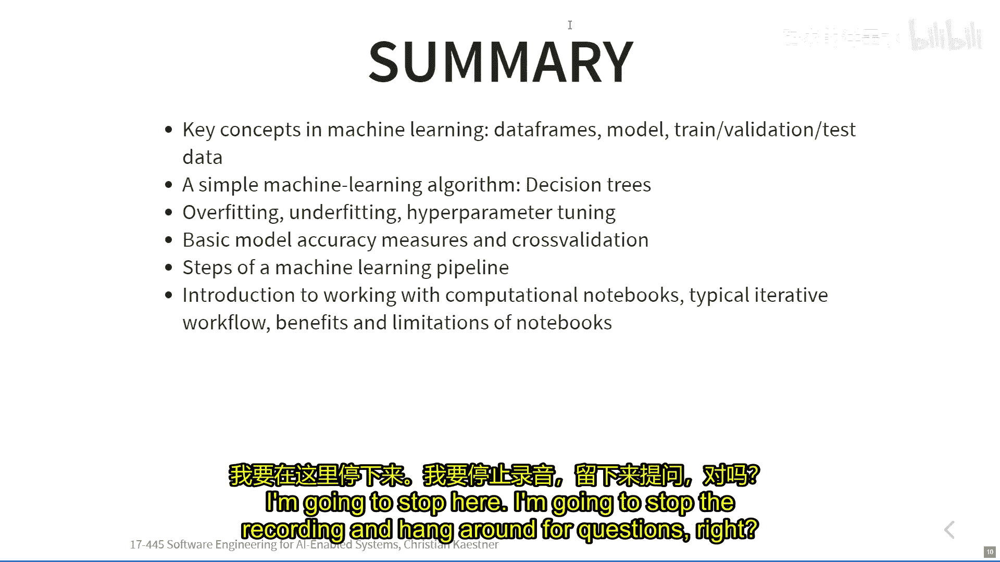

# 【全集】卡内基梅隆大学-AI驱动系统的软件工程-中英字幕-1080P-p02-Lecture-2---面向软件工程师的人工智能part1--BV1JS6gBcEBF_p2-

All right， welcome back。I'm going to start the class as I start every class and people who've taken a class with me before will know this and maybe hate me for it。

 but I'm going to ask what you remember from the last lecture so write in the chat or raise your hand。

I don't need to cover everything， but I kind of want to know what you remember， what stuck with you。

Anything。All right， go ahead trick。When building a software system that includes an AI component。

 the perspectives of the data scientist and the software engineer are pretty different and they're bringing different agendas into it right yep。

 we talked about the different perspectives what their goals maybe be where conflicts might occur。

Anything else you'll remember？你有。So we went into an example using lecture or speaker node transcribing service。

 so the natural language processing component， how does that integrate with the others software engineering component of the entire system right and we talked about how that's maybe just one part of the full system right the very important part in that case。

 but yes， we want to look at the larger system。One more， maybe anything else somebody remembers。等呢。

Yeah， the the pie graph with the data scientists on the left and the software engineer near on the right and kind of wanting to be able to somewhat be in the middle so like。

Being able to say what accuracy means in like a production context。

 So not necessarily getting the best accuracy， but getting good results from。

 from the consumers while still being able to talk to data scientists about accuracy。

Right so maybe this is a good callback to how I try to frame the course。

 so we're going to look at both perspectives， but I suspect that most people want to specialize in one or the other direction。

 but even then it's important to understand the whole spectrum and to talk to each other and be productive in interdisciplinary teams。

All right， I had one point where I kind of left up at the end。

With specifications and correctness and I kind of rushed this a little bit and I kind of want to come back to this and talk about this a little bit more in detail。

So。Let's look at this example again。 So here's a。Mechanism。

 like let's assume we're doing some graph algorithm。

 the original scenario was that we're analyzing friendship graphs on Facebook but it doesn't really matter。

 and we have some graph library that computes the shortest distance like how many friends in common do you have for something like this between two people in the graph。

And。You might call this thing and you might get an array out of bounces exception or you get minus1 and somehow this feels like something is wrong here。

Right， so。There's a question here， should this happen， what should the answer be and。

I just want to ask you briefly， So for the。For the first case。

Aray out of balance Can you just vote who says for it， who should fix this。

 I this the person implementing the method， then vote yes， or is this the person calling the method。

 Maybe they shouldn't have called the method with these arguments vote no。Just want to。

See kind of your intuition， what should happen here。Interesting， so most people say yes。

 some people say no， so most people say the method implementation is wrong。

 some people say we should not have called the method like this for the lower example。

 the minus one thing， Can you vote again， does this change your answer。

If you're completely confused also feel free to vote anything else like go slower or something。

ItDoes't really change your answer， all right？I would say。

Oh VT already writes depends on the contract right so I would say you can't really answer that question right now right so you can vote yes or no and you can have your opinion there but I haven't given you enough information to really make that decision invitee is right this really depends on the contract so here two possible contracts。

For this method right so the API documentation that says in the first case。

 find the shortest pass between two nodes， it returns minus1 if two nodes are not connected。

So if that's the specification。We assume that we're getting an answer on every case and we get minus one if they're not connected so if these two nodes are not connected and we get the lower behavior that's correct right in this case actually the method is correct and the person calling this provides the right method oops the right information in the second case we're saying the method finds the shortest distance between two vertices but the method is only supported for connected vertices so it essentially it says don't call me if these two things are not connected。

If these two things and you can check whether they are connected by calling a different library first。

 maybe right so this essentially says there's a precondition on calling this method。

And if we' are not meeting this precondition。I mean， essentially anything goes。

If we are not meeting that precondition in array out of bounds exception is fine。Minus1 is fine。

Technically， deleting your entire hard drive and crushing your computer is fine。

Probably not what you expect， but right so technically the person calling the method is wrong if they don't meet the precondition。

喂。If the graph is actually connected and you get either of these behaviors。

 this seems wrong in either case right so if we meet the precondition and these things are actually connected。

 then we would argue that the results are wrong。So this helps a lot kind of having a specification helps a lot to write test cases so you know what the expected output is right it helps to write maybe checks where you check the inputs before before you use them。

 it helps a lot with decomposing a system into smaller units if you have an interface if you know what the behavior of a method is even if it's not implemented yet。

 you can kind of rely on this you can bid on this functionality without looking at the implementation right so this is typically what in software engineering we used to scale right so we decompose a system we use interfaces in practice they are different degrees of formality that we have for these interfaces right so in an ideal word we would have former specifications like in the upper case I have an example here where you have kind of a mathy notation computer readable that describes the pre- and post conditions。

That becomes very hard to describe the expected behavior if you go beyond kind of the bank account example。

 if you want to do like。Like the graph nearest neighbor thing you could probably still specify。

 but you spend a lot of time kind of writing in kind of a form notation what you want。

 So what we have in practice is often texture specification， like the lower example。

 which is an excerpt of the Java API library。Wwhichch essentially says what the method does so there's a lot of text it says here the parameters。

 here's the expected result， here is also a description of what exceptional behavior is right so if you don't meet the preconditional of something weird happens。

 so again it describes pretty exactly what the method should do even though you don't necessarily need to know how it works inside。

And these contracts or specifications are super useful for a lot of things， as I said before， right？

It's really useful to determine like who's set forward to even say something is a bug right。

 something is a bug in the implementation or something is a bug in this part that's calling the system。

 it helps a lot with testing and you can really kind of answer these kind of questions like who's to blame who should fix the code。

 things like this right so what can we rely on？嗯。So this is a fundamental assumption behind information hiding behind kind of modularity and decomposing systems。

 the problem is that when we come to machine learning，It becomes very hard to give a specification。

It's very hard to kind of say， give an audio file， what should happen？

We can give a vague texture specification saying， given an audio file。

 you should give me the text of the audio file。But that's super vague right this kind of assumes a lot of magic you can do the same thing here。

 this is like Amazon product recommendations right。Give me the best recommendations。

 how do we define what good recommendations are， probably we define it even by things that the algorithm doesn't know about。

 like give me the recommendations that maximize my profits。

Maybe I'm only giving a more formal specifications。

 give me the recommendations to products that people bought that are most like the person that I'm kind of like my own past purchasers right so I can give a more precise description。

But it sts。When we come back to this。 It's very hard to define。

If I give you a list of purchases and it gives me a recommendation。

To figure out whether that's correct or not。whether that's useful or not。嗯。

Kind of to write a specification is kind of hard and this is just the last example I raised over this last time。

This is one more of these societal examples that are discussed a lot。

A machineine learning is used law enforcement and kind of by judges to make sentences recommendations。

 and there's a lot of discussion around bias and whether these things are fair and so on that we're going to talk about later。

 but one thing that they do is to predict recidivism。

 so the idea is to predict whether will somebody who has been convicted of a crime。

 we commit another crime in the next two years because if you predict that they have a high chance of committing another crime。

 you may not let them out early or something like this。

 or set higher bail or set higher requirements。So you kind of want to predict。

Based on some characteristics that you have like the age， the past crimes that they have。

 maybe the gender， maybe the time served so far to make a prediction whether somebody will commit a crime again and again。

 it's super hard to even think about what would a specification be here right？How should I。

Describe this the best thing we can typically come up with is kind of the idea。

Here's some data and for people if people are similar to people who committed a crime in the past then tell me that they' are likely to commit a crime in the past right so we can kind of describe how machine learning models should look at data and maybe extract something like this。

 but it's not clear that the model that we're learning here or the behavior of the model that we could specify that well and that we could specify this independent of any training data。

所。Typically in machine learning we don't have specifications。

 and that's actually where a lot of problems and challenges come from。

We have these components that are sometimes wrong。And it's even hard for us to say when they are wrong。

Or whether it's a problem that they are wrong。Because we typically don't have any clear specifications。

 right it's hard to test these things， we talk next week about testing and this is challenging to even say what the bug is。

 what a unit test might look like。嗯。So typically we define a question by Liu， Oh go ahead。

So yeah I understand it's hard to exactly specify what a machine learning algorithm will do。

 but from software engineering perspective I think we can still come up with some protocols that require certain degree of specification for machine learning algorithm at least to make sure the system will work robustly without without be forced to a termination or forced to halt during the middle of running something we can still ensure the system works。

 it just may not work exactly as we desired， but I think the other type of like a less comprehensive specification system be should be possible so we're talking a lot about we're going to talk a lot about what you can do what people typically do is。

We can specify partial behavior or invariance so we can， for example。

 fairness specification is a good example where you say the system should behave the same for men and women。

 for example， right so this is something where you have a partial specification on that system。

You can't really say anything about an individual prediction。

 but you can still say the model is wrong with regard to a certain specification that we have robustness is another example where we say the system should not be we should not be able to fool the system around kind of minor changes of inputs that are close to the training data。

嗯。What we can also specify is a machine learning algorithm itself。

So the algorithm like decision tree learning that we can specify。

 we can specify how to get from data to a model。The learning algorithm。

 but what the model actually does。I's only described in terms of the data and the learning algorithm。

 but it's hard to say what the model that we learn from some data should do about recidivism。

Does it make sense？All right。So。The reason that we don't have specifications and that we use machine learning is typically correlated the problem is typically we're using machine learning for problems where we don't have specifications where we don't know how to do this manually where we don't know how to write an algorithm with a bunch of if statements and for loops that figures out how to predict recidivism right so we don't know depending on the age and certain priors what should be the right algorithm to say yes or no they will commit another crime。

We don't really know looking at past purchases what the next purchase should be right so we're learning this from data。

 we're learning some wordss that we may or may not understand right transcribing an audio file looking at kind of the buy or the curve of the audio and figuring out how that should work is super hard we have tried this like all transcription I think tries to recognize certain letters or by certain curves but that has never gotten us very far right so kind of identifying the behavior that should happen somehow from data。

Is way more effective， this is why we use machine learning we can discover relationships and stuff that's just way too complex for humans to really write down step by step right or we simply don't know right we don't know how to do this with audio for example。

So。So typically we learn those rules。Now we talk about this more in my understanding we're learning specifications。

 we're learning how the system should behave， except that in most cases we don't understand those specifications。

 so we're learning kind of complex neural networks or something like this that we don't understand so it's really hard again to talk about bugs so we often have these indirection instead of saying exactly how we should determine recidivism。

 how we should determine the next purchase。We're often saying so let's optimize for some indirect goalss and then hope that the algorithm does something that hope helpss with these goalss right so we specify an objective like letting out the fewest criminals that will commit another crime。

 maximizing purchasers， maximizing satisfaction of people with their audio transcriptions right so something like this we're typically optimizing for。

 but we typically don't have a direct specification。

If you want to be fancy about it and use kind of language to sound smart。

 you can talk about this in terms of inductive and deductive reasoning。

 so there's this whole description here of how deductive reasoning that's more than May kind of reasoning where you start with a theory。

You have some theory， some logic， you derive something from it based on the theory you're doing predictions and then you're maybe validating whether it actually holds right so that's equivalent to kind of traditional maybe programming where you have some root you write down the logic you implement it and then maybe you observe that it behaves as you want whereas inductive reasoning that's kind of the science reasoning you start with data。

 you start with observations， you observe how gravity works and then you come up with rules right if you have enough data。

 you have some confidence， you're building theories， you can go around the other way。

 you can use those theories and to do predictions and test whether those theories are with it right but it's two different approaches this is kind of you can go far back kind of to the theory of science and so on to distinguish these two forms of reasoning。

And as computer scientists， I think we are trained way more with kind of deductive reasoning。

 kind of the mathy reasoning， right where you think about kind of theories， you think about logic。

 you think about how the algorithm should work， give guarantees of actually correctness right where everything is correct or not correct。

 and you can give a proof for this in the best case。嗯。

Whereas machine learning is much more in the scam of course。

 completely in the scam of inductive reasoning， you have a lot of data and you observe from the data right so you observe and you generalize and come up with certain good。

 they may not always be the exact right words， but it's the thing that the data represents。

So here's a description of what I just said。You can think about this as this leads to shifting and design thinking potentially right so when we're designing software systems that have machine learning in them。

 we suddenly can't prove the system correct anymore fully right so we're including these components that are bit on inductive reasoning。

 we maybe need to think about this different we don't have clear specifications anymore。

 it's hard to even say that we have guarantees for correctness or safety or things like this so we often do kind of best effort things we try to fit the data and hopefully works in some form and we can ask and this is what we're asking throughout the course what does it mean for our practices what does this imply when we're decomposing systems and we don't have clear specifications interfaces between components what does it mean for correctness for safety and then for all the steps in the pipeline。

嗯。So after saying this， I have one more disclaimer here that。

We kind of say that in computer science and software engineering。

 we have specifications or we could have specifications。

But I've shown you in earlier some of the better examples。

 even texture specifications that are often ambiguous。But in practice。

 I think it's very common that you kind of work with very vague requirements。

 you don't really have specifications for components and we kind of figure out how to deal with this anyway right kind of having。

Exact specifications and formal proofs of software。

It's something that you do in very small kind of core components with a lot of effort。

 maybe in airplane software or something like this。

 but in practice in most of our software engineering， we are not in this idealized world。

We already know how to deal with kind of incomplete specifications and so on。

Does somebody maybe have a。Idea what are typical tactics， strategies。

 what do software engineers do to make up for the lack of specifications in traditional software development？

How do we deal with this that we don't usually have。Good interface specifications。

 formal specifications， we don't prove our software。

Agile deals with that a little bit with having short feedback cycles and。

 you know touching base with the customer frequently to get feedback exactly so this is one of the。

I think one of the most obvious strategies here that。

We've kind of given up specifying everything upfront a because we don't know all the specifications upfront the customer will change their mind right so it's much more common to work iteratively maybe with the customer in somewhat agile fashion and we see later that the strategies that come out of this like AB testing testing and production canary releases and so on where you don't think everything is right you test it in production you just did it and you see how it's working those are exactly the kind of things that we see also again a lot in machine learning right so this is the thing how machine learning test systems are also tested in production。

So。I would argue for a lot of these things that what you see in this course。

 software engineering for machine learning or AI is not fundamentally different。

We're reusing a lot of traditional techniques， it's just that by not by having these unreliable components。

 we're often raising the stakes。We have safety issues much more often than in maybe traditional software systems。

 we have kind of things that are hard to test complicated to build more often than in traditional systems。

We tend to have solutions for a lot of these things。

But they're expensive and we don't like to use them that much。

 but I would argue is that with aI machine learning we're kind of raising the stakes here we're building actually fairly complicated systems very quickly。

 we might not notice this very quickly and it becomes hard for a lot of reasons to kind of test them and deal with them and so on。

Does this make sense？All right。With this。I have a block of we cap。

I wanted to like ask like moving towards them AI components isn't the expectations of the clients are changing in a way。

Because before they knew what they would be getting at the end of things。

 but having these unreliable components， you don't really know what would be the end result。

In that regard， so should they be prepared， more prepared？

Around this part or is it like because software engineers can't do more than。

So you're trying to often use machine learning and AI in parts where you don't know going and whether a system is even feasible right whether you can solve that problem。

 you sometimes have this with you have this with traditional software engineering as well right so this is what the spiral process is for build the hard parts first and try to figure out whether the system is feasible right so you often also incrementally do this not to assume everything upfront but I think we see this way more yes so it's harder again we don't。

We don't know often whether it's possible to even come up with a model that works roughly for our goalss。

 yes。All right。So I want to shift gears a little bit and talk about kind of basics of machine learning and I kind of go back quite a bit because I want to level kind of the playing field。

 I said I don't assume any machine learning background right so I want to provide that。

If you are familiar with how to build models like feature engineering， the process learning。

 this might be somewhat boring and I don't mind if you kind of come back later or do something else in the meantime right so just want to put this out there I think next week might be more interesting when we look into deep learning and maybe some classic eye techniques and then firstly I hope to go much deeper into testing that has more of a software engineering component again right so just want to put this out there。

So。😊，The idea in the most basic sense is we're trying to learn functions， right。

 so machine learning is。Learning a function from some inputs to an output。

And you can do this for many different things right so if you're detecting cancer in an image。

 your input might be all the pixels of the image。And the output is yes or no。

 is there cancer in the image？Right， if you're learning。If you're transscribing an audio file。

 gets's kind of complicated， but you're taking a chunk of audio。

And you're predicting what's the next ver that should come。

So you're typically predicting one word at a time or something like this if you're detecting spam。

 you take the text of an email， maybe preprocessed in some form where you look at what are the verts or the ver frequency。

 some encoding that those are the inputs X1 x2 x3 and so on right and you're predicting spam or not。

And you can do this for all kinds of things， right， and in the end。

 what we're always learning is some sort of function。

And this is where ideally we would have a specification of what the function does。

 but we don't we want the function to behave somewhat like the data。And。

In this part I'm talking mostly about kind of supervised machine learning right so an example that I want to use a little bit more is you're trying to predict the price of a house。

Sa it right so this is something if you have a real estate kind of company you might want to know how should I price a house right or what's the value of my house Zillow does this that if you if you look at your own house or neighborhoods they will tell you what what what's something worth right and you take some information like the size of the house the number of rooms。

 what kind of neighborhood is is in and make a prediction right so that's one sort of function that we might want to learn。

And we tend to do this by kind of generalizing from data right so if we look at supervised machine learning what we do。

 I don't want to get much more than Mahy notation than this is we have a bunch of data labeled data points。

So these are the values。4 specific houses， for example that we have seen right so let's say we have 50 houses that we know about the first one has one room。

 the second one has five rooms and so on， so each row of this is one house and the attributes of that house。

And we know the outcome right so we have labeled data so we know what the outcome is for that specific training data。

 so we know what the price was for that specific house and now we want to learn a function that somehow fits this training data。

So if I feed in those values， it should kind of represent compute the same results。

 but it also should generalize to other data so it should not just work for the things that I've learned it from that I've fitted from。

 but it should generalize to some form。And that's kind of a hard notion what it means to generalize and we talk about this a little bit。

唔是。So for the housing data this might look something like this。

 there's a famous data set that I used kind of Boston house prices a couple of decades ago。

 but this is mostly about the neighborhoods so it describe crime rate。

 the typical number of large or the percentage of large houses， the percentage of industry lots。

 so kind of things that you can gather as data about these neighborhoods。

 the number of rooms in the house and then the price you can just in the USs is public right so you can just look up past sales and if you can find some information about those houses。

 you have the data and you can essentially collect this data。Maybe as a sidestep。

 so the most common data structure that you see when you're actually implementing this are tables and they're typically called data frames these days。

 data frames contains rows with data right so every row。Like， this is。

This would be a table every row is one house or one kind of description right so the first attribute is one。

 the second attribute is overcast and why the outcome is true or falses in this case right so this is typically how we represent data。

This is not a matrix because different columns can have different types right so you see this here that some columns have strings as types。

 some have integers， some have buos， that's quite common and typically you have a lot of rows for all your data sets。

And now you're trying to learn something and there are a couple of different learning algorithms and honestly I don't really want to talk。

Let me skip a regression and go straight to decision trees。

So I want to talk more about decision trees because I think theyre one of the simplest form to understand how learning works if you took an introduction of machine learning。

 this is all obvious and you're probably implemented something like this if you've only done applied machine learning or haven't seen machine learning at all。

 you may have used some of these out of the box without thinking about how they work internally。

 so I want to talk a little bit about how they work internally。

 how they come up with the decision tree， so that you have an idea of how this works and how this relates to overfitting and underfitting。

So in the end， what you want to do is you want to build a tree。For example。

 for the housing data set that figures out if the size look at the size first。

 if it's smaller than a certain thing， look at the age first and next。

If the house is younger or older than something， here's the average price for a house in this category。

So it's fairly straightforward to understand these。

 this is something that we as humans might also use。

 this is kind of an algorithm you can write this as ifed statements rights an algorithm。

And the question is。If we have some data， some labeled data。

 how can we come up with a tree like this right so how does learning work？

So I'm going to use kind of the hello word example for decision trees。

Because it's really simple and easy to look at。This is this is ancient this is predicting whether it's whether you should go play golf for some reason don't ask me why right so it's kind of looking at the weather forecast at the temperature at the humidity and whether it's windy and then whether people went out to play golf or whether they decided they should go play golfing right and what you want to do is。

Come up with a tree and you want something like this in the end where it says。

Whether you should go going thing or not right so this tree fits this data fairly well this data is really simple small right so when you when you look at this。

Like when it's overcast the answer is mostly yes， right。

 so here are all the rows where it's overcast。And in the original data。

 it's almost always yes to go go thing when it's overcast right when it's。When it's rainy。

 you might want to look at the humidity next。So if it's high humidity， then the answer is。

For some reason， no， and if humidity is it's normal， then you go mostly go thing yes。Makes sense。

The question is， how do we learn this？And I want to walk through an implementation because I think this is actually interesting unfortunately so I wrote this like two weeks ago and then I looked at this before this class and I figured I should probably have documented this more or cleaned up the code a little bit more so you kind of have to bear with me and this is Sclet code so I'm not sure whether it's easy for me to write I'm not sure whether it's the most easy for you to read so I'm just going to explain this right so。

The first part is just load the data set， so I have the Go data set here。

 which is essentially what I've shown you before right this also has numbers。

 but I'm going to take them out for a second。So I'm just loading the data set so that I have x and I have the corresponding Ys。

so if I run this， I should see the table， I think。Because I've written this from scratch and Sca。

 I didn't have data frames， so I have some implementation to do my own data frames。And whileow。

 this is slow。 I kind of fear that this might happen。Does this compiling？

That's the benefit of Python， you don't wait for a compiler。嗯。

So nothing has happened yet right so I just loaded the data that I've shown you in the table before and it's listing the corresponding output right so the first row was true。

 the second forwards and so on。Again， nothing has happened yet。 so now we want to dig the tree。

So the tree that I want to build has the following shape， I have this stone here somewhere with us。啊。

Co。Com on了。So I have a tree that consists of node and a node is either a decision or an outcome in my implementation right so an outcome means yes or no go go a thing or not。

And you see later I have some confidence behind this as well。

 so I know maybe with 90% chance I'm confident that I'm going golfing or with 10% chance。

And I have a decision。And decision has a left or right note。

 this is how you can kind of go down in a tree right you can have recursive structures and it depends on a predicate。

So if you look at this。And I'm going to build binary decisions。 So Winy， yes is a predicate。

 and then I have a left branch where it's windy， yes， and I have a left branch where it's not windy。

And the round ps， those are the outcomes。So when I'm starting with all my data。

I can make a single decision。That just represents the most likely outcome。If I don't split anything。

 I will just have yes or no。And to make， yes or no decision。

 I just report what's the most likely outcome in this。I actually， me see， I have a method for that。😔。

啊嗯。Fit outcome。Nos。So if I'm running this。It should tell me what the most common outcome is。咁。

And I think this quote was not particularly reasonable， but it's just。咁晚。

Yeah it's just counting whether the true notes are more common than the false node then it's true otherwise it's false right so that's a decision yes or no。

 and then I have a decision where I'm counting the true notes or the more common note versus all notes that's the confidence I'm reporting right so in this case what you're going to see here is true is a more common outcome。

And in 62% of all cases， it's true。So this is what you see here is that in the last column。

 yes is a more common outcome。If I don't bid any tree， I should just always say it's。

The most likely outcome that best fits the data is that I always go calling。

And if I'm doing this 61% of the time， I'm going to be correct on this data set。

So this is what this says， I'm just looking at the more likely outcome。

And I want to say what's my confidence that this outcome is correct。So now to build a tree。

I kind of want to split the data set in some way， I want to start with a single note。

And I kind of need to figure out how I'm going to split this right so I need to decide what's the decision that I'm going to make。

And which is the best decision？So there are two parts that I need to do。

 I need to figure out what are all the possible decisions， this is part one。

And then I need to figure out out of all the possible decisions， what's the best one？Right。

So the first step is let's figure out what are all the possible decisions。

In this data set it's kind of annoying but it's discrete data right so for outlook。

 I could have a decision outlook is overcast， outlook is rainy， outlook is sunny。

I can also have a decision outlook is overcast or rainy。Outlook is rainy or sunny。

 right so there are different combinations that I can try。

The way that I implement it is that I take a list and I kind of split this and I essentially do it smaller than on this list right so I say overcast or rainy and sunny or I say rainy or sunny anyway。

And I do this for all columns like for youidted know for Vy it's easy。

 it's just true or false right for each column I have a decision， let me just do this。And again。

 run this and。You probably really do this in a different language that compilees faster for demo。嗯。

Or do this on a fasterA machine。Like this laptop is really slow for this。😔，All right， here we go。

 so these are all the decisions in no particular order that I have， the temperature is hot。

Or windy is false， or the outlook is overcast or rainy。

Or the outlook is overcast right so I have overlapping decisions， that's fine。

 I want to see which one is the best。I temperatures hot or cool， have humidity that's high。

 so you see decisions for each possible column。And for a specific column。

 you might see multiple possible decisions。Makes sense so far。

Now I want to know which is the best decision of those to make。

The way to decide there are many different ways to decide this and different approaches do different things。

 but in a nutshell what I'm trying to do is I want to find the decision that best sorts my outcomes into yeses and nos。

What's the decision that best sorts all the data？So that all the yeses are together and all the nos are together。

There's not going to be a single decision that exactly splits this。

But there's one that does it the best way。In the specific kind of ancient algorithm that have've implemented ID3。

 this is based on entropy and information gain。 so this is some specific notion of。诶。

Of information knowledge， like if you have a list of just once， there's very。

This is very different from randomness right so there's a lot of information whereas if this's all mixed ones and zeros and you have very little information。

 I don't want to talk about this too much， but the idea is that you measure the entropy in this sequence of ones and zeros。

So this is defined by taking。Determining what's the percentage of truths。

 what's the percentages of zeros and computing the times the logarithm of the percentage and honestly I don't know why but you can look at textbook and that's what's happening right and then you define an information gain that essentially just says。

If I'm splitting the data with a certain predicate。What's the improvement in entropy overall？

And again， the details of the implementation doesn't really matter。

I just have a mechanism how I can figure out how good is a decision in splitting my data into truths and falses。

And what I'm going to do， and that's the main part of the learning part。想。对。In my learning function。

What I'm going to do is I'm。Going to figure out for all predicates。

I'm computing the gain of the predicate， so there's a for loop in here that's kind of hidden and I'm taking the one with the highest gain。

We should have really written the quote in a more readable fashion for people who。

I'm not immediately reading scholar code anyway， trust me that I'm just trying all possible splits。

Right on the data set， and I'm picking the one with the highest gain。

And then I'm just splitting my data with the best predicate。

And I'm creating a tree that has the left part and the right part。

 let me just show you what this would look like。嗯。那。

So the idea here is really take all the predicates that I have。Or the possible decisions。

 figure out which one is the best and then just split it based on the best one。

And then for each part three， I just fix again， find the best outcome with the confidence。

 this would be the first step。嗯。Maybe you should run this before I start explaining things。All right。

So what we find is that splitting by humidity first。Into everything with humidity high。

The average is fos。My confidence is not great， it's near random， but if humidity is not high。

Then it's pretty good， I almost always go golfing with 56% chance。Right so。

The humidity split is actually the best one。So I come up with a smaller tree and the smaller tree is going to be better than if I just say always go go thing。

喂。Once we have this from here it's essentially straightforward。

 we just do this recursively right so we have a left group and a right group。And for each of those。

 we can split again， we can look at all the prediccateates that we haven't tested yet。

So the learning algorithm and this is comments out here oops。It's actually recursive。

You just run this while I'm explaining this。So after I do the split。I recursively。

Ca this to run another split。So both on the left hand side or the left axises and the right axises。

 I'm going need to split again。And I'm going to split it again and again and again。

 and I'm going to stop splitting in the worst case when all the decisions are true or all the decisions are false or I have no predates left to split right so here's a tree what would happen if I do this。

Again， I start with humidity first。Then the next best decision is to look at the outlook。

In this case， then if it's windy。And then if the temperature is nominal。

And then I'm finding this is true。It should go golfing actually in both cases。

 if the outlook is false， I'm going to go golfing yes or no based on the outcome。And this is， yeah。

 this is one。Tree that best fits the original data。Actually。

 I've split so far that my groups in the end are almost always exclusively just true or false。

So there's one single case here and I'm going to talk about this in a second。

 but otherwise my confidence is always one， so this means that in this tree let me just show this I slide for this。

嗯。So industry， which is the one that you just saw， if I look at this， let's say humidity is not high。

It's not windy。So humidity is not high， and it's not windy。Then the answer should be yes。

 right so normal humidity， not windy， yes， normal humidity， not windy， yes， normal humidity。

 not windy， yes， so in all those cases it's always yes。

 I actually have perfect confidence and there's no reason to split this further。

Because all the cases are already true。Doesnt make sense？What you've seen now is。

One form of decision tree is how they work right so they recursively split the data into smaller and smaller data sets that are more and more pure right so they are all yes or all no in the idea case in the end。

What you're also seeing here is that I'm overfitting on the data。

I'm representing exactly the original data set or almost exactly the original data set。

 Ill talk about this in a second， so we find a tree that very well explains the data with very few decisions right we're kind of compressing the table into a decision tree。

But it's not obvious that this will generalize。To unseen data very well。

 that's something that we still need to evaluate。The earlier trees that I showed you where don't repeatedly split they also work。

 but they are not super confident about their results。

And this is what you typically call underfitting， so they learn some concepts。

 but they are not very detailed。And one parameter that I can change here to control this is how long do I let the tree grow。

 right， how deep does it go？In this case， I just cut this off after a single decision。

In the previous case， I let it just run until all the things can't be split any further。

Either you don't split them because they are all true or all false or because I don't have any predicates left that would improve anything。

诶。Because theyre all in the same group so if I don't if I have very shallow trees。

 I usually don't learn a lot of information I have kind of weak predictions that's often called underfitting。

And if I let it learn forever。It will represent the original data as well as it can。

 but I'm not sure that it will generalize particularly well。

What you see here is that I have this one parameter to control how long it's learning。

so that's something how I can control。It's often called the degrees of freedom coming from kind of statistics of how much things it can learn。

And that's maybe one thing to talk about terminology here。

I think this is one thing that's to a software engineer is really confusing there are a bunch of these terms in machine learning that。

Are kind of unintuitive from the outside， so people talk of hyper parameters and moderate parameters and they mean weird things。

In machine learning。The model parameters。Are the values that you see in the decisions。

 so deciding that this decision should be humidity high， that's a parameter of the model。

From my perspective， that's a weird term， I don't know who was drunk when they know name this。

 it probably makes sense in some context， right from my perspective that's a constant in the model。

 that's a decision， right， a value。Matric variable if you want。

It makes sense in the sense that if you think of the model as something that has all these things that need to be learned。

Then all of these are parameters of the model and you learn the parameters of the model if you think of linear regression。

 I had this earlier。No。嗯嗯。If you think of linear regression where you're fitting a function like this。

 then Ipha and better are the parameters of the model， those are the terms that you're learning。嗯。

The terms that you're learning in the model， those are called parameter and models may have a few parameters or with deep learning。

 you have millions or billions of parameters。And the parameters。

 the things that you use to control the learning process， like when do I stop。

 those are called hyperparmeters。To me， those would be called parameters to the learning process。

But since they already used the term parameters， I assume they picked a different name and call this hyperparmeters。

So this is terminology that you see a lot and that's useful to just remember and to use this way is that whatever parameter you're using in the learning process。

 like the maximum depth of a decision tree。Right or the minimum support which I haven't talked about right these kind of things where you decide how long are you learning。

 how many degrees of freedom are you putting into the model in deep neural networks。

 what architecture you're choosing。Those are hyperparmeters。They influence how the model is learned。

And in the resulting model， these decisions， these are parameters。

Poss also these if you have some linear things in there。

And if you hear somebody talking about degrees of freedom that roughly represents how many parameters do you have in the model。

 right so how many decisions can and how many places can you tweak the model to learn something or learn something else。

So far so good。Any questions？Alright。Let skip this， there's lots more on decision trees if you want。

 I also encourage you to implement your own decision trees if you want。

 there's an option to do this in one of the homework assignments later but that's up to you Fi。

I was just a bit confused with the degrees of freedom。So， in the last slide。

It says degrees of freedom roughly represents model parameters。

But the things we control are the hyperparameter right like as a user when you're tuning the algorithm。

 you control the hyperparameter and with the hyperparmeter you often control how many degrees of freedom the model has。

So for decision trees， you can decide do you have a lot of like a very deep decision tree then you have lots of parameters。

 or do you have very shallow decision trees and you have very few parameters。Okay。

 so whatever decision we make for the hyper parametersmeter indirectly influence the。

Kind of model parameters that that so not the value of the or indirectly also the value。

 but also how many you have of those。Okay， right you see this next week also with deep neural networks。

The architecture， like how many layers you have is a hyperparmeter。

And then each layer has a bunch of parameters。 So by deciding how many layers you have。

 you influence how many。How many parameters you have？

So you're influencing typically there are a bunch of things that you can influence with hyperparmeter。

 but the number of parameters or the degree of freedom is often one of them。Right， yeah， thanks。

All right， let me see。So。Hopefully what you have seen from this is that learning。

In general machine learning supervised learning tries to learn a function by fitting the data I think decision trees are one of the easiest things to understand that's why I try to explain this in a little bit more detail and I think it really helps to understand one of these examples to get a sense of what these hyperparameters do for example right so that there's really a decision of how deep the tree is and that influences of how exactly you fit the original data。

哎。You're trying to generalize the kind of stuff that we just did generalizes to other outcomes so you could just present numbers。

 you can also have different kind of decisions so if you have numeric numbers you would have something like the decision is。

A is smaller than 10 a is smaller than 12 a is smaller than 15 right so you kind of need to pick what the decisions are there are lots of different things you almost always have these hyperparmeter right so we had the tree height。

 the maximum tree height and then many decisions that kind of influence。

The model qualities right so if you have deeper trees it takes longer to learn if you have more data or it also becomes bigger models。

 they might be more accurate but also overfit。think that this decision trees are nice because they scale pretty well。

 but they are pretty prone to overfitting there are a couple of strategies to kind of random forests。

 for example， to have multiple decision trees that are a bit different than averaging them out。

AndDe trees are also nice because I easy to interpret right so if I show you this result here and I tell you the prediction was false。

 I can tell you it's because it was over it was not overcast and it was this and this and this right so I can kind of understand how the model came to this decision I don't necessarily understand where all these parameters come from。

So I don't really necessarily know why the tree has bit the tree exactly like this。

 but once I see the tree I can kind of understand what the algorithm is internally。

And this is where we come back to specifications。So。

We never give a specification of when to play golf right so we don't say implement it like this right like a lot of if statements。

 this kind of is a specification in the end and I can implement this in code really easy but what's the point I can just generate this right the model I already have this。

So also we don't expect perfect predictions and one thing where you've seen this is when we're learning this value here。

Like if it's humid and the outlook is overcast or rainy and it's not windy and the temperature is hot or cooler。

Then yes， we go golfing， but not always。And there's actually， if you look at the original data。

 you have this thing here where you have three rows that are all the same parameter wise。

 but they have different outcomes。Right， so one day you went golfing one other day you didn't go golfing。

There is no algorithm in the world that could predict this right because there is no way to distinguish the different cases where we went golfing or not。

 so the best thing that we can do is say。If that's a condition。

Then most of the time you're going to go golfing and I'm not super confident。

 but there's like a 60% chance that you go golfing。

And then if you predict you're going to go go thing and somebody doesn't calling that a buck is kind of problematic。

 right because。I mean， we accept some mistakes， we even accept some mistakes in the training data。

 right we don't have perfect things。So we're looking for models that are generalizing well。

 that are describing the reality well， or that are just plain useful in some sense。

But we typically have we don't expect that if overcast and it's hot and it's humid and it's not windy。

 then yes you will always go going so we try to find to approximate something。Allright。

How far am I going。I might not get to notebooks today。But let's talk about evaluation。

 I talked a little bit about whether a model is good or bad。

But I want to talk a little bit more about how to evaluate this and the normal metric here is accuracy and accuracy essentially just。

Checks how many predictions out of all predictions were good。Co predictions versus all predictions。

So when I look at the Going data， how often have I said you're going to go Going with how often did you actually go Going？

How many of those were right， so the algorithm here is straightforward。

 you just say where there's a total number of data points。And I'm counting how often am I correct。

 so if whatever I'm predicting from the model right so I'm predicting a result here when the result corresponds to what I expected on some known data。

Then I'm counting it's correct and in the end I'm just dividing the correct count by the entire number of data points。

So accuracy is only defined on labeled data in this case right so I have some data where I know what the correct outcome is so I can compare the predictions against the correct outcome。

嗯。There are a couple of different metrics， and we're going to talk about this later。

 how you do this better with numbers and stuff like this。But。Accuracy， first of all。

 is just looking for a specific data set， how well am I predicting this？喂。

And you can predict on different data sets， so one thing that you can do is you can predict on the data set that you're learning from。

Let me see。If I look at this model， if I look at all this data， so I'm learning from all this data。

And I'm predicting play， so play is the thing that I've learned and then I'm predicting it again。

This model here is actually fairly confident that has learned all of this。

 so we predict everything correct except for this single role。

So this is a problem that we just talked about that this single row I can't predict because I don't have any way to distinguish this。

 so I have I don't know， 20 data points and only one is incorrect， so very high accuracy。

But that's accuracy on the training set。So what I've just figured out is how well does my model explain the data that it was traineded on？

So this model for example is pretty poor on the training set I don't have the numbers here right but if I look at I just look at humidity high are all those and I can check humidity high I'm predicting if humidity high it's always false right so this is wrong I predicted is wrong。

 this I predicted correctly， this I predicted wrong。

 this I predicted wrong I expected false but it's true。喂，我。No。

 I predict them true and this is correct， actually anyway。

I can go through this and check which of those lines are。嗯。

Correct or not right and the accuracy of this model will not be very good right it's underfitting。

 it doesn't fit the data pretty well。Whereas the accuracy of this planet was really good。But again。

 I'm just looking at the accuracy on the training data right so I'm just looking at how well does a model memorize the training data essentially。

It doesn't tell me how well it's generalizing。So the way that we measure generalization。

Is we need to test it on unseen data， right， We need to test it on data that the model has not been trained on。

But the unseen data also needs labeled， so I can't just ask arbitrary values。

 I need to know what the correct outcome is。And the way that this works typically is that we split the data set right so let's say we take all those roles。

I mean， this is they are sorted， so thiss another good idea here。

 but let's take we take all those roles。We learn a more on this。

And then we evaluate the model on the other roles。And by doing this。

 we can test how well does a model explain things that it hasn't seen？Does this make sense？

This is really important， we need to be able to split training and validation set。

We can evaluate on the training set that gives us some indication of how well the model fits the training data。

 but what we really care about is the accuracy on the validation set。Right so。

This is typically how code looks like in machine learning libraries。You have all data。

And you split it in some form into training data and validation data。

And there are different ways of splitting this like 80， 20% is a common way。

 there are a bunch of other strategies， and then you can get two accuracy numbers。

 you can get accuracy on the training set and you can get accuracy on the validation set。嗯。

This is how you detect overfitting what you expect is that if you give a model more degrees of freedom。

 the blue line is training accuracy， the model should get better so in this case it's error so this should get lower right so over time if I have a if I have a tree was just one level one decision it's pretty bad if I give a two decision it will fit the training data better right until it kind of explains most of the training data So what I would see is。

If I give more degrees of freedom。Into this direction， then more and more。

My accuracy on the training data should improve right it actually shouldn't really get go worse over time at some point it doesn't get much better anymore or we have already split everything。

嗯。So it levelss off at some point， but it shouldn't get worse over time， right？

And what you typically see is that。Up to some point。

 the accuracy on the test or validation set works better because we're learning more concepts。

And at some point it gets worse。And that's the point where we start overfitting。

 so at some point we're just learning kind of random noise in the training data。

 we're no longer learning kind of the concept， but the random noise in the training data and it gets worse and worse over time。

I can show you this in this small implementation， there's not a lot of data to deal with here。

 but just see I had this somewhere in here。嗯。So what I'm doing here is I'm splitting into the train and test set as I just described。

 this is  AD020 split， then I'm learning a model， let's say I'm learning this up to level three。

Then I'm predicting this， and I'm getting a value and this is the thing that can't easily just run multiple times。

 I guess。Let me。Yeah。I have a different thing that I can run in a second。More efficiently。

Should probably do this。 Let's see if for。啊。I'm learning I can't demo on this computer。

Let me just do this。Bch of times at different。Levels of depth。 So if I'm training。

 what I did here is I got perfect accuracy on the training set。In this case。

And I got 25% accuracy on the test set， which wasn't very good， so let me just repeat this。

Now with different levels。晚咁晚。There we go。So the first iteration。

It's not that great on the training set， but it's 50% on the evaluation set。

The next iteration is getting better， also getting better on the test set right so we're learning more concepts。

 we're learning more of the structure in the model。It doesn't get better here and it gets much worse。

On the test set。Right， and then it gets better again。

And here we see an effect of randomness because we are randomly splitting in this case we were lucky that it's actually doing quite okay on the test set if I probably what I should do is。

Not change this every time。Yeah。Should have prepared this， I guess。All right， one more time。

Can do this。咁。S more minutes， come on。Allright， so。What？Okay。This。Split for some reason， got better。

We may have just been lucky。I would need to debug this， sorry。All right。

This works better in a second so one thing that we do like in this case we have very little data to evaluate on and training is really fast。

So kind of taking off 20% of the data。It's kind of annoying and then we have a single split and you already saw if I split this in different ways randomly I get different resultss so one thing that people often do in practice is cross validation where they try different test and validation splits right so they essentially instead of validating at once。

That's。In this case， we have a single split。And we get one result。

 what we're doing instead is repeatedly split this。Repeatedly split into training and evaluation set。

 evaluate a train on the training set， evaluate on the evaluation set。And then repeat， repeat。

 repeat， and report the average。So let's say we're splitting 8020， but instead of doing it once。

 we do it 10 times。And then there are different splitting strategies， so the common ones。

 the most extreme one is that you train on all data except one data point。

 and then you're predicting the single data point that you haven't trained on。

And you're repeating this for every single data point right so if you learn on everything it except there's one data point。

You predict your average over the accuracy， like you see how often you get this one data point correct？

If training is more expensive or we have too many data points。

 you don't want to do this evaluation thing like 20 million times right so the more common thing then is k for it cross validation where you just part the data into K partitions。

 let's say 10 right so this is what you see below there。

 this is partition in three you split the data into three equal parts。

And each time you take all partitions， except one for training and the remaining part for testing。

Right， so you have。You have K different rounds， and then you average over the results。

Or you can just repeatedly randomly sample right that's often called Monte Carlo simulation or something like this and that I actually have implemented。

And that I think shows most stable results， except I don't know whether this data set is again weird。

嗯。哦。So cross validation is。Come on。It's relatively simple。

 I just say I have a certain number of round。So in each round， I do a split。

With a certain ratio that I've given， I train the model， I predict these two values。

I keep the evaluations and then just adjust from all the rounds I'm reporting the average。

And when this actually executes at some point， I hope that also in this data set we eventually see。嗯。

The effect that I plotted earlier。What。What just happened。Allright。St to random。

 the data set is crappy。What you see here， there's the first round that gets better over time。

 the deeper the trees are。And again， you see that quality goes。No， you don't see much。

But quality spikes around two or so and then goes down this data is just stupid I have another data set here that's attanic one。

 but I don't have time to switch I think。I want to do one more thing if we do this cross validation thing。

so this is fairly useful to get the real result， can we stay overfit？Is there still a chance？

That we can overfit on the training data， even though we try different subsets。

Has somebody seen this in a。In class。Can somebody explain why this might happen？Fy。

 do you want to explain or do you have a question？对。Yeah so。

Like if the whole set of data set is compressed of different subpopulations。

And our tiring datasethead contains only a subset of that negative thread。Like 10 groups of。

Data set and we train only on eight， then it'll perform badly on9 and 10 which which you've just seen right so but if you do cross validation we just repeat this over and over again right so that shouldn't happen there。

In the interest of the time， let me kind of go a bit quicker。

 so what happens is that you often use this for。This kind of testing for and cross validation for hyperparameter tuning right so if I if I do what I just did here。

I can look at this and I can figure out， oh yeah， depth of two for my tree， that's the best value。

By doing this， I made a decision。I made the decision to pick the hyperparameter two by looking at the test data or at the validation data。

And if I'm doing this， I can fit overfit by picking the model that best fits this data set。

So what people。Do if they do hyperparmeter tuning right so this is the algorithm for hyperparameter tuning where essentially just say you have a bunch of candidate parameters and you do the evaluation over and over again until you find the best model。

On the validation set， then you're overfitting。诶啲。The way to avoid this is to split the data into three parts。

Into training， validation and test data。So you use the training data to build the model。

 you use the validation data to do a first evaluation and figure out what the best hyperparameter is。

And then only once you're done， once you pick the best model。

 then you use the last data set to do the real evaluation。Does this make sense？

Once you do the real evaluation， ideally you should never go back， the problem is if you go back。

 you might do something just to see can I get a better real evaluation at the end and then you're training hyperparmeters again。

And there's even one more step where you can do this and elect this visualization。

This is more an academic problem， but in academia a lot of people work on the same data set。

 they solve benchmarks and they publish papers if they can be a better model that works better on those benchmarks。

Because everybody is bidding on the same benchmarks。

 you can only publish a paper if you get better accuracy。

So even if you do the trust training and validation split。You only publish the best models。

And those are the best moderate on that data， so for benchmarks what people have found is that the published moderates for benchmarks are usually much better they are overfitting compared to the real performance。

And again， you could hold out some data that you never give to anybody。

 but once you release that extra test data， the benchmark is kind of useless right because you can't accept any more submissions to the benchmark because you could overfit on this。

I should really stop here。What I tried to do today and。Is show you。

Kind of the basic idea of machine learning right so what you should take away today is kind of basic concepts like data frame。

 what's a model， what's a validation test split， why do you do that。

 maybe understand how decision trees work and really understand how do you get to overfitting how do you get underfitting and what are hyperparmeter。

 how do you tune them。And the evaluation strategies， why do you split this？Allright。

I'm already over time。 I'm sorry about that。 I'm going to stop here。

 I'm going to stop the recording and hang out for questions， al。

啊。什么。

