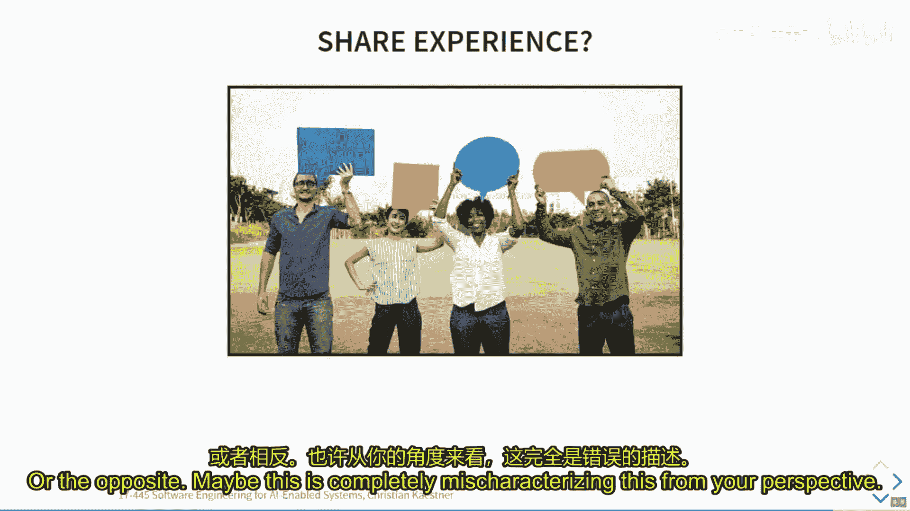
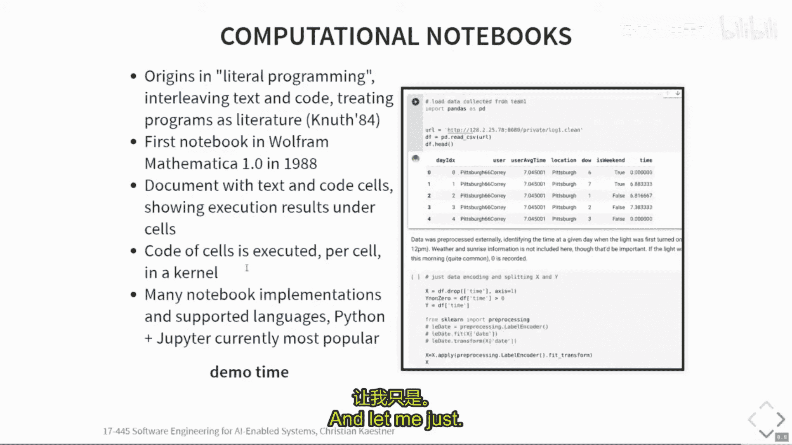
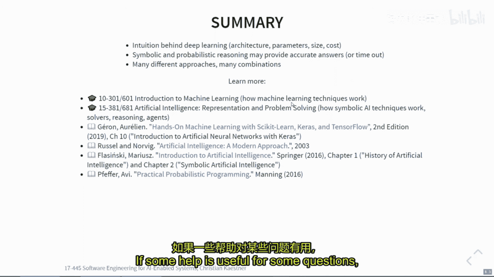

# 【全集】卡内基梅隆大学-AI驱动系统的软件工程-中英字幕-1080P-p03-Lecture-3---面向软件工程师的人工智能part2--BV1JS6gBcEBF_p3-

All right， welcome back。 let's start by starting the same way as usual me asking you what you remember from the last lecture。

Again， raise your hand right in the chat or anything like this。What did we talk about。

 is there anything that you remember， decision trees is something that we talk about， yeah？

I tried to demo something， my computer was a bit slow for that。Anything else？

lack of specifications yep we repeated this talked about this a little bit more that we don't have them separating training and test data and also validation data we actually talked about three steps right that you often need to do when you do hyperparameter tuning overfitting underfitting right。

Yeah， so overall I think I tried to do kind of an introduction to machine learning that at least we have kind of a similar baseline and have an idea of concepts like parameter hyperparameters overfitting and how this actually works so that we can evaluate if we put this into a system what we might expect on what we might not find so there were a couple of things that I didn't quite get to last time that I want to catch up on and I suspect I also run out of time today。

 but I want to continue on this path of kind of basics of machine learning I want to talk about deep neural networks and then hopefully I get a little bit of time to talk about some maybe slightly less popular techniques。

 more symbolic AI techniques just to kind of round up that we're not just talking about machine learning but also about the larger picture and when you would use those。

One thing I want to start with is that last time we talked a lot about kind of bidding the models。

 learning the models， one thing that's important is that。

People tend to think of machine learning as pipelines。

 and that's actually something that we'll talk more about later that machine learning is not about just building the model。

 but having an entire process to reproduce a model and we focus a lot on quality assurance of this process and making a repeatable and so on later。

This is one of many different forms of showing this。

 but they are all kind of similar where you think of the or of the yeah of the pipeline to learn a machine learning model of as multiple stages。

 this is fairly common where maybe you focus on think about kind of what the goals or the requirements are initially then there's a lot of work in data collection and data cleaning。

 data labeling， feature engineering， model training。

 model evaluation and if you're lucky somebody puts this into production and then you have some deployment and some model monitoring later。

嗯。I suspect a bunch of these stages are kind of safe explanatory。

 but let's think again about this problem that we talked about last time that you want to predict the。

Sales， prices of houses。RightSo that's kind of the goal。

 so the first step is just figuring out what do we want to do， yeah。

 kind of figuring out how much might a house be worth when we're selling it。能。

Let's assume we are still using supervised machine learning right then we need some way of training the model。

 we want to learn this prediction function F here and we need to find a way to gather data that we can train it on。

In practice， there's a lot of。Effort in this part and a lot of creativity， potentially。

 or you might even just start thinking about a certain model when you have the right data that you can even start thinking about this data gathering。

 if you， if you do kind of a machine learning course。

 it's often just somebody gives you a file that's already prepared。 but in practice。

 there's often a lot of effort where you might scrape some data from the Internet where you have to negotiate with somebody to give you data。

 maybe have it in a certain format and so on。And so there might be quite a bit of data。

 what kind of data do you think we could use to train a model like this to predict housing prices。

 let's say in Pittsburgh。If we wanted to bid something like this。

 how would you approach data collection， what kind of data might be available？And again。

 write on the chat or raise your hand， Leo。So there are a bunch of housing trading website like Zeillow things like that。

 and they have a recent history of where the real estate are and how much they were sold or right you can scrap from those kind of website to get some sort of data that's that's probably illegal。

 but that's one way of getting data so you're probably violating the terms of service which may or may not be okay depending on your business model and your agreement。

But this is one way right， property tax records is something that Jake said right is something actually all the sales in the US are public right so whenever a title is transferred there's a public sale they typically not on the internet automatically or depends on the county I think。

They used to be a big business of people going to the office every day to look at the books or the paperwork that they have。

 which is public information and then kind of scrape this and say this to a bunch of companies that send you spam afterwards or something like this so when you buy a house you get overwhelmed with kind of spam afterwards。

 which is because this is all public records and they have your address obviously probably your name and even how much the house was worth and even which company your mortgage comes from。

So this is public information， so this is stuff that you could gather from the internet。

And in addition， there's probably more information that you can collect right so this will give you some information about the house but not much more than the address and the sales price it doesn't really tell you how big the house is probably which you might get from some listings。

 maybe some of those are easy to scrape。But you can also think about things like what do we know about the neighborhood that the house is in？

So again there are different public records so maybe you can look at the crime rate that might be listed on the city website and correlate this with a zip code。

 right there might be other information maybe about school districts。

 things like this and you might actually collect data from multiple different sources and aggregate this。

This is very common that in the end you want one table。

 but often this comes from many different sources and it's often not directly in the format that you wanted eventually。

嗯。Next step， you do some sort of data cleaning， what kind of cleaning might be needed。

 what can you think of in this specific example。What kind of cleaning might you need？

There might be missing data， you might be able to fill that in right removing of outliers might be a good idea right so there might just be implausible values that something says you have 200 rooms in a house right that might just be noisy data that you can remove。

嗯。Yeah。啊。嗯。So data format would be checking， there might be strong violations of the format that you might be able to deal with right and they might come from different sources。

 maybe you need to translate them that could be part of cleaning。

 but I think it's usually part of collection。But yeah， so typical things are removing outliers。

 filling in missing data， things like this。Data labeling is figuring out what the supposed outcome would be。

In this specific example we already looked for kind of sales records right this is where we would get labels from we could also take some data and ask experts to do this or we could use like the Zillow algorithm or something like this like a reference model that gives us some labels that we could use。

And then there's feature engineering right feature engineering is now you have a lot of kind of raw data from different sources and you want to figure out what are the features that you're training on and the features are the inputs to these functions to this function here right so you want to figure out。

A what features do you want and then you need to extract them right so you need to figure out how can I figure out how many rooms this has。

 how many square meter or square feet， what the text is， what the neighborhood is like。

 the crime rate， things like this for this specific for each role in your data right so you're kind of curating the table that you can learn on。

And what training is in。In a lot of places just these two lines of code。

 sometimes more where you actually learn， apply a learning function， right。

 call a framework to train your code， model evaluation is what we talked about last time as well kind of computing accuracy on some test or validation set。

All right， and then you push this into production into monitoring。

In practice what most courses talk about most of the time is kind of model training。

 like how does it actually work， how do the different kind of models work and maybe feature engineering like how can I extract interesting things out of the data。

 what other things that I'm learning on in practice it seems that data scientists actually spend most of their time in kind of data collection and data cleaning phases like thinking about what kind of data can we get is a sufficient how can we prepare the data and labeling is also very expensive。

Kind of the initial requirements and the deployments and the monitoring that's more in a software engineering realm typically。

 this is not at least what a data science course would typically focus much on C。

Which is I think also what I kind of try to explain here this is what just what we talked about there are lots of challenges but they are kind of in the data science well there are lots out there but I don't want to go too much into this maybe the one part that I want to kind of emphasize again is that。

It's a good practice if you're building a system with a machine learning component。

 do not just think about oh somebody has built me a model and here I have the model right so some sort of function but you actually want to have a process to produce this model so you really want to think in terms of pipelines。

 think in terms of how can I update this model， how can I get data and so on。嗯。

One more thing that I wanted to talk about is。That the style of how data scientists develop these models。

Is。Fairly specific and possibly quite different from how software engineers might develop typical applications This has actually been studied a lot and there are a bunch of descriptions here。

 like this is a fairly old description these I mean for machine learning terms fairly old on data science work right so this is more kind of the scientist perspective。

 but you acquire some data， you prepare some data， then you write some analysis scripts。

 you analyze them， you look at the outputs and probably you debug and repeat and make better scripts。

 better models， look at the output again， then you look at if there's something that you like you take some notes。

 you talk about the results， you probably go back to explore some alternatives sometimes you might actually go back and collect more data and at some point after a lot of iteration you might get to a point where you actually happy with the results and you publish it or。

Producer model that you want to work there are lots of versions of this that look kind of similar This is something that Microsoft published as a as a draft。

 maybe a little bit small on this slide， but it again says there are all these parts kind of business understanding。

 data acquisition modeling， deployment and they all kind of interrelate and you kind of go in circuits and it's iterative and it' exploratory and so on。

嗯。Here's also a study that I like where 2008 so quite a while ago。

 this was before notebooks where they asked a bunch of students to develop a machine learning model they gave them four hours to do this and they recorded accuracy of the model as they went along so what happens is that data scientists tend to build the first model quickly it may not work particularly where but then they continue to improve it and what you see here the Y axis is accuracy and the X axis is time that over the time four hours for almost every participant they started with very low accuracy and then they figured something out to make it higher accuracy and then increases over time and in a lot of cases as levels off。

So this is very common that this is a very open ended and exploratory process where you start with something。

 you try， you iterate， you try something else until you get to a point that you're happy。

It's actually similar to doing research where when you go in。

 you have an idea that something might work。But you don't know yet， it's openend。

 you don't know that it's actually possible right so it's not just going in and coding a thing that you know will work and you just need to do it and debug it。

 but you actually don't even know when you're going in whether you be able to build a model like。嗯。

So for this， there's an interesting question here of。

Isn't that somewhat similar to kind of the spiral process model or agile？

There we also iterate right so in the spiral model we focus on risk。

 the idea is you do a big project and you iterate and to make multiple things build prototypes。

 extend those prototypes and the spiral process typically says do risky parts first right figure out the hardest part of the project。

 figure out how to do this， show a prototype for this is the risk management technique。

And Aure is kind of the idea。Let's not do too many specifications upfront， right。

 let's work with a customer， let's kind of iterate frequently。

 let's demonstrate something and kind of work in terms of sprints。😊。

Is that the same or is this different from kind of the iterative workflow that you see data science to Daniel？

So for agile， isn't it that you're trying to deliver work frequently to the customer。

 whereas it seems like with model development， you're kind of doing an experiment and。

Internally checking if was that good enough or not unless you're considering yourself the customer I'm not sure Yeah。

 I'm not sure for Agi do you deliver a product every sprint cycle in some cases yes。

 but in a lot of cases it probably also use has a prototype that you can play with right。

Any other comments， ideas？Is a spiral model or address processes clear？I would just。

 I just want to build upon Daniel's point。 So I think even in sprints at the end of every sprint。

 there should be some。Output that is visible to an end user。 And in an Agile， we have。

That continuous involvement from the stakeholders in every iteration right， but on the other hand。

 the model cycle which we showed， it seems like until we get a final result which might require a number of iterations we not involving the customer the work is not done yet。

Right。might you might publish a model， put something in production that kind of works and then you continue improving right I think that's fairly common as well so you deploy your first spm filter and then you improve the spm filter for future releases。

But yeah， in an earlier stages just before you release something to a customer。

 probably it's not very visible。ake。If we're just talking about building the model and acknowledging the study you showed before where things did improve with time。

I would think that it would be I mean for the model you're just trying to deliver a set of parameters that constitute the model and I think it might be harder to timebox that to estimate how long it would take as well as decompose it into smaller modules because you're just trying to extract a model from it so I think there would be some challenges trying to apply like an agile model to it because of that。

So， so I agree。 I think this is。This is quite different from what software developers do in an iterative fashion right so it's kind of much more sy。

 much more exploratory， you have a vague idea but you can't say let's break it down into sprints right you can't really I mean you can say first I'm trying this feature and this feature and this feature but it's typically much more kind of creative exploratory I try this in short iterations I try something is you also don't really know what the most risky part is unless you think the entire model is a risky part and you're just trying to build the first model as part of the larger software project and you can think this is the first spiral but I think it's way less defined way less structured that you can break things down the iterations look quite different I think for a data scientist than what you have as a software developer so it's way more exploratory I think way more driven by into。

Tuition rather than kind of planning。嗯。For the most part。

 this seems to be what most studies show how most people are operating。

 there might be some people that have a more structured approach。

 but I think this is the most common kind of data science approach is really this exoratory fashion working with things。

And so it's really this start with a rough goal， kind of iterate， have some of heuristics。

 you really let your experience guide this， this is often why experienced data analysts。

 data scientists are better at building these models because they kind of know what to look for right there's a lot of try and error lots of iterative refinement and often actually going back to collect more data。

 clean more data and maybe revise the goals。Let skip this has anybody of you done a project like this have you experienced？

Kind of this iterative fashion where a lot of things were unclear， maybe hard to plan。

 anything you might want to share。Or maybe the opposite。

 maybe this is completely mischaracterizing this from your perspective。

maybe one last story we're doing a project where we're doing anomaly detection to find malicious updates of software packages and again we have a lot of data we mind all of NPM and we have a lot of characteristics and can kind of identify things that might look suspicious maybe in a larger context。

 but it's really。

Let's do some anomaly detection here was the starting point right there are some techniques for learning we know this should be possible we run the first version completely garbage and kind of what it detects and then we think about what could be better features here and slowly it gets better and maybe to usable version over time right so again very iterative process driven by a big goal but not by。

I mean we talk about kind of what are the next things to try， those could be sprints。

 but it's more like let's try some ideas here， let's try some features there。

 it's not a very a thing that you could plan for a long time。

 really upfront I think or prioritize things， at least in my experience here。

Which brings me to notebooks。So just by show of hands， who has used the notebook before， Yes， no。

 have you used one before。Show of Handwork bothways so I assume I can make this fairly quick right so pretty much everybody has used notebooks in one form or another there are these things they actually have a long history the idea goes back to this idea of literate programming where you treat a program like literature so you focus much more on the description and then maybe there's some code in between but the primary artifact is essentially your text or your narrative that goes back to to the 80s to Don Moot。

😊，嗯。And then this has been around also for a long time in software。

 while from Mathematica has done this for a long time。

 looks fairly similar to what you see as notebooks before where you have text and code sets that you can execute and play with。

And let me just。

I think it's fairly obvious everybody knows this， right， so we have this。

Let's ignore this you have this thing that has text sets and then code sets。

 you can execute these code sets there's kind of a global runtime so whatever you execute here change a state this might be used in the next cell you can execute them out of order there are all kinds of things around here but in the end you can almost think of this as one long Python file that just has parts and you execute individual parts of this file right。

The idea that people always talk about as kind of the important innovation here is that you have text in between。

 right that you have a lot of documentation in practice that's not used a lot。

 so studies show have some things that people want to share。

 but people often explore things and then add text at the end when they want to share something most of the time they just play with sales or very minimal documentation。

嗯。Let's just briefly start with a。Discussion here， why do you think notebooks are so popular。

 Why are people using them？Or the other way around。

 what are some of the problems that you've seen with notebooks。

 why maybe people shouldn't be using them？You have an opinion either way？利요。

So I've recently used it a lot for my current research project。

 I think the good point of a notebook it's very convenient you can just make commentss visible and running codes all at the same time。

And also it's easy to pass it along to someone else who may be sharing the project with you and the problem with with that is if you want to have a huge project making an actual software。

 the code you have in the notebook， it takes a longer time to convert and integrate them into a larger part of a software system。

Y， there are a couple of things in there。 it's easy to experiment。

 It has a visualization right there。 it's easy to share the result， right。

 People don't need to execute them again。It might be harder to convert this into something that you want to use eventually。

Right， Chris。Yeah， so I think like。You know， the purpose for them like they're really good for you know communicating results and that sort of thing。

 but I think that also relies on like the code inside as well being like in a readable format and sort of。

You know， refactored to have like the higher level。Logic， you know， visible。Yep。So， but yeah。

 I think overall， it's。Really convenient sort of tool to use。Yep。

Then it a super easy print debugging。I'm not sure whether that's a positive or negative。I mean。

 the negative is potentially that there is no better debugger in most cases， right。

 but the positive is also it's fairly easy to do this and run segments of code at a time， right？Jy。

Yeah， I think the notebook is pretty good for Python or any scriptified language。

 but it's not good for like C or C++ where you need a compiler to compile everything at once right so it's only practical for scripting language like Python。

I think it has been used in ScalA as well， but I think you compile the segments sequentially or interpret the Sca code。

 I'm not entirely sure。So here here a couple of things that I have。 So I think one of one of the。

Things that you also said as you get quick feedback， right， So it's like the。

Reap the loop where you on the command line， you write something， you can see the output immediately。

 right？This is nice， you can experiment with this and in contrast to this repper loop or this command line where you just called Python and then type immediately。

 you have a history of what you've done right。You don't tend to execute individual lines。

 but maybe two or three lines at a time， but it's fairly common to have these blocks sharing visual feedback。

 actually having tablets in there is nice compared to kind of a standard IDE where the output shows where somewhere in the line below and I think one of the biggest advantages is incremental computation this is something that you might not see that easily but you load data once。

So I can can show this in this notebook here。Oops have。This one where you load data。

 if it's a lot of data it's loaded once， you clean the data maybe in some steps and then if I want to train the model or if I want to make any changes to the training or to the feature of things I only execute those sets down here so I may modify how the name feature works or the sex feature or whatever right kind of this is Titanic data set but you're extracting some information and you're not rerunning the entire notebook right not the entire code you're just rerunning this one set and it changes the state or it remembers the state from before and updates the state for future sets this is actually something that's quite convenient in a lot of ways。

There's some problems if you execute code out of order。

This is actually a quite well known problem that you can get in a really messy state。

 worst case you need to reexecute from front to back but it's one of the big advantages is this kind of incremental computation thing in contrast to having a script a Python script that you always add something to and you run it again and again and again so what I've showed you last week with the learning thing I always executed the entire program in Sca so it was loading the data every time even though I made only small changes to what I wanted to execute。

RightAnd it's really just。Easy， you can do a lot of copy paste。

 no abstraction needed right you don't need to learn about functions really or about proper abstractions and easy to share。

But it also had a bunch of disadvantages。So a lot of people。

There's a lot of negative comments also about notebooks。

 especially from software engineers who say lots of bad software engineering practices。

Anything that comes to mind， anything that you have seen people complain about or that you failed it to yourself。

 this is kind of bad practices what's happening here。Version control is hard to do。

 It's kind of stored in this XMA or Json binary format。

 So even if just the output changes a little bit， it's kind of。

Makes versioning and looking at differences hard， little modularity possibly hard to read hopefully there's some documentation but usually there isn't right so you have a lot of sales and it's essentially like one very long method right this is something we would typically call a codes smell it's different sales but it's one long method it's all global state。

Right so there's no scoping of variables typically that you would do with methods or so on you whenever a sale reads some data it writes it to a different variable or global variables pretty much yeah not conductive to test coverage nobody tests the code and notebooks really I mean you can but it's not common and yeah collaboration with one file kind of typically we have imports and modules and import them to make collaboration easier right here here we have one file and then things like Colup may help us to have multiple people edit the same file at the same time but it's not the traditional way。

Yeah， and there's lots of comments that people follow bad programming styles like poor naming conventions or things like this and potentially hard to debug。

 yes。嗯。We should be a little bit careful and again this is something that we probably discuss more later it's very easy for a software engineer kind of to say oh weve write way structured modularized code and write test cases all the time and those data scientists they oh they need to learn but they will come around eventually right so it's just this playground and notebook there's a point why they do this right there's a point that test coverage may not work while you're doing exploratory work right so maybe the best naming conventions don't matter that much why it's all just exploratory so I think if you understand the mindset of a data scientist to kind of explores the world。

A lot of this makes much more sense than if you have the mindset of somebody who wants to maintain the software for a long time。

It's actually very common and has been studied as well that the way that most people use notebooks is in phases where they explore things。

 they write things， they move things around， copy paste actually lots of sales。

 comment out stuff and then they clean things up they remove sales they write some documentation and they explore again and then they clean things up and they explore again and clean things up right there seems to be a much more common WordPresspress and I think it seems to be much more important to be kind of flexible and do something quickly rather than to write long-term code and I think if you want longterm maintainable code you probably want to go outside of the notebook at some point。

Or have some suitable infrastructure。All right， any questions on kind of this iterative process or notebooks or anything like this？

All right， Jake。Is there anyone particularly working on on some kind of technology or something to。

To graceful migration from notebooks to a more mature environment， or is it just kind of。

We're actually doing some research on this this summer。

So this is a project that we're doing sure here as well。

There are some tools to extract Python code from notebooks and be convert and things like this。

 they are used sometimes with ad hoc pipelines and things like this and there is a lot of work on helping people to clean up notebooks like programs sing for notebook code there's a cool Microsoft project and they're building in some of this in their their kind of internal environment。

I don' this is often one of the big pain points that's mentioned by practitioners kind of converting。

 kind of going from a notebook into production， and we'll talk about this a little bit later more。

All right。I'm behind and I think I'm not going to finish today either with what I had planned for this lecture。

 but I want to talk a little bit more background about。

Machine learning and artificial intelligence a little bit more broadly。

 and I want to give you at least an intuition for deep learning today。

 I'm not going to go into quite as much depth as I did last time。

 but I want to get you want you to get an intuition of。

Why it has this reputation for training takes forever or the models are massive and what it's maybe good at。

 what it's not so good at。哎。So。Maybe just broadly in terms of terminology。

 this is a fairly commonly shown figure。Terminology is not used super consistently。

 but we typically say that artificial intelligence is a broad field。

Of humans computers acting humanly or thinking humanly or thinking rationally or acting rationally。

 if you want to be very broad， some people just say artificial intelligence is whatever is heart and computer science so you can frame this extremely broadly right so this is all kinds of reasoning about sensing robotics and so on can be a lot of this can be framed under artificial intelligence and if you look at a kind of how people use the term it's also super broad。

Machine learning technically is a subdiscipline that uses data in some form or some observations to do something in the most common form it' something like supervised learning that we looked at right where you have some data some labels and you learn a function and then deep learning inside just like decision trees is one specific technique that's super popular these days right the terms are often used in overlapping ways but if you want to be precise。

I think this is the most common definition。In this course we're talking mostly about machine learning but I want to give you a sense of how this can be broadly more broadly right so artificial intelligence。

Has。Can be defined in many different ways， but there's things like acting humanly。

 like try to behave like a human， like solving the touring test right。

 doing natural language processing， interacting with the real world， lots of vision robotics。

 use machine learning there， there's also thinking humanly。

 like thinking like humans like cognitive science， but there's also the rational side。

 where you want to think about rationally reason about lots of things rationally。

 this is often logic patterns structures， and then acting rationally。

 this is where you think about agents， maybe solving computer games， things like this。

And artificial intelligence includes a lot of different things， problem solving。

 which includes things likebuoyan satisfiability solvers and logic。

 but reasoning logic as well learning where most of the machine learning work is and then a lot of kind of perception。

 acting， communication， and so on。嗯。Let me。Yeah let me do this quickly in the machine learning field it's also important to distinguish different kinds of problems that we're solving because this will affect a lot on how you're evaluating this and which techniques are suitable the most common machine learning problems if you think of kind of supervised learning are classification problems and regression problems。

Classification problems is if you have a finite set of outputs。Yes or no。

 or you're recognizing one of five things in a picture。

 things like this where you have a limited set of outputs and you're saying which one of this is it and regression are those things where we're predicting a number like the price of a house。

Right。There are alternatives here this was also in the reading right a probability estimation is telling you what's the chance of something will be in a certain class or maybe a certain number this is often used underneath classification problem and then you just report the thing with the highest probability right something like there's 80% chance that there might be cancer in the picture so you say。

The classification， yes or no， yes， there's cancer。

And then ranking problems are things where you return things in order。

 and you might do things like use a regression mechanism to give you a score and then report the things with the highest score in order right and a lot of hybrid approaches。

So let's just go quickly through this and let me just。

 I've never tried to use this poll feature for Zoom， but I want to do this now。嗯。

So if let's say we're doing this detecting a shoe brand in an image right so you have an app where you can take a picture of a shoe and it tells you this is a Nike shoe or an Adidas shoe。

 what kind of problem is this？Can you just vote whether it's classification， probability， estimation。

 regression， ranking？What something is。Is it just Nike and Adidass shoes？maybe more doesn。

It's still going to be a finite set so I can show you the resultss right so everybody said classification so if you have a finite set I think it's kind of hard to say assign numbers to things right so it's always a set of producers that you're trying to predict you might do this as probability estimations and turn this into a classification problem but what you're really concerned about as the output is。

Yeah， classification， what kind of shoe right， can you see the results， by the way？On my screen。

 I'm not entirely sure what。Alright， so。Let's do this again， for the。Next。

Thing recommending videos on YouTube， what kind of problem is this？All right。

 let me show you the results。So you're giving a list of recommendations typically ranked by the highest one right so you can think of this as classification yes or no。

 let's do something maybe as probability estimation is this a good or a bad recommendation and then you take the highest ranked ones in the end you tend to solve a ranking problem right you may use one of the other techniques maybe combine them in a specific way。

嗯。Understanding the survival rate of Titanic passengers。

 So let's say you have the data set of who survived and who didn't and you have some information about them like the gender their。

There。Their class of servers， things like this， What kind of problem are you solving here？All right。

I think I can stop here pretty much every says probability estimation。

I would think of this more classically as a classification problem， did somebody die， yes or no？

And then we try to understand the model in how do we figure out whether somebody dies or not right so the typical approach to do this is build a classification tree。

 a decision tree for example yes or no and see what's in the decisions right or build a linear regression model and see which features are actually relevant。

嗯。Let's see嗯。Estimating the arrival time of a right sharing car。Yeah。

 everybody agrees it's a regression problem， you're predicting a time a number。

 and then I want to do the transcription as a last thing。And。I think this is very non obvious。

Maybe somebody hears。Natural language processing experience。If you have no idea， take a guess。Okay。

Somebody here who knows how natural language processing works and what kind of technique is used there。

I had to ask myself， but my understanding， it depends a little bit on how you're encoding this。

 but my understanding is that most of the time you're predicting what is the next word in a sentence。

 so you're predicting one word at a time and each time you do a classification problem。

 you have a large number of words and say what's the next word。

And then you do the next word and the next word and the next word。

 right so the classification problem of what's the next word depending on the previous words and the audio file or something like this。

And there are kind of hybrid approaches and lots of other things。

And there's probably some ranking in between， but I hope you get a sense of that there are different kind of problems here and that different kind of methods are appropriate Vi。

Yeah， I wanted to ask like since we are transcribing an audio file so this it has to do something with the signal right。

 ultimately so like I'm not really sure like are there ways to like what are the ways to encode a signal essentially。

So we come back to this as deep learning， this is typically these days people use deep learning for this and pretty much take the raw input。

 you could learn almost from the uncompressed audio file where you just have a sequence of bytes of where it is I think there's probably some preprocessing that you can do。

 but I'm not an expert in this area。I can actually check how this is done。Right。The other thing is。

That there's a distinction in machine learning into supervised learning and unsupervised learning。

 Mahidu， have a question。Yeah， I just wanted to ask similarly。

 could you mention how image analysis works。Especially detecting objects within an image。

 I' show you an example later。是。Okay。嗯。Allright。There's one more important distinction that's supervised learning。

 unsupervised learning， and maybe reinforcement learning。嗯。The idea is。

 essentially whether you have labeled data or unlabeled data。

 does anybody can can somebody give me an。An example of something that you can learn without labeled data。

 what would an unsupervised learning approach do where you just have data but no labels？Clustering。

 right。Go and chess would be reinforcement learning typically common examines are clustering figuring out what data is similar to other data anomaly detection is another one so we've seen a lot of data and now if I see new data that's different from the past data then I'm sounding an alarm。

So。I don't want to go through this， but identifying whether a scan shows a picture shows cancer in an image that's typically using supervised learning。

 you just feed a lot of training data which show cancer or not and it learning patterns from this playing chess as reinforcement learning typically where computer plays itself and learns from reactions of the world right so it kind of it doesn't have direct labels saying this is a good move or a bad move but it can observe the environment and see oh yeah the move eventually lead to a good result predicting sales of a price of a house would typically be supervised learning organizing books into topics that's something that you can do with unsupervised learning so you can do this with supervised learning where you show a few examples of books and labels and then you learn more of this or you can just figure out here all the books structure them in a way that all the similar books are together and then I can look at the pile of books in one corner and say oh yeah。

Seem to be science fiction or something like。Right。

Detecting shoe brands in an image would be supervised learning。

 identifying unusual purchases as anomaly detection could be supervised or unsupervised learning。

 often unsupervised learning learning to work is often one of the reinforcement examples where you run this in the simulation。

 transcribing an audio file， probably supervised learning where you give a lot of examples。嗯。

And now on top of this there are tons of different techniques to users。

 they are inspired by very different approaches， I've only talked about decision trees and I will show you deep networks。

 deep neural networks， but there are many different approaches。

 genetic programming Markov chains nearest neighbors，That use different underlying techniques。

 I don't want to go into this， but if you're interested in kind of the basic directions where big groups of researchers are going。

 I can recommend this book， the Master algorithm， which is really written for a non technicalnical audience。

So if you have already taken machine learning course is probably boring and way to a high level。

 but if that's I think that gives you a level of a high level understanding of how different approaches work。

 how genetic algorithms work and things like this， they can hold a conversation and kind of have an overview of the techniques so that's fairly readable。

It' it's written in the。Completely math free high level thing toward actually non CS people that just want to learn about machine learning。

All right。I'm picking this one more technique， neural networks and I'm trying to go a little bit deeper again to give you an idea of how they work if you've taken introduction to machine learning you probably know this。

 I apologize， but for everybody else if you've just applied them or so I think it helps to understand a little bit how they work。

The whole concept is inspired by biology， by studying how the human brain or animal brains work in general where you have。

Neurons are the nodes essentially and then you have connections between nodes and these connections kind of grow or develop over time and you have electricity that kind of activates these synapses and then activates neurons and we have millions of those and somehow it works that we can process audio that we can see the word things like this make decisions right reason。

So there's a lot of study behind of how this might work at the cell level。

And people have studied artificial neural networks for a very， very long time， so this goes way back。

 I think 30s or 20s and it has been popular and studied a lot in the 70s and 60s。

 there was kind of a disappointment for a while with what people can do with this and then there was this new wave of kind of neural network and excitement in the last。

 I don't know， 1020 years where we had the hardware and the data to actually scale this and make this feasible at a massive scale and a bunch of inventions along the way。

The idea below is relatively simple， and then are a bunch of variations。

 so essentially your modern neurons。That are notes in your brain or in this artificial sense that are on or off。

1 or zero or maybe have a number in between and you have connections between them that send information from one to another so if one is activated。

It sends kind of electricity information to the next node and it influences how the next thing is activated right so you kind of can think of this as electricity flowing through your brain going on and off and activating and deactivating a bunch of neurons at the time。

The original ideas of where people played with this is think of each neuron as a bit that's either on or off。

And then each connection between neurons is also either on or off based on the previous neuron。

And one of the early roots was that you activate a neuron always if at least M inputs are active。

So in this example here， let's say if at least two inputs are active。Then if this is active。

 there are two edges here， so two inputs are active here as well， and if this is inactive。

 this will not be inactive right so this is just propagating information from one node to the next。

Makes sense。嗯。This thing here says that both x and y need to be activated because we need two incoming edges。

Given you have an idea or have seen this in class， how would you do this with an awe？

So we want whenever x or y is activated， then all should be activated， so we need two incoming edges。

To be activated when x is activated， two incoming edges activated if y is activated。

If NATA is activated， no incoming edge should be activated， any idea？嗯。No。

We don't need an intermediate note。Tvin is right， we need two notes， let me see whether that works。

We have two edges。So this means if x is activated， then o is activated。We need to address here。

Which means if Y is activated or is activated。And if both are activated， we have more incoming edges。

 we only need two， so that's fine。第一。People got pretty excited initially that they can model logic not as a bit hard or XO was a bit hard。

 but they figured it out eventually and they kind of if you have the structure you can design things that are do more complicated things and you can approximate a lot of functions kind of people figured out that you can do all kinds of things if you just structure these in the right way because you can do logic essentially。

These annotations stay， that's not good。All right。This has been pushed much further， of course。

 one of the next steps was to think of each function not only as on and off。

 but as having a number and each connection also having a weight。

So the idea here is that you have two， in this case， two inputs and three neurons。

Each input goes to each neuron。And there's a weight。

 so if we want to know the value of this node here。

 we compute the weight of this edge times the activation value of this node plus the weight of this edge times the activation value of this node and so this is what you see here。

 weight 1 times x1 plus weight2 times x2。That gives you a value。

And then you combine this with a step function。Or any other sort of function where you essentially just say if the combined。

W did some。Is negative， then this is zero， otherwise this is one。This is an accent sense so。

 so the idea is each of these nodes is either one or0 in the end。

 depending on whether the weighted sum of the incoming edges where you have different weights is larger than zero or not。

And you can adjust those weights in many different ways and these weights is actually what we later want to learn right we don't want to manually specify them but it's saying for example the first weight could be minus5 and the second weight could be plus 0。

5 or so， and then we see that if the second thing is activated then the first thing is not or it's within a certain range。

 then we get the activation value that says this is a correct output or this is a correct output。

Right。In general， so what we have is these for three nodes， we have these three different functions。

 where just say some base value plus the weighted input of x1 plus the weighted input of x2。

 we do this for all three things in each case we apply the step function at the end。

The number of ATU notes it depends on the architecture of the network as we come there。So。

The way that this is typically done is wire matrix multiplications so if you have all these weights here like in this simple example six weights。

 I can put them into a two by3 matrix and compute them by x like the vector x here。

 the values of x1 x2 and then add a vector B。For all the minimum values。

 then I get a vector of all the resultss of the ATUs in this row。

And then I apply the step function to every single row in this vector， right or every single value。

P sense sofa far。Yeah。And then we get to more layers。

This is also where kind of deep networks come from that we have more layers where we have。

A bunch of things here that have this format right they take the inputs from the previous layers with some weights。

 apply a step function at the end， and then we do the same thing with the output of these layers。

Again， apply some weights， see whether these are activated and get some output。Right so。In this case。

 what this would turn down to。 Let me see。 This is a description here。 So we have the first layer。

Where we say。For layer I don't know why it's called H oh the hidden layer。

 this is the inner inner layer， we have the weights of the hidden layer times x plus the base values。

We apply the step function。That means these are the outputs of this hidden layer， right。嗯。

And think I have。I'm missing apprentices， but otherwise yeah， I'm applying from the output layer。

 I'm applying the weights to the resultss that I got from the first layer from the hidden layer and apply the at the base value here。

 that's the input from one。And then I apply the step function again。Makes sense。

So what you see here is now that we have a lot of weights， the W values and the B values。

And those are the things that we essentially want to learn in the end。

 if we have the suitable weights for this， we get some input we put some inputs and we get the right output。

 that's basically the idea。And the way that learning works is。Just in a nutshe。

 you take some data with some labeled data， you start with completely random weights for allWs and OBs。

You put in some data point。And you observe the outcome right so you just compute every activation in the network for specific values。

 like for specific x here， you see the activations of all nodes at the output layer。

And then you see whether that's the right output。If it's the wrong output。

 you essentially change all weights a little bit。You change the weights of the output layer a little bit to。

Make it more likely to get the right output then you change the weights in the hidden layer a little bit in the right direction and so on there's a bunch of math behind that you can do these small changes to all the weights because you can observe the gradient you can see if I want to get from zero to one for this note here for example because that's the correct output then all these inputs here have currently negative weights so I need to kind of tone this down or this as a positive weight so I need to increases or so right so you can always figure out in which direction do I need to change the weights to make this single example a little bit better。

So you have this iterative process where you initialize all weights with random values。

You compute prediction and if it's not the expected prediction。

 then you go back and you change all weights a little bit toward this prediction。

And you just continue this over and over again with training data each time adjusting all the weights a little bit。

 and you hope that over time you get fairly stable resultss that the weights don't change back and forth a little bit that you actually get a lot of good predictions and not that many wrong predictions。

That works surprisingly well if you have enough data there is not that much more to it I mean technically yes and you kind of need pretty big distributed systems to actually make this work in practice but the basic ideas are really just that you have these notes that take a bunch of inputs。

 weigh them together， make a decision yes or no， put them out to the next layer。

 possibly to the next layer and so on， and then when you train things you just try some random you try some training data if it's correct great if it's incorrect you tweak the weights a little bit。

So the training algorithm is really incremental， you could stop at any point。

And you can also take a model and train it further by giving more data。

 maybe tweaking data into a different direction。Technically the step function will look different。

 there are reasons in the math behind this that you can't use the one or zero step function。

 so typically what people are using is the logistic function。

Don't ask me to explain why the specific function， it's a function that just kind of is used to kind of normalize data between one and minus1。

 I think， while you use the IELU function also has a name and I don't remember why which is just cutting off all negative results。

Right so。Both of these functions make the math behind this work that you can actually run this。

And deep learning is essentially what I've just shown you。

 it's just in practice using more than the five nodes that I've shown you right so a bunch of nodes。

 bunch of layers， and there a bunch of innovations， what the layers can do and can't do。

So just briefly on terminology。What I've shown you is in general。

 neural networks and deep neural networks are just neural networks， there's nothing。Specific。

 except that we call them deep when we want to get money from startup funding companies。

 right because it's kind of hit as a term， or we call them deep just because they have a lot of hidden layers。

But people just call these things kind of deep learning， deep neural networks。

 the architecture of a network is typically decided before you learn and that's the layout and the number of parameters so in this specific example we have an architecture of two layers。

 one or three layers， one input layer， one hidden layer and one output layer。

And we decided that the hidden layer has three nodes， the output layer has two nodes。

And that they are all connected。That's one architecture。

 that's an architecture with three layers where the middle node has three three the middle layers。

 three nodes， the output layer， we could decide on something else。

 we could decide on an architecture where we still have three layers。

 but we have 500 nodes in the middle layer and five output nodes。

Or we could decide on an architecture where we have 20 layers。

 each with five nodes or each with 20 nodes。Which architecture to choose？

Depends a lot of on experience， this is where a lot of research is what architecture works for what kind of problems and that's something where can completely not help you with right so there's typically for certain classes of problems as like state of the art architectures that people are using。

嗯。The architecture。Of the network， that's kind of the hyper parametersmeter。

So that's deciding how the model looks like， how the learning approach is done。

 it's a network structure， how many layers， what connection and also what kind of step function you're using。

Alright。The model parameters are all the weights that we're learning。

 so again in this thing every edge in this graph has a weight。

RightEach weight is a parameter of the model。Or constant in the final model。

 but if you stick to the terminology here right， we have parameters。

 those are the things that we're learning in the model。

 we have hyperparameters that control how the model looks like that is not determined why we're learning this from data。

Makes sense， So far。Let me show you one example。 This is kind of the hello world example of neural networks or deep neural networks its。

No I think it's actually the second example， the hello word example is handwriting digit recognition this is an example with a bunch of fashion items where we identify 10 kinds of objects in training data so there's 70。

000 small grayscale images。And they are already labeled。

 this is data that we can download and we want to identify， is this a bag， is this a code。

 is are these trousers and so on， and we hope that the neural network can somehow detect this。喂。

So if we want to learn this we need to specify the model architecture this is no longer a single line learn function。

 as you would do with the SVM or with the decision tree。

 but you actually need to write some code to describe what the model architecture is in Cars。

 for example， it might look something like this。Where you say， you have。

In this example we're creating three layers we're starting with the input layer which doesn't learn anything right where we just say we have 28 by 28 pixels each with a by it to determine the gray scale so we have 784 input nodes so if you think back off my graph where two inputs here we have 780 inputs right the first row is already very long。

And then we have three layers。 The first layer has 300 nodes。

It uses this REU activation function or step function。It's just saying that we have these 300 nodes。

 so from every of the 700 inputs we have one edge to each of the 300 nodes here。

Then we have another layer。That has 100 nodes。So from each edge of the first。Of the first layer。

 we have an edge to the second layer， these are two hidden layers。And then we have 10 output nodes。

So these 10 output notes correspond to the 10 classes that we want to represent。

And the way that this is typically done， this is called softmax。

 This is just reporting of these 10 nodes。 only a single one will be active。

 and that's the one that has the highest activation。So if we're going back to this graph here。

We have 7804 input nodes， we have 300 nodes in the first layer。

 and we have an extra layer in between with 100 nodes and then an extra layer or output layer with 10 nodes。

And then we have 70，000 data sets to train the model on。I don't have the code to train the model。

 but it's essentially， this is again then one or two lines that just says once you have this model with its architecture。

 fit this output and the rest is done by a frameworkbook。

 right it figures out it does a forward activation。

 sees whether it's the right output adjusts the nodes and so on over time。水。

Can you compute how many parameters you have in this model。Like how big is this model。

 how many weights are we learning？How would you compute this？So for the first layer。

 we have 784 inputs。And from each of them， we have a connection to these  300 next nodes in the next layer。

So we have 784 times 300 node in the first， just from the first to the next connection。Plus。

 another 300， because we always need to connect the one to each。 right。

 So we have this B B parameter。 And then from from 300 nodes to 100 notess on next layer。

 And then from 100 to 10 on the next layer。 So what Daniel writes is roughly correct。

 except that he's missing the B notess， right， So this is the number of the W parameters。

 And then we have a number of B parameters。 So。This is。This is what he's writing there。 right。

 So first layer， this plus 300 for the ones。 Next layer is 300 plus 10 plus 00 for the ones。

 and then 100 times 10。 So this single model。Has a quarter of a million parameters that we're learning。

Compare this to decision trees that we discussed last week where we had maybe 10 decisions that we would model right if you have deep trees。

 maybe 20，100 decisions， maybe 1 thousand00， this has a quarter of a million decisions。

Or things that we're learning。If you assume a float data type here right， so 6 in a bit per value。

 you would assume that storing this model alone， just storing the parameters。

 you need one megaby just to store the raw data of all the weights。Also。

 if you want to compute whether a certain input image produces an output。

You take the 784 bytes of the input image。Multiply this by this first matrix with nearly a quarter million parameters right so you take this long vector of 784 numbers。

 multiply this by this massive matrix。Get this new vector of 300 values， apply the step function。

 apply again by multiply this again by a new matrix that has 30，000 nodes。

Get a new vector with 100 values， step function and multiply this again。

This is maybe where you can see why。The GPUs are quite useful because you're doing a ton of these matrix multiplications on float or double values。

So you're doing a lot of these computations in parallel。

 you don't want to write this as a nested for loop to do the matrix multiplication。

 you actually want to do a lot of matrix multiplication very efficiently。

And every time you go through this network， you're learning the activation。

Of these well theres 400410 neurons by multiplying all all these weights every time。

 and then you go backward。And this is actually a tiny neural network。

So just to give you a sense of the size， I gave you two I looked up two recent networks。

 so something that's done to classify only slightly larger images。

 there's still a kind of weird task kind of small images classifying them into 1000 categories。

They're using 26 million weights。And each time you go through the network。

 you activate 16 million activations。You need 170 mebytes just to store the raw data of the final model。

喂。And here's a text generation network that was in the news last year because it can create fake news articles。

 essentially it can generate things that look like speech it can imitate how people speak and generate realistic text this is something that has。

嗯。48 layers。1。5 billion weights。And just storing the weights takes about 12 gigyte right if you just look at the data here you can reduce it so a lot of these things and neurons。

 their techniques to figure out which are not less important so you can compress the network to a smaller network once you've learned it but the things that they are sharing are still massive and they trained it on 40 gigabytes of internet text over one month or a bunch of GPUs right so these are massive models that have been trained they have just。

Millions or。8ight million text web pages where they took every single sentence。

 I think as a training data， applied this， computed this backward and forward over these 1。

5 billion weights。So I think I hope what you get out of this is a feeling why this is expensive。

Why deep learning may take a long time， wide deep neural networks may be fairly big filess。

RightAnd even the inference time， even if you have this big model and you want to get the next prediction。

 it may take some time or some computing resources to compute this because you need to do a lot of these matrix modifications。

It typically doesn't take seconds to do this right it's a few milliseconds we're pretty good at matrix multiplications。

 but still if you it's way slower than just evaluating a decision tree and if you want to do this millions of times this can add up。

 this can become quite expensive。So typically just one last slide on architectures there's a lot of different architectures and typically you don't want to connect every node in every layer to every other node。

 there are lots of tricks to kind of jump over layers or do things like where a neuron is not connected to all inputs but only to a subset of the inputs so this is a common thing where this neuron over here might only look at a bunch of inputs here and the idea is that these neurons will naturally learn some structure of the picture right so this neuron will recognize oh there's a hand and then a later neuron will recognize if there's a hand and there's a head then it's a robot。

 something like this。We have no idea typically what's happening inside right so just as we don't understand how human brains really work。

 what each individual neuron is doing or each synap is doing。What's happening if we learn this。

 we get this huge matrix。And it somehow works right we learn something that becomes stable that works。

 but we typically cannot understand why is one of these 1。

2 billion weights this value and not a different value right it's very hard to understand what the network does other than observing it from the outside。

So I think this is。Probably a good point to wrap up for today so for deep learning what can what I hope you can take away from this is that you can approximate arbitrary functions so technically it's able to do essentially anything we don't really understand at this massive scale what it really does。

But what it can do， what it's good at it can handle many input values at the same time。

 so if you have it's fine to have millions of inputs in your input layer。

 this is why we can handle images for example， every single pixel is just an image。

 we don't need to extract features first。Also audio filess you just take the curve or whatever characteristics you have of your audio pretty much in raw format and put it in there and then hope that the network figures out internally somehow how to interpret this and for some reason this seems to work right this seems to work for humans that we can figure out how to see and how to speak and how to listen right and this seems to work by kind of biology inspired natural artificial networks as well。

So the idea is that internal layers may automatically recognize some higherle structures and you can help networks by enforcing certain architectures。

 certain diets， like the idea in a con network is that you have fewer and fewer neurons per layer over time that it kind of forces you to compress things into fewer things that you want to understand。

嗯。There's typically no explicit feature engineering。 You just dump in the raw data。

And it works well for a task where this is appropriate you often get very good resides with much simpler techniques if you do some feature engineering so it doesn't。

You can learn pretty much anything with a deep neural network。

 but finding the right parameters training this requires a lot of data and a lot of effort right so you often need large training sets and it's very hard to understand what it has actually learned。

All right。I have more stuff to talk about symbolic API， but I'm running out of time。

 so I'm going to do this next time， and I probably keep this brief。I think I'm going to just。

Let me just briefly summarize so AI is all these different things i've talked about machine learning and I tried to give you an intuition behind deep learning and I think you should take away what architecture means in this context what the parameters are and why this is so massive and so expensive I don't think the actual mechanism internally matters too much for most of you right we will look in recitation at some point of how to actually train this with a tool。

But this is roughly where。So I'm going to stop the recording here and then take questions afterward Yeah tomorrow we're having a recit on Psychcl。

So。I think we enter to everyone tocom if you're very familiar with machine learning and building machine learning water。

I guess she can skip it。Because be interesting we're going to teach you cross foundation。Just是。

Using models from ps line。I should probably also say we're releasing a new homework assignment tonight。

 which is for two weeks， which is more or less a relatively straightforward machine learning task except that you need to figure out how to collect the data。

 how to clean the data and so on， so you will probably want to uses learn and notebooks so if you already know this great skip toor's recitation if some help is useful some questions tomorrow's recitation might be a good idea。

