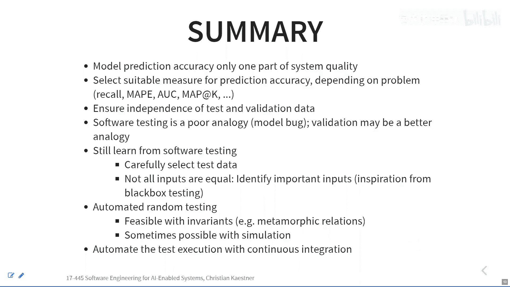

# 【全集】卡内基梅隆大学-AI驱动系统的软件工程-中英字幕-1080P-p04-Lecture-4---模型质量--BV1JS6gBcEBF_p4-

Start。

All right， let's start as usual， I'm going to ask what you remember from the previous lecture。

So what did we talk about， what stuck， what do you remember？ButT starts by typing。

 we talked about machine learning pipe。You remembered everything I guess right。

 kind it gave you advanced notice to type this right all those topics we talked about。

 the machine learning pipeline， kind of how data scientists tend to iterate very frequently and working very exploratory which is kind of different I think than what most of developers work advantages and disadvantages of notebooks。

 right we talked about that。😊，Classification versus regression tasks， ranking， hybrid rate。

 and then right the last part of the lecture I tried to give you an intuition of how neural networks work。

 how back propagation works， how this how this in general this approach might work，I don't。

Guess that this was sufficient to really give give you a deep understanding of neural networks。

 but hopefully， and there was the idea here to give you an idea of how it roughly works， why it's so。

Expensive why the models get so big， why you need so much training data。

 why you typically use GPUs to compute this kind of stuff。

I had a little bit more material that I wanted to talk about AI techniques that are not classic machine learning techniques。

 but symbolic AI techniques， but I want to tableor this for now。

 I'm going to come back to this later in the lecture because I kind of want to get to model quality which is also relevant for the next homework assignment and get a bit more to So engineering content。

So what I want to do today is talk about model quality and I'm going to have two parts here。

I'm pretty sure that I'm going to run out of time again and I'm going to continue next week。

But the first part is kind of the data scientist perspective this is kind of classic accuracy measures and when to use them how to be careful about this and then the second part I want to kind of look at model quality much more from a software engineering perspective what can things like test coverage unit testing performance testing I there something that we can learn what that we can apply to model testing here as well and I have a longer discussion there and a couple of discussions where I also see that some。

In some machine learning conferences， people kind of realize some of these test techniques。

 adopt techniques out of software engineering and specific angles to write tests for models。

Just briefly to frame this。We're looking at systems that are really hard to test so this is old quote what makes testing hard programs which are written in order to determine the answers in the first place are hard to test there would be no need to write such a program if we already knew the correct answer right so machine learning this is again this idea that we don't have specifications if we know how to write the program we wouldn't learn from data and。

If we learn from data and we don't know what the right answer is then how are we going to test this。

 so this is kind of a challenge that we see throughout again。

And today I want to focus very narrowly on model quality， we're going to talk much more。

 we're going to zoom out， look at the entire system。

 I motivated this and we're going to talk much more about things like how do you test the pipeline。

 how do you deploy models， how do you make sure that the deployment is of good quality。

 how do you test in production and things like this but today I want to focus narrowly on model quality model accuracy pretty much so the idea here is that you have some model and again we discussed this this is essentially a function that takes some inputs produces and output that we have learned。

And we have some test data or validation data that kind of plays a role as tests。

 so we have some inputs and we have some expected outputs。

 we can compare them and we kind of want to discuss somehow how good our model is for the data。

 right。There's a distinction here I just want to be careful that we're not confusing this。

 I don't want to talk about the quality of the machine learning algorithm so let's say I don't want to test the decision tree algorithm I assume this is implemented correctly we actually have specifications of how that works how decision trees should work how deep neural network the learning strategy should work and we could write unit test for that so this is kind of classic testing I care about the model I also don't care about data quality today or the system quality where we look at the entire system right so。

When I talk about model quality and we have this cancer example again。

 where we want to predict whether in a scanned CT scan or something like this there's cancer that a physician should look at。

 right I want to see how often is this model correctly predicting that there's cancer in there how good is this model at this specific task right really just this model part。

And in practice， you would put the cancer prediction probably in a larger medical system。

 healthcare system， this is just an open source new hospital kind of thing。

No ahead I think so I have a screenshot， but in general this would be part of a larger system right do you think about user interaction。

 how somebody interacts with the model I don't care about this today。

Also there are typically many qualities that we can care about like and we talk more about this like the model size。

 how long it takes to make a prediction， which is the inference time。

 how we are interacting with the user， what kind of mistakes we are making how the system deals with mistakes。

 again I'm not caring about any of this today， I'm narrowly focusing on the quality of the model predictions themselves。

And both in the first part of the lecture and then the second part of the lecture。

So why would you want to do this mostly to compare models。

 you want to see whether one model is better than another model or whether one model is good enough for a certain task right and there are a couple of more nuanced questions that we can ask。

How does a model and somehow less direct， how does it support the system goals or which kind of mistakes does a model make。

 but in general we want to see how well do models predict things。

One more thing so I have a couple of slides on terminology this is often when kind of at least my intuitive terminology on kind of from a soft engineering perspective doesn't align with how。

Data scientists talk about things and I was for a long time always confused and it's still tripping me up when I read in a machine learning paper that people talk about performance。

When you hear data scientists talk about performance， they almost always mean model accuracy。

So they say a model performs better if it predicts things better。From my perspective。

 performance is much more， I think of execution time， but that's maybe just my background。

This is something that they would call inference time or learning time right so kind of execution time typically has different names here or they might talk about latency here。

嗯。So when somebody says this model performs better than another model。

 they probably talk about prediction accuracy。If you're not sure。

 you might want to ask them what I mean by performance。And。

When I pointed this out in a passive aggressive way to kind of machine learning researcher that this performance term is kind of weird from my perspective。

 they rightfully so said， yeah， performance everybody uses performance in a different way right so performance and art has a different name in business。

 job performance is how way somebody does a job right it doesn't have to do with execution time。

 company performance is a typical indicator so this term is overloaded anyway。

 just want to make this aware。All right， with all of this out of the way I want to start with prediction accuracy。

 So this is kind of the classic view how you evaluate performance or accuracy of a model right so this is what。

The machine learning course would typically teach about how you evaluate accuracy。

 I already mentioned this you the basic idea is that you compare the。

Expected outputs if you have labeled data with the thing that the model predicts。

so here's an example of a matrix this is a classification task where we have three possible outputs We know it's actually a actually B or actually C right so this is what the。

Ground truth， our test data， our validation data will tell us， and sometimes the model predicts a。

 sometimes it predicts B and sometimes predicts C， and you can compare what is predicted versus what was expected right so this is often called a confusion matrix or an error matrix it's simply just the comparison of predicted outcomes versus expected outcomes。

And I think you see them with x and Y x as swapped， both of those I think are fairly common。

I think the straightforward part here is that all the values on the diagonal are those values that are correctly predicted right so the model predicts a。

 it's actually a， we have 10 of those， the model predicts B， it's actually B。

 we have 24 of those and the model predicts C， it's actually C。

We have 82 of those and all the other values， the model makes some mistake right， for example。

 in this case here， the model predicts a， but it's actually B right so it's a wrong prediction。

And what accuracy in the basic sense for classification tasks does。

 it just compares all the correct predictions。So the sum of all the values on the diagonal by all the number of possible predictions in this specific case。

 we would be 70% accurate or 71% right because 71% of the values are on the diagonal line。

This is like the baseline， the simplest way of looking at accuracy。So with this。

 we get a result right， so we get something like 99% accurate or in this case， 70% accurate。

And that's a value that's very hard to interpret in itself。It's similar if I tell you this。

Your web server answers queries in half a second， this is a good value or bad value。

 this really depends on the problem right so there are some problems where 99% is a really bad accuracy。

Because you're producing a lot of wrong resides， the typical example is if you do HIV tests on the entire population。

If you have like HIV is very rare among the entire population and if one in 100 people you just tell them they have HIV they have AIDS they are not going to be happy with a diagnosis right so is this produces a lot of panic in the entire population this would be a terrible prediction on the other hand there are tasks where 10% accuracy might be pretty good right so 10% if Google gives you the right search result in the first hit 10% of the time maybe you're happy with this right there's some tasks that are just hardware you're willing to look at multiple results。

So to interpret accuracy， a， you can look at the improvement in accuracy that you're doing right so you can look at what's the accuracy of the previous best approach and how much better can I do。

So it's improvement on accuracy or reduction of error。

 the formulas here is essentially just comparing the old accuracy and the new accuracy and giving you a percentage and how much you're improving。

So that's something that's much better to interpret。 right， So if I'm telling you。

 your model does 20% better than。The old model that's easier to interpret。

 still not clear whether it's getting you into a range that's actually useful starting。

The other thing。And here's some pictures missing， but the other thing that's。

Important or that's useful to know whether 90% is good or bad。Is thinking about baselines。

So a model accuracy in itself is not very useful， but if you know what a simple baseline。

 a simple heuristic， something that I could just try。Without a lot of effort would produce。

 I have a much better sense of how much I'm outperforming the baseline。So， let's say。

Question for you。 I want to predict cancer in an image。I'm learning a classifier。

 I'm investing a lot of things into into training， what could be simple baselines。

 something that you could implement without a lot of machine learning。

 something simple that you can compare against。So either write or raise your hand one of those。

You wouldn't typically compare。Manual classification is。You could compare against that。

 but it's a very expensive baseline。So it's hard to automate and more thinking about heuristics。

 something that you could implement。嗯。So what do you mean by guessing？Like if it's a binary test。

 then。50% is a reasonable baseline。So just random randomly getting right right flipping a coin right that's a perfectly fine baseline that you compare against just randomly say there's cancer or not。

嗯。Be back， what do you mean by equal0， I mean like。

Basically saying there is no cancer for everything Yeah you can say for every image there is no cancer which probably does better than random guessing because most images probably won't have cancer so if that thing alone is like 90% accurate then 91% accuracy is maybe not very impressive。

It嗯。Daniela says if you know the baseline， what's the basic assumption of how many people have cancer in the general population。

 you can adjust your guesses maybe。At least you can guess a more frequent result。

There are also things where you can actually look at the image。Maybe do something like。

 is there any dark spot somewhere in an image， that's something that you can probably do without machine learning。

 something where you just briefly implement other like six pixels together that are darker than the surrounding area。

That's something that you could probably implement。

So a couple of things like this are possible baselines。

What about recidivism so this is what the example where you're guessing whether somebody who's in jail right now should be released or whether they are so you're asking whether they are likely to commit another criminal offense in the next two years。

What could be a baseline for this again， it a classification task， yes， no， what could you do there？

You could just look at the number of past offenses。 Yes， you could try something。

 The first thing is again， you can guess， of course， you can always say， always release or。

Never release。You can look at the number of past offenses and just have a cutoff maybe you have some data that you can look at and find the right cutoff right to essentially bid a classifier that's super triviala that just looks at one feature at a time right number of years served as another example that would probably work so those kind of things are probably plausible。

so。And by doing this， you have a much better chance of interpreting a number like 99% right because you know what simple approaches can already do。

There are way more things to narrow down what kind of mistakes you're doing。

 the first common thing that people do is in binary classification tasks distinguish false its positives from false negatives。

That's。There's the example。If you're predicting， let's say you're predicting cancer again， right。

 so if you're correctly predicting cancer。That's a true positive。

If you're correctly predicting that there is no cancer in the image， that's a true negative。

If you're predicting that there's a cancer， but the patient actually doesn't have cancer， right。

 or doctors will disagree when they look at this， that's as positive。

As a consequence that you're potentially scaring the patients。Or giving more work to the doctor。

And the opposite are a its negative where you predict that there is no cancer。

 but the patient actually has cancer， or a doctor would disagree with you。

 a physician would disagree and say there's cancer in this image。

 and this has a consequence that this cancer would go undetected potentially。

So the point here is that for its positives and for its negatives are not necessarily equally good or equally bad。

In the cancer example， what would you say what's more important actually？I can just use。

 give me a second， I have a quiz for this。嗯。What do you think is more problematic。

 what problem is worse producing a voice it's positive or what it's negative or you have no idea？

All right， let me just share results so far。Can somebody argue for why false its negatives are worse？

A of you said this。I can go like my rationale was since it's related to the health of a patient if you are missing a warning。

It could be life dangerous for a person right。And you could argue that if it's positive。

 maybe you have another check before you tell the patient right to do in immediately so it's maybe。

More more difficult to kind of produce complacency because somebody doesn't check the skin rather than check the probable cases。

I think that's an argument， is there somebody who wants to argue why false its positives might be worse？

Yeah， it can。Okay， so I go so maybe maybe not for disease detecting。

 but let's say predicting earthquakes or tsunamis in this case you have a false positive then it will cause unnecessary panic and chaos so so I mean for this。

We can go through other examples， but in this specific example。

 when would is there a case where you would consider a force positive to reverse worse？Chris。

 youhan a。Yeah。I mean， I guess you's like if you start treating it right and you you know。

 spend the resources to start treating something that isn't actually there。嗯，对。

YeahI don't know if it's objectively worse， but。If you start chemotherapy for somebody who doesn't have cancer。

 if you don't have any additional checks in there， that'll probably also be pretty bad， Marin。Yeah。

 so my thought was just around if there's too many false positives。

 the doctors or other people responsible might just start ignoring the warnings and that'll just spoiler this thing of the system right。

So I don't want to give Jake another comment。But yeah just quickly。

 there was an article in the verrch discussing this and basically I think the problem was the AI systems were detecting tumors which it was doing well detecting tumors。

 but it turned out that a lot of the tumors wouldn't get any worse or turn into like a malignant cancer or a life threateningate cancer。

 so yeah it's kind of like the other guys were saying like it could actually be worse trying to do chemo or trying to do something radical because the cancer is not a threat。

 right？So in a couple of cases， I think there's a discussion here whether it's actually。

The model is poor or the way that we're using the model is not great， right， so the decision。

 whether we start chemo is probably not directly linked。

To the model outcome and we probably want to think about how are physicians involved or somebody checking this and so on I don't want to make a definitive answer for this specific case just skip a second。

呃。But we could do this and don't to I think I don't want to go through this。

 we could do this for different examples and we might come up with different conclusions whether we should emphasize for its positives or for its negatives。

 what's worse right so there are some things where it may not matter really like suggesting products to buy on an ecommerce-commer side。

 if you predict something wrong unless if it's not completely offensive。

 it's probably fine and if you're missing a sale that's maybe more of a problem and that there are examples where if you accuse somebody of human trafficking at the border that's maybe not the best thing but maybe also missing so there are these tradeoffs right and if you only look at accuracy if you don't look at false its positives for its negatives separately you wouldn't see this distinction actually。

There。Examps here。Here's a cancer predictor where you look at the baseline probability。

 so assume you're testing just random people and you would typically expect one in 2。

000 people have cancer you just if you don't look at people who come into the hospital then it's more likely to have cancer right a random predictor wouldn't do very well。

But the baseline predictor that always says you have never cancer that just goes with a more frequent option would do actually really well in terms of accuracy。

If you look at the diagonal， almost all the results are on the diagonal。

The problem is just you miss all the cancer cases right so this is kind of useless。

 even though it's very accurate。Where the random thing is very inaccurate。

It doesn't find a lot of cancer and produces a lot of warnings， right？

The terms that we're using here typically are recall and precision， let me go back a few slides。

We call impre defined in terms of false positives and negatives。

 the intuition is that recall is out of all the actual cancer cases， how many are we finding？

So out of all if you combine the cases where there's cancer。How many of those do we find。

 So what's the true positive over the true positives and the fourth negatives。

 right over the cases that we find and the cases that we don't find。

And the precision is typically looking at。Of all the predictions that we are making。

 how many of those are correct predictions？So if the system tells us there are 5。

000 cases with cancer and we look at them and only five of them have cancer。

 then we have a very low precision it essentially means if you're looking through cases one by one at warnings。

 how often will you find the true case？And there are a couple of others for negative rates false positive rates and kind of the harmonic mean between them。

 so you see those a lot discussed kind of in machine learning literature they are always come they are always explained in terms of these。

These matrices。All of these things are only defined for pairway classification though right so recall and precision are always defined if you have a true case and a false case you're predicting true or false right you need to have some。

Like it's no longer predicting A， B and C， it's predicting A or not A。

Because I need to distinguish what's the true positive and what's the true negative。

 right and need to have a notion of positive and negative。

If you have a multi class problem like you're predicting ABC。You can turn this into。Yes。

 no problem by looking at one attribute at a time， right instead of looking at ABC。

 you're asking is it a or is it not a？Or you're asking， is it B or is it not B？

So in this specific example here I drew this before where this is the original three class prediction problem and if I'm only asking whether I'm predicting A。

I'm predicting a correctly in 10 cases。It's a， but。I predict a。

 but it's actually not a is's in eight cases， these two。I don't distinguish this further。

And then there are the cases where I predict that it's not a， so anything in these two columns。

And I can check out of those cases where I predict it's not a。

 it's actually not a in a lot of cases and。I hope this is correct in these two cases。

In these three cases and in these five cases， it's actually a， but I predicted something wrong。

Does this make sense？It's just important for you。Because we're talking about so many different prediction problems。

 if you have a mighty class prediction problem。Like you're predicting which numbers in an image。

 you can't define recall and procession， right you can only define recall and processsion for am I detecting the number zero correctly。

Ma， you need a binary classification problem for this。All right。

 there are a couple of visualizations if you dig into this， if recall and precisions are unintuitive。

 there's a lot of help。But that's， that's roughly the。They approach to them going on。

Does this make sense so far？We call in precision roughly clear。Any questions？

The next step is that a lot of classifiers don't just tell you A or not A。

They don't give you a binary answer， but they typically give you a probability or。

Or a number that doesn't necessarily mean precisely a probability。

 but it gives you something more likely a more likely not a or something like this right so a lot of classification tasks will actually give you a value between zero and one。

And one means cancer， zero means not cancer and anything in between means something like that。

If you have this kind of outcome and you want to。Report cancer or not you kind of need to define a threshold right you need to figure out if the system reports more than 0。

5 I'm going to report cancer。Or if it reports more than 0。8， I'm going to report cancer。

 if it reports， if the system is very， very confident at 0。95， then I'm going to report cancer。

And you can see so if you're moving the threshold， this would affect how you're sorting the predictions into rows。

 right if you have a low threshold， then you're predicting a more frequently。

If you have a very high threshold， then you're predicting not a more frequently。

And this will affect recallant precisioncision。Typically， the higher you set your threshold。

The worst your recall gets。There are fewer and fewer cases that are reported as cancer。

 so also of the true cancer cases you will probably see fewer cancer cases in general right so typically let me see I can do this。

So。So if you have a plot。What you would typically expect is that。

If you start at you classify everything at zero， right， so this is your threshold。

You would expect that recall is perfect at one。RightYou classify everything at cancer so you'll find all the cancer。

 it's a useless predictor， but you find all the cancer and then the higher you use the threshold。

 the lower your recall rate goes right so this would be。Because。At the opposite side。

 when you're saying everything is cancer， then you predict precision is probably not that great。

 depends a little bit on how many cancer cases you have。But the more restrictive you are。

 like you're only report in cases where you're pretty certain that their cancer。

 typically your precision goes up。And where you want to be on the straight off。

 So whether you want to be somewhere on this end， where you。

Have high recall but low precision or you want to be in a place where you have very high precision。

 but low recall depends a lot on how you want to use the classifier。

So picking a right threshold it can navigate you along this trade off of recall and precision typically。

Makes sense。If you plot them， so okay。One more thing one problem that you're having is if you want to compare two models。

 you can just look at their accuracy right so you can look whether a has higher accuracy than model D。

 or you can look at recall is higher precision is a bit lower。

 but you can still decide which one of those is better potentially。If you have different thresholds。

 now it becomes more challenging to compare models because am I comparing them at the same threshold。

 am I comparing them at different thresholds， how am I doing the comparison？

The thing that people often do to sidestep this question at all is they essentially figure out can we do a comparison at all possible thresholds？

And this is where you get to these measures of area under the curve。

 which if you've taken a machine learning class， you probably have seen before。 So the idea here is。

You have precision on one axis。And you have recalled on the other access。

And you're just plotting the value at all possible thresholds。So here two algorithms or two models。

 one model has very high precision with a recall 0。3。

 this has a lower precision at the same recall and so on。And typically。

 the model that is better across all thresholds will be closer to this corner of the graph。系 so the。

Let me see。The further out you go， the better。And the way that this is typically done is to measure the area under the curve。

 this is where the term comes from and the higher value you get， the better it is。Again。

 by doing this， you're summarizing all the precision recall values across all possible thresholds。

This may or may not be exactly what you want， Maybe you don't care about our thresholds。

 but you often have a behavior like this where you see that one。

One model consistently performs better than the other it's consistently further out it doesn't have to be it can also be something where you see something like this where it's sometimes better。

 sometimes worse。Right， but。A node the curve compares to this。

The metric that's more frequently used than this is the receiving operator characteristic curve。

 ROC curve。It's almost the same except that it technically plots two different values。

 it plots the true positive rate and the fourths positive rate， they can be derived in similar ways。

 it has almost the same meaning， it just looks a little bit different and again you prefer the approaches that are further now into this corner is better。

So the more area， the curve， the better。Makes sense。Any questions？

Just want to show you where those things come from there are a couple of additional measures here like lift break even point。

 lock loss， coins copper and so on， so if you're actually doing an evaluation of a classification problem it's worth thinking about which metric to use right accuracy is very blind but works with Nclass problems almighty classification problems recallcoil and precision gives you a bit more insights into for its positives versus for its negatives。

Area under the curve is useful if you have a threshold， and then there are a couple of more。

That you can look up if you're interested。By doing this。

 we have only looked at classification problems so far。We haven't， there's a question。

 what do we do if we actually have regression tasks？So let's take the housing example again。

 where we have some information and we're predicting a price。

And we know the actual price right so how would a confusion matrix look like？Different idea。Youic。

Oh no I had a question Okay so for always the graphs for precision and recall it seems like as recall increases precision comes down typically yes yeah so I'm just trying to understand the rationale behind it like why does that happen。

So。Go back to the cancer prediction thing right so maybe the extreme cases are the most obvious。

 So if you're starting a threshold at zero。诶。No， can't write apparently anymore if you're starting at threshold at zero。

You're saying everything is cancer。Right so every prediction。

 even if it's with the lowest confidence， right， even if the confidence of the model is really。

 really low， you just say it's cancer。By doing this， you have a perfect recall。

Because every image that ever contains cancer， you're predicting is cancer。

But you're also predicting all the other images as cancer， so your precision is pretty bad。Yes。

 right， so this is why on the left hand side you have great recall。But you have terrible precision。

On the other hand of the spectrum。You're essentially predicting nothing as cancer。

 only the cases where you're super confident。So your precision is very high。

Unless your model is complete garbage， right， but if your models。Somewhat reasonable。

 the high probability cases are actually cancer。Then you're reporting very few cases。

 but those are probably actually cancer， right so your precision is probably pretty decent。

But you're only reporting very， very few cases， only the ones where you're really certain。

 so you're probably dismissing a bunch of cases which are cancer， but you're not entirely sure。嗯，好嘅。

But like， it can also happen that。Both of them increase with them。可。

Because like on the left hand side of this spectrum， we are saying recall is zero。

 so I have not identified anything， but my precision is high。

So another way to think about this is if you look at all the predictions in your test data。

You can sort them all right from the most probable to the least probable。

And what a threshold is it will split the data set somewhere in the middle。

 it will not re them right so it's always the most probable is always in one set and the least probable always in the other set but you shuffle how many predictions are you making right are you if there are 1 thousand00 patients are you making one cancer diagnosis or 10 or 20。

Independent of how many there are right so this is why you tend to see this trend over time Okay。

 I got it。Alright， back to this case。 I have another question。 Go for it。 Yeah， can。

 can go back to last slide。Yeah， so I'm just getting a little bit confused about the definition here。

 So you says we are using a threshold to make decision， right。

 But I believe that the model has to actually be able to make decisions like in the table。

 it says the model predicts a or not a right。 So I think here we are actually using a threshold to select the model。

Rather than。To make a decision。And I understand。CThe table that I show here is based on a specific threshold。

 right， So this is one example of an outcome table。And if I pick a different threshold。

 some of the results from the lower row will move into the higher row or down。

It's always the same model， right so the model will always predict 0。8 to 0。9 for specific pictures。

But whether I consider this as cancer or not cancer。

 my interpretation of the model outcome that will change。So the model itself doesn't change。

The model predicts a number。But how I interpret that number will change based on my threshold。Yeah。

 I in some machine learning approaches you don't deal with thresholds is will just make a prediction for you。

 they may use thresholds internally， so a bunch of approaches will just always return true or for instead of a number then you don't have this issue。

But if you are making a decision based on the threshold， then you have this issue。yeah。

 any other questions。All right let me speed up a bit maybe so if you're looking at numbers it's kind of hard to even think about what the confusion matrix might look like you can contain you can put stuff into buckets where you say everything between zero and 100000 is in one bucket and $100 to $200。

000 is in the second bucket and so on and if you do this you can just，You have again。

 you turn the regression problem into a classification problem right so you're just asking。

 have I predicted the value in the right bucket？And then you could use accuracy。

I like the traditional accuracy or we call and precisionciion。

 but usually these things don't make sense， this is not the kind of thing that we really want to do。

 so typically you want to ask much more how close are the outcomes to the actual values。

So here you use a different class of accuracy metrics。

 one common one is a mean absolute percentage arrow。

So this is just essentially asking for every single prediction。

 how many percent am I off of the expected value？So in this case， for example。I'm predicting 230。

 but it's actually 250。So I'm off by 20。And 20 out of 250 is a certain percentage， right。

 so I'm about 10% off here。And then you do this for every row。

 you figure out how many percent are you off here I'm almost accurate， I'm only slightly off。

So it's just it's half a percent off roughly。And then you just compute the average of all those percentages。

This is one of the accuracy metrics， there are many different ones right。

 but this tells you the metric here in the end tells you on average I'm 5% off in every prediction。

Doesn't make sense？所以。Be careful whether you have a classification or prediction problem that you use the right metric。

And again， you want to compare against baselines。So let me just ask again for the housing problem。

I want to do the housing price prediction， what could be a baseline that you're comparing against。

You can do the average house cost right， you can do the average house cost within the neighborhood。

 this is probably very cheap to compute。Priced by the number of windows， yeah。

 you could kind of do a very simple regression model yourself。

Compute cost by square footage that's maybe better than by window but is a similar idea right so all of these things are typical predictions that you can easily do and use as baseline and then again you can check how much do you improve over the error of your baseline approach right this is much easier to understand。

Again， there are a couple of different metrics here， I don't want to go through them in detail。

 the mean absolute error is looking how much am I off on average an absolute terms。

 so instead of saying on average I'm off by 5% it's saying an average I'm off by $20，000。

In this case， right you can do this with squared errors with root squared errors and R square metrics and there are a couple of others and they have certain tradeoffs of how sensitive they are to outliers and things like this and you find more discussions of what's appropriate if you want to look at this。

There are also more specific things in terms if you do sort ranking problems。

 if you have ranking problems you care about the top predictions more than the lower ones。

 so what people typically do is look at things like mean average precision where they look at。

I get a bunch of recommendations。How good is the first recommendations or how good are the first three recommendations right so mean average precision looks at how many good resides do I have in the first K rows？

So if I look at map  one。I get one good result out of one prediction， perfect accuracy at this level。

 right and you can do this average across multiple queries if I look at the first two。

I have 50% mean average precision on this thing right among the first two its 0。

3 among the first four，3， 0。5 among the first four and so on。

And you just average this across a bunch of different things and again you want some baseline for the prediction。

 for the ranking and so on。And again， there are more specialized ranking measures and I don't really want to go into detail。

And if you look into any specific field。And I'm taking natural language processing here as an example。

It completely depends on what you're doing。 You may solve a ranking problem。

 You may serve a classification problem， you may solve。

You may want to have some evaluation where you're actually looking at translated text voice recognition。

 how long how good the entire sequence are， so there are a couple of things where you just classify text if you just want to see whether the text has a positive or negative sentiment。

You can turn this into a yes no question and use recall and precision right if you want to determine the truths of a statement again recall and precision。

 if you look at translation or summarization， you typically compare against what a human would do and then look at some sort of similarity metrics like how similar is the sequence of things that the computer produces to the things that I'm producing。

And so on。All right。Any questions on kind of， this was the first part of the lecture。

 kind of the data scientist' perspective。Any questions on those？With this。

 I want to go on to software testing。Right， so software testing is something that I hope everybody in the。

Butcher room is familiar with， at least to some degree。

The idea is really just you have a program with a specification and the test has three parts。

 it has the call and the test inputs， it has some expected outputs。

 and it's executed in some environment that we control。え so。Like a specific machine。

 So typical test might look something like this。 You have a call with some inputs。

We have some expected outputs。And I'm running this in some environment like on a cloud service or with some Java around this。

There's a problem here that we're discussing in a second is how do we know what the expected output is？

For test， this can be very tedious to produce。And in general， testing is。Not sound。

 so you don't you can't expect to find all the bugs with testing。

 you can find some bugs and if you find a bug if a test has failed。

 you can assume something is wrong in the program right you're not over approxiating。

 but you can only look at the things that you're actually executing。

 not at the things that you're not executing。The layout is completely broken。Okay。

 think again of can we use testing the same way for machine learning models right so let's assume this is supposed to be a table again for housing prices right so we have the predicted housing prices and the actual housing prices and what we could do is we could take our data and turn it into something like this where we say。

If you predict for these inputs， I expect that the output should be equal to $25，000。

So I could essentially turn my data table and turn it into tests。But that kind of seems weird。Right。

 because。This was already fail the test suite would always fail pretty much right。

 it would fail already on the first row here because the actual the prediction that we got on first row is was previously off by $20。

000。So it's not exactly $250，000， so the test suite fails。

We don't really expect that the model predicts exactly the right number in our training data。

We even have the cases。Let's see， I don't have this here。

 but we even had the cases when we talked about classification trees。

That we might not even be able to distinguish all the training data。

 right because in our training set for exactly the same features， we see different outcomes。

So we wouldn't even even with the most overfitting。

 we wouldn't be able to to produce exactly the right outcomes yet so software testing。

 at least in this sense， is not a great analogy right so it's not that every single role in our validation set is a single test case。

And we are coming back to this idea that we have an oracle problem。If you're seen。

Some of you were my class last semester so we talked about this to some more extent。

 the oracle problem is always when you're writing test cases。

 how do you know what the expected outcome is？So want to know I want to test the factoring prime numbers in some way。

 for example。I can easily produce inputs， I can try one，5 any random numbers input。

 but how do I know what the expected output is if I want to write a test？

This is a fundamental problem in testing。That the finding oracles。

 finding the expected outcome is hard。And if we think of validation sets。

 we always have the right answer there。But in traditional testing this is often hard so what we do when we write unit tests is we as humans typically think about what do we expect and as an outcome so it's a manual oracle we write this manually right so in。

In this bookss in。This case here。I'm writing that when I'm adding two plus two I'm expecting for right so I'm doing the math of the based on the specification of what I expect the program to do in my head。

 in this case it's easy and I'm writing the expected output there。

If I want to kind of generate lots of test cases， maybe randomly。This doesn't work。

 I don't want to ask a person here I've generated all these numbers to test additions。

 can you just compute in your head what the expected answer is for all of them right that's super expensive。

It's something that we often do， but it's something that we can't automate right so we can't automatically generate test cases。

A trick that we can sometimes use and it depends on the environment is to use a gold standard so if we already have a different implementation of the system。

This is typically a very slow implementation that we're sure is correct。

Maybe we have some machine readable specifications。And we can just compare。

We have a test input and we can use this slow implementation to figure out what the expected output is supposed to be。

Different testing is a nice example here， so this has been used for example。

 to test compilers a lot where you have multiple implementations of a C compiler。

And you just run the same C code through multiple compilers and then run the program and see whether they agree afterward。

And if they don't agree， either you know that one compiler is more correct than the others or you just do voting。

Jake。He so specific to the factoring example， I was thinking that it's kind of an invertible operation so that if we had the factors and we were able to confirm that the factors were prime。

 we could multiply them together and get that number and whereas I could see that wouldn't transfer very well to a lot of machine learning problems。

 I was wondering is there a。A broader category for something that's invertible like that for testing。

嗯。I have a slide at the very end that this is actually something what you're talking about that sometimes works on machine learning。

 and this is used for testing vision systems when you have a good simulator。Where you have a way。

 if you have a scene， it's easier to go from a scene in a simulator to an image and it's going from an image back to the scene right so you can put a pedestrian inside the scene in the simulator and then render an image with a pedestrian and then check whether the vision system recognizes a pedestrian。

So if you control the entire thing， there's actually sometimes this dual where you have a easier implement where you can do the inverse of the machine learning task easily。

But again this is special cases， maybe the prime example is not great here right so so for addition for example。

Doest my book。But yeah。I think what you're talking about here is， again， having。Now。

 it's actually not in the list if you go from the reside。To the inputs， right。

 so you can create a random result and then create corresponding inputs。嗯。I think this is actually。

 I haven't seen this much in the software testing literature。

 I see there's actually more in the machine learning related with simulation。It's interesting。嗯。

Something that people do a lot so comparison against the goldD standard is nice if you have one。

 the problem with machine learning is that we're solving problems that we don't know how to solve otherwise so we don't usually have a goldD standard right we can manually ask people to do this but then we're back at manually constructing output input pairs。

嗯。What people do often in automated testing is checking global properties so you're not checking the correctness of the entire system。

 you're just checking things like。Whatever input I'm giving it， it should not crash。

So this is known as fast testing sometimes， so this was very effective like 20。

 30 years ago where you can just feed Unix utilities arbitrary bite strings and they would often crash。

So they've done this a lot， this has hardened， this doesn't crash systems。

 but they are more smarter ways of generating random inputs and they usually look for things like can we crash the system？

And sometimes you have some partial specifications where you maybe have a tool that can check for detect buffer overflows。

 so you're generating inputs to see whether you can create buffer overflows or you're trying to generate inputs that time out the system right so that kind of create very long runtimes。

 they smartfuzzers that do this。And the last part is writing manual assertions。

 so if you know partial behavior like preconditions， post conditionsition in the method。

 you can write just write assert statements。And then you're essentially turning these assertions into crashes and can again use techniques where you try to crash the program or not crash the program。

诶。What I want to emphasize here and I hope I get there today is it。

If you have certain invaris at hold for all possible executions。

 you can do random testing much better。But that's kind of how far we can push this typically with the Oracle problem right so we can't unless we have a gold standard or machine readable specification。

 we can't really generate random input output pairs generally。

So here's a bunch of fuzzing that I just taught you about。So as I mentioned before。

Labeled input data is not really solving the oracle problem right it gives us some examples of expected outcomes。

But we're not technically expecting exactly those values， right？

What we really want to measure is can we kind of generalize from training data。

 not can we produce these exact values for certain outputs？Right if we if。

Achieve slightly different values that are close enough。

 were still happy right we're much much more interested in getting near those values and kind of making statements across multipleable data points。

 not that every row is a test case and none of them should fail right this is not the right analogy。

So we're not predict that they are all correct， it saying a wrong prediction is not a bug。

Another question that we can ask is something like performance testing maybe a better analogy？Right。

 so with performance testing， we are not expecting。So we want to see， for example。

 that we can run a server and the answers should usually be below half a second。

So we' are not running the thing measuring performance and say it must be exactly 0。5 seconds。

We're probably also not failing this if it's once below 0。5 seconds right we have some noise。

 we can accept some noise， we want to kind of make statements about multiple executions。

What do you think is this is a reasonable analogy， does this make sense？Yes， both， okay。

I think it's certainly a better way to think about this。

 I'm not sure that I'm really convinced there are some things that seem somewhat similar right so I mentioned they are not precise。

 We need to control the hardware and so on and we typically look at multiple inputs not just one right so it's kind of similar in that sense。

And it's also similar that we don't have rear specifications。

We may have some expectations of where we should be。

 and I think we can do some regression tests where we can say。With performance。

 we would say across multiple executions and multiple different inputs。

 we would expect an average of below 0。5， so maybe we can think of something that would say across all these data points in my validation set。

 we expect an accuracy roughly larger than 0。99 or something like this。

I think you could do this with performance testing， you also have some of those problems that。

The numbers themselves don't matter so much， but kind of tracking this over time。

 tracking performance results over time that makes sense。嗯。So I don't think it's a verse analogy。

 not convinced that the single test would be the same right。

 but if you kind of think about multiple executions compared to maybe multiple different inputs。

 maybe you get somewhat closer。All right， it sounds more positive than I originally was when I was creating this slide。

 I think it's not the first analogy I don't think it's a perfect match。

I want to take a quick detour and this is kind of my pet theory these days I。

Earlier this year where I could still travel， I went to a workshop that had both data scientists and software engineers and them talking about kind of quality assurance and building these systems。

And we had long discussions of what is a machine learning bug？诶 so。If there's a bug。

 if the model doesn't perform where would we call would we say that the model is buggy？

Is the data that buggy is a single result buggy I've already talked about right。

 when a single result is off， we wouldn't call this as a bug right。

 we kind of would to go on with it and this is really weird。

And over a lot of discussion and it's actually a bunch of feedback loops。

 so if you look at some resultss， you might actually detect that a lot of resultss are not very good。

 but you might learn from this and improve your models so you have some iteration there。And。

We came to an interesting discussion here that I think。

When we're talking about quality assurance of a model。So this is not the right。Anay either。

 but it's a different mindset that might lead us to think about this in a different way is thinking about the difference between validation and verification。

所。People in the MSE program have definitely seen this before others， hopefully yes。

 we can think about the difference as verification is given a specific。

 have we implemented this system correctly right so think about you're making a contract with your customer about what the system should be implemented verification where most of the testing is it's just checking do we have bugs in the system。

 have we implemented this correctly right as specified。We might implement a system as specified。

 but it's completely useless because the specification was bad。

That's typically a validation problem right so the distinction that people often quote is have we built the right system versus have we built the system right right so have we correctly implement what we were supposed to implement to implement or have we implemented the right thing have do we have the right specification in a sense？

Right。So the upper part is typically requirements engineering so what we're typically doing is we're talking to people about what they want。

 we might interview them we come up with requirements and then there are lots of techniques to figure out。

Once we write down those requirements， are they consistent。

 are they the things that the customer wants， we might build a prototype and check this with the customer whether that's what they want。

That's a different activity than checking whether we coded the prototype correctly according to our specification。

So most testing is pretty much oil testing is a verification activity。

When I teach the software testing class in the master's program。

 we always assume somebody gives us a specification and we don't question the specification typically。

So there's a requirements engineering class where they worry about this and I don't care。

The interesting part for me is the discussion where machine learning fits into this。And。

Let's look at a single example here。This is a。Reciivism model， this is。We will talk about this later。

 but this is roughly equivalent or has a similar accuracy to the model that's actually used。

In court these days， deciding whether to release somebody on bail。

It's really simple in the end what the model really does if you boil it down to。

 it's essentially a decision tree checking the H and maybe the gender。

 but you can leave this out and then you predict that you will arrest them again within two days。

And if it's a different age and a certain number of prior offenses then you also predict arrest。

 otherwise you don't right so a very simple decision tree here。Think of this as a model。Now。

 taking this model。And implementing this in Java code。It's straightforward。Typically。

 we wouldn't do this because we will just generate this。So we don't。

 if we assume that the model here， the machine learning thing。嗯。Sorry。

 I should go a step further earlier here。The hypothesis that I'm trying to post here is that the machine learning model is equivalent to a specification。

Going from the machine learning model to some implementation， that's trivial。The hot part is。

Is the model that we are learning。Does this make sense for the people who are interested in this。

 Are we learning the right model， not are we implementing the model correctly。

So the question that we are asking here is， is this model really what we want as a society？

That's best at capturing whether somebody will actually commit a crime again。

So we're trying to figure this out。It's not so much whether we have implemented this model correctly。

So my hypothesis is that machine learning is really very similar to requirements engineering。

 requirements engineers go out and interview people and synthesize something and come up with essentially a model an idea。

 we could interview a bunch of judges about their experience and when should we predict that somebody will commit a crime again and instead of asking people we're looking at data。

Based on data， we are coming up with a model。And kind of implementing that model that's easy。

 That's why we don't really talk about bugs。 what we really should talk about is whether that model is a good fit to what we want。

And this is why the questions that we are asking are different， it's not whether a test case fails。

But it's whether we have the right model in the first place。嗯。

And another thing that youll see in a second I run out of time is。

That you may have some specifications and you want to check whether the model is consistent with some other specifications。

 for example， you have some fairness requirements， the model must not look at race or the model must not look at gender and then you can compare whether they are consistent。

And that's again， something that requirements engineers may do。

 they have tools for this where they check consistencies among multiple specifications。And suddenly。

 if you look at this， also， a lot of these feedback loops make sense because you might learn a model and you might。

Evaluate its accuracy and figure out all of the model is maybe not the kind of making the kind of predictions that I want。

It's not going in the right direction， so maybe it's not the right model。

 maybe I need to go back and collect more data， maybe it's similar to if you interview the wrong people。

 if the set of people that you interview is biased， you might come up with the wrong requirements。

If only if you never interview the customer really， only kind of other stakeholders。

 you might miss their point of view。I'm not sure that this is really solving any problems。To me。

 it makes clear why the term machine learning bug doesn't make any sense to me。

Because we're not talking about a bug in the verification sense。

We're talking about kind of we have the wrong model。In practice。

 I'm not sure that this is really that helpful though。

 because the main problem that we have is that most of the models that we learn we can't understand。

If you learn a deep neural network， it does something。

 but we can't really inspect it and can really make sure。

There are still some techniques where we can figure out that they are consistent with some other specifications。

 now we will talk about this。But the testing philosophy is maybe not immediately the right thing。嗯。

So the question that we are really asking is does a model。

 is the accuracy good enough to meet a user's specifications。

 is a model compatible with some other specifications？嗯。

And it's not really an implementation problem。Does this make sense？

It the first time I'm trying this on a student audience。What do you think？All right。

 I take the one yes vote。嗯。So， in terms of terminology。I would suggest to avoid the term model back。

So a model kind of saying that the model is buggy is problematic because what does it mean it's wrong on this one input。

 not really right it's kind of doing something generally bad。Well。

 it's doing exactly what it's supposed to do based on the training data that you give it。

There's another view where we could say a model is never bad it's just the wrong training data because a model is just derived from the training data。

 so a model is。Like if we have a crash in a program're not b we're not blaming the binary。

 we're blaming the source code right in a sense the model is derived with a machine learning approach from data so the machine learning algorithm is somewhat similar to a compiler and that it just does with a data what we want it to do。

So potentially we can blame it on the data， right so we have。It just means that we have。嗯。

What we're discussing here is really just that we have collected the wrong data over here。

And I think that's a reasonable question seeing do we have the right validation data or the right training data。

 actually not validation data。That's another valid view， but again the term machine learning back。

I think it's problematic。啱。I think performance or accuracy are better terms， because they。

Better than correctness， right so a model is not correct or not。

 but it's accurate or it performs well for certain expectations。And。Testing for prediction accuracy。

 you can draw analogies， but the direct testing analogy doesn't work。

 the performance testing analogy might work a little bit better。But its still。

This just brings in so many connotations right if you talk about software testing or testing in general。

 you start thinking about coverage， you start thinking about automated test case generation。

 maybe about combinatorial testing， equivalentvalence classes， things like this。嗯。

I have slides on a bunch of those I'm running out of time so I will cover this next week。

 some of those things provide some inspiration。But most of the time we don't have a clear mapping。

Like coverage is something that's super confusing， there are a couple of papers that talk about coverage of deep neural networks and things like this like neuron coverage。

It's super hard to even figure out whether that makes any sense at all。

Because I think it's a wrong analogy right so we it's not implementing the model and then making sure that we have implemented it correctly。

 figuring out do we have the right testing data to be confident that the model does roughly what we want to do？

All right。I have way more content talking about kind of analogies to testing， coverage。

 random testing， NCI， but I'm going to do this next week。嗯。Maybe because I have three minutes left。

 Daniel， you sent me an email， a question by email。

 maybe that's worth talking about that briefly for everybody。Sure， yeah。

Basically my question was about how do you compare models both like if you're doing using different algorithms or just type of parameter tuning and like if any statistical verification needs needs to be done。

To compare the models。So here's an example where I predict two models right one is a stupid model。

 but one has 0。5 accuracy， the other 1。99。嗯。In this case。

 I think it's obvious that one has way better accuracy than the other。

 I mean this actually this is a terrible example because all of these models are kind of bad。

But in some cases， you see very big differences between models and it's clear that one is better than the other。

Since there's a lot of nondeterminism in some model training like some decision trees are deterministic。

 but if you go for random forests and so on you have nondeterminism。

 if you go for a deep neural network， it's all nondeterministic because you start with random values right so if you train a model repeatedly you might get different resides slightly different accuracy resides。

 you also do maybe K4I cross validation where you choose different splits。

It's actually possible that just by random chance， one model is slightly better on one training run than another model and so on。

That's something that you can handle with statistics。

 so if you have randomness in your training algorithm， you can just train the model repeatedly。

You really don't want to do this if you have a one week run of a deep neural network so people don't typically do this much also if you do K for cross validation you get different accuracy results and instead of just looking at the average you could actually look with a statistical test whether they are consistently。

Higher in one group than in the other group。My impression is that this is not typically done in papers and in practice。

 that people compare one accuracy in the end that's averaged overall or the K forwards， for example。

 right， and they tend to look at one single model。There are some articles you pointed this out and I looked after this as well。

 so there are a couple of articles that look into how to do this。

And there are some complications because if you look pay forward。

 they are not completely independent test runs because you're training on similar data and multiple runs and so on。

 so they often use kind of complicated statistics and so on。

 so there are some people that think about this。And I think if you want to be precise about this。

 you can， you can do statistical tests to see whether one model is better than another。

 But in practice， I think that's。Not very common。Here's also the the other important thing is to look at how big is your improvement。

 right， So if you have a big effect size， like you go from 80% to 90% accuracy。

 then you're pretty confident。But if you go from 91 to 91。3。

And that's kind of in your range of noise then you kind of want to be more confident， but this is。

 I think， in the realm where you maybe win research papers。

 not where you really care about that the model that you're pushing into production is like tiny bit better than the previous model。

Doesn't make sense？Yeah， yeah that was very helpful thanks I'm not expecting you to do anything like this in the homework assignment so。

In the homework assignment， I'm asking you to kind of compare models and measure accuracy and pick an accuracy measure。

 right， but you don't need to run statistical tests。But you're welcome to if you want to。

All right I think this is a good place to end I've shown you different accuracy measures。

 I've started to talk about software testing， I continue there next week and I stopped the recording here and then I stick around for questions as usual。

