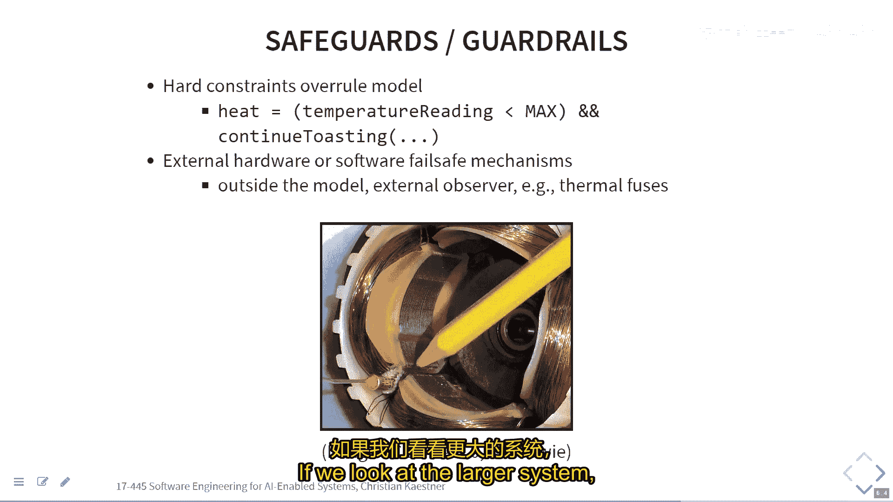
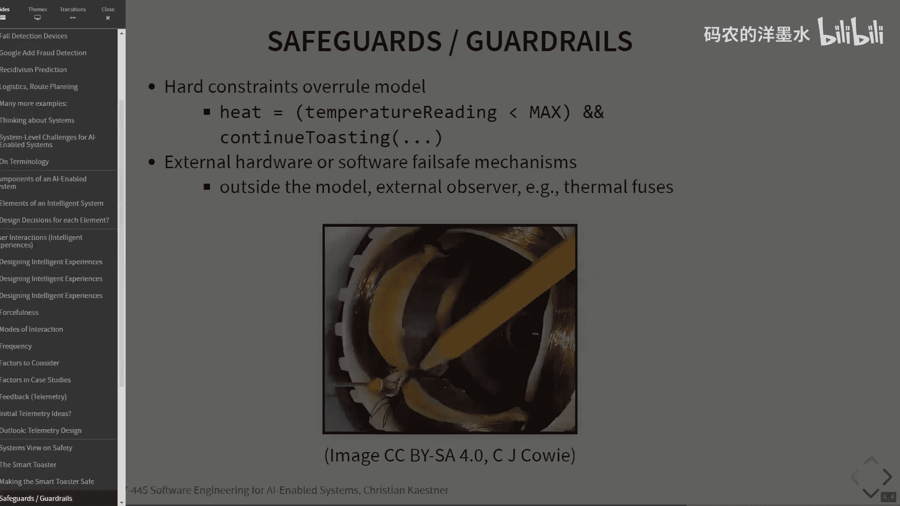
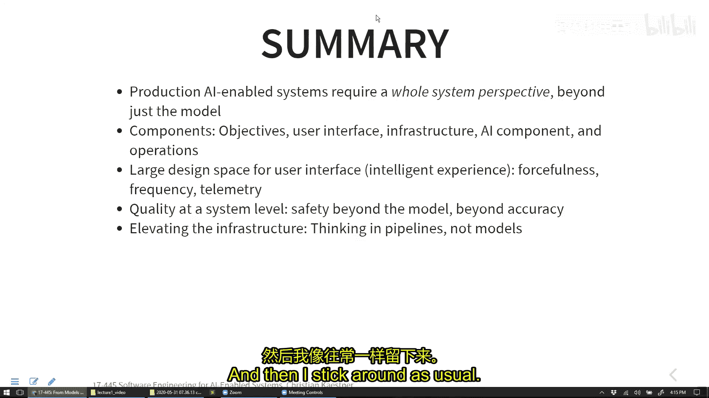

# 【全集】卡内基梅隆大学-AI驱动系统的软件工程-中英字幕-1080P-p05-Lecture-5---从模型到人工智能驱动系统--BV1JS6gBcEBF_p5-

There we go。

All right， welcome back and as usual I'm interested in what you remember from the last lecture。

So in the chat or raise your hand， what are things that you recall， what did we talk about？

What's stuck with you？So testing for machine learning is different than traditional source code right we talked about model quality there was a theme。

 we talked about that you're averaging over multiple resultss。

 you don't expect perfect accuracy right you're okay with some wrong resultss you're averaging and we talked a lot about kind of traditional model quality metrics。

 record precision area under the curve right that you should always compare against some baseline and then we talked more about a little bit the relationship to software testing right and whether there is such a thing as bugs and models or bugs and training data around about requirements engineering but this is roughly where we end it。

Right。So I still have the problem that I seem to run over every time and every lecture I'm trying to catch up today。

 so there's still some content I want to get to from the last lecture so let me start there。Oops。

 this one。So when we left off， we kind of talked， we talked mostly about。

Kind of the data science side and then we talked about how software testing might be similar or not similar right so performance testing is maybe the closer analysis and traditional software testing but there are also things where kind of software engineering background might help and I want to talk a little bit more about this and one thing where this might be the case is when you select your validation data when you think about how are you going to test something how are you going to。

Curate data sets。first question is what kind of validation data to collect and how much so here I just copied some heuristics from the textbook that you had right so you kind of get a sense of how many you kind of want a couple of hundred to a couple of thousand data points for most evaluations to get a sense。

U。I can also technically do power statistics， but I don't think that's too common that people do this。

But I think often more important than the quantity of the data is also how representative it is。

 right， So what's the quality of your test data， First of all。

 you want it to be representative of the population of the real data and representative of the training data。

 which you typically do by just randomly splitting the。

All the data that you have into training and test set right mod kind of dependencies in the data。

 but you kind of hope that this helps you to have the same distributions if that distribution is not corresponding to the distribution and practice data and production you have a problem anyway because you're learning models on kind of biased data and you're evaluating it on biased data。

So。You probably not only want to make sure that training or that your validation data is representative。

 but also that your training data is representative right？

But typically when we ask how much data do we need。

 this seems a little bit like how many tests should we write for traditional software right and if we think about kind of traditional software。

I mean there's a common question of where you ask when can I stop testing right so people are notoriously bad at writing tests and then they want to stop at some point right and you kind of ask how many tests should I write the honest answer and practice is。

When time and money runs out you stop testing right but if you look into this we've developed lots of techniques to kind of estimate test adequacy or test suite quality and the typical approach is looking at coverage right so line coverage or branch coverage I assume you're all familiar where you kind of see what branches or lines in the code have been executed by a test suite and then if you reach like 100% coverage。

 you're pretty confident that you have tested the software。

Pretty well right that doesn't give you any guarantees。

 but it's probably higher coverage is better than lower coverage。嗯。There's also mutation testing。

 which some of you might know where you just inject faults into the system and you see how many faults can your test suite find a better test suite would find more injected faults than a worse test suite right so you kind of can write test until your kind of confidence that you have a certain mutation mutation score that most of the injected forwards like randomly changing plus two minorrs and these kind of things that those would be found。

There's a question， though。😔，Whether there's anything similar that you can do for machine learning。

 like how much data should you look at， how big should your dataset set be when have you tested your model well enough。

And that seems kind of hard。It didn't talk about specification coverage。

 but we don't have any specifications right， so it's kind of hard to do kind of。

Classic boundary value analysis or something where you can look at the specification says if the value is lot smaller than 20。

 So we tried 20，21 and 19 or something like this， right， So you can't really do much of this。 Again。

 you care about representative data more than kind of。嗯。Corner cases in the specification。

 although maybe there is something that we can do about Corner cases。For coverage。

 kind of branch coverage。😔，What would be the equivalent。

 we can see whether we have in a decision tree， we have seen all possible outcomes or all possible decisions。

But we kind of expect that this will happen most of the time if our training and evaluation data is kind of representative and even if it's not。

 if there are some branches in the tree that we've learned that we are not really testing is this telling us much。

 I'm not so sure。For deep neural networks there's actually a bunch of research papers that have looked into things like neuron coverage。

 so you have a bunch of images that you throw against your image classifier and it looks at which neurons can activate at least once or deactivated at least once。

But again， does neuron coverage correlate with anything here。And then finally， mutation scores。

 what should we mutate here， what kind of fault should we inject， should we change the thresholds？

OfOne of the billion parameters in a deep neural network or a single decision in a decision tree。

So I'm not convinced that any of this is particularly useful right now。

 so there are a couple of analogies that you can try and researchers have looked into this。

 but my sense is that there's nothing kind of usable at this point to evaluate a test quality。

The thing again that I'm coming back to is you want to check whether your data is representative in some way。

 there are a couple of statistical techniques where you can kind of just compare distributions so is the distribution of features in my validation set similar to the distribution of features that I see in production so those kind of questions you can ask you can also ask questions of whether。

Some data that you're testing on is somewhat similar to the training data right so some models can tell you that they're currently making predictions that are very far off things that they have ever seen in training often called out of distribution predictions right so you have trained on some distribution on some data and you're asked to make a prediction on completely different data there's some approaches some models that can essentially predict whether they have seen somewhat similar data and training right and then tell you that they're really not confident on making production predictions here again this is。

This is I think more useful than any form of coverage， kind of looking for data drift。

 looking for distributions。Beyond that， let's skip these two parts os。Beyond that。

 I think there are a couple of things that you can still do by thinking about that not all inputs are equal。

So the example here is something that Chris Ray from Stanford mentioned that if you're Apple or Google and you're developing a voice recognition system like this。

The one sentence that you don't want to break ever is call a mom。Right。

This is something that you people use a lot。 And even if you're。

Even if you're making some changes in your system， that's something that's really important that you don't want to break。

Similarly on Google assists， something like what's the weather tomorrow is one of the most frequent sentence that people are using this and that's again a thing that you don't want to break。

Whereas adding some obscure。Ingredients to your shopping list may be less important。

So what you can think about here is。Averaging over all possible inputs or oil representative inputs gives you some average accuracy。

But it doesn't necessarily reflect that some of those inputs are more important on this I mean it reflects if it's representative calledM will be much more common in your test set right and better accuracy on that will reflect better accuracy in general。

 but what you wouldn't detect is if there are some less common but still important phrases in there。

They might just they might not be very common in your validation set。

 but they might still be very important。Something where this comes up a lot is if you start thinking about fairness。

So for example， speech recognition systems are often criticized for being performing much worse for people of color and people with certain accents。

Probably because they have seen less training data with those kind of accents and intonations。

And if in your validation set， you have very few of those examples。

 you might perform poorly on those， but it doesn't affect your overall accuracy too much。

If you're just looking at overall accuracy， you're looking at all inputs as equal。

 some are more frequent in your validation set， but you're not looking at differences really。嗯。

Let me skip this and come to this later。This is dangerous if the model makes some rare but biased mistakes that you really want to detect right。

 so in those kind of cases， what you want to avoid is。

You want to actually look for certain cases and what one strategy that you can do here is instead of just having one validation set。

Create multiple validation sets。Cate different validation sets for different subpopulations。

 so for example， you could create a validation set just for the call mom use case。

Where you have just  a thousand0 people saying call mom as a voice snippet and you test your accuracy on that and you want us to be very。

 very high， higher than the average。You can also think about having a data set specifically for speakers from certain minorities。

And want the accuracy and that validation set to be similar to your overall accuracy？

The third thing that you can do is stretch goals so you can think about very hard cases。

And you're kind of okay that right now they are not performing particularly well。

So speech recognition on very poor audio recordings， for example， right lots of background noise。

 you know this is really hard。And you're not really worried about if the accuracy right now is very low。

But you want to track those anyway to see whether over time you're doing better on those cases right so in all those cases。

 you kind of want to think about not just one validation set。

 but multiple validation sets and different validation sets for different groups。

Actually what you're building here is closer to a single unit test before right so if you have a group of examples for call mom or for specific dialect right so the example in the textbook is always coming of and some Hawaiian pigeon English dialect right？

That's closer to a test suite right so a test case。

 a single test case so you have many examples for a specific use case and you want the accuracy to be very high。

 It's not a single audio file right or a single data point。

 It's still a data set of you averaging over multiple results。

 you're still accepting some wrong results。But you might have different expectations for accuracy on different subsets。

The question now is， how do you arrive at those subsets， right。

 How do you know what your kind of test cases， validation sets should be。

And I think now you can go back to kind of black box testing and think about， well。

 you don't have a really specification， but you can think about what do we know about the problem。

 what do we know about the different users here。Can we look at some sort of requirements。

 can we ask some experts about what they think important test cases are right can we talk to diversity experts for example。

 right what to be aware of we can also look at user feedback or we can just look at how is our system performing in practice or even on the validation set see are there certain parts of the input。

 certain characteristics of the input that our model performs particularly poorly on so maybe that's something where we can identify some characteristics identify some potential problems。

And so on。So I want you to think about this for a second so think about the cancer detection example right so you have an image of a scan。

 FMI scan or something like this and you want to detect cancer。

 so now you can just take a bunch of images from different patients but are there certain groups that maybe should have their own validation set。

So give it a second think about this write this in the chat but don't submit yet I want to do the same thing when i'm just asking a bunch of you all of you to right click yes when you have written an answer or two。

But just click the yes button and don't submit it yet。嗯。See two yeses。退货。F。8ight。你好好啊好冇啊。All right。

 press enter。Okay， determine the stages of cancer， they may be particularly easy to detect so you definitely want to detect those。

What people， people with pre-existing conditions that you might perform otherwise they may be less common but are important right。

 certain locations of cancerous cells maybe some are easier or harder to find gender， y age groups。嗯。

Benign and non benign， depending on what you're looking for， right？Right， so。

Those are typical kinds of images。 Different qualities of images was the last thing Daniela just wrote that I was thinking of that。

Also， maybe you specifically try low quality images and see how you're doing on those or transformed images in some way。

So and again， I think。You can think of different examples here right so think of this as regression tests of kind of important test cases。

 the obvious cancer you definitely want to detect。Right uniform fairness testing。

 you have a bunch of examples， age groups， gender and so on。

 and then stretch codes may be very hard to find ones， right？

Things that maybe also physicians have a hard time to find or bad image quality， things like this。

And again， you can think about do kind of black box techniques help as some inspiration here？Dek。

 you have a question？Yeah， so what happens if the test cases， these obvious ones they actually fail。

 but the model is overall good like。It's better than the previous model。 So do we go ahead and。嚟。

Go ahead and deploy it， or well try to modify it so that it covers those basic cases as well。

Think of this as similar as you have a software system and the test for one use case fail。

Are you going to go ahead and deploy or not？Maybe right it depends a lot on how important that specific use case is。

 how you value that specific group。So for very important use cases。

 I suspect you don't really want to compromise right so if call mom on Siri doesn't work anymore。

 I think you have a problem， you don't want to put this into production even though the model works much better on your shopping lists and everything else。

Okay， makes sense。等iel。I was wondering if there's like automation around this because it seems like。

I don't know， I might be totally off on this， but like some sort of reinforcement learning where you train a model and then the reinforcement sort of engine。

assessessses it against these criteria so you get you know positive marks for assessing you know what we were calling unit test well and then you know it might do a subpopulation bad so it got negative marks and then the you know reinforcement learning would go back and change things it would require you know defining that as a user like what are the subpopulations but I was wondering if worked on that。

I don't know anything in this area， but I wouldn't be surprised if things exist。

 The things that I can think of more directly is that you try to。

You build another model that tries to predict the accuracy of a prediction。

I'm pretty sure that that that exists， right， So that you say what's the accuracy of a prediction in terms of。

Gener or in terms of。H and so on and if you let machine learning do this you can also look for interactions right so is there a specific group of maybe OI black people with certain pre-existing conditions where the system performs really poorly I haven't actually read anything in this direction but I would be surprised if that that doesn't exist。

Okay， if not， you could pay that probably fairly easily。Dake。

Just a quick follow up to ViVX's question， I would think if your model is performing well on the edge cases。

 but not the you know the trivial cases， there probably is another model out there that performs well in the trivial cases and it would be worth considering some kind of ensemble system that could incorporate both of them together that might be a good compromise。

Right。So just briefly there are a couple of black box testing techniques that you might familiar with depending whether you've taken my analysis course before or not or read anything about this boundary value analysis and petition testing and equivalence classes are things where you look at the specification you look at the different kinds of inputs that you're expecting and you group them right so you identify。

 for example， for gender there are certain equivalentvalence classes right and you have examples for both combinatory testing and decision tables or techniques where you look at combinations of multiple of these classes for example you try to combine you make sure that you see one combination of each gender with each age group at least once things like this right not sure that you really want to push this far and really have 500。

Subpopulations right so at some point this becomes also hard to interpret and maybe you have too much noise。

 but I think there is value in thinking about this and thinking of subpopulation as a single test rather than every single data role as a single test。

Makes sense。All right。I have one more larger topic and I'll try to speed up a little bit in traditional software testing there is a lot of research and some practice on automated testing。

 often called it fu testing or random testing where you take a program and you just feed it random inputs。

So the issue here is that you don't need to solve the oracle problem， so you're creating。Let me see。

You're creating a prediction。 Well no， You're creating a test where you have some input。

And this input you can just randomly generate， you generate just millions of inputs。

 randomly smart or not， there are a couple of different strategies here and then you check whether the program behaves according to something you still have the oracle problem right so this is a problem with test case generation that it's easy to create millions of inputs。

 but how do you know whether the program actually does the right thing。嗯。

So traditionally there's a lot of fuzzing and fuzzing often looks for crashing bugs or certain security vulnerabilities right so the old strategy where this became really popular was when people realize if they really just take random sequences of bytes and they feed them into Uni utilities in the late 90s they would crash a bunch of them。

 they would trigger some kind of memory bug， some kind of weird behavior this doesn't work that much anymore we fixed most of those bugs and fuzzers have become smarter so fuzzers use things like symbolic execution or coverage guided fuzzing where they try to identify inputs that execute more of of the implementation。

 but in the end they still look mostly for crashing bugs or for things where they have some extra analysis to see here they access memory that they shouldn't access or things like this。

嗯。So when we look at machine learning， again， it's really easy to generate lots of input data， right？

We have the housing price prediction model I mean I can generate you millions of houses with different numbers of rooms and different crime rates in the neighborhood and so on right I don't care this is easy right and I can do I can be stupid and just uniformly sample right so every house has between one and 10 rooms or something like this or I can be a bit smarter and look about the distributions so typically houses have two to three or four rooms maybe so to sample a bit more appropriately or maybe I can be even smarter and look at relationships between this right if I have square footage and rooms they are probably somewhat correlated so I'm producing samples that are more realistic right requires a little bit more effort in modeling kind of distributions but all of this is possible。

But the problem is it can generate you tons of input data。

But I don't know what the expected outcome is， right， generating input data is cheap。

But is this useful if I don't have any labels。So let's look back at how can we solve the oracle problem the oracle problem I mean manual generation or manual creation of that's the expected output doesn't really scale right so it could generate your random images and then give them to a human or a crowdsource worker and say how many of those random images with let just random pixels have cats in them or something cancer。

But that's expensive。 And I can't scale this。 And I won't do this for millions of images。

In traditional fuzzing， one strategy that works well is if you have a reference implementation right a goal standard。

 this has been done in compiler fuzzing where you just have five different implementations of a C compiler。

 youre randomly generate C programs， there's nonsens and most of the time but they compile and then you just compare whether they the compiled version execute the same way right and people have done this and found a lot of bugs and C compilers if you have more than two implementations you can even vote right often this is used if you're very sure that one is correct。

And but maybe slow and you're developing a faster version that you want to behave the same way。

For machine learning it's again unclear where we would get this kind of executable specification or ground truth from right if we had one something like this that could always predict this。

 we wouldn't use the machine learning model in the first place。

 probably we would use the other thing。And then we come to the last two categories。

 which are I think interesting more here， we have global properties， typically crashes。

 buffer overflows， coat injection things。Is there something similar for machine learning models。

 Can we think of any examples。Where a machine learning model should behave in a similar way for all possible inputs that we could ever feed into this。

Or partial specifications， so in code this would be typically assertions。The check like。Whenever the。

Input to the square root function is negative。 We have should have an exception， right。

 so we don't check what happens in the positive case。

 but we have a specification for the negative case。So。The question is。

 can you think of any sort of invariance or global specifications or anything that you can think of that should work for some machine learning models？

It's a。Is there something that you can think of all cancer prediction or all housing price predictions。

 whatever we feed into the model， we want to learn something about the output。Any ideas？

So some learning forms can be used to set boundaries on the size of the feature space and the output space so you could check whether no possible input would ever violate this。

 because that's what you're thinking about。Yeah， you might be able to， you know。

 if you know that your model is making simplifications about your input features。

 then you could reduce the past the total set of input features you need to test against， oh， I see。

So if you know that your model isn't using a specific feature。

 you could actually check that if you just swap that feature or change that。

 the output should be the same。Yes， this is sometimes used in fairness research， for example。

 you do loan predictions。And you just randomly generate kind of input data。

 kind of people with whatever they'。I don't know， income history and loan history and so on so you just randomly generate people。

And then you swap the gender。As a single attribute， you just swap the gender。

And if you expect that gender should not be used in training。

Then you expect that the result is the same。So you could randomly generate input data and make sure that for every pair of male female combinations you expect the same result。

And practices doesn't work well because you have correlated attributes and randomly generating data and just switching the gender doesn't produce relevant results。

 we get back to this in fairness lecture data， this is much harder。

 but as a basic thing some of these fairness properties can be in variance that you can express。Here。

 a couple more examples。So the first one is the one that I just talked about。

 you have a prediction and for all input data。If I replace gender by male。

 the prediction should be the same as Ive replaced gender by female。

So this is what what we just talked about， so I'm comparing two predictions on arbitrary test data。

And the access I can generate， I can take from whatever source I do could be smart or less smart data。

There is some work and that's actually one of the readings that you looked at。

Where they look at kind of synonyms or likely fors in。In kind of。Natural language modeling， right。

 So one example in there is if you do sentiment detection。

 So you want to see whether there's a positive or negative sentiment in the text。

 it shouldn't matter whether you write is not or isn't。

So for every sentence that has a positive sentiment but contains is not。If we replace this by isn't。

 we want the same positive sentiment？I don't know how easy or hard this paper was to read the reason why I wanted to give this to you and kind of just point you at it is。

What they were really doing was looking for invariance。

 they were looking for synonyms that if you replace them， they should still hold。

So they weren't actually checking whether the sentiment is correct or not。

 they were checking whether the classifier is robust against kind of these synonyms。

Against certain changes that we think should be invariant。This shouldn't influence the classifier。

There's a couple of similar things that you can do if you have a sentence in the form x is Y。

You should be able to swap is to is not and get the negative， the opposite reside。

Depending what you're trying to understand。You can probably find counter examples。

 and you're probably， again， okay with some。Like in the paper that you read the AC paper， they had。

They were fine with like 99 or 98% accuracy of these invaris right they didn't need to hold it perfectly but that's also one possibility Another thing that people do more frequently and we will also talk much more about later is looking at robustness so one invariant that you can test and model with is that。

Around training data perturbations should still produce the same result right so this is often done with image recognition like you're trying to detect stop signs or something like this。

If you're detecting whether there's a stop sign in an image or not。

 whether you slightly rotate the image or add a little bit of noise or kind of change only five pixels。

 any of those changes should not change the outcome。So that's often the robustness specification。

 so you're saying all possible values around those training data sets should produce the same outcome so what we're doing here is for all training data and for all mutations around the training data we want the result to be stable it's the same outcome。

And then you can also have hard coded roots that you want the model to enforce it's probably easier to do this outside of the model。

 but you could check a model for something like this so sufficient conditions in explainability again something we'll talk about later is called anchors so these are。

Sufficient condition to come to a prediction。 So you're saying if the credit score is below a certain value。

 the loan should always be rejected， right， So that's something that you can test。

So these are variants for the model。Typically， you can also test this at the system level。

It's kind of hard to come up with invariance。It's domain specific， you sometimes need experts。

 you can do some invariant mining so this is called specification mining in software engineering。

 it's called anchors in explainable machine learning so there are a couple of techniques where you can try to think about how to find them but often you kind of have experts thinking about this。

And just so that you have heard the term in the software engineering literature。

 in the research community， this is called metamorphic testing。

Metamorphic testing is about what's called metamorphic relations that relate to inputs and to outputs in a specific way。

 so it always has a form where you say for all possible inputs。You want the。

A transformed version of the input to be equivalent。

To the prediction of the model and then apply some transformation。

so one way that we could have just done this is one side as a replace is but is not and the other point side is negating the result。

別つ。With these two functions plugged in into this metamorphic relation。

 we express the invariant that we just had。诶五十米。So people have looked at this a little bit at different metamorphic relations。

 at different ways of expressing this， but in general you can just think of this as any form of invariance that go across different kind of properties。

 different relations of inputs。All right， Vi that。Yeah， so going back on the previous slide。

 I was a little confused about the male and female example that was given given about。

What we are trying to say is we do not want any dependency on the gender。

 but we will be giving this data to the model。I isnn't that like the model is always going to learn from the data。

 so isn't it better that to not give this as a feature altogether to the model？Does let's take this。

Offline by a couple of weeks， this has a really long and complicated answer。

Just by taking the data out doesn't mean the model doesn't pick up on gender through some proxies。

Taking the data out itself。So often you want to enforce some sort of invariance in the learning process or you test afterward。

 this is actually really complicated that there are many different approaches toward fairness and different definitions。

 this is a really trivial definition that's not very useful in practice。

So it's probably not a great example for an invariant that you really care about。

 but it's a simple one to start with。Any other questions on metamorphic relations and kind of testing invaris？

So I think that's a potentially powerful technique where you can if you can specify invariance you can automatically generate test cases people have used this for a couple of examples。

 they've used this for safe driving cars in combination with simulators。But。Again， it's not trivial。

 it by the way also fits this model that。Machine learning models are more like requirements because what we're checking is a compatibility of multiple requirements right so we have a requirement that stays there some fairness invariant and we want to check that they're compatible。

And again， once we have these invaris， once we have these metamorphic relations generating test data。

 that's the easy part。Even generating somewhat realistic test data it's not quite as easy but that's quite easy to just generate millions of inputs what we are just assuming is we don't know what the output is unless we invest heavily in labeling but we can still check certain invariance certain properties。

Alright。嗯。Just very briefly， continuous integration。

Is something that we talk about lots in software engineering right so automatically running test cases whenever you make a change。

Obviously you can do exactly the same thing also for machine learning it will typically not fail or pass the test suite unless you define specific thresholds。

 but it's still easily possible to just repeatedly execute your learning pipeline and your evaluation pipeline and come up with a number and see that over time your reporting better results right so there are a couple of dashboards and results out there。

 a bunch of tools that prioritize for this that give you pretty numbers。

 Tensorflow Tensorboards is maybe one of the more common ones there are also more academic systems that track this and you can specify thresholds and they will alert you or give you a batch where CI has failed。

嗯。MLflow， this is something where you see different models。

 you see how long it took to train them in different versions， what data you use。

 what the parameters were， or this is different parameters on the same model so this is for hyperparameter optimization and it compares different metrics I think if you're familiar with continuous integration none of this is surprising I think it's not surprising that you can adjust something like this so I'm not going to spend more time on this but I think it's very useful to think about setting up something like this whenever you change your model when you train something wetrain something and track data。

All right。😊，So this is all that I wanted to talk about last time which was thinking about kind of model quality right how can we assess just the quality of the model。

 not the entire system， not the pipeline， there's a lot of traditional accuracy metrics。

 software testing is not the best analogy， it's maybe better if you think of validation sets。

 multiple of them as tests but still we can there's something that we can learn I think from software testing about carefully selecting test data not all inputs are equal and thinking about invaris and continuous integration。

Any questions？And honestly， most of this is not that important because in practice。

 what people are doing is they test on production。We talk about this more and we had this discussion last time after class about。

If you split into tests and validation set and then you look at the test data。

 do you need to collect new one theoretically yes and practice your test in production and that's always unseen data。

But we get to that and that has its own problems。All right。

So trying to cut this part a little bit shorter， I think I already try to motivate this over and over again that we tried to move beyond the model。

 the last lecture was the last one where I really just wanted to focus on the model kind of evaluating the model quality right we need to think about this as larger systems that have machine learning and non-machine learning components。

so。The model is often just one part of the system right so we talked about this with the transcription service and in these slides I have a ton of examples I just want to go through some of them a little bit more closely。

所。Microsoft PowerPoint has this feature of design ideas in the latest version， has anybody used this？

It's actually pretty cool so you can create a slide like a boring looking slide like this。

 you click a button and it gives you a ton of suggestions about how you could lay out this slide and the suggestions typically fit what kind of design you have right so if you have a slide like me here with a ton of text then it produces designs that are suitable for a ton of text if you have bullet points that will produce often slides with flow charts and things like this。

So that's something that you could do with machine learning right you just look at a lot of examples of where design slides and then different forms of them and learn maybe have some people write things。

 what looks good or things like this。But again， if you think of PowerPoint， that's one component。

 right， there's actually this one button here and all this functionality that's in there。

They have machine learning in a bunch of different parts。

 but it's one feature and people probably won't buy PowerPoint just because there's one feature。

And if this one feature performs poorly， they probably don't ditch PowerPoint and start using Open Office。

 which doesn't have this feature at all， or Google slides。So again。

 it's a component as a part of a larger system， it ta me it was a really important component here it's a much smaller component right it's probably not mission critical。

Also if you think about smart devices there's a lot of push in Medicare devices to become smarter。

 one common example is fo detections for elderly people where you try to detect whether they fall down。

 there are a couple of different ways of doing this with smart watches。

 they often have a feature like this， but there's also hearing aids that get some sort of sensors that can detect there and also of wall and floor sensors。

And again， you have some machine learning here that thinks about what counts as a fall。

 right so you train this， you see certain activations。

 but in the end you still want to think about how do I integrate this with a larger system。

How does this integrate with？Somebody automatically calling emergency services， for example。

 when should you do this， how should you do this， right？And there are many more examples。

 you looked at the fraud detection case study as a homework assignment， right， again a larger system。

 the model was very central here， but again lots of concerns around it that you wrote about in your answers。

Reciivism prediction， the model is simple。And probably the software is relatively simple。

 but it's integrated into a human process where judges interact with the system。

 the society has requirements right so there are lots of things that push on this model and lots more examples that I want to go into。

So it's really important to think about systems， systems thinking is a discipline in itself where you think about that everything is interconnected right so you think about different components。

 how the system might influence the environment， the world， how this kind of comes back。

 you want to understand the dynamics， the feedback loops that actions have effects and how humans interact with the system。

嗯。There is no good term as far as I know about describing machine systems with a machine learning component in this course I'm calling this AI and ABID systems。

 I've read them AID systems。Microsoft Research has called it this ML infuse systems。

There is not much around us。 There are terms like M A systems engineering that often has a different connotation。

 AI operation data ops， M A ops。 So just accept this will probably be clunky and hopefully in a couple of years。

 we have a more standardized term。To think about this。

 I think the distinction in the textbook is a good starting point I make you read this right so Hton distinguishes between。

To build an intelligent system right so a system with intelligence in it with a machine learning component or AI component。

 you need first of all， to think about what's a meaningful objective。

Then what's the experience the design of the experience so this is about user interaction。

 how do you present the predictions to a user， do you take actions。

 how do you illlicit feedback and telemetry。Then how you actually implement the system。

 which is not just the model， right iss really the deployment part and collecting feedback and the infrastructure。

You have the actual model learning part， which is smaller and then he calls this orchestration I would call this operations maintaining and updating this and monitoring this over time。

So let's think through these examples。What might this mean so if we are bidding Microsoft Office or we're extending it we're putting in a machine learning component。

 what's our objective。It's kind of an intelligent system with a smaller component。

 but what would you consider as an objective here？Certainly not have the most accuracy in predicting the slide that the user actually wants。

 right that's a very low level model specific objective。

Help users create documents more easily right so there's a user specific view we look at this distinction next on Thursday。

 assist users to create better looking slides。What's the business goal of Microsoft behind this？

So get users to click on suggestions that's something that they want。

 but why do they want us right make the product more competitive。

 essentially sell more copies or mean keep the users keep them paying for licenses is typically for companies that all ends up with money at the end right so we have some goal of how you try to make money。

You're not going to sell this just because of this feature， but overall you keep the product。

Useful against competitors， people keep this， keep paying for this。So for the user interface design。

 there are a couple of decisions in here， right？So they needed to think about we have a model that can make predictions for a slide。

 how should we lay it out， they can actually give you multiple predictions。

There are lots of choices here how do we do this right should we show a pop up hey。

 here's a better version of your slide。Should they just change your slides while you're typing this？

The way that they designed this here is you actually have to know about this feature。

 you have to go to this button， click it， and it shows you a bunch of predictions。

 you need to choose one， and then you can create it。If the prediction is wrong。

 like creates poor resultss， I probably won't click on one of them。

 but even if I do I can still undo it。So there's not a huge risk in this user interface design。

 it's also not very visible so Microsoft isn't pushing this feature on me。

There's certainly a lot of effort in figuring out how can we implement this at scale。

 so is this running in locally on my machine or is it sending the slides to the cloud and how do I build the infrastructure that I can look at tons of clouds。

 how can they get telemetry， how can they figure out how many people are using it。

 how happy are people with this？What kind of usage information would you collect if you were Microsoft？

What would you know about how people are using this， how happy they are， how good you're doing。

 how well you're doing？Yeah so how often do they use this feature。

 how often do they actually click on one of the suggestions you can think of how often not are they undoing it afterward right how。

How much time are they spending with this feature？Useage of the top recommendation so a bunch of things right and again you want to collect some data you also need to be careful about privacy so what kind of data can you actually see right do you know about the things where the users are really unhappy with predictions what kind of slides are those right can we learn something about to improve the system。

The intelligence creation， I suspect there's a data analyst that can think about this and figure out how to do these things and then operations。

 we need to update this， we need to kind of figure out if users are unhappy with certain slides。

 can we improve this and so on。All right。So I think the user interactions is actually an interesting part I make you read a little bit on this for next week I'm assigning two more chapters that talk about this a little bit more there's really a lot of design considerations how do I present predictions to a user there's this forcefulness thing of do I take actions automatically do I make suggestions how do I influence that the user actually does what I wanted to do with the system right so a lot of systems want to influence behaviorm not sure that Microsoft has any specific goal here with this how do I minimize consequences of fraud predictions we talked about this in a Microsoft case you can undo this right you don't even you see a preview of your changes。

And so on。So。Let's talk about the other example here for detection。

So how would so you're predicting whether somebody has fallen and needs medical attention so that's a goal。

 the overall goal is save lives， maybe right get help when somebody needs help。So your device。

 let's say a smartwatch， can predict whether somebody has fallen。

And can predict whether maybe you should call the ambulance。

How would you present the prediction to a user。Would you automatically take actions？

Would you make suggestions？Any combinations？So maybe contact the family automatically。

Ask the user is a different option right so vibrate maybe on your phone。 I've detected a phone。

 Should I call the ambulance automatically call the ambulance， maybe you have a。

Some confidence or some rating of how confident you are。

Prompt the user to call a screen to tap the screen for help。

Probably actually you might want to do the opposite。

 say I'm going to call the ambulance in 30 seconds unless you tap the screen to a board。

Because the users might not be able to do this so those kind of design decisions here maybe also leave it up to the user what they want there are lots of tradeoffs here right and they go beyond the model this is really the user interface design。

嗯。And you want to think about some of those decisions。

Head more toward your goal of getting help if needed， and some of them are less efficient。

Some of them have more consequences if you have fault0 predictions right。

 so if you predict that somebody has fallen。And they haven't already。

 and you immediately call the ambulance， this might be kind of pricey also causing a lot of stress。

So what's your way of undoing bad predictions， do you give them buffer place， right？

And also how do you collect data to learn from mistakes right so is this thing internet connected。

 can you recognize that you thought somebody has fallen。

 but they actually haven't if they tap a button to a board right that's one way。Also。

 can you detect that somebody has actually fallen， but you didn't recognize it that might be even harder right where you。

Didn't miss a mistake。 So lots of challenges here。There are a couple of things to think about one is the forcefulness of the interaction。

 so how hard it is to ignore or to stop， Are we just calling the ambulance immediately。

Are we interrupting the user with vibration to ask them to call the ambulance。

 maybe give them a time window？Maybe just pop up a nice。Pop up， oh， I think you have fallen。

 if you want to call the ambulance， click this button。Or here's a phone number to call the ambulance。

 so it can be very passive as well。And it's kind of hard to choose what to do。In addition。

 you can automate， you can prompt， you can organize informations， you can annotate。

 you can also think about frequency。The following case is maybe less important。

 but there are lots of examples where you can think about how often should I inform somebody that。

Something has changed and the prediction changes right so think about weather forecast should I tell you every time I think it will rain in the next five minutes or not or I update my prediction right should I tell you once a day once an hour should I just。

Like in Microsoft， they are not telling me once in a while that they have a nice suggestion for my slide because I guess this might be annoying instead they are waiting for me to go there。

And there's this trade off between notification fatigue， right if Microsoft would just。

Ping me all the time they have a suggestion for making my slide pre， I would probably get annoyed。

But also if they never show me any notification， am I going to learn about this feature am I missing an opportunity here right so again interface design。

 how do I learn this feature， how do I how much how invasive do I want to be and so on。

And to consider also the right forcefulness and frequency。

 you really want to think about what's the value of a correct prediction。

 what's the cost or damage of a wrong prediction。How good is my model like how confident is it in making predictions so if we think about this again。

With forward detection， you probably want to be quite forceful。

 but you also want to think about there's a cost of making forward alarms。

There's value of rescuing somebody if they're actually falling。And there are concerns here。

 you may make different decisions if you're in an early experimental stage where you might detect some faults。

 but also often are noisy， versus in a more solid stage。

 if you're pretty confident that if your model detects a for then it's most likely a fall。

So at different stages， different model quality， you might do quite different decisions here。Alright。

And the last big design problem that we will talk about much more is。

Different forms of user interactions allow for different kinds of feedback and you really want feedback often right so you want to learn from feedback。

 you want to see how good your model does but also improve your training and certain user interactions allow for more feedback right。

For example， if you， if you want to detect。Whether somebody has fallen， but you haven't detected it。

So you could ask them once a day， did you follow yesterday？Probably pretty annoying again。

 right kind of notification fatigue。Maybe you can ask on very low confident predictions。

 you think there might be a fall but I'm not sure maybe that's the case when you ask whether somebody has fallen right but you don't call an ambulance as you would do otherwise so there's lots of questions here。

How do you ask about feedback？Identify how good your model is and there are lots of ideas and lots of creativity and it depends a lot on the context of what you can learn from and so on。

So I already talked about this， so I guess I don't need to ask you about this。

 you talked about telemetry ideas for the Microsoft thing I talked about foil detection。

 is there anything it any other form of telemetry that you're thinking about in these cases that we haven't talked about。

You might actually upload。Or the sensor data from the watch to the cloud to be able to retrain your model。

You get more data this way， but you also drain the battery and you have privacy concerns。

Meantime to failure depends on what failure means， but yes。嗯。All right。Maybe just as an outlook。

I like the Timmy example because I think it's clever about telemetry。

There's the obvious point down here whether they're just asking users。About how well they're doing。

But I think the much more interesting idea and I hope they're doing it is they're detecting when I'm changing my transcript when I'm fixing words in the text editor so I'm having a cloud-based text editor here。

 it's actually really nice to work with because it synchronizes audio and text so I can listen to this and it shows me where I am in the text and I can also go jumps somewhere in the text and it jumps to the right point in the audio。

So they actually invested a lot of effort into this user interface design。

And I think because of this， people are much more likely to modify and fix the transcriptions in this editor because it provides the right features。

 this is the right place to do this， and then when I change some words。

 it's a pretty clear sign that they got something wrong and it provides great training data for the future。

Because they already have the audio， they know what's right。Modulular privacy concerns。

 So I'm not sure what they're doing there。Alright。I have two more points， one is safety， again。

 a system view helps a lot。The example that the book gives is a smart toaster。

 not entirely sure which chapter， whether I ask you to read this。

But consider a toaster that uses some cameras to figure out how long it should toast bread， right？

Occasionally， it may make wrong predictions。And since this includes electricity and heat。

 I might be concerned about safety here， right？I'm okay if the toast are smiled and it sometimes makes a mistake and it burns my toast。

But it certainly shouldn't burn down my kitchen。So the question here is。

How can we make this system safe？So I think it's very hard to ever think of a machine learned model as safe。

So we kind of always assume a model could make some mistakes。

 even with some recent effort on kind of robustness certification and so on we kind of expect。

Most of the time it will be fine， but it may make mistakes and those mistakes are not predictable。

But even though we have an unreliable component in our system。

How can we make sure that the toaster doesn't burn down my kitchen？So right， so set certain limits。

 hard code time off， so it shouldn't toast for more than five minutes set。If you have another sensor。

 monitor the maximum temperature and shut it off if it goes beyond this， right？

So I had this right so assume you have a function continue toasting that you're learning based on some camera image in the beginning of how the toast looked before you toast it。

 the camera image now and some temperature reading and some user preferences and just tells you should I continue toasting or not right and you already said you could just stop at some point if I've been toasting for more than five minutes stop。

If I already have the temperature reading， if it goes beyond a certain threshold， stop。

You can even think about simple hardware components。

 so a thermal fuse is a simple example that's a hardware device that stops electricity if it becomes too hot。

 so this's actually something that's in a bunch of motors and so on so if this kind of overheats。

 it just burns the fuse， some are also reusable and it just stops electricity。

So that's a simple hardware device that you can put in your toaster just to make sure that you're not burning your kitchen。

 it's completely separate from the model。That's a pretty standard approach in safety engineering that you think about redundancies。

 about safeguards， right and we have a long history of building safe systems from unreliable components。

So there are a couple of things that we can do even if the model is unsafe。

 if we look at the larger system， we can still design something safely。

Ys。

Alright。We could improve the model， we can think about the user interactions that the users in the loop we can have better hardware。

 but in all cases it's not just model accuracy right so we're not fixing it by providing more training data。

And then one more thing， infrastructure， this was part of the technical depth paper that you read。

 which actually is。One of the early papers that everybody in this community refers to when you're thinking about kind of soft engineering。

 the technical depth metaphor in this paper is a bit forced or they have a very simplistic view on what technical debt means。

 in my view， but I think they have the heart in the right place and that they are really thinking about the larger system and what it takes to build。

So one thing that they are talking about is that in terms of code that you write to kind of deploy and maintain a model and that's not even thinking about the rest of the system it's pretty much just a pipeline that's a massive amount of code so you have some data collection code。

 some feature extraction code， some serving infrastructure。

 some monitoring code and the actual code that you use to learn the model is maybe two lines of psyic learn code get the model fit the model or it's maybe 1020 lines of deep learning code。

By the way， you're looking at deep learning Code and recitation tomorrow。嗯。

So the entire pipeline is much bigger。There's much more implementation effort here。

 this paper now is five years old in machine learning terms， five years is a very long time。Actually。

 a lot of these boxes probably have shrunk hung a lot right so the machine learning code is very small because we're just using a library。

And now for a lot of things we're also just using library or services like serving infrastructure。

 we can't just rent certain services of AWS or Google where you just upload the model file and data take care of the serving right monitoring there are tons of open source infrastructure that we can set up to monitor a system that will help us with this task right machine resource management。

 things like Kubernetes， cloud management and so on， this has allruning in the last five years。

There's lots of automation， lots of innovation and standardization。

But there's still a lot more than just model learning， right？So。Again。

 it's really important to think about pipelines， get away from the model as a single artifact。

 but think of the pipelines that produce the model and put it into the system because we really want to think about how can I update the model。

 how does something change， how do I detect how it's running in production，There's another。

So Google has been running workshops with customers and trying to help them with machine learning。

 one of the observations that they're reporting from kind of dealing with hundreds of customers is really this mind switch this mental model is a paper down here。

 the key challenge claim， this switch from，嗯。Thinking about a model to thinking about the pipeline。

Is really hard， this is something that organizations struggled with。

 but this is really an essential change because otherwise you have this。

Dirty pipeline lots of scripts that bid the model once and you can never update it。

 you can't debug it， you can't change something right so you really want to think about kind of a DevOs continuous deployment pipeline that means you need to automate all of this so there's a lot of effort that typically goes into this。

Any questions？All right。嗯。And again， if you're thinking about the entire system。

 then again it's not just accuracy， you have all kinds of qualities that you care about good enough might be good enough for a lot of machine learning models right so maybe for office it doesn't matter that they're always predicting the best layout slides as long as users kind of like the feature and they can choose among a bunch of them right sometimes the machine learning component is a critical component。

 sometimes it's just a gimmick， sometimes you can improve predictions but only at excessive costs and it might be much easier to deal with this in other ways and design a better user interface or change how the system works。

And。So overall， I think。What I tried to do today， I actually managed to catch up here is。

Think about the entire system， don't just think about the model。

I hope that's obvious and I kind of try to pitch this from the start， but this is。

 I think where software engineers come in。Where we have a lot of experience to tell thinking about pipelines。

 thinking about quality assurance of the infrastructure， thinking about requirements engineering。

 how to design user interfaces， how to integrate this into a larger system。

 how to deploy it and maintain it。So again。What I tried to do here is kind of think about the system from a system perspective right go beyond the model。

 I think thinking about components like objectives， user interface infrastructure。

 the AI component and operations is a good way of breaking things down we talked a bit about the design space as lots of work out there and then really think about quality at the system level and the infrastructure to produce those。

那's。What I have for today， are there any questions on any of this？Otherwise， let me stop here。

 let me stop the recording。And then I stick around as usual。

