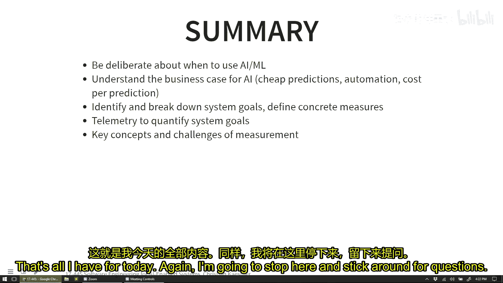

# 【全集】卡内基梅隆大学-AI驱动系统的软件工程-中英字幕-1080P-p06-Lecture-6---为人工智能系统设定目标--BV1JS6gBcEBF_p6-

Okay， welcome back。As usual， I want to start by asking you what youll remember from the last lecture。

So either in the chat or just raise your hand or just speak up。The vac unmuted。

 What do you want to say something？No， just mute yourself， okay， that's also an option。

How to present predictions to a user yep， that's something that we talked about。

 why did we talk about that or was the larger context？Thank you to Mo。

 we should present it to users so that the。你啊。The way we presented shouldn't。

Be too forceful or interrupt or irritate their normal。OrYeah。

 or maybe it actually should be very forceful， depending on our goals right。

 So the the idea was to think about not just the。Machine learning component itself right the model。

 we talked about model quality and that was also the first part of the lecture。

 but then trying to think about when we actually design a system。

 we're thinking about the entire system and。There's more to this than just predictions right user interaction design was one aspect and we talked about that depending on what you're trying to achieve and how confident you're in your model you might want to be very forceful in your interaction or not very forceful right so maybe you want to be very convenient and take actions for the user sometimes like a safe driving car obviously does want to do that right but certain prediction mechanisms and we have the Microsoft Office example or PowerPoint example doesn't want to do this。

And then right as an says in the first part， we talked more about model evaluation right model quality still and looked at it a bit from a software engineering perspective and one thing that we talked about was kind of thinking about how to。

Have something equivalent to test cases， which we broke down as kind of。

Different validation sets for different subgroups right kind of find representative cases。

And I guess with edge cases， we talked about safety， is this what we're referring to？Cichuan。Yeah。

 it was actually there was a simplistic typing， but I think it was like we discussed about how we should handle like majority like common have test cases for the majority class and then how we should handle the edge cases as well right that too and in variances right that's another a good point we talked about that as something where random testing may make sense。

And a little bit about telemetry data sounds good。Maybe quick reminder I would like you to turn on your camera if you can for the lectures。

If you can't， that's fine， but again， I think this is a nice interaction if we can actually see each other。

All right， so today I want to move on and talk a little bit about how we define success for the larger system。

 how we think about how to use machine learning and in a second in a。In a。In the first part。

 I want to talk about a little bit， the discussion of when to use machine learning and when not to use machine learning。

RightThis was part of the reading already， but I think we can。

I want to just walk through a couple of examples， right？

There are a couple of cases where you probably should not use machine learning to begin with。

 if the specifications are available and clear， if the simple heuristics are good enough。

 let's maybe just go through them and can you just give me one example each。

 what's a problem where you have really clear specification and you wouldn't want to use machine learning。

Yeah beve。I'm glad。Doing it is really hard， so the specifications that we get are at higher level。So。

 for example。We want to add like we want to identify hazards on the roots。

 things like that so the specification is very clear on that but how to do it is very hard so but so I'm asking for example it's where we would not want to use machine learning right because we have very clear specifications and we can implement it。

理o分。Example。So for example， like grading exams with only multiple multiple selection questions。

RightJ says mathematical relations， yeah math operations right so those examples where you just do arithmetic right。

 you wouldn't want to use machine learning because it just introduces a bunch of noise。

What's an example where simply heuristics are good enough？It's maybe hard to clearly specify。

 but we get good enough answers。Actually， Daniela's previous question would fit here determining if a student has passed based on grades。

There's probably a more precise way where you can look exactly at。

Every assignment in more detail rather than just summing up and having a cutoff。

 but most of the time we probably have a cutoff at some score， any other examples。

Where simply heuristic might be good enough。Space exploration。Okay， can you explain this Mar？呃。

I feel machine learning should not be substituted where you。

 complicated calculations and precise calculations are required。So if you can do this right。

 but then again you have very clear specifications， but there might be a couple of problems where。

You may not。now that precisely you could use machine learning kind of it's a hard problem。

 but you're kind of happy with good enough resultss like profanity filters might be an example where you might be okay with something that just。

Delete certain explets from YouTube comments right， you won't catch everything。

 you can probably do better with machine learning， but you're probably good enough for now。嗯。

All right。The cost of building and maintaining a system outweighs the benefits。

So you could use machine learning。It might be even beneficial for some cases。

But it's just super expensive。Any examples， any ideas？How about so little text selection from？

That text pattern searching， you could use redx for that instead of。Machine learning。

So kind of you could do something where you do kind of a voice search。

And it's probably extreme overhead if you just have a simple web page right so if you're developing your own web page for something。

 a hobby web page， you probably wouldn't want to use machine learning to do a better search even though you could I think Jake's example also fits here determining whether manuscript should be published。

 maybe some publishers， there is a business case where they don't want to read this all and some machine learning hips。

 but depending on what business scenario you have， you might do this once in a while and all the investment in machine learning is not worth it right？

Correctness is of utmost importance。What are things where you would not trust the machine learning system。

 even though it might maybe make sense？Weapon systems。

Let's hope aircraft autopilos I think flight by voya are common things。

 Medicare diagnosis we actually use machine learning increasingly。

 but again there's some cases where probably we。wantant to be careful of writing your way。嗯。

Right and then finally just use machine learning for the hype often to attract funding or something like this。

 right， this is maybe more obvious， but I think you find a bunch of cases in the news where there are companies that。

Promote we do machine learning。And then you ask yourself really why， right。

 because they're often simpler rules or。All right。So it's that last one really。

 because if you need funding。Yeah。Like， you know。Okay so you have an argument why you use machine learning。

 yes， it's not a technical sound argument and maybe you won't regret it later but maybe you get the funding right they actually a bunch of startups that kind of do promise a lot of things and they use crowd workers in the background to do what they promise machine learning will do one day and they get enough funding and maybe they get bought or something I don' want to push this too far。

so in general， you can think of there might be a bunch of cases where you get good enough with some simple baselines right so maybe simple heuristics can push this quite far。

 maybe some semiman approaches maybe it's not too bad to have some people in the background that do some tasks。

Well， maybe you even publish the system without that feature， right？所。For example。

 want if you have an app store and you want to rank the applications like the apps that you could download in the category business or。

 right you could do this with machine learning， you could probably train something。

 but you could also just list the one with the most downloads highest。

Right and similar with recommending products recommend the first the most popular products first。

 and then you can do maybe colral filtering and things where you do more personalized recommendations but maybe something simple as good enough right so there couple of articles that really say don't use machine learning if you don't have to use machine learning right so the technical that paper that you read also kind of makes this point machine learning systems are not simpler systems right so they need to be maintained if you don't retrain them from time to time they might really give you bad predictions over time it's actually bi them might be fun in the first place but operating them over time is usually a serious undertaking right so consider first whether whether this is really makes sense for that specific problem。

Then the problems。Where we don't really know with genome or AI。And I can。

Let me ask for examples so what are good problems for machine learning like big problems where you have massive inputs massive scale and because of this machine learning might be a good idea。

 humans have a hard time making such decisions at scale。Genome analysis， right？Iron informformatics。

Anything it？can probably just think about things that people are doing with machine learning right now and then go back with fake news Vive do you mean generating fake news or detecting fake news detecting fake news okay I hope so not generating right。

Right everything that has kind of massive amounts of text that you want to analyze in some form sure open ended problems where we don't have a single solution where we kind of look for incremental improvements。

 where we want to grow with the user。Gme playing game。We learn incrementally how to play this。

 how to explore large spaces。Any other things？Probably translation， language translation。

 things like this。Right。Time changing problems。So this is where you need to retrain the models repeatedly because the environment changes。

 So what can you do to。What are scenarios where it actually makes sense to retrain a model to adapt？

嗯。Again， think about things that are done with machine learning these days and think about whether it fits this category。

Yeah， fashion advisor。Suggestion of movies， certainly。

You don't want to suggest the movies from last year。

There's probably some underlying patterns the thing that I was thinking about was inventory management or prediction right where you predict what are you ordering in your store and it's kind of consistent but then the pandemic hits and suddenly you need to order face masks things like this trading automation right and intrinsically hard problems and I think these overlap right but what are things that are really hard where you have unclear rules you don't really have heuristics that perform where。

Yeah， anything that has to do with images or sound pretty much right kind of detecting cats and images。

 we don't have any good heuristics ready to do that， so those are really hard problems。All right。

 there are a couple more constraints as we're also in the reading like the partial system should be viable right so if this is again the opposite of saying earlier if we need guarantees then we have a problem right but if we can get away with sometimes making mistakes or that we can make the mitigate the mistakes some way or the benefits outweigh the costs right so this is typically how we want to think about this we probably won't have guarantees。

With some AI techniques maybe， but with most of machine learning we won' and we talk about mistakes next week and then it's。

If you don't have data， kind of feedback data， telemetry data。

 you can't really see how well you're doing and you can't improve over time。

 it's also really problematic right so this is one of the key ingredients you want to think about。

And you want predictions that kind of have an influence on the overall system right so there should be a point to the prediction you don't want to predict something that's completely senseless。

 at least you want an indirecting like predicting advertisement generate your revenue or predicting fun stories to keep people on your page and coming back and because of this they would look at more advertisement right so there's some objective in the background and it helps and again you want it to be more costeff than alternative approaches right so if you can just pay people to recommend products on Amazon if you could do this at the scale and that's cheaper than automating this probably isn't right but there are examples where you make very few kind of recommendations and actually keeping people in the loop might be still much more cost effective than trying to automate this and invest a huge amount of effort in data collection。

So I want to。Keep one reoccurring kind of example again in this lecture。

 one case study and I thought I'm using Spotify here so Spotify has this feature of where they do custom playlists for you right so depending on what you have listened in the past they will actually generate a bunch of things like your top songs is probably fairly easy you probably don't really need machine learning for this but you have your daily mixes and they actually have multiple of them they are kind of sorted by similar music not sure how much I'm giving away about my music preferences here but they oh yeah a bunch of people leaning in and looking at the screen I see。

That's fine。😊，So Daily mix one has more kind of instrumental pieces and daily mix four is more electronic music and daily mix three is more postdoc and they kind of recognize these things and put things together right and then also kind of select representative songs so there's some machine learning in here。

嗯。And just think through this， is this a big problem， is this an open ended problem。

 is this a time changing problem， is this hard？Is a partial system good enough。

 is there data does it influence the objectives， what are the objectives and this is cost effective so why would you argue that machine learning is a good idea？

What makes this。A suitableable task for this specific problem。It's okay to get it wrong。Yep。

 it's okay， so partial system is viable， right？嗯。Stngs change over time so there's something this both kind of massive scale is a big problem right millions of users and at the same time a changing problem over time。

 right？It's also not obvious of how to hard code this， right。

 how to identify what music kind of fits together。So it's not really easy to have rules。

 the Library of Music is massive。嗯。So it's certainly more cost effective than people having people to curate this for specific people right we could think about whether it's sufficient to kind of just curate general playlists manually。

 but even that's probably more expensive than what they can do at scale here there's data right so we kind of get telemetry about what people are listening to we see whether they are using the playlists。

What do you think Spotify's objectives with this feature？Maximize music playtime， improve engagement。

 have a competitive feature。I'm not sure that they want to maximize playtime maybe they at least want to keep you engaged and on the platform and keep you paying right maybe if you're not paying improve playtime because this correlates with advertisement。

Ensure subscriptions right keep them yeah minimize royalties and keep people paying for subscriptions is probably a good idea。

 or if you're not paying for subscriptions and show you advertisement。

 which correlates with how much you're paying。So does this feature ahead with that？

You can push lower royalty artists to users yes you can probably influence what people are listening to a little bit this might conflict a little bit with your goal to make users happy to keep them paying but yeah maybe。

嗯。So I think for most of these platforms， same for Netflix and so on they want to。

 they see that your subscription， you're less likely to drop your subscription if you're actually using it。

 so what they' are typically optimizing for is you using the server because then you keep paying so you kind of engagement。

So this brings me to to my next second no actually before I get to actually go it I have a detour here。

 I want to talk a little bit about the business view because I think this is actually。

Something that I didn't think about much before getting into this topic。

And I don't want to spend too much time on this， but I think it's interesting it's a different or different view on this there's this book prediction machines if you're ever interested in kind of the business side of deciding whether as a business as a strategic decision to use machine learning or not in what product and so on。

 this is a very accessible interesting read written by economists thinking about what is it that machine learning actually does from a。

Perspective of kind of building a business。And they summarize everything as machine learning is really what AI。

 they merge this is really about making predictions。And making prediction cheap and accurate。

I that saying we already use predictions to kind of make decisions in our businesses and our processes。

 we need to make decisions and we need to predict something to make those decisions right whether we want if we want to decide whether one company should buy another company。

 we kind of need to predict is is going to be a good investment， what's the benefit of merging this。

 what are the risks so we're making a lot of predictions， we tend to make those as users as humans。

And the idea here is that machine learning is good at predicting things， right。

 give them some data it's making prediction， not at all kinds of predictions。

 but at many predictions。And machine learning is making predictions cheap so previously we had humans making predictions and now we can make lots and lots of predictions。

 maybe even with higher quality because there are certain biases that humans have that machines don't have depends on the kind of problem right the analogy that they are making in the book is。

When light became first available with electricity rather than cands， we suddenly had much。

 much cheaper light。And we could change our economy by doing things at night。

 doing things in buildings， with fewer windows， doing things with additional light。

Light itself Sa was just a change， a resource that became much much cheaper this was kind of a rare expensive thing how to maintain before。

 and now it became much cheaper and it enabled a lot of opportunities。

 we started using much more light， it started changing the kinds of things that we were doing。

 we were using it for new things and the other example more recent that they were giving is the internet。

 which they reduced to that what the internet really did was it reduces the cost of search。

If you wanted to find a book before， you had to go to a library and it was very expensive or find an expert that could tell you something about this now we have the internet and we can search over vast amounts of data。

So by making search much， much cheaper we started using it way more。

 we designed new products that were bid on search like comparing price machines right comparing yeah。

 finding different。Sites that offer the same product with a different price and so on， right？

And the same idea， they make the same analogy here that if you think of AI machine learning as prediction machines and as something。

That's drastically reducing the cost of predictions。It which changed a lot of businesses。

 not everyone， but everything where we use predictions， we can potentially make cheaper。

 we can use more predictions， or we can use predictions for new kinds of problems where we wouldn't use it before。

So can you think of some examples？Examples where we used predictions before。

 but they're much more cheap now so we can maybe replace people with machines and。

Are much more efficient at predicting certain things。Stock market。

 I'm not sure how good we are at predicting lens， either as humans or as。As machines， but yeah。

Translations， yeah， travel agents travel planning， certainly this is where we had humans before。

 This became much much cheaper and we can use it much more。

 The examples that they are giving in the book inventory prediction like in in a warehouse determining how much we should buy as a shop right this is something that humans did before that systems now do at scale。

 maybe with higher accuracy or detecting cancer and image images where we had professional physicians before who did this right and we automate this and simplify this And then there are cases where we may not not have used predictions in the past either because they were too bad or because they were too expensive and now because predictions become so cheap and available we might use it in a lot more cases。

SoThey put translation in this group。Where they framed translation as predictions。

 right predicting the equivalent and this was something。That the few experts had done in the past。

 but now we solve this actually as an automatic problem。

 I can also see how this fits in the first category。 Are there other examples which。

Become now broadly available that may not have been feasible before。

Shortest driving roads right so this is another example that they actually mentioned navigation setF systems。

 things like this right that without having machine predictions we wouldn't have systems like this。

 we have people maybe remembering roads or planning a paper。

So I think this is a nice framing it comes with a lot of consequences to think about this。

 so predictions are critical input to decision making。

 even if you don't automate it right but by decreasing the price of predictions it makes it more attractive to use predictions in a lot of tasks right so we can automate more things or semi automate more things it increases the value of data。

Relatively right so because we can automate predictions if we have data we can automate more。

 this is kind of an economic factor and also data science experts or people who can build these systems become more valuable compared to before and it decreases the value of human predictions and other substitutes。

And you can fully change a business strategy potentially。

 so again they have an example here where they say one said Amazon's predictions would get good enough at predicting what you want。

 Amazon could change their business strategy where they just ship you things。

That they think you might want， and you can always send them back， right？

But it becomes more efficient for them than to just ship you things and then see whether they were right right they would sell more things this way。

 they would need a different business， they need a different infrastructure to collect things and get them back and so on。

 but it's a feasible design that becomes possible if you have accurate and cheap enough predictions right and you can think of many other things that。

That you can automate now where you can completely change the way that kind of a disruptive competitor can work in a completely different way than traditional business models。

 and that can become a distinct competitive advantage。

There's another nice example here where they talk about taxi cabs in London and London we learning on average for three years routes in the city to predict how to get from point A2 point B the fastest in the current traffic situation or the current time of day。

 right so this is something where humans invested a lot of effort in learning the map in a massive city at becoming good at predicting the best routes。

Now we have things like Google Map ways that can do these predictions really cheaply and efficiently。

 they have a lot of data and they're probably actually more accurate than humans a lot of times because they have real time information about traffic。

嗯。And the problem is， like by having SaF systems。Taxi drivers in London didn't get worse at predicting。

But suddenly they lost their competitive advantage because every Uber driver with a phone in their car can navigate similarly where to them。

Maybe better。So the entire training that went into this into being good at human predictions got replaced by machine predictions that got pretty cheap and change a business model。

 change competitive advantages and so on。Make sense so far。

They make one more useful distinction that I want to bring up。

 and that's predictions versus judgment。When you make decisions。

You want to estimate some inputs to the decision。And then you still need to make the decision。

 the second part of making the decision they call judgment。So the idea is。

Let's say we have this cancer example， you have a system or human looking at a scan and determining whether there's cancer。

And now somebody needs to make a decision based on the information based on the prediction。

 right whether it comes from a human or not what to do。If we are certain or not。

 we might recommend some treatment， we might recommend additional tests。

 we might recommend not to do anything depending on the outcome of the prediction。

When we're making that decision， we're not just looking at what do we think the prediction is。

 but we're actually making a value decision here， we're considering the benefits of making the right decision versus the risk of making the wrong decision。

So for example， if we treat somebody for cancer， if they don't have cancer。

 that's probably pretty bad。If we don't treat them for cancer， even though they have cancer。

 that's pretty bad。The other two cases are good， we might also decide to make a biopsy kind of to check whether they actually have cancer。

 which is a very invasive procedure， but much more certain than kind of looking at the scan picture。

So you have all these different outcomes， so what you see here is this kind of decision tree where you have a prediction initially。

And then depending on what the actual outcome was， do they actually have cancer。

 it may be a good idea like you predict they have cancer and you start a treatment and if they actually have cancer that's a good outcome or not。

 right but the value that you're assigned to all of these possible outcome combinations。

That's part of judgment。So typically you think of this as a utility function if you want to automate things。

 so how do you decide how do you assign costs to false positives and false negatives？

And in a binary example， this is easy， but if there are multiple outcomes of a prediction。

 what if there are multiple predictions， different information， and then also possible outcomes。

 different kinds of cancer， different kinds of predictions， and so on。

 this judgment becomes more complicated。Judgment is something that we often leave to humans。

 even though we automate the prediction part。So we might tell a physician like we suspect there's cancer in this image。

 but we still have a human in the loop to make a decision whether we should treat this or not。

Because it's something that makes value。Vue judgment， right， we identify。

Whether whether we value what it's positive or false it's negative or true positive。

 how we weigh those right and then be careful about being conservative or not。

You can have machines make also automated decisions that's actually also quite common say driving cars on an example where they actually take action in the environment。

 not just suggest something right not just make a prediction The idea here is that the machine learning algorithm can predict human judgment if there is enough data about past human judgment。

So you kind of make the predictions as the input to this decision and then also have a value function that you can either hard code or you learn a value function from past observations。

 all things that you see in machine learning。But again。

 I think zooming out and just thinking of what is machine learning doing here。

 its making predictions based on predictions and kind of probabilities or a value function we can make decisions or we can learn the value function to make decisions to kind of imitate humans。

 these are different ways of using machine learning。That can be used in different ways。的次方。

I don't want to go too deep but I think this is an interesting alternative perspective also to think about when to use machine learning and what not right so the question here is what can you automate and what do you want to automate。

 when do you want to have humans in the loop we talk a bit more about this next week when we talk about risk and dealing with mistakes but predictions obviously scale much better if they're automated by some AI component than if they're done by humans and you can either automate predictions or automate the predict the judgment and automate this you can get value from both right so if you give better input to making judgments。

 humans are much better at performing the judgment calls right so they can look at the input of whether machine thinks there's cancer and then takes us into consideration that can be a lot of value kind of partial automation or you can fully automate this。

嗯。Full automation is easier if there's let's。If you're interacting us with the environment， at' Z。

Automating trucks in the mine。It's much easier and there's actually done similar trucks on highway driving。

 It's much easier than。Automated driving and traffic in the city right so they are typically no humans in this mine or not in places where they're not supposed to be so these trucks operate much more like trains in a very controlled environment they're still predicting whether they are obstacles in the past and so on and they interact right but these are environments where you can control a lot and because of this judgment is become becomes much easier right you can hardco judgment based on simple predictions they are cases where。

Machines are just much faster at deciding things and that's why you want to use them so the increased speed through automation in automated driving for example is useful when a car can break for you before you can react and reduction in wait time where you sometimes have places to remote control things like space exploration where you have a drone in space and it takes minutes for signal to get there you can't remote control them so then automation is also valuable。

All right， having looked at this， suddenly if you look at this from an economic perspective。

 data becomes really valuable right and also costly to get but you're starting to think about how much value do I have in data because with data I can automate some things and I get value out of automating things。

So collecting and storing data can be costly。But usually it's considered to be cheap enough that what a lot of companies are doing these days is they're just logging everything。

 they're keeping all the data all the log filess that they ever have just in case this might be useful one day right storage is comparably cheap。

But they are also diminishing returns of data。WithMine learning models get better typically if you have more data。

 but at some point if you just add more and more data。

 you get diminishing returns they get only marginally better right once you have enough data。

You also want to think about what are the benefits of automating things right。

 do we actually get improvements in prediction accuracy for more data and so on？So。

They have a different view of thinking about when to use machine learning， they think about。

 can we have a goal or we have some processes in a company。And we want to。

Use machine learning probably to improve some parts。

 we probably machine learning doesn't directly address the company objectives directly。

 but indirectly right so what they recommend is。Decomposing。嗯。Wait， this is。That's fine。

 so if you have a workflow decompose it into tasks and identify which tasks use predictions and which part of those predictions you can automate。

 also think about which tasks you can automate， think about what benefits does it give you。

 if you can automate them， what inputs do you need。Right， how you can deal with a human。 So here's a。

 here's a。They call the CAI canvas thinking about。When to use AI。

 so there's always a prediction component where you want to say you want to predict something。

That leads to a decision either automated or made by a human right so you want to automate something there's a discussion an action that will be taken based on the decision and an outcome so they decompose each step where you might use it into those parts and then you think about where do you get the data。

To train the predictive model。What inputs are taking for a specific decision？

And what feedback can you collect to see how you're doing and to train over time？

So let's think about this in the Spotify example right so we want to assemble a playlist that's personalized or multiple playlists that are personalized to me。

So prediction。What are we predicting here？We're predicting kind of。

Things that I might like and maybe things that are similar to each other。

So there's a certain prediction goal。There's not much of a decision here。Oh。

 I should have thought through this example before， are we automating any decisions specifically？

This is left to me right， I'm still the human here deciding what I'm going to play。

And the action would be play a song or not play a song and the outcome is I'm happy with the song or not。

So it's a prediction as input to a human decision in this part I'm not automating the decision。

Training data would be past things that I've played。Input would be the user ID， like for me。

 I want a prediction now。And feedback is looking at what I'm actually playing。

 whether I'm happy with the prediction， maybe sending me a survey。Does this make sense？

So I found this book actually fairly interesting to read。

 it is not directly related to the kind of concerns that we're thinking about kind of scaling and building these systems and maintaining these systems and finding the right requirements。

 but it's thinking about what's a business case right and I think thinking of AI as prediction machines is a very nice abstraction to kind of just think about what can we do with them。

 what might they be good for。Any questions on this part？Another view that I also like is JK。Yeah。

 two slides before when you're talking about the diminishing returns of data。

 do you mean increasing the number of samples or increasing the dimensions or both to that the size of your training set okay？

Whether you train on a million cats or 10 million cats probably like from 10 cats to a million cats。

 you jump right but from a million cats to 10 million cats， probably not that much。嗯。All right。

 just briefly， another way of thinking about this is the cost per prediction where you factor in all the costs that go into that prediction。

I talked to somebody who worked on credit card fraud protect detection trying to get them for a guest lecture later but。

第一。Ideas if you're doing a service where you're doing credit card fraud detection for banks。

They're sending you queries right so they're sending you here's a transaction。

 is this fraudulent or not？And you need to answer fairly quickly。

And you need to answer with a certain cost right so the bank is paying you a certain amount of money。

And the interesting part is that the cost is not just the cost of running the server with your final model and answering the prediction。

But you want to factor in everything that you need to run your business to build that model。

 to run that model， to maintain it。What are some of the kind of things that might go into this that are not the most obvious？

So obvious things are maybe。You need to hire developers to build this thing。

If it's a deep neural network， you invest in kind of cloud resources for a week to train a model。

You need to operate it， you need developers to maintain it。What is？

Cost to secure the data Air privacy security。Human experts to handle edge cases， right。

 so you often need support the support team。De you arguing things acquiring the data in the first place。

 maybe the bank gives it to you maybe you need to buy it somewhere else right so there are lots of kind of things that go into this and if you want this to make economic sense you need to reduce the cost per prediction to a certain limit right。

RightAnd then for the bank， there's a decision of whether they how they make a judgment call how they make a decision。

 right。If they get a prediction that this is fraudulent。

 are they going to act on it or not that might depend on the customer。

 the cost of disgruntling customer， maybe this is a high value customer and so on。

Lots of things that go into this。 And then another thing that you also want to think about from a business perspective is the kind of risk that you might get another thing we're talking about later。

 but even just things like。Having discrimination in your system because。

Either this wasn't the data and somebody detects and maybe you have liability or having false confidence and wrong predictions right leaking data。

 vulnerabilities， things like this， and then also longterm societal risk where maybe only few people have access to kind of bid effective prediction machines at scale right so you kind of build monopolies。

 you only have Google and Facebook and Amazon at some point bi these systems for everything and compete out competing everybody right。

In privacy。All right。So much for the business view。

Now I want to actually try to nail down goals right so we talked about evaluating the quality of the model but then also said the models serve a larger goal。

Right， so in some way， we need to connect us。 We need to get from。

Kind of how well is a model doing to how much is it supporting our business。And in the readings。

You have this。Different levels， right， organizational objectives at the top， then leading indicators。

 user outcomes， model properties。明明吗？我。I mean， I'm not sure how much I should assume that you actually read it。

嗯。😊，So the ideas is organizational objectives are the things that the organizational wants is typically associated with money right if you have a for profit organization。

 then leading indicators are things。That are proxies。

That you can measure more easily or more quickly， what are some examples of leading indicators？有人吗？

I that like the user engagement and satisfaction or something？

Things like this so something that you can measure like how much time are they spending there。

 how many ads are they clicking on kind of common examples how happy are they Use outcomes is from the user's perspective right are the user's good supported by this which may or may not align with a business perspective directly right users might be happier if they pay less but they might be happy with having a tool that helps them。

And then finally， model properties， this is like the classic accuracy measures。

So some of these things are much easier to measure than others。每次。先。

How much time people spend on my page is much easier to measure。Then。

Often how where the model is doing， maybe， but also how happy the users are。

 we can often get more indirect data， organizational objectives are often slow。

You can kind of get day to day feedback how many ads you have sold。

 but often you kind of look at the larger picture right you kind of expect like user engagement to be indirectly correlated with overall success people are not going to quit immediately a subscription service if a prediction was bad right so they are kind of more long term。

Also one more thing。Organizational objectives are not only money related。

For companies they often are in the end right so the final goal is kind of to make money and to survive as a company。

 but you can also think of lots of kind of nonprofit scenarios where you think about saving lives。

 increasing animal welfare， reducing CO2， right， preventing house fires。Social justice improvement。

 right？Elevating the well being of the population improving fairness right so those are all goals that you can have as an organization mostly nonprofits right and in a lot of those cases machine learning。

Can lead to this also being electors， this can be a goal for certain organizations， right？So。Oh。

Right， and。I mentioned earlier if you analyze where you use machine learning。

 it's typically not directly related to the overall system goal。There is a there's a step in between。

 right， to Spotify。making me。Nice playlists does not earn them money directly right so there are a couple of indirects instead so what we typically do or a way to think about this is there are multiple places where we have machine learning so we have multiple more specific objectives that we optimize and often a good way to think about this is to break down longer workflow or identify all the workflows。

 break down workflows into tasks， identify decisions into tasks think about whether AI could help their whether we could automate this but keep them mapping。

And so I wanted to go。Back to this slide。 So typically， what you have is。Some sort of。

You start with organizational objectives and then you have maybe actually multiple leading indicators。

Things that you can see if those things go up， you think the company is doing well。

 right you might actually have multiple things that influence directly or indirectly whether a users are happy with a model。

 right and then。User outcomes and also leading indicators are more directly also actions like this probably more directly implement directed。

Sorry。So model properties are connected more or less indirectly to some of the other outcomes the important part is to keep kind of the connection right to think about why are we improving accuracy here。

 what's the end goal， why are we interested in this， we have an intermediate goal。

 maybe make the user happy， we have an intermediate goal beyond that， keep them engaged。

 keep them on the site and so on。So let's walk through this here for the Spotify example and I let you do another example that's a bit harder。

So in the Spotify example， what's the organizational objective again？Can just speak out loud it's。

 I think easy enough listening time。That's not the organizational aspect。

 that's probably a leading indicator。More profit， I think that's the most direct things right so it's a company they want to make money。

How do they make money。So what are leading indicators that might indicate that they are doing well？

The number of subscribers， the number of cancellations， the number of。At place。

So those are typically things where you can see how well you're doing and they correlate with how much money they're making。

I mean you can also think of Spotify as kind of social good maybe they want to make the world happy。

 but I don't think they are this kind of nonprofit that's not their motivet right they have shareholders。

 they're publicly traded company。So what are user outcomes that might influence these leading indicators like active users。

 recurring subscriptions？嗯。Things like this。From a user's perspective， what makes users happy？

Users find the songs that they like， they like that there's a lot of bread， lots of music。

 they discover new new music， maybe they listen to to more musics right so the feature that we're looking at is one of those things as supposed to make humans happier。

They make it easier to find more music， listen， enjoy music。

Use is enjoying music it's not directly the organizational objective right but indirectly it leads to all these things that we can measure that are probably more correlated with this and then we have this prediction model underneath one or multiple right so group the music so you might do some clustering and then also identify what are things that I should listen to by some metric。

 are what are measures， how could we measure those things。What are the right metrics there， I guess？

Precision recall， right accuracy in some form， I'm not sure how I would define precision recall here what's a false positive showing me music that I'm not listening to maybe and I'm listening to music that's not on their list maybe。

Those are the more traditional machine learning metrics right so we can think about whatever maybe this is a ranking problem also or we look at the accuracy of the clustering。

And then for each of those， we can think about what's the right metric。

So what's the unit of measurement， for example， and how can we get data for that？So。In this case。

 machine learning properties might actually be pretty hard to identify because the。

The telemetry that I can think of will not give us very direct accuracy measures。

 I can only see how many people are using that feature which is probably more at the user outcome level than machine learning accuracy right so at the user outcome level I can see are people using this。

Are they happy is maybe something that I can measure with a survey， I'm not sure。

 so you can think about how can I measure this， what's the scale。

 maybe happiness on a scale of one to five is a star rating right or the number of people watching something listening to something。

Leading indicators， so I think the metrics are pretty clear for the kind of things that you described like number of recurring subscriptions is something that we can measure just like this look up in the database right fairly easy to measure because we're tracking the data anyway。

And organizational objectives is probably how much money did we get last quarter。

And that's pretty far away from the prediction algorithm that we're using here。

But it's important to keep this trajectory。Does this make sense？你ific。

So this is not a form of decomposition or like a GQM method no I understand it now you're not building one out of the other metrics right there are metrics at different levels but you expect certain correlations right with this is better it helps us to improve this other metric。

Like if the predictions are better， users are happier， if users are happier。

 they are more engaged or we have more subscriptions and if we have more subscription。

 we are making more money。So you're kind of justifying why you're looking at certain metrics。

So now I want to put you into groups and have you discuss a different setting and depending on how cynca you are about this might decide to cut this out later or not。

 so I want to I want you to think about a very different example where you're。

Were you're automating the task of looking at applications for a masters program？

Soft engineering master or whatever program you're familiar with。

 so we get a bunch of these applications right and we need to identify maybe 50 students or so that should get accepted into the program。

And we get all their transcripts， we get the letter， and so on。

 so we could probably use machine learning for doing that。

Let's assume we have some machine learning model that could do this and I want you to think about。

What are the organizational objectives here？Of the university， probably or the master's program。

 What are the leading indicators。So we want to see whether the program is doing well what are the user outcomes。

 what makes them happy or not， what are model properties。

 how can we determine whether the model is performing？Is the problem clear so far？

Have you access list to these four levels somewhere because you won't see them。

 I think if I put you into breakout rooms。Is it a public or private university？Not just saygie man。

RightSo let's say we're doing this for our program for。

The Masters of software Engineering program for those who know it or any other program。

 doesn't really matter。so I'm going to put you into breakout rooms。

 let's say above about five to 10 minutes， if you're done just come back。

Otherwise I will ping you in yeah let's say eight minutes and ask you to come back there's a message there there's also a button if you need help you can ask me to come。

Right， let's see。 So let's maybe do five rooms。All right。When we come back， what do you think？

Organizational objectives。My hand。So for organizational objectives we discussed for the program。

 they would be seeking high quality candidates and looking at maintaining the prestige of the university and the program。

That's a very polite answer， what did other people discuss？We mentioned money。Anything else？

All right， leading indicators。How do we know as an organization that we're doing good。

 that we're doing well with admissions， I guess， what did you discuss？We said like papers published。

 citations of those papers， papers in major journals， jobs after graduation。

 salary after graduation or salary at some point。The first couple are probably more for a PhD program。

 I guess， right， but yeah， I think。I think what a lot of programs look at is where are their alumni going right I think a metric that's often get thrown around or advertised as initial salary and salary after five or10 years。

I've heard some discussions where they kind of want to see thought leaders。

 there are some places that look for donations。CU is pretty bad at that。

 getting donations from the alumni。嗯。Anything else？The number of people。

 like the number of students applying to the program as well。

That we are leading indicator that's a sign for the program here。Right。Okay， user outcomes。喂。

So user outcomes might be。You know， finding a better effect for the students so。

If these prediction algorithms are very accurate， then they'll get into programs that are a good fit for them。

Rather than。Programs that they qualify for，嗯。Can a fast user outcome would be the GPA of the students？

Yeah。How the student is doing in the program yeah？发个飞。

So we're thinking in another perspective for the admission officers the applications that are selected should be easy to read manually with important details highlighted and less important details put in in a further away pages and also if we're testing the model for those that are highlighted as suggest to admit should have a relatively high admission rate by the admission officer and for those who are rejected by in the system that still goes into the the human admission officers should have a relatively low admission rate eventually and also that can be used to readjust the model but I think that's more to the how we actually build the model part less than the user outcome part Yeah I think there's a good point to think about who the user actually is right。

Might be the program managers who make admissions decisions。

 not the students and they want to be happy， that's I think a reasonable perspective here。Chris。

 you have a similar view。Yeah， it was a along somewhere lines。

 I guess would be like less burden on the admission staff to you know。

 to go through all the admissions and instead maybe they could just。m，You know。

 go through some of the the edge cases or。Yeah， yeah， focus more on the arch cases， right。

There are also a number of other consequences that you can be much faster in making decisions and maybe compete against other universities that's maybe more leading indicators how quickly you can make decisions。

嗯。You think。So in the same like direction， what Chris just mentioned。

 wouldn't the organizational goal at that point of time to expedite the process of information？Yeah。

 I think there's a question， I think typically you see organizational goals。As really high level。

 not for the specific process， but for what does the organization want right and for the organization like。

You can think CMU reputation as making super fast decisions or something like this。

 but this is probably not what we are really aiming for。

 you can probably say CMU wants to be a high quality reputation or just wants to make money or whatever you want to discuss there。

嗯。I think in the end， it's more a thing to help structuring how you think about this right so to map everything to organizational goals and where exactly on the layer you are。

It's not so important it's more important that you have a connection right and the last thing is now model properties so how could we evaluate the quality of the prediction algorithm that we're doing。

What did you talk about？Maybe somebody else。sry。Yeah。

 we were talking about so for each student they might apply for multiple universities。

 so the system should suggest the student that the offers they send to the student should the numbers should be kind of close to the numbers student accept the offer。

嗯。I also would see this as a higher level。Although if you're predicting the yield right so how many people will accept。

 if that's part of your prediction， you can check accuracy for that prediction。

We're also actually talking about maybe there is another machine learning component that is identified a fake resume I don't think we get many of those。

 but right there's a price attached to applying right now。😊。

Other thing also we can definitely optimize for the number of admitted versus the number of attended so because we're only going to admit so many students。

 we want to maximize you know the number of people who are actually attending the university so that we can optimize costs in that case。

 so that is the important model metrics as well as the precisionary recall for how many people are actually admitted out of the people that should be admitted。

So I think there are two different things here that might be worth distinguishing so one is yield are they actually coming if we make an offer right you can predict that and evaluate the accuracy and then you're also evaluating whether they are actually good candidates and we talked about this earlier where you could measure like a year later what are their grades or did they drop out right or they did we pick the are highest ranked candidates the once with our highest salary afterwards or something like this。

All right。Let me go back to this if I find my mouse。Always the same problem。系。So。There is。

 I have another whole block of metrics that I'm going to skip and we're doing a recitation on this instead。

It's important to be precise about how to measure something。

Design concrete things that are operationalizable where we can define a way to measure something where we know what the units are and then we also need to be careful with what kind of things we can do with what kinds of units I'm not going to talk about this now there are a couple of slides if you're interested and think we're having some in recitation and then later we will talk also much more about how you can use telemetry to actually gather some of these resultss and production right so how do you know in production or automatically how where your selection of students works or something like this right and there's a lot of creativity in doing this and also in using this to get more training data for future versions。

So。With this， let me just summarize here。What I try to do today is kind of talk about how to be deliberate about when to use machine learning or AI right so what are appropriate systems whether or not understanding the business case。

 I think there's a useful to think about what do we want to achieve why are we using this and then based on this。

 think about what the goals of the system are and we can break this down at different levels right so there's a goal of the entire organization which is probably far away then there's a specific goal of this part that we're working on the subsystem and the goal of the model and the bunch of in between right and kind of connecting this and thinking about this I think is very useful。

That's all I have for today and I'm going to stop here and stick around for progression questions。

