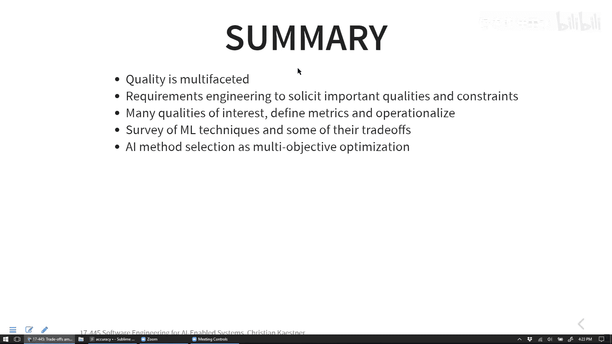

# 【全集】卡内基梅隆大学-AI驱动系统的软件工程-中英字幕-1080P-p07-Lecture-7---AI技术之间的权衡--BV1JS6gBcEBF_p7-

对啊。

Yeah， welcome back。And as usual， I want to start by asking you what you're going about from last time。

So anything that you remember？What did we talk about， what got stuck？Nothing。

Go somebody found the title of the lecture。Since we talked about gos， anything else you'll remember？

I just I remember the activity that we had for the education admission。

There were like different hierarchies of how from the top level goals， how these。

Go level by level until we reach the model and how to create measures for each others。

So we talked about that there's typically kind of some organizational goal， that's the end goal。

 often make money if you're a nonprofit， maybe some others。

And then you have things that you can actually measure more regularly， break it down。

 maybe into leading indicators。User outcomes were goalsers or some measurements more from a user perspective and model properties kind of at the bottom are things that we can actually measure about the model and what we wanted was some sort of traceability right so when we set goals for the entire system or for component itself we want some sort of traceability that whatever we are measuring we kind of know has some benefits toward our mission right the thing that we want to achieve with the system。

And then also what Gqua A says， we wanted to talk about。

 what we talked about when to use machine learning， right so a little bit of characteristic。

 what kind of problems this was used for and we talked a little bit about the business case as well。

 right？So today I want to move on kind of along similar lines。

 so if you have some goals that we want to reach， there are a couple of。

Decisions that flow into making decisions about what modeling technique to use， how to use it。

 what to optimize for and traditionally this is often just accuracy but I kind of want to push a little bit beyond accuracy and talk about what are all these other qualities that we might care about。

And。嗯。Let see how far we get。As a case study， I want to talk about a system like Lane assistist。

 this I think is a picture from a Tesla。But a lot of cars。

Also non Tesla cars these days have some features， I think some of them are supposed to become mandatory in a year or two where detects whether you're in a lane when you're driving right so if you're。

Swerving to the side and you're not using your indicators。

 as will beep at you that it detects that you're leaving the lane。

Some cars will go a step further and they will steer for you right if you're not using the indicators。

 you can even take the hands of the wheel。more or less you're probably not supposed to。

 but it kind of stays in the lane， even if if you go around the corner。

 kind of a white corner on a highway it would stay in the lane so these kind of systems have been around for a while right so they used to have less autonomy they might just beep at you when they detect that you're leaving a lane。

And the more modern systems will actually steer for you。喂。

So I want to talk a little bit about what kind of techniques will we use to build this system。

 maybe just by show of hands you can do this on the camera who has used kind of an automated steering system or something like this before。

 so a bunch of you。The automatic steering kind of to me feels kind of dangerous when driving kind of overtes a little bit。

 my impression， at least with the rental cars that I've used it on。But yeah。

 so this is available in a lot of cars。Does anybody know how this work internally？你有呢谁。So。

 so so there are a couple of different implementations from different companies。

 but essentially will work is they have either one camera at the center of their their dashboard the front window the windscreen or two separate cameras near the low end that are scanning for the lane lines and mostly done by computer vision and the other thing is they're using a radar I think it's it's a long distance radar tracking the car in front of you as well in case the lane gets too wide or the lane lines or missing at certain points basically using those as the main inputs and different implementations are adding additional features to make it work better or smoother but essentially that's how it works。

 I'm not an expert in these， but I think the。These vision systems have been around for a while。

 so screenshots that you see here are kind of image transformations that applied to search for lines and images。

 they have been around since I think the late 80s some of those so you can apply them to an image that tries to detect the lines so you're trying to find lines in a certain anger in a certain area kind of to find this and more recently the more recent systems use a lot of deep neural networks as well in machine learning but they're trained on a bunch of images and they try to detect those lines。

嗯。Right so there's a bunch of these systems around we want to talk about them a little bit later right so and often they're integrated in a bunch of other things so there's not just one machine learning component there's one for the vision system there's probably one that does a steering there might be one that takes the distance to another car right。

And I want to go step back for a second and talk about quality。 So some of you have heard this be。

 and I don't want to go into too much detail about this。

 but we want to talk about different quality attributes here。 So accuracy is one of them。

 Ac of a model， The size of a model might be another one right good models might be smaller。

 for example， but there's lots of different notions of qualities and lots of things that we can measure。

And if you step back for a second quality is actually a concept that can be really hard to capture so in the left here I have some pictures。

And this is a high quality picture， is is a low quality picture， right， so those paintings， others。

What makes the quality here right and on the right there's a car does somebody recognize？

Anngela machini， I don't remember a Ferrari， it's something that I found。Go for you know it。Okay。

So and again， is this a high quality car？HowHow do we make this distinction right high quality from what perspective and there are actually many different notions of quality and again I don't want to just run through this quickly so there's this transcendentent notion notion something is great and we just know it when we see it right so when we see those paintings maybe they' are great because we experience them as great we can't really say measure why they're great。

Maybe are maybe these are not， I don't know。This was a one royalty pre picture of paintings I could find。

Then there's product based metrics， so maybe the car is great because it has more horsepower than a different car right so we can just pick a certain metric and because it has more of that it's better maybe the painting is better because it has more paint on the canvas right。

Then there's a user view so somebody might like a car more because it is faster it brings them from A to B right it's useful but you can also have a value based view with where you contrast this with the cost right so the car might be useful but it's super expensive so in terms of money spent is this really good quality。

 good value and then you can also look at how it was produced was this great quality right so lots of different views of quality here。

And we could go further there lots of different quality metrics。

 but we can also think about some machine learning component。

 the vision system or the steering system that has a bunch of qualities right so there's a quality of the product itself。

 how where does it perform things like accuracy， reliability security。

There's also the project attributes of the larger project of delivering that component or delivering the entire system。

Time to market， development cost， research cost。And design attributes。

 so things that influence not directly qualities， but what kind of problem we are solving and so on。

So there are a bunch of qualities and one reason why this is interesting is that attributes is that we have certain constraints。

 whenever we design a system， we can't just pick arbitrarily among all possible solutions。

But we have constraints that we shouldn't exceed right so for example。

 whatever prediction we are doing in this lane detection mechanism。

 it must run in real time right so if we are processing 50 camera images a second we have 150th of a second to give an answer and that's a hard constraint。

We can't really change that， we can't be slower than that。

 so whatever solution we are the entire space of possible solutions we can restrict by saying that we need to be faster in the response time than that。

There might also be below a certain accuracy， it makes no sense。我。Be look beyond a certain fire size。

 if we need to terabyte deep neural network on a car， probably we won't don't want to update this。

 Maybe there might be certain constraints， hardware resources and so on， right。

 So they are all possible solutions。 And then there's a space of。

Acceptable solutions that we might care about。So I kind of already talked about the but we have different kinds of constraints right so we have problem constraints so things there's a certain minimum quality that we need to deliver。

There are project constraints， the project needs to be done or stay in a certain budget。

 or we have a certain number of people who can do something like this and then design constraints kind how might the solution look like？

So I already mentioned one or two constraints for the lane assist thing right so it needs to work in real time so the inference time needs to perform in a certain time right so we have 150s of the seconds to detect the lanes。

What other constraints can you think of in this specific project？If we want to build this， what is。

And we want to pick a machine learning algorithm or the component， what constraints our space。

 what are heart requirements that we can't。Can't change so reliability there's a certain form of reliability you can't crash all the time right so for every picture that we give we want a prediction probably。

嗯。At least reliability maybe in that sense， what。The compute power has to fit in a car。Y。

 so we have certain hardware restrictions。It should not cause a collision and kind of lane drift。

 those are very high level requirements。Probably as goers you might want to need you might need to kind of map this back for the solution what are the specific requirements here right so it should not cause a collision maybe in terms of accuracy。

Although we haven't really talked about collision problems of this one like staying in a lane。

 you typically have a a combination with kind of detecting the car in front of you， so latency。

What it's。Not really thinking about kind of end user requirements here， right so I'm thinking about。

If we pick a specific machine learning model or a specific solution。

 we design the machine learning component to detect。Are we going straight， are we going in a corner。

 how far away are we from the lane？And we want to decide， do we do deep neural networks。

 do we do the decision trees， do we do some hot coding？What constraints are a solution right。

 So we have hardware constraints， right， we have timing requirements。

We have maybe reliability requirements。Maybe we need to know about the confidence level。

Maybe we need to be able to train this with a certain number of training examples right so we can't expect a million training examples that needs to work with。

1000。I'm not sure that that's particularly realistic in this case， but yes。

 somebody needs to label this potentially。嗯。Anything else you can think of？

So let's look at this from a different。Point。Spickking the right。Modeling technique。

 the right machine learning technique， we want to look at different qualities and I already push this narrative that quality isn't everything a bit right and I want to talk really today about the different kind of qualities that we might care about and I want to start by collecting a list of all the things that you can think about that we might care about right so the learning process。

 the model that we learned and see， I want to just collect things right and I think we can start with accuracy as maybe the more obvious thing。

Then we had already latency or。Inference time， right， how long it takes to make a single prediction。

We had some sort of。Reliability。Maybe that's whether that crashes or not。

We have memory consumption or kind of CPU。Use， which relates to inference time， what else。

Confidence of predictions。Modtor size。Speed of model updates so。I can think of this as two different。

 so we have a training size。And whether we can learn incrementally。Probably right。

 and how long this takes。What what usability for machine learning model means？Anyway。

 from the point of view of users， so how it is easy to use the system。

 whether or not it is it is easy or not。So that's probably if we take the system view right so we design a user interface and we kind of select the forcefulness of the model or something things like this。

 yes。Today I want to stay mostly much closer to the modeling technique， right so we have。

We learn a function and we kind of want to predict the outcome for that function。

Understandability is typically called interpretability， interpretability or explainability， right？我知。

Modularity or kind of change ability， whether you can adopt it or retrain it ability to handle edge cases。

嗯。Not sure how to describe this more conly。😔，Yes。Maybe robustness， generalizable yeah。

shouldn't type so much during lecture。Anything else？Something like the。

A problem in the model shouldn't cause the function of the car to stop working。

 So are you thinking like a crash isolation， like if if you have a buffer overflow in the motor or kind of run out of memory。

Yeah， something like that。It could affect， I mean。The chance of it affecting a critical function like brakes or the engine management is probably very low but。

You know， it might affect the navigation or something other software based in the car。Okay， so。Bock。

 what do you mean by transparency？I actually refers to something like explainability。 because。

 you know， yeah， for， for some cases， we don't want a method that you don't know how it generates the results。

ep。So if we want to detect lane markings in a car， what are the more important features and what's maybe less important？

So kind of for detecting just the vision system that gets a picture and detects lane markings。

 which of these things in my list here is important。So I suspect we care about accuracy。 we often do。

It嗯。Inference time is really important here because it's real time。Generalizability right。

 so this kind of accuracy， but maybe also kind of corner cases， does it work in different settings。

 how robust is it， maybe we haven't actually talked about robustness。嗯。

RightSo how easy is it to attack， whereas maybe incremental learning or training。

Time not write down training time。嗯。Training time is maybe less important in a car。

We don't have a supercomputer and a car， but we also don't need to worry about the smallest embedded system probably。

 right。That's something that's maybe not the most important thing here。

 so we can kind of think about some of these qualities are more important than others。

 so let's say we're not predicting lane markings。But we're predicting whether somebody is going to default on a loan。

 so we're doing credit predict credit rating right so kind of somebody applies for a credit card and we want to figure out should we approve it or not。

Which qualities are important now？And which are less important。好。So explainability， definitely。

Accuracy， probably。Reliability and generaliz， I kind of have。Hard time kind of。

Fraing those really right so reliability typically in kind of classic software engineering means it doesn't crash。

嗯。看 of会。Producers of colorlearound， not so sure with the credit card prediction of the website。

Algorithm you just ask again。Right。Incremental learning， actually in both cases。

 we didn't talk about training time was maybe not the most important thing。

These models don't change daily probably， right， so you don't need to constantly learn a new model。嗯。

So。Explainability I think is much more important in this case right if you tell somebody that your CART application was declined。

 can you tell them why right or if a manager needs to look over this maybe wants to overrule a decision。

 can they understand why a decision was made？嗯。The number of features is actually also very different in this case。

This might be another thing to consider some approaches can handle。Much larger sets of features。

 if we look at safe drive image problems， we typically have each。

Pix as a feature right this is a very different requirement than having kind of credit history and a few few properties of a user。

嗯。Inference time is clearly not that much important here right so if it takes five minutes to check credit rating。

 which it probably doesn't it wouldn't probably be a big deal。

 the model size is probably we're not shipping this on a computer it can run on a server somewhere so it's something that we worry less about right training size and training time probably less important。

An aspect that we haven't talked about is fairness。Right， so in kind of。This situation。

You want to be careful about not discriminating as certain people。你。

I had a question about how do you more on the concerns of security。

 so I mean like we read about the adversarial attacks and things like that。

 so I don't know if they come under robustness or security。Mostly robustness at the model level。

 So security and safety， you typically want to think about more as the level of。Of the system， right。

 so you can' you often can't make the models safe， right？

The model may make mistakes and we kind of need to accept this。

 we make the system safe and similar from a securities perspective。

 robustness goes into this direction so you can make a system more robust by making it less sensibility to noise。

 actually let me go there and also answer Jake's question than in a second。

There are ton of metrics that we care about I think we covered most of what I have on the slide there's maybe a few variations of what we talked about like inference time you can also care about because it's energy。

 how much energy you're consuming it's typically correlated right so if you're thinking IoT devices or mobile phones and you're running some big inference algorithms you don't want to take too much energy。

Yeah。Training time also， how does training time scale with more or less data right？

Do you pick an so you have maybe a huge， huge data set does your training algorithm scale with us even if it would maybe work quite well for smaller data sets。

 does it work with lots of features， can it look at for lots of interactions between those features I think otherwise we probably mentioned most of us how robust is it against kind of poor quality training data is it reproducible if you learn it multiple times are the result stable。

So there are a couple of properties along those lines， just briefly。嗯。

This may also come up in recitation tomorrow。I use the term metric as some form of prescribed measurement right so something like requests per second maximum memory in gigabytes for each inference or something like this so this is a metric or measure some people distinguish between those two terms I don't metric or measure and then there's a way to operationalize a metric that is come up with a way of measuring this right so that somebody can measure something automatically or repeatedly or has a process of going out so in in the next homework assignment we ask you to think about qualities。

 think about measures for those qualities or metrics and then operationalize those。I mean呢。

You have a question。Yes， I have a question about reliability my understanding reliability is is windows is window system crashes。

 it should still continue working at a minimum and this is a must I think for for for safety critical systems like aviation but saying that the system doesn't crash。

 I'm not sure if this is realistic or not I'm not sure if this is part of reliability or not。Yeah。

 so I think reliability we care more about at the system level right so the entire system that we're building similar to safety right。

 is it reliable if something in the system crashes can we continue operating。

I don't have the impression that there are any machine learning approaches where we're really worried about crashes at runtime。

At least doing inference right so the inference usually means like navigating through a decision tree orly multiplying a few matrices。

Things like this， right， So potentially fairly large computations。

 but usually really where defined and。We don't usually test the influence part much because we really understand how it works so I haven't seen any discussions where people are really worried about the reliability of the machine learning component itself。

What you're usually worried about is that the model makes wrong predictions and because of this。

 the entire system is not reliable。嗯。All right。Also there's no standard term for how to call those things as far as I know。

 I've seen model properties in the machine learning literature when referring to those qualities。

 attributes are sometimes used， I prefer just the term quality or quality attributes。

 maybe nonfunctional requirements。Just to be aware， again。

 if you kind of have interdisciplinary teams， make sure that you define what you're talking about。

So let's talk about three metrics I want to talk about interpretability， robustness and fairness。

 we will have at least one lecture for each of them later。

 I just want to introduce them briefly and give you an intuition。

So interpretability is there to answer the question， why did a model predict something？系 so。

If we have the。Model that makes a recommendation a credit rating it gives you a credit score of 600 you want to be able to answer the question why did I get 600 right so maybe different questions of how would I have gotten a higher score or lower score how is this prediction different from this other person's prediction？

A lot of machine learning models give you an answer。

 but you have a very hard time understanding why you get to a specific answer。

So there are a couple of scenarios where you want to explain predictions examples are like。

You make a decision automatically like you automatically decline a credit card application。

 and now you need to justify it。Theyre actually attempts to standardize this and require this by law。

I think some steps in the European Unions for a right to an explanation if a system kind of takes an automated action。

For example， declines your credit card application you are required to be able to get an explanation。

This is a massive research field in machine learning these days。

 from our perspective this is also super useful for debugging。Right so we looked into kind of。

Evaluating model accuracy。And if you get low resultss。

 you don't typically know why right so you can look at individual examples and you have a hard time figuring out why does it predict the wrong credit score for this person？

Or even if you have fairness issues like why does it decline the credit card application for this woman woman。

 even though it has precisely the same criteria as this other person here right so whenever we want to understand something。

Kind of explainability， interpretability are kind of important concepts， right？

So some models are inherently easy to understand。So the model that I've shown here that I've actually shown you a few times is a really simple decision tree。

Its a decision tree with very few decisions that I can look at。

And I can understand what this model does。If it predicts an arrest。

I can figure out why does it predict this， right， it predicts because I'm in this age range and it has these prior offenses。

I don't necessarily have to agree with the parameters of these models right the cutoff scores。

 but I can understand what the cutoff scores were right I can explain to somebody this is why this decision happened and the model was based on training data so with these cutoff scores is maybe the most representative。

If you train a deep neural network with a couple million parameters。

 you have no way of understanding what happens there。

Even if you have decision trees that are really deep， right， lots of if its decisions。

 you can kind of follow this but really understanding becomes hard。Right so。

Very small models can be still understood， and sometimes people talk about inherently easy to understand。

For more complicated models， people try to find explanations。

 So there's a lot of work on figuring out。I made this prediction what other inputs would have led to a different prediction or in this region I would have gotten a better credit score if you had more money in the bank right now or something like this right so we're going to talk about this much more there are a bunch of approaches that try to explain things after the fact those predictions don't necessarily need to be very faithful to the model right it's kind of a local approximation。

Just intuitively， if you had to judge a model to be interpretable or not， how would you measure this？

Any idea how you could do this。The number of parameters is probably a reasonable first explanation approximation right so not sure if you have 10 neurons that you still really understand what's happening right it's harder to interpret neuron activation just in general。

 probably than。Then kind of decision case， but the size of the model， right。

 the number of parameters， the number of decisions is one is one way。

Complexity of the model kind of just puts it back to me asking， how do you measure complexity？

You want to。Like， for example， in the deep neural network， if there are so many layers。

 it might be hard to explain， but if you're only having a one layer fully connected。

 then it's just just like linear regression， which is pretty explainable。Yeah。

 linear regression plus ca fail。Yeah， which I think in the end comes back to number of parameters。

 but I think what you're hinting at is also one layer with 10 parameters might be more understandable than two layers with five parameters each。

 right？Something like this yet。Think about not things that you can measure automatically。If you。

If you can ask humans。So not the cheap evaluation， but you can do more things。

 how could you measure interpretability then？One thing that researchers have done is show a model to a human and then ask them ask the human to come up with a prediction。

So essentially I show you this model of recidivism and I tell you now I have a person of 20 years with no prior offs。

 should we predict them or not and I see whether they kind of make the same prediction as the model does so kind of whether somebody can understand the model and make the same prediction is one possible way that you can measure if you run a controlled experiment you can also ask essentially the question why did the model do something and then see whether human can kind of come up with an explanation or you can ask。

I get the prediction that somebody would be arrested， what different。

 what change would I need to do what the credit card needs was decline。

 what change do I need to do to get approved for example right and see whether a human can predict this。

Yeah one question that I had is can the explain explainability can be like can be told in terms of the examples that the model has seen before。

 so it all depends upon the data that we have given to the model so if it can trace back and tells us these are the things why I am。

Predicting it in this particular favor。Can that particular thing explain。Yeah。

 I think you can do something like you're similar to this example in the training data。

Although it doesn't really tell you what roots the model picks up on right so if you do nearest neighbor we talk about this in a second as a model。

 then that's the obvious explanation， you're similar to other people。

So we spend at least one for the lecture。On this because I think this is also one really useful topic to figure out to debug models we do this in the second half of the lecture though as one of the more specialized topics。

Another topic that people。That there's a lot of research in trying how to measure this is robustness。

 robustness is。IfHow stable is a prediction of the model， if I make tiny changes to the input。

Right so。The typical examples are something like the image above there where you have a picture。

 the model recognizes this and then you this often adversarial learning and then you make add tiny noise to this picture right so you make some pixel that's brighter。

 some pixel it's darker it's in the realm that humans can't even distinguish those two pictures right and the model we figure out makes a very different prediction。

一次。One way of thinking about robustness is do two similar inputs usually provide the same output right are the predictions of the model robust to tiny modifications。

This may clearly not work for all inputs because the model needs to make a predict makes a distinction between cases。

 there needs to be an image somewhere that's really close to the line right where a tiny change。

Shifts between the outcomes， there always needs to be one because we make this distinction， right？

But what you typically look around look for is that most of the time the model is stable， right。

 So predictions around the same input data is stable。

Or predictions around training data is stable right so that we can't fool the model with something that's close to training data。

Any idea how we could measure this？And again， we're spending a whole lecture on this probably。

The whole zoo of different techniques。Danelle， you want to say something？yeah。

 I was just going to say， couldn couldn you do exactly what you were saying。

 make small modifications and see。What the difference in prediction is。

Yeah you could probably just run experiments， do lots of small modifications and see how often do you flip the outcome the more efficient approaches are typically making targeted modifications so there are a couple of adversarial techniques that specifically look for inputs。

 this is how these things are generated right so you're trying for the smallest modification that turns the panda into a given and search for this very specifically rather than randomly。

嗯。You can also see similar to what Jake is saying， like how big are the bubbles around the training data or how far can I go before my model seems to more frequently randomly split。

 questions like this。All right， and last one， fairness。At the high level， the question is。

 does a model perform differently for different populations？

And different populations are typically protected demographics like gender race。

 marriage status and so on， right where you want to make sure that the model doesn't predict something based on those protected attributes leading to discrimination。

So there's a whole zoo around why you want to do this。

You might just be careful about this because you're a good person。

 but also because there's a big legal framework and there's laws against discrimination right and you might get sued and things like this。

It's really hard to。Define。Fairness， there are many， many different notions of fairness。

 There's actually a lot of different ways of measuring fairness。And they're not all compatible。

 They're actually often mutually exclusive。 One simple way of measuring fairness is。

Is the accuracy rate that you're getting like the rate of true positives or the false its negative rate is equal across both groups？

So if I want to predict whether somebody gets arrested in the future again。

I can have a model that doesn't look at gender at all， so this model looks at gender。

 right it makes different predictions for men and women。And you can argue that this is unfair。

They legal or their views why this is unfair。And you can measure this how sensitive is my model to flipping this right so if a model is perfectly fair it never looks at gender in that sense。

 you could just randomly test it， it's one of those invaris that we talked about a week ago where you can just take every data point。

 you flip the agenda and you expect the output to be the same。

A more useful metric is typically looking at。If I make a prediction。

There's lots of studies that men are actually more likely to。Be arrested again than women。

 We can talk separately about why that is。 But if that's actually the case。

Then not looking at the history， not looking at the agenda might actually get to unfair outcomes because you're predicting this。

Re arrestst at the same rate， even though women are actually on average， less likely to offend again。

So you can make a case here that to be fair， you want the model to be equally precise for men and women。

So for example， you could train two separate model， one for men and one for women。

 and you want similar accuracy from both models。Similar precision rates， similar recall rates。

 for example。The models might be different， they might be using different features。

 they might use they might differentiate on gender， but that might be faster。

And so it really depends on different forms of fairness。

And I can't do this just as now in five minutes。 so I just wanted to mention this。

 there are many different notions there a lot of different measures。

And it really depends on what you're doing This is actually in the requirements engineering paper that you read for。

This lecture， right？They were talking about this that。When you pick a model。

 you need to figure out or when you're building a system。

 you need to figure out legal requirements for fairness。Goods for fairness。

And then map this to specific requirements for the model and the system。

We're again spending at least one lecture on this entirely just on different notions of fairness and how you can measure this。

 which is actually probably going to be the lecture where we use statistics and math the most because we actually need to look at some of those measures and some of those formulas。

So this is something that you really need to worry about and requirements early and think about what kind of fairness you worry about。

Any questions briefly， no one has spent too much time on this part。All right。So I guess。

What I've tried to show you here is that there are lots of qualities that we might care about。And。

We kind of really want to figure out if we are setting if we're doing requirements engineering。

 we kind of need to set minimum expectations or constraints for some of these right so for example。

Training time must finish within a week inference time must finish in 150s of a second or something like this right some of those things like security privacy requirements。

 fairness concerns are much harder to identify and you probably need to look at the system perspective is harder to map back to the model。

You also need to understand how much data do you actually have and so on so there's a lot of work here to involve requirements engineers actually my impression this is one of the understudied fields to really think about how does requirements engineering change what's the role of the requirements engineer here。

But you really， in the end。For this lecture， what I care about is mapping kind of system level goalss to goalss that I have for the machine learning components and then establish constraints。

 establish goalss here。So I want to raise through some of the common machine learning approaches and just talk a little bit about requirements about properties here right so there there bunch of there are so many different approaches。

 So this thing here is actually。This is a map in Psyit Learn that essentially describes a decision tree if you have this much data and this kind of problem。

 maybe use this kind of tool， there's a rough approximation， the link here。

After this somewhere later this is not the part that I actually wanted to show I wanted to go through some of these approaches and just talk about it with regard to all the qualities that we looked at so far。

What kind of qualities is this kind of learning approach probably good for。

 which is it less suitable for？So let's actually start with one that we spent quite some time on earlier right so if we're building decision trees。

Which of all these qualities？Are decision trees great at， which are they performing not so great at？

Explainability is good if the decision trees are small。

It becomes really terrible to understand if they get big， but small trees。

Have are easy to explain theyre very intuitive Mo size is also something。

 if you don't have too many parameters， if we can characterize the smaller models。

 we have very small models that are easy to understand。嗯。

They are not super expensive to train most of the time inference time is easy。

 right it's a few decisions to go down the tree。嗯。How's accuracy。Ecracacy is actually kind of a。

Weird thing to compare， it depends so much on the data and the problem and it's actually a lot of researchers claim that for most problems most machine learning approaches perform with similar accuracy。

 there are some problems where some perform much better and it's kind of hard to do certain problems with certain approaches but for the most part especially for kind of standard problems you often get kind of similar accuracy。

So decision trees are probably not great for image classification， any idea why？Yeah。Right。

 these entries don't handle huge numbers of features where right so you have just too many decisions that you need to try in the learning process。

They， they don't。 they're not super great at learning high abstractions。

 maybe better for discrete data， right， they tend to overfit things and kind of just with a huge number of features。

 they're not great。 What Daniel wrote， I think before is also it's more related to incremental learning。

I don't know whether there are advances， but default decision trees need to look at all data to decide where to make decisions。

So if you have a little extra data， it's kind of hard to incrementally retrain the model。嗯。Right， so。

Linear regression。I's an approach where you essentially learn a formula where you have a bunch of features and you multiply each feature with a learn parameters and you add them all right and there are a bunch of ways to kind of use this in different ways as we ends and support vector machines and stuff like this。

So it can only learn linear relationships， so it's bad at things that require nonlinear relationships。

 you can include some interactions， but it's not super obvious， what are other advantages。

 disadvantages of linear models。Accuracy is not good if the model is not linear right the models are typically fairly small if you have too many features these things become very hard to train if they are small enough they are easy to understand humans are pretty good at kind of just multiplying factors and adding these numbers together。

Right。Some disadvantages。If anything obvious。Yeah， number of features， non nonlinear interactions。嗯。

You can't retrain them incrementally either， I think。RightSo you learn on all data at once。嗯。

You have to have weird encodings if you have categoryia data sets right。

 you need to think about how to encode this as factors。Neural networks。

 I think this is a more obvious contrast。Advantous， disadvantageous。Takes forever to train， right。

 needs a lot of training data。 Also， the model is very big。

The model is pretty much impossible to understand。This is all bad。 What is this good for。

Accuracy yes， but also lots of other things can be accurate right if you have lots of features right or you don't want to do feature engineering kind of you skip the kind of put raw data in deep neural networks can handle large large feature sets and nonlinear interactions much better right so they might pick up on all kinds of things complex functions complex boundaries right。

Not just linear functions。我啊。One last one。We haven't talked about this before10 years Ne。

 can somebody explain how this works？I assume a bunch of you have done this in some class and implemented this maybe。

Would somebody volunteer？Jake。Yeah， so。This model actually doesn't have any。Any parameters itself。

 it's only comparing your input to the samples that are already contained within。

 so you have just the hyperparameter K， which tells you how many nearest neighbors to fetch and then you would have some kind of distance metric。

 typically the Euclidean distance that would compute what the closest known samples are to that sample。

 and then based on some kind of consensus like a majority it gives you your label based on what the previous examples had been labeled as。

So it's lazily essentially searching when you have a data set what's the nearest data。

 so what is this most similar to and then you classify it the same way。What is this good and bad for？

Training size is amazing， right？You have no training。The model size is perfect。No model。

Incremental learning here， because you're not really learning you're just if the data changes all the time right you can do this explainability to some degree right so you just find nearby things。

It becomes it may become very slow if you have large data sets right so you have the cost of the inference is more expensive because you search at inference time。

嗯。Right I think also it doesn't handle huge numbers of features by so you need to you need a similarity function。

 you need to figure out how similar things are needed an ability to search in an area around something right so this doesn't scale very well。

There's some bad cases， yes， may not be super robust depending on your problem， right。So。

What I hope you've been seeing so far is that we can look at a bunch of approaches and we can already kind of get a mental model some learning techniques usually are better at certain qualities than others right so whenever we have a problem we need to figure out what other the qualities that we care about。

What are maybe trade offs what are constraints so what are things that are heart requirements so i'm not sure I would use K nearest neighbor in a real time situation right because the inference time is less predictable。

So in the end you really need to figure out if I have a certain problem what kind of method am I using and most a lot of times is kind of obvious there's often the state of the art or are we using deep learning because everybody is using this now but often what you want to think about is really what are really the requirements that I have right what are really the qualities and often it might be worse to actually go out and measure this this is actually what I'm going to make you do in the next homework assignment I just released this I'm going to ask you to do what you just did in the last homework assignment two more times but with different learning techniques。

And then actually measure a bunch of qualities that you care about right so if you're using deep neural networks instead of whatever you used just now。

 how big would the model be do you get similar accuracy， what's the inference time。

How many predictions per second can you do？right。By the way I mentioned this briefly after class I have a pandemic related teamwork component in this one。

 so if you want I want you to encourage to work together a little bit that you're not entirely isolated at home so if you want you can pick a partner for this assignment you don't have to you can the only requirement is that you work with somebody that you haven't worked before。

So I don't want all the MSE students us to cluster together and work with people that they are on the team on anyway。

I heard that two people here in the class are roommates also please don't work together right but otherwise if you want it's completely optional but。

Feel free to work together with somebody and submit things together or submit things separately if this helps you to talk to somebody。

Get connected with somebody。All right。So。嗯。Let me just briefly see。

So I'm going to speed through this to cover one more thing。

So we could have done some quizzes now to figure out which technique might be most suitable for certain kinds of problems。

 so for lane detection。Maybe not deep neural networks but probably actually some much older techniques。

 maybe deep neural networks as well so you can kind of think about tradeoffs for credit cards scoring maybe something that's more interpretable。

 some smaller simpler models might be better than having something that's completely a black box for movie predictions something where you constantly get new data。

 something K nearest neighbor might be better where you don't actually need to pretrain a model right the data changes all the time maybe not right so you you can have these kind of discussions here and in the end there are tradeoffs so you have a bunch of techniques that have pros and cons and you really need to figure out what other qualities that you care about and what other tradeoffs that you care about so there's this interesting example from the Netflix prize which was about recommending movies that Netflix better right and there were lots of techniques that outperformed what Netflix was doing and somebody won。

And there's this big competition and somebody got money for winning this competition。

 but in the end they decided not to implement any of this because the complexity of implementing this and the cost of running this was not。

Was so high that it wasn't versus in a production environment。

 so they actually stuck with something that was simpler， slightly lower accuracy。

 but much easier to operate right smaller models maybe easier to debug and so on。So in the end。

 you have all these trade offs。And you kind of need to figure out。

There are some solutions that are obviously bad right so if a solution is better than another one on every single dimension you call dominateminator then you clearly don't want to look at the bad solution but typically you have some sort but typically called the Para front so solutions that are better on one dimensions and verse on another dimension and it really depends on your tradeoff decision which one of those you're picking right so if you evaluate a bunch of solutions you can figure out which are the ones that are competitive and then there's a judgment decision which one you actually want to use。

Right so。Since I have like 15 minutes left， I want to do something that I wanted to do actually about six lectures ago。

I wanted to talk about kind of classic symbolic AI strategies and I just want to cover this to give you one more contrast about things that other sort of AI solutions might look like。

 so this is not machine learning， this is symbolic reasoning most of the time。

So classic symbolic reasoning， the most basic and well known example is bulloy and satisfiability。

You have a formula like this and you want to know， is there any possible assignment to A， B and C？

They can be true or false that this entire formula is true。So in this example。

 is there any assignment to ABC that this formula is true？So we have a conjunction of multiple terms。

 so we already know B is definitely false。Otherwise there can't be a solution， if B is false。

 then a needs to be true， otherwise there can't be a solution。If a needs to be true。

 C needs to be true。So A not be C would be a solution here。

And there has been a huge amount of research on finding this is an NP complete problem this is really hard to solve。

 you would need to if you don't have a good strategy and there's a huge amount of research in the AI community on finding good solutions。

 finding these things efficiently。And sets solvers。

 So toolss that solve these kind of problems have gone amazingly well in the last couple of。

20 years or so that we can actually， even though the problem is NP hard。

 we use set solvers in all kinds of problems these days。

You can actually automatically reason about really big complicated formulas。So one example。

That I've been working on in the past， and I have never thought of this really as AI or machine learning it not machine learning。

 but AI is kind of configuration systems。The traditional thing is like cars are highly configurable if you buy pretty much any car these days。

 you click to all these configuration dialogue and you select some features here and if you select this you can't have another one。

 the example that I've been working on a lot is the Linux kernel has about 14。

000 configuration options at Comp time that's just in the kernel most of these are drivers and a lot of these have dependencies right so you have a bunch of these options that you can check。

Internally they have the language where they define the option so they have this option it's a buoyan option it's off by default。

 they have a different option here and it depends on some other options。

 one or the other and if you select this one then you select another one if you do another one and so on right so you have fairly complicated dependencies here。

And you want to reason about them in different ways， and that's something that solve us。AI solve。

 set solve can do pretty well these days。But you typically do some encoding。

 so you encode whatever problem you have as a buoyant satisfiability problem。

 so the tool that we have is answering questions。Like what I started with。

 is there any satisifiable assignment to this？And now you can encode things。So here's an example。

If we have this part from the Linux variability model here。

I can encode this as a propositional formula。The first thing is， I say。For this depends clause。

 I'm saying if memory hot plugin is enabled， then either sparse memory or ACPI pneumma needs to be enabled。

Right。I express this as a propositional formula。And I can check whether that holds in every single configuration。

 in fact， what I'm asking technically is。Let see。I'm asking。But。诶。

I have a totalology of this formula here。And asking whether this holds in all cases right so whenever memory hot plug is on。

 then one of the other things needs to be on and actually checking that something is a teleuttology can be encoded as a satisfiability problem。

Does somebody happen to know how？I negate the formula。

And I see whether that thing is satisifiable if there's no solution for the negation。

Then it needs to hold true for all the original values。I'm going fast here。

 but does this roughly make sense？So what I'm doing here is。I have some sort of formula。

Or some sort of problems， I encode this as a propositional formula。

 I encode this as a satisfiability check， and then I can give it to a tool which can solve this for amazingly large problems。

There are a couple of things that I can do with this。

 one thing that people have done for the Linux kernel is figuring out are there any features。

 any options that can never be selective because of constraints？And what you're doing is。

You're taking。You're taking the entire model of the Linux kernel。

 oops so all possible configurations kind of create a massive formula that includes all the possible describes all the possible constraints and then you check whether。

With those constraints， can an option or still be activated？And if there's no possible assignment。

 you've found this problem here that there's no possible way that I can ever activate this formula。

Does this roughly make sense？so I'm encoding this search for。Among all the possible configurations。

 is there ever an option that I can't activate？As a problem that I can delegate to a solver。

And even though I have 14，000 configuration options and massive constraints。Actually。

 the version of the Linux model that has all of these things。

In a very compressed format is its about 14 megabytes， I think has。

 I don't remember this multiple million clauses in kind of conjunctive normal form。

 so this is a massive formula。Takes the set over about one second to reason about this。

 so it's fairly efficient。And can also check， are there any options that need to be always included in every single configuration？

So I'm always just saying if the configuration is valid， so if it adheres to all constraints。

Does it imply that this option is always selected？If that's a taology。

Then this is a mandatory option， maybe I shouldn't include a configuration option some of my colleagues call it these und options。

They are like zombie features they're always there。And again。

 I can check toology through not the negation， and these are just transformations。So。

For mutually exclusive options， any idea how you would encode this。

Are there any two options that can never be included together？You can do something like in all parts。

 is there ever a valid configuration so it's valid across to all constraints？

Where A and B are together， right， if they can be together。

 then they are clearly not mutually exclusive。So you're just negating this and can encode this as a satisfiable problem。

 Doest make sense。I don't want to go too deep into this。 what I want to get away here is that this。

Some automation about how you can reason about this。

 a standard example also where this may be used as job scheduling so I try to take this out of a textbook where you have a task of assembling a car like。

Put on one tire， put on the other tire， put on the roof or a door or something like this。

And there's certain things that can happen in parallel and certain things that need to happen sequentially。

So a way to encode this is that you have a bunch of variables and you just say each variable。

Is it time when this activity starts？And then you say the last activity needs to start at the 30th minute。

我。And then you have constraints like the second task needs to start after the first task and the first task takes 10 minutes right so the first task starts at some point 10 minutes later is when the second task can start。

So this is again adding a bunch of constraints， this is not justbuoyan right so this is not just true and false we are reasoning about numbers here。

This is called a constraint satisfaction problem， we have a bunch of solvers that can deal with this again。

Not buoolean formulas but kind of constraints and then again again we try to find is there any valid assignment to the way that we can start these things that we can finish the current 30 minutes？

There are also solvers that will solve minimization problem。So or maximization problems。

 so try to find me the assignment whether。Lest the latest tasks starts as early as possible。

 something like this。The reason why I'm talking about this， this isn't using machine learning。

 this is not training on data， this is reasoning about complex relationships。

It may take a very long time to solve these things。

 in some cases this is NP hard so it may never terminate。But in a lot of cases。

 we have solvers that can solve this。 And if we get a solution。

Then we know that the solution is optimal or correct right so set however will never give us an assignment for a formula that's not actually a fulfilling assignment。

Right。CSP however， will never give us a solution to this problem that's actually not fulfilling all the constraints and if we're minimizing something it will give us the optimal solution as well。

So， here。What I'm bringing this up is there are lots of symbolic AI techniques where you can encode a lot of problems as some logic reasoning。

This is actually deductive reasoning， we have specifications。

 this is not the inductive machine learning reasoning。

So we provide rules and the machine will reason for us following those rules。

And it provides an accurate answer。If we get any answer， might time out。These problems are decable。

 but they are NP complete。So we might not wait long enough for an answer。

 we would get one eventually， but if we get one， we know that it's actually。We can rely on this。

The Linux kind of doesn't actually use a satilver inside。

 they use some heuristics and you might get into problems， they discuss this。

 but they don't want to adopt this for the extra complexity， but it scales pretty well。嗯。嗯。

This is more or less easy to understand， depending on how close your encoding is and modern solvers are pretty good for many problems。

This is used for all kinds of things in AI right so AI is more than machine learning this is actually what I wanted to cover originally there are many problem their planning problems。

 scheduling problems where you can find in complex problems with lots of constraints。

 precise solutions。Planning data center layouts and minimizing cable length this kind of problem right or optimizing big data queries these are often constraints satisfaction problems or you can encode them in software analysis is used a lot for static analysis verification。

Version resolution， dependency management， chip design。

 things like this and also kind of electronic trading agents and e auction。

 So there are lots of application scenarios that are not。Just machine learning。

 they are combinations with machine learning and then you again lose kind of guarantees。

The key point that I want to make here is that AI in general。

 there are approaches that can give you guarantees if they terminate。Right。

 so you don't typically have time good timing predictions。 How long does will take。

And then there was one more step that I want to bring up。

 and I try to race through this in three minutes。 ass probabilistic programming is。

Think of this as symbolic reasoning with probabilities。

So you write programs that look almost like programs， but they describe probabilities， for example。

You have the event of a burglary with a certain probability， so you program a coin。

That is true in 1% of all cases and then you program the probability of an earthquake and then you can reason about if I have a combination if I see true for both events。

 I have yet another probability and so on right so you can create really complicated networks of probabilities kind of how events react to other events and in the end you can ask how big is a probability that there's actually a burglary if there's an alarm。

 for example。Does this make sense？If you know sta reasoning， kind of Bayesian reasoning and so on。

 you could compute this kind of stuff by hand。And this the advantage of writing these programs similar to the set server is that you can write very。

 very big programs， you hard code all the rules， they are odd probabilities。And in the end。

 you can get some resultss that tell you the probability of certain resultss， and these are accurate。

So again， these are not approximations， Daniela。Is there stuff done where ML will determine the probabilities for you like doing I don't know something simple as like a linear regression to give you a wait for your probability or something so you need to figure out where you get your probabilities from you can estimate them or you can use whatever statistics you want on some data。

Whether you want to call this machine learning or just basic statistics or just exploratory data analysis。

 right， there are also lots of combinations of machine learning and probabilistic reasoning。Yeah。啊。

Let me just kind of race through this a little bit more。 The。

 the thing here is that we can give optimal answers under uncertainty。

So it's not guaranteed to be the thing that you expect。

 but it's the most probable thing and not just by guessing right not just by observing something。

 what you have is your reason about uncertainty at massive scale。

 you can have massive simulations with lots of probabilities and lots of roots about events。嗯。

There is a step called probabilistic inference so this is actually solving the problem in the end right so you have this big thing and you want to know what's the probability of a certain event or what's the most likely event to outcome。

This can actually be solved there a bunch of different techniques to do this。

 you can do this symbolically， you can also just simulate this。

 approximate this kind of Monte Carlo simulations， a bunch of probabilistic model checkers give you guarantees with actually probability bond right it will tell you this is the most likely outcome this will have a probability of 70% or something like this。

嗯。We use this for some robotics thing I don't want to I don't have the time to talk about this again the thing that I want to talk about here is you manually create models most of the time you can represent uncertainty and you can reason about this again we have specifications we know how probabilities propagate we can actually symbolically reason about this it's the inference problem is a really hard problem similar to buoyant satisfiability probably much harder。

And there are some combinations to solve influence better with machine learning。

The whole reason why I'm bringing all of this up is。That in this entire lecture here。

 we tend to focus on supervised machine learning， and I always say that we never have guarantees and mistakes can always happen。

There are AI reasoning techniques that fall under the AI umbrella。

 right artificial intelligence that actually give you guarantees。

 typically symbolic reasoning or symbolic AI I would call them。

 they are not the most popular thing that everybody talks about， but they are out there。

 there are people researching this。And they're useful for a lot of problems。Right。水。From slide。

Also wrong site。So all I wanted to do today is kind of talk about quality as my professorors and we really need to figure out if we select the machine learning component or AI component。

 what are the qualities that we care about。Right correctness and guarantees might be actually one of them。

 There are many qualities we might care about and some。

AI techniques are better on certain qualities than others right there's often a tradeoff involved in picking the right one。

And again， I'm going to stop recording here and then I stick around for questions。嗯。

