# 【全集】卡内基梅隆大学-AI驱动系统的软件工程-中英字幕-1080P-p08-Lecture-8---风险与应对错误--BV1JS6gBcEBF_p8-

Today， I want to get back kind of from a more component perspective to looking at the larger system。

 so I want to talk about mistakes that an I component does， what the consequences for a system are。

 how we can think about this and how we think about。Risk how we plan for mistakes。

 how we think about requirements， probably at some larger just scale if we get there。So。嗯。Let me see。

I think。When we are dealing and you have this in your reading as well。

 when we're dealing with machine learning components。

 we essentially always have to expect some sort of wrong predictions right there are lots of examples so。

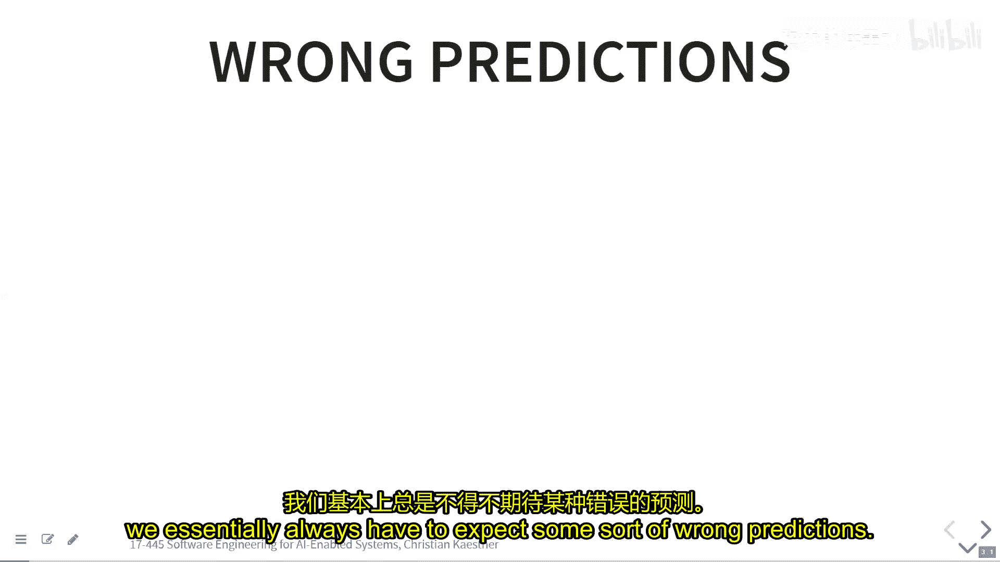

The cancer detection system that we talked about might just be wrong right It may not detect the cancer。

 It may detect that there's cancer， which leads to an invasive kind of operation that may may not have been necessary。

 And we can think about what are the consequences of this right so in some cases。Models are wrong。

 and they lead to。Some inconvenience， right， so maybe you need to do some extra tests。

But they could be life threatening， kind of safety relevant in some cases。

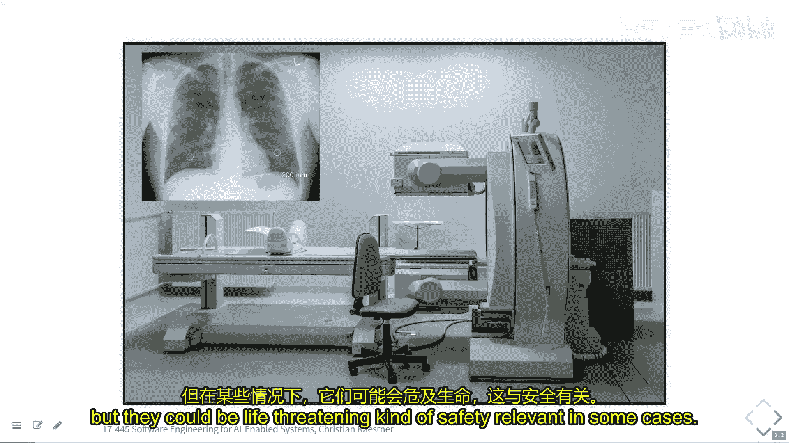

There are a bunch of other consequences， right。This was as well known。

 kind of the Uber safe driving car in an accident， again， very clear safety implication。Right。

Also probably quite a problem for the reputation of Uber。

And said driving cars more broadly right so they stopped all the testing but probably severely limited their operation and development facilities。

There are tons of examples of。Amazon， Alexa gonebat。Not all of them。

 like the first one is more almost more of a funny story where neighbor complained about kind of really loud music and this was somebody leaving the home for the weekend and Alexa just by some coincidence started to have a party at really loud volume so it picked up on something and started music loudly right so that led to neighbors coming in and calling the police。

There are lots of stories about Alexa devices buying all kinds of things because something was playing on the。

On TV right so that it picked up on should put the XKcD comic about ordering a million jelly beans whenever entering a house in here so there are lots of examples the dollar house thing is probably not technically true but it's a funny story anyway and very believable right so in this case。

Probably not the first case you could argue this is safety again right this is environment pollution and so on。

 the second case probably not a safety issue that you can still think about what are the consequences here right for the family where the horse the daughter house is bought。

Financciial also maybe for Amazon reputation of Amazon， things like that。You remember this。

Kind of Microsoft had this chatbot。That could interact and learn from chatting with other people on Twitter。

It's a turn racist pretty quickly。They shut it down after day。So again。

 what are the consequences here right so it's probably more a reputation thing。

 probably not a huge financial loss， probably a research project that hasn't worked out as they wanted it。

 they learned something from it， probably some hurt feelings。Maybe必。

And then again I could go on forever right so there are lots of examples of machine learning things not working as intended making mistakes。

 Amazon tried for many years to use machine learning for recruitment for scanning applications and they found this was terribly biased right that was picking up on the school that people graduated from and if it was a majority female school or something like this this was kind of hard right even if you hit what the gender of the person was。

Do you have any examples of kind of machine learning systems that you may have interacted with that make mistakes can be really low stakes or high stakes。

 things that you have seen personally experienced？can either write or just raise your hand and speak out。

Google face is not recognizing certain faces and especially than people of color yeah。嗯。

Not sure how important this is for your image collection。

 Thiss certainly not great for the reputation of the service provider， Nathan。I get。

 this is not a machine learning system， but even just some of the everyday things that we use like。

Automatic， you know， hand washers like you go if you put your hands under the sensor and。

Sometimes those don't work for people who have darker skin tones。

Systems I don't have an M component could have some sort of bias Yep I had this on an earliest slide skipton wanted to come back later but yeah there are lots of these things where there's a question of how these were tested。

Text correcting engines taking into account different dialects， not even English。

Any specific experience， Google Home works poorly for certain dialects。I mean。

 it works poorly in general right so it may like。At way。

I should probably not say this if you're saying certain dialects。

 it doesn't detect my dialects very well when I want to put certain specific things on the shopping list。

I suspect this is also a case with people who have English as a native language。

 but it could just be more dialect if you want to blame it this way。Right， so。

It certainly makes mistakes all the time for recognizing to dos。

 for recognizing things on the shopping list。The consequences are again there's a range of things right it may may not schedule my meeting or it may put the wrong thing on the shopping list。

 sometimes it's just funny sometimes it's annoying it's usually something that I can undo that's not life critical but。

Yeah。😊，Any other exhibits you can think of？Navigation systems。

 there are probably lots of funny stories， Chris。Yeah， I think。Sometimes with recommendation systems。

 I think people have seen this with YouTube， yeah， someone actually mentioned it。

It'll recommend like the same。あ。I guess。Videos with similar content and just keep recommending those without ever recommending you。

Movie videos that are different， I guess。Sort of like a rabbit hole bit if you keep watching them。

Right， and it just reinforces itself， basically。They actually broke this recently is another thing that I want to talk about later it broke us manually with conspiracy theory videos about people watching conspiracy videos and then getting recommended more of them and watching more and so on and it's actually the algorithm is working as designed people watch this so they want to watch more kind of they hard codeded specific routes to break this to actually overwride the machine learning system there right so lots of examples I think we can probably go on forever I think it's useful to think a little bit about where those。

Problems come from。 And there are many different sources of issues。 And it's not usually easy to say。

 again， we don't have specifications， right， So the model picks picks up on something。

 Maybe not what we're intending。So。What are some things that you can think about that's causing wrong predictions？

So some of the examples that we talked about。Poor recommendations system not recognizing when I want to add something to my shopping list。

 Google photos not recognizing faces of people of color， the Uber crash。Whatever， right so。

Training data was biased that's a very common thing right so you just don't have training data that's close to it。

 you're trying to predict something that's out of distribution。What else could happen？

The input into the system might be wrong， right， So sensor measurement errors。

 So you have inreliable inputs。You have feedback loops。

 this is typically has to do with data drift right so you learn a model at one point in time and may have been accurate then。

But the word has changed， and the model hasn't changed with it。There are many more examples。

 The typical thing is machine learning tends to look for correlations， right。

 It looks for things that。

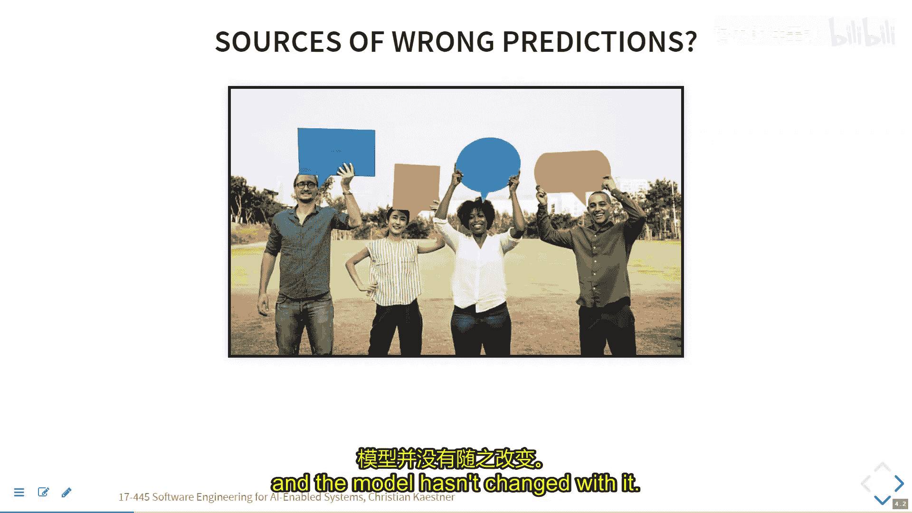

Occur together。It doesn't mean that they belong together right spurious correlations are common so these are there's a tu loves we spurious correlations there tons of these these are just some interesting ones like the number of people who drowned in swimming pools is strongly correlated with how many movies Nicholas C released in one year for a while。

There's probably no causal link here。🤢，A machine learning system might pick up on this right might pick up that there's lots of Nicholas cage movies in a year maybe we should protect our swimming pools or something right this is something that it just it doesn't understand it better right or the divorce rate in main versus a reduction or the consumption of marine so the system might recommend to reduce kind of maybe produce a public advertisement。

Campaign to eat more butter instead of margarin to kind of protect our marriage。'sIn Maine， right？

でそす。

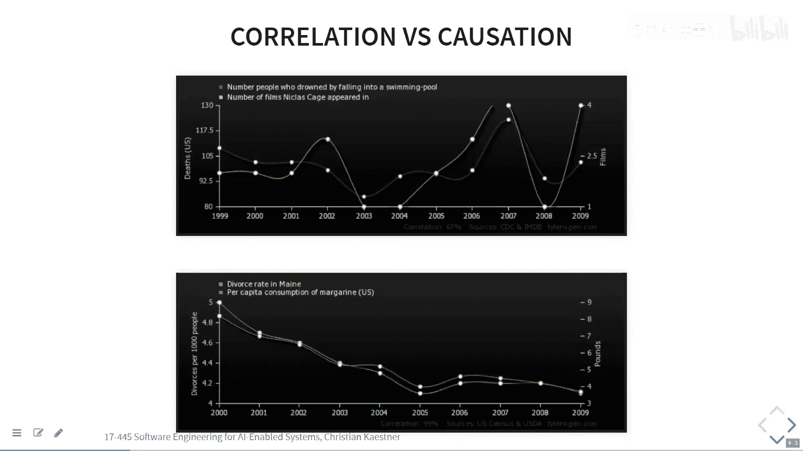

A big issue here with。Even if we see correlations and there is something behind this。

 it might not be what we're expecting the classic example here is that coffee is fairly strongly correlated with cancer right coffee drinkers are more likely to get cancer than non coffee drinkers。

But again， this isn't this is a correlation there's no causation between this cancer as far as we know does not coffee does not cause cancer right the thing that's actually the cause here is smoking and smoking is fairly strongly correlated with coffee consumption right smokers drink more coffee on average so there is actually some causes here but the model may not pick up on the right causes。

It's not reason reasoning causally， it's reasoning about correlations。

 so you might get recommendations because of something because you have watched something because you bought something and there's some correlation with other people who bought this。

 but there might be some effects that the model simply doesn't know。

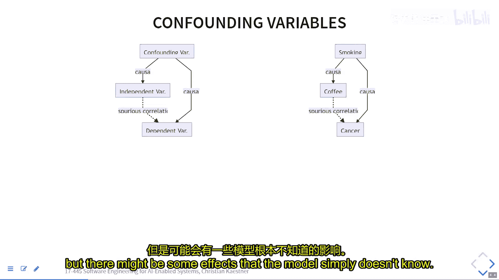

There are actually lots of interesting examples of this， an example that recently。

Heard about it was cancer prediction actually works amazingly well in some contexts。

Because it picks up on。Certain。Text in the image， not because of the cancer that's actually in the scan or not。

What it picks up on is that there are certain devices。Used to scan for cancer。

And it picks up that there are mobile devices and stationary devices。

Mobile devices tend to be used on patients who are too sick to make it to the stationary devices。

 so they have a much lower survival chance。So the model actually picks up on kind of labels that it's not supposed to learn。

 it kind of cheats right， it kind of learns from something that's hidden confound。

It actually picks up on some information here， but it's actually the human making the call or some inputs that are not supposed to be used。

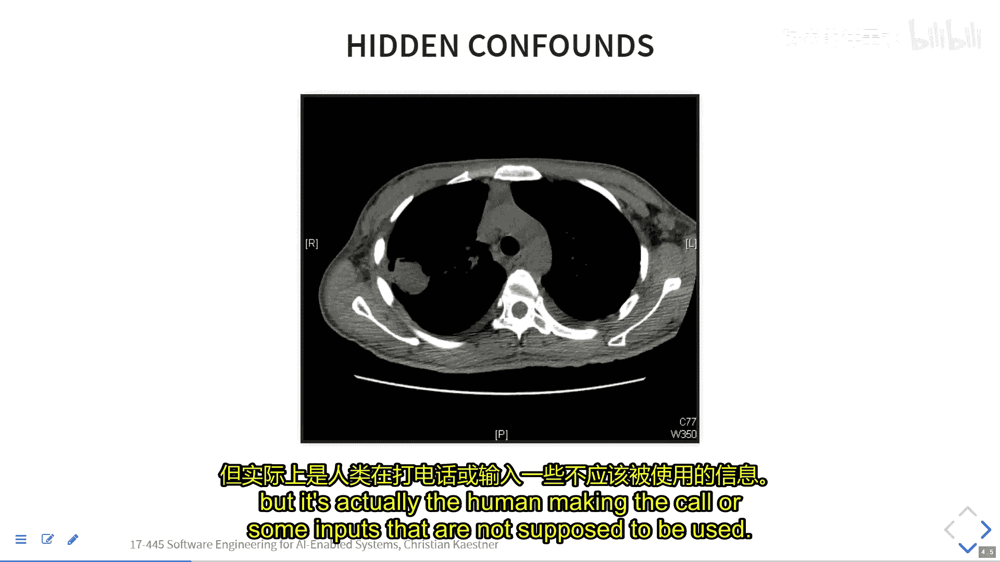

There's also lots of interesting examples of reverse causality that there might actually be some causation。

 but it's the other way around the plastic board example is playing chess kind of early chess computers trained with chess master moves。

 learn that sacrificing your queen is actually a very smart move because in a lot of chess master games。

 if somebody sacrifices their queen。That's。They only do this if they're about to win。

So if you look at chess master game， they're not sacrificing their queen in kind of stupid situations。

 but the early machine learning models in the 80s picked up on sacrificing your as queen is a good idea。

When I see causality is the other way around， because theyre about to win。

 this is a move that only works there。

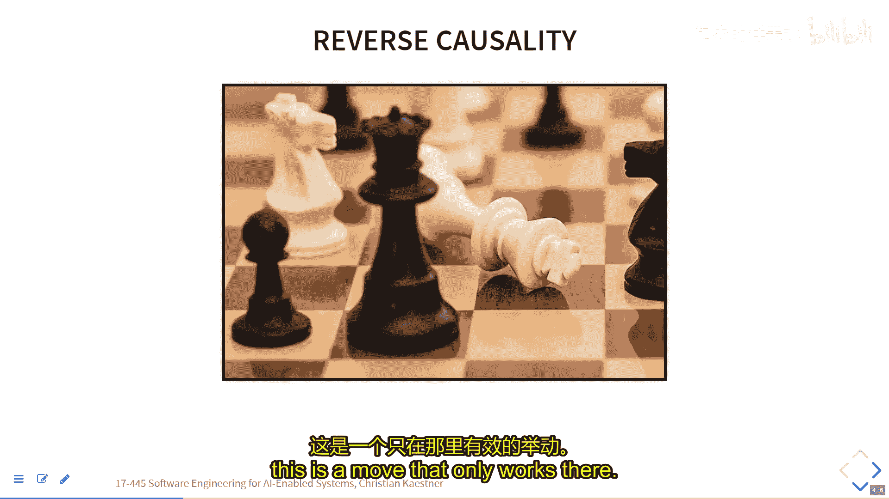

Another interesting example is a system that only looks at hotel reservations might figure out that the prices are very high if there's a lot of demand。

If you don't know the arrow of the causation， you must just suggest raise your prices。

 demand will rise。Right， so again， the system。Just doesn't know the causation。

 it sees correlation and may have problems understanding what's happening。

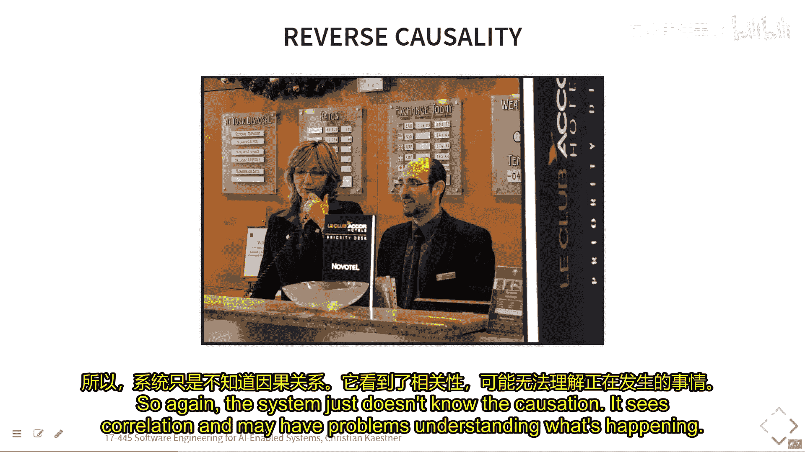

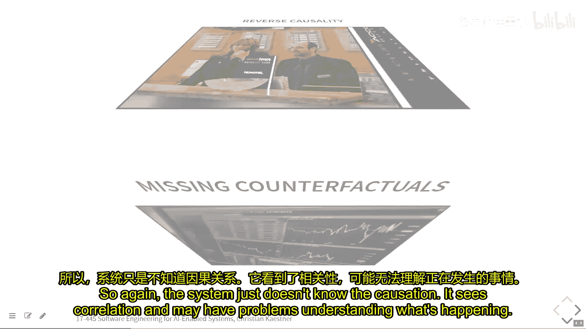

And another very common problem is that systems。Only see data about things what happened in many cases。

 but not about things that haven't happened。So if you're learning， for example， stock prices。

You only have one reality， right， You see what happened in the past。

And you can kind of think about there was maybe some press release and then the stock price rose and maybe that was correlated or that was causing it。

 but we don't know what would have happened without the press release。Thanks。Another example is。

You are taking this course。 Is this causing you to be better。

In your job later doing machine learning or applying machine learning。

Maybe but maybe you would have ended up in that job anyway because you're already interested in those topics right so that there's a reason behind why you're taking the course and you don't know what would have happened otherwise there are some cases where you can simulate this where you know what the character factorual might be right so the kind of what if question what if I hadn't done this but in most cases we don't know this and then all the obvious reasons。

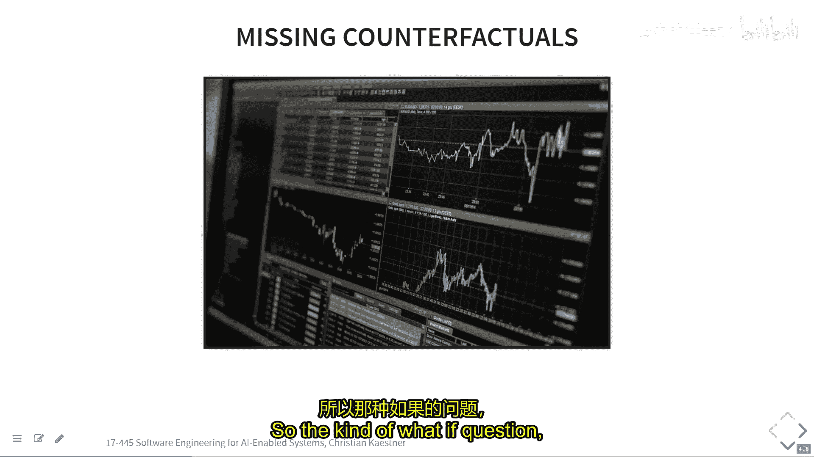

About many of that you mentioned right insufficient training data， noisy training data。

 bias in the training data， a model that just poorly fits the data that overfis or underfis right where you select the wrong model。

 maybe you have nonlinear effects but you model it with a linear model you just don't have the context to identify the right prediction。

You're trying to predict the stock market from Twitter data， but Twitter data。Insufficient to really。

I don't know what would be sufficient to predict the stock market。

 your inputs are noisy or you're trying to predict something that's far away from your training data right so this out of distribution inputs where you're learning on some data。

 but then you're predicting something else。Well， there's one more， I think， quite useful thing。

Way to think about this and Jake brought this up a week ago or so Black swan events。

So you can think about that machine learning is suitable for some kind of scenarios more than for others I find this terminology of known knowns known unknowns and so on always very confusing but if you don't want to follow this just look at the categories so there are some cases。

Where we can make predictions and we're fairly confident about predictions right so we have rich data available models can make good predictions near the training data。

嗯。What kind of。Well let me show the other ones and then we talk about what they might be。

Then their cases。Where we know that we won't be great at predicting things because we're trying to predict something for which we have almost no data。

 we're trying to。Pretty， really rare events。Those would be kind of known risks right so the model can detect that it just doesn't really it's low confidence in this。

 it doesn't have a lot of support。And then there are things that are really hard to anticipate because we simply can't foresee them so there's essentially no way of modeling this either for humans or for machines and the last one here it's called unknownknow knowns is where the model things it knows what it does。

 but it's completely wrong。so the model says with really high confidence there's cancer in the image。

 but there is none right or any of those situations。

 so maybe a different way really have a hard time putting this into into these boxes。

 but it's kind of。Roughly。On one side， how good are our predictions。

 do we know what we're predicting or not， do we know how good our predictions are？

We kind of know that we know or we know that we don't know and then how confident are we in our prediction。

 how confident no confident？Can you give me a couple of examples for each of these things。

 So what are some examples of known knowns。 So things where。We。Have good training data。

 machine learning works usually fairly well with high confidence。

 we have lots of data we can do good predictions。ES Bm detection right with tons of data sentiment analysis right actually most of the common machine learning tasks are kind of mainstream right translation language recognition。

 navigation recommendation engines。Right kind of expecting how a car will behave face detection right so a lot of these things where we have a lot of images。

A lot of training data and we usually do fairly well。

What are the things where we know that we're doing badly？

What are some examples that machines are pretty bad at， but we can recognize it？Quantum physics。没必。

So examples of prediction problems where we just don't have a lot of data to go for。

Try to predict elections。This is something where you have kind of data every four years， right。

 So this is something where you have very sparse data。嗯。

Another example is kind of mergers of two companies trying to predict whether it's a good idea or not right so there is some data but you don't have a lot of things to compare those with right you don't have a lot of public information about other companies。

Typically。Humans also don't have a lot of data， but they usually are better at connecting dots at thinking about those making judgment cardss。

 so humans often are better at these kind of tasks。UmPredicting elections with some data。

 maybe or predicting whether a merger is a good idea。Maybe telling jokes。Maybe quantum physics。

 Im not sure。What are some examples of Black swaann events？

Things that neither humans nor machines can't predict。The 911 attack。

And kind of all the consequences， a pandemic， right？Actually， lots of consequences of a pandemic。

Like a lot of these things change。A lot right so a lot of kind of inventory prediction algorithms suddenly don't work anymore people start hoarding toilet paper right so this is something that you can't foresee really or very unlikely that you can foresee it right and humans and machines are similarly bad at the stock crashes as well right。

And then there are lots of examples。Including the ones that I've shown you earlier where machine might be super confident that it's right。

 but it's wrong right so it's again， often examples where we have a lot of data。

 but it's still wrong。 I don't think that there's a real。

Category of things of examples's where this happens it's pretty much all prediction kind of things the chess example that I gave you is one of them right so where machine might be very confident in all cases where I've seen somebody has sacrificed their queen and then they won。

So it makes a prediction sacrifice your queen and it's completely wrong。

 but it's super confident in its decision。Right。Humans are way less common prone to make those mistakes。

 This is something that's much more kind of in a machine realm。So in a sense。

 I think the main message here is just accept that machines will make mistakes。

So never expect a machine learning component to be right if you have symbolic AI and you can model this right。

 you can get guarantees， right。And you can do a lot of investments in making better models。

But you still need to anticipate that there might be mistakes and the thing that was in the reading also and Htons spoke is that。

The mistakes that machines make。And not the kind of the near mis mistakes right they might make very crazy unpredictable mistakes like in the picture below it's completely unclear why it recognizes one as a panda and one as a given and it's very certain about the given right。

Humans tend to make mistakes as well， but they are more predictable they may they follow certain kind of patterns of mistakes。

So machine learning models might be really widely wrong when theyre wrong because of a bunch of reasons that we talked about and because we simply don't understand what's happening。

And they might be confident about the answer， so just looking at their confidence scores。

Like we had this with a decision trees right and the decision tree we know the answer is true or false we should go goathing or not and we know that kind of a confidence score by in 90% of the observed data we went going in these kind of conditions right？

The confidence alone。Doesn't really help you， right You might be very confident and wrong。

So I think in designing a system， it's always a good idea to just accept mistakes might happen。

Assume。AI components or machine learning components to be unreliable components。

They might be good 90% of the case， 99% of the case。

 but always assume they might make randompredic unpredictable mistakes。

 they might be confident about their mistakes so whenever you design something design the system to be secure or safe even if the machine learning component makes a mistake and this is why we need to zoom out right so the component itself is unreliable and we can probably not fix that。

So we need to think about how to think about the entire system to deal with kind of unreliability。

And there are a couple of different strategies。There are a few parts of how you can make the component itself reliable。

 so if you don't use kind of machine learning but you actually use symbolic reasoning you might get guarantees。

If you have interpreter models and you have a human ver the model， I'll show you an example later。

 you might。Get much more higher confident right if you actually understand what's happening or you might do things where you predict things to really near training data that you're very certain that you're not predicting out of distribution anything that's really different so there might be a few strategies where you get really high confidence。

 but in general， just anticipate there might be mistakes you need to deal with them。And again。

 we need to deal with this at the system level， we talked about this case before where we talked about kind of designing the UI designing the experience right how forceful is it。

 how frequent do we interact with this， how do we keep a human involved。

 should we keep a human involved， should we take automated actions right this is one way to think about this another way to think about this we talked about before it's kind of system level safeguards right we talked about the thermalfuse for a smart toaster that would just burn out in the worst case rather than burning down the toast and then my kitchen？

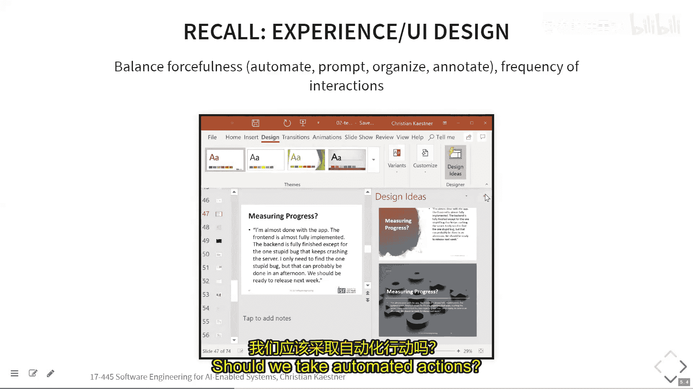

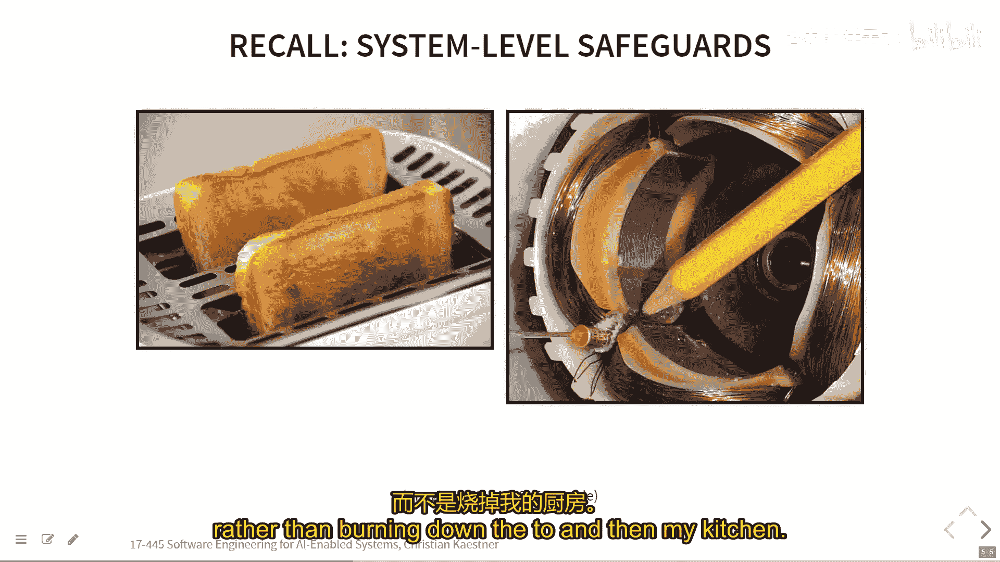

So there are a couple of common strategies that you can think about here。

I'm not sure that this is a comprehensive list， there were some in the reading as well。

One of the common things is to think about guard rates。

 is there something if you know what the worst thing kind of can be， can you stop something。

 if you know the machine learning component may make mistakes， how can you protect against those？

The example here was a toaster where even if it makes a stupid prediction， if it overheats。

 we just shut it off。And I think there are lots of settings where you can think about。

 is there kind of something to prevent damage in the end？

But also not in every system right so I have a hard time thinking about effective gut rates for cancer detection and image so you can。

Protect against very other， actually。There you probably have some human in a loop in kind of some system level。

 not in the software system right， but kind of in the process level。

 some guard rates to protect against us， like having an independent assessment。

 maybe with a different scan or different thing。Okay。

Another strategy that's also common in kind of for and systems。

 traditionally is redundancy and some sort of voting。

 if we talk briefly about in some other lecture about the tendency and some really critical system just to implement the system twice and hope that people don't make the same mistake in both implementation。

This is very common in machine learning in the sense of ensemble learning。

 where you just train many different models and you kind of average over them。

Random forests are a very classic basic way of ensemble learning where you just train multiple different decision trees and average over them and that seems to work pretty well in general you still may make mistakes right it reduces overfitting but you don't protect against other issues like reverse causality。

Especially if the data is biased， this doesn't happen at all really right because you're learning from bias data so all the models are learning from the same biased data。

It's also common that you use some hard coded roots or heuristics， like in the To example。

 you could hard code something never tossed for longer than 10 minutes in a row。

This is something that you can hot code。You do this often for important inputs。

 you might overwrite mistakes。A couple of examples like this。

And then I think a large class is where you just involve a human in some sense。

So there are many different things。 and a lot of this has to do with。Designing the experience。

 designing the user interface， the user interface， what we already talked about a little bit before right for example。

 instead of taking an action automatically you can involve the user， you can make suggestions。

 you can ask for confirmations。And also humans and machines are good at predicting different kind of things。

 and they have different kind of problems that we're doing so maybe let them work together。啱。

But they also problems with us， right， So this is。It's not my area of expertise and I don't want to go too deep into this。

 there's also a costs that we have on human machine AI design， Connieman。

But think about so classic problems are if you just bug the user all the time。

 they kind of get complacent or。Notification fatigue is a common example。

Do you have an example of a machine learning system that kind of wants to keep you in the loop。

 but you start ignoring it or you just say yes， yes， yes or something like this？

I I think it's got an AI component， but my phone keeps telling me the weather not through like a weather app or anything like that and it randomly tells me the weather and I really don't care。

你看。Not sure whether it wants you to take an action or this is more notification。 Yeah。

 but it's an annoying interaction design， certainly。嗯。

There are a bunch of cars that ask you to confirm every time you start the car that you're driving safely kind of kind of with the when it shows a navigation thing or something like this。

 right， don't be distracted， don't use your phone while driving。The Army has a discussion。我。

So Jake brings up AI involved in me devices， right？

If you're bring up too many false alarms and you kind of wait for a nurse to catch this。

That they don't intervene， they might just completely ignore the alarms at some point。

In the cancer example， you might think of something else right so if the model is constantly wrong。

A physician might just ignore it at some point。If the model is always true in their experience。

 they might also not really think about it。Don't critically question the example of the model。

The recidivism example is another good example， the idea of the do I have this here。

 I think right so this kind of compact compactas model and things like this that kind of predict whether somebody will commit another crime。

This is essentially just supposed to do a simple prediction whether somebody will commit another crime。

 that should be an input into a judge's decision about whether they release somebody on bail or not。

And the model doesn't really care about the severity of the past crimes and things like this so the judge should make。

The judgment called here about whether to release something。 The problem is that。

It's very easy to get complacent right so kind of just say I get this magic number from the tool and it tells me oh he's likely to commit a crime so I'm going to reject bail there's actually a lot of cases where I think people found that judges don't really understand what the tool really does how limited it is and they don't really make good informed decisions say just kind of to checkbox compliance right you have some money in the loop there's also a lot of discussion in the。

InIn the military。I don't know the current status， but there was an order a couple of years ago that's interpreted to say that whatever happens。

 there always needs to be a human in the loop because before there's a decision to engage in killing somebody right so even though we have drones that could easily automatically detect and take somebody out there needs to be a human in the loop。

 but again you can think about，If the machine tells you with some confidence， something。

 how critical is a human going to be？嗯。Is this really just a checkpoint that we can say if Congress starts an investigation because we started civilians that there was a human envelope loop and it was human error？

rather than machine error， maybe the system was designed， it's always easy to blame humans right。

 but it's also hard to kind of have humans in the loop as a checkpoint。

The example that I have in the slide here is the Tesla autopilot， Tesla has a self driving feature。

 right？Works pretty well as far as I hear you kind of can take your hands off and do other things it might be you or maybe you need the hands on the wheel but can read or something。

 you're not supposed to do this。And there's really confusing kind of communication around this in the advertisement。

 Tesla， essentially。Advertiisees this or has advertises as a safe driving feature right so they essentially say it's safe driving but then in the liability thing theyd say you always need to be have your hands on the wheel。

 you always need to pay attention if the safe driving car crashes it's your fault because you're in charge。

喂。And there's kind of this disconnect between we put humans sometimes in the loop。To oversee this。

 but if we don't design this correctly they might be fatigued they might not actually pay attention they might become complacent right just follow the predictions or just ignore the predictions and there's quite a question here to what degree do we put humans in the loop only for kind of liability reasons。

嗯。That we can blame a human if something goes wrong。Yeah。

 in the PowerPoint example we have a human in the loop。

And it's very obvious that we have a human in the loop because we only recommend certain things and human needs to actively even pick the feature。

 pick an option and do something so there's very clearly human in the loop。

Another thing of mitigating mistakes is to provide an option to undo mistakes。

This doesn't work in every case right so if you have a military drone that kills somebody is how to undo。

 if you make a design choice and PowerPoint， it's easier to undo。Um。Give any other examples of。

AI techniques that take actions for you that you can undo。Or that the human can overrite。

 so there's a default action， but it can be overwritten by somebody。Emails spam， yes。

 you can undo this， right， You can overwrite this or flagging emails as important。Tping ahead the。

There's predictions， you can accept them， you can also just delete the text again， right？

Credit card applications tend to be one of them right the way you get the default decision and then you can appeal maybe to the manager。

 although these days the managers don't have a lot of leway often or don't want to right so they just accept the machine prediction。

RightA bunch of smart home things that may take automated action。

 but you can overrule it right if you thermosat things it goes way warmer than you wanted。

 you can overrule it and you。Not entirely undoable， right， you're a bit too warm for a bit。

 whether it's not a long term consequence。And I think this is a special kind of direction。

 but if you have really interpretable models， which in most cases we don't right。

 but where we actually understand what happens， I think we have way more confidence that。

We can accept the model as a rule。And don't expect as many mistakes。All right。

 any questions did I forget anything， any other mitigation strategies you can think of？

So you' nutshell this is a big design space right and this has a lot to do with kind of requirements engineering figuring out what you can do。

 what you can't do has a lot to do with user interaction design right human computer interactions I don't think there's any fixed recipe there are a couple of common mitigation strategies that you can think about it's worth thinking about can I take an automated action and then unnu it or should I ask somebody what other consequences of asking somebody and I think just it' just exercise in a specific scenario。

 whatever system you're building， what can you do how can you think about this。嗯。The other direction。

That I want to go into now a little bit as risk analysis。

Systems may make mistakes and you want to mitigate them， but it's worth to think about。

What could the consequences of the mistakes be？

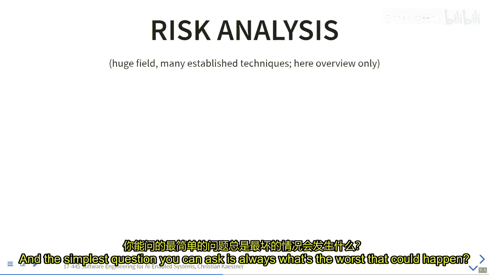

And the simplest question you can ask is always， what's the worst that could happen？

I'm not sure how likely the robot uprising really is。

Theres some people like Oxford philosopher Toby odd who predicts the。

So he studies existential risk so risk factors that might wipe out humanity almost entirely right so not a thing like a normal pandemic that might or a strong pandemic that might kill a third of the population really wipe it out entirely right so he thinks about things like meteor hitting earth and wiping out all of humanity right or an engineered disease that essentially wipes out all of humanity and in his book general artificial intelligence is actually rated as the most likely scenario that might end humanity at about 10% it's a guess right so it's kind of philosophy thinking about this within 100 years。

And so that's thinking about can we actually get to something like general artificial intelligence that can reason smartly and then can we put in predictions？

If there are multiple countries kind of competing around this， can we limit this。

 can we help a kind of a ban on things like this？嗯。I'Not sure whether you agree with this to me。

 this sounds too much like science fiction。But this is one way of thinking what's the worst that can happen。

 right and humanity。

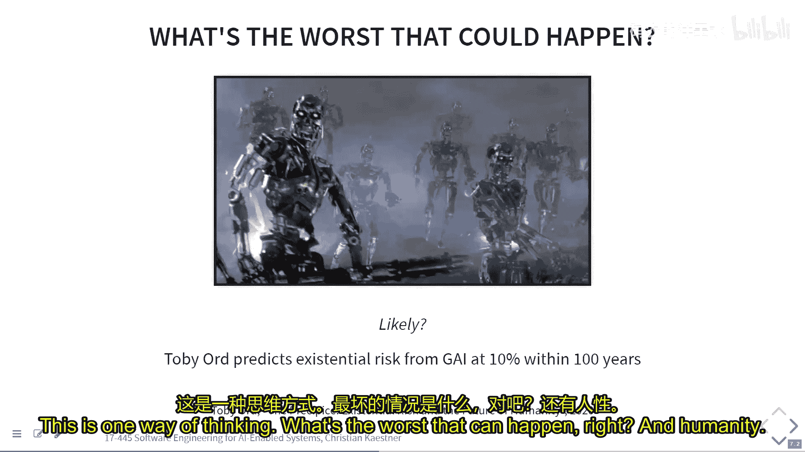

Along those lines， who of you has played paper clips before who knows this game？

So if you don't and you have like four or five hours to waste。

 this is super fun you're playing essentially a machine that has a goal of producing paper clips。

And it's kind of a thought experiment what's the worst that can happen if you instruct a machine to produce paper clips and I don't want to spoil this anymore it's a really simple kind of it' a simple web user interface game at least to me this was super addictive kind of。

Kith， I think is Saturday also almost entirely producing paper clips。

Anyway。And know I guess some of you are distracted for the rest of the lecture， I guess。

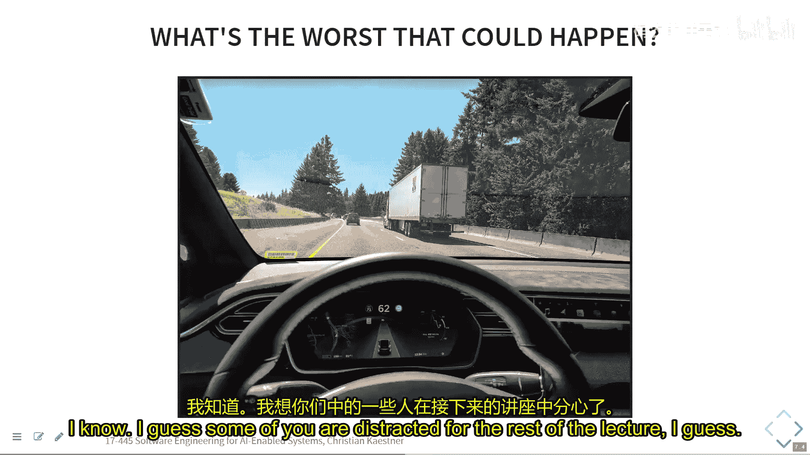

Here's a URL if you want decision problems， so if you just search for paper clips you find it so you can produce paper clips in the background。

嗯。So its but it's not always wiping out all of humanity right so if we think about La assistist。

 what's the worst that could happen？Crash。Probably crash， killing multiple people， right accidents。

What are other bad things that can happen that are not the worst that can happen。

 but still pretty bad？Property damage， yeah。Damage to the car pay silently right。

Any mightly annoying things that can happen that are still。Kind of bad。A flat tire， okay。

SShp acceleration tickets from the police traffic rule violations yeah could just start beeping at you the entire time right be really distracting so there are lots of bad things that can happen in some sense and some are worse than others right so it's not always the worst case。

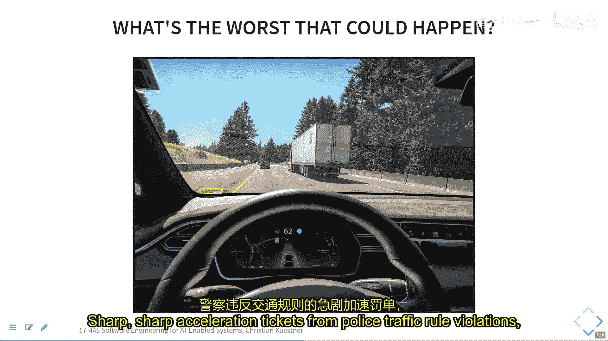

And we can go through this， what are bad things that can happen here right。

 what are the consequences， how bad， what's the worst thing that can happen？

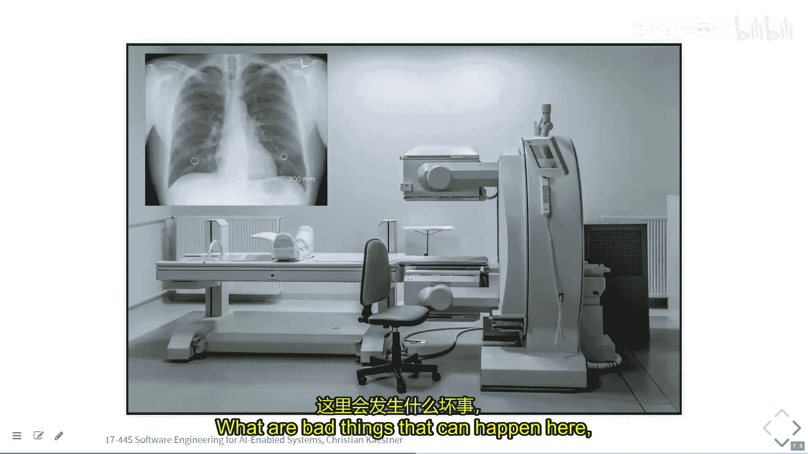

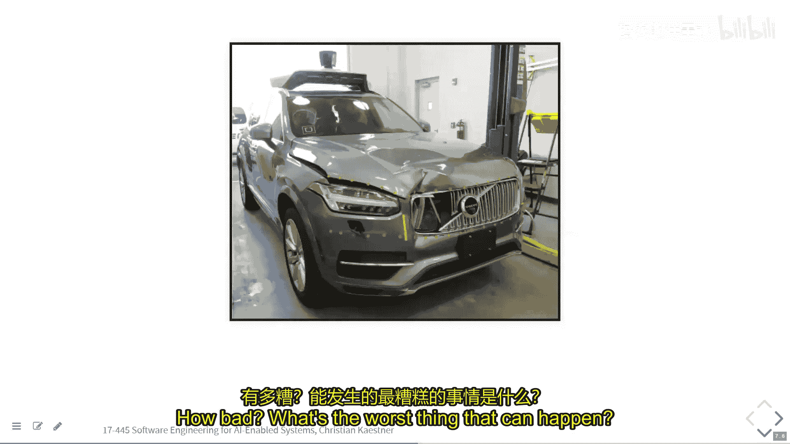

So we can go through all those examples again and think about。This this loss of life。

 this this loss of money， this is loss of reputation， right？What can really what can happen here？

So this is really risk analysis， so thinking about what can possibly go wrong in my system and what are the possible consequences。

And risk typically has two components。It's。The likelihood of something occurring and the impact of when it occurs。

right so。Wiping out all of humanity is really bad。And 10% is pretty likely。

 so that's a pretty high risk in that regard right causing a slight inconvenience by beeping once in a while and this might happen from time to time is maybe not that risky right crashing the car with a person inside is pretty bad the impact's pretty high and now it depends how high risk is depending on how big the another is。

So for risk analysis， we have a lot of methods that come typically out of the safety community of thinking about what are the possible risks and how can we think about kind of figuring out how bad they are and so on。

And I suspect some of you have way more exposure to some of these than others。

 so some of these came up in previous classes in the MSE Ma and So engineering program I'm sure。

 but I just want to go through some of them to give you a sense of what the toolbox could look like and these are useful tools to just think about what can happen so we know these AI components are not perfect right they can make mistakes but think about what are the consequences。

 what are possible risks。嗯。So one strategy that's fairly commonly used is fory analysis。

 pories look something like this， where you have。I debate this again。You have some top event。

 so that's essentially the bad thing that you don't want to happen。

This is a trivial example here of there's no light in the room。

RightAnd then you think about what could cause these things。

 so you reason backward from the bad thing that can happen to what's causing this。

So the car crashes because it exits the lane， what's causing the car to crash。

And then theyre typically my possible causes and some are more likely some are less likely right so in this case there are three possible causes directly under or the website burnt out the switch failed or there's no power。

There are again， two reasons why there might be no power。The switch may fade。

Or because we have two lights in the room， we actually need two conditions that all lights are burned out。

Right and you can decompose these things so you have a top event and you can decompose it into more specific events and you can decompose it further and I don't really want to go into the notation much as fairly straightforward is a tree typically with end and Os right where of events and then the finalr things are the things that。

Are there root causes or potentially root causes of problems？It's called a basic event。

 things that you don't decompose further。And what you can do now is think about what are all the combinations that might lead to a problem typically you have safeguards in place and things like this so you may think about。

Even if the prediction is wrong， there should be this other thing that prevents it right and only if both of these things fail。

 we have a problem。Poultries you can use in multiple different ways so the common analysis is just kind of thinking through a problem right so starting with here's a problem like the car might crash what can produce it it's also a debugging tool last year in this course we created an assignment that I won't do this year where we gave students a report of the Uber crash the safe driving car and then essentially the crash was a a bad case and then we kind of designed backward a tree students designed in in the homework a tree of what are all the root causes。

In most systems， when something happens and you've thought at least a little bit about what could go wrong。

 typically multiple things need to go wrong for something bad to happen。

So famously in the Chobyl case， there are like six things that went wrong to get to this place that Chobyl exploded where in the Equifax attack。

 if you actually read the report， they had so many mistakes。

 they had so many safeguards in place that didn't work like they had an intrusion detection system that would have detected the Aquifax attack。

 had they not forgotten to update their license or their certificate。

And they had multiple of these things， each of which would have prevented this and so typically if you look at these actual things。

 multiple things went wrong right。A poetryry analysis will help you understand what are the cases that lead to bad behavior。

So the qualitative analysis is figuring out what are possible root causes。

 So the typical analysis here is minimal cutet analysis。 I don't care too much about this。

 but it's kind of what are the smallest sets of。Basic events the smallerest set of things that can go wrong right so in this example here if the switch fails or the network power fades or the fus is burn all of these will immediately lead to the problem right so they are three minimal cut sets these are three things that are small you don't need to break them down into smaller things they alone cause the issue whereas here this cutet is larger you need two possible things to cause the issue。

So you can do a fairly simple analysis and this can be done also with some tools and tools for doing this that will tell you what combinations of issues。

 what small sets of combinations would cause a problem。

And then you can also do a quantitative analysis where you assign probabilities to each problem。

 so you might say the lamp is burnt out is maybe 10%。

 the other one also 10% that the switch fades is very unlikely the fuse burn network outage is maybe I don't know 5% fuse burn as 1% right and now you can compute overall probabilities。

嗯。To just see whats， what's the chance that the event will actually occur。

So if you're thinking back to risk， that that's the product of the impact and the likelihood。

This is one way to kind of break down an event and think about how likely is it， right。

 because we're thinking about how likely our。Are the events like how likely is a component to fail。

 how likely is the component to fail and also the safeguard fails at the same time。Makes sense。Yeah。

Who has used for trees before in some homework assignment or something？Okay， not that many。 It seems。

 All right。 I would have expected more， but it's， it's a， it's a fairly common safety analysis。

 And let's， let's maybe just do an example。 We should have time for this。 So if we're doing AI。

You want to anticipate mistakes and kind of consequences of kind of mistakes right so AI components might fail and you want to evaluate what are safeguards so let's think together maybe about the smart toaster learning。

Maybe just take a minute and。Do you have some paper or some notes for yourself。

 just take a minute or two to think about how could a poetry tree look like for my smart to test burning？

And to do this we to make it more interesting you actually need some a little bit of complexity here right so you need to think about we probably have a safeguard like a thermalfuse。

 we have some sensor inputs probably a bunch of different sensors。嗯。

So I show you the notation here again， example。Maybe just think about。ForFor a second。

So what needs to happen for my smart toaster to be burning？How would decomposes。

IfSomebody minds to speak out， this might be easier than typing。A failed heating safeguard。

So the termfuse fades。I can't write that way here， but yeah。That alone wouldn't cause the issue。

 though， right？That's one component of the things that needs to fail。

You'll need some toast to needs to be。Turned on， I guess。Heating or something。Right。

 it needs to be heating too long， right， So what can cause this。Heating too much bread in a row。嗯。😊。

So temperature sensor fades is another thing， right， So temperature sensor fades。

There's another thing， but we have a smart dosea。 So the the first thing that we're probably starting with is。

That we have some sort of prediction that went wrong。

So we have a component that tells us so the model okay I haven't repeated this today。

 but the model that I've been thinking about the smart toaster as a function of some inputs like the camera input。

 the heat input and something add to predict should we continue heating or not right so it looks at the bread and until it has a certain browning degree and then it stops toasting right and what predicts based on what it recognizes what you put in as the bag or is this bread or something how long it should take right so the first thing is。

Maybe you shouldn't do this wrong prediction。来次。If we have a wrong prediction。

Or way too high prediction or so this is the kind of thing that we're starting with right so we assume the model is wrong。

That alone might burn down the toaster if we don't do anything。

Assuming that we also have the term of use。Both of these things must happen， right？

Which is way less likely to。Let's say that we have a wrong prediction。

 we can have a fairly high chance of that happening。

 we assume yeah it could happen for random reasons， but we assume maybe the term offuse is 99。

99% accurate right it will protect us in most overheating cases so the combined chance of the AI being wrong and the fuse is failing is pretty low。

And then we can also think additionally， what might cause this， if we have other safeguards。

 like we have an overheating software overheating production， right？Overheating thing。

That must also fail。And that overheating thing might fail because our terminal sensor is failing。

So you can break this down further。Right， and the overheating system might also fail if there's a bug in the software。

 I don't know。Right so there's an o here。Possibly。We can also try to decompose why we have wrong predictions。

 but it's often a little bit futile because even if there's no cause of the wrong prediction。

 we might just have a wrong prediction right so you can think about is the input to the AI wrong？

So I think if you're thinking reasoning about the risk with some safeguards。

Probably a good idea to just assume you're focusing mostly on the safeguards。

 you're just assuming I might be wrong。With a certain chance。对。Does this make sense so far？嗯。

So this is a useful tool just to think through。How can we get to a bad outcome and especially saying through we have safeguards。

 what what needs to happen that those safeguards can fail right if you don't have any safeguards it's really just wrong prediction my kitchen buds down。

You can directly see this is a pretty bad connection right this is a pretty bad poetryry because a bad thing can happen directly depending on an AI component。

 which is something that you probably want to avoid。

You can probably also involve humans in these trees where you can also say human doesn't stop things。

Right， human doesn't pay attention， things like this， Jake。

Just going back quickly to when you were talking about competing the probabilities and I guess we by default you would reason about them like a joint probability。

 but do folks also reason about them sometimes in terms of conditional probabilities like if some condition is true even though the。

The joint probability is pretty unlikely this one condition could cause it overwhelming overwhelmingly likely to fail or something like that。

Ob。Probably， I don't know。 I haven't looked into this too much， right。

 So I think there's you do probably some some。baic。Proagation of probabilities。

 I assume you can also compute with how certain are you about your probabilities and just kind of propagate errors and I assume you can probably also do things that if this happens or this combination happens something is more likely。

嗯。I don't。 I also don't。 I mean， all these probabilities are usually estimated， right。

 So there's a question of how accurate you really are。

 So it's usually kind of rule of thumb right in the。In the。In the book about existential threats。

 they were always kind of thinking about one in a million or 10 in a million， right， so kind of。

Those kind of probabilities just boilpark because you're estimating things some you can measure so for terminal fu you can probably get data about reliability for healthcareer components。

For reasoning about how to compose them， I'm not entirely sure。Alright。

So maybe one thing to observe is that poultry analysis is a backward analysis。

 you start with the thing that happens， the bad thing that happens。

And there's a question of how do you figure out what are the bad things that you care about right or what what could happen。

 can I anticipate all the possible problems and there are a couple of different safety analyses that go the other way around。

Another one is failure mode and E analysis， has somebody seen this before？

I would expect that this was covered in methods。For the MSC students。嗯。And another I would。

If we talk about this in analysis， I should know that， correct。All right。

 so this is a forward analysis where you essentially systematically， it's an inspection technique。

Where you think about。Each component。And what's the consequence if the component has a mistake？

So this is a radiation example where it says。The system should provide the required levels of radiation。

 but it could provide more or less。RightAnd then you can think about what's the consequence that could happen here and how can you avoid those consequences。

 You can start really thinking about。Bottom up， what are all the things that contribute to the thing being safe。

And then what will happen if any of those things fail right so you don't need to start with the outcome。

You start with a problem and think systematically about possible outcomes。So。

Typically what you do is you start by identifying system components and again you focus kind of about mitigation strategies。

 maybe humans in the loop and so on kind of at a fairly high level。

 and then you enumerate potential failure modes。And。

My suspicion is that for a machine learning component this is pretty simple you just assume machine learning component may have a wrong prediction right if it's classification might first be wrong if it's a regression it might be too high to low far off close so on right and then for each failure what you think about。

What's the potential effect on the system？嗯。And how could I mitigate this？

And let's do another example here， so。I don't have time to go through this in detail， but。

This is a potential kind of abstraction of a system for lane detection right so you have a bunch of sensors like what's the steering status。

 you have a camera， you have maybe a gyro sensor based on the camera。

 you have one AI component that does predict where the lanes are right and you have a different AI component。

That predicts how much you should steer and then you have some sort of safety system that maybe avoids that you're not steering widely left and right or at a high speed you're not turning massively or something like this right and the output is either beeping or actually actuating influencing the steering。

So now we can go through this。Each of these components might fail， right。

 so it might fail in different way， so the camera。Might just fail entirely。

 so you have no camera input and you can think about what's the consequence。

Now how can I mitigate this right so you probably want to detect that lane detection just says no camera input and the system should beep and disengage and ask the human to take over。

Right or the camera， a different failure mode it might be that the camera image。

 the camera is producing an image but it's garbage。

 right maybe because it's rainy or something like this， you have bad visibility， it's low quality。

 it's grainy， there's dirt on the camera， whatever these things is。

And then you can think again through what could happen。If that's an mistake。

 can the lane prediction thing recognizes， would this be propagated？嗯。

And this way you might detect things that you haven't really thought about。

 maybe you only thought about the crash as the worst thing that can happen。

But maybe another bad thing is that during driving the system just suddenly disengages because the cameras dead or something like this。

 right so you might detect new kind of problems， new kind of hazards that you want to reason about。

And once you have those， you can go back and do poetry analysis and go backwards and see how did you mitigate them and so on。

Does it make sense？I don't care about the specific technique if you go out and do something these might be resources to look at。

 I think basically these are guided inspections and some modeling tasks right so you kind of want to think about what are possible things that can go wrong right？

so。In this case you might actually want to think about more than just the prediction is wrong。

 it may actually make sense to understand a little bit why predictions might be wrong， bad inputs。

 bad training data and so on so that it can actually be a little bit more finegrain and think about how you can mitigate some of these。

I'm going to skip this。So whereas poetryry analysis is backward analysis。

FMEA is a forward analysis right so from the component to the hazards。

 not from the hazards to the components。There are a couple of more techniques they often seem fairly straightforward but there are things that help you to identify hazards in specific ways。

 so this is one not going to go into detail but hazard and interoperability study has a bunch of guide words that essentially。

Ask you to think about every component could one of these things happen right so the camera for example。

 cannot have more or fewer images I don't know as well as something else so it's just a structured way of brainstorming essentially right or kind of。

Can I combine these words with cameras to camera images to come up with potential failure scenarios。

 right， potential problems？嗯。Allright。Any questions about this？

So this is just high level thinking about risk， right being explicit during requirements engineering。

 what are bad things that can happen？Where can the AI components cause these bad things and what kind of mitigation strategies do we have in place how reliable they are is a good way to think about this。

One more thing that's。And I'm just going to race through this。

 that's super obvious for people who've spent significant time on requirements engineering。

 and that's thinking about the word versus a machine。So in requirements engineering。

 there's this typical abstraction and it's very useful to think about that there are certain things that the software can know and that the software can't know。

So the software typically tries to reason about the word。

 it tries to interact with the word in the Laer system。

 it tries to understand where it is in the world and tries to interact with it。

But the internal representation that the software has of the world。

It's typically just an abstraction right it's mitigated through sensor inputs。

 it doesn't really know anything about the word， it just knows what it can see through the sensors and it can just interact with the word through actctuaators。

So it's really important。To distinguish this， to be careful about this。

 that their things there state in the world。What the car is actually doing and their stayed in the software。

 what the car thinks it's happening。Or what the software is doing and there are only few places where those intersect and those are typically sensors and acttorators right so where we have some shared phenomenon。

In the real world somebody wants to do something right if we start a motor in the machine world we have some internal state。

 some error codes， some implementation things， and then we have the shared phenomenon which are usually things。

Where the software can learn something about the world。喂。And it's useful to think about this。

 we have requirements。Those are about what we want to happen in the world。

 we want the car to stay in its lane。Requirements are specifically about what we want to happen。

And then we have certain assumptions about the environment。For example。

 if we take a picture from the car is front face and it represents the world right。

 So it's the line markings that we see in the picture are actually there or something like this。

 So these assumptions about what the machine can learn about the world about shared phenomena and then the specifications are what actually happens inside the machine。

 right， So given a picture of。The front we should recognize the lane markets。

The specification doesn't know anything about the word。

 the specification only knows about the shared phenomenon。

 it knows about the picture that we've taken of the word。which might or might not be right？

And it's useful to think about these as separate things to break down requirements into these three things。

 requirements， assumptions and specifications， right we want something in the world。

 we can reason about something in the machine and we assume something about how the word behaves。

With regard to the things that we can observe。So if you think about the smart toaster again。

The software that makes the predictions doesn't actually know the temperature of the toaster。

It knows what the sensor tellss it about the temperature of the setoster。

And we assume that the temperature sensor is faithful。

So if you're thinking about kind of potential problems。

 it's worse to think about can we break our assumptions。

 are there any cases where the temperature sensor might not be faithful？right。

Where we might do weird things。So we don't typically have specifications even for the machine learning model。

 but we still can think about what's happening， what the machine can reason about。

 what machine learning can reason about， is's just a representation of。

Where this becomes really interesting and I'm going to skip a little bit ahead is thinking about feedback loop and adversaries。

Because machine learning is in the software world， it only reasons about things what we can perceive about the word。

And if an adversary can manipulate the images that we have from the camera。

We might not perceive the word as it actually is。Also， by actuaing something。

 we change the world and we want to perceive it again。

 but we might not fully perceive what's happening， so the feedback loop example。That。

For forgot somebody you mentioned earlier about YouTube recommending more and more videos of a certain kind。

 right we are interacting with the world， we're affecting something in the world。

And that comes back in some way to our senses right we have certain assumptions about how the word behaves。

 but if our assumption about how users prefer to watch the same thing all over again is wrong。

 we might actually run into some feedback loop， we might make predictions that don't。

Behavior and data drift also makes sense through this lens where the world changes。

 but our assumptions are potentially outdated。Does this view make sense？

Probably should spend more time on this， I probably should come back at least in maybe in a recitation。

 maybe in the next lecture to go through an example again。It's another way of thinking through。

What could happen right so how can the machine be wrong， how can our machine learned model be wrong。

 how can it interact with the word right what can it actually perceive of the word。

 it's not taking the word directly as an input right it's taking cs as an input and it's interacting with actctuaators and all of those are imperfect。

诶。So the software and the AI cannot establish the system requirements， they are part of the system。

And the environmental assumptions are just as important and if we misunderstand them。

 if we model the environment incorrectly， if we misunderstand how humans react to recommendations。

 we might lead into weird feedback loops and weird results。All right， good time to stop here。

What I wanted to do today is to sensitize you about the problem that machine learning may just make mistakes and I think there's nothing right now that we can ever that we can do about this maybe we at some point really understand how deep neural networks work and can understand this and understand specifications but right now there are so many things that can go wrong poor data。

 reverse causation and all these things that it's safe to assume we have a machine learned model assume it will make mistakes and it will be very confident about these mistakes sometimes so you really need to start thinking about planning for mistakes and there are many different strategies。

 safeguards and involving humans or some of them。And you really to understand how to do this。

 it's useful to think about risk about hazards， about what can you perceive of the word。

 how do you interact with the world， and carefully think through this。Alright。

I think that's a good point to stop。诶。Let me know， stick around if you have questions。

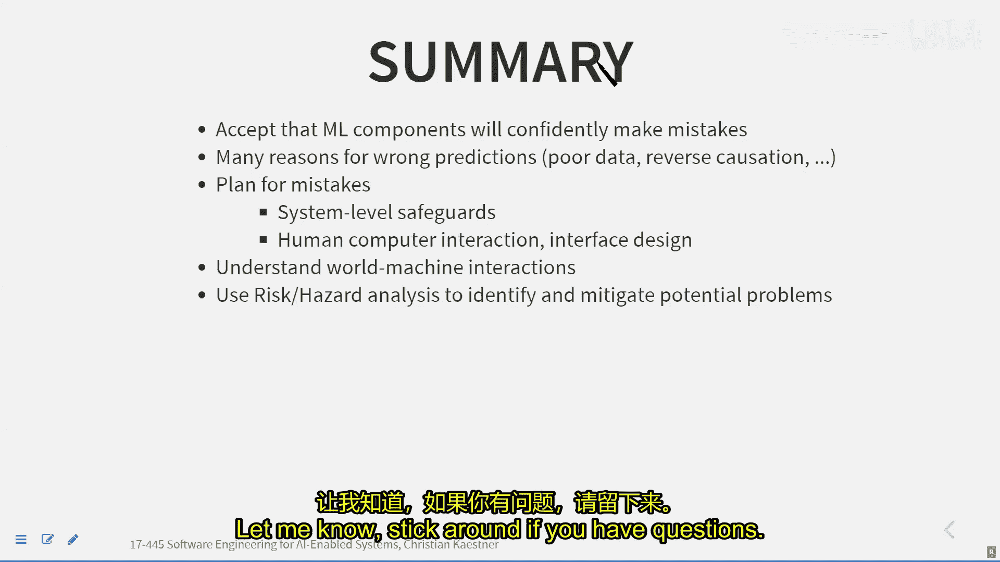