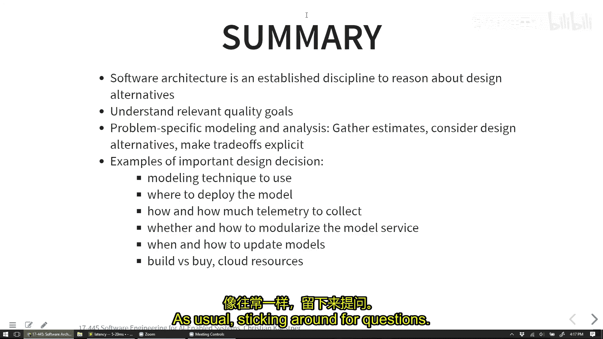

# 【全集】卡内基梅隆大学-AI驱动系统的软件工程-中英字幕-1080P-p09-Lecture-9---人工智能驱动系统的软件架构--BV1JS6gBcEBF_p9-

All right。Today I want to talk about software architecture and before I go ahead with this。

 my usual question is what did we talk about last time？What do you remember。Mistakes and safeguards。

 Yes， there was a topic。 Can do you remember a little bit more or anybody else or。

Maybe just unmute yourself and say a few words。嗯。🎼So maybe can I just call on you Jake。

 you already said mistakes and safeguards， can you say a few more words？我。Yeah， we just went through。

Kind of the certainty of mistakes in different situations。

And how there there's a different severity depending on what you're dealing with。

 like I remember the cancer example and then the automated car example。

Right so we talked about why machine learning systems make mistakes to some degree it may not matter。

 but it matters that they do Nathan do you want to say a few words about for analysis？

Can you hear me okay， so from what I remember we just we。

Created a fall tree based off the example of a smart toast tree that was burning。

 that's the main thing I remember。Andre not breaking down a breaking down a problem and identifying。

How could this problem arise based off of other areas within other components within the smart toaster right so that's exactly it so we talked about risk in general more broadly right and different forms of risk analysis and poetryry analysis as one of those things where give them a bad outcome you kind of think about what leads to this outcome。

 what kind of things need to occur together， what kind of mitigation strategies must have failed to come to this outcome so you can analyze possible risk quantitatively or qualitatively we also looked at some other techniques right so the general theme was really thinking through possible risk。

 possible mitigation strategies and plan for that your AI components make mistakes。All right。

So today I want to talk about software architecture and some of you have just taken a whole class on software architecture。

From those people， can I get a volunteer to just in a few words。

 describe what software architecture actually is and why we need it？I see mine grinning。

 Do you want to try？Yeah， I guess。In architecture， I think we talk mostly about the kind of patterns that we are going to use and how we are going to structure our software。

Based on certain quality attribute that might be of concern to us。This could be stuff like。

Modfiability or modularity to be able to change things quickly。

 or it could be to you know improve performance or improve reliability。

So what is software architecture？do you want to give it a shot。

So I'm just starting to call on people today apparently。

 I think it's the design of design and interaction of software components based on relevant quality attributes in like one sentence。

RightIt's possibly a bit harder to capture， but what you're saying is probably the essence right？

You kind of have requirements you want to get to some implementation and you need to think about how do you approach the system right so software for architecture typically corresponds to some high level design。

 some design decisions and it's always driven by some qualities that we care about right so there's there's。

Typically it's described in terms of structures and connections and their properties I don't want to go through this too much。

 but it has a lot of often people think of software architecture as some diagrams that have some purposes right so they're useful communication to think about constraints on the implementation to think about how you structure teams and。

Think about quality attributes which is probably the most important thing。

 let me just race through one case study just to give you a sense of what the scope of kind of software architecture is so especially for those who haven't date with us too much。

Who remembers the Twitter failedway just by a show of hands in the camera？This kind of image。

Have you seen this？No， I are too young so。In the early days of Twitter this was a very common sign that Twitter was overloaded so around 2010。

 2011 I think this was a very common frequent occurrence for example in the I think it was a 2010 world championship soccer games every time there was a goal Twitter was going down because too many people tried to tweet at the same time。

There was a problem here mostly with regard to capacity and they were thinking about well what's the problem。

 how can we deal with this And in addition to performance capacity issues。

 they also had substantial problems of kind of extending the platform。

 building new features because of focusing just on scaling and kind of。

Dealing with things so the way that they tried to scale things so far was just putting in caches everywhere right so there was kind of a traditional database application all written in rubby on raids and they added more and more caching but they couldn't kind of push it far enough。

By the way from Twitter's point or that Twitter does is essentially it's a realtime search engine。

 that's how they think of this right so you have a big database where stuff gets added all the time and。

Whenever you look at your tweet history， that's a search essentially for this user and their dependencies also search of keywords and so on。

So。They actually decided they couldn't go on with us， they were just fixing things。

 they call it this whale hunting expeditions where they with teams went out trying to fix bugs and they was complicated it was one monolithic applications and Ruby on rails and they had lots of problems so they decided they want to redesign things。

AndMyhein mentioned this already kind of architectural redesign often focuses on quality attributes that we care about。

 so the first thing that they did is they try to figure out what are their redesign goals in terms of quality so the main thing that they wanted to achieve was higher performance so they expected that they should get at least a factor of 10 in performance improvement and lower latency right fewer machines to handle this。

They also wanted to increase their reliability and maintainability， kind of。AF failures。

 more isolated failures， which they had the problems with their monolithic application and make it easier to extend and to maintain。

So at this point。This seems very hard to do with existing application。

 and this is a common example for software architecture that corresponds often to bid in deep understandings that are really hard to change later。

See John， you have another question？Yes， so you wrote the reduced number of machine 10x。

 so reducing the number of machines being deployed is actually an explicit goal。Yeah。

 is that what it means or？Yeah so they they were。They figured out that the way that Ruby was running and the implementation was running was super expensive。

 they had very few users that they could serve per machine。

 so they they were essentially just throwing money at AWS I think at the time just buying more and more renting more and more machines and they figured they should be able to。

Improve their performance by a lot that they need to rent way fewer machines。Okay。

So they actually went out and completely redesigned their implementation。

 they essentially scrapped everything that they had and reimplemented this and thought about how to do this in a much more systematic way。

You can do this if you have these chs if you have these performance codes and reliability codes to start thinking more systematically top down how do you design something and there are lots of quite fundamental changes that they made in their redesign first of all they ditched rubby on ratess entirely and they went to the JVM and Sca they have some changes since but they mostly stuck with this they also changed from a monolithic application kind of one big ruby on rates architecture into kind of microservices fairly popular might a small implementations that called each other over remote procedure chs they invested in this remote procedure call framework to do chors between these things so they have their own library for making these chors which include some monitoring and fail over strategies and load balancing and all this kind of stuff built in。

And they actually went out and designed a very different storage solution， so one bottleneck。

 if you're doing kind of temporary storage is。If you have writing to a machine and you need。

A concrete order in which stuff is written。 You need one single point where all tweets go through that they can be ordered。

 right， So they changed actually to a different database design where they have。

where they generate IDs， but they are only roughly sortable。

 so within a second they can't necessarily sort them。

 but they can sort them at kind of the second granularity。

 which means you can write to parallel databases， you're generating keys that are big enough that the collisions are unlikely but that you don't need to go through one bottleneck。

So what I'm trying to， I don't want to go too much into details here， if you're interested。

 there's a blog post where they we're really proud about kind of scaling this and having new records on how many tweets they can support。

 where they talk about this。The key point that I want you to take away here is。

The level of decisions that relate to architecture， right's。

How do you structure your system at scale do you have one monolithic application or My services。

 how do they talk to each other， how do you deploy a monitoring or debugging infrastructure and you bake it into the remote procedure called interface or fundamentally how do you store your data how can you deal with data storage that you can paralyze it that you can scale it things like this？

Right so。All of these decisions， they always come from a quality attribute。

 and I hope this matches very well what you kind of talked about or some of you talked about in the architecture course right so you typically start by thinking about what qualities are important at the system level。

And then you think about the main structures of the system or what are the parts of the key design choices。

 maybe for data storage， maybe for distributing the computation that matter with regard to those qualities。

Makes sense。所。These architecture decisions affect the entire system。

 not just individual modules not just the machine learning component right and you try to abstract and look at different scenarios you may your reason about quality attributes early right this is the key design problem here you think about performance before you implement the system rather than kind of what they did before let's insert a few caches to make the system faster。

And there's some decisions that you try to make explicit。There's a question here。

 and I don't want to go too much into into this。 but when they started with。

And bid this as a monolithic application。You could argue maybe they were stupid right they kind of bid a system that obviously wouldn't scale and they didn't carefully think about these properties there's a counter argumentment to be had that when they started Twitter those were not the same goals right so in Twitter's case the goals that they had changed they started Twitter to the product。

In fast。And it doesn't matter。Any users whether it scale is right so it's actually a pretty smart move in their case initially to bid on the framework that they knew that they could prototype something。

 get something running quickly。 And then when it's successful。

 maybe you have enough money to actually rewrite this， which is what they did right。

 but it's a very different design afterwards than it was before。All right。

Just briefly to kind of give a bit more of a sense of。Of how you think about software architecture。

 What are you seeing here。Google Maps。ItsGoogle Maps。 it's a map of Pittsburgh， right。

 So it's some abstraction。What is this thing good for， when would you use this？Navigation on roads。

 right， so something like。So let me contrast this， what's this？Good。ological map。

TheT electric map and bike maps right so this is the bike network at least three years ago。

 I think in Pittsburgh， what would you use this for instead of the first map？

Might be fast if you just unmute yourself。So choosing a biking pass。

 navigating right where you kind of care about heads， for example。

If you're navigating on a bike you might not recognize where it's really steep with this map right you don't really realize which roads are mapy heavy traffic maybe except for the highways that you might want to avoid right so this map has a different purpose。

But it kind of represents the same thing。What's crap I have the title here I wanted to check that out so this map is fire zones of Pittsburgh and firehouses。

Why would you care about， who would care about this map。

 what kind of decisions are you making with this map？Just like first responder decisions。Maybe。

Which fire department do dispatch in an emergency right so dispatchers might care about this。

City planners might care about this to know where a fire stations， how far they。

 how quickly do they get somewhere right？What I've tried to do with this kind of silly example is showing you three different maps。

Of the same。Thing kind of right。 All of this is about Pittsburgh。 Pittsburgh is the actual thing。

 and these maps are abstractions。These are。Abstract representation of something saying。

 and each of these abstractions are different， even though they represent kind of the same physical city。

And each of these abstractions have different purposes。

So if we want to reason about where to put a new firehouse。

We would use a different map than if we want to find the right bike lane bike pass， right。

 this is kind of obvious if we're talking about maps。

But this is a nice analogy to kind of architectural modeling where you often draw some diagrams and you think about specific attributes。

 for example， when you care about performance and Twitter。

 you might sketch some structure of the Twitter system。You might sketch what are all their servers。

 what are the connections and put in some maybe latency for some cords in there。

 so that's one abstraction of the Twitter system that you can use to reason about performance bottlenecks。

And if you think about extensibility of Twitter， you might draw a different diagram。

 you think about the system about different system abstractions right so similar of how we have different kind of maps。

 we care about different kind of properties and we might use different kinds of abstractions for this。

And so in software architecture， you often have。B and line diagrams and they can mean very different things and you can reason about some things with some diagrams and other things with other diagrams。

So this is an architectural diagram that shows that there's a system and some connections and it shows a network interface that some users are kind of in-house and some users are outside so you could use some of this to reason about security for example。

 you can think about with a diagram like this with a deployment architecture where should you put in encryption and you would probably not reason about can reason a little bit about performance there but probably not much about maintainability or extensibility。

This is an architectural diagram of the Google file system。

 big file system where they can store massive kind of files where you have some sort of master server and a bunch of chunk servers that store the actual files and the master servers stores the index to those files and you can start thinking about all kinds of different properties like redundancy。

 you have these chunk servers， they might be redundant to some degree you can start thinking about performance that you make some lookup into this table but the main traffic goes to the chunk servers not to the master right so you can start reason about connections about different kinds of qualities and a diagram like this might support you on reasoning。

Makes sense。So I suspect that to most of you software architecture is not new and that you have seen this。

 I just wanted to remind you kind of of the idea it's kind of domain specific reasoning。

 it's reasoning or drawings also about specific properties。

And from here I kind of want to go to machine learning and what kind of architecture decisions do we have maybe commonly or more or less commonly with。

With machine learning。So I want to use a case study of augmented reality translation today。

 I'm going to use this as a common thing does anybody know where this picture is？

Roughly can anybody read these signs I can't somewhere in Korea yep， it's somewhere and so。So。

This is something。I was supposed to go to Seoul for a conference this year that was canceled because of COVID。

 but this is a place where I can't read anything。so we have a couple of applications。

 have you used kind of the instant translation thing with video on Google Translate does for example。

But show of hands， who knows this kind of feature？Okay， most of you， right。

 So the the idea here is that you can really take a video。You can take a screenshot as well。

 but you can take a video and it labels text over things that you're seeing right so this is kind of。

Almost magic， it works pretty well where you just hold your phone over something。

 you move it a little bit that you have it inside and it prints the target languages text over it。

As if it was in place， right， it's kind of an in place translation。And for this case study。

 I want to push this one step further。I want to do kind of augmented reality。

 kind of think about smart glasses。Like Google Glasses when that successful but there are a couple of companies trying something like this again and wouldn't it be nice if you can just walk through Korea and automatically in your glasses translates what you can't read otherwise into English or whatever language you prefer right so that's kind of the case study I't want to talk about kind of instant translation。

In glasses kind of projected over reality while you're looking at it。

 So kind of the same idea as this just on a different device and running。Makes sense。

So for translation or for this kind of thing we need at least two parts。

 we need to detect characters in a picture or in a video stream right where they are what detect texts us。

 and then we need a translation module， so they're at least two AI components。

 one OCR kind of a character recognition component and one translation component。

And the first we can talk about a bunch of qualities， let's get there in a second。

 the first decision。The second decision I want to talk about is where the model should live right so we can first of all talk about what are the tradeoffs between different modeling techniques。

 but we have already talked about this right so that some stuff might run better on glasses have smaller fire so it's easier to update。

And I want to talk about。This was a little bit in your readings as well， where should the model live？

RightSo we have three obvious places。And actually we have two models。

 we have the OCR model and we have the translation model， right， it could live on the phone。

It could live in the glasses， they have a small processor。And it could live in the cloud。

And let me just before we start a discussion， let me just open a poll and just want to see what you're thinking。

所。Just vote for a second。系。All right。So。It was kind of an even split between phone and cloud and almost nobody wants to do this thing on glasses。

水。Let me collect a few things。We want to make a decision about where we' are running this。

What are the qualities that we care about， what's relevant for thinking about where to put this。

 what do we care about in the system？李珍思 so诶。Does anybody have a sense of what latency we need？

I might actually disagree with latency， okay？I mean if we're just trying to scan stationary images and it takes a second or two if that gets it more accurate I would trade off the extra accuracy in return for waiting for a moment so I want this as augmented reality so I want to go through a city with my glasses on and see this life translated right kind of overlay on if there's a shop I want to see what's written in the window right as I walk through it。

嗯。So under two seconds。Definitely under two seconds there's also different components right so if I move my head the text needs to stay in the same position and maybe I don't need to translate it again I actually looked up some of the stuff before the lecture today。

Let me see whether I find it。So latency， it becomes annoying if the latency is larger than 200 milliseconds for speech。

 this is where people feel uncomfortable that。There's a pause and people who kind of interrupt you。

 right？Below  20 milliseconds you perceive a delay a noticeable delay if it's haptic it's below 10 milliseconds and there are studies that show that there's a term cyber sickness that I didn't know before that people talk about around augmented reality so if the delay is too high it's kind of nauseating it's kind of weird so it's somewhere between five and 20 milliseconds that you have。

So。嗯。So this this is roughly one of the qualities that we care about right， very low latency。

 at least for some components， maybe not for the entire thing。

 the translation might take a second to show up， but if it's overlayid at least figuring out where it is we need to have fairly quickly。

So let's see translation and OCR accuracy。Curacy is another thing that was mentioned。

Let's see what is。So the device should not overheat right so energy consumption both for overheating and how long your batteries last how often model update frequency。

不。嗯。Battery consumption， did I see anything else， any other things。Motor size。

Kind of hardware requirements， right？嗯。Image， quality input， okay。Confidence。

 I put this back into kind of accuracy and how this performs， right。

 robustness of the actual translation availability。I like that。

Loower light handling right so kind of robustness to certain kinds of inputs in the translation part for most of what i'm talking about today I focus on qualities of the entire system not so much of the MA component but that's part of it right so let's start with this let's start a discussion。

If I want to put， so let's assume my glasses are connected via Bluetooth to my phone and my phone is connected。

 whether it's cellular cellular networks， 4G， 5G to the cloud， right？

Can somebody argue for one of the possible deployments。

 why would you put this on the phone rather than on the glasses， for example？阿溜。

Because I'm assuming that phone and glasses are communicating via either Bluetooth or very short rangerench wfi which should give us enough connection speed and also bandwidth to translate all the necessary information and from what I know the current chip technology doing all those computations on a glass will consume too much of glass batteries and might not last for very long whereas if you're doing on a phone it could sustain for a relatively long time so I would be the so so why I would prefer phone and glasses Okay so you make a bunch of assumptions there and I think this is a place where if we want to analyze performance of different designs right bandwidth requirements this is actually where we can get more information can you just。

Open Google and try to figure out what bandwidth requirements or what's the bandwidth that we have available with Bluetooth and what bandwidth do we need to kind of get video from the camera。

 from the glasses to the phone。So， let's see。嗯。I suspect that most of you don't know the bandwidth of Bluetooth。

 I had to look this up myself。So assume it's a Bluetooth 5。0， which is。

Pretty widely accessible from modern phones。The bandwidth is usually around two megabits per second。

Wifi is about 50 megabits just for comparison。就啊。So。Two megabits。

 do you have a sense of video streaming what bandwidth you need there？To stream in 1080p。

 that's normally 3 megabits per second。Okay， that's over。

But 720 p is somewhere between one and one and half megabits per。

So that's roughly what we're working with theoretical Oh that's assuming 30 frames per second。

Which I mean if you're looking at5 millisecond turnaround right。

 so you kind of need a probably a fairly high frame rate so。So video streaming。

When when I looked at it today is kind of 10 em bit is kind of low quality。

 but what you're describing smaller， yes， you can compress it also right。

 the Google Gss camera is a five megapixel camera。But you don't need to send us in the highest resolution。

So I was just thinking along the lines of it could also depend on。

What company is actually making the product is I'm aware that Apple makes use of their headro technology a lot。

 which in the backend works over Wiifi so it uses Bluetooth just to latch onto the device and all the bandwidth is sent over Wiifi but if you're working with and off brand。

Classes and an off brand phone， then we don't really know how much support for such technologies is available。

So I think。These are all good comments， this is kind of where I wanted to get at to actually make a consideration here。

 we typically need more information right so we need to kind of understand what other connections that we're dealing with and maybe with an Apple device and all in-house hardware we have very different requirements and we have different design opportunities。

So if you think about kind of streaming video to the phone。

With the right compression or so we might saturate the。Bluetooth bandwidth， but it might be possible。

 right？Kind of sending back， we probably just need the coordinates where to put what strength we don't need to send video back probably。

We could， but then we have the same kind of bandwidth the other way。

 right so you probably only send partial information back。嗯。

You certainly can't send images in the full resolution of the camera。

 but maybe you don't want to do that anyway， right because it's maybe too expensive for kind of to keep the camera on at all times。

嗯。In general， when we're making these kind of decisions。

 this is really this is a kind of domain specific modeling that I was talking about earlier。

 right the map of Pittsburgh， we kind of need to think about for performance。

 what other things for latency， what other things that matter。Right。

 and then we often need to go out and collect some data， figure out what are our design parameters。

 what are our choices， what can we do， what can't we do？

So it seems like fully streaming the images to the phone and processing them on the phone might be kind of pushing it。

 but might be possible depending on what technology we have。

There's probably also some hybrid approaches。 so you probably don't need to do the translation on the glasses that can have a much higher latency that maybe OCR could work directly on the glasses and then you're just sending text back and forth rather than。

The full images right or maybe you can pre processs the images in a very lightweight way to figure out where is there text in your compressors and other parts that you send selective information。

There might be a lot of strategies that you can think about that you can design here and the key point is again if you think of the Twitter case study。

 instead of just building something and figuring out later， can we make it fast enough？

When you design this， you step back and you think about what are all the connections。

 what are the kind of things that we need to know about， what will constrain our design。

And I think bandwidth in this specific case is fairly important。

What's the kind of latency that you would expect for Bluetooth， does anybody know？入屌。Actually。

 I just looked at it when I was looking at bandwidth was usually 200 milliseconds。

That seems kind of beyond what seems comfortable for。for诶。

Augmented reality right so maybe that's okay to stream it and do some image recognition on the phone as long as you have some stabilizing part that tracks kind of pixel it as you're moving your head that if if you know where text should go you can move it with the image right so again different design decisions maybe you don't need to process everything in real time on the phone so sorry actually that was the 200 was for 2。

0510 usually reduce it to 4040 milliseconds which might still be in the in the cyber sickness territory right。

So。The other question that we should probably figure out is。

 how much can we actually process on the glasses， right， So this might。

Require some experiments if we do OCR on the glasses or if we just detect what the parts of the image are there maybe containing characters how much would this take how quickly would this drain our battery right so this is nothing that I can send you to look up this is something where we probably need to run some experiments。

嗯。We probably also want to think about kind of model size。

 although its a glasses model which is now a couple of years old。

 it had 16 gigabys of storage and I think most OCR models aren't that big by far。

 most do you have a sense how big language models are？

How big is the download of Google Translate for an offline model。

 let me just check Korean to English as 53 megabytes。

So that's something that we could easily handle on the glasses。So what about other qualities。

 So model size doesn't seem to be a huge issue。How often are we updating models in this case？

What do you think。Probably not very often Yeah Korean doesn't evolve that quickly。

 I think we so there's little data drift probably right so that's not the reason we might update it once in a while to improve our models。

That's maybe we might get away with once a year once a month or something like us right it's not every five minutes so it might not be too bad to deploy some of those models also if there's an update and let's say we need to download these 50 megabytes this seems again like something that we could download to a phone and push to the glasses without too much effort right it's not too costly it's not too big。

What about availability。So I guess it's things like working offline。

So this kind of ruless out the cloud solution if we wanted to work offline。

the phone is probably fine depending on our use case。

 but we might accept that if the phone is dead then we can't translate automatically anymore。

 the users might accept this right I' I'm not sure how useful those glasses are without a phone anyway。

And I had some。Yes I think if we can have actually a smaller model deployed on the local devices。

 then we will be able to provide some limited services to users。

So I would suspect in this particular case that you might want to go with some hybrid solution right so you have OCR。

 you have the translation part， you have。嗯。You have maybe an extra step that identifies only part of the image that's relevant to send it somewhere and I suspect you want to do some stuff on the glasses。

 not just blindly stream everything to the phone that's sending a lot of stuff over Bluetooth all the time。

 it might be more energy efficient to do some computation on the glasses。

And I suspect the pure cloud solution is unlikely right so that you send every the video stream to the cloud。

 that's a massive amount of data that you're transferring there and wouldn't work offline which seems kind of useful in this case and not unfeasible right because the OCR models and the language translation models aren't supermaive。

 so it's something that you can probably deal with。Makes sense。嗯。

Anything elses that I've been missing？Any other qualities。

 anything that kind of would speak against deploying it， kind of hybrid on glasses and phone？

Allright。I think we talked about these things so how much data do we need。

 how much output data is produced by the model right relatively little here。

 how fast energy consuming is a model execution， especially if we do need to do this all the time。

 what's latency， how big is the model， the cost of operating the model。

 we haven't talked about telemetry， we come back to this later。

 and what happens if users are online offline。And so we talked about bandwidth and latency and in the book they。

Jeff Hoyton distinguished these five designs。You remember what's the difference between the first two？

Sttheatic intelligence in the product versus client site intelligence。嗱兄。

So I was a little confused about this， but from what I understood。

 static intelligence to me seemed like build once and forget about it sort of a thing。

 whereas client side intelligence though，It also includes building the model and storing it on the client side of regular updates are possible via our software updates or。

That's my understanding as well right so clientight intelligence means the intelligence is some component that you can update independently of the product。

So you can install a new version of the language model on your phone or on the cloud。

 it's not built into the operating system or kind of into the app itself。

 it's a separate component and I think static intelligence and a product where you have no update mechanism you might do this if you deploy it with some apps or if you have some hardware device。

 but really only if you're sure that you're not improving the model that you don't really expect data drift。

诶嗯。Server centric just means put everything on the cloud， right， ask on demand。

 backend cache intelligence was where you pre computeute things。

So you have a certain number of things that are common， like popularity of certain movies。

 if you expect there， you need them frequently， you can precompute this and then a lot of hybrid things where you really need to talk about what you're doing and we talked about a hybrid model。

All right， so just a quick question， where would you use something like static intelligence？

I think nowadays， everything does provide the ability to have software updates even。You know。

 the tiniest of IoT devices still have the ability to update。Does somebody have an example？

Maybe some a robot in space or something， or the bandwidth was really small。没变。Yeah。

 I was thinking like a military deployment like an edge。Yeah。

 you could also do client site intelligence and operate it mostly offline and sometimes connect to it to update。

 right？But you could have some busy and forget thanks， Leo。

So the one thing that I come up with is the guiding computer inside cruise missiles。

So for those kind of things it's built for once time uses and once it's launched usually cannot change its course so this and also it could be operating on under huge electronic interference so the things has to work on its own so yep that's kind of like a static intelligence it's a good and somewhat a depressing example。

嗯。Maybe a less depressing example， toys， like children toys that do some simple voice recognition or some pattern recognition right where you have just a tiny chip and your heart bake some model into it that it's voice activated or something like this。

 right which are done to throw away so you wouldn't update them。嗯。Yeah。

 not every device needs kind of internet connection， probably， right？

But many have for better or for worse。嗯。Right， so。So what what we've done here is look at one architect decision。

 right， where to place the model， kind of a deployment architecture。

And we talked already about how to decompose it， what are the kind of qualities that we care about。

 right and the kind of decision making that we talked about is kind of common for this kind of task right where you think about what are the qualities that matter in the end。

 what are the qualities that different solutions have。

What are the key things that I should explore like bandwidth， latency。

 energy consumption that you can start thinking about trade offs。

 right that you can start thinking about decisions that you're making and building prototypes。嗯。

Another big thing that I want to talk about is telemetry and we kind of talk about telemetry in almost every lecture。

 but there's again a lot of design here that you want to think about early telemetry has these two functions you want to see in production how well you're doing and you want to collect new data。

 new training data for future iterations， not necessarily always both but those are often two common functions。

so。In this translation example， we want to know how can we detect when something is mistranslated？

Or when we don't recognize the characters。And we want to design a mechanism that we can learn about it。

 that we can maybe learn from our mistakes and make our models better。嗯。So。How would you do this。

 how would you approach this？Yeah， go for。问。So what I can think of of the bat is。嗯。

You could use predictions that are low confidence。U that you're not showing to the user as a translation。

 but you've been able to detect that there is some text on the screen。Okay。

So you would use your model predictions or part of your model predictions to identify things that you're not very sure about。

There are possible mistakes or possible things that you should be able to do。

 but can't do right now and essentially send a screenshot。Sort of yeah， okay。

Because this is one area where you can't really ask the user for feedback because。

If he's asking you to translate something， he definitely doesn't know the language。Yeah。

There are some things so to Google translate， there's a mechanism of how you can report wrong translations。

 but I'm not sure how this is ever incorporated really right and it's kind of。

Poential adversarial attack kind of scenario there's no feedback button that I know of in Google Translate on the phone that I can say this is wrong and I think so in some cases I may have a sense that this doesn't make sense right or I have some other way of figuring out that it's wrong。

嗯。So ViVX has feedback for cases where the English doesn't make sense。

 maybe also where the original language doesn't make sense。

 right so the OCR detection seems to pick something up that doesn't seem to be a word right so it could be。

嗯。some。Any other ideas？So we could first of all stream everything from my glasses always to the cloud and have somebody just randomly look at some pictures right and see kind of have an expert see whether this is recognized or translated correctly we could also have a better model that's then the little thing but then we're sending everything right which is probably has a bunch of problems so what you already talked about some strategies of figuring out what is kind of some subset of the data that we might want to send right。

Do we have low prediction things？嗯。Leo， can you say a few words I'm not sure what youre referring to so maybe for a lot of the scenarios where a translation happened。

 a lot of the users are requesting for the same translation of the maybe same or similar thing from different angles at very nearby locations and if those things that turned on we can see if we get a coherent result from multiple users to see if the things is working or not you could check whether yeah if you have similar images that you get similar outputs or I think somebody mentioned this also another lecture。

 if you have something， whether the user kind of moves the camera always a little bit to kind of see something and the text changes or so this could be a sign that it's untable that somebody is trying to fix things because the translation is kind of broken so certain movements might indicate kind of bad quality。

嗯。Anything else？So telemetry design is challenging， right？So we want to monitor operations。

 we want to detect mistakes， we want to improve our models over time。

 but we can't just stream everything right it's too much data but also if we just randomly sample something like send an image every minute or so we might get very random data that' maybe it's representative but maybe not very useful right and often what we can do is very hard to kind of approximate quality especially if we're looking for rare events right so maybe translation works well most of the time or 90% of the cases there is no text but then in the very rare event that there is text and it's wrong those are the things that we would like to see and then if we're sending too much data it can be actually really expensive to operate this so let's say we have a million users that are all varying their glasses and we're trying to stream everything into the cloud to just see what everybody is seeing the entire time that gives。

There's so much data that this is kind of expensive just to collect and store and keep the operation。

 right。好。Of course， what's the privacy implications of this right。

 we do users know and want you to see what they are seeing in their glasses。

Is there a way of doing some sort of hands off debugging where you can detect on the glasses。

 whether you're doing well or not and just send that information back？

Any ideas with those considerations？So I suspect there's always a strategy that you can just have somebody handla certain events right somebody who knows the language looks at it or is the OTR component working is a translation component working。

 but again， how much data are we collecting when are we collecting data？

How much data is this producing？You could collect the data on the phone， for example。

 like how long you held the。You know， looked at a specific thing to。To say， sort of。嗯。

How accurate it would be because you probably look longer if it didn't make sense or something like that and then kind of batch send it so like I don't know every hour it's got some records and it just kind of sends what it seemsems important。

You could probably also once in a ask the user whether they're happy with the translation yeah。嗯。

Do you have a sense of how much data we are producing if we're sending pictures？

So it's a five megapixixel camera。HowHow big is a singer still picture that we would send roughly。

Coup of hundred kilobys， that seems optimistic。Depends on compression I guess。

 but it's I would guess a few megabytes。So screenshot on my phone， which has a lower resolution。

 two megapixs I looked up as two megabytes。啱的。Pictures that my phone takess。

 I think are slightly higher resolution， but there are a couple of megabyte territory。

 So let's say two megabytes。If we are sending this over cellular connection。

How much will it cost the user。What's the cost of two megabytes？I mean， this depends a lot in Europe。

 this would be way cheaper than here in the US with my connection it's about it's $10 per gigabyte。

 I think。Up to a limit and then cheaper so it's about2 cents per picture that we're sending if we're sending this overcellular connection right so if you're asking the user to send telemetry data every minute。

 it's2 cents every minute if we send it over cellular connection。

So you kind of want to be careful also， so the typical strategy is I probably to buffer it and send it over Wifi。

That's I think what most people do kind of wait with it and upload。

 but again do you have user consent how much data are you sending right are they on a plan where they have a limit so that again lots of considerations here about what can we collect。

How expensive is this？And then also if were getting like a two meap byte picture from every user every minute and we have a million users。

 how many incoming images do we have and how many of those can we sample with crowdsourced workers or some other tools right so there again kind of interesting discussions here where you really need to step back and think about what are the qualities here that I care about。

What are possible design choices and how do my design choices impact these qualities？

Any more ideas of what you will do here。Yeah， I think on the similar similar line。

 you could cash sort of the。The low confidence predictions。And OCR on the phone。 and perhaps。

 I guess， wait， say all day。 And then I guess you can。Based on that， you can sample。

 I guess you can see like what are the actual lowest confidence predictions and then only send those up later。

Be careful， though， Le on a second。 Be careful， though， that。

Confidence of the model doesn't need to be reliable， right。

 It can be wrong on a very with very high confidence。Low confidence is one。

Indiiccation of the model knows that it doesn't really know right you might also care about the things where the model is very very sure but very wrong。

It's hard to detect。Especially because we expect it to be rare Leo。

So one thing I'm thinking is the telemetry data are useless if we don't look at them so we can actually temporarily cache those data on the user's phone and do like a multi storage cache so we have a center cache cache at our server that are regularly pulling in the telemetry data stored on user's phone and those cache at the center are gonna to be used like we're gonna use it very very soon and for the things that we might want to use but we don't have the time to look at it we just maybe set a cache sizeize limit on the user's phone just store them there and pull them whenever we need them and also those data stored on user' phone can be replaced by new cache telemetry data so when we get when we pull always pull the latest results and for those that gets ignored we're not going use it anyway so it's not certain something that will hurt from a development perspective。

Let's assume we work in a company that cares about privacy or claims to care about privacy。

Would this change your telemetry view？嗯 this year。No， I don't。

It's kind of sensitive data right if you're recording from Google Glaes the entire time。

 even just randomly sending images to a cloud might make people fairly uncomfortable。

Is there any kind of information where we don't just randomly send things。

 but only with the user's consent or？诶。Where we only send information that's non problematic。

Could the phone kind of scrub out a lot of the data， So I mean， all that we care about mostly is the。

Is the text so it could。you know remove all non text from the image or something like that yeah we might lose quite a bit of information but that might be useful for debugging but that's a common problem kind of blow out faces or something like this for example automatically right。

啊， maybe。You might have something where you interactively kind of you prompt the user。

 can you give us some feedback on some of the translations that we have made and then if you say it's bad give them permission to share this image so that you're actually designing a user interface where they need to ask you like Google Map asked you about feedback about how your write was right and you can ignore that like。

Its kind of something like this， I'm not sure that they're probably not asking for permission whether they can use that specific information after they've rated it。

对。You might be able to anonymize the information and only send text when when it's about the translations。

 maybe that that's criticalica depends where you draw the line right so kind of。

As of debugging kind of where you trying to improve a model。

 but you're not allowed to see user data as actually a big problem It's one of the big challenges that a bunch of companies are working on facing。

If we are not allowed to see telemetry later。So also a question if if you're working offline with this thing right so we just talked about that this should be able to work offline。

 are you collecting telemetry and sending it later or are you giving up on telemetry entirely if you have a。

The build in client side model where you may not have any internet connection。

 you probably have a hard time ever getting telemetry。Right。right。嗯。So I have a few more things。

 but they're all kind of smaller in scale。So。I think everybody's converging more or less to serve models as kind of independent service right so one thing that you want to avoid is that the machine learning component is somewhere baked in deeply because this is something it's kind of the oil designed for change principle right so you don't want to have this in a place where you need to update the entire app if just a machine learning component changes because a machine learning component might change more frequently right so what people do a lot is kind of have this as a separate service you bid something like this in the。

In the first in the second homework assignment， right so kind of think of this as a microservice architecture where you just have an end point to make predictions for a model。

It's also quite common to have a gateway service that scales it and does load balancing if you need to serve the model。

 need to scale it up that you have multiple copies of the model， you automatically balance it。

 you can go to a new version we talk about AB testing canary releases on Thursday。

 those kind of things。Right。嗯。Also the learning process and the learning data could be kind of decouped a little bit。

 but the common thing is to have kind of an inference API So for OCR what might an API look like？

What's the input， what's the output for kind of a microservice for the model here？

Just text in textile kind of thing thats what that's for translation right for OCI it would be probably image in or part of the image and our put is a text in the location on the image here something like this。

So you would just build kind of a rest API or some other API maybe for images and videos probably not rest。

 but some kind of slowlycod service but for them kind of for cloudback things it's almost always a rest API or something like this or whatever remote procedure call you're doing where you send an image or you sendt and you get the reside back and that's something that you can then just easily swap out right so you kind of want to future proof the API think about what kind of changes you might need is there more than the image do you need some metadata you want to make this flexible or not what kind of model changes are you expecting and then the other part is and we talk about this later you kind of want versioning to version everything so when you have an answer you kind of want to know that it was created with version5 of the model。

This is very useful for debugging later， especially if you get some telemetry thing back and it says on this image。

 it didn't recognize as text。嗯。And it may have used an offline model that's maybe a week out of date。

 you kind of want to know which version of the model was used to create this right so kind of provenance tracking。

 keeping what the old version is right and then if you do this as a service you can use all the classic things for cloud computing and so on load balancer redundancy it's a separate service if it crashes it doesn't take down the rest of the system right and you can do some logging and some analysis of the typical service levels that you're achieving right latency and so on。

嗯。Another thing that's a frequent design discussion is thinking about when and how to update models right sos another architectural level discussion model change right depending on the scenario they change more or less frequently。

 we talked already about kind of this scenario that。

The models are probably not getting stale very frequently right charactersact don't change that frequently words in the language don't change that frequently updates are probably coming from us developing better models。

 more accurate models， but you can think of other scenarios where。

Maybe you're recognizing certain things that kind of slangvers that come more frequently or you're recognizing something that gets updated every day or so where you want very frequent information right and that changes very much of how you're thinking about updates so here you need to think about how frequently do I update what's the cost of an update。

 there's some data transfer， can I incrementally send models can I have smaller models to make the updates cheaper things like this。

嗯啊。And there's a whole bunch of things that we will talk about later next week。

 I think of kind of designs of how you can incrementally learn over time。

 kind of from a streaming service as data comes in。

 you automatically update the models all the time that you kind of have a constantly evolving model。

All right。嗯。And maybe also just briefly， there are lots of cloud services that companies provide that will be happy to take a lot of the complexity away from you right so you can buy image here that's the Asia platform one of the useful things is with Tensorflowlow these days if you have a model you can just push it through the cloud and somebody else cares about how many copies do you need to do an inference service that's highly available that's scalable and so on right and lots of other things also for learning there's all these platforms where you just reuse existing things so there's always a question of whether you buy or bid something that's big kind of architecture decision there's all these infrastructure that you can often reuse and bid in the cloud。

So the last thing that I want to talk about here is architectural style， architect tactics。

 design patterns， and so on。And I gave you a blog post to read， and。

I suspect this was not particularly deep and insightful。I think though。

 this is fairly representative of the state of the art in my perception。So in my perception。

 not a lot of people think systematically about。Architecture and patterns， kind of。Best practices。

 reusable design trade offs that are encoded in some form。

So the main thing that people talk about is。Instead of a big script architecture。

 use some microservice architecture where you encapsulate the inference services right so the modeling part and then the other thing you might see about is focus on pipelines right automate。

Things。I've read a few papers a talk that are trying to create a catalog of patterns or things like this I've never found anything they're all over the place you have some patterns that are about how to scale deep learning learning algorithms。

 kind of the parameter server is something like this is very specific to a specific style of learning this has very little to do with kind of deployment the other big pattern that I see a lot is kind of the gateway architecture where you have one central point to ask all the models for load balancing and so on。

 but honestly I don't see a lot beyond kind of microservices。

 gateway routing and then on the data side you see more like a data lake and the lambda architecture and some reuse some continuous deployment and so on。

So I think this is a in general， a lot of this is fairly new to right so a lot of companies are building their own infrastructure。

 they are learning， I think a lot of time we're just using common best practices as we know from other systems。

I don't know how much we need to specifically customize for this。

I suspect that if we think hard about this， we will come up with reference architectures for telemetry design。

And different kind of designs and trade offs that we know or design patterns right we might come up with something for deployment architectures like common combinations。

 common kind of considerations that we can learn of。

I haven't seen much in this area and maybe we're just too early， maybe it's not needed。

 I'm not entirely sure。There are a couple of anti anti patterns。But I think again。

 kind of maybe obvious and maybe also not all entirely uncontroversial， right。

 but things like pipeline junkgleets over the place and undocumented some blue code that just batches things together all kinds of languages。

But again。It doesn't feel like a cohesive structure kind of concept。

 like you see in a bunch of design patterns， books or in architectural patterns。

 sometimes where you would maybe think about qualities that you're trying to achieve and then think about tactics。

 think about kind of a codified catalog of approaches to do this。嗯。Yeah。Any questions on this？

 Have you seen anything， maybe。Am I missing something？

My impression is that this is a useful area where I think sharing experience in kind of how to build this。

 how to scale something like this might be very useful。嗯。

Maybe it's not that different from different distributed systems and different big data systems。

I suspect certain architect patterns also to deal with wrong predictions might be useful。

Certain patterns about how to implement things to make them maintainable。

What I see more happening is that a bunch of companies and a bunch of open source toolss are coming out to kind of cod best engineering practices。

 This is often kind of。How to lay out your directories in a learning pipeline。

 how to archive things in a more systematic way， but the problem again is that there are like right now 20 different approaches to do best practices and。

I think we the need a couple of years to kind of consolidate around fewer things， fewer towards。

 fewer practices。I'm not sure。I think you see this a lot these days people use just cloud service for model serving。

 kind of for inference service to push this to the cloud and let somebody else do the load balancing stuff。

especiallyspecially if they want to scale this， which maybe a couple of years ago。

 like in the technical De paper that I signed a while ago was the a lot of code was just around this kind of part。

 which has been kind of abstracted away。All right。I think this is， this is what I have。Let'。

What we talked about is really think about the design top down right， think about the entire system。

 again you need a system perspective， think about what are the qualities of interest。

 think about what does it take to do this， what are the main building blocks。

Think through the system just in terms of bandwidth or just in terms of performance。

 just in terms of scalability， and then think about tradeoffs， think about different decisions。

 how you can justify them， how you can identify what the important component are。

 how this restricts your design。And I think that's all I had today right so software architecture is a field that's established and I think it's very important here。

 I'm not sure how much we need to customize it or how much we just need to experience software architects。

 but there are certain lots of problems and I think the obvious parts that I talked about were deployment architecture telemetry。

And maybe when and how to update and how to surface this。That's all I have。

As usual sticking around for questions。

