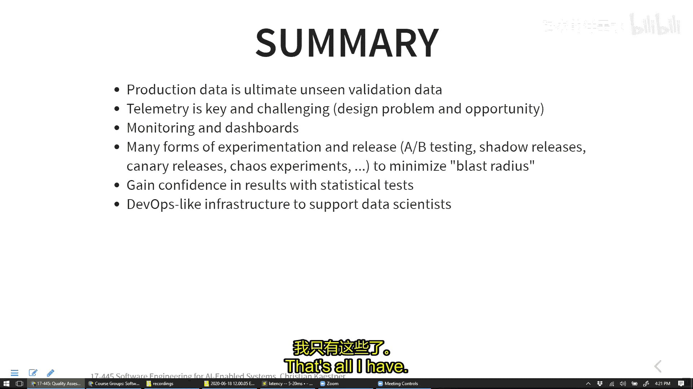

# 【全集】卡内基梅隆大学-AI驱动系统的软件工程-中英字幕-1080P-p10-Lecture-10---生产中的质量评估--BV1JS6gBcEBF_p10-

Good， what did we talk about last time？Surprising question。Architecture， I think。

 like quality attributes。Architecture， we talked about Twitter， right？

So what was a machine learning connection， Why did we talk about architecture。

 what kind of architecture decisions did we talk about？

I think one of those was where the models should reside the device or in the cloud right so kind of the deployment architecture thinking about where to place a model and also how this constraints what kind of models we can use。

Right？I as scripting service to a microservice architecture， right。

 so we talked about this and we talked about telemetry one more time， which we also talk about today。

Right two。So the overall theme was kind of thinking about as an architectureural level。

 thinking about trade offs， thinking about qualities and how the system structure beyond just the model informs this。

 right？So today I want to come back to quality assurance and。

Talk about testing and production pretty much。 right， So this idea。

The idea is that you essentially instead of investing all this infrastructure to test offline before you deploy it。

 you deploy it and then see how it's working。So。I just want to give a little bit of context where we were。

 right， so we've talked about model quality and today。

So testing and production tests kind of system quality。

 but you can also make this about model quality right so it works at different levels we talked about model quality before and that was kind of this data science mindset mostly we have a fixed data set。

And we are training on part of the data and we are evaluating on another part of the data and we talked about a bunch of different qualities so accuracy kind of for classifier was one of the basic metrics right we talked about many different ones。

 including area under the curve that had to do with kind of different thresholds and how you can still compare this we talked about overfitting and that to detect overfitting you kind of want to split into a training set and the validation set right so you separately evaluate accuracy on both and then if you see at some threshold with some degrees of freedom or so the。

Model might perform better and better on the training set。

 but it performs less well on the validation set just because it overfits on the model right so this is a typical notion of how you detect overfitting or detect when to stop。

And we talk more about how to do this and that you typically actually split three steps if you do some hyperparameter optimization and I had quite some question pushing around this right if you do kind of training first and validation you use validation to tune hyperparaits so you kind of potentially overfit on the validation set so you keep a separate test set and then there's potentially kind of the academic challenges of what happens if you're。

Don't perform very well on the test set so you make more changes。

 right so you actually have a chance to overfit on the test set。

And there were more issues around how you split your data into testing and validation set that might lead to problems。

 I hadn't actually shown you the plot on the top but it's kind of the idea if you have time series data right so you're learning some function over time。

And you randomly split the data into training data， red and validation data green。

It's much easier to predict the points when you know the future。Right rather。

 if you train on the past and then try to predict the future。Right。

 so it's really easy to get super optimistic results if you're doing something like this。

 right where you're evaluating on。Random past data where you already have seen future data。

So you actually have to be kind of careful of how to avoid dependencies in tests and training data that you're not learning on this。

 the other example that I briefly talked about， I think is if you there was this case study on detecting distracted drivers and。

You had might have of pictures from the same driver so what the system was doing and was overfitting on specific people it realized well the detection on specific people was pretty good and you tested on people that you've trained on but it wouldn't generalize to people that it had never seen before right so the system wasn't working very well in production and if you only ever testing on date but if you only have ever static data set you split it in some form and that's what you're testing on you can make all these mistakes it's kind of hard to be really neutral。

We talked about whether it's representative and kind of ways to assume kind of critical test cases and then this was kind of the last stage of how you can overfit to a test set because there's a reviewing process so you only select the model it's a about performing way on a specific test set right it kind of this academic thing and then I think some people asked me actually a bunch of you asked me after class what are you doing if at some point evaluated my test on my test set right and then I kind of have looked at this if I now trained something again because it wasn't working well I do I need a new test set right and how do I do this？

And to be honest， I think the practical answer is。All of this is really important if you're doing academic work。

 right if you're trying to show。In a paper on a given benchmark， how you're doing？

But if you're working in production， if you're blocking in production machine learning and you have actual customers。

What really matters is how well the model is doing in production。

But accuracy measures on a static data set is nice。

But really you want to see how it's working in production， how happy are your customers， thanks。

And' so。啲诶。And in a sense， you can think of production data as the ultimate headout evaluation data right or test data。

 this is data that the model definitely hasn't seen before because it was produced after you trained the model so you can't cheat you can't ever have kind of dependencies between training and evaluation data or it's only the kind of dependencies that are actually good to have right so if it's only working on the customers that's in the training data。

If those are the customers that you have that you're doing prediction for is fine and if you have lots of other customers that are not in the prediction data you see that your model quality is going down right so if you're actually looking at testing and production。

嗯。A lot of these issues don't happen。Still you don't just want to test on production。

 so there is an idea that you don't。So again， essentially this picture， right？

You don't want to be stupid and just push stuff into production and see what happens。

 You want to have some confidence that what you're pushing into production is not going to be extremely terrible。

It's not going to be much， much worse than what you have or make crazy new mistakes。

 so there is a role of doing some quality assurance before you're pushing things into production。

I wasn't really going to talk about kind of continuous deployment today。

 but the standard practice and kind of。Continuous integration， continuous deployment pipeline。

 So what companies do where they automatically and quickly push changes into production， they still。

Tend to have a unit test， unit test in a safety net， right。

 So they are not automatically just pushing every change into production to everybody。

 They're at least running some unit tests first and see how they are doing。

And then they are also rolling things out incrementally what you had in your reading and what we're going to talk a little bit more about today。

 so you're trying not to be。Completely stupid， of course。 And in the same sense。

What we've been doing about model quality， all those testing that's useful stuff to do before you push things into production right it's not going to be the last number but getting accuracy on a static test set right on your static set getting some idea of what accuracy you're aiming for is a good idea to first see get a sanity check of whether your model is going in the right direction。

All right。😊，so。Let's talk a little bit more about testing a production。Actually。

 pretty much the rest of the lecture。To test in production。

 you need some form of feedback and this is where we come yet another time to telemetry。

So there's some way of how you need to observe how your model is doing in production。

 how you need to have some observation。In classic deployment thing like if Facebook deploys a new change。

 what they tend to look for is whether the system is crushing more frequently。

So this is something that they would roll it back fairly quickly or if customers are spending way less time on their site。

 so they're collecting some sort of information about how the system is doing right so either classic service statistics。

Orre certain performance measures that they care about？With machine learning systems。

 that might be the same thing we might just care about。How much are people spending time on our side？

Or you might try to collect telemetry that's more specific to the prediction that you're making right more specific to the AI component so if you。

If you're changing one AI component in Facebook， for example。

 how are you presenting advertisement or something like this？

This will probably not have a huge impact on how much time people are spending on the site。

 so that's maybe not， even though that's the overall metric that you might care about。

 you might want to collect more specific telemetry for that component。

And so there's always a question of。What kind of information can we collect about how is the entire system doing or how is the specific AI component doing？

And then there are a bunch of engineering challenges。

 how can we collect feedback without being intrusive。

 without harming the user experience and with managing the vast amount of data。So。

Let me push this back to you， Elizabeth， I want to。

In some cases designing telemetry is easy and we had some examples in some discussions already。

 but I want to want you to think about how can we collect feedback to know how where we're doing right so classically we would look at accuracy or some measure like this on a fixed data。

 let's say we want to do something like this in production。

And we can go through all the different case studies that we had so far right。

 so let's start with predicting housing prices。So we want to see how well we are predicting housing prices。

We can do this on a fixed set data set right so we just have history data or housing prices we trained on some。

 we learn we're evaluating on some other， but how can we see how well we're doing in production？Jake。

If you made predictions on houses that were currently for sale。

 then we can assume that those houses will be sold reasonably soon。

 so then once they do sell you have a production label to check against right so you're not training on houses that haven't been sold yet right but you can observe what gets sold and you can just see how close you're doing。

嗯。You may also have just the appraisal data like how is a house price。

 even if it's not sold right now， right and see whether you would come up with a similar suggestion。

Right。So let's say you want a profanity filter for block comments or for。YouTube comments。

 how are you how do you know how you're doing there？And again， on a static data set。

 you typically have a labeled data set where you just have a bunch of past comments and somebody went through and labeled them all。

So how could you detect and production how you're doing？等 you。

You could have like a report comment button and also like a。For your own post some sort of hey。

 I got flagged， but I don't think this is flagable， please look at it some manual intervention。

This is interesting because you're talking about mistakes in both directions right and this is a common problem with telemetry data。

 sometimes it's easy to get precision but not recall or recall and not precision。

You were actually talking about both directions right so you were talking about things that we should have found。

 but we haven't。For that， you have a report button and you just see how often people report something。

And then you also talked about people complaining that they were flagged。

 even though maybe we shouldn't have flagged this。We probably shouldn't trust all of them。

 but if somebody actually argues that this shouldn't have， they put some effort into it。

 so at least you can manually review some of those cases， right？嗯。So how about the cancer case。

 you have a scan and you're detecting whether there's cancer in the image or COVID or whatever？嗯。

Yeah你。I think we can like at least for the false positive part like when we see that there is a cancer。

 we can get the person diagnosed further and if there is no cancer， then we can probably mark it。啊。

But I'm not really certain about how to do it for a false negative case where we have predicted that there is no cancer。

 why would you send him for diagnosis then？So I think。

This is a place where you need to zoom out and think about the entire system right so you want the telemetry data is you can get immediate impact from the doctor looking at it。

They don't necessarily have the ground truths and there' are some examples where actually the AI components outperform doctors in detecting cancer。

They make different kinds of mistakes。But there's long term information that you can observe。

What kind of thing could you observe later in how you're doing？Anybody。So you're saying cancer。

 but there isn't any well。The other way around， you're saying there is no cancer。

 but there's actually some。If you depending on anonymity concerns。

 if you were able to uniquely track that patient a year or two down the line and see if they were ever diagnosed with cancer。

 that would give you kind of a longer turnaround but more accurate label。

So if they actually have cancer and it's problematic right， so even if you misdiagnos them right now。

 they are probably coming back pretty soon。Or worst case as a biopsy， right？

Once they passed away and somebody may detect Earth's cancer and if you actually have a system with medical records where you can link this。

 like if this is part of a hospital system and you have access to that information。

 you might actually get some telemetry data this way right fairly precise。

There's lots of privacy concerns right so designing telemetry is often really hard privacy is one of the big problems。

嗯。What about the opposite case when you're predicting cancer。And there is none。Fortunately。

 I think nobody here went through cancer treatment or tests。

So they're fairly invasive tests where they actually poke you with a long needle and check whether the thing where they're expecting cancer。

 whether those are cancer cells， is a fairly invasive procedure。嗯。And it's risky to some degree。

 right so it's something that has side effects。But it's something that's really certain right so if you poke somebody within kind of this needle kind of do this music biopsy。

Some procedure right to check this， you can actually check that this was of course it' positive。

Right you want to avoid this and then again you can see if this test was a false positive and you were originally right or something like this on the line。

 but there are mechanisms it's just some of these tests are expensive and you need to convince the doctors to put this into the system or report this back to you right so there's again a kind of user interface design thinking about。

How to make this not very intrusive but fairly accurate， right？

But they are the simplest cases to compare with what the doctor would say。

 but there are many more cases where you can think about this。So we could go through the list。

 but I think you can do this on yourself or do this in a bunch of different settings that you're thinking about。

 for example， in the homework assignment I'm asking you to think about this as well and we talked about that there are a bunch of different design so you can just ask people right this is a simple design but kind of intrusive so you might want to avoid this or not overdo it this you can ask people to report problems similar to what Daniel was saying about kind of blocked profanity things there are a bunch of cases where you can just wait for a while like the housing prices right once the house is sold。

 you know what the market barrier would have been。嗯。And you have cases。

Think we talked about this right where you can design the user interface in a way that actually draws and and encourages them to give you feedback in a way that you want us and Timmy where they design a good user interface where you actually are encouraged to stay in the user interface and fix the transcription in the place because it's such a nice experience that you can synchronize the text in the audio and it shows you where things it's not right so youre encouraged to edit this and change in here and so you get very nice telemetry but it requires quite a bit of investment in thinking about how to present this to a user so lots of possible questions and you can always just take snapshots of pictures and have experts label them in Can you could you need very specific experts。

 but you could take some snapshots of predictions that you to made in production and have an expert verify them。

So typically you need to go through these three steps， you need to think of a metric。

So what's the you need at least three parts， you need a metric kind of what quality are you measuring this could just be accuracy of the model recall and precision for example。

But very often you don't have a very good。You only have an indirect version of this right so you might only get some feedback from some doctors so not everything。

 so you could only get an approximation Sometimes you actually even only have。

Proy proxy measures that are not let me see， did we have an example in our of list here？嗯。No。

 I think the three cases that we talked about were actually fairly easy because you could always think about recall and precision。

 let's talk about the Spotify playlist whether it's any good。So this is a much harder case。

 I don't think we could express recall precision or top K ranking or something like this right so this is much harder to collect data that maps very directly to any of the metrics that we would do in an offline evaluation。

You could definitely give users a list here， three songs you might like。

 tell me whether you like them。So what Ja's writing is an example of how much percentage of the time do people spend？

On that proposed playlist， but that's not measuring directly how good the playlist is right there might be many other reasons why I spend time on this。

 why I spend less time on this， Maybe those are all great recommendations。

 but I'm currently not in the mood。If you would ask people kind of Skype style。

 how good was my recommendation？Even if they are not listening on this。

 you might get very different answers right if you ask people to name their top three songs。

In kind of a training set， right， you label this upfront， you might get a very different answer。

So I think in this case， what you often get are metrics。That are only correlated。

 often weakly correlated with the model quality that you really care about。

RightSo you probably won't get the this is a ranking problem。

 so you probably won't get the top K rating things or precision it。

At five this is kind of the metric that we looked at in past right so if you look at the top five how many of those will really really reside something doesn't really matter so you probably don't get one of those things that data scientists would use。

You probably get a different kind of metric that's more about user engagement or that only takes you for the users who are using this。

 how are they， how happy or how much time are they spending on this？

It's not telling you directly how good your component is。

 it doesn't tell you anything about recall and precision， but often that's fine。

So when we talked about in the Go lecture that there are different kinds of goals。

 there's the organizational objectives， and then there's leading indicators and there's from the user's perspective of what they' are trying to achieve and then they are the model properties。

You may not be able to measure the model properties directly。

But you might measure something further up in the hierarchy or something that's maybe more on the user side or that's more related to the business。

This is what I'm describing down here so sometimes you get very accurate labels for real unseen data。

 the housing price example is one of them right so a week later or month later you see what the house was flow for。

嗯。Sometimes you only know about mistakes。The Skype example where you report problems。

 so if users are happy， you don't know about this。Sometimes the answers are delayed。

 so this is in the housing example again right so it's very good data。

 but it only comes a week late or month late。If you're predicting something。

 we talked about this with master program admissions right so a lot of metrics that you would like to measure you only know five years later like。

Well a year later like what's the starting salary， what's the salary and the position after five years right so some of those things you can get but only get much later。

 which is not really helping you immediately。And often you only have samples because otherwise there would be way too much data we're going to talk about this and often you only have weak proxies of correctness。

Right so。What you need in the end is think about。What can you actually measure This might be just straightforward recall and precision or on a sample。

Or accuracy or some of these traditional metrics， but it might be something like what I just described percentage of time users spend in this playlist。

And this might be good enough because if you can compare with a change whether they are spending more time than before。

 you might see that you're improving right and if that's the only thing that you changed。

 you might actually make a causal link that the improvement in your model。

 that's the thing that's improving。People us spending more time。So if you know what the metric is。

You need to identify what kind of data you're collecting。So in the spotpotify case。

 whatever people are playing right and playing in the so you kind of need to track all that data。

 you need to collect something in the cancer case， you need to think about what kind of data can you get from the hospital and so on。

And then you need to map them right so you need to have some way of how you figure out how you compute the metric with the telemetry data。

Which is often obvious if the metric is defined。Proper。So whatever you're testing in production。

 it's not necessarily a very accurate measure， but that's fine right you don't need to get accuracy or you don't need to get recall and precision。

 your numbers might look very different than what you have on a static data set。

What's actually way more common is that you start monitoring the system and you observe trends right it's not so much about what is the number。

But how does a number behave over time？If if your user engagement is going down as's a bad sign right if your relative recall measure。

 even if it's noisy is going down that might be a bad sign。

 if the number of complaints about your profanity filter a rising， that might be a bad sign。

If there's a massive jump in your metric after you release a new version。

 that is possibly a bad sign。So kind of relative differences is much more commonly the thing that you look for。

 and that's the thing that you can also automate on。

Maybe I should have ordered this differently you read about canner releases right kind of incrementally releasing something first to a small user set to a larger and if this isn't behaving well then you're rolling back it's useful for this kind of stuff right so you know what the metric is the engagement metric is for most of the users for some users you give them the new model。

And if it's performing wildly worse than the old one。

 then you have a problem and you want to stop the release。All， I'll go back。

So the kind of things that you're looking for。Jumps after releases。

And typically you don't roll out everything at once。

 you kind of do this canary releasing that you mitigate the mistakes like if there's a jump that you're not hurting all your users at once。

You watch for slow degradation， so if it goes down over time。

 that's common sign of data drift of stale models， of feedback loops of adversaries。

So something is changing and somehow your model isn't keeping up with the changes。

And all of this is useful also for debugging， like if you see changes or if you see different trends in different populations。

 you might want to figure out why are some of my users really unhappy with the Spotify playlist and some users are much more happy right or why is our cancer detection much worse in women than in men？

Thankss like this。Makes sense。Any questions？So for monitoring， there are lots of tools out there。

I'm gonna have you play with us in the group assignment later install some of them there are hundreds of open source tools I think some of you think most teams in the analysis caused last semester used Grunda which is a common dashboard it looks something like this so it's a way of plotting all kinds of data over time。

There are dozens of these and they are highly customizable so what you're plotting there is something that you can plug in in different ways Pros I think is a tool that helps you to suck in metrics from all kinds of log files and different sources and then search from them and aggregate this and a bunch of different tools and different stacks and infrastructures I think we're going to spend some one recitation on one of these stacks and then as part of the group project you're going to do some testing and production so you're going to try one of these。

In the end you're always did in some sort of dashboard so this is a classic one。

 I think this is not machine learning related so this is looking at how many user lock ends do you have。

 how is this behaving over time， how many signups so that those might be leading indicators in your goals things like this that you want to want see memory consumption CPU so those are things that you might just for operations purposes want to track anyway you also might have that after model updates suddenly inference becomes really slow so this is something that you want to detect server requests and then there are also specific mechanisms specifically for machine learning and this is also a place where there are lots of commercial companies kind of in this ML ops space machine learning operations lots of services like AWS will just host your models for you and they will give you some dashboards and then a bunch of other services that will tell you。

This is a response term over time， how many predictions you have。

 how many requests take more than two seconds。This is mostly on performance。

 but if you also have some telemetry， you can also easily plot you like the percentage of time plate on the proposed playlists or something like this right or the measured accuracy so this is a place where you really want to start thinking about collecting telemetry visualizing this。

And maybe putting in some automated steps， this is also fairly common that if there's a sudden jump。

In the bad direction that you inform somebody， that you page somebody or that you automatically roll back to an old version or something like this。

 right？Again， I've shown you this before telemetry is hard。 There are lots of problems。

 the most obvious one， and I think。Depends on the scenario where you're working with。

 privacy can be a big one。So when we talked about the Google Gla scenario two days ago。

 you don't want to send to the cloud whatever every of your user seeing at any time。

Maybe you don't you want to send us but your users probably don't want that right there's lots of scenarios where you use machine learning and kind of privacy Crious solutions or you're one of those companies that actually tries to make this as a theme that they care about privacy right and then actually do this like Apple tries to differentiate themselves these days a lot by being really careful of what kind of telemetry will leave the iPhone for example。

嗯。There are many more challenges。And again， this is similar to what we talked about two days ago。

 but a big challenge is。How much data are you collecting。Like these infrastructures here。

 Grfao and Prometers， they are designed to scale like what you can put into a Kafka stream just。

Just the amount of data that you can push through this it's pretty amazing right so you build kind of big distributed systems in the cloud you can consume a huge amount of data if you still want to think about do you want to really have all the camera images of every person and all the time streaming into your cloud right for cancer predictions probably not too bad you're probably not doing too many。

It really depends on the scenario right and then you probably want to sample this was also in the reading of how you identify samples。

 whether you're smarter about it， especially if you're rare events。

 it might be hard to find them in the sample so there are strategies about adaptive targeting。

 biased sampling， detection of rare events right we talked about this a little bit before and kind of batching things before you upload things。

嗯。Any questions？You want to do an exercise？see reactions one way or the other。嗯。Can you vote up down？

Spend 10 minutes on an exercise。Nobody wants a vote。Nobody cares。

The people who care counter decideide， okay， I take this as a know。

 for now we do one at the end of the have。This is a just just for context， this is from the。

Midterm or final last year， I think is one of this。Scennaaros of the smart home workout system。

 there's a lot of these systems these days where you have kind of an AI instructor。

And this is giving you feedback and you want to see how the feedback is doing。

But let's do this later。Okay， its right now。So I think we have some time at the end。So。

The thing that I've talked about so far is pushing something into production and monitoring how you're doing。

诶嗯。There are a couple more things。Where you can run explicit experiments in production that's very common。

 And I assume most of you have seen AB tests in some form right so this is experimenting and production。

 This is the idea of。嗯。Essentially running what if scenarios， right if you have enough users。

 you can just show a change to some users and see how they are doing。

You can also show a change to all users and see how they're doing。

But then it's hard to say whether people， let's say you're。

You're running a sale on Amazon and you're showing the same sale to all users now you have a hard time determining are people buying more stuff because of the sale or are people buying more stuff because it's close to Valentine's anyway and people are just buying more stuff and they would have bought more stuff anyway。

So the idea of AB testing。Is that you're really doing randomized controlled trials？

Kind of the thing that you would do for medicine testing。

 Medicare testing or where you divide all of your users into two groups。One group gets the treatment。

The other group just gets the plain old version and now if you see a difference between those groups and that's the only difference in kind of what you're showing them。

 then you can make a causal argument that whatever change you made actually caused the difference in higher sales right it's not that it's a later date or it's a specific date in the year because that would have affected both groups equally。

And then if you're selecting those groups randomly。You can't say that it only affects the men。

 versus the women in some way， right， it would be randomized across both groups。

So if you see a consistent effect between those two groups。

 you can be pretty sure that the effect is due to the treatment that you're doing right so this is really the idea behind science how controlled experiments work。

It really allows you to not just detect correlations， but actually causation。

The difference is due to this change， it's not just correlating with change this change is causing it。

Just hard to say what part of the change if the change is larger as causing。

So AB testing has a long history for usability， it's especially easy if you have online sites where you have a lot of users that come to your site。

 it's very hard to do as a startup if you have almost no users right or in kind of a student project but if you have a suspicion it's just sufficient scale and enough users。

 it's fairly easy to and you can collect telemetry and production。

 it' very easy to show some of your users a different starting page and see whether they just buy more stuff。

Or something like this， right， So that's very common run in a running system。

 typically a web system or something that's backed， backed up by a cloud or something。

 Take a random sample of X users and show them a modified version and then track outcome。

 have some sort of telemetry。 see how you're doing。And there are lots of examples of doing this。

And people actually have been pushing this very far so people。

Like you hear stories where Facebook experiments with the size of a button with the color of a button right so something like this really really small change。

 just the background color changes。And if you just have enough users。

You might actually find the difference between those changes right so if you have enough users。

 you can test a lot of small changes and kind of make a judgments。Adjustments accordingly。

So let's think about this for AI components。So let's say we're swapping out。

The product recommendation algorithm at Amazon。What are the kind of things that we would look for。

 how would we run this as an experiment？Its too obvious。快啲。

So if the new algorithm is provided to a small subset of users。

 we can see if more items are being purchased I mean the recommended items marketing added to the car and theyre leading to more it's pretty much the same with the user interface design in a sense。

 it is a user interface design right it's changing the ranking and see whether people are buying more stuff。

Or whether they're following the links more， whether they are。Spending more time on your page。

 adding more items to the card， right？So you can think about all kinds of metrics。

 you can also think about how many servers do you need or how much energy do you need per customer to serve them。

 like how much does your throughput shrink because this component takes much more time to kind of estimate the cost of prediction。

But yeah， I think this is fairly straightforward so。Let's take our audio transcription service。

 you have a new language model， you think you're better at recognizing certain words。

 how you're testing that in production。Yeah， if you look at the number of manual corrections。

 right so you can just can just translate some audio files。

In a different way you don't even need to divide this by user necessarily right so you could just do this by audioify and then see whether the kind of feedback that you're getting from some users is different from the kind of feedback that you get from other transcriptions you can also do the five star rating thing and see whether you see a difference there。

Right， so whatever quality you can measure there， you can just compare。

And if you have an offline model for detecting faults。Even if the model is offline。

 you can probably take some sort of telemetry。嗯。Right where you see reports of the user。

 some part will be online， right， even though the actually AI component is not。

 but the effects of it， it will call it some hotline or something。

 So you can look for this for fo detection， I think it's interesting because it's much harder to run an AB experiment right so you need to get you need to identify。

Some of your users that have these smart watchtches and in some way you need to get your。

You need to identify or get an update with the new version to some of your users or to all of your users and identify this and then it's a fairly rare event right so I think even if you have a million users。

You probably only see a couple of thousand people forward a day。Maybe less I don't know。

 I actually have more statistics about how often people would fall probably not that frequently right so we have fairly rare events。

So， you have。If you have a million users and only 1 thousand0 users are in your sample group in your treatment group and of those thousand users only one person fors in the next five days。

 it's very hard to compare whether that's representative。

 so this might be a case that's actually very hard to run a AB experiment just because you don't have a lot of events that you can analyze。

Which brings me to the point about experiment size。

 how many users do we need and how long do we need to run an experiment？

So if you have a huge amount of users， you can run even tiniest experiments and this has to do let's see。

Let me just very briefly， I don't want to spend too much time on statistics and some of you have heard this be before。

 but。This is a place where you actually need to think a little bit about statistics about whether the differences that you're observing are random or not。

It's a classic。Ress might look something like this， you have a group A and a group B。

Group A has a classic recommendation model， group B has a personalized new recommendation model。

And you have， I don't know， 2000 users， 10 users get the new version。

And now you' looking at how much time are people spending on your site？You see that the group A。

 the original user spend maybe three minutes， 13 watching videos on your site kind of following recommendations and with a new recommendation model you see three minutes 24。

This is potentially very hard to see that this is a cause change， right。

 The results are pretty small。And there's a chance that the results might be random。Right。

 not every user will spend exactly three minutes，13 on your page。

 you have some users that spend 10 seconds， some users that spend five minutes。

What you want to see is that on the average， the actual average is different between those groups。

But the problem is that if you only have 10 users there。And among those 10 users。

 there was one user who just spent two hours on your page。

This one user will influence the average quite a lot。

And whether you have one of those users in your 10 users or not。Rrandom， it's a chance thing。

 like and the smaller the group， the more。The more unpredictable the media or the averages。

 so you can use the median as more robust against outliers。But still， there's a question of。

How close to the real median are you， right， So if you're just comparing the median， yes。

 you get much。I think you typically say with five measures。

 the median that you take is the real median will be between the smallest and the largest measurement。

 it gives you a very often pretty narrow confidence interval。Typically。

 what you want to do is use some statistics that are a bit more scalable and not so customized on this。

It's a。How would you approach this if you want to know that the average on one group is actually different from the average of the different group？

Who has a little bit of background in statistics and knows what to do here？

Right T test is what I recommend last semester right so a statistical test a statistical test is there to see whether two distributions are different so what you typically have is something that looks like this you have two groups and this is a density plot so it just says how much time are people spending on your page between zero and I don't know eight minutes。

And most of your users in one group， so some users spend two minutes， some users。

 more users spend four minutes， some users spend this amount of time right。

 the mean is somewhere here for this one group and the mean for the other group is somewhere there。

And what you want to know with the statistic you test is whether the samples that you're drawing from these two distributions。

I actually coming from two different distributions right whether this is distinguishable and there are two cases of how you can distinguish things easier so one thing is if you have a bigger effect size。

Like if the averages are further apart， you're much more sure that they're actually different。

So intuitively you can just look how much are these curves overlapping， if they are very far apart。

 they are not overlapping much， you're pretty sure that they are not just samples from the same distribution。

Another effect that helps is if you're pretty sure if you're very little noiseous。

 like people always spend three minutes plus minus 10 seconds on your page。

 whereas sometimes people spend two minutes or 10 minutes right， if the noise is much bigger。

 it's much harder to detect the difference。Does this make sense？

So the idea is whether two samples that you're observing。

 you want to know do they come from the same distribution or from two different distributions？

And a statistical test will essentially tell you give you some confidence measure。

It's not precisely accurate， but with 95% chance these come from different distributions right so this is usually how people think about or how to think about this。

This is where significant levits come in， they give you roughly an idea of what's。

If there is a difference that I'm seeing， what's the chance that this difference is entirely random？

And the more samples you have。The more clearly you can rule out chance right So if you have very few samples and the distributions are very similar。

You're not going to be very confident that these distributions are actually different。

 but if you just have millions of data points， you can find even the smallest differences。

It's kind of a typical intuition， let me see。So I don't want us。Take know so。

This is this is roughly the intuition here behind kind of the law of large numbers。

 so if you only have very few samples。You have a very high confidence in very large confidence in our。

 So the true value could be anywhere in this range， so this here shows the confidence so。

The orange line is a mean up to this point right so this is from one to 100 sample。

 there's noisier that you see the orange line is a mean that we computed for a specific sample up to this size。

And then the gray and the yellow line are the confidence intervals that statistics will tell us the real media。

 the real mean will be somewhere in this range and what we typically see is that the more template we have。

The。The means stabilizes around some area and the confidence interval will get smaller and smaller right we're much more confident that the real mean is in this range。

This is the more samplesbl you have， the closer your window， and the closer。

 the easier you can compare to data that's very close to it。Makes sense。R菲。So in practice。

I think most of the time for the kind of data that we're looking at， you want to use a T test。

There are a bunch of different statistical tests， but if you have enough data a T test assumes normal distribution and stuff like this。

 but it's typically robust if you have enough data points So if you in our settings we typically have hundreds of data points so most of the time the T test will be fine so unless you have。

I mean， best case， talk to your data scientists， they hopefully know about statistics and they can help you with this。

 right？Typically use a T test。 So you add two lists of numbers。Like how many。

 how much time did people spend on your site in one group。

 how much time did they spend on the other group？The confidence level that you're aiming for and the test will。

Tell you， what's the chance that these two distributions are separate。

And the way to read this is a bit complicated， but it typically attach you a P value and if this P value is smaller than 5%。

 you kind of say it's statistically significant， that's just a convention。

Roughly it's not technically true but roughly what this means is the chance that this difference is true just due to randomness is smaller than 5% that's kind of what we assume as significant if it's smaller than 5% chance that it's random and it's probably not random。

喂。So what you're doing here is whenever you have。Some observations， you have two groups， where am I。

You have two groups and you have lots of resultss for one or the other group。

You're trying to compare whether these differences that you're seeing don't just produce a different average。

 but whether these averages are statistically significantly different。

Right that you're not based on noise。And the nice thing about IB experiments is if you。

 if you Google or Facebook， you have so many users。

That even if you make tiny changes and the effect size is tiny。

 you can still measure this and are often fairly confident about differences。

If you only have a couple of hundred users， this will be much， much harder。

 you will not be able to see clear effects from very small effect sizes。

You will only see improvements or significant improvements if you have really massive jumps in how good your predictions are doing。

So it depends a little bit about how much data you have， how many people you have and so on。Alright。

And there are also some power statistics， but I assume you're not going to use them to tell you if I'm expecting a difference of like I'm expecting my model to improve accuracy by 2%。

How many users doing and this is roughly the noise， this is the distribution。

 how much does it differ between user to user， how much time they're spending on my page。

 you can compute with power statistics， how many users do I roughly need in my experiment to be able to show a difference if a difference actually exists。

The key term here is power statistics， there are some tools online to look this up。In practice。

 many people don't do this， they just run an experiment and then see in a dashboard whether their results are significant or not。

 if they're not significant， they run it longer， and if they're still not significant。

 they give up at some point。So this is the more pragmatic thing。So。😊，Just briefly。

 how would you implement this？Where you need to have a way to run two implementations at the same time。

 right do you need the a group and the B group。With machine learning it's often two kinds of models and if we are already thinking about kind of a rest API for our machine learning thing it's relatively easy just spun up two docker containers with one version of the model here。

 another version of the model there and then have a load balancer that figures out which one to call right or in your application where you're calling the model you're just deciding if this is group A or group B so the most common thing is。

That you either have two separate deployments and then a load balancer somewhere。

 which I think is probably what you want to do for models。

 or you have feature flag somewhere in your implementation， which is just an if statement。

 just says if this condition then use this model otherwise use that model。

And one more ingredient that you need is you need to figure out which user is in which group。

Or if you don't have users， which translation was done with which model was in which group。

And typically you need some persistent mapping so you need some file somewhere that says these are the users that in my B group in my treatment group。

 you can pick them randomly， but you want to remember this。

 it's fairly weird for a user that every time if they reload the page they see a different version especially if you're doing visual things。

 so you typically want to keep them in the group。Also it kind of makes it fishy if you send them this recommendation once and then this recommendation the other time。

 and the results are not immediate you measuring something like how long are they staying on the page becomes really weird about how is the measurement actually relating to the model。

And then whatever telemetry you're collecting， you need to be able to again also figure out does this belong to group A or to group B？

So at the implementation level this is usually super straightforward you have somewhere some sort of library or some sort of simple implementation that just says is this feature enabled like one click checkout or a new model version for a specific user it should be a closing parenthes here and then either you use one functionality or another right it's really just if statements there or you have this if statement somewhere in the load balancer。

In a sense， it's really just bulloolean options。Possibly a bunch of them。

And then some mapping to users， right， So here I'm checking for the combination of user I D and。

This specific feature that I care about。In practice you。

Can either implement this yourself it pretty straightforward but most of the time you might want to consider using an existing library or an existing service。

 there are a bunch of open source libraries and they're a bunch of people who do kind of companies to provide us as a service。

 the two that I know are here launch darkly and split split IO so these are both companies that essentially do brilliant options as a service。

Right so they host your feature clicks on the cloud and then they have a interface something like this where you can just create。

Rs， they are run in the cloud you can map users to certain conditions and they have a way to show your resultss。

Yops， let me show you。Yeah this is the kind of dashboard that you might see so you have certain tests you see the results you see theres a different version of showing the resultss and then you tend to see some confidence intervals or you see whether the results are actually an improvement whether they're actually significant you see kind of trends over time of how your confidence intervalts go get smaller things like this so a bunch of these services exist you can implement this yourself and I think。

Often you want to bid on existing infrastructure。Okay。😊。

Do you have the sense you could run an AB experiment if you had to？

Kind of figure out how to implement this。Oh here， many more dashboards， right？Just briefly。

 so most people won't do power statistics。So how do you know how many samplebits you need？

So the common practice is somewhere between one and5% of your users see the new version。

Why do you pick a smaller number。Why not 50%。Why one2 five？

Maybe to reduce repercussions in case something was seriously wrong。Yeah。

So you're kind of afraid that something your new model might not be great right so this is often called minimizing in the blast zone。

 so if something goes wrong， you kind of want to reduce the impact。

So that's why you pick a relatively small number and if the number is too small。

 you have the problem that the results might be very random。

So you might not get significant resultss。There's also lots of technology for automateators for automating this I don't want to go into details。

 this is often something that comes either with those services they have a lot of infrastructure and then companies like Google Facebook they have their own A testing frameworks。

 the concerns that they usually have arequeuing like。

Facebook and Google they are running hundreds of experiments all the time， right concurrently。

So they tend to cue experiments， so they have a queue of things that theyre not running everything at once。

Then they stop experiments once they have confident results automatically。

Or they stop experiments with bad outcomes？Bnie。And then they have some reporting and some dashboards and so on so you can invest a lot in kind of infrastructure around this。

Here's a script that Facebook users in in。I think yeah。

 this was Facebook in some internal languages where they have a whole language around kind of。

Different treatments that they're running and then probabilities about who we see what treatment and so on so they kind of have their own domain specificific language of scheduling and running experiments and then if you run multiple experiments concurrently you also need to think about experimentaled designs are they interactions how do you identify kind of multifactorial designs and so on and you can automate this and I don't care about this if you're interested I think these two papers down there are interesting one is from Google one is from Facebook talking about kind of large scale infrastructure that they developed in-house for AB testing。

嗯。I think that's interesting， I think most of the time you will probably start with something smaller or you would have an existing infrastructure available。

Let's talk a little bit about the other things here。

So something that's interesting and often possible in machine learning are shadow releases or traffic teeing。

嗯。Can somebody explain briefly what this is？I think Jake brought this up a couple of weeks ago as an as a question but fighting。

 can you go for。I'm not 100% sure， but is it like you have two replicas which are exact copies of your system and。

You try to send the same request which you get an actual production to the second copy as well。

 but only one of them responds to users。Y， you typically use the old system to respond。

But you run the new system kind of in the background and just make predictions。

If the prediction is different， you don't know how a user would have reacted。

But you can see how often the reactions are different depending on what kind of telemetry you're collecting。

 this is very different can be very different so if you're predicting housing prices。

It's simple because you know the ground truth later。

 right your prediction doesn't necessarily influence what happens。So if your prediction is off。

In the background， you can track this if your prediction actually has an influence like you're deciding whether to filter profanity and comments。

And your model predicts something else you don't know how the model would have done， right？

You can see a little bit if a user has complained that this should have been filled out but wasn't。

 you can see whether your model has not made the same mistakes。

But it's kind of hard to react about the counteractual， I think。I think it was Jake， great。

 you brought this up with safe driving cars。系啊。你说。So that's very common that they drive the car around either with the selfdriving mode or either not and they record what would the AI do in this situation right and then if two AIs disagree you can see this or if the AI disagrees with what the user actually did。

 you can also see this so it's kind of running in shadow mode in the background it doesn't actually do anything but you can observe this so you can compare against an oldD model or you can compare against the outcome and in some cases you have ground truths labels that you can get。

系来。Like in the housing price prediction thing where you can actually check， you don't deploy it。

 but you can see how it will have done。Makes sense。It doesn't work for all settings， but it's。

 I think more commonly used in an II setting than in a lot of other software settings。嗯。

Blue green deployments， I think this's often just brought up as a straw argument these days。

 this means you're immediately switching over all your traffic to the other treatment。

But then you prepare to go back quickly。The idea here is that you just have the infrastructure twice。

 once with the old version， once with the new version。

 you're switching over from blue to green and if it's not working well you're switching back。

The thing that people are doing much more commonly is canary releases。

So the idea you read about this that you're releasing the slowly。

 you're starting with a small percent of the population。

 you're essentially running an AB experiment every time you're releasing something。

And the AB experiment can look at questions like this accuracy degrading totally is the rate of errors。

 is the resource consumption increasing suddenly and then you roll it back。

Do you know where the term canary testing comes from？Crarack， you want to explain that to？mightSure。

 yeah， back in older times， they would send canaries into mines to believe detect like gas leaks or something of the sort。

 and if the canaries returned it would be safe for humans and if not they knew not to go in。

So the one that I know is that you typically have a canary and a cage with you。

And the canary dies much quicker due to gas poisoning than humans。

And if the canary dies in this cage， it stops singing or somebody observes。

 then this means there's gas， even if you as a human dog detector so you run。

Right so you leave quickly。 So the idea that you have it's similar here。

 you have something that detects something early。Right before it becomes really dangerous。

And canary releases are very common， I think in rolling out changes to AI infrastructure right so it's often called under machine learning operations MAOs。

 this is what a lot of these companies are doing， there's a lot of books about this。

 lots of startups as we do this kind of thing for you tractors right not just AB testing but also kind of helping you with rollouts and again Lo dark split and these kind of companies can help with this kind of they support these kind of use cases。

 all of them。AndThe last one here I want to bring up is chaos experiments。

Can somebody explain briefly what those are？At least the MSC students have seen this last semester in should know。

What is Cha Mon doing？I guess if nobody else is taking a apart。嗯。

It's basically testing in production， you bring down production instances。

To stimulate a survival failure。嗯。Monitor how your system reacts to it right？

So this is robustness testing and production typically right so mostly in distributed systems you want to see how does the system react to error conditions。

 the classic thing where this comes from is Netflix taking down AWS instances randomly in production。

To make sure that from a user's perspective， if they're watching something。

 there's a seamless transition to a different instance that will just take over， right？

If you think about this as maybe a little bit insane， you're just shutting down server randomly。

But now they have a lot of more tools where they just delay certain connections。

 where they make certain service slow where they。Falsify certain data。

 I think corrupt data intentionally in all kinds of these things， this is called the Simeon army now。

 a bunch of different chaos towards。And the idea here is essentially again saying certain things are very hard to test。

Robutness tests and distributed systems are hard。We say machine learning testing is hardright。

 so you do this in production， you can't do this。With unit tests that way。跟。

This is also culture change for chaos experiments。 it means if you tell developers that you're going to kill some of their instances in production。

They know that their error handling test will really be tested。

It really matters this is a cultural thing， they tried to do this。

And Uber and the developers really didn't like it。Why are you trying to sabotage my runtime environment？

Turs out that Netflix actually random failures of AWS instances are way more common than what chaos Mon does。

Um， but even even if random errors happen all the time。

 it creates this culture of thinking about fallback mechanisms， thinking about kind of backups。

And I think this is interesting in the AI context as well。

So if you tell developers that I'm randomly flipping your AI predictions。Like 1% of the time。I mean。

 probably 1% of your AI predictions will be wrong anyway。

 but maybe you're still believing that the confidence that the AI gives you is a good indication of how sure it is right if you just tell developers1% of the time。

 I will just flip the outcome。This very much hammers honed the fact that you should never trust the outcome of the machine learning component。

Right， so developers should really think about fallback mechanisms。

 the thing we talked about last week， right phase saves and so on and should test those as well。So。

I't read this much that people are doing this。But I think it's a very plausible strategy here also to kind of think about a very similar kind of testing and production。

 introducing chaos into a system with an AI component as well。Right seeing how well。

 how robust is the system to wrong predictions。And you could run this as well。So all of these things。

Whenever you're experimenting in production。You want to be careful right so this is why you don't want to roll out something to everybody。

 you want to minimize a glass radius common strategies are doing canary releases or aB testing on a small population or chaos experiments where you're careful that you're reducing it to a certain area right so even if you're calling a failure it's not affecting all your users is affecting maybe 1% of your users and you can fix it pretty quickly you can monitor it and detect it quickly。

It's also common that you don't go into production before you do at least some testing before。

 right so do。At least some continuous integration， some runtime， some unit tests and so on。

And always。Autommate things and allow for quick rollbacks so there's a lot of tooling around this I think well talk about some of this。

 but I don't want to go too deep into this， but if you're interested into DevOs right so there's a lot of material here can continuous delivery how can you automate these things what kind of infrastructure containers load balances versioning of these things there's a lot of infrastructure to kind of automatically stay scale containers Kubernetes can do things where they where you can roll over containers kind of reduce the number of one kind of containers and increase the number of the other ones automatically。

And I think you really want to monitor things be careful， watch what's happening。

 have good telemetry， and that's in general about how a system hass us。

 but also specifically about AI components and about how people react to your AI components。Great。

I won't have time actually for an exercise， but I have three more minutes to talk about this and I don't have a lot of material。

We talked about this difference between software engineers and data scientists and how data scientists are often stuck in their notebooks with static data sets。

So if we're pushing things into production， right， we have this infrastructure we'。

We've done AB tests as software engineers for a very long time， we have all this DevOps stuff。

We should think about how can we give this back to data scientists right so how can we make it easy for data scientists to experiment in production。

 how can we give them access to telemetry data， what's the kind of DevOs infrastructure that's good for data scientists。

I think this is again part of the MA ops community， but it's really thinking about。

We want to help soft engineers and operators and data scientists to work together and we want some sort of tooling right so kind of think about。

Make it easy for data scientists to deploy and test models in production。

Which means going from a notebook to a production model there needs to be some connection right or you need to be able to push something and then this will go through automatic tests into deployment and then some automatic telemetry is collected。

And then give data scientists access to telemetry data。

So if you're collecting telemetry data anyway and you can do things like shadow execution and so on。

 have the data available to data scientists that if they're experimenting in a notebook。

 they need a new test set and so on， they can access this kind of thing。

And you really want to think about kind of the modeling infrastructure and the versioning of models and running of experiments that goes beyond notebooks we're talking about versioning more later when we talk about provenance。

But it's very easy to have hundreds of versions of a model and then a big debugging nightmare because some model produced the wrong version。

 maybe in an APB experiment， maybe not and you have even a hard time figuring out why and so if you rejected a credit card application and it was from an important public person and it blows up in social media。

Do even have a chance of figuring out which model made this prediction why and so on right。

 so this is often called provenance and useful for debugging。So I think this is a good time to stop。

If you want。Think about this exercise at some point。

What kind of telemetry data would you collect here。

 but on the other hand you have an exercise for next week anyway。

 so where you can think about telemetry data and how you would collect this and how you map this。

 I think it's slightly easier than this one here。So。

What I talked about today is production data is really the ultimate unseen validation data right so we had all these problems in kind of test training validation sets splitting and kind of different problems of how to split this。

If you test in production you can't cheat， you can't accidentally overfit on something and your test data because you see in production that it won't work right the test quality and production simply won't be great you really want to invest in monitoring and dashboards and really think about how to how to bid infrastructure for this there are many different forms of explicit experimentation。

You want to be careful about to design this。Some statistics are useful。

 I'm not going to push you far into this direction， but。

concdes somebody who knows about statistics if you're building this or use some tools where this is bit in and learn about how to interpret resides and then think about how to make all of this available to your data scientists。

That's all I have。

I think there's a good time to stop。