# 【全集】卡内基梅隆大学-AI驱动系统的软件工程-中英字幕-1080P-p11-Lecture-11---数据质量--BV1JS6gBcEBF_p11-

All right， I want to ask as usual， what did we talk about last time？Testing and production。

 AV testing， different release strategies。嗯。What does this have to do with machine learning， AI？

You want to do those things because its there's a lot of uncertainty。

Like it's very hard to replicate production data， so your testing is you know， only so good。Right。

 so。You always have problems if you're testing with a fixed data set， A of how to curate this。

 how to not introduce kind of bias and overfitting。Right so。

Production data is unseen data that you can't cheat with。 so it's nice for that purpose。

 And then the other aspect is that you can actually test the qualities that you care about。

 which may or may not relate to the accuracy of the model right so you can actually test how well。

The system is doing a task at the system goal level， rather at the modeling level。

And then we talked about all kinds of things that make this difficult。

 designing telemetry and how to do this and kind of noise and you might want to use a T test to find statistical significance all these kind of things。

Sounds good。So today I have， again， one of those lectures where have way too much material and then I also want to stop about 15 minutes early at the end to talk a little bit about the project and get you get together in your groups to do a little bit of planning。

So。Today I want to talk more broadly about data quality and data engineering。

 let's see how far we get。啲。Data quality is one of those big problems that data scientists face there are a bunch of studies that put kind of the amount of data wrangling and data cleaning kind of getting data and dealing with data somewhere around 60 to 8 to 90% of their job I think you saw this in the second homework assignment where you collected some data this wasn't so much about cleaning but about getting the data from different sources I I heard from a bunch of you that the main difficulty in that homework assignment was actually getting the data processing the data at scale this is fairly common and data cleaning is one of those things that you often have data you have data from different sources but it's not always in the best quality and you kind of want to deal with that so today I want to talk a little bit about different aspects of data quality I'm going race through some of those things and spend a little bit more time on others。

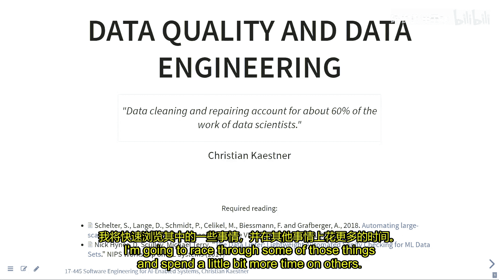

And I want to start with a scenario as usual。

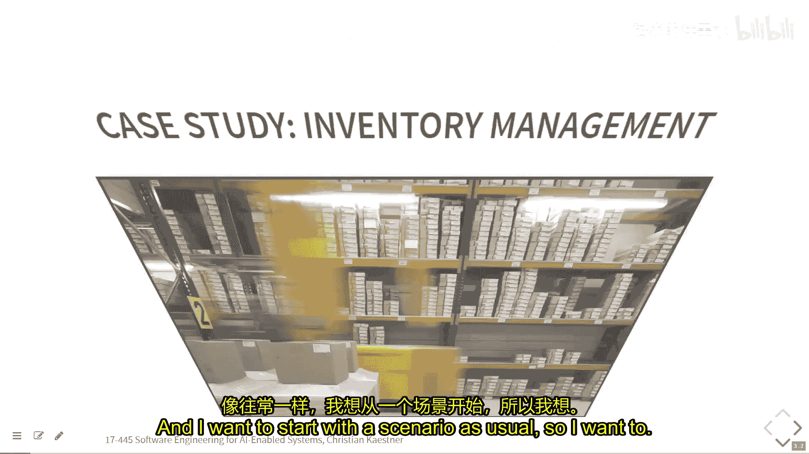

So want to。Take a very classic kind of machine learning thing that has been one of the earlier use cases kind of predicting when you buy things in a store right so you have stuff on the shelves so for example。

 down there that's giant e it's the roof of giant e right there local supermarket so there。

This is how you see how I can come up with my case studies， right？

They are buying stuff that they put on the shelves right and then stuff gets bought and they need to restock at some point and they need to make decisions about how much do they buy when how much are they restocking and that's kind of a prediction right so you're predicting we are going to say this much。

There's many peaches right so then you're buying peaches for the next week you can probably order for different days。

 maybe order more at one day， get a special delivery if you're running out。

And you want to optimize this， you want to optimize that you're ordering enough that you're not running out。

 but you're also not ordering too much that you need to throw it away or that it sits on the shelf forever。

So I want to start。 So you can think of there's some machine learning component in there。

 maybe multiple machine learning components that we。Do this task， right。

 It used to be humans kind of in the departments making decisions about how much they're ordering this。

 but you can automate this。 You can automate some of those。

 Take the human out of the loop a little bit。And I want to start by asking what kind of data sources you think a machine learning algorithm might use kind of a model might use that we might use to make those predictions and I just want to collect a couple of things again。

そ。What do you think， what kind of information would we want to use？So sales over time。

Not sure what spatial dimensions mean in this context。

Basically different regions might demand different products all right yeah。

Let's say we're doing predictions for this shop down there。But sure。

Right cases when data was out of stock， so。Stock history or something。

 how much was on the shelf at any point in time。Eecial events， okay？Like holidays。

 you might buy different things over Eastern versus Thanksgiving versus。The normal day of the week。

What ads might influence how much you're buying， how much you're buying of what shelf life。 So you。

 you probably have some sort of product database， the shelf。Dive and prices， potentially。

You might buy more stuff if it's cheaper。嗯。Yeah， you have maybe information from competitors right。

 I'm sure how you get this， but。No。Yep诶。呃。Pro。Use a database with delivery times。嗯。

Logistic efficiency would fit into this。Any other information？Probably。

Have maybe some user preferences， some store layout， maybe。Theft history。

 maybe you're tracking this to some point or you're tracking when you're running out versus how much you have sold it and kind of see how much you're losing。

嗯。You might want to know what the marketing campaign is for that week。Maybe something is on sale。

So a bunch of things right and what you see here is that we have data from many possible different sources。

 which is kind of common。You could also go kind of push this much more into research territory and kind of look at Twitter for trends right that you're kind of seeing a trend early that you kind of have。

Maybe online some， some influential or some， some database of。

Of kind of sales trends maybe you have some market analyzing thing some semihu thing that you subscribe to right so many different sources and some of them are more curated than others and some of more problematic or noisy than others so。

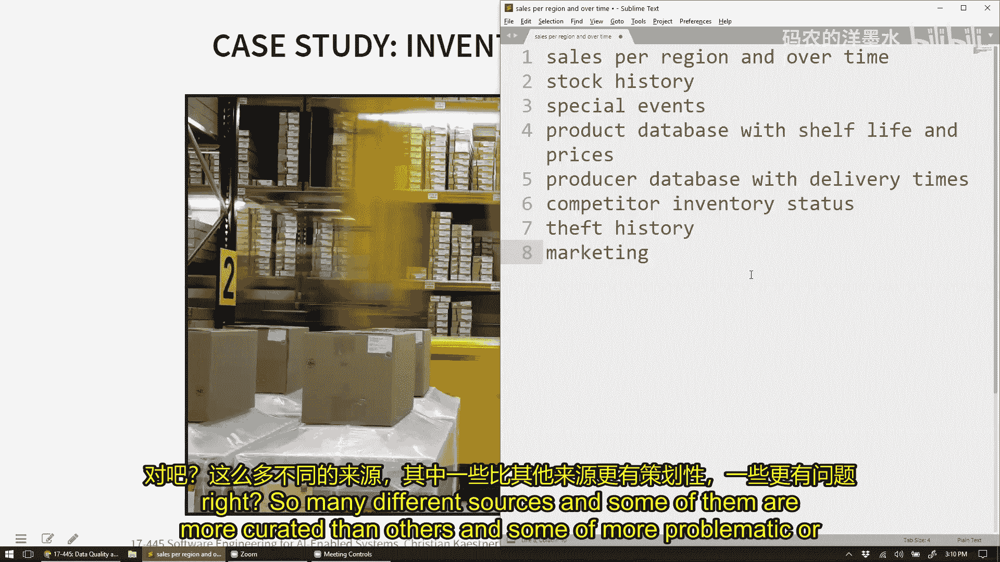

You're expecting you have a bunch of databases in some form， right data in some form。

 so you may have the products， you may have how much you have in stock at any point。

 how much you have sold at any point and a bunch of other things that we just talked about。

 right they might come in different formats from different sources。

And now we want to think about what makes good data quality and we can break this down in many different places。

 this is what I took I think from some book， doesn't really matter how we break it down but there are many different forms of quality that we can also think about for data right so we want accuracy for data and we can talk about precision versus accuracy here。

 we want completeness。We want uniqueness， we want consistency， we want timeliness。And。

Let's just go back to this and think about what might be one problem in each case。

 what might be an accuracy problem for any of these data sources。

So accuracy is if we're not recording the right data。What would be a simple example？

A plausible example in the scenario。Cash sales on a track in the system yeah for whatever reason right we're missing just something also completeness when relevant data wasn't recorded similarly we're missing some sales for some reason or we're getting shipments from somebody but for some reason we only get the paper receipt and it doesn't make it into the system right so our database might be incomplete。

Uniqueness is maybe the opposite right somebody gets this paper receipt and they enter it twice or by some reason we stop duplicating the entry。

What might be a consistency issue？快啲。So some information might be。Available in multiple places。

 like for example， we have sales and we also have stock info。

And we have safe health product database then something like a product ID could be there。

Like some information could be there in multiple places and from multiple sources we collect。

 but there there should be a way using which we can map these things together like if you want all information for one product is it possible。

To collate the data from multiple sources and apply it to one product so so one example would be we have we're selling peaches and we want to know from our provider database how many we got and in our sales database how many we have sold right and kind of to match this together and we need to match them。

Around teachers， right and if we have different kinds of pe， make sure that they' are matching。嗯。

And they right， so。Ztroron says if inventory says 20 items were sold。

 but we only have 10 that were checked out or 10 that we ever bought right so those are inconsistencies。

Or one sauce kind of just groupss all chili peppers together。

 even though we have different varieties and a different source， right？

A bunch of these things happen and different data sources may use different terms and so on。

And timeliness， what might be data that's。Maybe what might be a plausible reason that data might be out of date？

嗯。Kind of slow to be entered in the supermarket scenario。Yeahliu。So， so as far as I know。

 a lot of the inventoryvent managing。Ssystem of US supermarkets are still using very old software based on。

 I think， even backing Windows XP some kind of architectures。

 so with very old systems there's a high chance that they will temporarily break down and when things break down to restore data takes a lot of time and that could that could lead to data out of date。

Could have a system。Going down or maybe just offline so they're caching things and they don't get entered another thing is maybe you get receipts from the vendors in paper form and you need to enter them and somehow you don't do this for a day or two right so it might be a little bit out of date。

A。So there are many different forms that data can be noisy， right？

Don't have very obvious sensor examples here， maybe checkout counters where maybe you scan something or miss to scan something or use something incorrectly right but kind of scanning something at the checkout is probably fairly accurate but not super accurate。

You may have some weird computation， somewhere crashes， duplicate data。

 near duplicate data we talked about out of order data as well if it's delayed and then just plain in wrong format right so somebody fits and they get a paper receipt and they fit it in and they just fit in the wrong stuff in the wrong form so they instead of saying 10 pictures they sayP 10 it's like the name is in the wrong column or something like this right。

All kinds of possible problems and then also a bunch of things change over time so the system objectives may change software components may change and be upgraded right the prediction models themselves may change the quality of the supply data may change user behavior changes assumptions may change let me again get a few examples。

但是。Objective of the system for inventory prediction ever change。

I'm not sure how clear the objective was in the first place is you could have an objective like we never want to have an empty shelf or you could say you know you always want to have the freshest goods or you never want to run out of one so I think you could define a lot of objective functions within your problem description right and that might change over time right。

Do you have an example when the quality of the supplied data may change over time？So again。

 for example， you get the paper receipts from the vendors whenever they ship something to you and。

You have a new person typing this in and then maybe not trained or you buy a new scanner and or have a new software to do this and it's suddenly much more accurate。

Maybe you upgrade all your cash out terms and for some reason that's no higher quality and fuel mistakes。

Maybe the marketing campaign or the Twitter data or whatever external data you get。

 what we talk about kind of special events that just much more accurately tracked right before you kind of just had a few things now you're tracking way more。

嗯。User behavior changes， this might be somewhat obvious。

There's like an E coli outbreak and people stop buying lettuce。是吧。That's one example。

 there's probably hundreds of examples why somebody would buy stuff more or less， right， this is one。

Right， and then。Yeah， a lot of these are assumptions about the environment。

You could think about nobody would buy more than 20 roads of toilet paper at one point right as a reasonable assumption that you typically have that suddenly gets violated kind of again。

 consumer behavior changes。And then you have kind of feedback loop things。

 right so users can react to the model output and users can try to game， deceive the model。嗯。

A vendor might try to buy their own products， lots of them in a short time span， maybe return them。

 but kind of create a peak in demand， right kind of to track this that the supermarket wants to buy more bunch of examples like this。

Let me skip some of these things。So when we think about machine learning， data。

 quality and quantity is important。Typically kind of as a rule of thumb， if you have more data。

 you get better models right， So the more data you have。

 the more you can learn about unusual things the better you can usually generalize。

 although in most modeling techniques there's a point of diminishing returns right so at some point you have so much data that。

Even doubling the data will give you only very little marginal accuracy right so for different kinds of modeling techniques and different kinds of problems。

 this is at different points， this is maybe hard to predict up front how much data you need。

 but you usually want a lot of data and for some problems you need a huge amount of data。

The more noisy your data is， the less confident your models are or the more data you need it depends a little bit on the modeling technique how robust they are a lot of techniques can deal with noise quite well that they kind of see here lots of similar data points as's quite a big distribution but they take the average so if you just see a lot of a lot of different data points they might kind of be able to deal with us if you have enough data if you have only very little data and on top of that there's noisy you might overfit to very wrong or you might learn wrong patterns right you might be very not confident。

And if you have inaccurate data。You might get completely misleading or maybe I should get back to this point。

 actually。I should briefly talk about the difference between accuracy and precision most of you have seen this probably before。

If， if there's a real value， like how many。Peachaches are on the shelf in the supermarket。

An accurate measure will give you the right number。

And a precise measure will give you the same number if you measure repeatedly。

So you can have a measure that's accurate and precise it will tell you there's 100 pes on the shelf and if you count again there's again 100 pe and if you count again there's again 100 peache or 101 right most software metrics are very precise if you measure multiple times you get the right the same number。

You might get a metric that's very precise but inaccurate， so there are 100 pes there。

 but whenever you count it says 200 pes consistently counts double the number of pes right this is very precise it gives you the same number over and over again。

But it's not accurate， it returns the wrong number。And then you have accurate but impreciised things。

 so for example， if you ask 100 people to estimate in this pile of peaches。

 how many peaches there are。Maybe on average you get close to 100 right so some people may estimate 50 some 200 and if you average it out over a large number of numbers。

 you might get fairly close to the accurate to the accurate result。

 but it's a very imprecise measure。诶 soで。The difference here is。Precision。

You can deal with or imp precisioncision。 you can deal with by just repeatedly measuring this。

 This is kind of annoying， but you kind of have to。

You can performance measurements are another example where you just repeat the measurements and take the average and you get closer to the real thing。

U。Accuracy is some saying that you can't easily replace。

 so if a metric consistently tells you double the amount of time。

 that's a bias that you can't really deal with and that you can't deal with with statistics。嗯。

So except for spelling mistakes the difference between precision in precision and recallcoil and precision and accuracy and precision is they are completely different concepts they just accidentally have the same name right so precision and accuracy is precision here is really repeated measurements how close do you get the same result whereas precision and recallcoil is very much about kind of。

Of the things that you're predicting， how many of those are actually true， right。

 they have nothing to do with each other。So kind of coming back to this difference。

 if you have imprecise measurements， kind of precision problems。

 machine learning can often deal with this because they can average over noisy data。嗯。

This is distracting， thanks。U。But inaccur inaccurate data is something that you can't really deal with right so if your data is consistently off。

 your model will learn based on wrong data。So there is a need whenever you're doing machine learning to get the right data。

 to get accurate data to deal with kind of wrong data and ideally also to get less noisy data。

 right more precise data， so it's very useful to invest in data quality。

So I don't want to spend a lot of time on this but I want to kind of bring this up exploratory data analysis is one of those steps that data scientists should do it's one of the main recommendations。

 always do this but it's very often people don't exploratory data analysis essentially means before you even start with machine learning or anything。

 try to understand the data， try to look at what you have and just want to kind of take an example here。

This is。

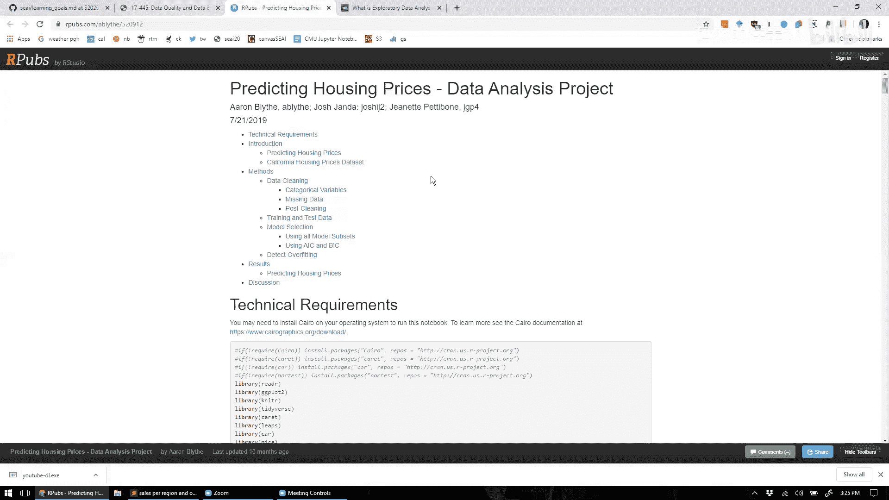

A notebook on housing price analysis somewhat similar to an earlier example that we had in class。

 it starts by importing a bunch of stuff and then loading a certain housing。Data set。

 so it's California housing prices， you have the location。

 you have the median age of houses in that neighborhood， the number of rooms， the number of bedrooms。

 the population in that neighborhood and so on， how close you are to the ocean and then you're trying to predict a housing price。

We could just take all those features， throw them in the model and see how what accuracy we get。

But the useful way of kind of approaching this is let's first look at the data。

 what kind of data do we have， what does this actually mean so longitude we might kind of look at the distribution of data right it's between minus-114 to minus-124 so you can kind of understand what this might mean in terms of longitude it's probably no extreme outlier here。

 you see how median age of houses kind of makes sense thiss probably years right。

 total number of rooms。Doesn't seem to be the number of rooms， maybe square feet。

So you might want to go back and this might not mean what you think it means。

 also it has very big outliers here。This is the first step it's very common to actually visually explore the data so this is just plotting where these things are and what the values are so you kind of get a sense of whether the data makes sense right so if there was a kind of big green area here kind of a blue very higher housing prices over here you would probably not trust the data too much。

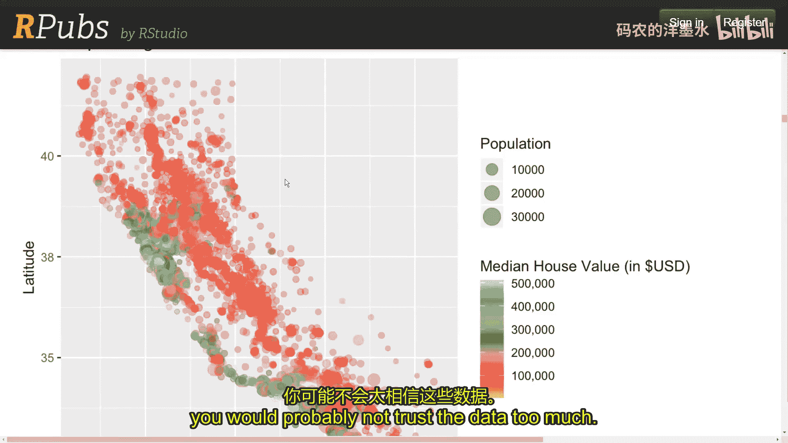

This seems plausible， then it's very common to kind of do some plots to just check kind of how is the data distributed。

 like most things are not close to the ocean yeah that makes sense。

 there's a common thing where you look for correlations， what's happening here。

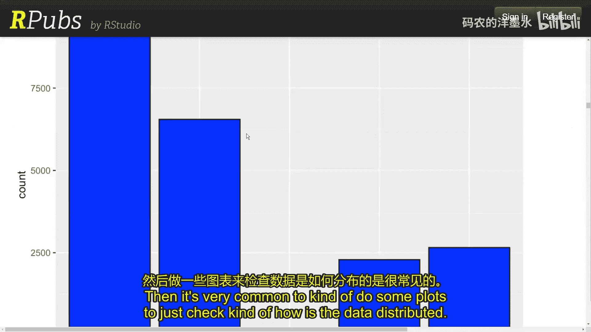

Oh。So here they are just plotting a bunch of distributions， right。

 so if you see this total number of bedrooms， you might want to think about whether。

Maybe for machine learning， you want to transform this into something that's more normally distributed or between0 and one。

 and that's also a useful thing to see。Just visually are there any strong correlations between data so I don't know which ones they are。

 but this thing and this thing here households and total number of bedrooms seem to be strongly correlated right。

This may not matter for some machine learning techniques， but it helps a lot to understand the data。

え so。Why am I talking about this where data scientists should do these things anyway to understand what they're working with right to understand the quality of their data。

 but also when we're bi these systems。

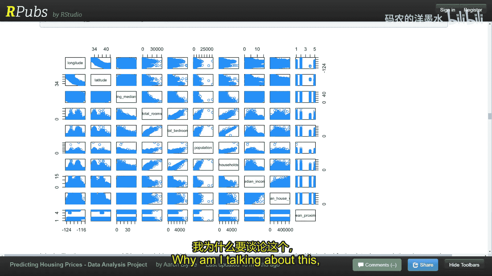

It helps to understand what kind of inputs and outputs are we working with。

 what are the kind of distributions that we are expecting。Are we expecting lots of outliers。

 are we expecting clean data， very unclean data， what kind of assumptions can we make about the data。

 maybe we can test some of those as assertions at runtime right kind of the shape of the data。

Things like this。All right。Now there's a huge step in data cleaning and I don't really want to spend the time to go through all of this。

 you can slice and dice data cleaning in many different ways there are many different activities that we can work about here so we can talk about different kinds of problems so examples where you simply have completely broken input formats right this is ill formatatted you have kind of dependencies that are not met where kind of the age doesn't match with the birth date。

 you can have things where values are wrong where things are misspeed some of them are about specific data some of them are about relationships of multiple data that are not consistent so there are lots of these kind of possible discussions and there are many。

Let me see there are many different tools and techniques。

 the classic approaches are outlier detection and removal， data deupplication， detecting duplicates。

 some sort of transformation， some rule based data cleaning。

 identifying consistencies and roots and then some kind of probabilistic reasoning about probable roots and so on for data cleaning。

This comes mostly out of the database community， they've been looking at this for decades。

 this has a lot of additional attention these days because a lot of companies are building huge huge data sets and need to deal with this right so there are currently hundreds of startups in the space that are doing something with data quality in some ways so a lot of kind of the classic techniques are coming back。

I just want to go through some of the kind of basic things that are kind of easy to apply right so the first thing is to use a data schema the data schema essentially just describes constraints on the format of the data kind of expected fields and so on。

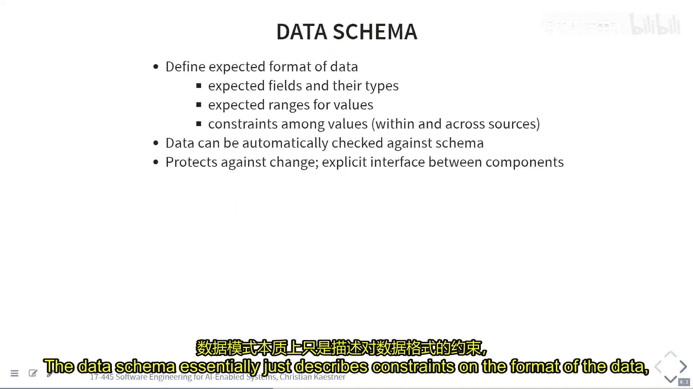

I suspect most of you know this from SQA kind of classic relational databases define you have tables and then they define what the data looks like right so the employee table has an employee number which is an integer which cannot be neither it always needs to be provided it's also a primary key which means it needs to be unique no two employees can have the same number right and then there needs to be a birth date which is a date so you can't enter something that's ill formatted into this database right so at least it follows a certain consistency rule。

And then on top of this， you can also have you have more things you can say also the department name can be concrete and then you have foreign keys as well where you essentially establish relationships between tables like you can only have a department manager if that employee number exists in the other database。

So those kind of rules， those kind of constraints are fairly common。

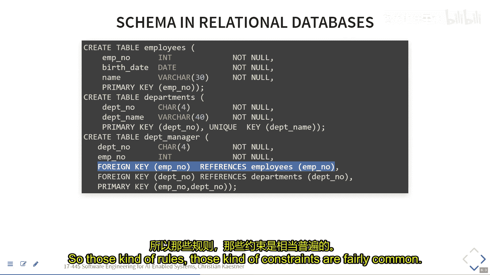

Interestingly， if you look at modern data science， we work a lot with CSV files and data frames。

And very frequently not without not with any schemas right so we dumped stuff into J files into CSV files and do a not check them。

 So here's a。Input data that I used for the homework assignment with the movie streaming thing。

 it was essentially a CSV5 which wasn't comm separated， but colon separated for some reason。

Right in this format。It actually had this format throughout。

 but there is no data format that tells me that the first thing is a number， it's unique。

 the second thing is a string or maybe it has two parts right This is convention and actually it worked here。

But。My PA for this now assumes this format and if I would get any different input it might crash it might just say array out of bound right these kind of things also in this thing here agenda of occupation but it's not from a fixed well it doesn't tell me what the valid values are and so on right so this is where you often come back to data exploration where you get the CSV file and you first of all look at what do I actually have right what's the format。

It's actually a good idea to enforce some schema when you're passing things right that you actually。

 if you assume this is a format of your data， actually pass it。

 actually check that it consists that it。Fits this format right。

 that you have a meaningful error message， if it doesn't。

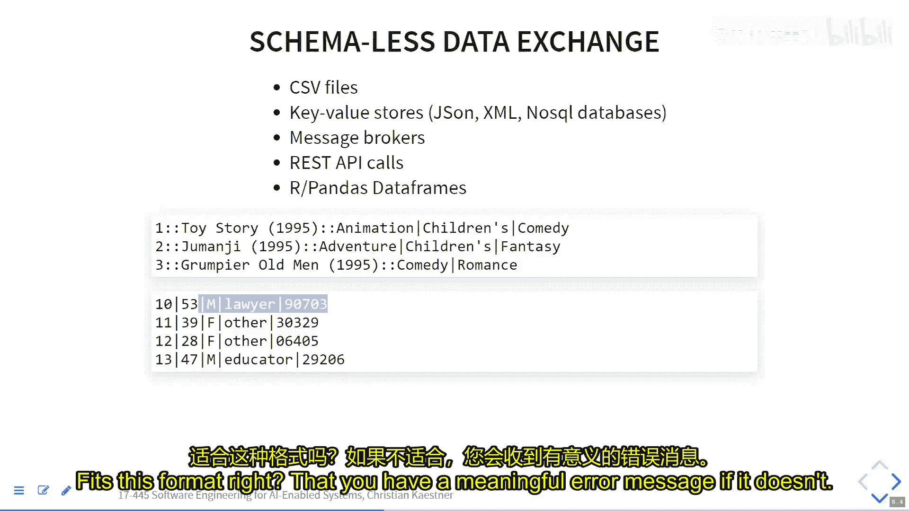

There's a lot of push and modern tools to adopt some schema also for kind of Json filess and CSV files there are a couple of competing toolss Apache Avro is one that Kafka supports I haven't set this up for the stream that I gave you but what you can do there is you can say again this is a record。

Name and then certain fields and those fields have types right so this is specified in some JSson format。

 but it essentially is similar to the SQA schema in that it defines what does a record。

 an entry in a Kafka stream look like and then whenever you write something or read something from the stream。

 it can use this to validate that it actually corresponds to the format and you can use this to generate automatic pause and serialization mechanisms and so on。

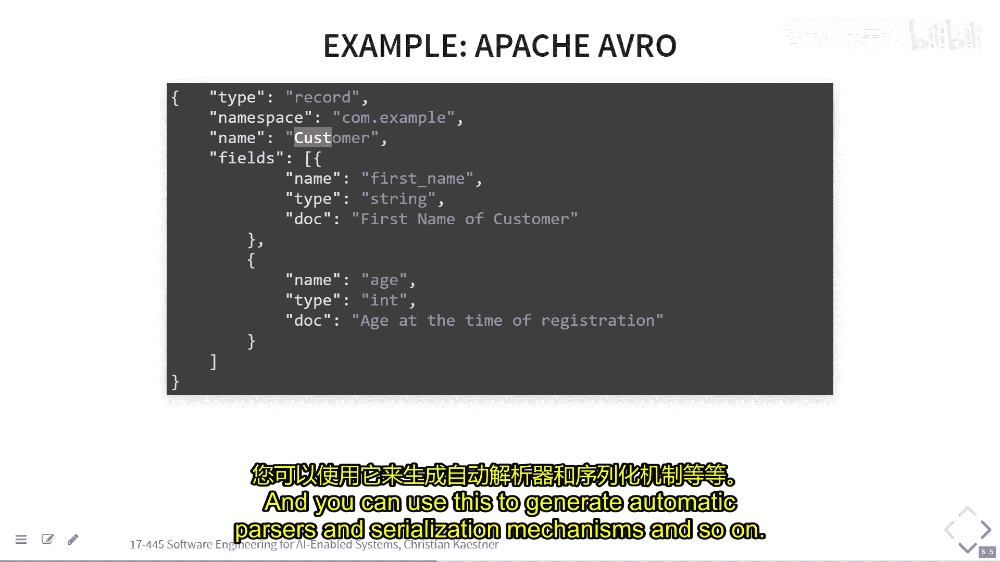

And so this exists for a lot of languages， for a lot of tools。Often comes with or M mappers kind of。

Things where you can kind of get a useful nice API to access this if you're actually going beyond a notebook。

 if you're buildingdding an infrastructure that you actually want to maintain have lots of data that you need to understand for a long time it makes a lot of sense to invest in some of this right to actually document what the structure of your data is and put in automatic checks and these tools。

requirequire some learning curve so you need to understand how to use them。

 but then they are fairly useful and fairly low key。

 low overhead as a simple mechanism to enforce some form of data quality。

It doesn't enforce that the values are correct that are in there。If you have the birthday。

 it doesn't check that this is a plausible birthday， it just checks that it's in a date format。

 right it's not just a random string， but that's one step。

 a first step to actually enforce that's quite useful。

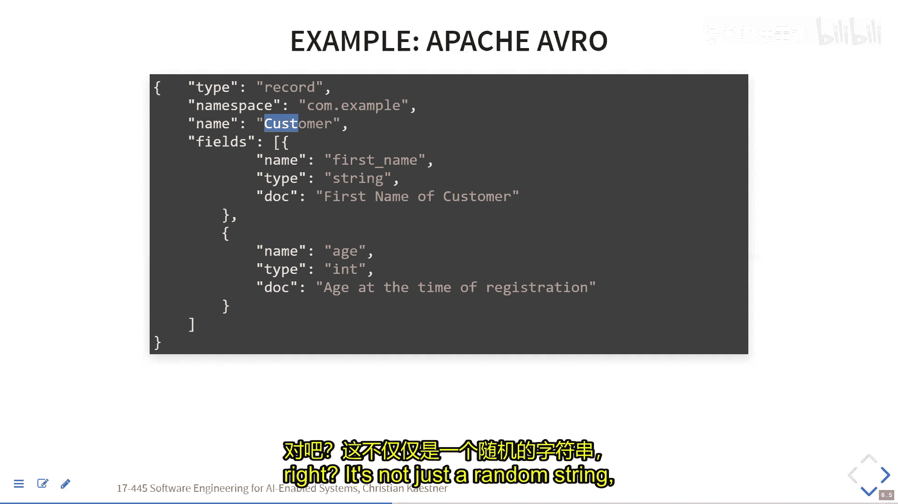

All right， I think for our inventory system， this is fairly straightforward。

 I think I kind of implicitly assumed for all the data that you gave here we probably have some sort of database。

 some relational database that maybe already has a schema。

 at least a way that I've shown it here kind of implies that a bunch of those things might also be CSV files right in very different formats like the product database might come in a CSV file from the vendor or an adjacent format。

But in general， yes， at some point we need to ingest the data from all these different sources and try to understand what we're doing。

We're going to talk a little bit about this process of ingesting data from huge number of different sources on Thursday I actually have a guest speaker who has been working with machine learning in production since then。

Mid 90s and he's going to talk about especially this problem， how in a company。

 you have all these different data sets and how you kind of need to integrate them to make sense out of this and so。

All right so schema is one thing schema seems kind of easy。

 this is also in the reading most of the work in this Amazon paper was about schema enforcement。

 there was a little bit of work on kind of enforcing distributions but most of it is really just schema enforcement and they figured out how to actually do this at scale right。

The other thing is actually looking at inconsistencies in data， looking at rules at dependencies。

So if you have a lot of data。You can。Or often you have redundancy in data。 So， for example。

 the city city and a state together should uniquely。No， the other way around。

 zip code should uniquely identify the city and state together。

There are some areas where I think this is a little bit ambiguous where you could have two different names for some reason you can have Monroville and Pittsburgh。

 you can write either one of those in some zip codes but usually there's a fairly fixed rule and if you have a zip code that completely doesn't match the Pittsburgh area right this would be an outlier and something that you detect so you have a certain you often have certain redundancy in data and certain rules and certain consistency mechanisms you also have certain distributions like Chicago is very common whereas whereas this spelling here is not very common so you might learn that。

This is probably an outlier right looking at the rest of the data。嗯。我。

I think this suggests that different those have the same zip code。

 but the street address or different zip codes， but the street address otherwise is exactly the same。

 which seems implausible right， probably again an outlier here。

So there are many different ways to think about this。

 but it often boils down that you have some sort of rules that。

Create some invariance across data across one table or across multiple tables or across multiple rows。

 right， So the typical things are multiple attributes。From the same of multiple data sources。

But also things like things should be unique， things should refer to something that's in a different table。

 a lot of classic integrity constraints that have shown you in databases fit into this category。

And there's a bunch of old and newer work to mine those routes as well right so if you're just giving a CSV file。

 you might want to figure out what are some of those routes here。

 so if you have some external database of zip codes and addresses。

 you can use that to check your data but if you have enough data you can also mind that kind of figure out oh Pittsburgh should be in this zip code range for example。

 right learn this from data。There are a couple of。Kind of classic algorithms that give them a data set。

 assuming everything is clean， it can find functional relationships。 For example。

 it can figure out that。嗯。kindind of the the zip code relationship to a city like the zip or the city always uniquely identifies the zip code or the other way around。

 there are also algorithms that can do this under conditions where they can figure out under this condition。

This value always implies this other value right so with this street address this zip code implies this other thing and you can also find things that are mutually exclusive。

If you have mostly clean data， if you're not sure that your training data is cleaned。

 you can also have a probabilistic view where you only look for common rules。

And then once you see loop violations， you can either get some user feedback kind of to fix those or kind of get more feedback to learn this or just learn。

Have you seen association rule mininging before？So this are very classic old machine learning techniques that's often used kind of an exploratory data analysis the idea is that you find dependencies in data so the classic example is that you have a bunch of sales again in a supermarket so the first person buys these two items the second person buys these two items and now you want to figure out if X is bought then y is also bought。

And theyre kind of classic algorithms that do this， these roots don't usually hold for all data。

 this is a probabilistic algorithm， but what it might find is that if diaper and beer gets bought together。

Then also milk at spot。Often。And there are typically two values that are shown here。

Support and confidence support says out of all the data that I've seen in how many rows has this rule applied。

 So here we see this rule applies in two out of。The five words， so 40%。And confidence is out of the。

How that does work out of the things where diaper and beer are brought together， so not all roots。

 but only where the precondition is fulfilled， how often is milk then actually bought as well？

So confidence says how strong this implication is。And support says how often this occurs in the entire data set。

And they're relatively easy。To understand algorithms that in some machine learning classes you would implement yourself like the a priori algorithm how to get a big table of data and find those rules so what you're looking for are typically high confidence rules with a certain amount of support right not super high support but they should occur at least a couple of times in the data set that you have some confidence right so you might learn that if the zip code is。

15，213， then with very， very high support， the place Pittsburgh。

And this is true for maybe 1% in your data or even less than that， so support is not super high。

 but if you see this relationship， then it's very certain so it's kind of a probabilistic way of finding woods in the data。

And again， this is similar to looking for correlations in data。

But it's looking for dependencies between correlations。

 it's looking for kind of correlations between multiple columns。

 this would look for dependencies and this can help you to understand your data as well。

Does this make sense？This can be quite a useful tool just to kind of find things in software engineering this actually also has a history。

 I don't have the time to go through this， but there's a quite a bit of work on finding。

Invariance in execution， so likely preconditions or post conditionsd and software。

 some of you may have seen the Daon tool or something like this， so you're trying to figure out。

Things like this could be a precondition for some function or post condition。 I have an example here。

 So if you if you're running this code here with a bunch of different inputs， for example。

 for the absolute function， you might learn that。呃。But do you learn that。G。

So you might learn kind of invariant like this where you figure out that if it's larger than0 than its's x。

 otherwise it's smaller than x， and there's a way to kind of just observe this。

 you observe a lot of data point and then you find ruless that have very that have some reasonably high support and very high confidence。

And if you have those roots you can use them for repair as well there are a bunch of tools out there that do this one thing that I've seen recently is Holloclean which is a tool that essentially does this kind of learning over data it finds probable relationships。

And then if it finds in violations of those relationships， if it's very confident about this。

 right so it has seen that the zip code is clearly Pittsburgh。

 like 99% of the time it might just change it for you。So you can repair data this way。

If it's not so confident it might flag it for human review or depending on what your level for data quality expectations is you might just throw it out。

诶。So there are a couple of things it usually gives you some confidence in kind of this is a rule violation。

And then depending on the confidence you can use it for repair or not。

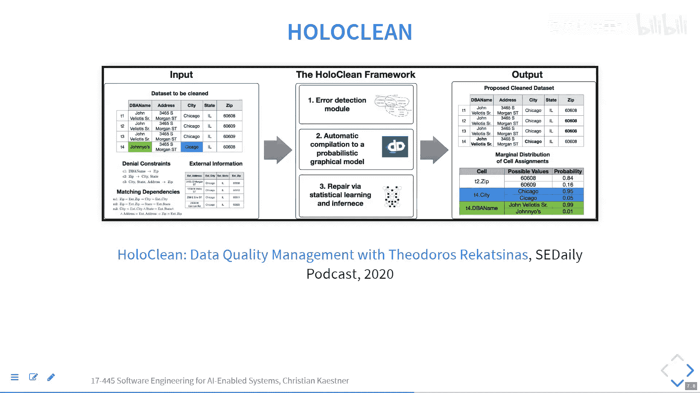

All right。Give have some examples of wordss that you might expect。Either roots that always hold。

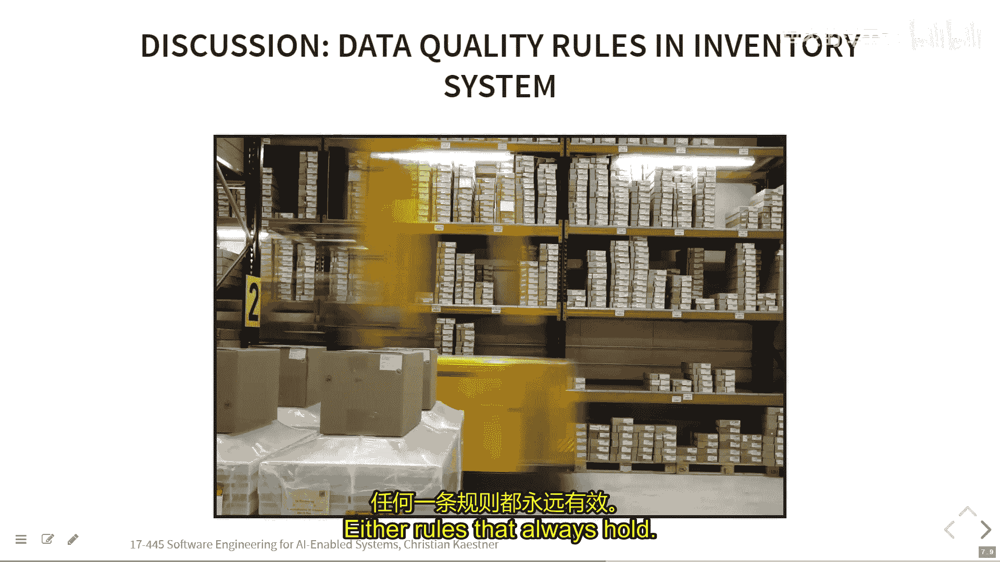

Or ruless that mostly hold and are a strong indicator for kind of violations either within one data set or across multiple data sets。

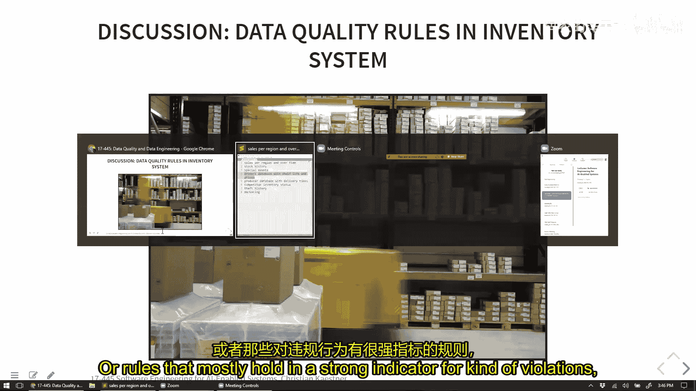

In this analysis part。Y， inventory should not be negative。

 that's probably actually more data schema issue right this is only refers to a single data point。

 not the relationship of multiple data points。But it's an variant that you could learn， right。

 so you can learn that it's an outlier to ever have a negative inventory。Anything else？Certainly。

 all the address stuff works with supplier addresses and。嗯。Sfe lives shouldn't change over time。

 yeah， probably at least not drastically。If you get。The same product from white with vendors。

 maybe the prices should be within a similar range。Delivery time should be in a certain range。

Maybe depending on on the day right so if you order on a Monday delivery times should be under one day。

 if you order on a Friday， it might be larger so you can have some of these dependencies of day to delivery time。

So there might be a bunch of these roots in here。And if you just see kind of a sudden violation this might be a data quality issue right and then there's a question about how do you repair this。

 do you flag it， do you automatically repair， do you just delete the data。

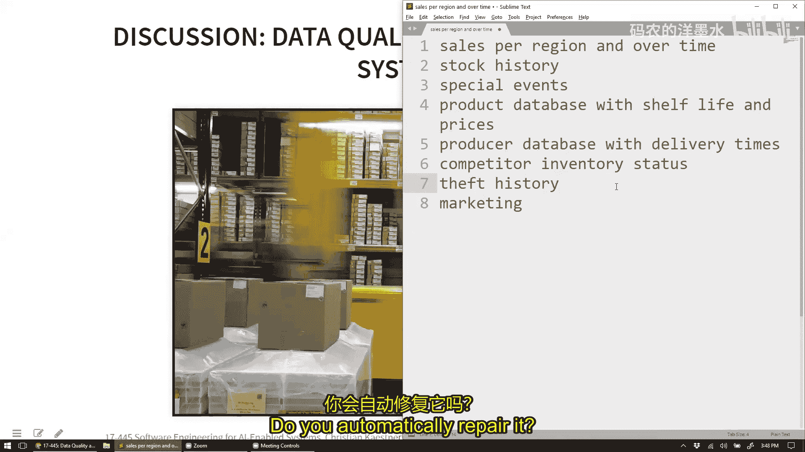

Do you just wait until you have？If it's just a little bit of noisy data， you might not mind。嗯。

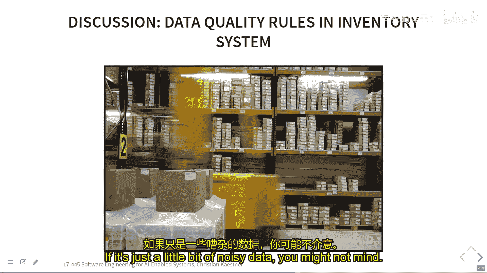

All right， just very quickly， you looked at this paper as well。

 I just wanted to bring this up because I think it's a neat idea。

 it's essentially thinking about we have all these static analysis tools in software engineering right things that finds mistakes like in Java you don't want to have an assignment here。

 you actually want to comparison an E operator here right or you have that code after return statement。

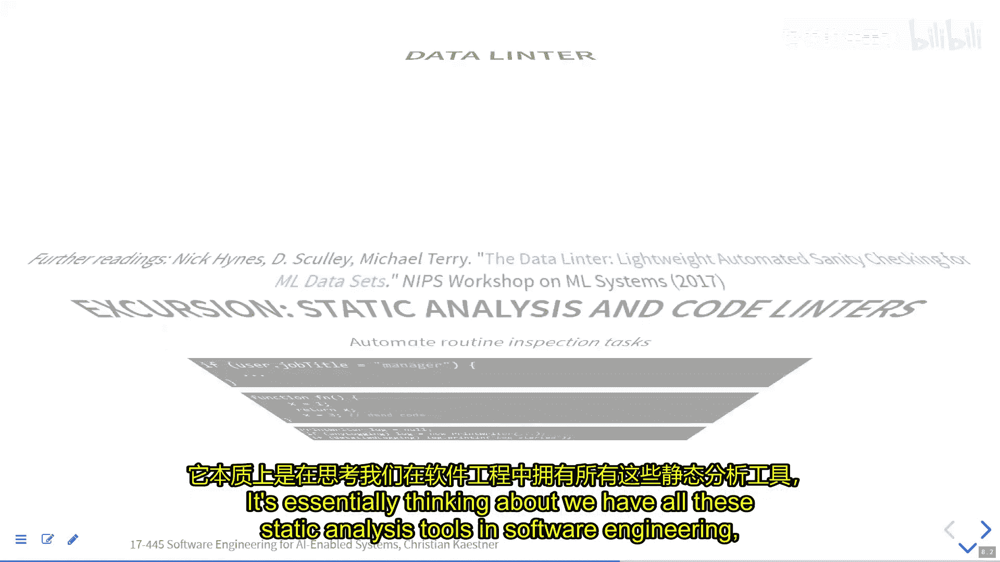

And you have kind of a bunch of weird things a lot of these things can be detected by static analysis or dynamic analysis of source code right so there's a question is there also something that we can do to machine learning code to detect some inconsistencies to detect some data problems and the things that they talked about in the paper where things like。

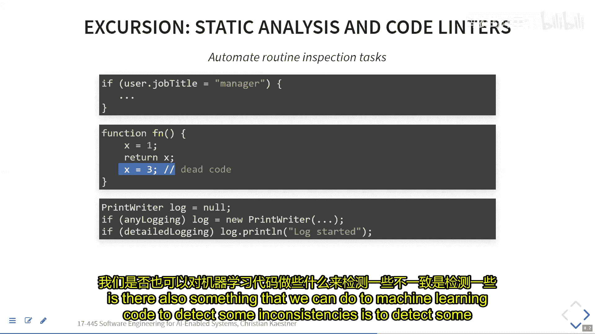

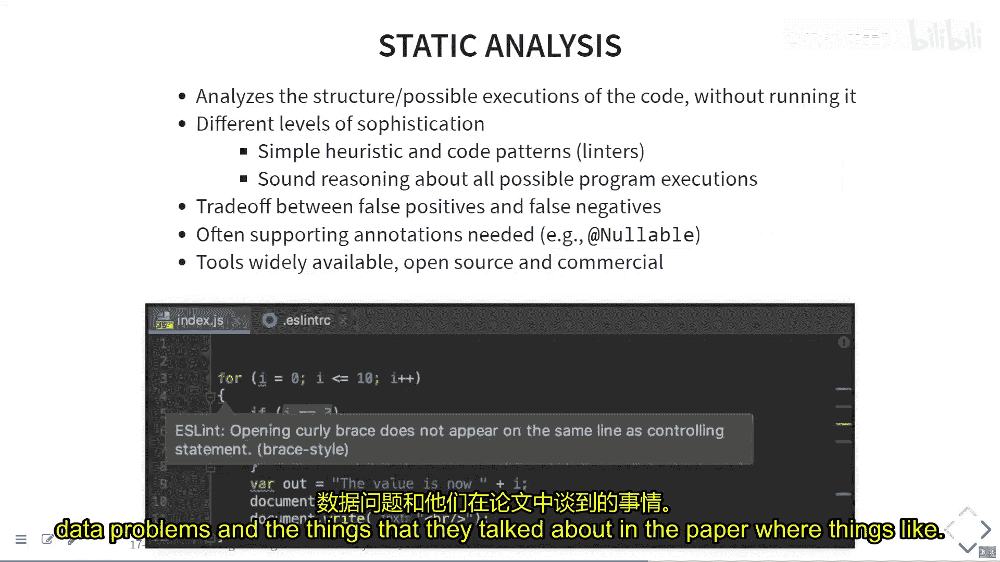

Wrong and coding。So kind of using strings as input to a machine learning algorithm that expects numbers or that uses inums as reads or the other way around outliers and scaling so there's maybe not fully static but more dynamic but kind of looking at the distribution of data and the distribution is really longtailed and the machine learning mechanism can't deal with this very well maybe should encode the data certain packaging things I haven't seen much aids in this area。

 I think there's some error checking with regard to deep neural networks where it's very easy to make mistakes but there's closer to type checking but I think there's a potential here also to kind of look for more structure things or problems in your code that have more to do with the encoding than maybe with the original data quality so I just wanted to keep this in here as a pointer。

Any questions on this part， what can we move on？All right。

The main thing that I really still want to talk about today is drift。

And that's the problem that something changes over time and how to detect this。

And this is a big problem， right， so if it's a data violation kind of if the。

Date format is invalid that's easy to detect right if there's a rule violation like the zip code is wrong。

We have techniques to detect this， but what do we do if data actually changes our expectations change？

And there。At least a few different things and they have slightly different names。

 they're not always cleanly separated。 There's the idea of concept drift。

Where the idea is that for the same input， you expect different predictions over time。一つ。

You have a credit card transaction and today you would flag this as fine and tomorrow the same transaction you might flag as potentially fraudulent。

Right， so the data hasn't changed。But the kind of things that we consider as fraudulent。

 maybe because the kinds of attacks have changed in the real world that has changed right so for the same data。

 we expect a different outcome。That means the kind of concepts that we're predicting have changed。

Data drift is slightly different。Data drift just means we're predicting different kinds of inputs。

And we're getting away from the inputs that we have trained on。So for example。

 we have recognized a face recognition algorithm。And now people start wearing masks in the pandemic。

For the same person we still expect the same labor right that hasn't changed。

 but we have trained on faces without masks and now we have faces with masks that we haven't really trained on so we're trying to predict things that we haven't really learned on。

So in both cases， what happens over time if data or concepts drift， we expect worse predictions。

Because we've trained on different data。Or the， the expectations on the training data have changed。

 And then there's also the problem that the out upstream data may just change。

 It may change the formats。 So for some reason， somebody has changed。 We use the weather data。

 and it has changed the format from。Sayss to Fahrenheit。

 where you use the movie data from IMDB and they change their rating system or they change how they format a certain column。

Right。This has very abrupt changes， so there you would typically expect that if your input data very suddenly looks very different。

 not because the ver has changed so much， but the way that you collect the data has changed。

So in these cases， if you have concept drift。How do you fix it。

So let's take the credit card fraud example， it's very similar to the fraud example that you saw with advertisement and in the first homework right online advertisement。

 so the kind of a text change， how do you deal with this？

You have trained the model on some labeled data of the text。What people are doing is changing。

 so for the same data you might want to classify this as an tech now， which was fine yesterday。

Do you just relabel the data and retrain yep， you relabel and you retrain or you collect new data。

 but yes， you need to retrain and you need to relabel to do this。For data drift。Just retrain。

 I think， right？Collect more data， right more training data and retrain。

 but you don't necessarily need to relabel the old data right because you don't expect it to change。

And if upstream data has changed， how would you fix that？Depends on the change。

 but let's say Fahrenheit two Celsius。Maybe just transform your data sets so that it yeah。

 I would probably just transform the input data when it comes in before you use it for e right but if the rules are clear enough and you're not losing anything you can just convert it。

so。I wasn't using concept drift and data drift consistently as separate terms before and I will often just refer to this as drift for the rest of the lecture when I tried to look into this I also got the impression that papers don't necessarily make a very clear distinction here。

And it's always it's also kind of hard to there are some cases where it's hard to make a distinction。

 actually。There might be cases where you can think about has the prediction changed or have we just not enough context for the prediction。

 So actually， the data has changed。 So， for example， if you're going with seasons。

 you're predicting different amounts of Turkey sales around Thanksgiving。So in our inventory example。

Ha the。Has the prediction target changed or has the data changed？So you can think about this as。

Given that we have 10 turkeys on the shelf， how many turkeys should we buy？

That has certainly changed， right， so in a sense it's concept drift。

But you can also think about this if we say for a certain date of the year。

 how many turkeys should we buy and we have never trained on Thanksgiving data before then we have just a gap in training data right we kind of have foreseen of this it's not that the concept have changed is just we're predicting for an area that we haven't trained on so。

I'm not sure that you can always distinguish concept and data drift precisely。

 I think there's two separate ideas and you kind of address them in slightly different ways。

I would suggest if you talk to somebody about this。

 define what you mean right so I think most people have a vague idea of kind of drift always happens。

 but whether it's because the concept has changed or whether the data distribution has changed。

 it's not always super clear。So in both cases， the idea is though that if you don't do anything。

 you would detect dropping quality over time this is another reason why testing and production is very important on aesthetic static data set you wouldn't detect this。

 but if you're testing in production，And either your concept change or your data changes。

 you would expect lower and lower quality over time。And in both cases that we talked about fixing。

 you would expect to retrain new models either closer to the data that you're observing or relabeling things so that you would expect kind of to always improve up。

 but this is also a reason why you need to retrain and practice all the time。

How would you find concept drift？So one thing is you just see quality dip， right。

 this is probably a good indicator that something is wrong。

Can you think of other things that you would use？So it's kind of for similar input data。

 you're expecting different outcome data over time。

So you can look at the distribution of outputs for kind of similar data right so if you're doing the same kind of prediction for a lot of people over and over again。

And your telemetry。Tells you that what was previously correct most of the time is now increasingly considered as incorrect by people。

So telemetry data for the same output。It's kind of rated differently， that could be an indication。

It just requires that you also have telemetry data， actually。

So kind of drift on telemetry probably helps you can probably ask humans to label some data。

 some telemetry data or some regular data， this a credit card is this a fraudulent credit card transaction？

Is this a proper kind of amount of peaches that we are buying？

If the labels changed over time on the same data that keep a label。

 that would be an indication is a fairly expensive way to do this。

And I think one strategy could be if you have an interpreter model。

 which you can actually understand what the model is doing， you might be able to judge。

 oh this is no longer the right model。I don't know if there are any better strategies this is not my area of expertise there's hundreds of papers on this topic。

 but theyre typically kind of very statistical detection mechanisms and I think in practice what people mostly do is they look at how much is their telemetry data telling them that model quality is going down over time right so it's really look for this curve if it's going down it's time to retrain。

Right， possibly relabor。嗯。Data draft。Oh yeah， so this is another reason why you really want monitoring。

You really need telemetry， you really need monitoring。For data drift， it's often easier。Data drift。

 you can detect that distributions have changed。 This is where we're coming back to kind of what we what I've shown you in kind of the exploratory data analysis。

 right， So if you know that。In your training data。

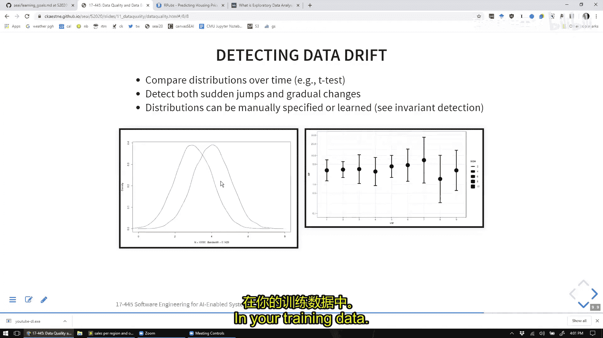

You're expecting most houses to be。Far away from the ocean and only few houses near the ocean。

 and then you suddenly see in the production data that you're working life。

Almost everything is on an island。This kind of indicates that something has changed。

 your training data was not representative of this。

And you can use this on a single feature like this， or you can use it on the data in general。

 right is the data that you learned close that you're making predictions and practice close to the data that you trained on。

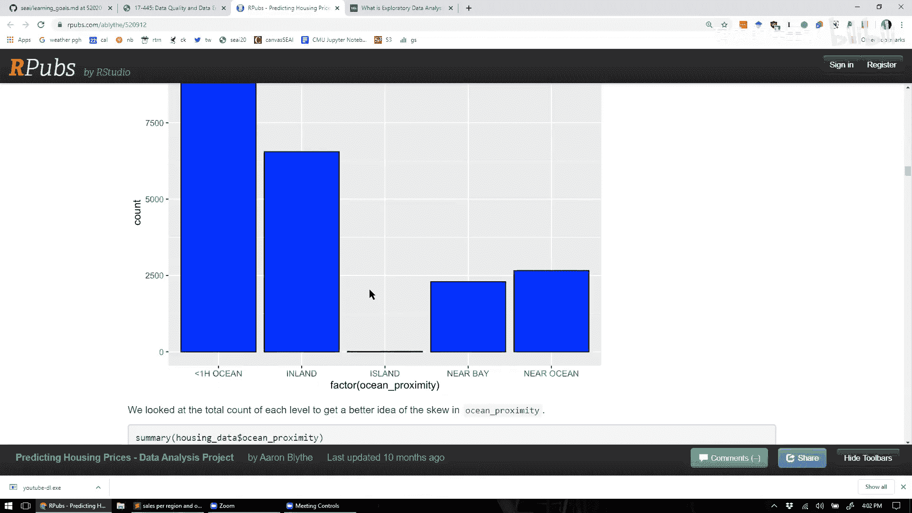

There's actually a bunch of techniques here。Anomaly detection is one of them where you can just see。

 is this very unusual data， you can check what's the distance to training data。

And then there are a bunch of approaches that use statistics in some way to kind of figure out how representative is is this kind of an out of distribution sample or are we getting further away you can also look at the representations of labels the distribution of labels and whether that changes right so if in your training data the housing prices were like this and then the actual prices that you're predicting are much higher。

This might be an indication that something has drifted right so the prediction data。

 the production data is not representative or the training data is no longer representative of the production data。

And again， you can do a lot of statistics or you can just plot it and look for kind of changes over time right gradual changes or jumps。

 sudden changes， jumps are usually signs of something has changed in the data format or kind of something has changed very abruptly or attacks。

On the system， right and graduate changes are usually some sign of some drift over time。

So simply just plotting kind of distribution over time。

 these are box plots I think or kind of error bars can be useful just to see whether the input data is kind of similar so their number of different techniques but I think a lot of time just kind of simple descriptive techniques are probably fairly reasonable and they're also a couple of tools that some of the machine learning frameworks do like Asia has a data drift the dashboard I don't actually understand what they're really doing but they're looking at how data changes over time and then they're also telling you which of your features change most over time so they're telling you data in general changes over time and then。

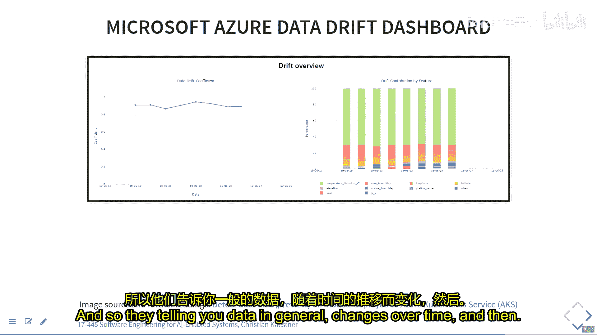

Some of the data more specifically。So how am I doing on time。

 I have essentially no time left if I want to give you some time for the teams。We can think about。

A drift in the inventory system， right， So there are different forms of drift that we you might expect that by how many peaches you buy goes up and down。

嗯。With the seasons。Let me。One second。嗯。啊。Let's see whether I break everything by making sure you host。

No still seems to continue， I just need to to prepare breakout rooms in a second。嗯。😊。

So there are all kinds of drift that you might expect with the seasons with special events with the pandemic。

 right so toilet paper or the Eli outbreak with salad， a bunch of things that might suddenly change。

 they might change what you predict， but also they might change what kind of data you're seeing and whether it's representative。

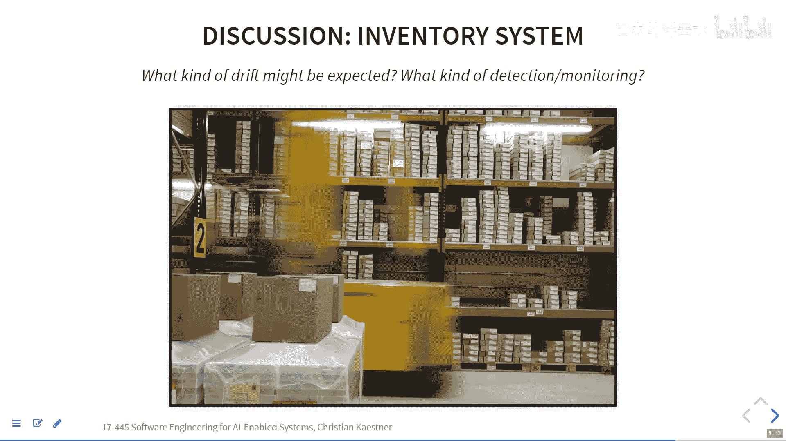

Allright。I'm going to skip this topic for the next lecture。Because I want to talk briefly about。

About the next homework assignment so you have one homework assignment that's due tonight there will be more two more individual assignments later but we're starting a group project I so this is a project that goes until the end of the semester ends with a presentation and has multiple with milestones kind of。

It's usually one week projects or so with milestones。The idea is to work again on the。

With the simulator that I gave you on the movie watching behavior。

 but this time instead of predicting the popularity of a movie you're actually making recommendations about which movies to watch so in this project I want you to build a model on which movie kind of recommending which movies to watch tomorrow's。

Resitation will be about collaborative filtering this kind of the useful technique for doing this kind of thing so you're going to build a model and deploy a model and then we're actually going to maintain and monitor the model and update the model over time so the assignment has a kind of a breakdown over over multiple weeks of what we're planning to do in each milestone and this is a group project so the idea is that you're working together as a group on this。

AndI've been giving you a virtual machine where you can run this and I've also given you I think $200 worth of Amazon credit each which you can use。

 you don't have to， you can also use whatever other toolss you want， you can use。

And I actually encourage you to use modern infrastructure rather than rolling everything by yourself。

Right and it starts by by essentially setting up movie predictions I think the first challenge is just to get you started as a team。

So to do this， I want to put you in breakout rooms as teams for the next 10 minutes。

 and I would like you to just say hi and figure out a way how you're communicating。

So the first team deadline is next Tuesday。I hope the first assignment is fairly straightforward。

 it's building and deploying a model。There's not a lot of kind of extra infrastructure work on this。

 not a lot of text and documentation work， but I think you need to figure out a rhythm of how to work together as a team。

 how to meet，Remotely， how to communicate， do you want to set up a select trainer。

 what form of communication do you want and so on， and would like you to get started。嗯。

We're going to put you into groups， I'm going to hang out here in the main channel until 430。

 so if you have any questions about kind of homework assignments in class or anything today。

 come back here and I answer questions here but otherwise。

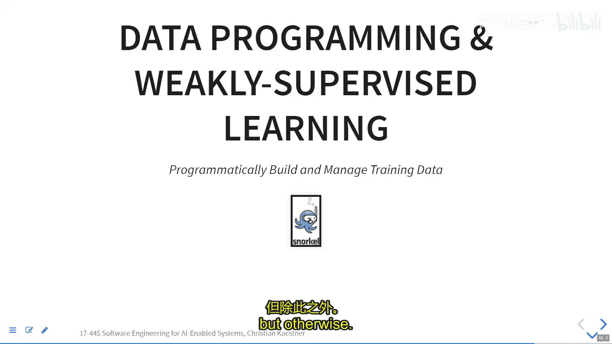