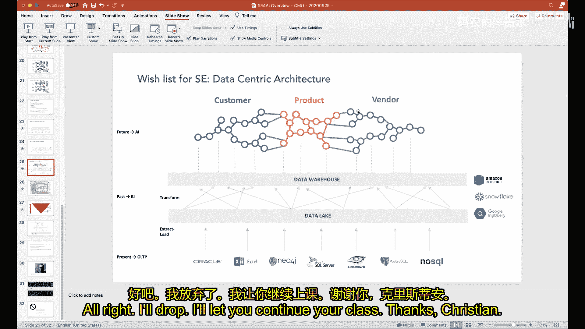

# 【全集】卡内基梅隆大学-AI驱动系统的软件工程-中英字幕-1080P-p12-Lecture-12---机器学习驱动的业务系统--BV1JS6gBcEBF_p12-

Right， welcome everybody for today。We're trying something slightly different。

 I've invited Moham to give a guest lecture， so I met Moham earlier this year at a seminar where we talked about software engineering and AI and kind of how to build better systems。

With a bunch of interesting discussions， some of which influence what we talked about earlier in a couple of lectures。

 but he also at the seminar， he gave a talk about。Yeah。

Building machine learning systems and production he has founded quite a few companies actually doing that he's currently the CEO of relational AI and he can probably tell you a little bit about what they're doing they're hiring I assume they're hiring great people they have an amazing team but also in earn he has been working on neural networks using this in production in business systems in the 90s already the credit card fraud detection and all kinds of other things and the talk that he gave and I think this is also what you're seeing today is really about struggling with large amounts of diverse data in businesses so this is something that fits the current lecture quite where we talked about data quality on Tuesday and he's going to use about half the lecture today and then I want to continue talking a little bit about big data systems and data processing and we want to go a little bit further than that。

Direction。嗯。所以。Please welcome Mom and also ask questions。

 raise your hand right in the chat this is supposed to be interactive and have fun。Thanks。

Thank you Christian， good to see you again it was our trip to Dochto was the last trip I took anyway as I came back from Germany I was immediately grounded symphony。

So nice to see you again this time over Zoom and you're right。

 the presentation I'm going to give today is basically the same presentation that I gave。

Dooc Sol maybe added a couple of slides just to highlight some points that I think will be interesting to the class here。

Okay， let's get started so my context here is or the context with the talk is this is about software engineering for machine learning and for AI。

 not the other way around， although the other way around is also very interesting。

This is also a talk that I call it sort of based on my experience with real businesses that are not Facebook。

 Amazon， Apple， Netflix or Google or Microsoft， I consider Google and Amazon， Apple and so on。

 it's dealing with machine learning and AI at a totally different scale。

 but also dealing with it with resources that most businesses most typical businesses don't have okay。

 if you go into a typical bank or retailer or，Airline company or other sort of more standard businesses。

 you just don't have the resources and expertise that a Google or Apple will have。

And then the third sort of level of context setting I want to make here is that this is about building machine learning and AI systems for enterprises。

 for enterprise decision making， this is not about consumer oriented AI。

 this is not about helping you recognize your friends in in your pictures on your iPhone or whatever。

 and so there are the sources of the data that has implications of course。

 on the kind of data that you work with。The kind of data that you have to process when you build machine learning models。

Okay。My experience is grounded over 30 years almost starting going back to a company called H&C Software。

 in fact before working at A&C I worked for AT&T for two years on computer vision systems but AT&T is a big company。

 H&C and does many things， H&C was a company created specifically to build machine learning。

 what we today we would call machine learning systems that solved real world problems for our customers。

The main solution that agency offered was around credit card fraud detection。

 and I started working there in 1993 and by 1995， 1996， we went public and when we went public。

 already we had 23 of the top 25 credit card isuing banks as our customers in the US and something like 87 of the top 100 in the world were using our credit card fraud detection software。

At the time the technology of choice was believe it or not neural networks。

 but these were not deep models， these are one layer models in the late 80s people discovered that if you add a hidden layer into neural network you can start doing nonlinear mappings from input to output in the neural network is theoretically now a universal appximator and there was a resurgence of interest in neural network neural networks and but of course we didn't have all the GPUs and the computational power that we have today。

 so we could only afford to learn one hidden layer neural networks and so we used neural networks with proprietary hardware accelerators along with rulebased systems and with linear programming injury your programming type systems to build these applications the terminology at the time was not machine learning or it was computational intelligence or data mining or database mining in fact agency owned the trademark on the term database mining。

And that's why a lot of people ended up calling a field data mine。

HNC Republic in 1995 and was acquired by FICO for something like $750 million in 2002 and the HC footprint is a big part of FICO or Fair Isaac and underpins a lot of what happens in sort of the consumer credit rating and consumer oriented fraud detection and so on？

And so you know in the applications that we developed there you have to make a prediction about whether a particular transaction was fraudulent or not it was and then of course you had to live with the consequence of that decision either being correct or being a false positive or being false negative and depending on what it ended up being you had to deal with different impacts on the business。

 so for example， if you decline a transaction that turn it up being fraudulent then you save the recovery cost of the fraud。

 but if you decline a transaction and ended up being a legitimate transaction you have an unsatisfied customer。

Or if you accept a transaction that was fraudulent。

 then you incur recovery cost again or you incurred it here or you save it here。

 and if you accept it and it was legitimate， then you have a satisfied estimate。Okay。

 so you had to you know worry about the various scenarios here and different banks needed different to be able to set different policies that were consistent with their customer you know。

あ。The way they want to deal with their customers， so maybe if you are a very important customer。

 they would let more suspicious transactions through because they didn't want to risk setting you with a decline。

 but if you are a less profitable customer they would be more stringent in terms of what transactions accept and what they don't。

Okay， in 1996， H&C bought a company called Reech at the time we bought ReTch。

 it was less than 20 people， less than $10 million in revenue。

 and ReTch was building ERRP solutions for retailers。

And one of the reasons that ReTAC agreed to be acquired by us was because they thought that predictive analytics and machine learning。

 AI and at all that good stuff would be hugely differentiating capability in their footprint and the application footprint for retailers and that included applications that were like demand forecasting。

 which is all about trying to predict what the demand is going to be for a product that a retailer is carrying。

 supply chain optimization which is you can think of as sort of a decision problem around how to optimize the flow of inventory through the supply chain。

 and pricing and many， many other applications in the retail context。

And within a few years of buying Ret， Retac had become the dominant solution provider into the retail industry with a majority of the retail global 250 clients that includes Walmart and includes Kroger and includes every many。

 many retailers that you would recognize。The techniques we use there to do this kind of work were based on time series。

 technology and automating time series， multilevel time series。

 because retail data is often very sparse because for a particular product and a particular store doesn't sell every day for many products we used。

traraditional regression techniques， and we used optimization technology that was heuristic based to go along with some of the work that we were the technology we were using to do linear your programming and programming。

Retech became very valuable and in November of 1999。

 it was spun out of H in a separate IPO and for a about。

A couple hours in the March of 2000 Retech was worth more than the top six airlines U airlines combined because it was the height of the bubble eventually valuations calmed down and Retech was acquired by Oracle for about $640 or 650 million in 2005 okay so a lot of value created by leveraging machine learning and doing something that most people are not aware is being done because it's in a kind of enterprise context as opposed to a consumer context。

Okay， and as you might have seen anecdotes like this before， you know。

 about beer and diapers going together in the retail context because， you know。

 dad gets sent out to buy some diapers and they put the beer by the diapers so that you know。

 dad can pick up a six pack beer or whatever。I'm not sure whether that anecdote is true or not。

 we never saw that in the data we looked at， but we did see interesting things like in certain Walgreens stores you would find people buying tinfoil and lighters and the speculation there is that they were using that as drug butterphernalia。

 for example， and things like that， so that I can confirm that that pairing does exist in the real world。

And of course， the supply chain is a very involved system involved in stores and warehouses and factories and consumers and retailers and wholesalers and manufacturers and so on and orchestrating the flow of inventory in a way that is efficient and robust is a non-trivial task for machine learning and AI。

 but in the 90s when this was going on， this was all sort of。

What under the label of operations research and forecasting。

 but today people doing it today would sort of claim that they were using the Sch and AI。

Next company I'm involved in here I'll try to pick this up a little bit is a company called Bstreamream which did in store video analytics using old school computer vision this is pre deep learning ultimately this company was acquired by a company called Point Gray which was acquired by a company called F in 2015 basically he put stereo cameras in the ceilings of stores this is。

A large format store here where the entrance is down here。

 I believe somewhere and consumers go in and they walk around the store and everywhere you see a lighter color or a red or yellow color that means' that part of the store sees more traffic and everywhere you see a cooler color like a blue color or black color that means there's not a ton of traffic there and so what ultimately you're trying to measure here is the number of eyeballs that see a particular product in a store and kind of correlation of demand for that product based on where it is so you can imagine in a product placed back here doesn't see as much traffic and therefore is less likely to sell than a product say placed you here next to the cash registers on an end cap okay and this heat map here is really a probability distribution of traffic in a store and so if you study generative models and those kinds of models in the context of this class you can sort of see。

how data can be collected and can be sort of used to represent a problem distribution then you can then use as input to downstream machine learning systems。

 machine learning based systems that will then use this information to predict demand for a particular product based on where it is in the store。

Okay and then the next company， so Brookstreamam I was involved in helping start the first two I was not。

 I was just hired into them， the next company was a company that did wireless network optimization。

 you had customers like AT&T and singular at the time and American Moe and teleonica the techniques we use there where Monte Carlo simulation based and heuristic search。

 we did used simulator and kneeling in particular to optimize the frequency allocation to various radios in a wireless network。

 this company was acquired byerson in 2010 for about 100 million and again the idea here is that you have these these cellular towers or these radios spread out in a physical environment and you wanted to optimize the allocation of frequency and the allocation of equipment to each of these points and you wanted to configure the equipment so that it's pointed in the right direction in the right way the max。

capacityac and to minimize drop calls and bid error rate and all that kind of stuff。Okay。😊。

And then finally， most recent company Outstar was sold to Info in 2016 was again coming back into retail and working on demand forecasting。

 supply chain optimization and assortment planning and so on。

 but doing it entirely on the cloud doing it with more modern machine learning technology like leveraging factorization machines and other machine learning。

Okay， so hopefully that 15 minutes I just gave you there helps you understand that I've got some experience I can draw on when I talk to you about the software engineering for ML or for AI problem。

😊，对。😊，So one common thing that you learn from doing this over the years is that businesses are really big systems。

 you can think of them as complex systems no different than biological or physical systems that have a lot of complexity variability in detail and then in order to manage the complexity of the business。

 we have to build simplifying models and you might have learned from other software engineering classes about people for example building financial models and spreadsheets and making a lot of decisions based on what the financial models are predicting about the impact of a decision on the business okay in the end businesses have to worry about profitability and making money of course there are other types of models or data models that would go into a database that capture elements of the business or supply chain network models that ultimately mapped to linear programming into programming systems。

 there are statistical consumer demand models that predict you how many can of Coke you would sell if you put them in a certain place in the store or if you price them in a certain。

There are price elasticity models that tell you which products are elastic or not or sensitive to price changes and then of course there are process models that you might use to run the business okay if you work in enterprise you'll pick up right away that these models are there are many of them they're inconsistent with each other and they get to map to either spreadsheeting technology typically in any reasonably sized business will have thousands。

 tens of thousands of these little spreadsheets being used by people all over the place with all sorts of bugs that you get when people are rolling their own spreadsheets you got that where you have detail but you don't see the the big picture or you have enterprise systems that are systems like SAP or Oracle where again you have lots and lots of detail or at every product or every customer or every store and so on you kind of lose the for。

You can't see the forests where the trees okay the enterprise systems are so rigid and unwieldy it creates the opportunity for people to roll their own models basically inspectionhes now ideally you would want to have something that has the agility and the flexibility of spreadsheet but built on top of the the kind of infrastructure that's robust and industrial grade like enterprise systems and that combination doesn't really exist。

😊，Okay because ideally you want these models to be built and maintained by domain experts who can improve them over time。

 but if you build them on this enterprise stack， you have to deal with a complexity that's overwhelming I'm sure that in a minute okay so this is an example of a model I found on the internet it's a Dupont return on investment model so every decision that DuPopont makes allegedly is processed this way。

 you look at you know if I spend a million dollars on something what kind of return am I going to get on that investment and that return on investment is a function of turnover multiplied by earnings as a percentage of sales and earnings is computed as sales minus the cost of sales and the cost of sales has these components and so on now no two businesses are alike and so as you start getting into the details of a specific business the detail out of here starts to change dramatically so for example。

 a software business the cost of a software business is labor and compute it's basically what salaries。

You pay and what you pay Amazon or Google for cloud computing that drives the bulker of your costs。

 whereas in a retailer， their costs come from labor。

 but also from the inventory that they're buying and putting on the shelves as well as the real estate that they're renting or also acquiring that takes up their capital and so on and so if you're modeling a retail business。

 you would have a model that looks very different in detail than the software business even though at the headline level。

 profitability is sales minus costs。Okay and then you know retailers you can dig in an interest of time。

 I won't read this slide to you， but there are different ways of breaking down sales as a function of units sold times unit selling price。

 know minus lost sales etca etc and then the cost or procurement costs and transportation costs and distribution costs and warehouse handling costs and capital costs and all sorts of costs and then of course you have constraints that must be satisfied by these models because you have to deal with the laws of physics you can't get a product from point A to point B without spending some time and of course you have regulatory and legal constraints that might say for example。

 an employee can't work more than 40 hours without getting paid overtime if they're not a salaryari employee and hourly employee so there are all these constraints that you have to factor in but ideally you want to think of your business modeled as a set of equations not have to deal with the complexity of the underlying technology that's driving that。

equationquations can include statistical models， machine learning models that predict something about how the world will work if you make a certain decision Okay。

 now this slide comes from a former customer of mind this is actually 2% of their I footprint。

And it represents the systems that ultimately end up implementing the kinds of models we're talking about okay so models that you know if you write them by hand would be know a dozen pages or 50 pages of of rules or equations have to be mapped to systems that are a mess and so each box here is represents actually a set of technologies like this box here in the middle is the box that where my former company Retech developed things and if you look underneath the covers that box has many。

 many different technology components it has a transactional database which is programmed in SQL and maybe PLSQL and a pro C which is a batch programming language it has an application server which expresses business logic in Java and C sharpp or whatever and has a UI component which is implemented in browser using JavaScript and HTMLL。

And that layer here would capture the OLTP layer， the bookkeeping layer。

 the what's going on in my business now layer， of course businesses want to be able to do analytics so they typically have a business intelligence layer that involves a data a database for data warehousing like Terraadata in the 90s it would have been Terraadata or AtiA a BI app server that would in the 90s would have been a microstrategy or business objects and then of course another user interface and and then it would have a forward looking planning layer because the B layer is read only and there you would have technologies like AA or IPPN or TM1 and a frontend that could be Excel and of course you would have to glue all this stuff together with ETL technologies these and so on and if you want to do something predictive you would need to build a model again in the 80s and 90s it would have been MATlab or SBSS or R and if you wanted to build a prescriptive model of an optimization model you would use languages like OPL or AplGs and solvers like CLX or dash or point0 R that's easy。

A dozen different programming languages， three or four different data management systems。

 a bunch of competing programming paradigms that you can categorize as being either declarative like SQL is declarative or Excel is declarative or you just basically say what you want this system that figures out how to compute it or imperative and if it's imperative it's either object oriented or procedural or in some cases functional and and so on it's a real real mess and the cost of change in this footprint is really high if you wanted to add a field to a screen here for example you had to employee data birth and you wanted to compute age you would have to change the UI logic in HTML and JavaScript you'd have to change the business logic potentially in Java you'd have to potentially create a field in the relational database you'd have to EL that field into the data warehouse create different KPIs and so on and so forth property getting that change across a dozen programming languages and so on。

Okay so 20 years ago this was a mess， but even today it's still a mess。

 some of the technologies have changed， so you might be using a cloudbased transaction system or you might be using a cloudbased BI system like RedSshiftft or Snowflake or BigQuery。

 you might be using Spark for the ETL or moving data around。

 you might be using Anaplan as the planning server。

 you're still probably using Excel somewhere and of course your data mining tools are now more like TensorFlow or Pythtororch or some Python libraries or Spark。

It's still the same soil crushing mess that we had 20 years ago， okay？

And you complexity breeds complexity and to compensate builders of AI systems have to incur heavy compute and cloud infrastructure costs because every one of those databases have to have their own servers and every process that moves data around has to do the same and so on。

 and so your cloud fees are very high if you're building AI into your footprint and human labor is very high because AI systems and machine learning systems require manual future engineering and all this effort that cannot is very hard to kind of make systematic。

And so you end up with spending a lot of money on the cloud， a cloud infrastructure。

 you also end up having to hire a lot of people to handle all this stuff。

And the implications of that。😊，As for you as a business is that you make less money because you're spending more money with Amazon and on hiring。

 you gross more slowly， you have scaling challenges because again you need lots of people to add capability and adding people takes time and you can't move as quickly and then you have weaker defensive modes you can't build models that as many models to automate things as you would want and this was covered really really well by blog written by Martin Casato and recent Horowitz called the new business of AI I would encourage you to Google it where and recent Horowitz who is one of the most successful venture firms here in Silicon Valley which is where I am is looking at their portfolio of software companies or portfolio of companies and they're looking at the AI companies and they're looking at them they're going man these companies don't make as much money as nonAI companies they don't grow as fast andre not they don't have a good defensive mos why is that and if you dig in。

To explanation， you'll basically it maps back down。

 it maps back to they spend more money on cloud and they need more people because everything's fragile。

And of course， if you are spending all this money that undermines the economic argument for AI in the first place。

 which is based on a dramatic improvement in the reduction in cost for prediction or per decision and a dramatic improvement in the quality of the prediction and the decision okay and that's covered really well in a book called predictionction machines if you go to prediction machines at AI。

 there are some videos out there and they kind of explain the economic argument for AI that's based on effectively making certain predictions very very cheap well with this mess on your hand there are many decisions。

 many things that you can predict that you're no longer able to predict very cheaply because of this complexity。

Okay， so in the few minutes I have left。You know， I would love to see the world move away from this application centric architecture where you have you know a set of applications each has a hairball of technologies and programming languages underneath it that you know speaks its own language with its own ontology and schema and class diagrams that gets dumped into a data lake and try to be you know people try to make it coherent of this layer。

 I would like to see a move away from that to one where we create this layer here。

 that reharmonizes the concepts that matter to a business。

 you important concepts like product or customer or vendor or store and looks across this mess of database technologies and programming languages and creates some coherence out of it。

 so one of the companies that I'm aware of。Dealing with this is a company you all know JP Morgan。

 they're very public about this， but if you look hard enough online。

 you'll find them talk about how they have across JP Morgan 17。

000 SQL databases and hundreds of millions of of columns of data here I'm not exaggerating like something on the order of 400 million columns of data and very hard to get a handle on all of that and really at the core of their business they have something like 400 unique concepts that are mapped to 17。

000 databases and 400 million columns and the relationships between those concepts so you have to sort of we have to work hard to kind of create some coherence here via some kind of knowledge graph or something that represents this knowledge away from the details of the technology that comes from and slowly refactor these applications down here into something into the capability。

that are delivered there okay so I wish my wish list for people in software engineering is to kind of move towards a data centerric architecture that starts to get rid of all that accidental complexity in the footprint。

My wish list for the database community， if any of you are taking database classes and working on database research is to get away from this madness of creating a database for every kind of use case like if you want transaction processing or bookkeeping。

 you have one kind of database， if you want to support graph payload。

 you have different kind of database， if data is in documents， you have a third kind of database。

 if you have you know if your data needs to be managing as a key value pairs。

 then you have another kind of database， this is a pretty old slide now from 2015。

 but even at the time you had several hundred different database technologies and data management technologies that were specialized for very specific use cases today Andy Pablo who's a professor at CMU you might up taking classes within maintains a database of databases and the last time I looked at it there was something like 780 entries in that 780 different database technology。

that people have built to solve some kind of problem right and so I wish the database community you know steps back from the madness here from the Aby and starts to develop database technologies that can walk and chew gum so that we can support different types of payloads without having to have this level of specialization。

And my wishlist for the programming languages community is to realize that there are a lot of citizen programmers out there way more than the application developers that use CSharp or FSp or C+ philosophy or Java or whatever and creates truly scalable end user tools。

 scalable beyond spreadsheeting that prior users and consultants data scientists and quants can use and can so to build models declaratively in a live way in a reactive way based on the spreadsheing experience where I can interact with my model by feeding a data and immediately seeing feedback about how my model works and being able to incrementally maintain my model and again not have to go through long compilation and linking in and execution cycles。

There's definitely room out there for programming language or researchers to do something compelling here that empowers this community。

And finally， my final wish list for machine learners in the audience is to start to developing machine learnings。

 machine learning technology like this slide that I pulled off internet here from Thomas Ki's website that understands data that's structured relationally which is how all enterprise data is structured as opposed to what we do today。

 which is we start off with data with all this sort of embedded knowledge about the domain。

 but because DensorFlow needs a data frame as input。

 a design matrix or feature matrix of input that's maybe a billion rows and a thousand columns。

 we have to take all that work that we did that we worked hard to put in our database ontologies and so on and we work really hard to throw it away by joining it all together to flat it out to create the data frame to feed our machine learning tools I would like to see machine learning technology evolve so I can just give you the。

And give you the relationships that are already modeled that already reflect my knowledge of the business and do for that kind of data。

 what deep learning did for pictures and videos and text and speech which is automatically or automate the process of lowlel feature engineering and representation learning in the enterprise today you don't have such a thing and you end up having to pay a lot of data scientists to buy and hand craft features that will help you predict the thing that you're trying to predict and this is where we wear with computer vision 10 years ago 15 years ago where we had to handcraft the features to develop computer vision systems like the ones at Bstreamream and today you don't have to do that anymore you just give the machine learning system a picture and it takes it from there。

Okay， so I think there's a lot of cool work that I hope will be happening in the in the machine learning and community to automate that and if we do that I believe that in the future enterprise systems will be。

buuilt using a reactive data centric architecture， using knowledge graphs as a foundation。

 I'm sorry I forgot to close the parentheses here， and that you know whereas today a sophisticated system is built up of many components。

 each of which is handcrafted。Over time more and more of these components will either be learned the poster child for this is Google translate。

 it used to be a few million lines of C++ code written by hand now it's a 500 line Python script that sets up Tensorflow to learn the mapping from one language to another so you you can think of machine learning is learning the contents of a function that in the old days you would have had to write by hand that maps inputs to outputs so more and more components will be developed that way or more and more components will be declared kind of like we declare things in SQL and Excel today。

 but we need richer languages and that can express more sophisticated capability。

 more sophisticated requirements and so these components will be declared and then executed sophisticated reasoner in sort of the good old fashion AI sense。

And hopefully the days of instructing the computer step by step how to perform a task will be or should be behind us if we can do all those things okay and I know it sounds like a lot but I don't think where you know decades away here。

 I think there are a lot of interesting trends in the software engineering community the PL community。

 the database community in the machine learning community sort of pointed in that direction。

 but it's also not around the corner， so as you graduate and you go out in industry I suspect you'll be seeing a lot of what I talked about if you end up joining enterprises that aren't Google need to build systems to enhance decision making and so on。

Okay and sorry Daniel， I just now saw your hand raised I don't know how long ago you raised it。

 but I'm happy to take a question now I'm actually done with the presentation and happy to take questions from anybody Daniel you have something to ask Yeah so this kind of last section about recommendations or vision for the future it seems to me that a lot of these really focus more on people problems than necessarily technology problems for example your example of JP Morgan having so many tables and rows and columns and all that it seems like that kind of stems from organizational inefficiency I forget what the research was but it's like any organization of more than like 200 or 500 employees starts incurring significant inefficiency costs and at least from my industry experience you know I was at a 50000 person company and I knew of it。

At least two other groups that were doing the same project that I was doing with like a slightly different flavor。

 so I was just curious。Like。How。If you haven't any thoughts on like how you make progress in these areas。

 given that like you're still going to have huge companies with these inefficiencies。Yeah。

 so it's a fair point and some of these problems are obviously social。

 they're not entirely technical， but you know what I see and I'm sure you saw it if you work in organizations that large。

 right what I see is a lot of people rolling their own analysis and analytics in Excel。

 okay this guy here shared this diagram with totally an anecdote at this company。

Where they wanted to add I think one digit to employee numbers。

 let's say they had a four digit employee number， they wanted to make it five。

F digits and it took them over a year and a few million dollars just to just to make that change okay so I think there's a part of this that social but I think a big part of it is also。

TheAccental complexity that you have to incur today in implementing even the most simple model。Okay。

 the most basic application， if you want to make a data driven application。

 if you want to make an application that uses some predictive modeling to enhance decision making。

 still in many cases has to get mapped to maybe not the entirety of the stack， but a lot of it。

And in companies like mine， like ReTac and agency and Opim and so on。

 our company was a software company and those companies where for most of their lives were a couple hundred people。

And we had to also deal with this complexity， and we were not able to serve the needs of our customers or expand our markets very quickly because anytime we wanted to add a feature。

 we had this mess looking us in the face。Okay， and so I believe if we start attacking this problem from a software engineering perspective。

 which is about architecture and a PL perspective， which is about you know moving in the direction and declarivity and a machine learning perspective which is around automating feature engineering and a database perspective which means I don't need to have 17 copies of the data。

 okay I think you start removing the accidental complexity and you can start actually。You know。

 working against a footprint that looks like this， sorry， like this。

 where you have a two dozen concepts or maybe a low number or like two or three or 400 concepts that you standardizing your enterprise and people instead of developing things one app at a time。

 start to extend this knowledge graph in ways that support whatever business requirements they have because you don't need to kind of。

You know， bring， you know， an army of people to add a particular bit of capability okay。

 now even in that world， I do have to acknowledge that there will be politics and competing budgets and priorities and you might end up with a redundancy。

 but you can I think you believe me when I tell you that you can factor out that redundancy way more easily if you built it on a simpler stack with fewer moving parts and very little accidental complexity。

Okay， yeah， thank you， that was helpful。Okay， so it's not about out running the bear and necessarily in all cases。

 you just have to run whatever people do today， you have to improve what people do today and what people do today is really soul crushing and horrific。

Okay， so if we we look at this by， you know let's take a positive step forward， it's still。

I think saving a lot of human potential that's now wasted managing this mess。

So maybe briefly along those lines， I think you alluded to this。

 but in a typical project that you would do， how would you estimate how much work is in the modeling and how much work is kind of just in getting the data there and getting it in the right shape and so on。

So I didn't get into this but when we got to the point where we were doing logic fluxs like at this point on my journey。

 which is you now in the 2010 2016 timeline okay we started building more and more of these types of components that we weren't able to get and we found that you the difference for us is that people building software in this more modelbased way okay using you better programming paradigms and better data management paradigms。

 we can get a group of， let's say five people to build the same sophisticated applications that at ReTch we were building with 50 people and they could do it in six months whereas 50 people would take a couple of years to do it in the reTch context okay so it's completely anecdotal't know I can't hand on hard tell you that it's an order of magnitude or towards of magnitude faster and cheaper but。

But anecdotal， you know like for sure in all cases。

 but anecdotally for the types of applications that we built in retail because I got to do it twice。

 I got to do it at Retech on this mess here， okay， and then I got to do it logic box on a much more simplified footprint and it was much。

 much， much， much faster and cheaper。Easily in order magnitude， maybe two。Jake。Yeah。

 so on your comment about you know trying to impute relations between data。

 do you have any opinions about the utility of causal learning for that？

Casal learning is becoming very popular it's just you know a new capability that you from a mathematical and computational perspective is starting to become within reach you know before mediaea Pearls sort of popularizing this area people would do you know would do a lot of AB testing you in context where we're talking about causal learning now so it's just one of many different kinds of machine learning technologies that you want to be able to support in your footprint so some business applications could benefit tremendously from understanding why something happened and today if you wanted to do that you would be basically adding to this mess you would have I don't know what your favorite causal learning tool is so you at the relational AI one of my colleagues wrote a probabilistic programming language called So and a programming language called Julia and it has causal inference capability and so you would have to figure out how to put that in this mess here but。

have Tensorflow and you might have some iPhone libraries and you would have that system and they would have to co-exist and you'd not to stitch together a capability that includes causal learning and causal inference。

 but also includes other kinds of machine learning。

So I think actually Knowgrass as a foundation for causal learning are great because you make certain things easier to do if you have relational information。

So that you wouldn't have in a flat in a grounded or data frame， like for example。

 a knowledge graph would know that I have a twin brother， I don't。

 let's say I did and therefore if you're trying to do an analysis like they did in the 50s and '60s around smoking the smokingca cancer where the tobacco companies argue against that by saying。

 well we don't know if smoking causes cancer it could be that there are people who have a gene that causes both cancer and smoking and there's no way that you can you know you shouldn't confuse correlation with causation and so the way you get around that is you find people who are twins。

 one of them smokes and one of them doesn't and that identical twins and so they have the same genetic makeup and you say no that cannot be and so that information is relational information it's about relationships that would exist in a knowledge graph that would not exist in a flat data frame for example that you would have to model by hand。

So I'm not sure I answer your question， but I think it's an exciting area。

 I don't have a ton of first time experience with it。That was illuminating， thank you。

Any other questions？Asked chance。Maybe to close， can you picture a little bit what you're doing these days？

Yeah， so I'm building a knowledge graph management system because believe I've seen this problem。

 I believe that this is a real problem， I believe that these layers have gone out of control I see now that we've moved technology forward enough where we can build a very scalable knowledge graph management system that leverages knowledge。

 clean knowledge up here to both accelerate and enhance statistical machine learning of all flavors and generative flavors and discriminative flavors and so on。

 but also that has an underlying reasoning capability where for most of your business logic I don't need to write Java code and C sharpp code I can just express that declaratively and we are working with customers now that are seeing again amazing improvements moving off code bases you there's one example and thinking of 800。

000 lines of C sharpp less than 10，000 lines of。of declarative knowledge okay and a solution that's more scalable and so on so it's really for me it's all about building a knowledgegraph management system that's open that's scalable that's reactive that supports data centric architecture that ultimately lets us learn and reason using knowledge and data to do things that you can't do today or you can you can't afford to do today。

 given the the the alternative。So if you're interested in that kind of problem。

 I'd love to hear from you， I really meant everything I said today and I really think these are real problems and I wouldn't be wasting my time building what we're building or helping build what we're building if I didn't think this was a real problem that the world needed it solved。

All right。All。All right， I'll drop， I'll let you continue your class thanks。

