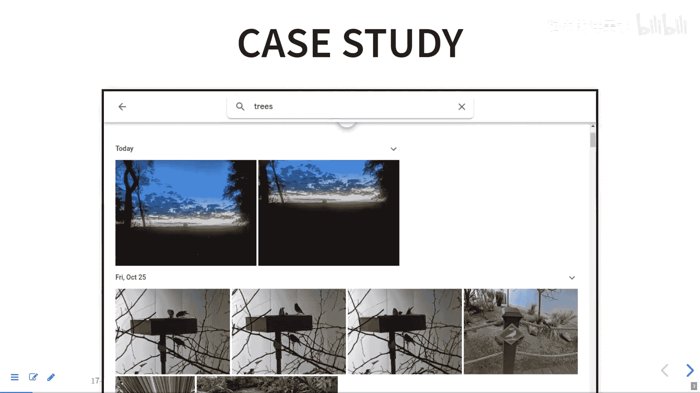

# 【全集】卡内基梅隆大学-AI驱动系统的软件工程-中英字幕-1080P-p13-Lecture-13---数据编程与大数据处理入门--BV1JS6gBcEBF_p13-

So but I want to start with one topic that I skipped last week on Tuesday。

And this is data programming or weekly supervised learning。

 this is something that becomes increasingly popular。

 it's partially related to the data quality issues that we had talked about on Tuesday。

 and I think it's a neat idea that's worth exploring and worth thinking about。

So the idea here is that。Labeling data is expensive。Right so for learning you need labeled data。

 depending on the context you get very cheap labeled data because you can just wait a week。

 but in most cases you need people to label data whereas unlabeled data is super easy， right。

Like you want to classify images， you get hundreds of images from the internet。

 but they're usually not labeled。And there are many different ways of labeling them The standard approach is probably crowdsourcing I mean。

 you can just sit down and label a bunch of your own。

 but if you want to have hundreds of them or thousands you probably want to crowdsource this and depending on the problem different labelers different people doing this also have different qualities in how they are labeling this the standard example kind of labeling for cancer diagnosis right so you have some。

FMRI scans and you labeling， is there a cancer in the image or not so that the tool can later detect this if you ask a random person on mechanical attack to just label this it's。

Can probably flip a coin instead， if you're asking experts like physicians who've done this for a long time。

 they're probably pretty good at this， but they're also very， very expensive to get their attention。

You could think about medical students， they're maybe not as experienced， but they're much cheaper。

 but they're also probably way less accurate right so there are different ways of getting labeled and some are better。

 some are worse。So depending on how you label this， you may have data quality issues in your labels。

 right， not just in your inputs， but also in your labels。

The idea of weekly supervised learning is that weak supervision so。

Kind of not the best labels is probably better than having no labels at all。

 And there's a whole technology around this where you incorporate some。

Expertise and expertise of different quality in the labeling process。So。They call us。

 let me actually go two steps further。So， the idea is that you。

Have a domain expert that writes a few labeling functions。

 So these are mechanisms of how to label data that doesn't have to be reliable。

 So they are often partial in a sense that here's an example for detecting spam。

So you might just do something where。Maa is contained in the text for some reason this is considered spam and if Maya is not contained then you just abstain。

 this is probably not very clear about not a very strong signal about detecting spam right but it's maybe better than nothing。

You could also look at use an external tool that just says this is a very polarizing statement by some NP technique。

 so maybe that's an indication for spam maybe you have certain phrases so you can actually have a lot of these labeling functions and some of these labeling functions you can probably。

Specify like emails about Vigra or certain misspellings of Viaggra。

 so you're probably fairly confident that therere spam。

So the idea is that you provide a bunch of these functions。

 they can come from different sources and they don't need to be perfect。

And then you build a model that's called the generative model in the snorker approach that essentially just looks at how well do those functions correlate？

If functions frequently correlate， you kind of assume that they're fairly reliable。

you give them high priority if they often contradict each other， they might be less reliable。

 they might be more reliable on certain kinds of data than others。

 so what the idea is that you kind of incorporate， you kind of guess reliability from correlations and then together this creates a labeling function。

So you kind of weigh all the individual labeling function。So that you can label training data。

So instead of having humans rate maybe a few hundred messages a spam or not spam or did some sophisticated telemetry mechanism。

What you could do is。Write a few of these functions。

Have the system figure out how to balance these functions and then use kind of a majority voting mechanism or weighted vote to just label millions of email messages like unlabeled email messages are much easier to get than labelbeled ones right label millions of those those labels won't be perfect and a bunch of data you will mislabels right so you can't label everything。

But this way you get a big set of label data with somewhat noisy labels。

 but probably fairly decent labels。And then you just put this into a machine learning model。

So the machine learning model then trains on that。Lbel data。

And but it's a real model that you're using。You don't want to use the generative model directly as to label kind of as a prediction function because it's based very much on the labeled data。

 you hope that if you're learning over if you're labeling things and then learning over that model that the learner actually picks up things that are not in your labeling functions right so you might only pick up on Viaggra and it figures out that there's a certain style of writing about this that it also picks up right so the model the discriminative model here is。

Usually much more general than what you get just from combining the manual labeling functions。

Does this make sense so far？So this is just a neat idea that's actually used quite frequently these days in big companies。

 So people have used this for all kinds of things。 NP techniques， a lot。

 kind of text recognition and spam filtering and so on also on images where you have kind of。

Very weak classifiers that you combine as kind of to label something like whether there's a person in an image and so on or bicycle。

 you can maybe identify the bicycle and the person individually。

And this is fairly flexible so you can use quite a few different kinds of labeling functions and again with different qualities right so the ones that I've shown you are hard hard coded heuristics where you really look for certain phrases at your hard code。

 you assume certain things， you can use distant supervision which is essentially just delegate to a different model that this maybe somewhat weak but maybe works well on some examples so this was a second example here that were maybe using sentiment analysis analysis or polarity of the text so kind of polarizing text but we are delegating to a different model。

We don't trust this fully， but it's a signal。You can use crowdsourcing。

 you can just integrate this here as well。And then yeah， this is again， similar to oh。Sorry。

 this is external models is what I've just shown you with the sentiment analysis and distance supervisionist external knowledge bases where you actually have some key information that provides some relationships like zip codes in the previous example。

Right， and。Snorker is one of these systems that really popularized this， this is an open source tool。

 there are a bunch of papers on this， this is fairly easy to use。

So if you're ever coming into an area where you try to learn on something where you have too little training data。

Or you think you have very noisy training data This could be an option to think about。

 and so this is a kind of a neat way do to do this and honestly the the idea of detecting。

Inconsistencies。So this has kind of a lot of similarities。

 it's actually done by a similar team or overlapping team where you look at certain rule violations。

 right you have multiple that are maybe weakened together， but they give you some ideas in total。是。

All right。So you can also use this for a bunch of other things。

 the similar idea right so you can so labeling training data is a most common approach。

 this is what it was developed for。Data augmentation。

 you can use it kind of to produce artificial additional data So if you know what kind of if you have some data and you apply。

And it doesn't match any of those roots， but you know if you made certain changes。

 it would be kind of spm， right so you can create artificial spam messages with us and use it for training。

嗯。You can use it to identify important data sets， so certain things where you have some rules to capture these are maybe the cancer images that are important or these are the messages that are used frequently in voice recognition。

 things like this。And data cleaning， as I've shown you， if you have some wordss with some confidence。

So I want I want you to think about how we could use this and honestly to me。

 this is kind of hard to think about in the inventory system， maybe because it's time series data。

 so you typically have some idea of。What was the right solution afterward right so you kind of see how much was bought you can use some experts right so you can ask some people to judge how many how much inventory should you buy it's maybe not the idea solution but let let's take a different example。

Let's say we want to detect toxic comments on。YouTe。And this actually。

 they're probably not quite as rare as in some other events。

 but let's say about maybe five or fewer percent， maybe just 1% of all comments are toxic。

Probably not less than 1% maybe so just random sampling or labeling them you would label a lot of issues as nont right so what kind of labeling functions could you think of what kind of mechanisms could give you some ideas。

 some inputs that can give you a weak signal。That something might be toxic， right。

 So people inciting each other， people shouting at each other kind of cyber bullying and these kind of things。

It count as toxicity。水。YeahJ says hard coded heuristics on words， phrases and snippets。

 so you might have some examples of things that you consider independent of context this is almost always offensive right。

 slurs names， offensive languages as Chris says right any other thing。

So you probably have some keywords that you can match on。Sentiment analysis。

 there are a bunch of toolss that could identify kind of negativity in comments they're also existing classifiers for toxicity。

嗯。Anything else？Where would you get the hard coded terms from？

Any databases that have kind of dictionaries of。Naughty terms。Pend some credits yeah。嗯。Chris。

 I don't know what you mean by username Fis。So like most systems have。When you create an account。

 they check for offensive language like in the username okay for something like that。

 so that's where you could get that data from maybe if somebody has implemented this kind of pull it off an open source project。

Yep， user reports on toxic comments could provide you some information， right？And I think。

We wouldn't want to trust any of those。We might also want to throw some people in that handla things。

 right crutsource， something。But I think。What you would get here is a bunch of weak signals。

 urban dictionary might work。So you get a bunch of weak signals that you can use to label millions of YouTube comments。

 right way more than you ever have humans label。And this is， again。

 the trade off where maybe a huge amount of somewhat dirty data， right。

 not super clean data might be better than small amounts of。

Very clean data and realistically also noisy data。Right。

I think snorkel and the whole idea of data programming can be quite useful to think about just as a concept of how can we scale。

How can we scale kind of getting data， how can we kind of trade off clean data versus less clean data。

 the cost of cleaning， and so on。Makes sense。I just wanted to bring this up。

I don't have time to really start a new topic， but I want to do one exercise that maybe motivates what we're doing next time。

 so I want to talk next doing this next week then about kind of different approaches to deal with really large data sets。

And I think I just want to start today with a case study and want you to think about how we use machine learning in some cases where we use large amounts of data。

So this is a screenshot from Google Photos。This is a service that's used to upload like most smartphones。

 Android phones have this installed and upload pictures by default photo if you sign in。

 also a bunch of iPhones， this is I think fairly popular。

Google reported last year that they passed a billion users。Two years before they said they had 1。

2 billion image uploads a day。Rough estimate， I did this before class。And this was。Three years ago。

 I think now three years ago with。This was like 14，000 photos per second。

Producing like 70 gigabytes of data per second， roughly， if I assume like five gigabytes per picture。

This is 70 gigabytes per second compared to。Does somebody know how fast normal this drive is？

Just writing images。The number I saw is around 160 megabytes per second。So 160 megaytes。

 those 70 gigabytes。It's about 6 petabytes of data。Images per day。

RightSo we're talking about quite big scale here， not every project is quite as big scale right YouTube also falls into this category certainly a lot of projects you might build at some point are probably not quite as bad the teamid transcription service won't have quite that throughput right but you still need to start thinking about how to scale this。

And one feature that is here in。诶。That's quite convenient。

 You can search for a bunch of words in your photos right so you can search for dates It finds pictures taken on that date。

 you can search for things like trees。 It recognizes the trees。

How would you design something like this， So you're getting。Pabytes of data per day。

You probably have some sort of image classifier that can classify an individual image to say whether it has trees。

But you're also probably checking a bunch of different things right， does it have trees。

 does it have people， I don't know how many things you have， it does also tagging off geolocation。

If I search for Pittsburgh or Pennsylvania or Shady side。

 it would find all those images that fit into the area。

How would you design something like this that can？What's kind of the overall architecture that you would go for？

When would you analyze and take those images。

So let's try to sketch something， so let's say me see whether this works yeah。

 let's say we have some database that we're getting images right six datates a day。

And this database has， I don't know。 The image and some tags， right。

 So somehow we want to get those tags attached to the image。

When would you apply those tags once a day？When immediately when the image is coming in。Oh。Oneo。

 one good approach for you to just kind of do it slowly over time because there's probably like。

Less downside of not having a tag rather than like the complexity of trying to tag everything immediately and maybe slowing down the upload or something like that and you could you could almost like crowdsource a little bit the tagging to make it。

Better over time。I think you're not takingging 1。2 billion pictures a day with people。

 but so what's the expected latency， how quickly would you expect the text or the search to be available？

诶 like。But I think it would be like you'd be able to tag some simple things like super obvious things。

 but then， you know， those images that had like a couple branches in them and showed up for tree like I don't know a month。

Like that's not you know， the more the more obscure it is like the less important because the user is going to say。

 oh yeah that don't make sense， I don't really know there's a tree there。😊，Yeah。

Citran said almost immediately。所以。I suspect if you just upload the picture and you don't find it under trees。

Okay， extreme expectations for Google I haven't actually tried so maybe somebody wants to take a picture and see how long it takes I would expect if you search a minute or 10 minutes later that's kind of okay if it doesn't show up immediately。

😊，嗯。But if you at some point you're searching for an image that you've taken a while ago right so maybe five minutes。

10 minutes later， you might actually expect that you can search things and certain things are easier probably than others。

所。I think， I mean， there's a search， I don't expect it to perfectly detect detect trees anyway right。

 but if it gets better over time of a few minutes。That's probably fine。你 said。

The typical design that I would expect is some sort of stream processing where you get the data。

 but you put it into a queue first。So you cu things and then you have some process that takes an image from the queue。

and takes it right so it takes it and you can paralyze this with many。

 many crowd workers and if the queue gets very long you spin a few more machine machines to take this right but it's probably not a process that's done immediately when writing the image to disk right because that's kind of a bottleneck。

And you don't need this immediately。But you can paralyze us quite easily， Taging us quite easy。

 and actually。It's easy to paralyze， not the task is easy right and you can do something like detecting trees or detecting a bunch of things。

 but you can also do geolocation which probably would work quite differently right so you might want to look at for geolocation you often have GPS coordinates already。

RightSo instead of using a big machine learning system。

 you probably just look up in a table where this geolocation is in this neighborhood。

 it's in this city， it's in this state， so you add all of those tags。

So you can add a lot of kind of information in parallel。

 you can actually have multiple of these things that or multiple cues so you just write it into multiple cues and process them one at a time。

The嗯。The other question is now， what if your。Model improves。So， let's say you。

Had a very crappy initiative version that detects trees or maybe trees are a new category。

 you've done some more labeling on training data， you've trained it right and you've done this when would would you and when would you relabel everything。

I think you could just kind of constantly be doing some sort of slow relabeling。

Giving priority to something like you probably don't need to rela super new images because you can kind of just see that from a。

Like filtering by upload date， you know， your last year， but like older images maybe you want to do。

 but certain age people aren't searching for them。But like just kind of slowly crawling through the entire database and applying Yeah。

 and you may have the resources to apply it to most of the data in a week or something like this right so this this is what's typically called a batch job whereas the other one is typically called a stream processing job right so stream processing is near real time。

You may have some delay， you put it in a queue， but you expect that within a few seconds or a few minutes a few hours。

 depending on the context， you can process us batch processing typically relates to things that run overnight or run for a week or something like this right so if you have a substantially new model。

 you may decide to run a batch job over the entire data but there it's not important that it's immediately available。

Liu。Yes， so I was thinking about taking some ideas in segmentary implementations is so yes。

 you may schedule some schedule it to be processed in the future。

 but also whenever a user search pops up maybe we can have different categories of labeling from the most rough ones to the most detailed ones。

And for the rough ones， maybe relabelling will be easier and faster。

 we can do it more more frequently and when the user make a detailed search we can go down and relabel some of the photos in a bigger category。

 so I think in that way when user may actually making a search it can reshuffle things and create more accurate result。

And also reduce the amount of unnecessary computations because if the users not doing the search。

 it's not necessary to re things。Right， so。So first of all there。

 I just want to put the batch processing into this。

 this runs at some point right and you were talking about doing this potentially at search time。

So at some point， somebody will do a search on this。Data set。

And I'm probably not search one point all six petabytes that have been uploaded。

 I typically search in my own images。Or I search in a subset that somehow curated for a Google image search。

 which is not the private images is a much smaller as it。嗯。

So there's certain things that you can potentially do at search time。But again。

 there's a trade off of how much are you applying there。

 you probably don't want to evaluate the deep neural network across100 images as such。

 maybe you do depends a lot on the setup and what availability you have。

so what you're seeing here are different designs of handling data。

 so you can do something per request So at service as a service at。Single request time。

 you can do something in kind of a stream processing mode and you can do something in a batch processing mode and those are the big three that people typically think of as architectural decisions for kind of large scale data processing。

And this is something that I want to talk a little bit more about then next week。

But I think this is a good place to stop here。Any questions on this？Vibe。Yeah。

 I have a very small question。 so does it。I'm not really certain of this。

 but does it take more time to search for。Multiple tags rather than searching it for a few tags。

I would expect most of the time these things are indexed before。

 so you're just searching over an index。And I maintain an image。哦啱。

Depends again on the technology right， so most image classification techniques will tell you there's one of multiple things in image。

嗯。And you might have multiple models。I think you can also have image classifiers that just say is there a cat in the image yes or no then I think you would have separate model for every tech I'm not sure how they do this at scale I think another challenge in here that I didn't talk about is that a lot of times you're comparing images if youre recognizing faces right so you're not looking at all Google images but only。

At the images of a specific user， but you're comparing an image against all previous images and you might actually build a model of your own friends as you go along。

I see so just just looping back on Leo's statement then I like at that point of time。

 if I'm having different models， maybe I just want to run the models of the things that users search very frequently first tag them Yeah it respect spec that my growth。

Okay。All right， maybe just briefly， there's a midterm next week， I already wrote this。

In the discussion forum the midterm from last year is public in the GitHub repository there's a link in the answer that I gave on Wednesday we can talk about this and in recitation I'm also happy to answer any questions in general I intend。

You should be careful what I'm saying， but I intend the midterm to be relatively easy。

I always see after the fact how easy it actually was， but I don't intended to be punitive。

 I want you to look at the material so far but most of the time it will be applying kind of questions to a specific scenario。

 somewhat like the last homework assignment and things that you've seen before。

So most assignments that I give and also this one will there's a scenario and then a bunch of questions about the scenario it's open book so you can use any kind of material that you want it's during the class period I'm just going to release it automatically at the beginning of the class period at 3 pm and then you can submit it to grade scope at 420 and I give you a little bit of grace period it doesn't matter too much but don't spend a huge amount of extra time on this。

嗯。Just for your own sanity， right I don't want to make a day long take home exam that you plan the entire day just doing the exam or something like this。

So it should be relatively easy， you don't need to be on Zoom， you don't need to be online。

 the only thing that I ask you to not do is talk with each other。あつ。

Don't chat with each other or open a Zoom call with everybody in there while I'm not here。And。

I think that's。Oh， the other thing is。In practice， everything is fair game for the assignment。

 everything that was in the readings and so on， but I'm not going to ask about specific sentence of the reading。

 I'm going to focus the midterm about things that you actually had the chance to practice so things that what we had maybe an in-class exercise will be covered in recitation or that you actually did in the homework assignments are much more likely to come up than some obscure effect from some reading or some slide。

All right。Is email the best if we have a question during the exam or something？Yeah， I think so。

 okay。You can probably also。Call me on Zoom， I'm trying to be available during that time。

 but I'm trying to answer email fairly quickly。Okay， thanks。Any other questions on the midterm？

So are you going to only release the PDF or there will be a text version that we can just fill in yeah。

 it's probably going to be a vet document that you can just fill in。Okay。

The one thing that's really helpful for us is if you don't change the page breaks。

Then we can grade things on the same page， we can find the answers quickly。I sent some instructions。

All right。That's all I have see on Tuesday for a normal lecture and then。

Reciitation Wednesday is kind of。Ask any question if you have and then Thursday it in mid term。

 there's no final in this class， only final project presentations。All right， thanks。

Yeah。