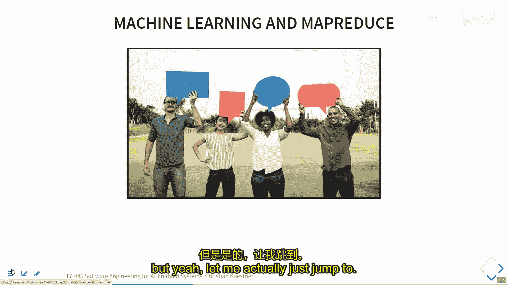
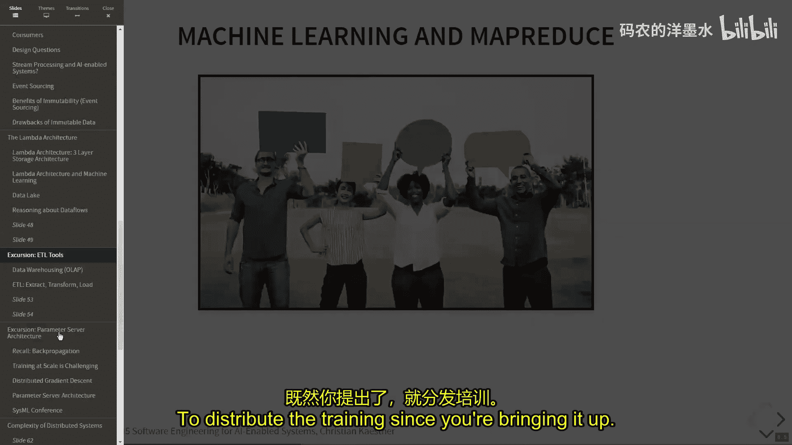
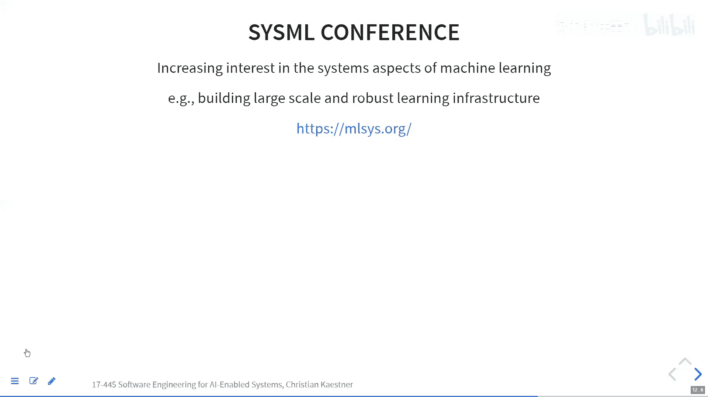
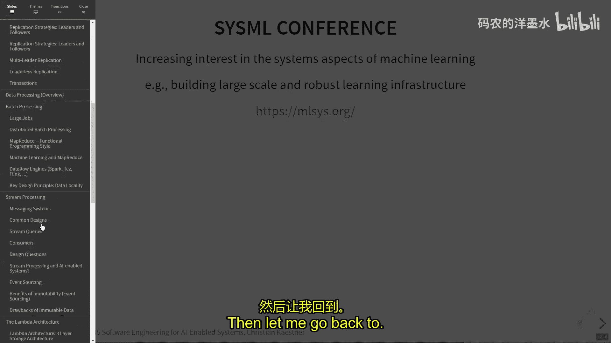
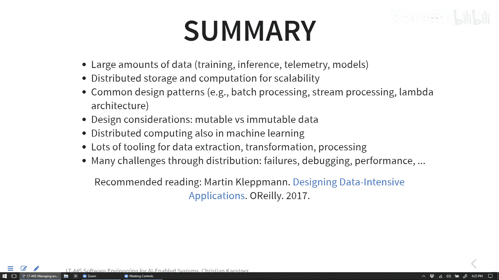

# 【全集】卡内基梅隆大学-AI驱动系统的软件工程-中英字幕-1080P-p14-Lecture-14---大型数据集的管理与处理”--BV1JS6gBcEBF_p14-

没。嗯。When I come back， let me start the usual way， what did we talk about last time？嗯。

What do you remember from the last lecture？We had a guest lecture talk about sort of models in business and you know。

 having high， really high fidelity models that are super confusing or super low fidelity Excel models and there's not really like。

The bright models in the middle that。Are easy to maintain and use and extend。Okay。

What does anybody else took away from that guest lecture？I thought the wish lists were interesting。

And so I think he talked about moving from。More of like an application。Centric design to。

More like a data centric one。啊，所以 that都。不认识间。I specifically remember the thing about infrastructure cost and why ML companies aren't as profitable because of the higher amount of costs they need to。

对。Bumping the infrastructure。Right so the thing that stuck to me also the first time he gave the talk was the complexity of getting data right so the 300 tablets and way more than that right the many。

 many columns distributed all over the place and the difficulty to integrate them and load them that feeds into our lecture today so we started also this was the other part that we talked about last time we motivated one case study where you really processing data at massive scale right so we talked about tagging images in Google photos kind of they have this huge amount of pictures that they're getting in and then they have a bunch of machine running algorithms to detect certain features there that you can search for them like in this picture here search for trees or search for Pittsburgh or search for a certain location or time and you don't probably don't want to do all of that search when。

Somebody asked a question so you need to process the data and we talked a little bit about different designs speculated a little bit of how you would possibly implement this and this comes up in a lot of cases。

嗯。This happens when you update the slide just seconds before the lecture。嗯。Maybe not。

This happens for a lot of cases that you actually need to process data at quite some substantial scale。

 so this is what I wanted to include。I remember this picture thing on Twitter so in the early days of the pandemic speculating how Zoom must extend their server capacity at any time right so because more and more users were using this。

 but you can think about this as all kinds of different systems if you're bidding something like Tamy the transcription service。

 you need to deal with。Data that your customers upload and store that right and the audio files and the transcriptions and in the beginning this probably fits on a single machine and then you buy another machine and if you're popular if you have the luck that this actually explodes and lots of people want to use it right then you might get into a situation where you want to add a lot of capacity very quickly and there's a question of how you do this。

So in this lecture I want to give an overview of kind of different approaches to address processing data at scale。

 look a little bit at machine learning component， but a lot of this is actually kind of orthogonal to machine learning it's just that when we are thinking about machine learning systems we have a lot of data most of the time and so we have training data people often talk about terabytes to petabytes of training data for jobs in big companies so not the small data sets that you have to model Titanic survivors or even the data that I'm giving you for the。

For the movie scenario but really really big data sets right so you need to store them somewhere first。

 then you have input data for which you're doing predictions right so the data that you're running the inference on we talked about what was it 1。

2 billion pictures a day for Google photos。Right so those are those many requests you want to do for your prediction service to detect trees potentially right so you have a huge amount of input data and then you also have telemetry data that's probably also potentially also fairly large and the models themselves sometimes can be large as well so you need to have strategies both for storing this huge amount of data and for processing it as well right so kind of applying predictions to preprocessing computing whatever。

And。There's a whole history of kind of thinking about this kind database community and there's a huge amount of infrastructure and tools and I think the skill here is in designing a system and picking how to build a scalable systems。

 figuring out the right components， the right tradeoffs and so on。

In machine learning systems you have a lot of training data that you may need to clean。

 store and pre processcess to extract features at scale， right you have a lot of reads to the model。

 lots of predictions。essentially saying the same thing over and at some point you need to start thinking about distributing it right you're extending the scope of a single machine and you're looking into things like distributed data cleaning。

 distributed feature extraction， distributed learning。Distributing the prediction task。

 the inference task right applying this to every single picture that's coming in。

Or having a single big prediction task that may take a lock time that you want to predict like doing the transcription for a very long audiophi。

 maybe you want to chuck it up into pieces and do it in parallel。

 and then all the telemetry and the logging data that again that you might collect and distribute。

So if you're scaling you can only achieve so much right you have three main options。

 you can find more efficient algorithms， you typically hit the ceiling when even linear algorithms aren't fast enough。

 you can buy faster machines。Whi also hits the ceiling and gets expensive very quickly and the typical strategy that we go for is having more machines。

 buying them as cloud resources， so lots of commodity hardware and just building a distributed system。

嗯。农民。Let me skip for a bit。There's lots of basics that we can talk about。

 but I don't want to spend too much time on those one of the。Key assumptions。

 one of the earlier decisions is about how you store your data and that has a lot to do with how you can access your data。

 how you can query it so a traditional view model is kind of a relational model you store everything in tables and then you have things like SQA to write queries and kind of an engine that knows how to effectively evaluate those queries data is often index so that you can make point queries pretty quickly right so a table like this could be terabytes big could be distributed across multiple machines but databases can be very efficient at certain search queries if you have index the data and the database can also enforce schema consistency so there's something that we talked about data quality lecture for example making sure that the department that's actually referenced here actually exists and that the user ID is unique which isn't in this case。

For some reason。You probably also have seen document database models。

 no SQL databases where you just store structured text or structured documents， right so。

Can anybody give me a short pitch why you might want to use those over a relational database？

Like the couch Dbss or Mongo Dbss out there， fighting。AndSo one of the reasons why we might choose。

Like this kind of database over relational is， we might not exactly know。

Like the data schema that values。 So like the data or。The features might change over time。

The cost of adding more columns or like changing the way the data is stored might be more。

 So instead， if we had an unstructured。Xchema we can make changes easily Yep that's one reason you also don't need to think too hard about it。

 you can kind of store nested structures easily， but it's often kind of key value storage it's less efficient for joins and similar operations that relation to databases are optimized for so they're often simpler。

And then you also often have to deal with unstructured data log files are common examples right where you have tons and tons of CSV files in some format without any any instructions by the way。

 most document databases also can enforce a schema， but most of them don't。Well， most users， I think。

 don't。所。There are certain trade offs of I already talked about the benefits or some benefits of。

Document databases， any other obvious cases when would you use。Just。

Loock files when what you use relationary databases。

Jake talked about how the document databases you can scale it possibly in an easier way。

 right distribution might be somewhat easier， although there are also lots of relational databases that can be distributed in some models。

 but it' it's。Yeah it's potentially more complicated。

 it's more a trend to have massive relational databases。Anything else？Y。

 data integrity is easier to enforce in relationary databases。

There are schema mechanisms for other ones， even for log files。Again， not necessarily used。嗯。

Loock files are easy to dump if you don't really care about them right now but you think you might use them later right it's easy to write this and it's really easy to you also use document databases in the same way just as a kind of a dump of data and you figure out the schema and how to search for it later log files are。

Don't support any indexing， so searching， you can search by time kind of binary search。

 but that's about it。Right so those are some of the examples and then data you can encode in many different ways again kind of the data you can encode as plain text。

 you can encode it in some semistructured format you can enforces schema and that often gives you some encoding for example you don't store numbers as text anymore which is kind of inefficient like in the log file here this wastes a lot of space storing numbers as text right and then there are formats that are actually do binary encodings that are very compact photo buffers a thing is one of those things so especially if you want to send lots of data over network there are some。

Encoding protocols。So for data storage， there's lots of different solutions for distribution。

Does somebody know the difference between part and replication？IThink this came up in the readings。

 right？It's been a couple of days since I assigned this， but。

So database replication or database partitioning or data parting， what's the difference？Replication。

 yes， like mirroring， you put the same data on multiple machines。Partetitioning。

So petitioning is dividing a database。Into parts of the database that you can put on different machines。

 do you have an image for this， right So partitioning， there are two different forms of parting。

 horizontal and vertical the。Common horizontal form is that you take a database with lots of rows and you put some rows on one machine and some rows on the other machine for example。

 yeah movies by decade or hashing so I could put all my data on certain kinds of old movies on one machine and newer movies on a different machine or in a shopping database something like Amazon relating to different centers or different warehouses on different machines that's horizontal petitioning。

And verticaltica petitioning would be cutting off certain columns or parts of a data set right so for example。

 I have the movie title， but all the information I have about actors。

 which is potentially pretty big， I put on a different machine。嗯。Replication。

Is when you store the same data on mi machines， often you have partitioning and a replication in some combination。

And there are many different ways of handling this I don't want to go too deep into this。

 this is something useful to know about when you're building these kind of systems to read up on the book that are assigned for reading I think gives actually a very good overview of different designs。

 it's technology independent kind of independent of specific implementation so that you can pick an implementation that matches your concepts。

So a common strategy is that you have one leader database that has a ground truth and then some replications follow that get copies of that database。

 the advantage here is that you can always read from any database。

The disadvantages that you tend to write only to the leader database right so somebody needs to decide if there are multiple competing rights。

 which one wins， which one is first， there are lots of problems with these distribution of in distributedri systems that if somebody writes a value to this database。

And somebody writes a different value to this database at the same time。

 which one is a correct value right and what you want to avoid is that every database think a different well every copy thinks a different value is correct you want consistency across the database or across all copies one way of achieving this is to have a primary database and all of write go to this and then you copy data from this and everybody can read from everything essentially。

There are multiple different designs here。 There's multi leader replication where you can write to multiple different leaders。

 but you need to deal with right conflicts。 There are multiple ways of doing this again， for example。

 you can write certain things only to certain leaders or you need to。

Have some voting mechanisms between the leaders。 So there's some synchronization that at least a majority of the leaders need to know about this。

 or you have strategies。 I think I have this in here as well。Where you have eventual consistency。

 so you might have slow inconsistencies， but mechanisms to resolve them eventually。

Do you really want to go into this so one strategy is that you always write to all at the same time another strategy is that you have transactions where you lock things theyre distributed transactions。

There are lots of difficulties here anime brings up the CA theorem it well known that you can't have consistency atcy and persistence at the same time。

 so you always have to give up something， they might be inconsistencies in the database or you may have effects that are not atomic so if you write two things together。

 only one might be successful， the other one might not or you may have things that you write and they are overwritten whether you have kind of short termm inconsistencies。

Different databases have different strategies to deal with this。

 There are lots of different trade offs。If you're interested。

 I can spend more time in a future lecture to talk about this， but otherwise this is。

This is mostly fairly well understood， lots of kind of trade offs。

 and I think it's more a question of what you pick for your specific problem。嗯。Any questions。

 comments quickly on this？All right。With this I want to switch to kind of data processing and especially talk about batch processing was stream processing we talked about this briefly before when we talked about the Google example at the end of the last lecture。

所。You can often think about this as three different forms of processing。

 you have services where you do processing on demand， so a web server would answer immediately。

You make a request， I'm asking for a movie recommendation from your service。

 your computers on demand immediately send it back。

Bch processing is the idea that you run large computations， typically in intervalts at some point。

Offline， right so you pre compute data。It's not necessarily the freshest whenever you run this last。

But you can do this on things。On large large data sets may take a couple of minutes or hours or even days to run and then you get a reside and stream processing is somewhere in the middle the idea is that you have something near real time but you don't get immediate answers back so you put events in a queue or data in a queue and then you have items that kind of process queue one step at a time let's look at them a little bit more in detail。

I think the service。Part is easy， right， That's straightforward。Bch processing。

 I suspect most of you have seen this in one form or another。Let's start with。Very simple。Large jobs。

 Does anybody know what the code here is doing， Can somebody read ba scripts。Roughly。

 can somebody thinklo about the first five unique records？In this law。唔好。So。Can you。

 can everybody read the basic。Thinking what's happening here So there's multipleable tools that are kind of sequenced right so you have one operation that produces data and then next operation takes that data。

 produces other data and so on so it's kind of pipe operations。

The first thing here just outputs a text file， a log file here。

This command extracts the seventh element in each row。Let's say it's the when this is a access log。

 I think in the example this was a web server， let's say this is a URL。So after these two commands。

 we get a file that has all the UL or all the files on the web server that have ever been accessed。

Everything else got thrown away。So this data set is much。

 much smaller than this because we threw away all the dates。And the users and things like this。

What are these two lines doing？Sorting， then get rid of the replicas。Right， so sorting and counting。

So this counts how frequently each line occurs in there so it's an aggregation in SQL you would do something grouped by。

 so get the count grouped by something。The unique command will just count how many lines in a row have the same value。

And so that you can count things you first need to sort this， this is a common Uni pattern。

 you sort things that all the URLs are always next to each other if the same URL requested multiple times and then you count how often so what we're doing here is we're counting which URL is how often it has been accessed。

And then this one here is sorting the result again。

 sorting by the number that the previous result produced。So we're and sorting in reverse。

 so we are starting with the most accessed files first。

And then we are just taking the first five resultss。So what this thing is doing。

 it takes a massive log file， it extracts the URLs or the file names。

It counts how often each file is occurring in this thing。

And then it reports the five most common things。This is a job that potentially takes quite a while right so if your script is big。

 this takes quite a while。But this is the kind of thing that we often do， filtering， sorting。

 aggregating。Couning something， counting occurrences， sorting something。

 a lot of these operations are actually quite expensive。

sortting or aggregation is expense aggregation is cheap once you have sorted it but sorting is expensive on large data right and this is often done to produce reports to produce models。

And this is done in a single process， or I mean you can kind of start with the second tool when the first two is running for some toolss。

 but it's kind of on a single machine on a single data file and now you want to kind of do something similar at a much larger scale and this is essentially where mapre mapreuce and frameworks like this come in。

So mapre tasks are typically quite similar， you have some data， for example。

 massive locks data that is scattered across many machines。

 you extract all the files that have been accessed， you count them。

 you count them on each machine separately， then you aggregate them。

 you reduce it so kind of ship the partial results from all the machines together。

 so the first map task might be on this on each machine， get all the UAs and count them。

Then you get some intermediate results， they are much much shorter than the original data。

 so you ship them around， you aggregate them， you reduce them and you get the entry result。

And potentially you do this over multiple stages。A key idea here is that you process data locally at the storage。

 you ship computation to the storage rather than shipping the data around because the data is so massive。

Whereas the program here， that's just a few lines of。Some code right some aggregation。

 so the common approach that mapR does is it moves data， it moves computation to the sources。

Not all computation can be done locally on a subset of the data。

But a lot of this can be if you look back at this result here。This stuff。

Can be done separately on all subsets of the log files。

We can divide the log files into five files and do this separately。

Sorting we can't do on just a subset for sorting we need the global view。

But what we can do is we can because we're counting essentially right we're sorting just to count。

 we can count locally and then add the counts for multiple subsets together in a separate step。

 so if you want to distribute this you know that you can do the data extraction and the counting here。

And then the rest of the counting on the subset of the data。Itつ。This is a fairly common。

Design pattern to run big jobs to paralyze them right if you have massive distributed data。

 bring the computation to the data， try to compute as much locally as possible。

 ship the results around then compute on the results again and continue and continue。

There are several frameworks for this， Hadoop is the most common one， I think。

 is an open source framework。The thing that the map Red framework does。

 it gives you all the plumbing and the arrow handling。

The problem with distributed systems is that where you had one machine before that could fail。

 now you have maybe a few hundred machines and one of them will fail right so as soon as one of these workers here goes down。

You kind of need to start it again otherwise you're missing part of the data。

 so what a mapre framework like Hadoop will do is it will manage the overview it will orchestrate what's computed where has the computation completed if not has it failed。

 do we need to restart it right it's a fairly nice framework you can just compute recompute some of these things if something failed。

Doest make sense？So this is， I think， the typical structure， how you want to think about mapre。

 kind of massive jobs that you can distribute。There are a couple of assumptions here。

 you kind of need a functional programming style which fits well to kind of the shared programming thing。

 so you need immutable inputs so if you compute the same thing again the inputs haven't changed。

From inputs， you produce outputs， you're not modifying the inputs。

so this is also common for share commands， you read something， you produce a new output。

 you write it somewhere else。And you tend to avoid side effects。

 so things like printing something is something that you don't do or writing resultss that you use in the next query is something that you don't do and because of this because of the function in nature here。

 which kind of limits what you can do， but if it fits this function in nature。

 it's really easy to repeat jobs on crashes or parts of jobs。

 easy to roll back and it's easy to decide what can be run in parallel and what can't。

Debugging is really annoying because things no longer fail locally， they fail in distributed places。

 there's a bunch of infrastructure again to help you debug this is where a lot of infrastructure investment comes from。

 which is why you also probably don't want to build your own map reduce system but build on an existing infrastructure that handles all the plumbing for you。

So let's think back。 Let's get it back to you。 Think back to the。A Google photos scenario。

What kind of things would you compute with batch processing in that kind of scenario。

 where might this be appropriate？H。So Cjon talks about kind of non-machine learning use cases like aggregating user statistics each day。

 yes that's like a daily report on something thats very similar to the log file analysis right so you could just look at the 1。

2 billion pictures a day and kind of collect when have they been uploaded or how many users。

 things like this and then Chris talks about updating tags on existing pictures right so if you don't need this immediately but maybe you have trained a new model and you want to go over all the data this is a potentially fairly easy to paralyzze job where you have a distributed data storage of all images and you apply a new model and update the corresponding data for everything。

嗯。Right， so I think。Where classic map reduced jobs often are mighty stages。

 at least the way that they are taught， you can have these jobs where it's just one expensive task that you run over a large amount of data and again kind of tagging images。

It's the same idea where you move the computation to the data。

 right even if you have a model that's 500 megabytes。

 moving the model to the data is probably cheaper than moving all the data to your model。Right， 1。

2 billion pictures。Am not small。嗯。Jake， can you expand a little bit。Oh， just I was suggesting。

That perhaps you might be able to use the map reduce for neural network。

 but I clarified to say not for training it because if you're using ingredient gradient to under something。

 you're not going to be able to distribute the task。You actually I'm going to talk about this later。

It's。 But this is， this is how a lot of these systems work these days。

 I haven't really seen distributed inference in the sense that you split a model into smaller pieces and kind of。

Send parts of the picture to different places， typically the data is much bigger than the models。嗯。

But。Yeah， maybe I'm also not sure that I know all of this there。

Could you do like almost a random forest in a distributed way where you distribute you train a whole bunch of。

Decision trees and then your inference model really just sends the input to all those trees and somehow aggregates the response yeah I'm not sure that the network overhead is worth it in it might be but most decision trees are relatively small and cheap to evaluate I would guess right that you might not want to do the network traffic but yeah。

Let me actually just jump to。

To distribute a training since you're bringing it up。

嗯。This is something。Has been influential， actually。

 the original papers from Google and some CMU folks on the parameter server architecture。 so this is。

I think they knew already how to do distributed training of deep neural networks。

 but this is this was an approach to scale it up quite a bit more。

 I'm not going to explain this in detail， but just showing。It's not traditional map reduce。

 but there is distributed learning， distributed training for machine learning data。

Just briefly remember how training deep neural networks work you have these networks and each of these units has one parameter in it or no each of these edges sorry each of these edges corresponds to one number right so you multiply the incoming value by this weight。

And then you sum all those weights， get you have some kind of cutoff function， you get the residing。

 you multiply this by weight again and so on and the way that training works is you compute all the activations forward。

 then you compare the result against the expected result。

It might be the wrong classification and if it's wrong if it's far away from the expected result。

 if your loss this to back you go back through the network and compute which weights you should change so you typically you compute the gradients。

 you figure out this weight should be a little bit higher。

 this weight should be a little bit smaller， this weight should be a little bit higher and so on and you just incrementally adjust the weights a little bit。

And you do this， you continue doing this until the model stabilizes。

 right until when you train more and more and more， it kind of averages out and stabilizes。

 it converges。Makes sense。So the question now is， how can you distribute this？It。

You have massive amounts of training data， so you definitely want to distribute this so the paper is from 2014 and it cited terabytes to  petabytes of training data back then and we talked about the size of these parameters right so that just the parameters alone could be a terabytes of half a terabyte or terabyte of data of some of these big models so you don't necessarily want to send them around。

So distributed gradient descent。Is in general not super hard so what you're doing is you have a bunch of workers that essentially get some of your training data。

 so this is indicating kind of the rows of training data， you have some weights。

 you compute the activations， you compute the corrections。

And then you send the corrections back to one central server that knows all the weights。

And you can do this in parallel。The original learning algorithm is sequential， right。

 so what can happen is that you're learning some some weight adjustments here that are overwritten by some weight adjustments here。

So typically you're sending back the adjustments like plus 0。1 minus plus 0。1。

 and then you just aggregate them here。This is not strictly the same as learning sequentially。

 but you get similar enough results。Does it make sense？Jake is shaking his head。Okay。

The problem with this approach is that you're sending massive amounts of data across。Everything。

 so the pushes here is you're sending a bunch of updates to all the weights， right， So if you have。

Like these huge numbers of weights。You're sending potentially half a terabyte of data in terms of updates。

 and then you're sending them back， you're sending the adjusted weights back。

 and this can be very expensive。So they've actually pushed this further and I don't want to go into the details and I haven't looked into them in too much detail。

 but there's a huge amount of engineering that went into figuring out to send only the relevant data back and forth。

So often when you're training， you're not adjusting all the parameters。

 you're just adjusting some parameters。 So instead of sending the entire vector or the entire matrix over。

 you're just sending parts of the data structure over。

 So there's quite a bit of engineering to make this。This transfer of parameter data。

 much more efficient to only look at the parameters that you need to have more clever clever merging and so on。

So in the end， it looks。It's not quite mapreduce， it's called the parametermeter server。

 you actually have typically multiple servers that only store part of the model。

Or part of the parameters， you have the workers， and then you have some efficient kind of communication between the parameter server and the workers that just talk about kind of some parameters are updated and so on。

The thing where's kind of similar is that this feels like a mapre framework and that the framework takes care of a lot of the plumbing。

It again figures out what happens when any of those servers go down。

 there's some replication right so the parameters are not just stored on a single parameter server。

 but are multiple， the workers are monitored the entire time if something crashes。

 you restarted and so on。嗯。So but it still has kind of the fear of a batch job in that you have a massive learning job。

 you're distributing your training data， you probably move the workers to your training data。Right。

 they are smaller than the data most of the time。 And then you're thinking about how how are you shipping data around。

 There's a lot of discussion there in kind of。Trading of different qualities。

 like reliability and how quickly you。You kind of converge things like this。

I doubt that this is something that you will ever really care about unless you kind of go into operations in designing a system but I think it's useful to think about yes。

 they are distributed abstractions also for the learning part itself there's a massive amount of kind of engineering and research going into this there's actually if you're interested specific conference these days that just focuses on the system aspects of machine learning this is on the academic side but it really thinks about kind of systems in terms of networks and hardware and how can we support machine learning tasks at scale。

 there's quite a bit of attention in this area these days。Any questions？

Os。Then， let me go back to。

Bch processing。So。I think most of the time we will probably use batch processing to apply predictions to a lot of data。

I kind of have a lot of input data to apply to a prediction algorithm。

Or just in general data processing， right， computing statistics。

 computing things from telemetry and so on。There are lots of data flow engines Hadoop is kind of。

Aging， I think， in many people's mind is is focused on this very kind of narrow map reduce abstraction。

 There are many engines， data flow engines are typically called kind of where you pipe computations into other computations that get a lot of attention Spark is one of them that's essentially in memory computation and kind of clish moving around computations and data test and fling other ones I don't know most of those systems in detail。

But these are all kind of big systems that are popular and broadly used。

 they give often a lot of flexibility， do a lot of pluming in many different ways。To run big jobs。

Right， but I think。A key principle is always you have data distributed and you move computations to the data as much as you can。

 and depending on the engine， you need to think harder or less about how much you need to get involved。

Any questions on this partd？Otherwise， I'm going to streams。

So stream processing is essentially the Kafkas out there right so you have seen this through Kafka I'm writing stuff in there you can read this multiple can read from the same stream you can process a message as it comes in for example。

 one thing that I expect a lot of you will do or will start doing at some point is to subscribe to my stream and just take all the rating。

Entries and throw everything away， right so that you get you process the ratings and not the rest。

And it doesn't really matter that you do this immediately in real time。

 right so I can write to the stream I don't have to wait for you to process this。

But it's often near real time and if your system crashes。

 then there's a backlog and it just starts up and you process the backlog。

So this is a pretty good picture， so it's an event based system。

 if you've taken architectures before think of this as a published subscribe system right pops up architecture。

 message passing style。嗯。So there are many different systems around there。

 Kafka is kind of maybe a somewhat strange design in that it focuses heavily on persistent data so it kind of is a mix between a database and a message passing system。

 but they are often kind of similar， so you have producers it send messages to topics you have consumers that can read messages from topics classic pops up system this way you produces from consumers this is also something that we saw in the shared architecture right so the thought command doesn't need to know where the data is coming from。

U。And you also decoup it in terms of time， right， so if a message producer is faster than a consumer。

 messages will be buffered。Up to the point that the buffer overflows。

What happens if the buffer overflows？If the producer is way， way faster than the consumer。

Has anybody did with any of those systems？So it really depends on the system so you can do different things。

 you can discard messages。You can refuse to accept messages。

Kind of throw an exception when you write something， silently discard messages。You can also。

 instead of just rejecting exception， you can work with the producer and start slowing down the producer。

 giving the producer a signal， I can't accept anything that's often called back pressure that you kind of design the system that the producer oh producer stop for a second。

This is really lots of that many different strategies and it kind of depends on what you use cases。

 so in robotic system for example they use this for internal message passing as well。

 they just drop messages if it's older than a few milliseconds it doesn't matter anyway so they just drop them。

Kafka has a strategy where they have a massive buffer typically。

 but if you're way behind and the buffer gets emptied， you might lose messages as well。Right。

 so depending on the system， messages get removed when they are consumed。Or after timeout。

Kafka actually keeps messages， a lot of other message passing system will remove them once they' are consumed and there are some systems that use a central broker some without and many。

 many different error handling strategies， a lot again is in the plumbing of how you deal with distributed systems。

 how you scale this to massive scale， where you have maybe leaddizable replications and so on。

So the way that you end up using them is kind of like chaist scripts where you have a system that passes some input and it writes output into a different thing。

So I didn't have a good exam picture here so I used something that I wrote myself has nothing to do with machine learning。

 I think it's something where we run Github analysis at scale so we're downloading data from GithHub so I actually start with a stream of projects that I'm analyzing I'm downloading issues for those so I have a project that's。

Taking an input stream of this is the next project that I should analyze。I'm downloading the issues。

 I'm writing this into a new stream with the issues。

And now I have multiple tools that are reading this stream to process those issues， for example。

 check whether they have been deleted， whether there's something removed or so and in the end。

There's a different thing that just takes those issues and writes them into a database。

 and all of these things work at different speeds。So issue GiHub is rate limited so I can ask about one query per second and some of these computations are fairly expensive like detecting deleted issues I need to ask more queries I need to ask a database and so on so this is fairly slow so they all work at different speeds and I can also decide to add more consumers and producers later and so on right so a lot of this doesn't have to be real time actually。

All right。But you can think of something like this also。

 do I have this here in a machine learning context， right？

How would you use this is probably too easy， but how would you use a streaming system in the Google Photo scenario？

Could you stream photos to do the predictions for like updating the labels？

So I would expect that you put all the incoming photos in a stream， right in one topic。

In a queue essentially， and then you have one or multiple workers that just always take the next part of a queue。

Make some predictions， write those predictions either to a different queue that gets written to the database or write it directly to the database。

 you can probably also do multiple steps of processing where you maybe take multiple。嗯。

You have some prediction model that looks like an image produces some output。

 and then you have a second prediction model that takes the output and produces new output。

And you can have multiple consumers again right so you may have one input stream of all the photos and then you can have multiple different mechanisms。

 one that's tagging trees， one that's adding the location that's looking up kind of this is a coordinates and in these in these locations right you may have another thing that compares it to the previous or the next pictures to detect whether you should do some panorama picture or whether you should detect friends。

 things like this right。Again， you decoupy this， it's very easy to add or remove certain consumers。

It's also easy to add more producers right so if you have more ways that photos can come in from multiple endpoints。

And you don't need。You don't need feedback immediately。Right， can actually。

I wasnn't planning on this， but I have this open right now because I'm showing you the other thing。

Let me see。I have this dashboard from。The Gi upub issues if this opens。

Everything gets slow if zoom is running。😔，Oh。So this is my download of issues。As I said。

 about one a second and then at some point once an hour， the rate limit runs low。And。

I'm processing things in different speeds。 So here's the queue of things that I'm processing or the speed that I'm processing this。

 I have a massive backlog of things where I need to figure out。Whether they are deleted or not。

Whereas writing this into a database is super fast， so I rarely ever have a backlog here of messages。

 so this one says how many messages I have or how fast I'm analyzing this can。See or not see。

 depending on whether this ever works。Yeah， a bunch of these workers。

 This is the throughput of individual workers work at the same speed as the original downloading mechanisms and some of them like detecting deleted things。

 the speed is pretty much independent of how how fast the other thing works。 And this is just all。

This is this is all decoup right so I can if one of these workers also crashes I can just restart it if one is too slow I can just start multiple copies of it。

水嗯。There are some nice benefits of doing this。And there are a bunch of different designs， let's see。

One of the big design question is， how do you deal with lost messages？Again。

 assume this is a distributed system， so a server could go down at any point in time。

You typically can't guarantee that every message is processed exactly once。

 You either have to accept that you may lose certain messages， so they are never processed。

Or that you may process multiple messages multiple times。

 you typically can't guarantee in a distributed system that everything is processed exactly when that's again the CA theorem in the end。

It's a one fallback strategy is that。You want to process each message at least once。

So that nothing ever gets lost， which means that you may process it multiple times。

 So if you're taging images in Google it。Probably doesn't matter when you compute the text multiple times right you probably compute the same text。

 you just overwrite them， it's fine what you want to avoid is probably that you have some images that are strangely not tagged for users。

But there are also messages that you maybe never want to produce a process multiple times。

 any ideas of examples。What's a message where it's better to lose it than to process it multiple times？

Think about operations that destroy data or money。I was going to say like an emergency response thing like you don't want to process an old emergency response and if you miss the data。

 probably somebody else will。So been another one or something like that。嗯。

A banking system where you send payment， you probably don't just because the server goes down。

 send the same payment multiple times， you probably want somebody to explain a complain that they didn't receive their payment。

And just submit another one。Things where you mutate data， so you do kind of a plus one operation。

 but you care about the precise result。嗯。You can often think around this like have some some confirmation through some other channel where you see oh this wasn't eventually processed but in the process things may kind of fall down get restarted and so on you kind of one of the big design decisions is about how to deal with this and different systems allow different mechanisms often this is a parameter or this is a design decision in how you。

How you're sending or receiving messages in Kafka， for example。

 you can just send messages without waiting for confirmation。which is way。

 way faster than sending it and waiting for confirmation if you get a confirmation Kafka guarantees that it's in the system and won't be lost and as a consumer I don't know whether you made an explicit decision but you need to decide when to commit offsets right so the consumer reads something and then updates which things they have read。

And the default setting I think is an autocommit offset。

 so you're reading something and will automatically send back that you've read it。

 but you can design this in different ways， for example you can only update the offset after you're done processing so if you're crashing while you're processing you would get the same message again because the offset hasn't been updated。

Or you can decide you commit immediately when you're reading that this has been read so that something can't be read twice and then you might crash in processing and you may lose information。

So I suspect I'm losing a bunch of you here because I'm talking abstractly about this。

The details don't matter too much， the key point here is designing these systems is hard。

 but they are known trade offs， known design principles。

And when you're ever dealing with something like this。It's a distributed system。

 so you need to deal with unanticipated errors in weird ways。

 and you kind of need to think about what can happen and what kind of backup mechanisms do you have in there。

And then read up on this when you need it。Again， the book。

That I recommended and that I signed the first chapter for is really good at explaining kind of these trade offs。

 explaining the fundamental algorithms without committing itself to a single tool。Right。

So we talked about this。This is one last thing that I want to talk about。

Do we have any fan functional programming in the room？诶。

There are people that are convinced that mutable state is a root of all evil in computer science。

And then everything becomes so much easier if you don't have side effects of everything as a pure function and so on。

😊，There's a similar idea in databases。Like traditional databases are mutable state。

 you have a database， you can always change values， delete something， add something， modify it。

 you don't have a history right so in a typical database there's a lock that's usually used for recovery if the database crashes but most of the time you can't go back in time right it's not like a git which keeps the entire history of your file for forever。

So there's a concept in databases that becomes more and more popular。

 also because it's kind of useful in a lot of scenarios in kind of big data systems and machine learning systems where you have appendon databases。

 you like log filess， you only write to the end， you never modify existing data。

The technical term that's mostly used for this is event sourcing where you， instead of writing data。

 the final resides， you write events that update the data。

So down here is an example of creating a user。Then updating a user by changing the department。

 for example。So I'm not going back to the table and actually change it。

 I'm just saying the data that I've stored previously has changed。And if I'm deleting something。

 I'm not actually deleting any rows， I'm just adding an extra line that it has been changed。

So traditional databases do this often already as a lock， but again mostly as a recovery mechanism。

 so those locks get perched at some point。嗯。If you want to know the current state。

 like which department is a user in， potentially you have to go throughout the entire log。

And compute the state， right， see where the user was created。

 see all the updates to get the last value。An advantage that you have。

 it's really easy to point to a specific point in time and say this was my state at this point in time。

I can say the database yesterday belonged to entry 5321。

So and everything that comes after this was changed afterward。

 you might even be able to say who has changed something and gives you a very clear kind of provenance of your data。

 kind of who has changed things。We'll come back to some of this for provenance later。

 so for machine learning it's really annoying to figure out if what like especially if you have production data that you update。

 what data was a model trained on。嗯。If data is changed in a big database like sales change from day to day。

 right to you doing predictions of an inventory system。

 if your input data changes from day to day and you train a different model。

 it's very hard to debug because it's very hard to figure out what data was precisely trained on。

Event sourcing makes it easy because you just say the data at this specific point in time。

So you can associate a model with a number， the single pointer into your database to reproduce。

The training data at that point。嗯。So there are number of benefits here all history is stored。

 it's recoverable versioning is really easy， you can compute multiple views also if you。

That's maybe the main drawback。If you want the current state， you need to go through all of this。

 you don't want to do this。 so what people do is they compute views on the data so。

You could have a streaming system for example， that computes the current view of the data。

 the current snapshot of what would be in a database and whenever a new event comes in you update the view right if you ever lose the view you can just go over the entire data to recompute it。

But to do efficient queries， you typically want to view and you may want different views。嗯。

YeahThis is just an example of how you would do it。This is。

Does this idea of event sourcing make sense？Any questions on this？

What are some advantages that you can think of having this kind of model kind of immutable data？

It's expensive to get to the current state， yes， any other problems you can see。You have more data。

 yes。You might struggle with high right environments， yes。

 although it's often easier to scale databases this way because you only append。

 you don't never need to go back and search for things in an index and modify existing pages。嗯。

Any other things？Let just drop the keyboard privacy。Any ideas？If you make mistakes。

 you need to have another update afterward to correct the mistakes。

 yeah you're never deleting anything for privacy also the thing that I wanted to get at is you can essentially not delete data。

You can mark data as deleted， but you will never get rid of it。

 so if you're by law required to remove certain data， this kind of breaks your model。

which is a problem in general， kind of deleting data as hard。

 but in this model kind of assumes that you never delete anything or marking it as deleted as fine。嗯。

This brings me to the last point for today， this is a big buzzword， the Lada architecture。

 just by show of hands who has heard of the Lada architecture before。Lesten half， okay。

So the Lambda architecture is an idea to combine。Imutable data。With。

Stream processing with batch processing， essentially。The idea。Picture is terrible。

 but talk about those。 So let's go two steps further that。 This picture is better。嗯。

You assume you have incoming data。嗯。You have a server that you're operating that's producing log filess。

 for example， the log filess go into a streaming server。So the stream will process things at near。

Should have practiced explaining this。Let me step back so you have three layers that people talk about。

 the serving layer answers questions immediately。The stream layer。Answers。

 questions or updates things in near real time。And the last layer。

 the batch layer computes things in regular intervalverts。

 So an idea is if you have a stream of data coming in， if you need to answer a question immediately。

 you need to kind of deal with some serving structure。 but most of the time you don't need to。

latestatest most up to date result。You can always go back to kind of the traditional big batch system and you learn overnight。

Or you compute something overnight。And then the idea is to have this layer with stream processing in the middle that does incremental updates in near real time。

So an idea example could be you're producing a big。Report that computes。

 how many pages are seen how often you computes once overnight on all the log files from yesterday。

And then every time a new user clicks on a web page， you update your report in the streaming process。

It's almost real time， but you don't need to block。The execution right。

 so you don't do this in kind of a service layer， you don't respond immediately。

But you kind of put the log filess into a stream and then you process it like once a second or maybe with a five second delay and update your model。

And once you or your report， and once you have the report that you can send back immediately and the result that you get from the report is near real time。

The advantage is that even if the stream processing here may lose some messages once in a while right so we have those consistency issues it doesn't matter too much because we're losing some small updates。

 some small inconsistencies and overnight we're going to recompute everything from the entire log base so the next day we're starting with the fixed versions so the errors that you're getting from stream processing never amount too much that's the idea。

Does this make sense？食。In machine learning， what you can do， I've shown this say before， for example。

 you can learn a model every night。And then you adjust the model with some incremental learning as data comes in。

The incremental learning might not be as good as the original learning because maybe it biases a model or it might overfi or something like this。

This assumes that you have a model that you can incrementally train， right。

 but it's good enough to make quick adjustments to the model in near real time。And then overnight。

 you're recomputing the entire thing from scratch to get a better model with all the updated data。

RightAnd the predictions you do with the model with the。Which has been updated over time。没出。

In terms of just explaining jargon， so people talk of best the batch layer。

 which does Hadoop style kind of batch processing， you look at all the data。

You recomputute it periodically。And because you're looking at all data。

 it's typically saying this is the best accuracy。But it's producing data that's potentially old。

By the time it's done， the speed layer is a streaming layer。

 so it's stream processing incremental updates。Often new approximate results。

 so it's often less accurate， it's just kind of quick updates。

And the serving layer is the one that produces the res or that reports the resultss that are produced by the other two layers。

To make this work， you want append only data。So you want immutable data because you want to be able to recompute everything overnight。

Or at least you want it in this format。You can do tasks with varying。

With variant latency right so the speed layer can do some quick approximations and the expensive results you run overnight and you can kind of balance latency throughput and for tolerance in potentially interesting ways。

我看你是。So I was wondering， can we say that this sort of architecture is only useful in use cases where you need that incremental learning to happen at a very fast pace you need your model to adapt like something in a financial market modeling or something like that？

Yes， so traditionally I think this comes from reporting。

Well this would be the more traditional use case， I think you generate reports like a sales report or kind of webs or kind of。

The dashboard right， but in the machine learning context。

 this is useful if you want to do incremental learning。

There are lots of use cases for this and lots and lots of scenarios where you don't need this。

 correct？Okay， thanks。Another buzzword here is data lake。Does somebody know what this means？

Have you seen the term before？My understanding is you have data lakes and data warehouses and so a data lake would be a large collection of data from different sources but not particularly organized。

 and then it's once you organize it and it's more interoperable with itself then that would be more of a data warehouse structure。

Right， so data warehouse， I'm Im running out of time。Did have a segment on this。

 but I don't think it's too important。 A data warehouse warehouse is a typically a big structured table that has。

That's useful for precomputing certain information so what you typically do is you have lots of databases and you care about sales in certain regions or so you're extracting all the relevant data into one big table that's typically something that doesn't change right so it doesn't change from transaction to transaction you do this once a day and then you're computing a view which is sometimes also called a datamar。

So this is a massive pre computationutation of a view。

And data lake is typically not a so this is structured。

 this is like a relational database that's often denormalized but。

ItDoes't matter too much for this purpose。Let me go back now， I。I lost track of。In。In a data lake。

 you typically。Just have unstructured data so pilots and pilots of log files or databases in different formats。

 the idea comes essentially from the idea data is valuable， even if it's just stupid log files。

 maybe we don't know how to use it yet but maybe we use it in the future let's just keep it all right data is a new oils let's kind of just amass at all it's not clear that were ever going to use all of this。

 but maybe there are some useful nuggets in there that we can use later so it's fairly common for a lot of companies that just store all their data in a fairly unstructured format just keep all there oil in log files often these are log files in the case that it might be useful later。

嗯。Just assuming data storage is cheap right so if were wondering next year or had we only kept that data。

 then we could have made the super business use case and implemented this new feature。

 This is essentially just assuming that。Yeah it's cheap enough to store and we can go back to it if you need to so it's quite common to kind of if you have a data stream like Kafka that you just write the result of log filess or in the pile and store it somewhere right so you have processed it you may not have immediate needs for it you could also write it in an normal database or you can write it into a more structured data warehouse system that actually is optimized for queries I just wanted to essentially run the buzzword by you because data lake is something that youre almost certainly are going to see if you're going anywhere in this area kind of big data。

Same as Lambda architecture， those are kind of very common words and common style to think about this as kind of something that does fast processing or massive amounts of data。

One thing that happens very quickly is that you might lose an overview of what's all the data that you have so it's very common to have this pile of data files and then you write into a different database。

 so this is where it's really useful to start some documentation。

Kind of document how data is flowing to the system。

 I was so glad that I had this when I looked at my project again after a year and set this up again because I had no idea what I was running and what was consuming what data and writing web。

And going back to last week's guest lecture Moham was talking about how companies have all these different data sources and they're producing them in many different forms right so this is database traditional databases you shift them to some other forms。

 they come there's some streaming platforms in here with data might come in from different sources right and you kind of processing this over and over again until you get to some。

Something that you can actually use as input for a model or that you're producing for some reporting。

All right， I'm out of time。I had some other stuff that's less important， I think。

 let me just briefly summarize。I wanted to get you a sense of。

What are the things to care about if you're working with massive amounts of data。

 which you're very likely to do if you're dealing with machine learning。

 right so you have massive amounts of training data， inference data。

 telemetry data and even the models become big at some point and you really need to think about some sort of distribution。

 distributed star end component。It's really useful to think about common design patterns like batch processing。

 stream processing， Lambda architecture， and just use tools that have been developed for this。

There's a huge amount of engineering and plumbing that goes into those twos so understanding them is an investment。

 but it's probably much much better than rolling your on。So this is what I wanted to cover today。

And if you have。Two more minutes， I can talk a little bit more about how I changed assignments。嗯。

So I push， I changed the。I changed the schedule a little bit and pushed a bunch of assignments back I was realizing that I had the midterm now and then the holiday weekend and then assignment you next week and I didn't want to do that so I pushed everything back a little bit。

And I made the last assignment part of the group project a little bit shorter to compensate for this。

So there is no immediate assignment due for next Tuesday。I would suggest if you have some room。

 so the next assignment， I'm going to release it tonight， but it's for two weeks。

 is an individual project， but I would suggest to keep working with your team if you have some room to work on the next milestone that this is not pushing it。

Also because of this we have some time in the schedule。

 so if you're feeling you're behind with the first milestone of the team project。

 send me an email and I think we can be kind of open to some extension except that this kind of moves into the midterm。

 which I don't really want to do。But。I'm flexible on this thing， and。

So I just wanted to mention this， I won't see you on Thursday because you're writing an exam and then have a good holiday weekend and then see you next week。

系，这啊。

