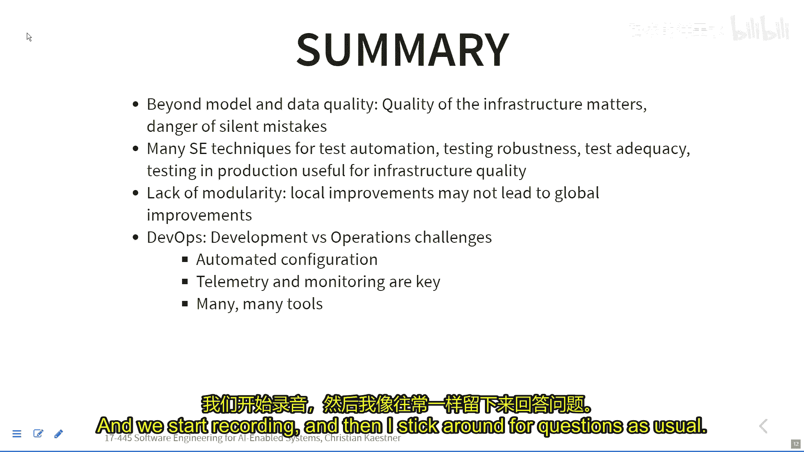

# 【全集】卡内基梅隆大学-AI驱动系统的软件工程-中英字幕-1080P-p15-Lecture-15---基础设施质量、部署与运维--BV1JS6gBcEBF_p15-

2。

All right， I have a couple of administrative things in the beginning。

 midterm you should have seen the grades if you have any questions about them。

 let me know the microphone is acting up， also let me know I can change to the other one。嗯。

The tooling assignment is out and has been out for a week， the deadline is next week。

 the idea that you can look at one tool of your choice。

 try it in the context of the assignment and play with it and write about it it's extremely open ended it's more also sneak way sneaky way for me to learn about those tools because you try it。

 you write about it I can read about it。And then about teamwork I posted a survey and you saw an announcement。

 hopefully please fill out that survey， I want to see how teams went。

 the second part is anonymous I'm not going to share this but I want to see whether there are problems in teams and whether I should follow up with some of them so actually sharing problems with me will help you and I will help you to kind of work through team issues if needed。

We can talk about issues in class on smaller groups in the team or just individually and so on。

With that all out of the way。Let me ask my usual question。

 what did we talk about last time and what last time I don't mean the a term？

What did we talk about before that lecture？Distributed operations machine learning data processing right moving computation to batch processing and stream processing right so we talked a little bit about big data processing big scale data processing and how you would use machine learning right and I think from my perspective the main parts to take away are probably thinking about batch versus a stream processing。

 paralyzing things right working with data at massive scale where you need to think about replicating things parting data and so on we didn't go particularly deep I think we could do an entire lecture just on kind of big scale data processing and actually there is one。

I wanted to give you kind of a way in to think about some of the buzzwords like data lakes and the Lambda architecture immutable data。

 kind of some of the ideas that are popular in the context of data science and kind of big scale distribution。

嗯。Today is my last lecture on these more technical aspects today I want to talk about infrastructure quality and a little bit of DevOs it goes into a similar way and I'm talking about a lot of concepts that I suspect you're more or less familiar with so I'm going to cover a lot of ground I hope I probably run out of time anyway but I try to cover a lot of things probably a little bit superficially similar to the last lecture if there's any of those topics that you would like to do more of we probably have a lecture in the end。

 I know a lot of you talked about kind of big scale processing of data when I asked what you're interested in the beginning right so if there are any specific topics I'd be happy to kind of go into more depth about some of those things in the end we can also talk about specific tools。

thingsh in recitation tomorrow we're talking about monitoring and recitation and different monitoring toolss。

嗯。So today will be a quick overview kind of of the landscape and some of the concerns and I'm happy to dive into details but。

I think it's also a lot of this is kind of standard。

 and then there's a huge amount of tools to learn about。All right。

We talked about earlier in the class a lot about model and data quality， model quality。

 mostly kind of prediction accuracy， but although other qualities that we care about model and we talked about some issues regarding risk and kind of what happens with wrong predictions and what you can do about this。

 but there are also lots of issues that can happen within the pipeline you read about this in the reading right so there are lots of issues that can happen when you try to deploy a model when you learn something but something in the learning process is wrong。

And the danger there's often kind of silent mistakes， so it used to work at some point。

 you make a change and you deploy and something doesn't work like the deployment doesn't go through or things like this。

Are there any things？That you have seen maybe in the assignment。

 maybe in some other work where some of those infrastructure issues came up。

Where you made certain mistakes and the model was kind of bad for a while because something wasn't working correctly。

 but it took youo while to notice or。Actually in our case。

 the file loads were a problem so whenever we were getting a request we were trying to load a file。

Which was around 800 M for every request， and which basically slowed down the。All the responses。Okay。

 and it worked in testing。 and then you had a problem production or。

Yeah so I like we did not test it directly， we put it in production when we were testing it the delay was like around five seconds。

 but when we put it in production we realized the requests are coming as like below one second and it started piling up and then at reached a point that till 30 minutes we were not getting a response。

O。The things that I'm looking for here mostly are things that used to work。

 and then they don't often update。Have you seen any any kind of those issues？

Well is there something that you could speculate what will happen in your projects， for example。

 if you。If you continue to refine this， is there any issues that you could deploy a model and you might not notice some of the issues？

Well let me ask the other way， what could you speculate what are possible silent mistakes that can happen when you update something in the infrastructure。

 when you update something in the model？嗯。It could affect the production system。

The latency could change in terms of like prediction latency and that could。

Kind of have a downstream effect that's harder to pick up on so for example。

 you learn the model on some initial data， but then from telemetry you have more and more training data and the model gets bigger and bigger and the latency for some reason changes depends on the model that it might take longer and what was fine before in testing now takes too long but you don't notice until customers complain right could also another。

Thing that's often cited as a potential problem is that the size of the model gets bigger and bigger and then at some point you run out of space on the target device and the upload fails but it's still using the old model it's continuing to use the old model that's still there and then even though you update you retrain automatically regularly over time kind of prediction accuracy goes down right so those kind of issues there are all kinds of things you might extract the feature incorrectly and then use it at the bronze scale and that feature might be useful but because it's now extracting kind of weird data it's essentially no longer used in the prediction right things like this。

You might have more user in the telemetry server overloaded but you don't notice in some reason right so the point that I'm trying to make here using state datas is also you're uploading you're getting more telemetry but for some reason you're still using the old data for training right so there are all kinds of issues that can happen throughout every step in the data pipeline right so we're automating a lot of things and data collection and data cleaning and labeling potentially in feature engineering。

Each of these steps we write some code， maybe it's just three lines of Python code right to kind of call a psyic learn function to encode something。

 but still theres some code and sometimes this is more sophisticated than others right data cleaning code。

 data encoding code can be quite sophisticated， but even then model training。

 model deployment and monitoring there's a lot of infrastructure out there and you want to make sure that all of the infrastructure。

 all of that automation that you may rely on on retraining things regularly is actually tested and actually works well in production。

And the reading that I'm coming back to in a couple of minutes was precisely about this。

 there are so many things that you can test。They are really about the infrastructure。 right。

 Can you test whether you would notice when a deployment fails， for example。

 Do you get a notification， right。Can you test whether you're using state data that you would detect this。

 that you would retry if a database connection is down wide training or something like this。

 or would you just silently learn on the wrong data so lots of things that you can test that you can look for。

嗯。And let me skip a bunch of things here， I just want to race through a bunch of things that are kind of standard in software engineering about quality assurance about testing and a lot of these apply also to pipelines right pipelines are not using models we are actually writing traditional code we are writing Python codes Java code also so on and that's code that we can test actually I think in one of the milestones for the group project I'm asking you to test your pipeline so I want to see some evidence that your data extraction code is actually robust has been tested that your data quality code has been tested things like this。

Right。So I'm going to race with us but interrupt me if I'm going too fast or if there are concepts that you feel are unfamiliar with and I want to know more about。

 I assume most of you have seen most of these things。So。First of all， you can。

When we talk about testing we mostly mean automated testing。

 but by no means that's the only thing that you can do right so we can manually test things a simple manual test might be a safety drill or kind of a test for your monitoring system where you intentionally slow down responses or stock responses for a second to see whether the monitoring system sends you an alert。

RightSo this is something that you can test automatically。

 but it might be a lot of effort to kind of set this up。

 you might instead say as part of our operations once a week we are testing our operations。

 our monitoring system and that might be a manual process so somebody once a week。

 goes through the process， goes through the steps and checks whether they get a notification。

just want to make sure this is not out of the room here right this is a potential option not everything needs to be automated。

 but automation is nice because you don't need this person to actually do this every week。

And then we have all these tools for automation， we think of tests at different levels。

 unit testing of individual units， integration testing of putting units together and system testing of looking at the entire system end to end and accepting testing as more demonstration doesn't matter for all purposes so much。

Unit testing， I assume you've all seen right so you write。

 typically there's some test runner that can automatically run those tests， you set up some calls。

 you test a single unit often a single function， right call that function and compare the result with the output。

Every automated test actually every manual test has these ingredients you have some specifications。

 something that you're testing and in contrast to kind of the machine learning component for pipeline we know pretty sure what should happen right if you deploy a model to the cloud the deployment should happen we have a specification for this if you do some data cleaning we have a specification of what the precondition is what the postcondition is this is traditional coding you may have some parts where you use kind of data programming and some machine learning as part of those tools and then testing becomes harder right so if you do something like hollowloclean that we talked about or some of these steps。

But most of the pipeline code will be traditionally coding and can be tested with traditional means right so you have some sort of specification。

 you're testing in a controlled environment， for example。

 on a continuous integration server or on a test machine or your development machine but usually not on life data or you could control this as well。

 you have some test inputs so you call a function with some parameters or you call the sequence of functions and you have some expected output the Oracle and again since we have specifications we can at least manually come up with the Oracle if you're testing the monitoring server we take the thing down and we expect to get a text message for example。

 there is an expected output and we can test for that。嗯。You can test a code with dependencies。

 This is also fairly standard， right， So you typically。If you have some code。

 here's some code that gets some data from a stream， puts it into a data frame。

 and then learns a model， this is kind of all tightly coveredboard。And part of a rear system。

 but you can decoupy this and you replace the original system with a test driver right so this is J unit。

 you would say。You only take two steps out of this entire program and you test those right so you test that getting data from the stream and putting it into this table actually works with some cleaning。

And then you still have the problem that you're potentially testing against a database backend so what's actually in the stream might change from time to time。

 so in testing it's a common practice to decouple what you're doing look at the specific unit and if the unit is dependent on something As put in a step or put in a mock element to step out the connection here's an example of this instead of getting an actual Kafka stream here。

We build our own stream that just provides some hard coded data。 right。

 So this fulfills the same interface as a Kafka stream。We can't hard code against the backend。

 but we can have a backend interface and then we have a mock implementation that just provides some fixed data and with this we can test this line of code here independently right we always give the same data into this in the right format we mock this out and this is a very common pattern that before you had the code that you're interested in kind of between the client and some backend what we're doing is we're replacing the client by a test driver like J unit and the backend by something that we can mock or that we can replace with something specific。

Makes sense。So for mocking the back end， there's a lot of infrastructure out there that you can automate some of this。

 but you can also hardcodeat this as you want here。Da， you have a question？No， okay。

So there are a bunch of things to mock these things I don't want to go into details and you can mock the different parts as well。

 so not just the database connection but also the data cleaning object if you wanted to。

 and a nice part so this is a kind of typical infrastructure here that you have both the client and the test driver using the same code and then you could run the code against the real backend or against kind of a mocked up backend。

And a nice thing that you can do here is now you have control over how the backend behaves and the back end kind of represents a larger environment so you can also check for robustness。

 you can inject mistakes， you can inject forwards into the environment and check whether they are handled correctly so here's an example where we're just testing that if you have the data you're creating the database with any without any youre learning sorry you're learning on an empty data this should produce an exception。

So this is a test case that fades。If this one succeeds。And if this one fades with an exception。

 which is what we would expect， then the entire test case passes。 right。

 This is just a style of how you would write this in Java。

 Every test case framework has a different way of saying。

 I'm expecting an exception to be thrown here。But again， if you control the environment。

 you can do something like you get some data from the stream and the third time you're requesting some data。

 you're throwing an IO exception。So now you're simulating a stream that throws an  error and it actually throws an  error in a predictable way。

If you test this on a rear stream， it usually doesn't have an error。

 so it's kind of hard to test those error conditions。

 but you can inject this if you have a mock object here， you can control the environment。

And with this you can test， for example， that your retry mechanism or whatever mechanism you have for exception handling and recovery works correctly。

So again， a very common strategy to test for robustness of implementations that you inject some forwards as part of a test into the environment。

 if you mock the environment that's usually easy。And then you check that the program still works as expected because you're testing essentially the recovery mechanisms。

嗯。You can also test error handling and that it's kind of localized and that it kind of still continues as kind of a similar example。

So those are kind of the things that I want to talk about kind of in terms of testing。

 in terms of pipeline testing， I think it's common that you want to decouple things right so you provide some data。

 you might think about providing not only correct data but also incorrect data or defect model or things like this。

Then if you automate tests is typically a good idea to look at some sort of test quality measure。

 we don't really have a good way of telling you how good your tests are there are a couple of different strategies。

 the basic one that most people are using is looking at some code coverage to see how much of the code is executed by my tests right so you can see other parts of my code that have never been executed by any tests at all。

It's a very simple metric， it doesn't assure correctness because it just checks whether a certain line or a certain branch is executed。

 they are a bit more sophisticated things like mutation testing。

 but they're rarely used in practice that essentially you're injecting faults into your program and you see whether the tests are sensitive enough to catch the faults that you're injecting。

But in general， there's always kind of a hard term of figuring out I've done a lot of testing。

 but it isn't good enough right so there's a bit of judgment involved and kind of hard to define specific guidelines。

When you're writing tests， it helps a lot to think about structuring your software to make it testable。

So a traditional notebook is very hard to test because it's just one linear long block of code。

So if you want to test this， it's very useful to extract certain sales or certain functions like data cleaning into its own functions。

 separate them that you can call those functions that you can unitest them。Things like this。And then。

This was unit testing， right looking at the single step。

 something that might be in of a notebook or the single deployment step。

 but you also typically take care about integration testing and system testing so whether the pieces actually fit together。

An integration test doesn't know a data science example。

 but it's typically something where you have multiple objects or multiple functions and you test that the output of one function produce as an input into the next function the sequence of two or three function chs might work together or here's a pokeca example where we have both a poker objects and some playoff objects and when we call it bunch of sequences to essentially play a game and see whether these three components work well together right this is more than a unit test is actually test a sequence of functions and you can do this similar thing and the data science where you test that the output of the cleaning step works well with the input of the learning step or something like this。

嗯。And then system level tests would be essentially test the entire pipeline。

 so start a new learning process and see whether the model makes it into production or something like this。

嗯。You typically want to automate all of this so there's bid systems that automate the building and the running of tests continuous integration is really nice if we automatically trigger a bid every single time I think I'm asking you to do this in your team theyre kind of cloud services that will run this every time you push something to get it will automatically run your tests you can also set up your own infrastructure like Travis like Jenkins on a local machine that has a similar functionality。

 but it's all local and maybe you have more resources available the main benefit of continuous integration is that the tests are actually executed so every time you commit something the tests are run。

 you can't skip that thing so you can't just say oh it's late on Friday I'm just pushing something and。

It's too late to run all the tests that will take a while right these are actually run。

 they will produce reports， they will blame you if you broke the build， things like this。嗯那 the。

And it's also this is a screenshot of Jenkins， it's also useful to observe trends over time so you can see how many tests do you have over time or code coverage over time。

 how much code is in your repository over time， these kind of things just to see how you're doing。

 how stable your development is and so on。Any questions so far？A obvious。

Last point here is testing the monitoring systems is maybe among the most complicated parts because it's kind of in production observing something。

 again you can mock out certain things and then kind of test the individual components。

You're typically not testing the monitoring system as itself。

 if you want to see how the monitoring system is working。

 so I think most of the time you kind of want to test this in production in some form。

 so fire drills essentially。Just be careful about what you're doing right this is the same as I chaos engineering here。

 the idea is to minimize a pla radioius so you don't want to be taking down your entire system just to make sure that the monitoring system works right but you want to see that if you take out down one instance your monitoring system would notice right or there would be a correct fallover。

All right， so chaos engineering， I mentioned earlier， Benya。Yeah， I was just wondering if。

For the testing of the monitoring system it seems like most of those tests you could do in some sort of staging environment right like seeing if alerts go off and things like that to avoid production for some of that is that true yeah if you don't trust the monitoring system itself right so if you're building a monitoring system you could certainly set up an environment where here's a stream of log files and here's the expectation and just run this and I'm expecting a notification right this would be something like set up a server。

 set up a notification service monitor something， run it。

 stop it and see whether we assert that we actually received the notification right？

Not sure that you're actually going to do this if you're setting up an off the shelf monitoring system。

嗯。Right， but you still want to see that like for example， in your in your case。

 you might set up that in a homework or in the group project， you might set up to see。

How well is your service doing right so are people rating movies where that you're providing？

But if that suddenly doesn't work anymore or just picking up the bad ratings or something like this。

 would you be notified right and I think you probably wouldn't write a test for this。

 maybe you would if it's important enough that can be automated but you can certainly do a fire drill you can certainly kind of stop notifications in some way turn off Kafka or turn off the connection between Kafka and that thing or something like this and see whether you get a notification。

Okay。Depending on how production critical the system is。

And then chaos testing or chaos engineering is the entire discipline of kind of thinking about how to test in production。

 how to run experiments and production without breaking everything at the same time。

 so there are a bunch of tools that allow you to do this like the Simeon Army has a bunch of kind of tools where in the end in the chaos toolkit you essentially have a way to describe experiments so this is what happens if an certificate expires on one machine。

So what happens here is you kind of describe what should happen by default。

And then you have a way to figure out are you still accessing this machine， for example。

 or is the certificate still working and then somewhere here's a method to actually。

Inject the fault right in this case， to swap a certificate with an expired certificate。

And here you could see。Whether。嗯。Sorry， whether the steady state hypothesis。

 the monitoring system would actually detect this。RightAnd the chaos toolett。

 if you set it up correctly will run this on only one machine probably and figure out that on this one machine。

 you would detect this problem right so it's kind of testing monitoring in an automated way in production taking care that you don't do this on all machines at the same time and there's a way also to roll this back and it's all automated so it's automated tests and production。

Makes sense。Any more questions？Let me just。Just one second。 I just want to test whether the。

Breakout room thing works as I wanted。 Yep， I don't need for setting this up because now I want you to make an exercise。

哎。Even though this may raise bad memories， I want to talk a little bit more about the scenario from the midterm assignment。

This extra T。To my knowledge doesn't exist， but it's based on research that a colleague has been doing a couple of years ago。

 so he's been doing my younger he's doing a lot of research on kind of using cheap sensors that might be in smartphones and so on for all kinds of。

Unusual detection。 So here had some work where he would detect certain forms of lung problems。

 You would blow into a whistle in the smartphone sensor。

The the sensor would pick this up and would diagnose certain problems so it's not COVID but it's something like this right so this was kind of the idea behind this he's also using all kinds of other devices。

 gyrosensor for all kinds of diagnosis the idea is that you have a cheap diagnosis device that you can use at home or in some areas where you may not have access to more expensive equipment。

So assume you have some sort of cloud deployment or hybrid deployment where some part is on the phone。

 some part is on the cloud。Now I want you to go through this and think about infrastructure quality。

 I want you to go through the points that were in the readings。

So there's data and there were seven things that you can taste about data sets。

There's test for model deployment， development and seven things that you can test about this。

 infrastructure tests。And monitoring tests。I'm just going to put you into groups according to your teams。

I want team one to look at the7。Data test， team two to look at the model development test。

 team3 to look at the infrastructure tests and team four at the monitoring tests and spend the next 15 minutes in your group talking about if you would actually build the system。

 if you would deploy it。Which what kind of testing could you think about setting up right so think about the things I just talked about certain forms of automation。

 maybe testing and production， maybe。Maybe some monitoringing system and testing this。

And then after 15 minutes I call you back and I would like you to just briefly talk about what you discussed。

 like what kind of things would you adopt， what kind of things would you test。

 what kind of things would you maybe not test because it's much too expensive right so kind of keep it roughly in the scenario that we talked about the scenario of the midterm that you're bidding this system you want to deploy it from a research prototype into production。

 you expect maybe a couple of thousands or millions of users。嗯。Cl。Any questions？Last chance。Alright。

 see you on 50 minutes。All right， welcome back。嗯。O嗯。Group 1， you want to start。YeahSure。

 we can properly start。So looking into the data test part for our scenario。

 we can certainly have certain schemas for the data。

 so we were looking for the groscope data and the。Audio these two are the input data for the use case and gyroscopic data is generally in double floating values so we can have a schema so if it is something like a string or a word we can probably reject it。

Audio files， we were a little confused because none of us have any experience how the audio files are basically stored。

 but we were assuming that we might have certain metadata related to the file which can tell that it's an MP3 file or some other type of video and we can reject on the basis of that。

For features that are beneficial， we were discussing essentially that we can have things like correlation metrics and try to figure out whether。

Certain features are beneficial for。In predicting the like。Actually。

Put in some weighttage in the predictions that we get out of the model。

No features cost is too much we were not really able to come up with this much since we were generally using cheap sensors itself in that regard also when you're using deep neural networks there's not much in terms of classic features theres kind of using the raw data often but we were not really sure like how much time goes into processing or something like an audio file so we were not really sure of that。

Adhering to the meta level requirements。I think we were we did not have any points related to this。

 it just seemed like this particular part was not applicable to our problem。

Da pipeline has appropriate privacy controls， so we had a little bit of discussion around the audio part and we were and we want to avoid the PII portions of things but which is very tough to identify from the audio so if if if a person is saying his for example his SSN on the audio then it's a PIA data but that generally will not happen since we are just recording the cuff part but we were discussing can we just extract the coughing pots from the audio but we were not really sure if it is if it is possible he might attract any form of speech and throw that away。

new features can be added quickly， we did not we did not have much to add on to this part。

 we were a little confused like what kind of features may come into feature。

Would it be we like I don't know video can come features are problematic in the sense right and then I guess the last one is similar yes。

You might think of new data sources， maybe that you also use a video or something like this。

 but that's a massive step right that's not just adding a feature。All right， thanks。Cture。Yeah。

 so I think several of these are sort of generic anyway。But just looking at them。

So we're talking about a deep neural net implementation， so we want to make sure that for Model one。

That all of the parameters were checked in for the entire neural network。

And all the hyperparameters in terms of and and the biases would be part of those parameters So so hypoparit probably and the architecture right that would be the other thing。

 Yeah， the hyperparameters and then the。We'd make sure that we indicated which library we'd use to train the neural network and what version of it。

For the next one。嗯。Basically， as the article describes。

 we would do AB testing to make sure we're capturing user engagements adequately and。

TheThe previous architecture that we'd set up to use different versions of the model would allow us to compare different versions to see how accuracy。

Affected user engagement and broader higher level。Metrics。For Model3。

 basically again as they describe， we would want to use a utility。

 a hyperparameter tuning utility to see what we kind of had that resulted from it since this is a deep neural net that would probably take a lot of time because we're training multiple neural nets at that point。

 so we would make sure that we kind of planneded out well in advance and it wouldn't be something we do every day。

 but on a recurring basis and especially driven in the event of data drift and massive changes in data。

And I think we'd also probably may not be the most relevant here again。

 right so you probably to do some architect experimentation， probably some tuning。

 but I'm not sure how far you want to push that yeah， Okay。

 and the other thing we were thinking about was retain maybe the top three。

 the top end sets of hyperparameter， which we could quickly try you know。

 if there was a data drift or something just to see if another version that we had saw in the past was better was better。

Saleness， again， we would use AB testing along with the older versions in the repository as a comparative basis。

For the simpler model， we could either do like a single layer neural network or linear regression and the features would be compressed under principal component analysis。

 so we'd have fewer components as well。For model quality across data slices。

 I think some key slices we identified would be the country of origin of the user urban or rural environment age we want to partition our data into the different categories of each of those and ensure that the data was looking good through each of those and there wasn't kind of a wide discrepancy and then for inclusion I think we just want to make sure that we had。

A diverse set of training data that covered gender fairly and race fairly and so forth。

And from the assignment， maybe the different quality of sensors。

 right those could be for data slices like cheap hardware， where there's more expensive hardware。

 Yeah， absolutely， So all of things that you could consider And a lot of this you could automate and actually implement。

 right， So there's a lot of work there， but。And you probably don't want to do everything immediately。

 but youre。Croook 3。Sure， so for the first one， we were thinking。So you could have。

Two models that were trained with the same infrastructure。Model A and Model B。

 and given the same input data， like readings from sensors， they should give the same output。

That's real thing。For two。This is kind of tough， so we're thinking。There's two sort of cases here。

 so if we're using an external library。Versus if we're rolling our own implementation of。啊。聊的。

Code that's sort of generating the models。嗯。And so I guess in the former case。

I don't know if we could rely on like the tests that are in the library。啊。

I'm not sure if we had anything like that and I'm also not sure here。

also I mean we don't need to do every step， but I think we should think about every step， right？

Right， good ahead。Yeah， so and for the third one。For integration testing， we could sort of。

Test faults at each stage。So。I guess of things we can do。

 we can test getting inflammatorytry data from user phones， for instance， making sure that。

That that's functional， also deploying to each phone。嗯。

And make sure that collecting data from the sensors on the phone phones actually works。

For model quality。We could have。Multiple validation data sets， sensor readings。And compare。

We can store like order versions of the model and then compare。As time goes on。And also。

 we can look at the time it takes to deploy the model as well。

 since that's important in our scenario。And for model debugging。

 we could use a small subset of the data。Maybe specific to a certain type of phone or something like that。

And。You know， debug the model if there's a problem with that certain。嗯做 like that嗯哼。嗯。For6。

This seems pretty straightforward， maybe just partition the user base。嗯。

To inroll out the models that way。And7， I think is pretty straightforward as well。 Yeah。

 but somebody has to do it different。 Right， Yeah， and also for， I mean， in a hybrid scenario。

 it's a little bit more difficult， yes。And also， since we're using the app， it's there's some。啊。

There's some latency there as well updating the app。All right， last group。

You haven't talked about who should talk， right？Actually， yes， we didn't talk about that。过分了。😊，Okay。

 we didn't actually get to the end because we spent too much time in front so we talked about。

Depenency changesSpecifically， we wanted to apply a sort of chaos testing kind of model where we basically took down random parts of the pipeline。

 We that we thought that was important to also note like because the pipeline could be very very long and the dependencies could be very deep。

 So we wanted to see if there。Differences to the end result as a result of something being destroyed。

 very upstreaming。 So that's one for1 one for two。Because of this context we might get data from external third party sources like hospitals。

 we would like to make sure that the data that they're providing is of the same schema from each input time and we're also concerned with。

They're still like alive， that's actually part of the first one。

The third point trading and serving not too skewed， we want to make sure that the output。

Of the trading and the serving the production。Exist in the same feature space and have a similar distribution。

 Oh according to the paper， it should be identical， but we didn't really get what。That quite meant。

For the fourth point models not to scale， this is pretty straightforward to test。

 we just look at the age， but one thing we did consider was we want to see if we think that there is a correlation that the accuracy generally drops as the model gets older。

But we also want to see if that is true in production。

 so we think we could also do a reers shadowdowing concept where we take down an old model。

 but we leave the we still use the old model generate predictions and see if the accuracy indeed drops over time as new data comes in。

The fifth point is relatively straightforward， it just applies some。

Mummerical tests to make sure that the numbers are in the correct space and then we did talk about the last two。

 right？Right， I don't want to go into the details of these。

 but I hope what this exercise has shown you is that there's actually a lot of stuff that you can test right they have this overview figure and I think traditionally most people think only about evaluating accuracy of their model。

Right maybe using some AB testing or cannerary deployment。

 but I think it's very useful to just think about there' are so many other forms that go into the infrastructure that need to be reproducible that need to be reliable and at least you want to know when something breaks that you can fix it right ideally you want to know this before。

So I think this is useful to think about， I like this paper as kind of a guideline right。

 they even talk about how they kind of within the company advocate kind of better practices by having this test score。

 right scoring the practices and kind of seeing how P teams improve over time so I suggest if you ever get into a situation where you're building an actual system。

 not do every single step but think about these steps。

So I have 18 more minutes and I want to talk about a few concepts probably just briefly。

 This is something doesn't really fit in here， but I wanted to bring it up。

 There's a lot of things where you actually chain a bunch of models。

 So this is an example of an automatic meme generator where you take an image。

 you detect what object is in the image， you get the latest tweets from Twitter about that object。

 you kind of do some ranking based on sentiment， pick the bond and then overlay a text on the image。

 something like this right so what you see here is that the input of one model depends on the output of a different model。

Right just in a pipeline fashion and if you look at things like safe driving cars。

 they actually have dozens of models that work together in some different ways right so you have inputs like LiDA video。

 you do object detection and you're tracking those objects。

You're predicting the motion where they're going to be right you're doing things like lane detection so all of these things produce some feet produce some inputs to some eventual planning algorithm or prediction algorithm what to do possibly also with multiple stages right and。

All these things kind of feed into each other。 This makes things super hard to debug and understand and test as well。

 What happens is that an improvement in one of these components may actually degrade the quality of the entire system。

You may have non monotonic effects and weird interactions here， you may have things where。

The object tracking was depending on some nuances on object detection initially。

 maybe it was detecting certain objects particularly where and it didn't care too much about others。

 but now you improved it that certain objects are slightly worse detected but others get better。

 so overall an improvement but the entire pipeline kind of performs worse。

There is a similar concept in traditional software engineering called feature interactions。

 where you have multiple things， multiple components that may interact with each other。

 usually through some environment， so a classic example is flood control and fire control。

 flood control in the building are these kind of devices that you screw on the floor to just see whether there's water that would connect these pins。

So you detect flooded。Bathrooms or things like this and fire control is a sprinkler system right both are components that you can buy and test individually you can install them in your building。

 but if you put them together you might need to be careful right so if there's a fire detected and the sprinklers go on you don't want the flood control to shut off the water in the building。

So this is an interaction that is actually not visible in the software you can unit test the innovative components and they're working fine。

 but if you put them together there's kind of some unexpected interaction through the environment。

 these components were actually not that modular and independent as you thought they would be。

There are a couple of techniques to detect this for requirements analysis reform and modeling and some testing I don't want to go too much into detail。

 but in the end and there are many， many of these future interaction examples。

 the key message that I just wanted，Lview here with us that you often have these effects that you have multiple models and they may interact and in this case you can't do unit testing or evaluate models in isolation。

 you need to focus much more on system testing。Right test the entire tweet generator or meme generator or test the entire safe driving car maybe in a simulator test these components together there's some value in testing them in isolation but just a local improvement kind of seeing that one model that one component improves let's ship it is not a good idea right so one component improves great let's try to test the entire model and see or the entire system and see whether it improves as well。

Makes sense。I don't have a solution for this。I think system level testing is the only way to get around this right now。

 there's probably some work that I don't know in this area， but I just wanted to bring this up。

In the last 15 minutes that I have， I just want to race through。

DOs and MAOs essentially I again assume that most of you have seen those kind of as buzzwords right as kind of the problem came from kind of an old tradition kind of similar to what are pitched about data scientists and software engineers that you have developers and operators。

 operators are the things that are supplying the data centers and making sure that the service actually runs right and they have different kind of backgrounds。

 different specialties， they focus on different things developers want to develop new features。

 operators want to make sure that they are not get caught or paged in the middle of the night right things runs smoothly and。

Traditionally there's a lot of stories of how they were kind of fighting against each other。

 right developers were developing something， updating libraries and it would work on their machine and then you push it into production and things would break because they haven't documented the library update or things like this。

 and then it's kind of a nasty back and forth or it works on my machine while it doesn't work there in kind of a slow process of releasing something。

DevelopOps is the idea to kind of integrate these and kind of create a pipeline shared vocabulary。

 shared knowledge and better coordinate so reduce the fri of bringing changes from development into production as kind of the key goal and there's an entire tool chain around this。

 you look at the entire process。To kind of。Give developers a few more tools and a few more responsibilities。

 but also access this heavily relies on automation and tooling。

Let's see so common practices is that all configurations including dependencies including server settings and so on are put into version control that you can roll them back that you automate configuring systems setting up systems you deploy and test and containers so that the environment for the developer and the environment and production is the same you automate a lot of testing like continuous integration fits in here as well a lot of focus on monitoring orchestration automatic deployment automating decisions and practice operation decisions this often gets promoted together with microservice architectures which is nice if you can decompose the systems into many small systems that you can deploy independently update independently and。

The goal again is to release things quickly and automate things。

 take out the friction as much as possible to get quick feedback for developers。Make sense so far。

Is this new to anybody， should I explain a few more things？

All right there's a heavy focus on tooling this slide is a couple of years old but it kind of describes tools for different tasks right if you actually look into this you probably recognize tools in most boxes probably not all of them there's a heavy learning load if you're getting into this field and kind of learning tools as you go you don't need to know every single one but it's useful to kind of in those boxes。

 be comfortable with the ideas of some of them and maybe use them you can look at this more in the slides and I have a larger version later with machine learning。

嗯。So continuous delivery is one of those aspects where you try to automate things into production right so essentially from committing to Git it will trigger some tests and it will trigger automatic deployment and maybe an hour later this will be can released to the first users and a couple of minutes to a couple of hours you have some feedback some users see this in production a bunch of companies do this like Facebook and Etsy and so on they talk about how they release a new version every couple of minutes。

Of their web service right as a user you wouldn't even notice this。

 but this is extremely empowering as a developer that's something that you're developing you can push into production you can see online tonight right instead of waiting for a release next year kind of classic office or Windows or so would be released every three years and if you don't make the release you have to wait another three years to see your work in production。

嗯。So takes out a lot of automated steps， continuous delivery is the idea that you automate everything except for the one decision to go life at the end and called continuous deployment also takes automates that decision typically with some canary releases。

Let me skip a bunch of these things。So。That's just the idea。

 And then a lot of tools in this world are kind of containers， configuration management。

 you' have probably seen a bunch of those Doca is very common as container language。

 right so you describe。The dependencies not only libraries that you're using。

 but everything that you need to run this virtualize this put this in a container and then it's fairly easy to ship this container to different servers and to run it there。

 this makes it fairly easy to package your software with all the dependencies and run this in the cloud on your development machine and a bunch of other machines。

Compared to kind of traditional virtualization software。

 the key advantage of lightweight containers like Docker is that they are really launched quickly。

 like subsequent second launch time， they are not kind of heavyweight mechanisms。嗯。Let's see。

And then somebody needs to decide what runs where how many copies of a container run on how many machines。

 how are the machines connected， what environments do we need how do we scale this and there's a lot of infrastructure to automate configurations especially if you have a bunch of servers Ensible is a script where you can install a software or make configuration changes on many machines very quickly。

 so here's a script that would I think install in MongoDb。So it creates a rower。

 it kind of creates a log file and it creates a startup file。

 so multiple steps and then you can just say。Deploy this to all our web servers or to all our database servers and you just have a list of those and a bunch of those might be cloud servers right so instead of doing things manually and maybe forgetting to set up some configuration parameter。

 create a fire somewhere， this is just automated。Puppet is a very similar tool。

 but instead of writing scripts the same way you have a more declarative language where you say this is how the machine should look like at the end like Apache should be installed。

 updates should have been installed， there should be a directory here it's just a slightly different philosophy as a tool。

 but in the end you can also say this machine should have this configuration and automatically。

Kind of create configuration files， run things， install services， run your Docker container。

 things like this。 right so it's really the automation things applying similar changes to many machines And these scripts are things that you can put into version control again。

 These can be reviewed right These are version things so you can go back somebody made a change。

 applied this to 100 machines。 Let's go back to last week's version。

 We can actually see what happened。And then the next step is kind of container orchestration。

 so this is the idea Kubernetes is kind of the most popular tool in this area where you have just a bunch of virtual machines and you have a bunch of Docker containers and you figure out where do you deploy them like you want maybe you rent 100 machines from Amazon。

 you have like 50 different services as Docker containers and you want to figure out oh this one docker container should run on 20 machines there' other container on one。

 and I want to automatically scale things and so on so Kubernetes is kind of this idea that you have a server that oversees all those virtual machines。

And knows where to which server should run， which container and how to route the traffic to them eventually。

It takes a while to figure out how to run each of those things right so there's a learning curve attached to each of them Kubernetes is actually quite high complexity so for the homework assignment if you want to use it use it but。

Probably if you're not already familiar with this。Probably not worth it for the movie scenario to kind of invest heavily in all this infrastructure。

 but it's out there。And then there's a huge amount of monitoring infrastructure we're talking about this in recitation tomorrow。

The thing where I wanted to get to is that there is a trend called MLOs that's kind of DevOs for machine learning if you want it's a buzzword。

 it's framed in different ways， but the idea is like you had previously DevOs as developers and operators bring them into production。

 this is kind of data science and operations kind of support data scientists when they're developing models。

Quickly deploy models into production， have some automation in the infrastructure and so on。

 there are also terms AI ops that typically refers to using machine learning to make decisions and operations that something else and data ops that's more data analytics kind of in kind of data warehouse settings and so on。

They overlap。 They are not clearly defined， but think of ML ops as kind of。

A version of Devop targets machine learning。From my perspective there is conceptually there's not a lot of new stuff here。

 it's similar ideas bring things into production， automate things， provide common vocabulary。

 common infrastructure， but the tools change right so there are tools for pipeline automation there tools for versioning models and data there tools for data programming there tools for continuous deployment of machine learning models so instead of pushing code to a Docker container you might push a Tensorflow model to the Amazon cloud and a specific service for this right so it's more tailored models。

 monitoring a think probably also doesn't change a lot so different tools。

This is a different overview， this is just the AI tools under the Linux Foundation。

 so open source frameworks for all kinds of things there's a clickable version if you go to the slides online。

So， this is。Does is slow again。But there are a huge number of tools for many different purposes here and。

This is too slow， I guess。And this is again， worth to look into what you want to do。

 depending on what the specific task is。Let me see so things for feature engineering。

 things for S engine visualization， pipeline management and so on。 and these are only。

AI tools or tools that are not the Linux Foundation， right。

 but this is by far not a complete set here。on open source Tours there's a bunch of commercial toolss in the space。

 if you're interested there's a link to a reading list it's a bit unsortted。

 but there's a huge amount of readings on AOs this is kind of a topic that draws a lot of attention these days in kind of this operations space。

That's a。I know this was very quickly I kind of did all of DevOs and MLOs in like 15 minutes I just wanted to pitch this that this is out there if you're interested in these topics we can go through more details later send me an email if there' are specific things that you care about otherwise I would suggest a bunch of these are interesting tools that you could explore as part of the homework assignment on open source toolss or kind of machine learning tools。

And maybe try in the homework in the group assignment。All right。

 any quick questions before I summarize？So I hope you got the idea。

 So today what I wanted to push was really。We talked about model quality， data quality and so on。

 but there's also the entire pipeline and the entire pipeline matters。

 it's much more kind of traditional programming than a lot of things that we talked about so we can use a lot of the traditional testing techniques that we know about testing robustness。

 code coverage and things like this。We briefly talked about the lack of modularity and then all the DevO stuff right the whole goal is to automate things。

 automate things at scale， get developers and data scientists to get their stuff quicker into production。

 get them quicker feedback， less friction and in doing this you automate configuration you put them into version control there's a lot of monitoring and then lot a lot of tools。

All right。That's all I have in the next lecture， I want to pivot a little bit and talk about topics like ethics。

 fairness， and then after this safety， robustness， security。

 and so on so more specialized topics about certain qualities that we might care about。All right。

Let me start recording and then I stick around for questions as usual。

