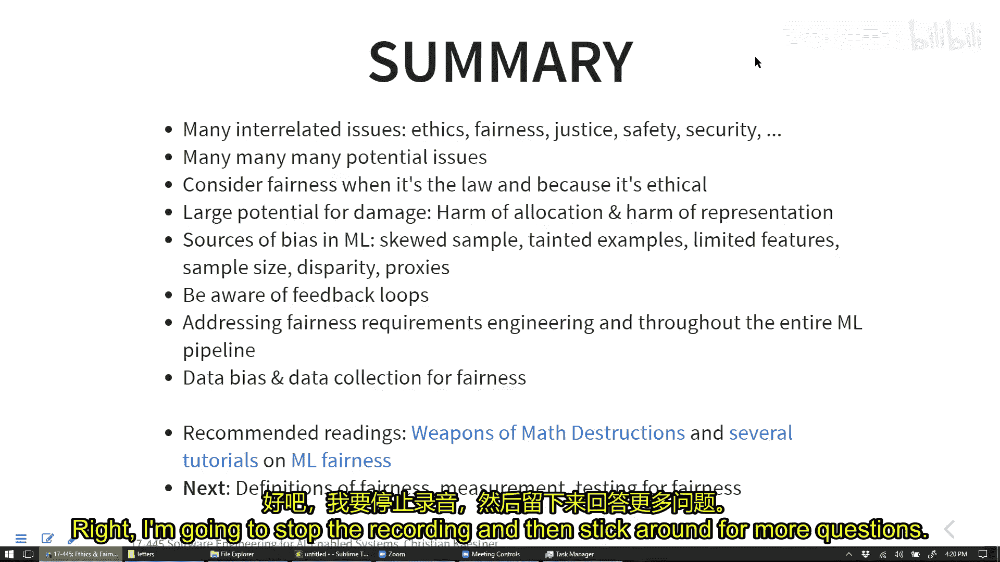

# 【全集】卡内基梅隆大学-AI驱动系统的软件工程-中英字幕-1080P-p16-Lecture-16---伦理与公平性--BV1JS6gBcEBF_p16-

All right， welcome back。Let's start as usual with what you remember from the last lecture。

Talked about a lot of things in a very short period of time。Testing， monitoring， DevOps， right。

 anything specific that you remember。Yeah， so I think for test monitoring， we discuss one。

It's called cows。Testing， yeah， I think that's for production setting testing and production with chaos engineering。

 yeah。RightAnybody adds anything you remember or anything that stuck with you？Activity on tests。

Can you just expand on this this was the paper， I think so there were different types of test for data infrastructure。

 model land。They were like seven， seven to10 points for each。

RightSo one of the key points that I wanted to bring across which was also in this the ML test score paper is that you really want to test the entire infrastructure right so we're doing a lot of steps。

 data cleaning， preparation getting the data training， modeling。

 serving and so on and you can test essentially every step in there and it's actually can be quite problematic if you have mistakes in there silent mistakes or other mistakes。

All the classics software engineering testing is appropriate in this context。

Right and then we talked a little bit about machine learning operations。

 MOs and DevOs kind of that there's tons of tools to automate deployment。

 automate reasoning and so on。Right。All right， so as I said last time I want to pivot a little bit and talk more about a bunch of qualities that are particularly relevant in kind of systems with machine learning components and today I want to start talking about ethics and fairness today potentially is a somewhat depressing lecture because we're kind of talking about lots of problems we probably won't get to solutions today。

I want to talk about the kind of problems that you probably want to be aware of。

 how to think about some of them， where some of them are coming from。

 and then I think next lecture we are focusing on some of the machine learning mitigation strategies。

 kind of how people define fairness， how they measure fairness。

 but then also come back to the system level and think about mitigations at the system level。

 things that we as software engineers or requirements， engineers can do and how to be involved。

This is also a fairly。Sensitive and difficult topic to talk about。 so we'll see how it goes。诶。

I have lots of things and I'm happy to discuss all of them。

There are a bunch of interrelated topics and they're sometimes hard to separate， so there's ethics。

 there's fairness， justice discrimination， but then we're also leading into safety and privacy and security and transparency and accountability。

And you could separate them all， and you could focus probably on every single one on the of them。

 but they kind of bleed into each other。 So I'm gonna。Start with kind of a more broad motivation。

And then we're focusing more specific on issues around fairness and discrimination。

 but we're kind of starting broadly。I want to start with this distinction of what's ethical and what's legal。

Does somebody can somebody just on the spot separate those two？How would you define ethical。

 How would you define legal。So I think legal would be does it violate the law or not an ethical might be something more cultural societal more of a personal belief than something that's explicitly coded somewhere right so ethics is kind of this branch of philosophy that's the kind the science of standard human conduct it's a bit hard to define this so there's no。

No legal binding， no enforcement beyond kind of shaming somebody。

 and then it depends a little bit on how much people can be shamed。

RightThere are certain people who are just resistant to shame and might not care about this it's kind of a societal agreement among multiple people of what's good standards。

 what's moral potentially right so moral is morality is usually a more personal setting and ethics is kind of。

The morality of groups， if you want kind of codifying something professional ethics are a bit more specialized。

 so these are things where professional societies essentially codify a code of conduct certain rules of this is what we are expecting。

As software engineers， there are certain kind of rules。

 but they are not we don't swear an oath as some physicians might do in Canada theres some some kind of an engineering oath this。

But， these are， usually。Kind of considered best pre？

Agreed standards or things that we expect from people most of the time。

 so classic case study on the difference here is so if you search just about the difference between ethics and morality。

 this will come up again and again， this is the CEO of a pharma company that rice that bought a。

A drug and then raised its price by。Yeah， from 13 to $750 per pill right so this is perfectly legal。

 There's no no law at least at the time， I think still not today against this。

 but this caused a big outcry right so most people would agree that this is。Not。

The behavior that we want to see in our society。People tried to shame him， he was shame resistant。

He actually got sued and is in jail now for other purposes。

That's unrelated to this so this was perfectly legal right and from his perspective he would have also said yeah he made profits for his shareholders and this is his primary duty right so there's usually a way that you can justify also unethical behavior。

But it's not broadly accepted， right， And it's probably something that we as engineers should be careful about and think about and probably not engage in。

And the problem here is that as software engineers。

 we are in a very powerful position with a few lines of code we can cause significant damage。

 There are lots of examples and therere more harmful examples and less harmful examples so there are lots of examples where with the single configuration mistakes people lost banks。

 a huge amount of money， they deployed the wrong version and they lost millions in like 10 seconds right and bankrupt the company there are lots of examples where with code。

 we have severe health consequences， safety issues up to the point that were radiating and killing people or kind of spacecrafts exploded and things like。

But there are also things that seem kind of harmless like it seems really easy and actually for this course it's really easy to just grab a huge amount of headlines so easy to find kind of controversial examples of bad practices so this was。

Two years ago that some European airlines， some discount airlines started when they assigned seats just to split up families to encourage them to buy seat tickets together。

 right so to actually pay for the seats that they can sit together。

 there's even a component that this might be illegal when some of these passengers were children。

 but most of the time this is it's not illegal but it's kind of unethical behavior probably as most of us would consider this。

But it's a few lines of code that somebody wrote right。

 and there's some engineer who was either thinking of the idea or was told to implement it and implemented this。

And。There's always the question how far are you comfortable with doing this。

 what do you consider still ethical behavior， where do you draw the line？

And I like this example as kind of a。Example to show that this is really not always obvious。This is。

 this is now a little bit data。 There's a couple of years ago that Google released this dood on the birthday of。

跑。Thats Paul designer off of some guitar and essentially so you could go on the web page and play。

🎼Kind of on the strings virtually and people recorded music with this， right。

 And there's an argument that。They were celebrating their success。

 but there's an argument here that somebody with a few lines of code wasted millions of hours of productivity of people worldwide。

So you see here in just 48 hours you recorded 5。1 years worth of music。

So it has certainly had a tremendous impact and you can think about。

Should the developer have some responsibility here， you can also say maybe with this。

Thing they spread a lot of joy， and this wasn't that positive for humankind。Right， but it's kind of。

It's really easy to make some of those decisions to implement something without thinking about consequences。

 without thinking about kind of how does this affect other people is this。

Something that we want as society and so on。Makes sense。Allright。

So machine learning brings a lot of concerns and I think a lot of them are fairly broadly discussed and known can you just bring up a couple of examples that you're familiar with kind of issues with machine learning concerns。

Fairness issues， safety issues。Dangerous risks。The personal level or societal level。

I think one could be the example we've used in class a couple times for some way。

 some automated system to decide admit admittance to a university or a similar thing to thatside jobs because like the data you're training on is old。

You know， operating in a biased world， so if previous admittances were biased in some way。

 you're not solving that problem。We're going to talk about this。

 but machine learning is a great way of codifying existing biases right and then algorithm and then as Sijoan writes。

 the lack of transparency kind of makes this even worse because there's a bias somewhere baked into an algorithm but it might be very hard to figure out that it's there where it's coming from and so on。

Other examples that you can think of， kind of fairness issues in machine learning。

 there were a couple of things in the readings， I think。

Right credit scoring where you might provide different credit limits to different populations。

So I have a ton of these and we don't need to talk about all of them。

 but you can start with the very basic safety assumptions issues， right？

Again robot uprising maybe not our primary concern right now， even though some people discuss this。

 but there are lots of things where with simple implementation decisions we can have safety implications and we talk about safety more later here's an example of a company doing kind of smart devices and home automation systems to control heating and Hre systems when the servers are down people are complaining that they're freezing at home right so what's our ethical responsibility to。

kindind of provide these systems and what happens if some of these things are machine learning components for operations and they may fail for things that we don't know Another safety case this happened essentially last semester when last four when I taught this lecture here in Pittsburgh have you seen these robots running around the city？

There was a case which kind of blew up us on social media where the robot was blocking in somebody in a wheelchair on a crosswalk so the robot was in a position like this at the lower curerb and somebody was crossing the street but couldn't get up the curb because the robot was blocking the street and they obviously couldn't go around it。

This is kind of a dangerous situation that。There's kind of a question of how much should we have anticipated this so they blamed them on a 40 map and they fixed it after pulling the robots from the street for a while and there was a lot of press coverage。

 but again， we need to assume that there are certain assumptions and there are certain assumptions here that you might think it's maybe not so bad if the robot is standing there most people can just walk around。

Right， but certainly not everybody can。You can go in different directions。

 so in terms of addiction and mental health， there's a lot of issues here。

So let's assume I'm just want to look at power washing videos also on Reddit right Reddit has this mechanism to draw you in that's also used by most kind of social media apps and so on which is called the infinite scroll right so you go down and down and down and there's more and more topics。

The inventor of this pattern I think worked at Google at the time is regrets the invention at this point。

 quite a bit， there's a psychological problem with the infinite scroll that there is no breaking point so it kind of draws you in you can just continue and continue and continue looking at things whereas previously with pagegenation you would look at like 10 entries and then you need to make an active decision to jump to the next page。

Right so。We're actually really good at building addictive apps。

We're designing systems often we're optimizing recommendation algorithms and things like this machine learning algorithms to increase engagement right to draw users in to have them spend as much time on our site as possible have them watch as many YouTube videos as possible。

 have them look at how because as correlates to add revenue off so we actually have been pretty good at designing。

Systems in a way， designing recommendation engines and user experience to draw people in and keep them engaged。

Which can lead to addiction， there's lots of discussions around this。嗯。Robin Hood。

 an app for trading has been in the news because they have extremely gamified their interface。

 you kind of are drawn in into gaming into trading。

 you get bads for trading and you first increases right so it kind of attracts people who。

Don't necessarily know what they're doing very well and kind of get into this and kind of get addicted to this。

 and there's a lot of。Kind of again， machine learning behind it to guide you in the way to give you the feedback at the point。

 get you the endoffene hit at the point when it actually keeps you engaged。It。

Theres is whole discussion around the morality of AB testing because AB testing and our ability to just run these small tests。

 what will improve it， what will engage us more， we find all these things of how we can hack our mind essentially how to get people addicted right we are really good at automatically finding exploits for the human mind with AB testing a lot of this can be automated with machine learning that kind of looks at human traces and optimizes for some goal。

And I think there are lots of risks here where we need to be careful what's ethical design。

This is still all legal， right， we're not talking about legal issues here， these are ethical issues。

嗯。There are actually safety consequences from this on mental health right so there's quite a bit of discussion how increased social media use correlates to teenage depression。

Right， a safe harm。All kinds of mental health issues。

And there's a question of how much should a company like Facebook feel responsible for this？

They're not doing much these days if you're interested in a more positive view on this what can be done this is a recommendation if you look into this specific aspect the center of humane technology is a nonprofitfi organization that's interested in kind of looking at better patterns how can we design this they have a podcast they talk about these issues a lot so if this is something that you're interested in this specific aspect of the problem I can recommend this。

By the way， I have tons of links to papers and different articles in this。

 most of the pictures can be linked if you look at the slides。

And then they are completely different issues。 So we talked about safety。 we talked about。

Mental health and addiction， there are lots of societal implications as well。

 there's a lot of discussion around kind of unemployment from automation。

So we are certainly optimizing away a lot of service workers。

 this is a simple example of ordering in a fastro restaurant。

 but we have increasingly we're optimizing away kind of insurance clerks。

 we are optimizing away truck drivers probably fairly soon and this has implications on our society。

You can think of machine learning or software engineering in general oftenness unemployment engineering if you want to be negative about this。

There's a lot of discussion around what kind of jobs are we losing。

 what kind of new jobs are we gaining， it's probably not the same amount。

 it's probably not for the same kind of people， maybe it's good， maybe we should address this。

 I think more systemic， approaches to addresses things like universal basic income right where we should maybe think about we're automating something。

 we're not giving not everybody should work in these jobs。

 some automation is actually a very good thing， maybe not everybody needs to work 40 hours a week。

But things to think about。There's also a lot of discussions around how。

machine learning and kind of the recommendations and is causing kind of fiter bubbles and kind of polarization like you only see content that you already agree with or you see primarily content that we enrage you right so this is the thing that you're engaging with so we're constantly enraage we're constantly kind of polarizing more destroying democracy potentially there's a lot of discussion around this as well。

And then， even further。🎼Also things that you've seen certainly right so how much should we automate weapons。

 how much surveillance should we have a ban on facial recognition a lot of these AI technologies are developed in countries with not the cleanest democracies were sometimes exporting them to to countries with democracy deficits。

And even in this country， you can think about where are we using them。

 how are we using them and so on， right so there are lots of issues around this as well。U。

Somebody Chris brought up credit worthiness right here as an example of somebody where known in this case。

 complaining about the upper card when it was introduced。

 how it kind of discriminated against his wife， kind of provided very different credit ratings。

Here and having no way to appear， right， things like this。嗯。Racial discrimination。

 kind of really ugly pictures， right so there's misclassification。呃。And。😊。

Into this kind of discrimination area there's a lot of research and we talk more about this andness。

 there's lots and lots of exampless right discrimination in hiring and college admissions and credit rating and insurance and policing incentive cs and seeing and advertisement and you have this actually resides in a lot of problems and a lot of unequal outcomes unequal opportunities and it reinforces kind of bad patterns it reinforces biases and so on sometimes called technological redlining so you where previously there were maybe humans involved in not giving credits to certain minorities or neighborhoods now you just have an algorithm of doing this and there's no way to appeal to that。

So。As I said this is a somewhat depressing lecture right you have a lot of issues here that can potentially creep safety issues。

 addiction， mental health， all kinds of societal consequences， discriminations， social equity。

 and so on and so on， and I think there's lots of things to think about。The place。

Where we can start at least a discussion here， this is where so we can talk about we will talk about safety later。

 a good place to talk about that covers a lot of the things that we kind of pitched in the beginning is I think fairness this is something that's also extremely popular in terms of kind of research as a research topic in the machine learning community and I think as I talk about later there's also quite a bit that software engineers can contribute in。

So。😊，When we talk about。Fairness， this is again， kind of fuzzy。

 but people often focus on discrimination， either in the legal sense or in an ethical sense。

 right so there's a lot of things。A lot of。Places where discrimination is illegal and then a lot more places obviously where it's also unethical so in the US there's lots of legislation over years about what are protected classes protected properties that you're not allowed to。

Disriminate based on right so in terms of hiring， you should not evaluate race。

 you should not evaluate sex or religion it should never be a reason for hiring or not hiring somebody。

If this would be the case and somebody can prove it you are in legal problems right so there are actually penalties here。

 the problem is often proving this， but in principle there are laws in this case and there are more specific laws about certain regulated domains。

 often domains that had long problems， lots。Past histories of discrimination。

 so those are specifically under scrutiny and if you automate anything in this domain in addition to just being kind of。

Fear out of an ethical responsibility， you also want to be fair just to obey the law and to obey kind of steep penalties。

But again， this is hopefully not the only reason。诶。Right。

 we're coming back to this more when we're measuring things， but there again。

 a bunch of different notions of。What is fair， right？

A simple difference is to look at the difference between equality and equity。

 where equality is just you give people the same opportunity or the same support。

Right so everybody gets the same chances whereas equity is。

Different people may need different support to get to the same outcomes to have the same opportunities right these are very different concepts and we may want to we need to think about what do we want to achieve and how can we achieve this and one more thing is just to address the barriers and remove those in place。

Sted with me。Right right。In terms of discrimination， we typically distinguish two kinds of harms。

 harms of allocation and harms of representation。嗯。Hummps of allocation means that different。

People have different outcomes。我。A different we would hold opportunities or resources from them right or certain groups of people have poorer service quality degraded user experience。

 so facial recognition algorithms， for example， usually perform worse for women than for men and they perform way worse for black people than for white people。

Hms of representation is around reinforcing stereotypes， subordinating along the lines of identity。

 There are lots of classic examples here as well。 For example， if you have a black sounding name。

 this is way more likely that Google will show you advertisement along the lines of。

 has this person been arrested。So you can search for different names and different names show different forms of advertisement You can click on the link and they will eventually you will figure out no。

 they haven't been arrested right， but just because the name sounds seems to associate with a certain。

Demographic， certain advertisement is shown to some people but not to others and you can dig in deeper here it's not necessarily that the matching algorithm is racist or that an advertiser has targeted this kind of population et it might just be an algorithm behind and there's actually a lot of discussions behind this that the algorithm is optimizing for a very benign goal here。

 it's optimizing for maximizing ad revenue or we can show different ads to different peoples who are more likely to click on it and this is just something that we automatically something that the algorithm will learn by different ad pricing by different tendencies to click on this which might be based on previous stereotypes potentially and so on。

So it might pick up on existing biasers and reinforce this。So the two harms here again， a location。

 giving different opportunities or different outcomes to different people and stereotyping harms of representation。

I have something for you to discuss in a second， but so what can we do about this？First of all。

 we should think about these things and I think that the main place to think about this is requirements engineering there are many other places as well。

 but I think。If we want to think about fairness， we need to start at the beginning。

 we need to start thinking about system goals。We need to identify what are our fairness constraints。

 some are legal constraints， some are ethical。We typically will need to talk to stakeholders and stakeholders from diverse backgrounds to identify what are their concerns about the system。

What are the right fairness constraints or the kind of problems， the kind of risks？

For discrimination or fairness， do we anticipate harms of representation or harms of allocation in this system。

 analyze potential feedback loops？We talked about the world， was this a machine。

 kind of think about what can our system do， how can it affect the world。

 how can it be influenced by it， and then typically we can't satisfy all stakeholders equally。

But we need to find a compromise， we need to find a compromise that obeys the law。That， hopefully。

Considers ethical considerations。Important societal considerations。And trades us off with。

 do we have a business case？But。And how away can the system do？

And then you set constraints requirements， you think about mitigation strategies。

 so if something bad happens， how can you deal with it。

 are you just saying oh it's the algorithm I cant can't do anything kind of having an incident response plan and setting expectations kind of an assurance strategy we talk more about a bunch of these later。

I think why to care about fairness is hopefully obvious。

And I hope you take away that it's not just about the first point here obeying the law。

So there are certain things where definitely have to obey the law。

 but that should be kind of a minimum bar。So you want to be ir responsible。

 you want to be kind of ethicalca。On top of this， there's also lots of arguments that。

Just by being fairer， you're reaching more。More people right so the product is actually usable for more people。

 it has a broader audience。You might actually compete against others you kind of。

Being seen as a more ethical participant might actually be a useful PR strategy as well。So。

It depends a little bit who you're talking to right so if you talk to a CEO who is aimed at profits maybe you want to focus more on obeying the law argument and maybe the PR strategy。

But also better products， more people， but also a lot of people will be convinced by ethicalca arguments。

All right， I want to give you a moment to think about this and apply this。So， we can do。

Let's start with one case。 can do another one if it's useful。

 Let's do college admissions again and let's again do kind of。A master program。

 the master program that you're in potentially over in。

So think about we want to automate kind of the review of applications。

 right fit people or rank them automatically。So what are possible harms of allocation or harms of representation that you could see here。

 kind of allocation of resources， quality of service。

 stereotyping over another representation integration。 What things that you can think of。So， I think。

So Jake talks about it may help recruiting top Tiland if they see our business as unfair， so this is。

 I think， a reason why we should be fair。RightBut let's think about fairness risks， what can happen。

 what happens if our algorithm is maybe not unfair right so what are the possible harms that we can cause。

Daniel。One could be representation where if there's like a worldwide bias。

 say that white males are better programmers then the admittance thing might。

Admit more white males and then more white males coming out。

 receiving good education are ending up programmers。

 so it just kind of perpetuates this stereotype and。In the world without adjusting。At all， yep。

Other things。Seejo， can you explain this。It's so related to Daniel's point， which is if you give。

So like if you've already identified through your algorithm that there's a set of students that are more likely to succeed in order to optimize the chances of success。

 you give them more resources and that I guess helps them succeed better。

 but then that just ends up exacerbating the difference between the I guess the。

It makes the difference。Of like， I guess， potential for success。

Even greater between the two different groups of students。And I guess that's not。

That's not equitable in a traditional sense。 You wouldn't think of that as a good outcome。

Does anybody have a concrete example of what we might pick up on in the admissions that might actually be a sign of kind of a very privileged background。

 for example？I would think one would be if。Their parents are alumni of the university or。Just。

Family background。Okay， Sam。Eacy admits。Yeah， like Daniel just mentioned。

 sports that require a lot of expense to maintain your participation in。Okay。Chris mentions address。

 right， So if we， if we admit people based on。The address where they're coming from undergraduate college might give us a strong signal。

 but also might bias us potentially standardized tests。

Right so there's a lot of discussion these days around using GRE or not using GE scores because。

Kind of。Potentially measures much more how much time you have to study for it。

 how much money you have to tutor right so this alone might bias kind of who does well on those tests and bias the demographics studying abroad is another good example right especially if you do this without any scholarships。

Community service， yep， potentially。Unpaid internships， yeah， because all the same direction， right。

There are a lot of these， these issues， right， We might reinforce existing under over representational representation groups。

 right， we might pick up on signals that。Crelate potentially with a success right this is why the machine learning algorithm picks up on but it's just reinforcing existing patterns so it's not equitable it's maybe equal right it's considering kind of equal inputs but probably not even that and it's not considering that we might want to give more support to certain populations or。

You like。Yeah I have a simple question like do you consider the criteria from a university also as an ethical challenge in that sense。

 for example， let's say for I are they only one programmers so essentially you are blocking the other population from joining company that's creating a little bit of bias so is that also countered under ethical challenge that you're at。

I think you always have this。 You have some ethical consideration。

 but it's not obvious which one is a problem right so not every form of bias is immediately a problem Daniel is on this point。

Yeah， I think I think it's pretty related I was just going to say like the。

The domain of this problem or the way it's phrased seems impossible to avoid bias because basically what you're saying is。

🤢，What。What can I do to predict if a student is good so there's nothing like I mean everybody's kind of unique so there's going to be a good student from most every background so if you're trying to generalize that I mean you're essentially just saying you're like productizing bias。

So what often happens is that for certain populations we have more information。

 so if the student comes from a university that we know we can make maybe much more accurate decisions about whether they will be successful right。

Whereas if this is a student from a local university in the south of Alabama， I don't know， right。

We may not know anybody there， we may kind of be skeptical about their grades。

 I mean international students even more so right so。

We just have a way less information about them and make maybe more noisy decisions and maybe we are risk averse then just go with the students that have a clearer signal。

Just want to。This is， I think， a good segue here to talk about that not all discrimination or all bias is harmful。

 technically actually bias and discrimination are technical terms in machine learning。

There are lots of things can't explain them all but selection bias reporting bias bias of an estimator。

 those are all technical terms， this is things you can measure and so on。

And discrimination in general is a technical term for classification。

 distinguishing between two different outcomes。The problem is unjustified or unjust differentiation right so making decisions based on things that are irrelevant either for practical purposes or for moral purposes。

 or that are simply just unethical there are a couple of good examples here so in。Admissions and in。

In credit rating we。Don't want to consider gender or race， right so this is considered unethhaca。

 This is even illegal。In a Medicare diagnosis， this may actually matter a lot。

So we don't want the same prediction of whether somebody has some medical condition based on kind of blood pressure or something like this or weight independent of knowing their gender。

So in this graphic here， you see that the top diseases or causes of death actually differ in kind of ranking between men and women。

And there are certainly differences， and this is actually a big problem that we， again。

 that we study certain populations much better， we have a much better understanding of how we treat certain populations。

 children as an obvious example where we often have very little information about how certain drugs interact with children。

 but there's lots of racial and gender bias， also medicine where we simply test on dominant populations。

Or we test on vulnerable populations actually， right they have the highest risk when they are going through early trials。

So to really understand what discrimination。Or fairness issues are this is domain specific right so if we want to go back here we actually need to have a discussion at some point we want to distinguish successful from unsuccessful students right or students who are potentially successful so we need to do some sort of discrimination。

in a technical sense right so we need to discriminate between successful and unsuccessful students。

 but we don't want to discriminate based on factors that should not or matter right so we don't want to favor students just because of their skin color or the zip code that they grew up in。

Or the prep school that could afford。Makes sense。Any questions， any discussions？

So it seems that fairness is fairness is kind of like。We。

 as a society have decided that there are a bunch of features that we will fix to be irrelevant。

And then we apply this to basically all everything downstream。That's one way of thinking about this。

 We talk about that。 this will not help。 So if you， if you do， if you go that route， you。

You can optimize for equality。So you're essentially saying here you give everybody or you predict a box independent of their height because the height is kind of irrelevant or illegal or sensitive attribute。

So it really depends what you're optimizing for right so in some cases that's exactly what you want to do in some cases you want to achieve equity。

嗯。It depends a lot on what your algorithm does and what society， what's。What's societyetally。

Acceptable， I guess。And appropriate。 And that shifts over time， right， So we get。

Our expectation to was fair。I think improves over time。

 So if you actually look at kind of bias and discrimination。

 we get way more sensitive to this to issues。That might have been completely acceptable 10， 20。

 50 years ago。have been not accepted by society or by the broad majority。

And I think this is this is again where I think requirements engineering actually plays a big role because what we need to do is we need to figure out what are our fairness requirements。

 how do we negotiate between kind of。Expectations of society。

 expectations of minority and majority groups， profit expectations of our business and so on。

 and I don't think there's any single， simple rule。This is。This is domain specific。

 we need to kind of think about this， we need to talk to people， we need to negotiate。

And once we kind of can characterize。What the fairness requirement， the fairness goal is。

 I think then we can start thinking about how do we test this， how do we enforce this。

 how do we assure this。感觉。Yeah， I was just wondering if。The sort of discrimination。

If it's more lax if you're trying to kind of predict things in the past versus the future。

 so like a future example is like should we admit this person because they'll be successful but in the past like if you're trying to predict if a random person was arrested 10 years ago or something。

Then the discrimination is it's still unfair， but it's factoring in the discriminations of the real world in the past。

 so it's。So what's the prediction in the past good for？I don't really know。

So I think most of the time you want to make a decision now， right。

 so you want prediction as an input for a decision。

You can do pure data science so kind of explaining kind of observing the word。

 observing correlations right then you might just study past biases or things like this。

 what correlates in the past right so there are certainly scientific questions where you don't try to make a decision based on this but I think essentially always when we implement a machine learning component in some software system。

 we want to make a decision， we want to make some judgment and have some outcome so theres always essentially has future consequences。

Okay好。All right， let's look a little bit at sources of。Of bias。And。

There are couple that we can distinguish。Have you seen this example？

So this is translating a text into Turkish andbe。What's happening here and why？

Either if you've seen us or if you can guess。The pronoun is gender neutral and Turkish。

So there's simply no information in the lower bar right about the gender。

The top translation is fine right so it just translates this， it gets rid of the gender。

But by doing this， we have lost information， so this the Turkish text doesn't have gender。

 so Google just in first gender。It needs to pick one。Or Google translatel here。

And how do you think it picks the agenda？Why is the nurse female， the doctor male。Yeah。

 that's just what they've seen most frequently in training data。So in training data。

Nurses are mostly described as female or in the texts that they have seen。

Right and doctors were mostly maleor so the。The model essentially picked up on data that it has seen。

Kkindind of reinforcing a bias that maybe shouldn't have been there in the first place right but is there so we can think about this and we can break this down and people have done this so I'm just taking here this characterization of five sources of bias So the first one is historical bias。

And the translation example fits into this。This is actually。Interesting。

 so there is a story that and this is， again， is one of those famous examples of biases。

 if you search for CEO and Google image search， only male people would show up。

And this is just because most CEOs in big companies are male right so it's kind of the historic buyers that has gotten us there and it just reinforces us actually these days if you search for a CEO in a Google image search you find a bunch of a female characters and they often relate back those are often stock photos or they kind of relate back to a discussion on buyers in this contextductductt go still shows only male people on the first page also。

嗯。So I suspect they have actually intervened in some way。

 so historical bias that data reflects the past。Correctly。But it's not the intended outcome。

And you can see why people might get upset about this。

 but it correctly reflects the current state of the art。You might also have tainted examples。

 especially if you have labeled examples that are labeled by humans by human bias。

 and so attempts at automatic recruiting often led to revealing a lot of bias that was probably already there in humans。

But Amazon for example， tried to have an automatic CV kind of classification system and they completely scrap this because they figured they was super biased。

 they trained on a lot of data and it essentially just showed them how the data was biased right it was really biased against female applicants。

If an applicant came from an all female college was essentially sorted out immediately。Ths like this。

 right so it would even if you took out the names it would pick up on a bunch of other things and this was there again similar to the CEO case。

And similar to the Turkish example， because the data is just simply。

Based and this is human produced data， right， so some humans have produced this。

Some organizationist soci structure have produced this， right and we are reinforcing this。

There's also skewed samples。嗯。Can somebody explain what this might be in kind of crime？

Prediction kind of scenarios， I think we talked about this earlier in an example right so predictive policing or predicting where crime will happen。

What might be a skewed sample， Yeah， white collar crime ist track。So， certain forms of。

Interactions may not be tracked but that's potentially more the previous case right so if you have an interaction with the police and the police decides where to file a report and where it doesn't。

 there would be more ated example。What could be a skewed sample， how might it be skewed？

You might sample some parts， way more than others。How would you maybe see crimes in certain neighborhoods way more than others without involving kind of the bias of the labeler of not reporting certain？

We patrolling happens essentially right so if you kind of go into certain neighborhoods。

 you patrol them way more heavily than others。You will see。

wayay more crime there just because you're testing more right so that's say there's like 10。

 20% crime in every neighborhood， but you're testing much more in one neighborhood you see much more in that neighborhood。

So the sample is not uniform， you don't look for crime equally everywhere。

So this is not the police officer once a see crime labeling this incorrectly right which often which might come on top of that right they might observe something and interpret this in different ways。

 but they just the places where they are searching for things might be different。

And then on top of that， the entire discussion， what gets fired。

 what gets considered in these statistics and so on。Then another example is。

 especially if you do feature engineering that you pick features that are more informative for certain populations and for others。

So the example here is that you do employee performance reviews。

And you consider leaf of absence as a feature in there。And if our absence might be。

Potentially reflecting performance for men differently than for women。Right。

 or for people with heads conditions differently than for people who just take the time off for。

Parting。So there are certain features that are just more or less meaningless or are very noisy for certain populations and they' are very precise for other populations。

And if you just use them uniformly， you will just treat different forms of people differently。

And then synsize disparity， Does somebody know about the Shirley card？Have you seen this before？

So this is a card that Koak used kind of the camera company for calibrating equipment。

For color calibration。And this card。Wass used for many， many years of equipment， right。

 that shows a white woman。So this was a sample that was used primarily to calibrate things。

And it caused that camera were calibrated for certain skin tones。

And was often producing very poor images for other skin tones。

 You could have calibrated for other skin tones， but people didn't because they didn't test for that。

 right they optimized for this card。 They had a sample， They had a very skewed sample， or they had。

Lots of examples of white women to test on in very few of black。So you can think of this。

There are many examples of this。Where people obviously haven't tested this right so this is or have tested this on only the majority population。

 this is an example of a racist skin soap dispenser right that works for white people but not for black people。

嗯。If you have tested this， it was probably 95% accurate or so on the people that you tested it。

But you just had a skewed sample of the population。

The different groups were represented in different amounts of frequency。So this happens。

 this can happen quite easily in data sets right we talked about having separate data sets for different subpopulations。

 so this is a strategy to deal with this， but if you。

This is also a reason why image recognition or face recognition algorithms work so much better for white males because we simply have used more training data on this。

 we have more labeled data on white males and on other skin colors and on female and so on。Right。

Okay能。And finally， a common thing a proxies， so where even if you take out the。

Features that you kind of don't want to discriminate on right so you take out race。

 you take out color。嗯。Agenda and so on， you still may discriminate because you may use features that are proxies for this。

So if you， let's say you do credit rating or。PretC rating or recidivism。

 and you explicitly don't consider race。But you consider the zip code。

Right kind of what are regions where many people default or what are regions that。Where。

Where a lot of crime is committed， this may make sense， right。

 Z code may actually be a good feature for some of these activities like credit rating and so on。

 but。They are often correlated with attributes that are protected。

So if you look at the map here of New York， you can see that different neighborhoods have different population distributions。

And so if you use that information， it's correlating with protected attributes that you don't want to use。

And you might end up discriminating indirectly without even realizing this。

And then researchers come along years later and kind of say， oh your algorithm is discriminatory。

 this is kind of how the compass algorithm， the recidivism thing， right？

People were claiming they were looking at the algorithm from the outside they was claiming。

There were certain things that might correlate with race。And that was used instead。嗯。

So let's go back， let's think about we want to do this college admissions thing again。

So we want to know is a student likely to succeed， we have a bunch of features， GPAs at GE， race。

 gender， household income， and city， and so on。嗯。What information or which of these。

Bases can lead to kind of problems here。 So let's maybe just go through that one by one。

 Can you think of an example of kind of。AHistor bias。

That might play into your machine learning classifier。I think we mentioned this earlier already。

 right。嗯。So can maybe。嗯。I mean succeed， the question is what's the definition of succeed。

 let's say they're graduating successfully， they're not struggling in the program or dropping out or they are having a good job afterward。

嗯。So。CMU has a long story about kind of trying to be more inclusive with regard to gender in their undergraduate CS education。

 so they had a very small number of women as undergraduate CS students and the women that were in the program didn't feel particularly welcome was kind of this voice club right so they would drop out more frequently。

 they didn't feel supported， they like outsiders so there was kind of this self fulfilling prophecy right they weren't supported so they weren't successful and if you just take that historical data。

You you get kind of a predictable algorithm that favors men and then you continue to have few women in the program they probably still don't feel very outcome and you have this kind of historic bio。

So what they actually did was redesign kind of the environment。

 redesign how they are looking for how they're evaluating applications， for example。

 no longer requiring prior programming experience， but instead providing introductory courses that are more inclusive and open to everybody。

Focusing on certain different aspects of undergraduate education。

There are a couple of good books about how CMU has changed its undergraduate CS education a lot and has achieved in the last couple of years。

 actually gender balance in their undergraduate classes。

Kicking as in computer science is a good book that describes a lot of these efforts over many years kind of to make this a more welcomingcoming environment and this was fairly successful。

What might be tainted examples so where human labeler provided biased labels on training data？

In the college admissions case。The definition of success may have been very biased right so Jake was asking about this maybe somebody thinks success is only if you get hired by Google afterwards and people who go into kind of nonprofits or things like this are not successful right you could easily encode something like this。

 you can also look at success only in terms of grades in hot math classes or something like this and ignore applications。

 I don't know， there's probably a bunch of these things。Skewed sample。

In college applications where you only have。啊。Or you kind of have akewed sample of training data that only。

That doesn't really represent the truthce。Maybe you have only admitted the MIT students in the past and they were kind of successful right。

 but you kind of over sampleamped in the pool of successful students and have simply no data about all the other students。

Anything else you can think of？we might have data depending upon the location from where the students have come into the program。

So we can already see， for example， MSc。We can see the country wise ratio is totally different and the success ratio is going to differ on the basis of that。

Right so you may， may only have observed。Students from countries with lots of applications or actually maybe lots of money for applying。

Yeahep。Limited features， some things that are good measures for some students， potential success。

 but not for others。I think maybe maybe this is kind of where the GRE comes in for like students who had the opportunity to have time to study or。

You know， dedicate more time to doing well on the GRE it's so probably from rich neighborhoods GRE might be more indicative of success。

 but from poorer neighborhoods maybe less so because there was less time to study or less resource to study from yeah so maybe for students who had actually a month to study for this this was actually maybe a good measure。

But it discriminates against poorest students who don't。嗯。

Symthesize disparity yeah we may have way more students from， I don't know， India than students from。

Bangladesh or students from South Africa or Egypt。嗯。And proxies。

So let's say we explicitly don't consider gender， we don't consider race。

 we don't consider a country of origin。What might be proxies？

You could argue a GIE as a proxy for ability to study and have a tutor， right。

The schoolss that they went to is potentially a proxy for。Ger or。

Kind of class hierarchy or something depends on the country。

What else do we have yeah you probably don't want to use household income as an attribute if you use their city or something right。

 this could be again a substitute for the university where they studied or the opportunities that they have。

Right。In the last couple of minutes， want to pitch this。 This is one of the first books。

 weaponsapons of Math destruction that kind of talked about the。

Problematic potential of kind of machine learning， self fulfilling prophecies and so on。

 especially for high risk cases。 it's a very readable book。

This was certainly my first contact with this topic four years ago。

There are multiple books in this area and way more technical ones is is very much not technical。

 this is kind of policy discussion， but it has tons of examples of how machine learning algorithms or big data kind of。

Drives unequal and unfair decisions in。In housing， in in elections in。

In incarceration in credit rating in advertising and so on。 So that has lots of examples。

 it's kind of a narrative。 The main thing why I want to bring this up is again。

This is kind of how I started with a few lines of code， right， We have a lot of power。

 We actually use algorithms。We use algorithms a lot for making automated decisions right so we might use predictive policing algorithms to figure out where to send police。

And this is often actually something that we don't question we might use a credit rating algorithm to figure out whether to give somebody credit。

And we don't question this， and there's no way to appeal this in most cases。

There's actually a trend in recent years that。You didn't get the outcome from a system that you wanted。

 but well it's the algorithm， it's not our fault right so you kind of just say there's an opaque algorithm that's taught me no and there's nothing to be done about this。

A lot of these algorithms are used in situations where actually affects people's lives right and kind of high stakes decisions。

Let me get back to this here。So we often trust the algorithms to be objective。

 actually often an argument for introducing them is that algorithms are more objective than the people that they are replacing right so the algorithm for the recidivism case is。

That we have an algorithm who's not biased by looking at the Canada at the Peroleoli right at the person who committed the crime and is potentially released。

 we're not biased by just looking at them by hearing them talk but we are actually just using data facts that is neutral the problem is we trust them to be objective。

And we don't have a way to question their predictions， usually。

These algorithms are often designed by and for the privileged and majority group。

Often without really considering fairness， we're getting there， we're getting better。

 fairness is a big issue these days。But still not。There's no requirement usually in the US that these algorithms should only be used in。

 they're usually black box， we can't question them。

Either because they use deep neural networks which we don't understand and often because they are trade secrets。

 which we don't share。Predictions are based on correlations， not causations。

 they might be flawed the book actually has a couple of examples where they're based on flawed statistics as well right so people have just built these algorithms。

 you can game them。And then the problem is that we just trust these predictions。

 they affect outcomes that are often biased， and by doing this we are reinforcing patterns。

 so you often have biased training data， training data residing in a biased model。Because of this。

 you get biased outcomes。Because of this， you get biased telemetry。You use that for training again。

So we're reinforcing kind of the bias in the system。Kathay O'neil， the author。

 talks about this as big data codifies the past， it does not invent the future。

To kind of go into the future to make changes， you have to imagine something。

 you need to do something new， you need to actually do the requirements。

 you need to figure out how to design something explicitly。

 you can't just train on data right so you need to at least be very careful with the goal that you're optimizing for。

So in predictive policing， the common example is that you have biased data because police was already biased and they patrol in certain neighborhoods more。

They ticket people in those neighborhoods potentially more。Where white color crime。

 they might get away。White privilege， right do you stop somebody in the white neighborhood and let them get off with a warning whereas you might ticket them in a different neighborhood。

 so you have kind of biased data to begin with。Then you do predictive policing。

 you train a model that's supposed to be neutral right it's not based on a person so you might trust it you don't question it and it dispatches people patrols to certain neighborhoods。

And then because police are more in those neighborhoods。You。You find more crime there。

Well you might tell police go into this neighborhood but it's a low crime neighborhood so if they see something they might not consider as suspicious or they might just warn somebody right and this reinforces a pattern so we observe that actually predictive policing works because we go into those neighborhoods and we find more crime than in the competing neighborhoods。

And by doing this， we find more crime in those neighborhoods so we reinforce the algorithm。Right。

And this is a very common pattern， a very dangerous pattern that can happen in a lot of things。

 This happens with housing as well where you kind of predict or make housing decisions this can happen with insurance or credit card rating you give somebody bad credit they don't have opportunities so of course theyre defaulting on their credit the little that they're getting so they won't get opportunities in the future and so on right so this is in all these cases。

Very dangerous that you might just encode the bias。

So there's a lot of danger here if you're putting too much trust into algorithms for high stakes decisions。

And this is， I think， probably coming back to the beginning。

There are things here that are required by law and there are things that are ethical。

We should probably push beyond the law， right， we can look in all the examples that I've shown in the beginning and think about what can we do about it。

 what should we do about it， How can we avoid it。This is not intentional most of the time。

 right we don't intend to build bias algorithms we're just picking up on past biases。

But how can we prevent this？RightAnd if we identify certain criteria， how can we reduce it。

 how can we eliminate it and I think this is where I'm going to continue talking next time we're going to talk a little bit about what we can do inside the model certain。

Fairness requirements and then also what can we do around the model and in the design process。

And this typically starts already by acquiring the right data， filtering the data。

But then also deploying that user interface design and so on。Alright。Any questions？

Did I bring everybody down。I was just thinking kind of in your summary that a lot of the issues here might be related to。

Poor weak backgrounds and statistics， would you say that you know improving。

Machine learning engineers， backgrounds and statistics would help a lot of these things， too。

 because they'd be more aware of the fallacies and the pitfalls。Yeah。

 I'm not sure how much this is the statistics part itself。But。

Being aware of fallacies and being aware of what data you're collecting and what kind of safeguards you build in or how you're using predictions probably。

I would expect a lot is more kind of at the system level than the model level， but yeah。哦。All right。

 I'm going to stop the recording and then stick around for more questions。

