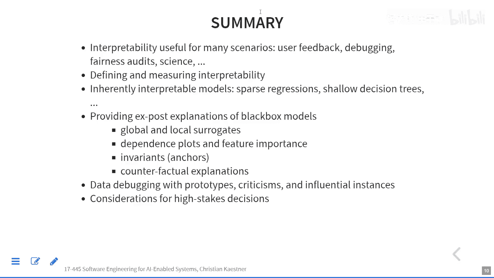

# 【全集】卡内基梅隆大学-AI驱动系统的软件工程-中英字幕-1080P-p17-Lecture-17---可解释性与可解读性-part1--BV1JS6gBcEBF_p17-

We come back？What did we talk about last time？More AI fairness。

 anything more specific that you remember。Different kinds of fairness。

 Which kinds of fairness do you remember。There was that one about optimizing for equal representation。

 I've got it specific terms， but one optimizing for equal representation independence， I think。Yeah。

 I I keep confusing the terms。Well its right so independence and separation and anti classification。

 does somebody remember what those were roughly？Yeah， so for anti classification。

 we were looking at flipping。Fields such as gender， just to make sure that。

The gender has not made an effect in the prediction。Mh哼m。

Right that's useful if you want to make sure that two people who are the same except for the protected attribute get the same prediction。

 for example， if you want to make sure that gender doesn't affect whether you get credit or not。

 this should be not part of the model， whereas the other ones actually allow for cases where the protected attribute actually relates to the output。

 right and you want equal representation or you want equal quality of the predictor， for example。

 separation is the equal number of false positives and false negatives as Vi write。

RightWe talked a little bit about good practices for achieving fairness。

 some of which are closer to the model and measuring fairness right so we talked about some of them。

 but also that a lot of this system properties and we need to kind of think about this throughout the life cycle。

 there's a lot of this that you can do early by thinking about the right requirements。

 setting up the right processes， thinking about this in data collection and so on。

All right today I want to move on and talk about interpretability and explainability these are also extremely highly researched topics there's a huge amount of work in the machine learning community。

 it kind of bleeds a little bit into fairness as well as you see。And。

I'm just going to give you an overview suspect we won't get through this today。

 I essentially summarized this book here intooperable machine learning in this lecture。

 I didn't want to assign it because it's kind of long。

 but I want to give you an overview of a large number of different techniques because I think they will actually be extremely useful if you're building any system any sort at least as a debugging technique。

所以。Let me just start by a few kind of motivating examples。Actually。

Yeah let me start by a few examples so this is a project that IA was involved in a couple of years ago where we wanted to do some sort of anomaly detection on Github commits so the purpose wasn't really security it was more people are overwhelmed with notifications on GiHub there's just so much especially if they watch somebody else's repository to learn we wanted to see can we identify。

Commits that are different that are maybe worth your attention that you want to look at right so in a sense this is kind of anomaly detection and there's a lot of different anomaly detection approaches。

But just saying that the commit was anomalous， felt like not particularly useful for us right。

 so we could give a rating a number between0 and one。

 But what we wanted to do and this is here at the bottom of this graphic。嗯。

There you see this here that we actually provided some explanation。

Our model that we used was fairly simple。 We are just probability distributions for all kinds of features that we were looking at。

 and then we were looking at whether we were at kind of toward the outliers for a bunch of our features。

 And that was pretty nice because we could easily explain why we thought that certain things are kind of different。

 including things like somebody never commits at night。 And now they commit at night， right。

 or this is kind of different kinds of files and so on。

So kind of explaining somebody why giving them more context might help them to understand what's happening。

 but there's also many other things that we can use if we can understand actually what the machine learning model does。

So。Here's a model about recidivism that I've shown you a couple of times。

 it actually comes from the paper that I signed as reading as alternative to the podcast。

This is roughly equivalent or has a similar performance to the compass model that's discussed a lot。

So this is a model that we can just read a couple of if statements and we can start discussing is this model fair？

And we can actually discuss this quite easily here， it refers to gender as part of one of the rules。

We can discuss whether that's a good thing or not。What kind of fairness we have in mind right so it's certainly not anti classification here。

But we can start thinking about is this something， at least with regard to general。

 right is this something that's。That's problematic or intended。

And it's much easier than doing this with a black box model。

 right so this is how the compass model apparently looks like。 just found a screenshot online。

It gives you so there's a case management tool so there's a larger tool around it where you kind of have information about somebody who's in the judicial system and then there are kind of risk scores。

 a violent recidivism risk， general recidivism risk。

 pretri release risk and for a person they essentially just give you the score between one and 10 or zero and 10。

And I think this is just kind of feature information。Kind of describing the case。

So this model doesn't really take， tell me how it makes decisions。SoThe researchers went in。

 you heard this in the podcast or saw this in the paper。

They kind of looked at data that was used to train this model or they fed data into this model and looked at observations and this kind of controversial of different people have kind of different views or different interpretations。

 how they study these models， whether it's actually biased or not and how。

If you have a model like this， this discussion becomes much easier because you can actually see what's happening。

So the compass model， the real tool is black box， you put in some information。

 you actually has 140 fields also so that it considers sort a lot of features。

And it gives you an output a number between zero and 10。

 whereas this model gives you a binary output and it tells you how it reaches it right it tells you what the cutoff areas are。

It doesn't tell you how it reached those numbers， right but you can understand。

 and if I describe a person， you could say， what would the model say？喂。

So this is something that we would typically say as an interpretable model。嗯。

There are many other forms of models that could be used。我是。From the same kind of style of work。

 this is a model that's not phrased as if then adds， but as kind of a checklist。

 and then you assign assign points， positive or negative points to each thing then you get the score。

And there's a way to interpret this score， so predict arrest for any new offenses if the score is larger than one。

or this one here is you get the score and then depending on the score。

 it will tell you what the risk is。But again， this is a model that has very few inputs and is actually written in a way that's compatible with things that we are used to。

 right it's machine learned， So whether this is what the cutoffs are and what the points are and so on is the output of a machine running result。

 but the way that the model is presented is in a way that we're used to as checklists。

Here's another version just for a stroke risk。They kind of look the same。Layout doesn't work。

 but I showed you this tweet before somebody complaining that the epi card would be a sexist program because he and his wife got different credit ratings。

 even though they should be very similar in terms of properties。

 how they should be evaluated the question now is。If you get complaints like this and you have a black box model。

 right， So you have trained a model， how do you make sure。

Whether there's a problem you can feed in those two data points and see yes they get different outcomes right but is there a larger problem here。

 is this just the machine learning make model made a mistake for one of those people it kind of there's an outlier right we talked about there could always be some sort of mistakes because we don't understand the roots or is there actually a systematic bias in here is there a systematic problem。

So debugging machine learning models， kind of figuring out why do we get to those resides。

 when will we get to other resides， is there a systematic problem。

 it's a huge problem and this is where interpretability helps。

This is where a lot of the research is really useful for。

 not sure how often you're going to develop a recidivism model。

But I'm sure that you have some models that have problematic outcomes and you want to know why。

So all the explainability tools that we're going to talk about。

From my perspective are extremely useful debugging tools。

 so I could have called the entire lecture just debugging machine learning models。嗯。And that's。

 I think， a very good way to think about them， although they have lots of different purposes。Right嗯。

Explaining decisions here again so why does the model think this is a cat or a lion or dog right are we confident in our decisions。

 how can we figure out that the model does the right choice， how can we debug this。And then。

We talked about certain forms of models。especially deep neural networks。

 but also many other forms of models where if we just look at parameters or that the model structure I think we have essentially no way of figuring out what's going on right so if you think of an image classification model that takes an image like this that has maybe a million input parameters or something like this for every pixel。

And then you have a couple of thousand of these neurons or more， right across multiple layers。

 each of those neurons corresponds to or each of these edges。

 not neurons corresponds to one float number。Now we have these big matrices。

 but we have no idea what's happening。And so a lot of effort。

 lots of people are trying to understand at a more abstract level what happens in deep neural networks。

 what other structures that we're learning， but I think we are at the very early stage。

 most of the time we have no idea。Right， so most of the time。

 any model that uses deep learning is essentially a black box。So we we can see what the output is。

 but we can't really understand why from the most part。Let me skip this。And again。

 this isn't necessarily new。咩嘢。This is a。This is a flowchar。Okay。

 this is how select notifications work， this is not machine learning。嗯。Come on， is just the question。

 should we send a notification in Slack？And this is a complicated decision process。RightAs humans。

 this is the kind of thing that we use to understand complicated decision processes like flow charts。

 there's a high resolution version of this on the internet somewhere if you really care about those things right but it's kind of complicated it depends on all kinds of settings。

 it depends on kind of the context whether it believes you're currently in slacklack just to get to yes。

 no decision right and this is handcrafted but with machine learning we're learning a lot of those。

And handcrafted things can be hard， but what do you think a machine learning model will look like right can we get to something close？

嗯。And this is not just kind of the machine learning prediction things you also get similar problems with symbolic AI。

 what you see here is data log it doesn't really matter too much。

 it's asking a query over lots of facts so you're saying that there are certain facts about relationships between people so there are in parach relationships and then you define what ancestor relationship is and then end there's just a query give me all those people that are in ancesstrtor relationships。

We talked about symbolic AI a little bit and about kind of logic reasoning and planning and probabilistic reasoning。

 when those twos give you an answer， they can give you a derivation tree how they reach those answer。

But it doesn't necessarily mean that it's easy to follow， there can be lots of rules。

 this can be used on a large fact basis right so even in those systems they tend to have clear reasoning rules and they can explain in terms of statistics or logic how they come to an answer but understanding this is not necessarily easy。

So。There's lots of things that we can try to explain where do the rules come from。

 what are the relevant factors， why these resides， why these rules， why these cutoffs。

 both for machine learning and symbolic AI， we focus on machine learning most of the time。

And we can reason about why we want that。Any questions so far。Oh I wanted to ask。

 have you worked with any machine learning models that were hard to debug。

 how to understand any specific cases that you can share？Speaking is probably easier than typing。

Anything where you struggled？Just making sense of what's happening or debugging or。

Kind of checking some properties。So we are a little bit struggling currently within our studio with the machine learning models。

 although we are using Amazon recognition to classify images for us， but sometimes it。

Identifies like out of the box hazards and we are just keep guessing oh maybe this is because of like this so we are just playing the guessing game over there and currently we are just totally dependent on the fact that okay maybe providing more data will solve this issue but we really don't know if it is going to help or not。

And it just misclassifies things sometimes and you don't know why yeah。

 it misclassifies essentially we are solving a bounding box problem essentially and it draws boxeses that。

At places where we know that essentially we are trying to find out if there if there are hazards on the sidewalks or not and it at some places we we can see oh that's a big hazard。

 but it will not find。That area， but there is a small black mark somewhere on the sidewalk and it will identify that。

 So and I suspect most of the time it kind of works， but it often makes mistakes。 Yes。

 most of the times it works like it identifies for most cases。

 but some of the cases it is just like a black box essentially So we really don't know what's happening Does anybody else have anything。

W share。Yeah， so the SEI and Lake group were using a genetic algorithm to recommend system level refactories。

And so it's not necessarily machine learning but。It's still。At this scale。

 when you have like a large codeID base， for example， and you have a large number of solutions。

It can be hard to figure out。You know， how did the algorithm actually get to those solutions and how did the fitness functions interact？

So。I think at scale， that type of algorithm is sometimes harder to de。

It's mostly a debugging problem。Yeah， I think。I mean， I think as long as you have。

You know enough logging and that sort of thing。You can get to an answer eventually。

 it's just not immediately clear and。Take some digging。 Yeah。

 so we see this that there are different reasons for explainability， I think。

I'm biased to what seeing this as a software engineer as a debugging problem most of the time。

 but there are actually lots of different reasons and there's a huge interest in kind of explainability or interpretability for different purposes for example you can start with legal requirements。

 especially if you kind of think about high stakes decisions there are different regulations and different countries there's a fairly recent the recent European Union data production rule regulation has a sentence in there that you have the right to obtain an explanation for the decision that's reached。

There's a lot of discussions still about how this should be interpreted， how broad this is。

 but it triggered a lot of attention kind of in the machine learning community and kind of in whether things like recidivism prediction。

 whether that's actually feasible or credit scoring right how far do we need to explain this。

 I don't think this is tested in courts yet， but this is coming and they're also in the US discussions around this。

A place where this is already in place in the US is credit scoring。If you get denied。

 they need to give you a reason why。Essentially， I don't know the details of this cause this thing。

 but there are places where they need to give you reasons and。

There's a discussion of what kind of reasons are acceptable or what kind of explanation is acceptable and we talk more about different kinds of explanations in a second。

You can also talk about explanations are there for customers to achieve better outcomes。

 so for example。If you can't give them a loan right now。

 what can they do to actually work with you and then you can give them a loan later right so it might give them an explanation that they can actually improve。

You might have a model where you can figure out。How can you boost your message as an advertiser or just somebody who wants to use some of those social media platforms right so kind of helping your customers maybe explaining why is this message considered spEm you can see that a bunch of these things could be upus potentially right but。

You can work。 There are lots of cases where you can work with your customers and kind of help them to get better。

 I talked about debugging already， right， So I think debugging。

 there lots of things that you can can do understand a single wrong prediction。

Understand what it's actually picking up on， what is the model learning。

 you're feeding in all these things， especially deep neural networks， right。

 what is it actually what's actually relevant here， how reliable or how robust this is。

 what do I need more data， What kind of data would help。In understanding edge cases。

 which is what Vivek was kind of talking about right， so it works most of the time。

 but there's just certain things that don't work and we don't know why。

Auditing is a thing if you come back to fairness and things like this right or safety。

 if you actually want to understand what are the boundaries of the system。

 what does it actually build on， is this actually fair if you want to reason about fairness loops or biases it might help to understand what the model is doing in the first place。

And again， I think this fits with the machine learning as requirements engineering that you're actually mining requirements from data kind of rules and variants and you want to see whether those mind requirements fit with what stakeholders have in mind and to do this you need to understand whether they're。

You need to understand what has been actually discovered right not everything needs to be explainable。

 but there are lots of cases where it's useful and then there's a large big class which is just about science if you want discovering information so we use machine learning a lot to do things like earthquake prediction or predicting how promotions work or what influence is demanded for bike granted or or even just。

Reidivism or cancer risk or things like this right so yes we can make a prediction yes no。

 but if we understand what actually underlies behavior in our society。

 we might actually do interventions， we might do better designs right we might if we understand what influences demand in a bike rentaler we maybe place bikes somewhere else or do things so even if it doesn't have an immediate impact there are lots of things that。

A much more useful kind of from just discovery or science perspective and we can't do this with black box models right so in sciences people actually often use linear models so in our research if we kind of look at like things like the last thing we had to study last year of open source organizations which are successful at raising donations and which are not or what characterizes projects that are successful for those kind of things you typically use linear models because those you can actually understand because you want to study which factors are responsible I don't just want to say this person is likely to raise money or not。

I want to understand why I don't really care about the specific person， right。

 So there are lots of cases where we use machine learning or data science for science。嗯。

To maybe flip this around， can you think of cases where a black box model where we don't understand what happens inly is perfectly fine？

Not everybody at once。Well， I would think for like low risk decisions like a movie recommendation service。

If you don't， if you never need to debug this， yeah if it kind of works。嗯。Yeah。

 lower risk certainly for high risk you want explainability right。

 you want to understand what's happening here or high stakes。

Cases where you don't want the model to be gamed， that's a very good point。

 we're coming back to this to some degree you can argue that this is a security by obscurity argument。

That you want to protect the internets that it can't be gained。

 but be there might be cases where this is actually。Important。

 also protecting intellectual property or being able to sell a model right if it's understandable and easily out there。

 this is hard。The last example that I have is for really well studied problems like digit recognition。

Handwriting recognition it may not be that important because it already works if you just get something similar as long as it works and then just models that don't really have an impact at all。

 So for example， why you're just figuring out whether you can even bid a model at all for a problem right by you're exploring things is it even feasible to do。

Audio to text translation or translate languages or something like this。

 maybe interpretability doesn't matter in the early stages if you're just exploring if you see whether that's feasible。

 but you might want to revisit this before deployment potentially。All right。诶。

So let's think a little bit about what makes things interpretable or explainable this is kind of hard to define or it's not like fairness where there are a couple of formal definition that you can measure there's no mathematical definition that I know of of interpretability or explainability。

 typically interpretability is a degree to which a human can understand the cause of a decision。

Or the degree with which a human can consistently predict the models reside。So I can give you。

A specific case。And the person can tell me what the outcome would be like I describe a person and you tell me whether they commit another crime again or whether I should give them a credit rating right so based on the model。

If a human can tell me what the model would do。Then it seems that somebody can interpret the model。嗯。

The other question is essentially asking， the first one is whether you can understand the cause of a decision is essentially asking you were denied the loan。

Can you understand why？What would have changed to get you the loan， for example？

So how would you measure interpretability if I give you two models？

How could you tell me which one is more interpretable？Given that that's what we are looking at。

I think it will be hard to come up with a metric that you can measure without human involvement。

So I suspect we need some sort of experiment， anything you have in mind that we could do。

Could you just see how many how accurate a human is at estimating that outcome of both models given some set of input？

Yeahep。So there's one approach that's sometimes used in papers， you give somebody a model。

And you ask them for make predictions for these 20 people， right and see how many the humans get。

Not the humans get the prediction right， but the humans get the same prediction that the model would do。

It could also be the human has no idea， you can also ask in an experiment。

 here's a decision somebody got rejected alone。Why is that what could they have done differently right what could have been changed so you're essentially running some sort of experiments where you give them explanations have this year this one you can do this at different levels and with different degrees of realism ideally you have experts and compare this to experts so the last one here would would a radiologist explain a cancer diagnosis on a scan in a similar way to what the machine does。

Right， so you're comparing with experts， you can also ask crowd workersers。

 So which loan application do they prefer or which kind of hiring decision would they make and see whether that corresponds to the model or whether they understand it。

And you can use some very simple proxy metrics that's sometimes used like how many decision points are in the model。

 like if you have a decision tree， smaller decision trees tend to be easy to understand big ones are hard so you can just count the number of decisions that wouldn't require experiments。

 but it's also somewhat weak proxy。We'll see some of those in a second。嗯。

We can talk about interpretability or explainability of a model that's kind of understanding the model in general。

 or we can talk about a single explanation， which is understanding a single prediction So your loan application has the declined if your saving account had more than $100 your loan application would have been accepted right so this is kind of pointing at。

A reason for a decision。There's a single explanation。And explanations tend to answer why questions。

 so why was it rejected kind of for justification or why did it not work。

 why did it not detect the obstacle on the pavement right that's debugging for example。

Or kind of generate data science， why is turnover higher among women in our organization right so it's always why questions we want to find explanations that we can understand。

so。嗯。There are two ways and we'll talk about both of。

Interpretability or the way this was actually discussed。

 I think both in the podcast and the reading is。Cynia Rubin makes a difference between interpretability and explanations right so a model can be inherently or intrinsically interpretable。

Which means the model itself is so easy that I can under or so simple that I can understand the model。

 so this scoring card here。Is a model， but I can as a human I can understand the five conditions that go into this。

 I can understand that there are five scores I need to add them up and I can read this right so this is something that I could give to somebody and I'm pretty sure a human would come up with the same predictions for this model。

An alternative approach and this is where most of the research is is explaining black box models。

 so you're given a black box model。And it does something and you don't really know what's happening inside it might be a deep neural network。

 but you're trying to come up with an explanation。To understand what's happening there or why right so this explanation here。

 your loan application has been declined， but this other one would have been accepted。

 can be done potentially on all kinds of models。So you can just find a counter example where this would have been accepted and generate an explanation。

 so this is I think a very important distinction here。And in terms of terminology。

 this is all over the place， I don't think that people user are generally。

Distinguished between interpretability and explainability。 I've also seen them flipped。

 but what I'm trying to do here is follow with the reading that。

I call a model interpretable if I can read the model if it's inherently or intrinsically interpretable。

 and everything aids are Xpost or post hooc explanations。

It's an explanation can be done for every kind of model。

 but it's particularly needed for black box models。

 but again this is not consistent as far as I know in the literature and I've talked to a bunch of people who do research in this field。

 they don't agree on a distinction between interpretability and explainability。So。

Maybe you can ask you about this， what makes a good explanation？

So we can come up with a lot of different explanations like these here。

What makes an explanation good？If I have two explanations of something。

 how do I decide which one is better？One factor is it has to be correct in most cases。Yes。

 it's actually， this is interesting there's research on this。It doesn't actually have to be correct。

 there are factors that are sometimes preferred over actually really truthful like approximations are sometimes fine。

So prefer simpler one I think is good right so simpler explanations like this one here。

 the loan application could have also been accepted if you had done like five things instead of just one right so the simpler application is often preferred。

If it matches our expectation， I think whatwi writes is good。

We have a mental model of how things work and if it's closer to that that's a good explanation there are a couple of discussions here me see so good explanations tend to be contrastive that yeah so counterfurs we say what would have happened in a different alternative right so what would have changed the outcome is often useful and they don't need to be complete you don't need to describe all the things that have been。

That could have worked， right？It's sufficient。Kind of partial explanations are often sufficient and often preferable because they're shorter。

嗯。Do you know the movie Russianman？Jake is nodding vigorously。

 can you do you roughly know what it was coming up here？Yeah， I guess because Rashman。

 it's all about， I think it's four different perspectives and I think it's about a murder and why a murder happened。

 So it's all the different characters， personal perspectives about why something happened。

 and each of them might have some elements of truth in it。 So I guess for this as well。

 there might be multiple causes for prediction。 And so any one of those could be valid right So this movie is fairly famous and has been copied a lot。

 there's also a Simpson's episode that has the same idea and Lola runs。

 the German movie has kind of a similar idea。 you see the same event out of different perspectives And they're kind of similar。

 but also slightly different， right， So different people of different biases see different things。

 So you always see partial explanations and。Maybe you can trust some of them more than others。

 but they are possibly all true from somebody's perspective， right？This movie is from 1950 so 1950。

But it has been extremely influential very well known that the effect that there are multiple explanations typically。

It's often called the Russianman effect， so for example。

 the loan application maybe declined because you didn't have enough savings or because you lived in the wrong neighborhood。

And there are many， many possible ways where your application would have been selected。

So at some point you need to decide which one are you showing。And then again， which one is better。

 right， There are multiple criteria， like it's short， it's true， it's。And this is， I think。

Coming back a little bit to Viveck's point of expected reasons。

 good explanations are social and they address the audience so they。

Explain things in a way that the audience can can understand it so for example。

 if you rejected if your loan application is rejected。

 you might give a different explanation to the person directly versus to somebody doing customer support or hotline。

Where they can actually， the customer support team probably understands more context。

 understands some of the nuances of the prediction that you might have a hard time explaining to the customer directly。

Right。And good explanations tend to be consistent with prior belief of the person receiving this。

So there's more， but I just wanted to kind of show that this is complicated that there's a reason why there's so much research for this。

Let's start with a few inherently interpretable models。

Let me maybe just ask what are the kind of models that you're thinking of when you're thinking of models that can be easily understood？

Decision trees， right， linear regression。嗯。Those are the two main ones and in both cases it's not all decision trees and not all linear regression。

 it's really sparse linear models， so linear models where you have fairly few factors。

RightIf you get a linear regression， but you have like 5000 factors here and some of them are interactions based on the original data。

 this becomes hard to understand right so data scientists usually work with I don't know a couple dozen features or so。

These kind of models as formulas are fairly easy to understand for humans。

They don't capture nonlinear effects or you need to encode them then it becomes kind of hard to understand。

But it's fairly easy to derive explanations here down here which I've shown before right so this scoring card is a representation of a linear model right so it's this is I1 or better one。

 better two， better3。So you you're having a bunch of features。

 some of them are discretized right with some cutoffs。

 but in the end you're just identifying what's this formula and then you're showing the better points here and then you need some cutoff at the end if you if you're doing kind of。

Clasification。There are actually techniques to make models sparse。

 so if you're looking into like to figure out you start with a model where you maybe have 100 features and you get 100 of these betters。

But you only care about the important ones right you actually often don't lose a lot of predictive power if you kind of throw out a lot of small features。

 their are techniques like Lasso is a well-known one to the larger fields is called feature selection kind of figure out which of those columns which of those features are important and build models only with a small necessary set。

 regularization is another ver that's often used kind of to build models that only use the features that they need kind of to minimize the features。

 there are a couple of learning techniques that are essentially balancing a loss function with a cost function。

 so the more features you're learning the higher the penalty so you kind of only at a feature if you get some benefit in terms of better predictions。

I don't essentially with all of these， I don't want to go into the details here。

 but just give you a rough idea of what's out there。 There are also techniques。

 and this was mentioned in the paper， for example， that bid models that are。

Even closer to things that humans can understand。 So one thing that's useful if you really want this to be understandable easily is to limit the better terms here to real values or maybe even just to one and two and three kind of simple values because if you have like。

You could have， like。17。357 points here， right， but if you're just adding simple editions and so on。

 that's easier。To understand， right， easier to visualize in this form。 So linear models。

It doesn't have to be in this form right， we are pretty good。

 especially scientists are pretty good at understanding linear models with a couple of dozen features。

RightAnd interpreting them， there's a lot of techniques out there， this is what data scientists。

That do the data science part， the kind of understanding part do all the time economic。

In economics and social science， I do these kind of statistics all the time， but that's fairly。

 fairly straightforward to understand if it doesn't get too big。Right。Decision trees again。

 are easy to interpret up to a size。If they get too big， you have a problem。嗯。

It's fairly easy to derive counterfactuals。So in this example。

 I could kind of give you a person and the model says。Well。

 it's a 19 year old male person we're predicting arrest。When would we not have predicted arrest？

If they were two years younger， we wouldn't have predictedors arrest， if they were female。

 we would not have predicted arrest and they didn't have prior so these kind of things we can derive this pretty easily by just looking at the roots。

Makes sense。I don't think there's any formal study that has shown how big those trees can be to be easily understood right I've shown you the flow chart and we can deal with pretty big ones。

 but I'm not sure that we want to。Be。Just a small question like what interpretability include。

Why between one to 18， like 18 to 20 is chosen why these conditions have been chosen。嗯。で。

There are places where you want to explain those thresholds， right， these models。Don't do that。

 really， so。I mean， we talked about how decision trees work right so you can understand the algorithm quite easily you could kind of explain in this data。

 this is where the thresholds what the cutoffs are like 80% of the data is explained or in decision trees you can also say what's the in each bucket。

 what's the percentage of kind of。Correct predictions was the incorrect predictions on some data set。

But it's hard to say， I think it's harder to explain kind of。

Maybe there's some outliers in the data that caused this right。

 so those are typically other methods for linear models。 Again。

 there's that's lots of techniques that make this more efficient and。

The math behind them and how you derive them is very well understood and studied。

 but just by looking at a model you don't know why this model is the right model yes so like is that also like a overviewview of the research that that's happening in theability to even explain why these things and I show you some examples later I suspect we won't get there today but there。

Usually not the specific cutoffs， but kind of figuring out what data is influential or what data is more or less influential。

Okay。嗯。A couple others decision ruless tend to be fairly easy to understand we talked briefly about this in decision rule mining。

Kind of this idea， you look at shopping carts for many people and you discovered rules like diapers and beers are often called bought together with milk or something like this。

 right so。The podcast talked about this technique a little bit as well。

So those kind of decision rules don't necessarily explain all outcomes。

 but they explain partial outcomes and those are easy for humans to understand as long as you don't have too many of them so you can just if a decision has been made。

 you can just point to this rule and you can even point out where this rule has been coming from because it is kind of common in the data and it representative。

And a last technique that's also fairly easy to explain as Ka nearest neighbor。

 we also mentioned this before， this is where you don't build a model actually。

You just search when you make a prediction， you search in your training data。

 what are the nearest data points and give an average prediction of those？So for example。

 you look into past loan applications and look at who's most similar to you and did we give them a loan or not。

 and then you kind of go with the same strategy。嗯。You can there's no global interpretoperability because you can't understand kind of relationships there's nothing like this in the model。

 but if you make a decision you can show the nearest neighbors you can show these people were similar to you and we gave them loan in the past well these pictures are similar to this picture and we detected a pedestrian in the past or something like this right？

There's a bit of research which came up in the reading to find models and kind of strong restrictions。

 better learning techniques that build these sparse models with easy constants or that bid trees but the research or people who use interpretable models often focus much more on feature engineering it's much more domain specific right so there's often a certain amount of effort that goes into this and it seems like my understanding is that the number of these methods are computationally expensive you build very small models。

 but you compute quite a bit。To get them there。The vast amount of research is in explaining black box models。

The idea here in ShaH is just one tool， but the idea is you。

 you bid a model from data and it makes a prediction。

 and then you have a separate technique that kind of looks at the model。

 maybe looks at the training data and comes up with an explanation。For a certain prediction。

 right there are a couple of different approaches。The simplest one。

 all of them all of them essentially assume that models are black box。

 so you don't know how they're working inside， you just use prediction as an interface。

 a lot of these techniques actually require lots of predictions so you probe for a million data points and kind of see what the model does。

 some techniques can work with fewer。In。A number of approaches you can get better if you have access to the model。

 like if you have the access to the gradients of the deep neural network。

 you can do more efficient search rather than just randomly searching for this。

 it sometimes helps to have training data。But in general。

Most of the assumptions are around black box models。

The simplest strategy or the most intuitive strategy， I think， is to build a Serrogate model。

 so you learn a deep neural network。But you can't understand what happens。

 so you just take the deep neural network to predict a bunch of data points and then based on that you learn a decision tree or something like this。

The decision tree is probably not quite as accurate as the original model。

 otherwise you could use a sparse or small decision tree in the first place。I mean。

The argument from the reading was that often they are comparable。Let's assume。

 So the idea here is just。You have a data set， you train a model F。

 and then based on the predictions of Model F， you just build a new model G。

RightAnd if you use one of those techniques that we talked about for。Like decision trees。

 barcelinear models， rule mining for those models。You get something that you can understand。

It doesn't exactly explain the prediction of the original model。

But it probably makes similar predictions， you can actually check how similar they are with kind of statistical measures like ask where are they making similar predictions。

 are they deviating things like this？What do you think about this technique？Would you use it。

 what's good about it， what's bad about it， what are limitations？啊。

It actually kind of reminds me of some of the。The descriptions I've seen for adversarial attacks where you're trying to explore the model and get the model parameters。

 so in that sense it seems like a good strategy， one thing I was wondering is maybe it would suffer on the edge cases if the model had been trained on data that include edge cases and you didn't have enough edge case data when you're probing the model。

So I think the， the compass， the Republicana article， I think they。No， they had access to the。

They access to the training data， I think。But they probably still checked the model predictions。

 built their own model and then figured out that the model that they build was biased。Right， so yes。

 you can kind of。Sear somebody's model， if you just can make enough prediction right build your own model based on somebody else this model here the point is really to use an interpreter model right you could just train another deep neural network but to build an interpreter model instead。

嗯。Dania， can you talk a little bit about what you mean by proxy features？

The surrogate model could just pick up on some correlation noncausation。

 like proxy features like in the and the republica one where it picked up on race instead of age。

 so your underlying model could be making a prediction based on one feature。

 and there's another feature that's very correlated with it。

 and so your surrogate model favors that sort of correlated feature and then maybe it changes over time and its way off。

Yeah， so so you're kind of building on the same similar data， but。

I think what you're getting at here is that the。The surrogate model might actually be biased right it might pick up on some other data than the original model maybe the compast people have done a lot of work on ensuring bias and you're just learning this on a poor sample or with a pool technique and your surrogate model is biased so I think the key challenge here is that the surrogate model might be close but it's not necessarily a truthful explanation of what's really happening you don't understand the real model it's just a surrogate。

Does this make sense？嗯嗯。😊，所以。Right， and for certain kinds of models。

's when it's hard to build an interpret interpretable model in the first place and building an。

Then you won't be able to build a interpretable surrogate model， right？ There's a bit of a question。

 If you can build a good surrogate model， Why do you need the original model。嗯。

But you typically accept that the surrogate model is lower quality but easier to interpret。

 but then you have kind of the distance to the original model right it's a really simple technique。嗯。

But。It doesn't necessarily give or it's questionable how truthful the explanations usually are。

There's a very successful and extremely broadly cited approach for local surrogates。

 so here the idea is not to explain the entire model but to explain the neighborhood of a single prediction I think I can explain this better with with a visual example。

So。Here the idea is blue is kind of positive cases and gray or negative cases。And the model。

 the black box model， can distinguish blue from gray。嗯。

we could kind of try to identify this shape with a surrogate or something like this。

 but what we really care about here is a local explanation。

 we want to know this point here is in the gray zone， this is what the model tells us。

 but we want to know where is the closest blue zone for example。

What's the closest decision boundary that we care about so what this technique does is it samples points in the current space。

 it particularly separates points in the neighborhood。

And then it learns a model that explains the area around this point。So。

You sample more in the neighborhood or you weighed these sample more in the neighborhood and then you build a relatively simple model。

 you're not trying to explain the entire area， you're just trying to explain the neighborhood so this model here on this side is actually showing this the model is a really simple model that just has a horizontal line here it's in white it's a bit hard to see but it distinguishes all of this part is gray and all of this part is blue these pluses and minuses are what the other model predicts。

Our surrogate model is wrong most of the time right so it kind of doesn't detect any of this。

 but it detects the decision boundary。That's close to our single prediction。Does this make sense？

So in the neighborhood of the prediction we can kind of say what was influential for this decision right we can say we are this far away from our decision boundary。

 for example， the prediction here is negative because you were larger than this and smaller than this or something。

嗯。So the idea， again this is I think what I just described。

 so create random samples in the area around the data point of interest， create a surrogate model。

 learn on the predictions layer， where you weigh the nearest or where you weigh the sample by distance。

 and then you interpret the surrogate model for that specific point。

So you're just doing this for one point， you don't get a global representation。

This has been used for all kinds of things seems to be。

This is fairly popular as kind of a local debugging tool because it tells you around this point what are the kind of near decision boundaries。

 so here's an example for an AP techniques。I don't I have no idea why they are studying this。

 but this is something that they do in NI， they take old news。Bought messages。

 and in this case they want to distinguish whether these texts were posted in a bo on atheism or on Christianity。

I have no idea why this is an interesting research question right so they are different discussion boards。

 they scrape the text and they want to see whether they can fit them back and they learn a model that picks up on different keywords and here's an example text and it's classified as an atheist。

And if you want to know why this figures out what were the influential features essentially。

 like in this neighborhood， what were the gradients what？

What pushed the model into this direction right further away from Christianity， further to atheism。

 and the key inferluential features here were the part in the surrogate model。

 what we could see where the highest highest kind of coefficients were is posting host and NTP。

 EDU have and there。And then they just highlight this here。

 and what you see is that the model is pretty garbage。It picks up on completely the wrong terms。

And this is a useful kind of debugging technique， right。

 It doesn't tell you that the model is generally garbage。

It just tells you on this specific example here， it makes a prediction。

 and this prediction is kind of based or biased by these terms。哎。Does this make sense？

This is another example where you interpret every picture of an image as a feature。

And this is detecting a cat instead of a dog， right， So it's classifying this， so it says。

These were the picture the picture that's really important for this classification in this neighborhood of this individual picture right and these were the images that go against the classification as a cat。

They have lots of queer examples because they do this on not just tabular data。

 but on text on images and it gives some intuitive insights right so for a single example。

Here's another image classification that shows you how this is， again， may be useful for debugging。

So this is classifying this image as a wolf。And then if you figure out which pixel like what was green in the previous field。

 which pixels are actually relevant around this discussion， you see that it's mostly detecting snow。

And that's why it's classifiedifying there's a part that looks like an animal maybe be。

 but' these are the pixel relevance for this decision as a whole。

I'm not sure that this helps you in any form to fix the model。

It doesn't tell you why the model think thoses out of the relevant parts， but it explains。

In some degree， what the model is doing。It gives you some idea of what pixels were relevant。

There's actually a bunch more of these to get this。です。I don't know how exactly those work。

 but there are attention maps and there's a bunch of research on this。

Give them an image like this dome congruous or something。

It kind of explains which pixel would be relevant for different kind of。

Pictures and these tend to give pretty nice examples， at least visual examples for paper。

 not entirely sure how useful they are in production。It's a。嗯。

And it also shows what the confidence is and what picks up on。 at least you get some idea。

Is black box what this model might be based on and some techniques actually work better if you have access to the model and to the whites and so on。

So there are a bunch of those I'm not going to explain how they work in detail。

 the limeme is the simplest one of those， this is the local surrogate model here。

 and this is something that you could probably implement yourself。

But they are also really easy to use Python packages。

 they are actually implementations for most of these。

And if you go to the book that I'm stealing most of this material from。

 they have references also the right to the implementations and they explain also in more detail of how they work。

系 right。Lme explanations tend to be rather unstable if you give it a slightly different image。

 you might get a very different explanation。They are not necessarily extremely truthful because they' are based on the sample around the neighborhood and they are really local explanations。

So there's a certain danger here that these explanations are kind of biased and。They seem useful。

 right， but they're not necessarily super truthful， there's some local explanations。And its， yeah。

 it's a little bit unclear of how much you can trust those explanations。嗯。

Right so I think this is useful for debugging， the explanations are short， they are contrastive。

 they're easy to use， they work for lots of different problems。

 the explanations actually may use different features than the original model you can learn on higher level features and kind of observe how those work or different kind of features。

But since they are not actually truthful， they are often not what。

Many people consider them not usable in a compliance scenario。

 right if you're required by law to give explanations and they may be unstable。

 it's one of the more common problems。Something that you may see。

 I'm not going to go into detail here is our sharply values they are discussed quite a bit。

 they work。From the outside they look fairly similar， they give you local explanations。

 but they have way more math behind them and kind of a game theore foundation there based on sharply values invented by sharply something in the 50s。

嗯。The idea。This is。Every time somebody explains sharply values。

 they go into these long examples that come kind of from game theory of how to explain this。

 and then you get something like the sharply value is the average marginal contribution of a feature value across all possible coalitions。

I'm trying to do this as intuitive as I can， so the idea is that you look at all the features。

 how much they contribute to the re that you're predicting， whether it's positive or negative。

But since features can interact， you're not just looking at one feature at a time。

 but you're looking at combinations of features， so you're essentially trying the predictions without a feature without this feature without another feature and you kind of see what's the influence of each feature or each feature combination on the outcome。

So you're essentially trying to make a prediction。For this specific data point where you。

Try every possible subset of features for the prediction right so you leave one out。

 you leave two out you leave three features out and so on so if you actually want to compute this precisely you have an exponential number of predictions that you need to make and it's very expensive but people do this with approximations they resides that you get I don't have a picture for this they look fairly similar to line values so you get。

You typically see things like this where you see for individual features。

 kind of numbers plus or minus， do they help or do they push you in one direction or the other direction？

There's just way more math behind it they are probably a bit more stable sorry jumping around too much。

And they have a solid theory behind this， there are some people who argue that in the compliance scenario this is right now the only thing that you probably get approved because there's a theory。

 but again， people only use approximations because it's too expensive and you get explanations for all features。

 not just spae ones and you don't get any counterfeture it's similar to Lyme right so it doesn't tell you if this was different then we would have reached the other thing it's just telling you which features were influential to reach the decision that you're looking at。

Any questions so far？Let me go to some much simpler things that are useful for at least for debugging partial dependence plots。

 something that I only learned about when I when I was looking into kind of interpretability for this they're really simple they're just essentially plots for a data point or let's do predictions for let's see how a prediction call corresponds with a single feature so here's a plot of all data points。

Split by temperature。Oh， this one is bike rented in DC as a data set that's used a lot of people renting bikes in DC and what you see this is temperature and Celsius use I assume the higher the temperature。

 the more people rent bikes on average。And then at some temperature it goes down again。

 so this is just essentially looking at the entire data。

 the training data or looking at arbitrary predictions。

 we can do random predictions and see how does temperature correlate with the average prediction right。

How influence is temperature on this one feature？你住好。You can do the same thing with humidity。

 you can do the same thing with wind speed。And what these plots also do is they show you how the data is distributed。

 so for example， here you see you have very little data on very low humidity days in DC。

Right or very windy days NDC are not that common， so you can kind of interpret that these parts of the curve are maybe not the most。

Stable right because you have very little data to support them。

 but what you see is for every single feature you see does the model pick up on this feature and how does the model interpret the feature。

Does this make sense？You can also do 2D versions of this。

 so this is saying how does the number of pregnancies and age together influence the probability of cancer in some data set so you see a heat map and you see that this area like in a certain age range and in certain number of pregnancy there's an increased risk or the model predicts an increased risk of cancer so you can just do this by kind of。

Probing the model for its predictions you can probably also do this on the original data as a data science kind of exploration thing。

 but this is useful to explain what the model actually picks up on right so you just compare a lot of predictions there's also a version that doesn't average everything。

But actually shows for all the different data points。

How does the prediction change if I change the temperature right so the previous thing was hundreds of days or so and then averaged this one is showing for this specific observation if I just if I keep everything the same but I changed the temperature then I see this kind of trend or this is what the model predicts right so on this day if the temperature would have been different I would have gotten this prediction。

And you can do this for all kinds of things and here you can see some nonlinearities。

 you can see whether the model expects certain interactions if all the lines are perfectly kind of correlated。

You would expect that the feature is an influence that's uniform independent of other features right but you see that there are some cases here where the lines are not really uniform。

 so we expect that on certain days temperature has a different influence than on other days right so there's at least some other property。

 maybe it's humidity， maybe it's wind speed， maybe it's something else that interacts with temperature。

So this plot is quite useful to detect whether interactions exist。

You can't really tell from this what interacts with what adds。

But you see how the model picks up on this feature and whether on this feature alone or puts something else together。

Does this make sense？Any questions？Let me show you one more thing that's feature importance。

 The idea is。That you。Measure the accuracy of a model on a fixed set of training data。

But you leave out individual features。 So driven picture。 Yeah， so this is， again， the the。

Data set on bike rentalers。And I take my entire validation set。

And I take out temperature well instead of taking it out what you do is you just randomize temperature so you have certain temperature values and you just redistribute them in a random way so you permate them by doing this you break the relationship between all the rest of the data and temperature but temperature no longer becomes a feature that's really meaningful。

And you see if I take temperature out this way。How much does my accuracy suffer？

Right so I expect that the model performs best if I have all features but if I take temperature out how much am I losing in terms of accuracy and you can have different permutation that's why I kind of repeat this a few times so here you see you're losing accuracy I don't know2% or something like this。

Temperature seems to be the most influential feature， right if I take this out。

 accuracy of the model suffers。If I take。This is kind of development over time。

 If I take out how long the system was active， this is also a useful feature， this kind of。

I assume them。The bike renter thing got adopted more and more over time right whereas you can see whether it's a holiday or not。

 if I take out that information that doesn't seem to do much right so holidays were not if I randomize this this was not a useful prediction。

Does this approach make sense？The nice part here is that we can do this without retraining the model right we don't need access to the model。

 we don't need to retrain it we don't need to build surrogate models。

 we're doing this by permutating a single feature at a time。

So if we want to see what the effect is on weather。We take our evaluation data set。

 we take the feature at the temperature column and just scramble it just permutated。

 could probably also set them all to zero， but you kind of want to represent the values。

And then with this new permutated data set， you evaluate accuracy。

And you see how much accuracy drops。So this is highly compressed。

 these plots are pretty nice it shows you which features are useful。You do this without retraining。嗯。

There's a bit of a problem that by permutation you might create。

Kind of data points that are not realistic。 Let's say， say you take out temperature。

 and suddenly you get。Very low temperatures that correlate with humidity on a day that kind of。

 I don't know。 I don't have any good example here， but that's very unlikely， right。

 So you kind of that you hope that it doesn't happen too often。

And there's a weird discussion around whether you do this on training data or on validation data。

 they are arguments for doing both， but I don't really want to go into this discussion here。Right。

Any questions？I think this is a good time to stop I have more techniques and we're going to talk more about policy questions next week。

 but what I wanted to do so far is interpretability is useful for all kinds of things。

 giving people feedback， I think debugging is important auditing， just doing science。

Defining and measuring interpretability is hard。嗯。We have interpretable models。

 we don't tend to use them that much。Maybe that's a problem and then there's lots of techniques to explain them。

 the ones that I've shown you were surros， local and global ones and plots so far and I have a few more that I'll show you next time。

All right。Let me stop the recording and then as usual I stick around for questions。

