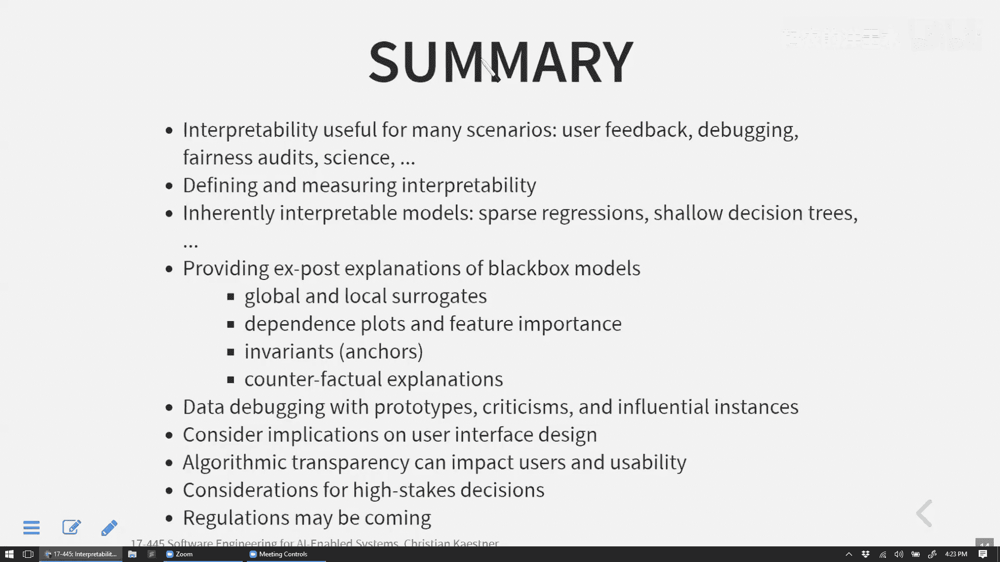

# 【全集】卡内基梅隆大学-AI驱动系统的软件工程-中英字幕-1080P-p18-Lecture-18---可解释性与可解读性-part2--BV1JS6gBcEBF_p18-

系い。What did we talk about last time？As a hint， we're continuing to talk about the same thing today。

 so the slide is kind of giving it away。Anything you'll remember from the last lecture？li okay 诶。Vik。

 can you describe a little bit what you remember about Yes。

 we were looking into interpretability of our models like where is it actually working the way we think it's working and we saw Ly was one of the tools which works for image object detection Thanks and essentially we saw an example where we were trying to identify a whole。

 but it was identified on the basis of the snow on the sites rather than on the。

Facial characteristics of the。不子。Right so so Lyme is a locus surrogate model right so you learn an interpretable model around the neighborhood of a certain prediction and this way you can identify in this neighborhood which features are influential to come to that specific decision。

Diel writes about that we talked about explaining black box middle black spot。

Black box models was just building interpreted models in the first place right so we developed a little bit about this conflict of having something that's inherently interpretable was something that's black box that we explain after the fact we talked about a few models that we can probably understand fairly easily like shallow decision trees and sparse linear models right some rural mining techniques might also create things that are fairly easily to understand and then there are lots of techniques that we。

Discussed for kind of understanding black box models。

What kind of techniques do you remember beyond Lyme？I want to continue there。 So。

 I kind of w to build up on this。 So let's just get through， go through them。So。

We talked about or we started to talk about some of these explanation techniques。

 sharply whereius was one of them right， so we started with global surrogates。

Where you essentially take a model， you pick a random sample。

 ask for the predictions and based on those predictions。

 you learn a new model and for the new model you use something that's inherently interpretable。

So it's a surrogate for the original model may more or less well predict the outcome over the entire space。

 but it's does so in an interpretable form lime in contrast with local surroates where you learn a model a surrogate model but focus around a certain decision boundary you can use this for all kinds of things we talked about a bunch of examples here。

嗯。We talked about sharply values as much more math heavy and probably more rigorous form of this。

 figuring out which features contribute to a decision， which is very computationally heavy。Jake。

 do you remember how partial dependence plot work？嗯。Yeah， basically you。

Change a single variable and then you see how everything else changes in response to that。

Right and you do this for a bunch of different values and average this。

 where we also had these plots where you do this for multiple values and you can potentially see if they're all in paralleled and behave the same。

 that's what you would expect in a linear model and if you actually see that they're not all in parallel then you may have some interactions with other effects and you could explore those further。

And then the last one was feature importance。Does somebody remember this？I mean。

 it says to on the slides right so this was this example here。

 you permmeate a single feature and see how much you're suffering in prediction accuracy。

 essentially。And you're doing this by essentially scrambling one feature so for example temperature here is you just across the entire validation data set you just shuffle all the data so that it's not in the right place but doing this you essentially assume this feature is meaningless it's just randomly distributed and then you lose precision or you use accuracy of the algorithm if the feature was important and if the feature was not important you would get almost the same predictions as before right so it's a easy way without relearning a model without actually touching the model just to explore which feature is influential。

哎。All right。We have a few more。The next one I want to talk about is invariance and anchors or invariance would be probably the software engineering term anchors is how it's called in the machine learning word。

 The idea here is to find。Partial conditions or rules that poet and that describe some of the behavior。

 for example， something like if the income is below a certain threshold， the loan is always rejected。

These roots don't say something about all other cases but they are sufficient conditions if the precondition holds or if the condition of this rule holds。

 we have an explanation for this part of the model so the idea is to essentially find a few factors that can explain some of the outcomes。

K kindd of like association rule mining or specification mining。 I tried to explain this。

 come back to this a while ago。 we've done this in software engineering。

 this is fairly well known Dacon for environment detection。Try to explain this before。

 but let me give you another example here here's an implementation of a stack and assume you just have a bunch of test cases for this stack you don't really know how this works necessarily。

And。You have handwritten test cases or you fuss this。So you can observe what happens。

And Dacon and a bunch of similar tools will try to find invariance。 So for example。

 what it does is it finds invariance that always hold it between method executions right so in object invaris。

 for example， it will see that the array。Thing is never known。So after the constructor call。

 it's not Nile before and after calling any of these methods， it's never Nile。

The way that Dacon does this， essentially it instruments the executions and it instruments all the values that it sees。

And then it has a bunch of roots that it can check over the traces so essentially。

Test is the object never now， This actually holds across the entire entire trace。

 So this is something that we can write here。 We could also check， is the array always。In a array。

 right so this is the next thing here， it's of a certain class。Thing it's an array of object。

This is also something that we see the type doesn't change we could also for numbers check is this equal to one always or is this always larger than zero。

 larger than one， larger than 10。So there's an infinite number of possible invaris。

And we can search for some that are plausible。 There are a couple of heuristics of how to find some。

 how to write these templates for invaris that we could look for。

 and then we essentially just test them across the trays。

 And so here you find a couple of potentially useful ones like the array is never Nile the array is always where this is what the type tellss us。

 but we can also detect this dynamically that's always an array of objects。

 The size of the stack is never smaller than -1。The size of the stack。

Is always smaller than the length of the array。So it also compares multiple variables。嗯。

It also searches for the most specific one， we could also find an invariant that the top of the stack or the size is always larger than minus5。

 minus6， minus7， right it just finds the one that is the most specific of multiple possible things。

And then there's a similar technique。 Well you can do the similar thing for method execution。

 So this talks about a certain exit。 So this is the return statement down here。

So at that specific statement。We know that the return value is always the top of the stack where we see this。

 but this we can observe this dynamically， we can also observe that at this point we only get to this point if the top of the stack is zero or larger right if there's at least a value on the stack otherwise we wouldn't have reached this point。

 we know that at this statement here we're never returning now。

There's another check somewhere that we don't put nodes into the array and we can observe this。

Does this roughly make sense？How you could have a trace， lots of observations。

 and then a bunch of rules that you're testing and you just check whether this holds。Anchs are very。

Conceptually similar idea for machine learning observations。 You try to find certain kind of rules。

That enable or that guarantees certain outcomes。And again， this is a probabilistic view。

 you find rules that hold 99% of the time or that hold in your sample set right so you sample a bunch of observations similar as in the testing case。

 we don't know all executions but we have a bunch of test cases and see their traces so we could see。

 for example， if the FICO score in the lending example is smaller than a certain threshold all the observations that we have seen in the model always reject the loan right so this is a partial explanation。

And。If we reject a loan and the FICO score smaller than this。

 this might be a plausible explanation that we can give to a customer。

 we can't tell you that the loan would have been accepted if the score was higher。

 but it was rejected because of this。Also， if you think back how we talked about interpretability or explainability。

 how we could measure this， one way of measuring this is seeing whether a human can make the same prediction as a model。

So these are root that a human can easily read and make predictions。

There are just a lot of cases for which we don't know what the prediction would be。

 but hopefully with a few roots in some cases we can actually cover a lot of possible。

Inputs right the most common cases might already be covered by a few root。

 and in a sense we are learning at least partially an interpretable model here。

But again it's a surrogate model right it's not the actual model that we're interpreting。

 there might be cases in there where a lower FICO score actually gets to a good loan。

 we just haven't seen this in our sample set。But that's roughly the idea。Does it make sense？

There's a paper attached to this thing I'm ci I'm citing it here and this describes there's a Pson implementation that you could play with。

 this is one of the better known explainability strategies that's quite different from the ones that we looked at before。

This is another example of how you could use this to test an NP model that predicts what kind of work you have。

 whether play a verb a noun in a certain sentence， and it does this by looking at other parts of speech tagging and it identifies some roots。

 even though this may have been learned by a deep neural network in the background that we don't understand。

Alright。There also， again， a lot of these things work on a lot of kind of different inputs。

 tabular data are easy to see， but here's an anchor that's sufficient。

To detect a certain breed of dog。And then you can see you can swap out parts of the picture。

As long as those parts are stable， you would still detect the same thing with high confidence。

So they usually play with this kind of with NP techniques with image recognition。

 not everything works equally like the partial dependence plot might be kind of hard for images right if you kind of say if you print the partial dependence of a single picture。

 but the number of these techniques actually，Skate quite well and they always have nice pictures in their papers。

 which is nice。Alright。So they only provide partial explanations。

 but they can be useful for debugging and。For providing explanations， so those are quite nice。

There's another group of examples where we。Of explanations where we don't try to explain the model or the model around the prediction。

 but essentially just give explanations on individual examples。

 the typical thing that you might have seen before is counterfactual explanations。

 which essentially says。I know a different situation， the outcome would have changed。

So if X had not occurred， Y would have happened。Or why would not have happened is a typical form of a counterfactual explanation。

 right， it's this kind of what if question。嗯。And what's typically pretty nice as an explanation is if you can say if you had changed this and this other part。

 the outcome would have been different right so your loan application has been declined。

 but if you had slightly more in terms of savings， we would have accepted it。

This is actually a kind of explanation where you might actually do something about it。

 right it gives you some feedback of how you can improve， how you might actually get the loan。

Counterfactual explanations are famous for having this Russianmon effect that we talked about last time that they are usually many。

 many different explanations that could explain why you have like there are lots of what if scenarios where you would have gotten the loan。

Right。If your saving accounts had a bit more money。If you wouldn't have lived in this neighborhood。

If you wouldn't have lived in this country。Sometimes if you had more money and your last name would be different and this would be different and this would be different right？

The challenge here in explainability with counterfactuals is typically finding the best explanations。

 and that might be the shortest or the most actionable。There are a couple of。

There are a couple of examples， what was it？系y。嗯。得。Happless。No here。

 there a couple of cases where you can do something about some features。

 but you can't do something about other features。It's a。

Probably changing your gender to get a loan is quite a drastic step。🤢。

That's probably not something that you're going to undertake just to get a loan。

But getting a little bit more money in your bank account is something that we can change。

So typically， if you think about kind of the world of features。

 there are some things that you might want to use more for explanations than others because it's easier to change or influence for a user of your system。

Especially if you want to nudge them in a certain direction。Does it make sense？

So there's a lot of kind of scoring that goes on in kind of counterfactuals。

 let's maybe talk about how would you search for counterfactuals？So you have a black box model。

And your loan was denied right so you have a certain data point， you have your characteristics。

 your age， your income， your gender and so on， how would you approach this to search for counterffes？

They're more sophisticated and simpler strategies。Could we use that strategy that I've completely blanked on the name。

 but where you sort of change one value and see？What。Changes as a result。

What that called me open sensitive， yeah。You could try this so you can try you can essentially sample in the neighborhood and one first thing would be to try every feature once right so flip every feature or try for continuous features try plus 10% minus 10% plus 20% minus 20% right so that' that's a pretty simple search you probably don't want to search too far away you don't want to search on things where you need to change things that the customer can't easily change but that's a kind of a fairly simple search strategy kind of randomly search in the neighborhood you can also search for combinations right kind of。

Which two things can I change together that change the outcome。

 this increases the search base at some point， but if predictions are cheap enough。

 you can run this for quite a bit。There are a couple of models that just don't just give you a yes。

 no answer， but they give you a numeric output like 70%。

 71% and so on and then you have a threshold right so the score needs to be over 80% to approve the loan。

If you do this， you can usually use the gradient of the model。

 you can kind of search in the neighborhood， am I going in the right direction essentially？

so you maybe have seen this as hill climbing as a kind of simple search strategy where you change every feature and you see if I improve the income a little bit then I'm getting closer to being approved right it's not approved yet but it's getting closer whereas when I'm decreasing the income I'm getting further away from being approved。

 so that way I can think， oh this one direction is possibly promising。That's a kind of searching。

With hill climbing or similar strategy， what might find you a local optimum。

 there are better search strategies， something。Written this year。

Does somebody know how this algorithm works？Has somebody seen this in the machine learning class？

No I also haven't， but my interpretation is is a more sophisticated version of hair climbing where you kind of use three points at the same time and you determine the gradient in which direction do you need to go and then kind of slowly improved toward a direction it's one of the standard optimization approaches if you have a gradient of a model。

If you actually with you approximate the gradient right so you don't actually need access to the model。

 you just sample three points and you see which directions is getting better and then you search further in this direction。

In some cases you may have actually access to the model parameters like the weights of a linear model of a neural network and then there specific strategies to search there adversary attacks work this way we talk about this next week where you essentially use information that you have about the model to figure outs what's the closest way to get to the prediction that you want This is actually fairly similar to how training of deep neural networks works in the first place where you put in some data you figure out it's the wrong response and then you figure out which parameters do you need to change to get to the right response a little bit but instead you're using this information to know which inputs do I need to change a little bit to get to the right response and you can search this way along the gradient So there are a couple of these techniques for this class it doesn't matter really but there are a couple of techniques that you can。

Used to search for this you typically want to search in the neighborhood there are a couple of techniques again I don't know how they're really working in detail but where you can incorporate the distance into the search that you're trying to find the closest point so you apply a penalty for getting further away from the thing that you're using so it it's a strategy to find a close input that flips the outcome。

You can use the same thing for attacking a model， potentially。

And are a couple there are many of these techniques actually they come readily implemented。

 I think for most models or most techniques so you can find a technique for this。

 but you can think of just as an intuitive model， random search in the neighborhood would probably give you a couple of counterfacts as well。

Right， so。They're easy to interpret counterfurs are how humans tend to explain things that's a very natural way for us to think about this we don't need access to the model of the data if we do have access to the model the search might be a little bit faster。

 but we need to start thinking about how we rank and select alternative explanations typically shorter ones are better and typically ones that we can do something about are better。

Right。Any questions about kind of counterfactual explanations？So this is something。Don't remember。

 somebody brought this up last week。 Maybe Jake， how about security。Yeah， right， so if we have。

If we give explanations of how you can get you loan and isn't this encouraging people to cheat？

If we explain to you or your face ID on your phone， we couldn't unlock your phone。

 it's because this part of the picture doesn't seem to look right right it tells you which part of the picture it uses and which part it doesn't use。

Doesn't this make it easier for you to attack this and kind of figure out how to get into somebody's phone？

So I would compare it with cryptography because there are a lot of cryptography algorithms that are open source too and they're open to the public to you know exploit for any purpose and some of the best cryptography algorithms they haven't been broken despite that。

 so I would say philosophically， you know if these models are working as intended and they're incorporating the right parameters。

 then it would be okay， for people to be gaming it because it would be reflecting desirable outcomes to get it。

So this is a very common argument or counter argument that you actually。

Making the algorithm and how it works transparent。May help people to make better decisions， right。

 So if a loan application actually。Uses the features that actually correspond。

If you actually had causation， right， more money in your bank account makes it more likely that you return the loan。

Then actually， it's a good thing to encourage you to get more money into the bank account。

RightIf what you're using for learning are cheap proxy features because you don't have anything better。

And those cheap proxy features are easy to game。Then you may have a problem。

Give an example for one of these things。Where you might use a cheap proxy feature and that makes it easy to game。

This might be a little simplistic， but I think there's a proverb from India where they were trying to cut down on the rat population。

So they were paying for the number of rat tails that people would bring in。

And then what they discovered is that people would actually breed rats and then sell the tails as a result。

So maybe not machine learning， but it's still kind of an algorithm。

That was lots of examples of incentives going wrong。So I have auto grading here。

 so you could think of a system that automatically grades essays。And it does so by counting how many。

Uncommon terms you use kind of that make you sound sophisticated or something like this I've heard that the GE。

 for example， weighs heavily on using certain certain styles of writing right and then the way that you。

Getting a better grade that you're learning for the test。Is essentially using certain words。

 using certain phrases。That may or may not correlate to having a better essay。

And especially if the feature doesn't really understand what's written here。

It just counts how often you using certain words， technical terms or even just connectives like therefore and then or something like this。

 you get people who get perfect grades on completely wrappy essays just because they game the system。

So Jake other Jake is right here right so in some cases we want to people to game the system in a sense if what gaming means is actually improving the right things right if our system actually measures better writing in a reasonable way and we can tell people how they can improve their writing。

Then it actually helps， right， because people will actually practice the right thing and we will measure the right thing。

But dont if we only have proxy metrics。Then it may become easy to cheat There's actually a nice analogy I want to talk about there's this movie teaching。

 teaching and understanding understanding that's used for kind of education how do you design assignments and classes and things like this how do you teach students tend to learn to the test So whatever you tell students that you're expecting that you're grading for is that what they will optimize for so this entire。

The lecture here talks about how。How you should how you should assign。

How you should align the teacher's intentions with the requirements in the exam so that the student。

Kind of has to do what you want them to do。嗯。I'm not saying that I'm doing this perfectly。

 but maybe if you look at the assignments that I'm giving you。I want you to do a certain thing。

And I'm fairly explicit about what I want you to do and what I don't care about， right？By doing this。

 I kind of try to say。Engage with the following things， think through the following problem。

 I don't care about where you arrive at， but I care about that you've thought about this right that's my intention。

 for example， I'm not trying to guess I'm not trying to make you guess what answer do I have in mind or something like this。

嗯。So this is a very common design strategy by being very explicit， you can kind of game the test。

 but by gaming the test you optimize for what I actually want you to do。

Right which is exactly what Jake wrote here in the chat， right if you designed this in the right way。

 the loan applications。The person preparing for a loan application will do exactly what you want them to do。

So explanations will actually help to provide the right behavior。

I think better design or better explanations of what I expect in a homework assignment。

We guide you more directly to do what I actually want you to do。

 right rather than trying to guess and optimizing for all kinds of other things。Again。

 it doesn't work on everything， right， It requires that I have a way。Of measuring。

What I want you to do。RightAnd there are a couple of weird proxy metrics， so for example。

 if I want you to think through a problem。Let's say for the next assignment that I'm releasing tonight is about fairness。

 I want you to think about different forms of bias， right？嗯。

I'm going to give you an assignment where say write something about this and comment on every of these five biases by doing this。

 you have to engage with this， but I can't really measure。

I don't want to measure whether I agree with your notion。

 I only want to see that it's reasonable right so there are certain certain ways where I can't measure the perfect outcome。

So you could potentially game it by just writing something that's remotely reasonable。

 but in a way by doing this youre already engaged with the system you thought about this right so there's only so far that you can game it。

啱。I think there's certain kinds of examples where this is more obvious。Than others， right。

 so the loan applications。If we have good features， which hopefully we do。嗯。

This we want to encourage hacking this。Reidivism potentially as well， right， So this is。

This example down here。These are features that you。AYou can't really game them。

Or you can game them in a positive way。RightThe number of offenses you can to some degree game and you game them in a direction that we think is better for society right so this is not this is either designed on features that you can't change or on features that you can change to encourage better behavior。

嗯。There are cases where it's less obvious。Not sure what you would。嗯。W you would。

Game cancer diagnosis。So maybe there's not much of an incentive， but spm detection， I think。

 is probably a case where you might not want to be super transparent about what exactly you're using because you have people who have a high incentive game that thing and your metrics。

 whether something is spm or not is。It's not that easily measurable on the outside。

Doesn't make sense？Also think the face ID example， kind of image recognition or face recognition to unlock a phone is maybe also not the best case where you want to provide incremental explanations to somebody of how to change this right ideally again。

 face ID depends on things that you can't change。But you kind of can。

 that's not perfect features right so there's kind of this tension of。

Can you game or attack the model。We will talk more about attacks text later。

 and can you design the system in a way that actually being transparent。

 providing explanations to the end users actually fosters the right behavior。

healthth insurance another good example， do you have an example where you might not want to share the model because gaming is it might be too expensive or too dangerous？

Spend detection， face ID。I don't have another one。 There's probably a bunch。

Typically the argument is kind of an high stake situation， kind of loan applications。

 job applications and so on， you shouldn't use features that are so opaque or easily gameable anyway that actually making the working of the algorithm and transparent forces you to adopt better features or forces you not to use crappy features in the first place right so it could be。

嗯 could be。A forcing function。 This also is very closely related， I think， to security by obscurity。

 this argument， right， So a lot this is Jake started talking about encryption before。

 right so some companies don't want to release their encryption code because then it might be more likely that they're attacked。

But the counter argument is a bit better encryption that can't be attacked even if it's public knowledge of how this works。

嗯。There's probably marginal some value in security by obscurity。

 there are certain things that are definitely harder to attack if you don't know how it works right。

 but I don't know in the long run somebody figured out anyway how it can be attacked and you might have designed something better in the first place。

 if you hadn't assumed kind of the security by obscurity argument。All right。

runningning already a little bit behind， let's see。

Have two more techniques prototypes and criticisms are the idea。

This is a very different approach now now we are looking into data so this is looking for training data that's kind of representative or that's outlier so that we can debug kind of training data。

So let's say a very simple example here of。Training data along to access。

What's kind of very representative data in this example？

So if you just want to give me a few examples of typical data。

 let's say this is all data of one class of one that leads to one specific prediction or training data for one specific class。

We would probably say like this is kind of common， right， so maybe the middle point of this cluster。

Would be representative of these concepts here。Then we have a bunch of concepts over here。

 and maybe this data point is representative of this kind of concepts， right， and then we have。

Some sort of cluster here， maybe this is a representative points， these are called prototypes。

 so these are in this kind of research these are data points that represent typical examples of your class。

As the classifier ceases this。And then there are certain data points that also belong to your class。

 but are kind of unusual。 Maybe these are somewhat outliers or this one。

 right so they are kind of further away。So a couple of techniques to do this automatically。

 like K means would already cluster your data and you could find the center of each cluster right so this is an easy way of thinking about prototypes and criticisms。

 the outliers， there are different strategies， I don't want to go into how it works。

 but they are algorithms to essentially find outliers in your training data。And again。

 this looks kind of stupid in this example， but there are again many pretty pictures。

 so this is an example of training a classifier to detect dog breeds。So you find prototypes。

 very typical pictures for each of these breeds and then criticisms。

 these are pictures that are labeled by the same breed。

 but are kind of far away from how to classify us thinking about this。

So it's kind of a useful way to debug your training data or to think about is this training data actually correctly labeled。

 probably should we get more training data that looks like this because it's an outlier right now。

 maybe we need more of this， things like this。Makes sense。Here's another example。

Dit recognition is kind of the hello word example of a lot of kind of image classifiers， right。

 deep neural networks， so these are。Typical ways to write certain numbers。These are kind of outliers。

Where we don't know a lot of other training data that looks like it。

It doesn't mean that these criticisms really influence the modern much。

Doesn't even mean that we have。Kind of wrong predictions for those。 It's just。Atyical training data。

 right， So we have a lot of things that look like this。

 but we don't have a lot of things that look like this， for example。Again。

 there are tools for this and you can implement this and play with this。

 especially prototypes are really easy to catch criticisms， there specific algorithms for this。Yeah。

Typically you need to know how many classes you're looking for， how many prototypes。

 but in general that's fairly easy to implement。And the last one that I want to talk about is this idea of influential instances。

 so this is another way。There's another way of data debugging Webek。

 you have a question first yeah on the prototypes and criticism。Essentially， if we know these things。

 what what can we do， like is it like we need to add in more data for criticisms？

So maybe you detect that the criticism is actually mislabeled， you could fix the labels。

 you might recognize this is actually a common case。

 maybe we should get more training data in this area。Yeah， I think things like this typically。

Or just see what are the kind of things？There are kind of outliers， yeah。

But I think data augmentation or fixing labels are probably the most common strategies to fix things。

So influential instances are kind of similar， but also kind of different because now we're looking at the model actually。

The idea behind influential instances is that we want to know which data points in our training data influence the model training most its again fairly easy to show visually。

Here's a bunch of points and we're creating just a regression line， a regression model。

 and here's an influential data point over here。If we leave out this one data point。

 we change from the orange line to the blue line， so the single point changes the gradient quite significantly。

 whereas if we have left out this point， it probably wouldn't have changed the gradient much。

So the idea is essentially retrain the model over and over again and leave one data point out at a time。

It's the only technique that I've talked about where we actually need to retrain the model as far as I know。

 the surrog guts we're training models， but not the original models right so here we're retraining a model over and over again and we see whether leaving out a data point affects the accuracy of the model。

Disproportionately or the coefficients of the model， you can look at this in different ways。

How could we use this information that certain data points are influential， or this is useful for？

Okay can next。Data cleaning， potentially， maybe it's an outlier， maybe it's wrong data。

 There are actually a bunch of different things that you can do。You can figure out what。

I think the data cleaning part is probably the most obvious thing。

 so this is what Daniela talked about here is。Not every label comes with the same quality。

 if there's labeled data that's particularly influential， maybe we should double check those labels。

 right make sure that they're actually correct。嗯。Vik， what do you have in mind with drift？I mean。

It was data between when we are training the model and then during inferences。

 so maybe in the life environment and production environment we are getting different types of data altogether。

Yes， but we wouldn't compare directly how this looks so you could look whether the data is a criticism kind of or for its into it's kind of dissimilar to the to the training data this is not an explainability section one thing that you could do though is。

You can see is there training data that if we had left that training data out we would have better generalized to production data right so is there certain training data that's fairly biased to the kind of artificial setting where we are coming from that's not representative of the newer so what you're doing here is you're essentially trying to figure out what data points skew the training data in a way that the model works less well on new production data。

And you can find。I've seen examples of where this has been used in cancer prediction models in one hospital that worked poorly on another hospital and they figured out that the population were different so they had very few kind of elderly patients in one hospital but more in the other so if they took out some of the elderly patients that had large influences on the model and it was behaving differently there's a nice。

Nice way to think about this also to figure out what influences。

Or what what makes those influential instances special that might help you with data debugging This is kind of counter intuitivetuitive。

 If you need to think about around two corners here。 So the idea is。

You have a bunch of you try a bunch of instances and essentially try to leave them out so for each。

For each of your data point， you try to see what happens if you leave it out and you might see this has a tiny reduction or a large reduction in kind of accuracy。

 this has a tiny reduction in accuracy。And so on， so you kind of do this for every data point。

 you see what's a reduction in accuracy。And now you build a new model that tries to predict this one here。

This is a why and it predicts this in terms of your data points。

 so it tries to predict based on all my training data。Which instances are influential？

And then you can plot this， you use an interpretable model。And you can see， oh。

 the thing that most influences the accuracy of my data is。嗯。Is data of a certain population group。

 for example， if ages。嗯。So if we have old patients in the cancer prediction example。

 if we leave out those patients。We influence the accuracy of the model， most。

This is typically a sign for that these are very influential data points。

 typically because you don't have a lot of them。You don't have a lot of older cancer patients。

 so taking out the few that you have。Influences the model quite a bit。Does this make sense？

It's kind of counterintuitive around two corners， right so you're kind of trying to predict。

What makes。Which of my data points is influential？But you're looking at every one of them and then you try to explain which features makes a data point influential。

 the typical case is find features that have a strong influence but little support in the data。嗯。

This is kind of similar。Which features have a strong influence in my original model？

But cause a lot of generalization error if I try it on a different population。

And this is a very different use case， it's just which data points have a lot of influence。

 so I should double check them whether they're actually labeled correctly。嗯。

The problem with this approach， the key problem is that you need to retrain the model。

Right so for every data point that you're taking out， you need to retrain the entire model。

 which can be very expensive， especially if you try to use deep neural networks。

 this is probably not a technique that you want to use right if you have 10000。Data points。

 you don't want to spend an hour training the model for each。嗯。

This can be good enough for some really cheap to train models where you just do this。

 run this overnight， you get a report and you use it for debugging and for certain classes of models。

 people have found ways of identifying the influence of a feature point without retraining。

I don't know how this works for linear regression or logistic regression this works。

 I can tell you the feature influence like how much would this model have changed if I didn't have if I wouldn't have seen this data point without recomputing this so there are couple there's research on kind of making this faster for certain kind of models。

嗯。But otherwise this is a main limitation， otherwise this seems fairly useful as a data debugging tool。

Alright。So those are all the techniques that I wanted to show you。

 I'm not sure I do want to do the exercise right now， I wanted originally you to go through。

All the techniques that we've talked about using inherently interpretable models， global surrogates。

 local surrogates， limeme， partial dependence plots， feature influence。

Adversarary or counterfactual examples， prototypes， influential instances。

 right and kind of to think about in some of examples which would be useful or not。

I'm trying to do this at the end， I hope we have enough time。But I want to cover some other material。

 right？so。There are a couple of things this is not about techniques。

 but more about how to use those techniques and you've already this was in today's reading right kind of。

Providing explanations。As part of the user interface design can raise trust in your system。

 right black a user might not trust the black box prediction。Especially if it's uncertain。

 but the model might actually be。Explicit about why it thinks it's uncertain or why it thinks it makes a better prediction and that might lead people to trusting the app more right so the example from the reading was to say why it thinks there's a certain problem or why it's not certain。

 for example， it doesn't know anything about streetlight data at night so it can't make a confident prediction here。

Well， here's an example for kind of recovery workouts after injury。So the。

If it just says be careful or this is a workout that I recommend instead of just saying we have adjusted this for your recovery saying。

How we think this is useful for you might actually increase trust。Right。

So this was not part of the reading but out of the work book of the reading。

And I think this is useful to think about there different scenarios that AI could be more or less confident。

And the impact could be higher or lower。And based on this。

 we might want to make different kinds of explanations。Can you give me one example for each of these。

So let's start with this one， a low impact， high confidence。

What's a situation where we may not need an explanation because we are confident and we have a low impact on users？

Dires， maybe。Driving directions， yeah yeah。Estimated delivery time for Gr up。

I think if they are wrong， it's not too important and we're probably fairly high。

The recommended system， low impacts。I'm not sure about our confidence there。不清。

Would this fit for a recommender system， low confidence and。Low impact。

I think it might actually be potentially a good idea to say， we're recommending this movie。

Because we don't know much about you， this is a popular movie or something like this。

But it's maybe low enough impact that it doesn't matter either way。

 but we could show uncertainty and we could actually help users to give us more feedback。

 say we're not confident about their explanations because we haven't seen enough recommendations。

 would you like to rate a few movies right so you could do something like this。So。

What's an example of high user impact and high confidence？Could it be weather warnings？😔。

We are fairly confident about the weather。Sure I'm not yeah。

 I don't know how I would explain weather prediction but。Yeah。

 so I was thinking not in terms of like whether it's going to rain or not。

 probably that is also important， but storm warnings and things like that are。

More concerned for humans。 Yeah， I don't think， I don't think this is what people are doing right now。

 right， So there's kind of。There's a tornado watch because there's a high pressure system approaching something like this。

Maybe， but I don't think we have a good sense of why our model is predicting this most of the time。

Are there examples？Is this easier？Low confidence but high impact。Stock prediction。

 disinformation detection。Obstacle avoidance。Not sure that we have enough time and obstacle avoidance。

嗯。Nathan， do you want to expand on disinformation detections？Well， I would have。I would guess that。

A system。Can it's hard to verify facts like actual facts。

 and I think that because it's hard to do that。If that spreading of that information would have a high impact on on。

On users who are absorbing that content。So you're thinking about kind of blocking messages on Facebook Twitter？

Yeah， essentially or like。Having some sort of identifier that this tweet could be misleading or the closest is misleading。

Yeah， I think in this case， it makes a lot of sense to explain why we think it could be misleading。

 why we delete this has a high impact and we may or may not be very certain。

If we're not very certain， we might want to give a more complete explanation。嗯。Insurance。

 so I think a lot of these high stakes decisions that we typically call talk about credit rating or credit insurance。

 hiring， recidivism。So these are all cases where we kind of push for an explanation because it has a high impact。

And。If we are certain we might explain why we make a certain decision。

 if we are uncertain we might also explain that we don't have enough information to make a confident decision。

So we might need more information from you。Again， I don't have a concrete viewpoint here。

 but I think this is useful to think about from a user interface design perspective。嗯。

a couple of smaller side notes also there's a discussion about how much should you actually let the people know that there's a machine learning system in the loop there a couple of dark design patterns or how you can hide machine learnings in the background there's actually has little to do with this。

 but until recently。This is booking。com， they have a bunch of weird kind of patterns to pressure you to buy things。

 they have a rating algorithm where you just on six gates。

Vote with Sies how good something was and they compute an average of those。

The lowest rating you can ever get is 2。5。The rating is 2。557。510 and it's just averaged over them。

 but the user doesn't know that they can't give a one star rating。

 kind of it artificially inflates all the ratings to a higher value。And when users learn about this。

 they usually get quite frustrated。They're pretty unhappy with bookingcom booking。

com actually changed this thing now you have a one to 10 scale where you can just rate things。

But the point here is that actually hiding the existence of a system may not always be beneficial to users right so certain level of transparency saying that there's an algorithm that makes decisions is actually useful。

 more machine learning example， by the way， this is both from。Mta Hari。

 who will start in HCI as a faculty member next semester。She has done a case study on Facebook。

Facebook is automatically with machine learning curating your feed right so Facebook decides what you can see。

 what you cant see and Facebook is not transparent about that there is an algorithm。

People may or may not know this， and they don't really show you why they are showing certain things or that they're hiding certain things。

So she has done a study where she went out to show people there。

Kind of original Facebook feed before curation right so there are a couple of so the blue things are things that Facebook shows and the white things are things that are not shown。

嗯。I don't know exactly how Facebook works， but in general they kind of try to optimize showing you things that they think you might click on right or you might engage with。

 I think they favor pictures and things like this。And she has actually done this with a bunch of study people。

 this is a couple of years ago， but 62% of the interviewees were not aware that there was any algorithm behind it。

And actually， the reaction to learning about this was surprise and anger when they learned about the curation。

There were a couple of participants who were really upset that。They didn't know。

They just thought certain people would no longer talk to them essentially。

 the title here says I always assumed that I wasn't really that close to her， but in fact。

 it was actually in the feed just Facebook was filtering it。

 This is something that people didn't like。However， once you taught them about it。

And they did a follow up。It did not change the satisfaction level。

 they were actually okay with the filtering by Facebook as long as they knew about it。

 as long as they kind of had a vague understanding of how the algorithm worked and that they could look at things that were not shown。

 right giving them the power to overrule us essentially。

And it led to more active engagement and a feeling of more control。

Which I think is an interesting way to think about this right so we want to kind of often make AI seamless in the background。

But actually being transparent about that there's a machine learning algorithm that we make some selection that we do some automation and it may not be perfect。

 but it has a certain goal is something that in a lot of settings users actually appreciate。めつ。

Here's another example of somebody complaining on Twitter that they have a hard time hiring somebody。

And then they figured out they only get very few resumes kind of from HR。

 seems like very few people are applying and the people that are applying seem all not great。

And they figured out that HR was using an algorithm in the background。

 it was actually asking people to take a personality test or some sort of test。

And they were filtering out all people that HR thought were failing this test as being not social enough or something like this。

 you can click on the tweet and read the thing right but again there was a。Algorithm in there。

That we didn't trust， that this person didn't know about。That caused a lot of problems， right。

 in this case， actually， I think learning about the algorithm didn't make her happier。This is。

But this not knowing that then is an algorithm kind of took away power to overrule it right to understand it。

 so even just knowing that an algorithm exists in a system as a form of explanation， explain people。

 what is done automatically， how it's done automatically and think about this as part of the user interface design。

How do you provide explanation， how do you show that there's an algorithm involved can actually be very useful？

There's a certain question and this is again kind of like the gaming question of how transparent should we be。

 can we hide algorithms in the background？If we make all our algorithms transparent。

 are we releasing trade secrets？Doesn't make sure we need to be fair。

So I think there are lots of design questions here with lots of non obvious decisions。

I'm not a user interface expert， but I think that and this the community starts paying attention to this。

 some people who start researching this， the reading for today comes from this Google group that starts exploring this and writing about this right and providing trainings for this。

I think this is worth exploring。And then the last block I have two really。

 but they are connected I want to talk about is this whole idea of the reading or the podcast that you listened to last week。

 stop explaining black box machine learning models for Hissts decisions and use interpretable models instead。

 which is actually literally the title of this paper right the argument is typically that there's a tradeoff between accuracy and explainability。

Right， so for fairness， we talked about this before， if you do。If you enforce fairness properties。

 you typically restrict the degrees of freedom， you put constraints on the model。

And do the perfect predictions that would increase accuracy as from the view of the model。

 right so typically there's a trade off between fairness and accuracy。

There's a question and it's often assumed that there's also a tradeoff between accuracy and interpretability of models。

That's why we need to post explanations or postdoc explanations because we better use the most accurate models and then they' are not understandable then we can use them after the fact。

What do you remember as arguments against this kind of view？

This was discussed both on the podcast and the reading。First of all， Cnia Ruin。

 the author here argues that this is a false conflict。

 so that in most examples that she has seen and tried。

 essentially always they came up with an inherently interpretable model。

That has very similar accuracy。It typically requires more effort in terms of feature engineering right so you can't just use deep neural networks and dump everything in and hope that it kind of works。

 you kind of need to think about features。She has some examples about features and more kind of image recognition systems right where you need to engineer more complicated things。

 but you also get benefits of that because you actually understand what the model does so the first explanation the first thing she postulates is essentially that most of the time this is not。

And actually。Conflict。What the conflict is actually there that to make it interpretable in the first place requires more effort。

But it doesn't sacrifice accuracy。Especially for the kind of high stake situations like loan applications and so on where you typically have moretabular data。

 you don't have the images so much， but even for more complicated scenarios。

Then she argues that or postdoc explanations。Don't necessarily are truthful or faithful to the original model。

 right we talked about this in a bunch of examples， especially with global and local surrogates。

 we learned something that approximates the original model and we give an explanation and we can check that for that specific counterfual。

 we actually would get the other outcome。But it's not necessarily a truthful explanation of the model。

 whereas if that's our recidivism model。That's all there is right so she gives this example。

 this is where I took this example that I've shown you so many times in contrast to a proprietary model she argues that also the proprietary model is probably fairly simple。

 just proprietary and hidden for kind of intellectual property reasons but that this model is probably simple enough。

And every explanation that we're giving here is actually truthful to the model， right。

 we're not explaining something that somebody interprets and then there's this nuance in the model and it picks up on something else we can actually audit this。

 We can understand this fully。嗯。So here's our argument essentially。

 it's a myth that there's necessarily a trade off between accuracy and interpretability if you have meaningful features。

The explainable muscle methods， kind of post hooc explanations are not always faithful。嗯。

And because of this， they also don't always make sense。

 they don't always provide enough detail to understand this。

 right to kind of always chasing behind the original models。

And because you're not understanding what happens， you have a problem。

Taking context into consideration because you might just assume the model already does a certain thing。

Even though it doesn't， so her example is with recidivism。This model here。

 the model doesn't talk about the severity of the crime。

The judge is supposed to incorporate the severity in the sentencing decision。

 right it just predicts whether somebody will recommit any other crime。

But if you assume this is just a black box and you don't know how it works。

 you might not know that it doesn't use severity you're supposed to use the context。

 whereas if you actually see the model， you understand it much better and you know how to combine us with external informations。

And then it just kind of makes things complicated and leads to human error。

So my sense is that this is not a mainstream position right now in the community。

 but I think this is a very vocal person and a very important kind of viewpoint of this and I think if we can push for interpretable models and they work with similar accuracy。

 we probably have a lot of benefits rather than trying to explain something after the fact。

So if you have any task where you can use a simple model and the decision matters in some form。

 maybe movie prediction doesn't matter too much right。

 but if you have something where the predictions actually matter。

 I would recommend try interpretable model， simple model， sparse linear model。

 decision trees first that you can actually look at what the model is actually picking up on。

rather than investing in all the heavy kind of explainability towards after the fact。嗯。Right。

The drawbacks are usually that you need to invest more into feature engineering。

But that's only a drawback to some degree because you also learn something about that you actually understand the problem as a typical argument。

And a lot of these techniques that actually produce sparse linear models and so on are computationally more expensive。

嗯。She talks about in both places around this propublica article and the controversy around this。

 do you remember this？Do you remember what the argument was？What the controversy was。

Is the model actually biased or not？I think it was saying that race and age were highly correlated。

 so theublica thing was picking up that race was correlated with the predictions。

 but it wasn't picking up that age was also correlated with race and that might be what they were actually using for their predictions。

So the original article said that the model is heavily biased towards race。

RightAnd her research shows that。The bias might be explained by other correlations in the model so that potentially the statistical analysis in the republica study wasn't controlled enough。

Independent of what's true here， the problem that this points out is that we have a very hard time to figure out what's really true because we don't know the model。

So we're only learning surrogate models and we're analyzing those。

And different surrogate models may have different properties。

maybe better or worse models right so if you create a surrogate model that doesn't control for the correlation between race and age。

 you might not see this right and the resulting model might actually be biased。

The original model might not， right so this is another case that in high stake situations we should actually have access to those models in the。

Vibek， here has a question？I had a question around the black box models so isn't one of the reasons why we go for black box models is we really do not understand how features are going to work or there are just way too many large number of features I'm not really certain how we can do image analysis without black box models like neural networks。

Me neither， she claims there are ways when you would require way more feature engineering or you kind of go back between black box and then you try to understand it and then you build an interpretive model。

嗯。Her argument is mostly that。Most of the time， a model where you actually understand the features are better and that you don't need all of those crazy interactions and nonlinear effects in most cases。

嗯。I think whether this actually holds broadly is an empirical question。

Yeah I' confused confused like because there are ways from black box to try to understand what they do。

 they may not be significantly perfect but like going through feature engineering and trying with all of the features may also be problematic in terms of like time spent。

 effort spent and things definitely I think there's a way that you try to understand the black box model and then with an actual interpretable models based on some understanding that you get in the podcast she talked a lot about the importance of actually exploratory data analysis。

 understanding your data， understanding features rather than just blindly modeling something。

Lly modeling something is certainly cheaper right and if that gets you half the way maybe in some cases that's better。

 but her argument is mostly about high stakes situations right so if it actually matters the outcome matters for society for buyers and so on。

 then we maybe should invest more effort then we should audit those things and then we should not rely on black box models。

Ex sense。That's the last part and I only have two minutes here。

there's a policy discussion here right so she makes a strong claim no black box model should be deployed where there exists an interpretable model with the same level of performance in any hight decision。

 so we're talking mostly about things with government involvement， recidivism， policing。

 city planning， about things with medicine and about things with high discrimination concerns。

 hiring， loaning loans housing so things that are already controlled and then maybe things that might influence entire societies and there you can think about things like polarizing。

 targeted advertisement and so on and you can think about as a policymaker where should you do out the line。

Right？There's a conflict here around regulation as a policymaker。

 you might actually want to mandate interpretability or certain understanding。

 certain fairness properties。But there's also intellectual property。

 right maybe you want to have a company make a profit of predicting recidivism。

If that's the model and you share the model， you can try to license it。

 but good luck making somebody pay tens of thousands of dollars a month for。Kind of three lines off。

If then adds right， this will be much harder to say there's a bit of a discussion there of how we should get the entire public to pay for some of these things instead of kind of the market。

There is a lot of discussion and I don't have time to go into this around how companies are picking up that there might be regulations coming and they kind of。

Start getting much more serious about this， so the typical framing is often around responsible AI these days。

 so Microsoft and Google and so on they have all kind of they start pushing on this。

 they invest a lot into research in this responsible AI。

There's a counterpoint argument that this is kind of a push to avoid regulation to kind of callop academia。

 kind of to change the narrative as' an intercept article that pushedes this view quite a bit。

 so whether we should push for safe regulation or government regulation。

 there's an ongoing discussion right now and it's different in different communities。The。

There's certainly a lot of attention on regulation these days。

 the US is taking it slow White House executive order that essentially says AI is important。

 we should have a leadership position hands off for regulation mostly。

 they have a rough guideline of how regulation should work and some people should look into this and this sets standards and so on。

 but it's mostly hands off California is trying to push a little bit further in some areas。

 some countries push it further， the European Union and the UK have certain guidelines。

 I think in the UK is just guidelines and the UA the EU。

 there are certain regulations in China there are also certain controls that look quite different again。

I think this is something coming。And explainability will have a key role there to understand safety issues。

 to understand fairness issues， to understand the right to explanations and so on。

So I have zero time for doing an exercise， do this， find another way to do this。

 maybe in a recitation。But what I want to talk about is different strategies toward explaining and debugging AI systems we talked about inherently interpretable models and then lots of techniques to provide exposed explanations。

 which I think are super useful for debugging and also then thinking about user interaction design and how you can explain those explanations。

 how transparent you should be， and then there's a lot of discussion around what should you do actually in highs stakes decision。

 what's a responsible thing to do， what's the ethical thing to do。

 and then should there be regulations around this。All right。Let me stop here and as usual。

 I stick around for questions。

