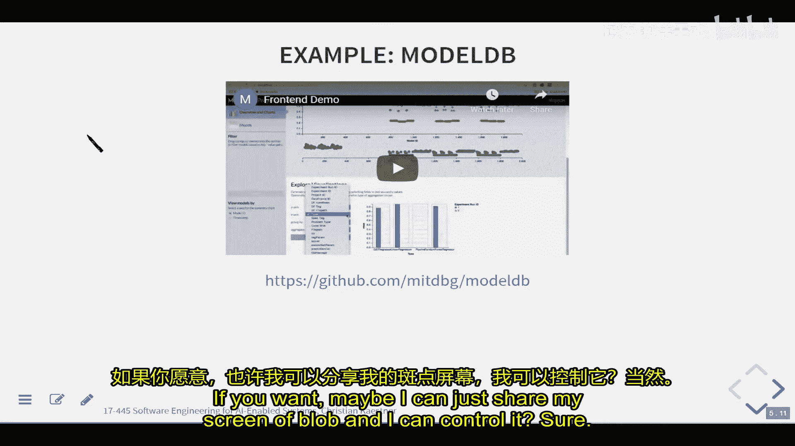
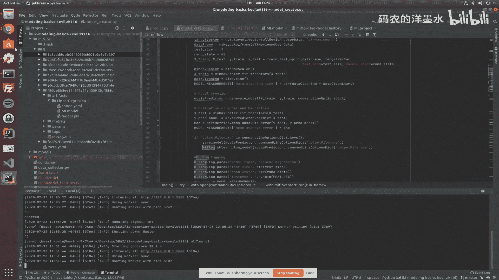
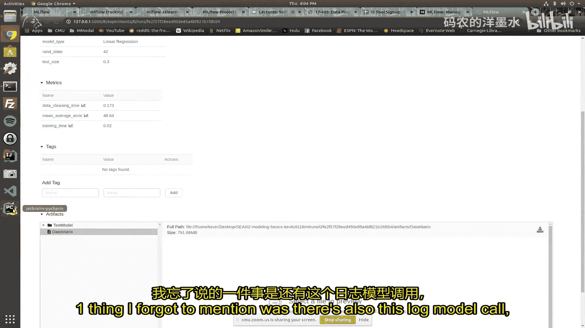
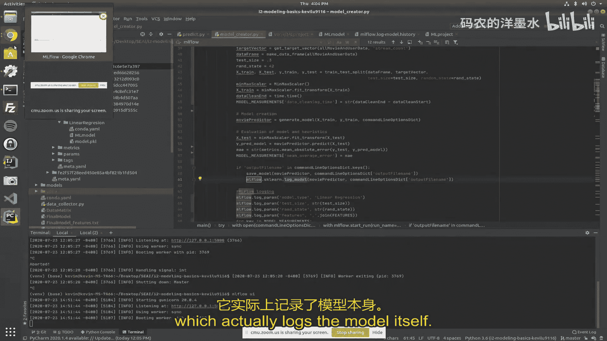
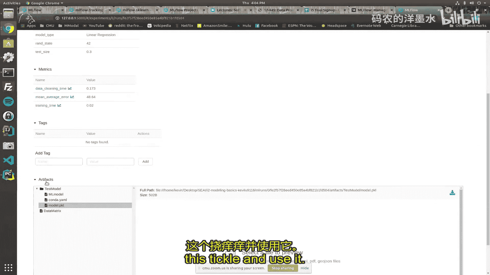
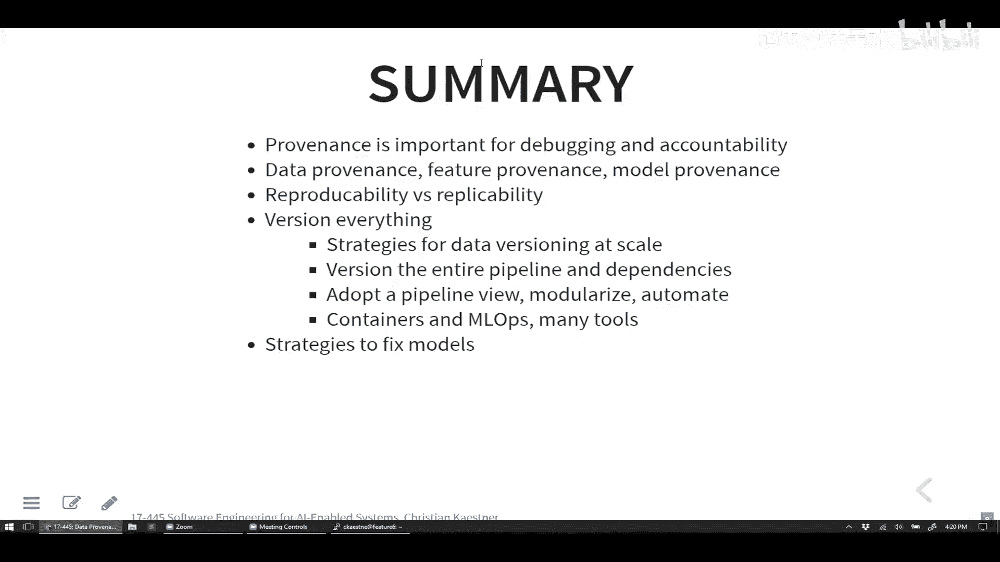

# 【全集】卡内基梅隆大学-AI驱动系统的软件工程-中英字幕-1080P-p19-Lecture-19---版本控制、溯源与可复现性--BV1JS6gBcEBF_p19-

So we' back and let's start as usual by talking about what you remember from the last lecture。

If anything。The discussion about black box versus not black box。 right。

 When should you use maybe not a black box model。Anything else？

Sort of explanations and user impact or user interactions that was very superficial， but yeah。

 consider how to present。Whether and how to present explanations to users， right。

 depends on how critical the task is， how。Confident we are。 looked at a few examples of those。

Anything else？Let's take one more。We talked about a few more techniques such as counterfactuals。

 prototypes， criticisms。Those kind of things and influential instances that can be used in all kinds of ways。

Yeah I want whether or not to trust the output。Today we're kind of staying in the overall theme of maybe debugging understanding a system and I want to talk about provenance and to some degree reproducibility。

 so let's take again an example， we talked about this before。

 kind of a very public media backlash after a way connectedn person on Twitter wrote about how he believes that the E Car is such discriminatory algorithm because they provided different credit ratings to him and his wife。

And then also a threat kind of following up on this of how he。

Spoke to representatives and tried to debug this， but the answer was essentially， yeah。

 it's just the algorithm， we can't do anything really。Right so。Again。

 there's a question here about understanding what happens。

 whether there's actually bias in the system， last week we talked about explanations。

 so if you look at a specific model and a specific outcome can we understand why the model made the prediction。

 maybe what data influence the model to be done this way。

 but there are a couple of more challenges in debugging this。

What you frequently have is kind of nontrivied pipelines this is just something that I made up on the spot before the class。

 but you can think about if we want to think about a credit card offer。

 there a lot of information that goes into this in some form， there's some credit scoring model。

Where you have some information about the customer to get their credit score。

 maybe the kind of purchase history or what kind of things they buy might go into the specific model。

 I don't know。It uses historic data but then this is not the only model right so there's a model that maybe analyzes the patterns that's used this input to this model and then the credit score is one of multiple information that's actually determined to figure out what the credit limit is。

 how much money are you giving them， maybe how much to what condition。

 this involves probably some value function that somebody is evaluated based on cost and risk and how much we are evaluating maybe on market condition like the bank can get how much money for what rate and is giving this to somebody is and in the end what we're criticizing is that this offer here in the end for two different people that we put in the offer is different and we want to know why。

So we want to debug potentially understand what's happening。

 we can understand maybe hopefully probably not， but with some techniques。

 the three machine learning models that are involved。

 potentially but in actually understanding what happens there are a couple of more things that we need to do to reproduce this case in the first。

So。Today's lecture is really about。Understanding how do we get to this choice。

 what version of this model was used to use it， what inputs did this model get。

 which sometimes come from other models， what data was used to train this model。

What specifically has a customer put in that they are unhappy about how has this triggered and flown through the modern right so those are common debugging problems。

You make a prediction and you want to know why am I making this prediction？

You can look at a specific model， hopefully you know which model was used。

 all these models are potentially updated maybe once a day， maybe once a week。

 some of the data changes right so if I want to know。Where did yesterday's prediction come from。

 I need to know yesterday's market condition， which are not directly the customer input but the other input that flows into this thing。

 and so there's all this kind of information that we want to potentially need。

So can we reproduce the problem this is kind of where we want to go at and that's actually highly trivial if all the things change the highly nontrivia if all the things change all the time。

 so what inputs were used for the model or multiple models which exact model version was used。

If we do some form of AB testing at the same time we need to know that in addition right what data was the model trained with so we might figure out that the model is biased。

 can we figure out why the model is biased and how we go back to this。

 what code was actually learned used to train the model， what feature extraction code。

 what algorithm， what library， where does the data come from， how was it processed。

 what features were extracted from the data， if there might be versions right。

 which version produced， which input to the model and then。

If we get the wrong answer here or an answer that we kind of don't expect。

 which part of all of this training data or user data or certain models， certain intermediate result。

 what's actually causing the problem？So I'm going not to talk any more about understanding an individual model。

 but what we want to focus on today is kind of understanding how do all the parts came into place and how was a specific prediction made？

And。Typically， this is called provenance。Providence is a term for tracking the origin。

And the changes over the history of data， where is data coming from， who has changed it。

 how has it been changed， typically you want to be able to track every step and know who's responsible for changes。

Track the origin data provenance is this with regard to data， track the origin of our data。

 where was it collected， collected by whom， modified by whom modified when， modified why。

If there were algorithms that kind of produced the data。

It's kind of some intermediate processing steps also extracted something， how was this produced。

 was this produced with another model？So if we go back to this credit card example here。

We may have an output of this model or even just a credit score。

 right we might need to know what version of the credit card scoring mechanism has produced the input for our model。

So what other model or what other algorithm has produced certain data？嗯。Right， so this is。

Kind of non trivia。And then you kind of want to track how data flows through the system。

 model dependencies and flows is sometimes called visibility debt in the。

Paper that you talked that you read in the very beginning of the semester。嗯。In the reading。

 you looked at one specific approach that Google did to track provenance of some of their data。

 do you remember how that worked？Can somebody。Just briefly describe the idea。Sorry。

 which example were you talking about the goods paper， the paper you read for you today？

So this described how Google internally attempts to track some origins right so they have the problem that they have lots of data sets models learn from different data sets。

And a lot of challenges， you're using some big table with some data that has been annotated maybe。

 but where's this coming from so they are doing some provenance tracking for their data internally。

I signed that paper for today， right？Yeah， so basically， isn't it。Colect metadata on all their datas。

啊。And then I guess in automated fashion， then they expose an API internally where different teams can。

Access this。那你给吧。So， so metadata is one thing。 So you can automatically。

We generate some descriptions of this。 but there's also interesting metadata about。

Which process has produced a certain data set？Can you remember this part？

To see whether a data has been derived by cleaning another data set， for example。是。

Didn't they look for like common kind of column names or shapes or data to try to tie them together to see either like duplication or maybe like you were saying。

 like one is derived from another？I don't remember the details myself anymore you want to be honest。

I think there's some of this， the main thing that I remember that's why I think this is actually a pretty interesting thing so Google runs all of their big jobs in some cloud services right so there's a certain amount of infrastructure that all produces log files so they know if they run a big mapre job that it's reading from database A and writing into database B for example。

So what they did here was analyzing all their log files， essentially to see， oh。

 this database was written by this job。And this job has read from these three other databases。

so what you get is some sort of diagram， essentially。Where you have。

 you have a bunch of databases and kind of steps to produce to kind of。

Process data with often the map produce job or some big kind of data job right into a different database than maybe you produce。

couple of different ones。You don't use one anymore or you delete it。

 but you kind of produce another one you kind of and if you if you're looking at a specific data set。

You still have the chance of which other or which processes have been run to producers based on which other data sets right so you might see certain kinds of patterns or this data is coming from source from this source originally executed with these processes。

So。When I talked about。Big scale data processing and streaming I had a slide where kind of described one approach that I used how data was kind of read from one stream written into two other streams and then written again and so on this was a diagram that I created manually myself for documentation because I needed to understand kind of in this stream I'm producing data that comes from this other thing and it's this algorithm or this program that reads from the stream processes and puts it in the other stream so that's a pure documentation thing that I did manually。

They do with a little bit of analysis of log files。

It assumes that you have the infrastructure where everything is kind of somewhat uniform that you can actually track those and extract these dependencies from log files。

Which I think if you're building a startup or something like this。

 you probably don't have that infrastructure to just use whatever you do and extract it after the fact。

So we're going to talk about a bunch of toolss that produce these pipelines and kind of force you to kind of document this or kind of put that into a format where these pipelines are automatically versiond and analyzed。

But if you work in an infrastructure or in an organization where they have very pre defined infrastructure and maybe even the right log filess。

 I think this is a pretty nice idea to just automatically capture this。right嗯。

The alternative is always to manually describe this。For every data set。

 this is produced by this other feature， this becomes a bit tedious to version and to update。

This documentation is often very quickly out to date out of date and then often not updated。

 but I think this is an interesting direction at least。

That's why I kind of thought this might be an interesting read。All right。

 so that was data provenance kind of tracking where databases or individual rows of data come from。

 there's feature provenance so if we are learning over certain features somebody needs to extract data from the training data or extract features right and both from the training data and from the inference data or from the live data。

Right so if we again， go back to。This thing， there's at least。When training the scoring model。

 somebody needs to extract from some training data， the features that we're using。

 and then somebody needs to do this from the live customer data。

 and hopefully we use the same mechanism to extract this。

Hopefully we're not cleaning outliers in a different way or kind of normalizing data in a different way in one approach than the other。

嗯。😊，But these feature extraction algorithms might change from time to time。

 We might also add additional features， right， So it's useful to actually track。

For making a specific prediction， maybe the prediction last week。

 we used the following version of the feature extraction code。Right or the data cleaning code。

And finally there's model provenance， that's the idea of how do you know which model was used and where's this model coming from。

 like what data was used to train this， what library was used， what hyperparameters were used。

What's the code to produce this， right？And if there might have of models。

 what other models have provided input？So that's what talked about， and it's again， it's very common。

 these are examples from previous lectures that you have multiple models in some form to build a system so this was an example of an automatic meme generator just a hello word example of chaining multiple models。

 here's an architecture that took from a paper or kind of subset of an architecture for self-driving car where there lots of models are kind of involved right object detection object tracking。

 object motion prediction， just as kind of sequential ones and then a bunch of other things that all go into each other。

So we kind of want to track at least data features and models。

And we need to talk about how to do that。So we want to version data and models at least。

You're all familiar with Gis。But there's a bit of a question of how do we do this if we have fairly large training data？

That so。Let me start by asking you， how would you version training data？

So let's assume just a practical setting following the movie scenario that you're using right so you're getting more and more ratings from users。

I suspect by this time your training data is a couple of hundred megabytes， probably。

50100 megabytes I don't know my training data is about2 gigabytes at this point and it's growing right it's growing with every day let's say you want to train a new model every day so you want to version every day what data you used how would you do that？

I guess if you could capture you'd want I would suggest some kind of di based thing because that would avoid having to replicate your entire data so yeah that way you could just capture the delta is because you can assume safely that you're not going to drop any of your previous data so yeah even then you could I guess you could capture that as a delta too but yeah just basically like what gets added from day to day right as you right so one common approach to to version data any data really is to capture data right you start with an initial thing and then you essentially just describe changes that actually also works way for removal of data or kind of changing of individual fields not just for adding things。

Does anybody know which version control system works like this internally？

Does anybody know how version control systems work internally？I would guess SVNN。But I'm not sure。

 yes， I think。As we know， I don't actually know， but I think they do something like this。

I know that Git doesn't， Git doesn't store data， Macuria does。

So the internal model of Mercurre stores data， which means if you want to see the most recent version of a fire。

 you potentially need to start with the Earth first one and apply every single data。

So looking at the specific version might take a while。But yeah。

 one way you could do this is have a file and then every day have a data。

 essentially a diff for that file， and then you can say if I want to restore。The data from last week。

 I need to apply all the datas up to last week right so you kind of have a list of data and you know what's the latest data that you need to apply。

What are other strategies to version large data files？Anything Etsy have in mind？

For time series based ones， assuming that it's aend only you can just record like the dates that you queried between。

Yep， if you have something like Kafka， you just take the offset。

 although Kafka removes data at some point， but in append only data。

 you can essentially say how many lines。Have you imported。

If you have time series data that you're not overwriting or something that you can query that's not changing over time。

 you can just specify the query。A simple version would just be to create copies。But that。

Is kind of inefficient for large files right so this is how Git works internally。

 Git always stores copies of each file。 It doesn't actually do any kind of compression and Git is not the best format to store large files for that reason。

 like if you make a small change to a big file， you store an entire copy of that big file。嗯。

GitHub currently has a limit of I think 50 or 100 megabytes， if you try to commit something bigger。

 you can commit it， but you can't push it to GitHub。Has somebody worked with a Gi fire system？

There's an extension that GitthHub supports also for bigger files。Yeah。

 I about Ive read briefly about Git large file system and I know that it's supposed to work as another storage space that serves larger files。

 but it still enforces that two gigabyte。A maximum。

 but I don't believe there's any versioning version control data， version control part of that。ok。

I would expect it to have it， but I haven't actually looked into this more likewise。um。

I think with Git LFS， it does really basic versioning by just taking the hash of the entire， yeah。

That it。I mean that's technically also what Git does internally right so Git stores the hash and then has some metadata to say this version corresponds to this file and then the next version corresponds to the same file so we don't store a copy if nothing has changed and then if you change something you get a different file a different hash and you point to that right so that's。

I suspect it's just。Kind of a similar strategy outside of Git directly。嗯。

So append only data is kind of nice right append only data means you can always do this offset trick。

 it's easy to kind of deal with data。What happens if you have data that changes over time。

 let's say something like user database and people can update their names and things like this。

 how would you version something like this？If you take maybe like a SQL database or something like that。

 you could store it as a series of queries and just apply the queries so it's not quite。D。

 but it's like a sequence of changes that you'd have to run in succession。

 but it's more specific than just general pieces of a file。嗯。

So I'm not sure whether I'm understanding。But I'm mapping this to my right understanding。

We talked about event sourcing before I this what you're getting at Yes that's what I'm referring to all right so I don't think this is typically not transparent to a SQ database so a SQ database does this in a background as a kind of backup mechanism typically not for very long time so typically you can't go back arbitrarily fine time so the idea is that every operation。

Its essentially。Described as a change。But you don't update actually the data。

 you can compute the most current data by applying all changes over time。

So this way you can go back in time to an arbitrary place。

 you turn a database that overbriites data into an append only database。And in addition， you can。

 if it's useful， keep a materialized view view of the latest snapshot right so the view is something that you can recompute。

 but it's much easier to query probably than kind of always going back in time the entire time。

And so。The way that most database systems work， they have a lock in the background that looks like this。

 and then they。Also keep always the most recent version and whenever they are sure that the most recent version is written to the disc。

 they can discard the log。And if they crash， they have the last snapshot and the lock since the last crash so they can restore the most recent version that they had in memory from the log file right so they write the lock much more frequently than they try to just write everything that they have in memory。

 this is how most database systems are implement it as far as I know so you can design a system just like this and turn it essentially into an append only system another thing that's interesting here is。

Kind of the snapshot。Or view， you can think of this in a more systematic way in the database system。

 this is often called a materialized view or just a view of the data if you have a system。嗯。

Like here aware。我。Thiss maybe not the best example。

 but something where you have some feature processing to create another table right so you have the original raw input and you have some feature processing to have the input that you're using for the actual model training。

So you're creating the raw input， the CSV file based on this or data frame。

 and then you put this into the training process。This intermediate result is something that you could store and version or it's something that you can recompute from the raw results。

系 so。I think those are the things that I wanted to discuss here。

 so you can store andR copies like Git。This might be inefficient when the files are very similar。

 you can store data like Mercur。If it's a pen only， you can store offsets。Maybe in this class。

 you're most familiar with us from Kafka or just the line numbers in the file。Or if you know what。

Steps you use to create the data。You can recreate it。

 right so you can recreate the data by applying the same processing steps。

And then there's one thing that we haven't talked about there are a couple of databases where you can version individual records。

 so for specific record entry you can go back in time similar like how in Git you can go back in time for different files。

 you can do this for every row it essentially keeps the history of the data for every row as far as I know S three buckets do this if you enable it。

 so it's an option that for every。Kind of in a， in a。Key value store。

 you can get all the past values for specific key。And this works again。

 in all kinds of different systems。 Often this is done in some cloud storage。

 if you have really large data files， check check somes are often used to uniquely identify versions of files。

 This is done this way and Git。 this is I thing done in S3 this way。

 And you also want to make sure that if you have schemas and things like this。

 you want to version this as well。嗯。Check some and hash， I think is to me the same thing。嗯。Okay。

 yeah， I didn't know if it was like a specific algorithm or something that would be used or。No。

I use the terms interchangeable， but I think it's just a hashing algorithm for a big fire that gives you a unique number and you hope for any change that you get。

The chance of collisions right that two fires have the same hash is relatively small。Okay。Allright。

Does this roughly make sense。As kind of general strategies。

I think it depends a lot what you're really doing you have a lot of these things out there you can just make local copies of a file。

 you probably want to identify this， you can use something like Git largege file system to have some mechanisms nicely built in there there are many of those right you can use an app only data storage of some form and identify some sort of index if you have a key value store or something like this or a relation a database you can have histories of individual records。

嗯。If you can recreate data sets that might be an option。

 there's a big kind of tradeoff of how expensive is is to recreate the data versus how expensive is is to store the extra data theres actually in databases also sometimes a trade off do you keep the materialized view and things like this。

嗯。Allright。How about your version models？This is coming up for you right is I think the next milestone run an AB test or something like this。

 so you need multiple models you might want to go back to an earlier model。嗯。My model is about 400。

500 megabytes， I think。How do you version something like this？

You probably want to version it on different sort of parameters right。

 so if you have a model but you've just retrained it。Probably want to version that model。

 but if you made like substantial changes saying switching algorithms or something。

 you probably want that versioned in a separate way or kind of separately or something like that so so the term version is。

It's actually fairly broad and used in different ways。

Some people distinguish two different kinds of versions， their revisions。I come right here。

 revisions and their variants。The idea is that revisions。

A versions in time and they supersede each other typically so if you create a new revision you replace the old one maybe you want to go back in time for some reason but you typically don't operate with multiple revisions at the same time whereas variants are sometimes called variations in space instead of time are things that you have in parallel so a classic version control system revisions are version numbers。

And variants are branches。诶。Doesn't have to be there are many different ways of dealing with variants。

 you can use feature flags， you can use。Coopies， all kinds of things。

I think what you're talking about potentially experiments might create variants。

you're intentionally creating alternatives so that you can later pick one there and until you pick one。

 they are not superseding each other in time， right there existing in parallel。

I don't think it matters much for this discussion， but you're right。

 you want to know when you update something like every day you train a new model for your recommendation algorithm for example。

 you want a new model right that's a revision that's replacing the previous ones unless something goes wrong。

 but then if you try different models if you're trying different hyper parameters you're experimenting you have also multiple versions potentially variance in space。

All of those we want to version in some way right so all of those we want to identify。

 this is a model maybe that I produce in this with these parameters on this day。

How would you go about doing that。Would't you be just storing the entire model along with the metadata file probably？

Yeah，Why are we not doing anything of the other things like data， offsets， individual records？

Because models are essentially binary files with zeros and ones。

 so like storing the deltas would not make much difference they're already compressed。

I think for most models that's true right so even smaller changes in inputs might essentially affect every parameter of the model where there's nondeterminism and training so even if you train this twice you get slightly different models they have very similar characteristics but there's very little in terms of compression so if you compute the diff between two models even a binary diff it probably for most models doesn't gain you much so there's probably not a huge amount of compression that you do so at least as far as I know pretty much everybody uses kind of the Gitla approach where you just store the entire model。

You just do copies of it and you kind of need some tracking of metadata。🎼Right。

 so pretty much any system that you want to use that can store binary data。

 it's filess with some naming convention， whether it's Git， whether it's some database。

 all of these things should work。And then the last one is versioning pipelines。

So we have created the model and we can store the actual model right we can version that we've talked about how we can version the data。

attend thenです。The connection between the two， how did we create the model from some data？

Maybe what hyperparmeter did we pick？How would you version something like this？I guess。

Depending on how data driven your implementation is。

You could actually just store the source code files that call all the， for example。

 the Python calls or maybe you could put it into a configuration file like an X&L file。

Or something like that where you can you have all your methods as modules that you can plug and unplug there's some like tools that would do that。

 but it depends on your implementation right but the data is typically big the model is sometimes also still big the code in between that's just code。

and usually not a huge amount of code， this is like a couple of lines of Python。

 maybe more lines of Python， maybe some frameworks right so you want to know which library you have used。

 but we know how to version that。So I would expect that for the pipeline。

 we just use Git or something like this， kind of traditional version control， hyperpar。

 there's a question they are probably in your code anyway， or if they are not。

 you need to version that as well， so that might be the script that's launching this with certain parameters。

 there are multiple different strategies to doing that。

The final task is to link these three parts right so you need to know this model was created with this version of the pipeline。

In this version of the data。Which you can do like if you version these independently right so you get a version number for the data。

 you get the version number of the pipeline。Maybe a version number of the hyperparameters if you want to do that independently but it's probably part of the pipeline and then the only thing that you need to do is with when you're storing the model in the version control system。

 you're just saying giving the two version numbers of the other sources right of the data and of the pipeline and then you can recreate this if you look at the model model version 10。

 you can see oh this was created with pipeline version 50 and data version 3。

And potentially you could get all those parts， you can automate this more or less to recreate this or run this specific code。

So if you're going back to the example of the credit cards application system。

If we had versioned everything。We can figure out or this customer prediction was made with model version 20。

 then we look up this model was trained with this version of the code and this version of the data。

 we could try to reproduce exactly the pipeline， maybe check whether that data。

 training code had some problem if we figured out that the model had some problem and so on。

Does this make sense？I think to somebody who's used to version control that none of this is magic。

 the main thing is that we need to think about how to deal with the model and the data。

And I think these two big fires often have different characteristics。

 so we might actually use different strategies for these three parts or store them in different places。

For the libraries or for the pipelines， there's one more thing。

 it often depends on frameworks and libraries。So you need to version those as well。So in Python。

 for example， there's typically this requirements TxT file。

You want to be careful with floating versions right so if you specify that you use the library Psyit Learn。

If you don't specify a version， it will just get the latest version。

 which is probably not what you want， you actually probably want to pin the version that in this specific pipeline。

 this model was used with this version。You can also put this all into a Docker container and version that Docker container if you want。

There's also the strategy Google does this internally to commit oil dependencies to your own version tree。

So that you don't depend on something like PIP or something like NPM that might just swap out the version underneath you。

 it's unlikely they all try to produce and give you reproducable bids right the same version every time this is sometimes in the go terminology this is called vendoring there's some communities where this is more common to just copy the dependencies。

嗯。And if you really want to be sure， just version the entire environment， for example。

 in a Docker container。And maybe even test it on some independent machine， right。

 so this means that you can just install this and re executeecute this。So again。

 I think none of this is magic。But I think this is stuff we need to do to be careful here there are a couple of tools that try to help with us that four big best practices that help with versioning。

 often this is solid now under machine learning operations MLOs they often have things for versioning data。

 versioning models， versioning pipelines， specifying pipelines that you have multiple steps that。

That clearly document how an output is produced from an input so that it automatically tracks versions for you。

It does the metadata tracking for you right so where Google's good system is kind of trying to extract this after the fact most of these systems。

 you write it in a certain system in the system does it tracking for you。So interestingly。

 I had three or four examples here and in the assignment where you all looked at open source Tos。

 you have already looked at those tools， so maybe you can just ask those people to and I want them by email about this。

And can just ask them a little bit to talk about what these tools are doing。Nathan。

 you want to talk a little bit about DVC？Sure， so yeah。

 I wrote about DVC and I actually have been I started using DVC for a project I'm working on at the SI and I I'm。

Totally new to how it works， so this was a good opportunity to kind of dig more into the documentation and。

Learn about it so yeah it I think it's really powerful in terms of a remote storage system because for of what get。

G large file system while it allows you to store larger files， it is solely on a。

On a like special Git server with DVC， you have the power to define other third party storage systems and you know it has that same functionality as those same ideas and commands as Git。

But I guess the trade off is you have to just remember to use it and it can be it can be kind of it can be a lot of commands to remember to use because you after you use a Gi command。

 you immediately have to do use a DBC command in order to keep the。

Keep the versioning kind of together。Yeah， I guess are there any specific ideas that you want me to talk about as for the tool？

So DVC is built on top of Git right so the idea is that the mod filess and the data fight are too big to store in Gis。

 but we kind of want to version this。嗯。You also decompose your script into stages。Right。

Can you talk a little bit about how this works when you run a stage。

 you produce a new output right that gets version based with the input。

 can you describe how this works？Yeah， so you'll have the ability to define a pipeline and they call them stage as you can name the pipeline or name part of the pipeline training or featureurize or or preprocessed clean data and then if you want to reproduce once you run that DVC1 command。

 it gets those met that metadata gets tracked with in DVC YaAL file and that YaML file then allows you to reproduce that same pipeline by just referencing the stages that are described within the。

The YamL file， and then when a new pipeline is created。

 another DVC internal file called a DVC block is then updated and it tracks the changes between between those two or tracks a change between those two files and when new parameters dependencies are set in your pipeline creation。

Its。I think if I have a pipeline and I update my training data。

I would do something like pull the new training data and then I can run the pipeline and it will。

Use the training data to produce a model and then I can commit that model and I think it automatically identifies。

 I've used the current version of the training code with that version of the data right so that's kind of push and pull for data and push and pull for models and so when you push a model you know which version of the code and which version of the data you've used even though that's not all necessarily stored in the same Gi project。

Any questions？Anybody is？So I was a little kind like how do we link between this DVC and link like is there another configuration file maintained or yeah。

 DVC maintains its own configuration file that。Links to the git repository so or to the dot git folder so all all of the changes that are chapterers in Git can also DVC disclose it automatically you want those DVC commands so yes is the kind of quote right so you say that's remote storage。

In this S3 bucket， this could be all kinds of things， right， so this can be。

Different forms of cloud storage， this can be just SSH into a machine。

 this can be in Git itself or in Git file system。So you essentially say there's a remote file somewhere and it kind of configure this internally and then you just commit that configuration that's essentially DVC knows that there's a certain file and it knows at this point when you run the stage。

 you' have used the certain version right so the last version of that file that you pull it into your workspace。

 for example， from that remote thing is in that version so it knows when you run a stage。

 which version it used。And can track that metadata for you got。So but like Nathan mentioned。

 like we will be running DVC and get commands separately so yeah you see an example here right so。

DVC will。We'll update a bunch of configuration files for you。And the configuration files themselves。

 the metadata you store and get done， we need to commit。

So the first file essentially changes a bunch of changes this DVC config file in this case。

 right it just kind of stores the metadata for you。

And then whenever you run something in DVC you have updated your local configuration file and that's the metadata that you can commit and you get repository Okay so so like just going with the the diagram we were having before like like the pipeline basically stores the model version in I think so yeah yeah and if you scroll down the to the other images。

 it let's see。Yeah when I talk about yeah， so like this is the S bucket that has the different versions of the data itself and then if you keep scrolling down you'll see the configuration file that gets created within DVC so yeah that has all of the of the metadata what specifically you're looking forward right there。

 yeah， the DVC dotconfig JO。呃 got了。哦。This thing yes。

 yeah that so like that that's the configuration file maintained by DVC you're committing to get and is tracking all of the interaction between the remote repositories and yeah just the remote repositories in this case this one doesn't have the versions right the versions of now the versioning is done in the YamL file which if you scroll down you' you'll also see scroll down a bit more yeah and then that's the Yal file that has that has the versioning and the DVC lock which tracks changes to the YamL file whenever new pipelines or get new pipelines or dependencies and parameters are set。

はい。So there are a bunch of these things you can also roll your own right and track the metadata somewhere DVC is just one solution as far as we have seen this is not broadly adopted in open source。

 I don't know how much this is used in companies， but it's one of the tools that's frequently talked about it's open source as a company behind this。

They're focusing on slightly different things these days， I think。

 but it's the broadly talked about project and easy to try。嗯。All right， second one is model。

 did we you want to talk about this？OhYeah， sure。 can screen or just talk about it。If you want。

 maybe I can just share my screen of blog and I can control it。

嗯。O。Yeah。🎼I assume it' here。 Yeah， so Mo DP is also a open source machine learning system tool。

 and it can use use to version your data， your code， your config files and environment settings and。

Basically， model D consists of two parts。 The first part a model D server is already integrated in a Docker compose instance。

 and it's pretty easy to set up this server。 And another part is like you want to write some API calls provided by the model D。

 So you can do this by a Python package called Verta。 And you can you can install this through P。

 So yeah it's pretty easy to start to use model D。And then。I呃 soup。🎼I。

 I think one thing Model D provided is site， it has a kind of well designed。Webs server， so。

If you take a look， it looks like this page。 So this web server provide a visualization for all of your information you logged in the model D database。

 So like in here it has three items。 the first one is projects。

 it contains some experiments you created and it also contains all the experiment information like your metric。

 you hyperer parameters and models。 It will be lo here。 and it also has data size。

 so basically I only try to log the data site version like the timest I haven tried to log the data met data and for the repositories I guess it's something about your environment settings but I have actually tried this one。

 So anyway， so yeah so once you set up the。Sing is really quick to do some logging。

 you just like in your code， you do some calls to set up a project set up an experiment and then you just like I think there are all some pretty straightforward API calls to use like you can log your hyper parameters。

 you can metadata of your model and of course you log your metrics here So after you have done those kind of things you can view the results of your the data you loggged and off the experiments information in the web server So here is a metadata of your model here is a metrics and your hyper parameters these kind of things So but this part just to put this into。

This works a little bit different than DVC so you still I think have your normal code but you lock statements so this is much more when you're running a bunch of experiments when you're doing variant rather than revisions but also you can use this for revisions it just tracks and you're kind of responsible for setting most of this up I think it tracks what hyperparameters you're using and then you upload the result of the training so that later you can see oh this model was created with this hyperparameter I think there's no automatic tracking of the source code version that was used right。

Yeah， yeah。 so， yeah。 I think the developers are responsible for， you know。

 explicitly do off the logging things。 And also you need to like you want to log your hyperpar。

 So you need to define and write what the parameters here are So I don't think it can ultimately track anything。

 right Yeah， DV， by the way， also as support for experiments。

 I think with branches So you can create branches and have some extra files for configuration parameters where you can just try different configuration parameters for the same thing than run it somewhere in the cloud and store the results。

I haven't tried to push this anywhere。maybe I might have missed it， but does it version data。呃。Yeah。

 I think， I think there are ways to version metadata data side。 But yeah， so in my try。

 actually only， you know， version Z。🎼It likes the time set of the data set I use。

 So I didn't actually version the metadata of the data。Yeah。

 I would expect that you're responsible for logging which version of the data you have right and that you use some database that has a version mechanism。

Yeah， like if you're versioning S3 buckets， you could just store the timest when you put it。

 if you're using like Git file system， you could store the cha or the commit of the file that you're using。

 something like this。Allright。Anything else or。Maybe I think that's said。

 So maybe just a quick summary to Mo D I think like here's the architecture。

 I didn't put this picture in my block， but as you can see。

 I think Mo D is able to kind of smoothly integrate with things like Kubernetes and probably also some other popular frameworks like Py and Tensorflowlow。

 So I think yeah， it is still evolving and provide some good integration with other external tools。

 So I think this is kind of another advantages of Mo。 a of how a sense of how broadly this is used。

I think this was an academic project and they're trying to build a startup around it。Yeah， yeah。

 So I think where AI is a startup funded by the。A I student who created this tool。Yeah， all right。

 sounds good the last one I have in my list is an Edflow Kevin has looked at this。

 but I'm not sure that I've given him enough warning。嗯。Would you mind talking about this？Sure。

 can you hear me Yeah， do you want me to share the screen or do you have something you want to show I can share my screen。

Okay， you guys can see my screen。

So from what Bach just talked about in model Db it sounds like MLflow is going to be pretty similar。

 it's basically an open source tool that allows data scientists to。嗯。

Basically do best practices from the entire。Model learning pipeline from data collection data cleaning creating your models and deploying it so they have three components and the one for provideance is called ML tracking so here this is my code that I use for individual assignment to where we had to design a prediction system for streaming and ML float it's designed to pretty much work right out of the box once you tip install it you just include it in for it in your code and then。

So like Model DB you have to manually log all the things that you want to track so there are three functions that I looked into to do that one is log Para which basically just you can log any hyperparameter that you're interested in for your model another is log metric which is used basically to as the name suggests log any performance metrics of the model and then what's also interesting is there's this log artifact call which basically lets you log any file。

On your。Machine and it'll get saved onto the MO tracking server so I run an example of this。

I can show you what it'll look like so this code it's basically doing all the steps that I mentioned it's going to clean the data I have from this raw data file it's going to generate a model and it's going evaluate it and because I incorporated Mflow it'll log all this stuff and。

So for me， it'll actually save it as a local file， but what you can also do is。

Set up a MOflow tracking server and provide MOflow that UI and it'll log it to a remote server instead。

I suspect this is also similar that doesn't automatically store the version of your pipeline or the version of your data you have to do lots。

So somehow it does。MOO somehow was able to integrate with。I think， like。

GHub recode and it actually automatically logs the commit for the commit for the code that you're actually running so that's done and we can actually see now。

Yeah， so this was the last run I did。It just， it gives you the run name， right。

 the person who ran it。Pies。Cdes that actually got executed and as I said。

 it automatically did this for me， it just gives you the commit hash in GitHub so you can go back in Github and look at that version of the code。

😊，And then these are the parameters that I logged and the metrics。And if you。Goll further in。

You can see that this is the artifact that I log this is basically just the raw data set right so if you were to start a run and you wanted to keep track of you know what data you use to generate this model you can do it this way and one thing I forgot to mention was there's also this log model call which actually logs the model itself。

And as you can see it gets logged here and there's this tickle version that you can download directly and you can unpickle it in a Python script to run it these other files here they're generated so that you can just use the MO tracking API to load this auto directly without having to download this tickle and use it。

So and integrate with some deployment script or something like this yeah。Right。Ss。

Does anybody have questions？

So the second two are much more。I haven't used this much。

 but I think they feel much more like a logging framework。Where you can。

Like if you're using Promeus or something like this where you can lock certain information。

And it doesn't just track kind of numbers over time right it's not the time series database。

 but you say explicitly now I'm starting a specific run， here's all the information for that run。

 here's a code version of that run or the data version and some of this is done more more automatic than others I think DVC tries to do a little bit more of the metadata tracking and kind of。

Defining for you how a pipeline should look that you have multiple steps and install the intermediate results and it knows how to run parts of this based on past results but。

Yeah， so these are。And from what I've seen this I think also the most common tools in this area。

 there are a bunch of others， there's a lot of movement， lots of people trying things。

 implementing things。I don't have a super clear sense of which version is the most popular。

 I think MF has quite a big community。嗯。DVC is is talked about a lot。 I'm not sure about Model Db。

And the others， as well。Any more comments， any questions？Right maybe interesting。

 there's also work on kind of versioning in notebooks this is a research project I don't think there's any commercial tool or anything at this point。

But here at CMU， there's a project where Mary Beth， Carrry works on kind of versioning in notebooks。

Which has a very different flavor and we talked about how data scientists work differently。

 but I think it's interesting to bring up here as well。So in a notebook。

 people don't usually commit the entire notebook all the time。

 they do a lot of experiments back and forth， try something and say， run it， run it again。

 and so on without ever versioning something。Right and kind of going back there or understanding what has happened as hard。

 the thing that Verdant does the tool here is it tracks finegrained history within a notebook like this say was run。

 this was the output the say was changed as following and it has a bunch of tools to explore what you did in the past essentially so if you want to see the output of the cell has changed。

 but I like the graph or the resultss that I had five minutes ago better you can go back in the history of that specific graph' not sure。

I think there were some examples herem which I can just play here。嗯。If it。Books。T。

Don't think tube is cooperating all right anyway so you see here on the site kind of a history of specific sales you can navigate this you can see potentially the output of a sale its at different stages right if you click this say you see the output in the past was this you can go back to a result in the past look at this this is completely different from what we just talked about and not really relevant I just wanted to bring up there's also versioning here that's potentially interesting。

喂。嗯。And then in all these cases there's also lots of work on deployment， right so yeah， thanks。

That's really not useful to show me this now。😔，Get away。

So once you have a specific model version and you're happy with this。

 you can trigger some sort of deployment after the fact and there are a bunch of tools and it depends on where you deploy it。

 how you deploy it you talked about some of those also as part of the homework right so a couple of blog posts about some of those as well。

Some of this is just pushing this into production， some of this is connecting this with cannerary tests to release it incrementally。

 some of this is。诶。Load balancing this automatically。

And then the last part that's actually really needed that we haven't talked about。

 if you're serving models in production and now you're getting user requests。

Likes specific information to give you a credit rating right or a credit card offer。

 you need to lock that information and need to make sure that you connect the user request with a version of the model that was used。

So you need some sort of logging and that logging needs to include the model version。

And if you have that， then you can track everything back right so in practice。

 a good version that tracks all this information tracks the version of the model and you can go back how that was created and then you have a mapping to figure out which prediction has been performed with which model。

And if you have more complicated models that have multiple stages。

 you need to do this for every step，You really want log or audit traces in some form version everything and record every model evaluation in some log file have an app only lock。

Back it up and if a customer complains about it at some point。

 this should be sufficient to replay what you've been doing。And if you have something。

 as was the other example， but something composed right so multiple models in a row。

 you want to know this。This model did a prediction at this point with this version。

 the result was a following that was used here， but this version and so on。

 so you could have log filess for everything that can actually reproduce what happens。

So we don't have much time， but maybe just for you to briefly reflect in the movie recommendations scenario。

It's not super complicated。 It's just one model， right。

 but you can think about how would you figure out。You made a specific recommendation， for example。

 a bunch of users got really poor review poor recommendations yesterday and you want to figure out why。

 right？Based on your log files， are you able to figure out which model has made the prediction？

Figuring out which model has made the prediction， Are you able to figure out how was the model trained。

 what data was the model trained on and so those are the kind of questions that。

I don't think it's super hard to do， but it requires some infrastructure and some thinking about logging the right information that you can actually do this。

喂。Any questions？All right， let me skip this and jump here。 just briefly。 So reproducibility。I。

What we talked about is not exactly reproducibility it's figuring out where does stuff come from reproducibility is whether you can recreate the same models。

 for example， technically can talk about different terms here reproducibility versus replicability。

 there's a big kind of discussion in science， whether。

Kind of reproducing exactly the resultss of a scientific experiment is nice but doesn't tell us that much it just means that we can install the same software and run the same thing what we typically want to do is kind of repeat the experiment independently kind of set up a similar things change some things and see that we get a similar result that's consistent with the prediction for all purpose what we really care about is can we recreate the model and pretty much get the same result I think technically there's what typically we called replicability but it's in this communities mostly called reproducibility。

So in a practical sense， what we really care about is can we reproduce a research result or a specific prediction。

 can we recreate the model from training data。And essentially at the technical level。

 it's exactly what we talked about before， if you version everything， if you version your pipeline。

 if you version the hyperparmeter， if you version the data。

You can just run the training scripts again。So now there's non detertaminism in training。

So if you have exactly the same data and exactly the same code。

 would you expect to get this exactly the same model？What sources of nondeminism can you think of？

My chatman no went away with all the screen sharing please。What may make it hard。

 even if you have exactly the same code version， exactly the same data？

Make it hard to get exactly the same model。There's like random initialization functions。

 So if you're doing like gradient descent， some sort of。You know， starting point or like clustering。

You have starting points and stuff like that。RightSo a lot of machine learning models。

 especially deep neural networks， clustering， require randomness right and deep neural networks you just analyze all the weights randomly initially。

You can't start with zero， you could potentially start in the same place。

Viy talks about the random split between training data and validation data right so that's often done randomly that would lead to different results there's some machine learning models that are deterministic so you would expect to get exactly the same result you do you have a example of one。

If we are using exactly same data， then decision trees or linear regression will to the same model。

Decision trees should they have a deterministic way to figure out how to split things right they optimize for something and if you have exactly the same data again the same hypera parameters you would expect to get exactly the same tree for linear regression probably the same。

RightSo not every technique is different so there's a bunch of places of nondeterminism in learning algorithms distributed learning might be another thing right where just a distribution mechanism that introduce more nondeterminism in many classic notebooks and pipelines contain nondeterminism so for example。

 you might not version your data precisely you might use today's whether data or whatever you get from IMDB today right that might be different tomorrow so it might be hard to reproduce a notebook directly if you just look at notebook code。

 it's common that it depends on the current time or random seats。嗯。

Not so sure how much this matters in practice， most of these things。

 there's certainly nondeterminism in learning and you might want to check if you retrain the model on the same data two or three times do you get relatively stable results or does it vary widely。

And yeah， different library versions that might be installed on the machine。

 maybe you train somewhere else with a different library version may affect the resultss。

 so reproducing a notebook kind of a data science notebook exactly is actually pretty hard。

If you just download a notebook from Github and try to execute this for classic machine learning pipelines that you might use in a company。

 you can probably。Get rid or control most of the sources of nondeminism like。Version your data set。

 make sure that your hyper parametersmeter are clear that you use。

 you could even set a specific seat for some learning functions。So in the end。

 I think I'm just coming back to the same recommendations。

 really the entire lecture today is version everything。This is essentially the whole message today。

 version code version data， version the models， document is useful， document your intention。

 your assumptions in the process， not just the results。

 so that other people can recreate this can understand it。

 document why data is cleaned in a certain way that people can reproduce it understand it。

 document why certain hyperpymeters have been chosen， maybe you've run some experiments。

Look at the determinism of the pipeline steps， you could test that a simple test is just run it three times and see whether you get exactly the same result。

 run it on different machines， see whether you get the same result this is sometimes actually used for security reasons and bids reproducible bids as something that Debian has invested quite some effort in they want to see that if multiple people compiled the same source code on different machines they actually get exactly the same binary。

They want to avoid certain attacks that somebody sneaks in kind of a malicious compiler or something。

嗯。This is actually also really hard because a lot of code has some timests somewhere in there when you download something it uses a version of the file system or something like this。

So there's accidental nondeminism in a lot of bids and then test and container yourize potentially。

That's all I have summary from today is versioning versioning versioning pretty much version of everything。

 Proance is important， it's an important debugging thing in practice， you're running experiments。

 you have lots of versions of things and there are lots of tools and。

I'm not sure that it's important or that you want to adopt all of them in your assignment in the project。

 but I think a lot of them are interesting to look at and there's probably a bunch of things to learn from。

All right。

