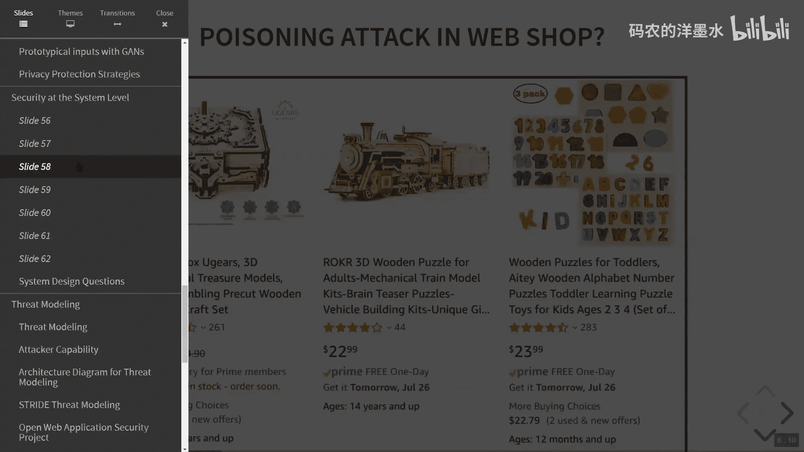
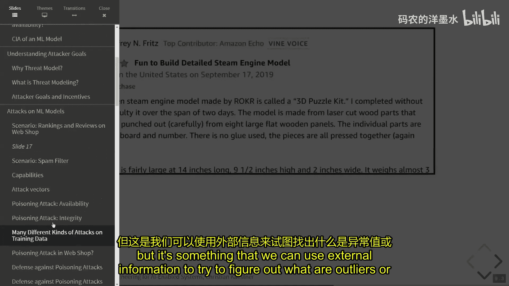
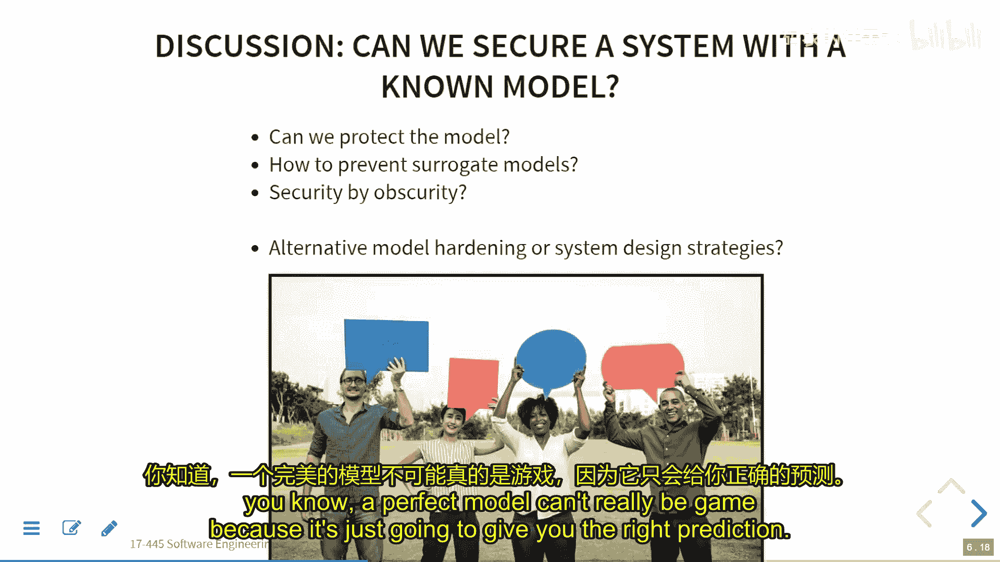
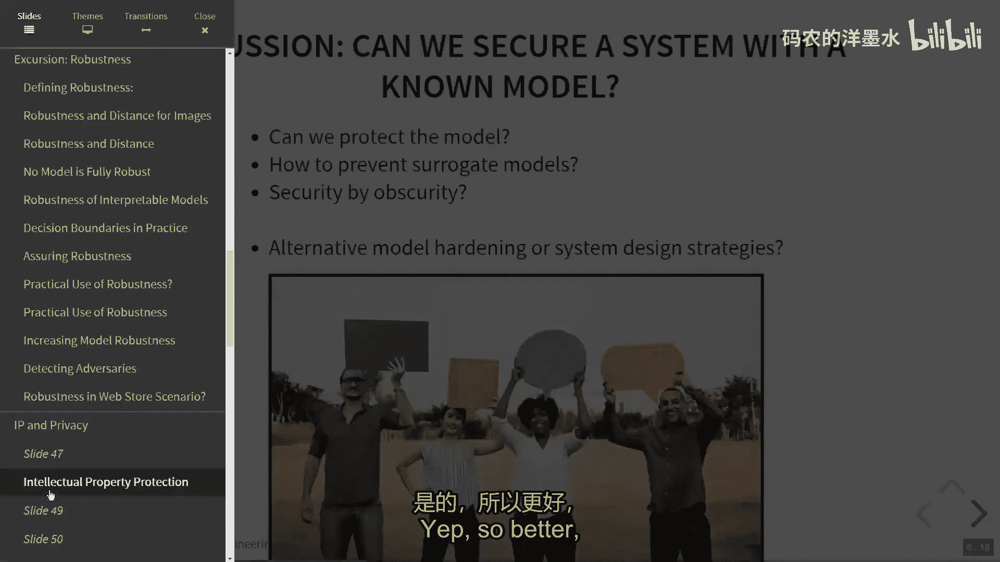
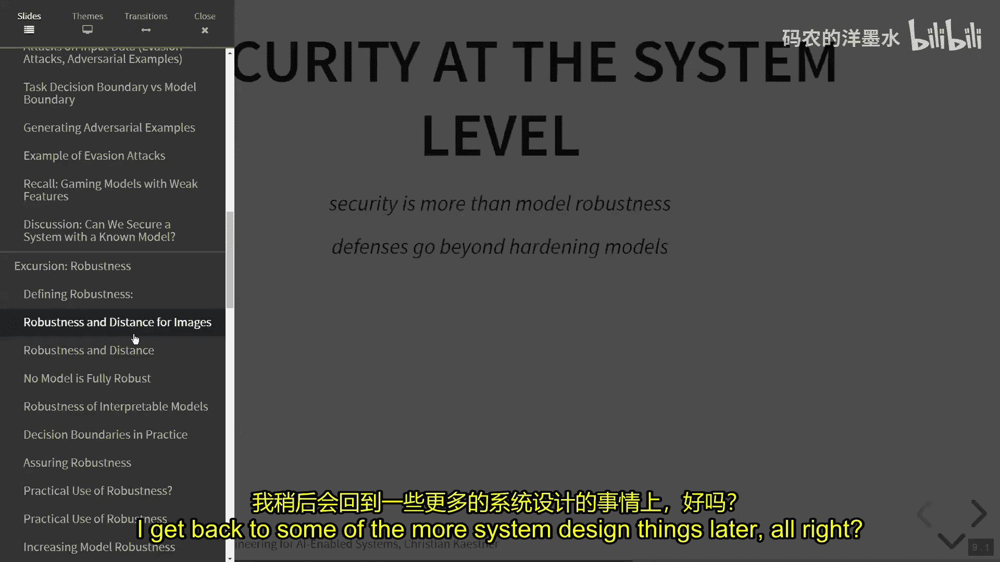
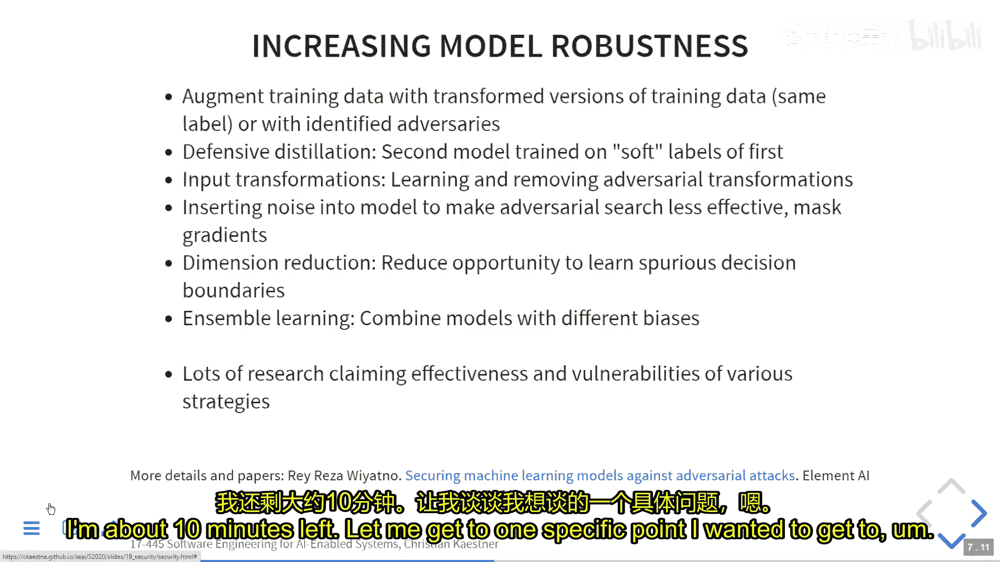
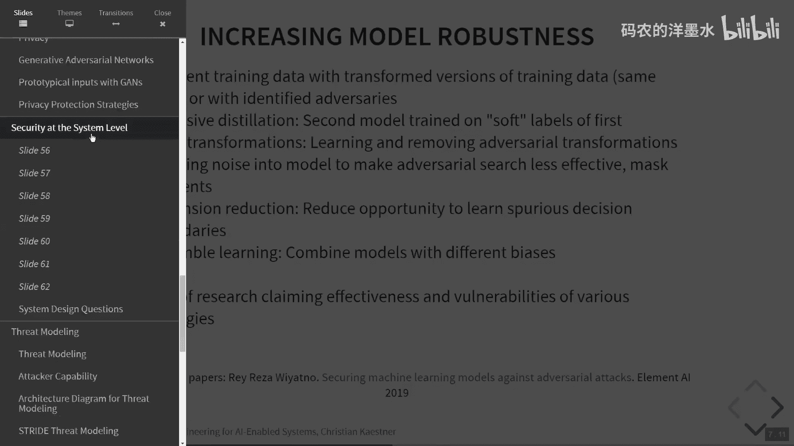
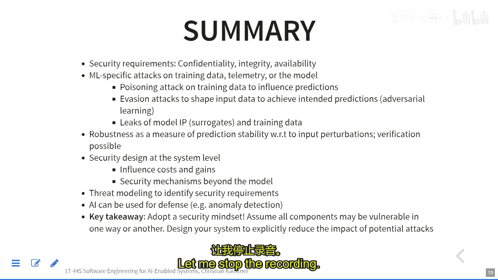

# 【全集】卡内基梅隆大学-AI驱动系统的软件工程-中英字幕-1080P-p20-Lecture-20---攻防与风险防护--BV1JS6gBcEBF_p20-

All right， welcome。What do you remember from the last lecture？I know always the same question。

We talked about providence and。Viersin control for data sets and models。Mmhm。😊。

What's this needed for， what's this good for？Why did we talk about this？Anybody。I guess to ensure。

Experiments and experiments are reproducible and we're tracking all attributes of。

How a model is produced right we want to we want to possibly reproduce the experiments。

 we want to reproduce bugs for debugging purposes， user reports of somebody complaints。

We want to understand what goes into this， if there are problems exactly。AndEssential。

 we talked about versioning in all different forms， we talked about a bunch of tools like DVC。

 Model DB and M， Fide， and how to version large data sets。

 what kind of techniques there are and so on。はい。Today I want to talk about security and then on first。

 we' going to talk about safety。 none of those I'm really an expert in。

 so I'm going to give an overview and I think many of we have microphone problems。Give me a second。

 Try this。我。Is this any better？What's still the same problem？Are restarting helpss？Okay。All right。

 so we're going to talk about security。I think some of you probably know more about security than me。

 giving that some of you work at the Cert。I'm going to give an overview。 and here's the same kind of。

Different。Different perspectives that we saw in earlier lecture so a lot of the research is kind of very focused on narrow properties at the model level。

 whereas what I really want to push is much more kind of a system level view of things。

 but we're going to discuss both so in some part we're going to talk about security at the model level and different attacks on a specific machine learning model。

 some of this is deep learning focus and then there's a lot of things that are more traditional maybe not that a machine learning specific that we can already do the system level。

So。I think I can be quick on this， but let's go over quickly what we mean when we talk about security。

There are a bunch of different elements here， we have some security requirements。

 some goals of what we want to achieve with security then we think about what the attacker can do。

 what capabilities and incentives they have， what parts of the systems are exposed。

 how they can interact with the system and how we're protecting this and then there are a bunch of security properties there are different lists of them。

呃。We can further so hear this one talks about confidentiality。

 integrity and availability there are also versions that talk additionally about authorization versus authentication and non-reudiation right so they a couple of different terms but I think thoses three are the most common ones so confidentiality is that you don't leak sensitive data right so you control that only people who are supposed to access something and supposed to access it integrity means nobody should manipulate the data right whos not allowed to in availability is just that the service should be available。

Is somebody here using garmin watches？For something， they had a rather severe outage。

 they were attacked by a ransomware thing。What was affected there，Or given it。Confidentiality。

Integrity availability， what were the more obvious signs maybe？What they attack us does。

Availability right so the most obvious thing is they took down the services right so it was actually offline for four days something like this is fairly severe。

The people were actually on the systems， right so they encrypted the system it was a typical ransomware attack。

Which means they also potentially had access to the data。And could have manipulated this。

 What could have an attacker done have done to。In terms of confidentiality。

 what if they hadn't just taken the system down and demanded $10 million， I think。

 what would the attack look like that breaks confidentiality？

I guess if they exposed the data through some additional channel that was unencrypted that anyone could publicly access。

Yep。Or just steal the data themselves， maybe passwords， right， try to get into other sites。

Maybe fitness data， heart rate data， H。Wt， things like this。嗯。

If they wanted to attack pretty of the system。What the possible attack would have looked like？

What could they have done， what kind of harm could they have done？

So if they modified the database for the back end data about all the users or everything you just talked about except modifying it to be。

You have some other values， you know， changing someone's weighter。

 how many miles they ran or something。Would somebody do this。

 is there a motive for an attacker to do this？嗯。It could be like a competitor just trying to drive business away from Garmin。

Yeah。嗯。And that's probably across all attacks， right if you leak data， that's bad press。

 if you just take it down， that's bad press。If you modify user data。Yeah。

I'm not sure what the secured data would be that definitely can't be modified。But yeah。

 you could you could change runs， you could change their age。

 you could change their names and friends， make people very popular。

 give them all kinds of badges that they haven't earned。

 I don't know maybe if you assume that they're taking telemetry from their devices。

 then you could corrupt their telemetry data， which would hurt their business。

typically this has an availability component in the end。

 right because you're breaking some other service by doing this。嗯。

But I think the key point here is there are different notions of security and you can break this。

 they're sometimes overlapping， there are other forms that I don't want to go into and we can discuss what can happen。

Now， let's think about something more specifically with machine learning。

 Let's actually skip something。 and that's。We'll come back to this in a second。

I think I just want to brief here what helps a lot to discuss this is get an understanding of what the attacker can do and what the attacker wants to do right so they usually have some sort of goal you want to understand what the motivation is。

 what the kind of capabilities they have， so typically you think about what's the profile of an attacker。

 what do they want to achieve。In the Garmin case probably makes some money was a ransomware attack right what are they capable of how do they interact with the system。

 what are their incentives and kind of understanding some of that helps you to think like an attack and helps you to think about how to defend against this right so。

I think in the Garmin case was straightforward ransom attack。

 but you could have something like Daniel mentioned that it might be a competitor who wants to create bad press for them。

 I take them down for a while， things like this， this could be somebody who wants to leak user data。

 to create harm for all kinds of reasons， maybe grab passwords to get into other pages。

And if you understand kind of what the goals are could also be somebody who wants to have a lot of training data on kind of where are people running。

 what's their heart rate， things like this right so you can steal data for all kinds of purposes but having an idea of why people are doing this helps you to think about what potential attacks are but let's focus a little bit more on machine learning。

Right and let's take a more specific example that has some machine learning in it so let's say you're searching on a web。

 this is Amazon， there's a search for wooden puzzle right but you could search for a bunch of different things and there's some sort of ranking here and it's very valuable to be higher up in the ranking。

So this is something and competitors and sellers and maybe users might want to influence the ranking。

Or might want to take Amazon down or might want to make it useless。

What are possible attacks that you can imagine here？Against the machine learning component。

 kind of something that makes the ranking algorithm。Predict the wrong thing。我。Rank the wrong thing。は。

Bott reviews so you just have a bunch of bots submit positive or negative reviews to boost or lower so that right so that the algorithm thinks that certain items are better than other or worse than other items。

 right？Okay， what else can you think of？So there are companies which actually provide certain services to。

Bring the rankings up so they will manually go and write good reviews or give provide good ratings clear application or in this case to an item So in both cases。

 is kind of manipulating the reviews of writing extra reviews right。

Is there anything else you can see？Maybe if we had some automated way to just hit the search。

Functionality of like the website， So if a product， if a certain product is searched a lot of times。

 then maybe the model can find it to be more popular。Okay， so。

I think are you talking about kind of stealing information that Amazon has about which products are popular or？

As I was just thinking like if the rankings are based on popularity。Okay。

So you can learn something based on what Amazon is recommending。So by just searching。

 you can see what's popular。A。So you learn something about Amazon's data。Poently。All right。

 anything else？So if we assume that rank results are to some extent a function of relevance to。

 which would be relevance to the user's text search。

 then trying to reverse engineer how that search is done to put key phrases in the description of your item。

To ensure that it would bubble up higher it would become more relevant than you commonly think like you see in some web pages where they have all kinds of like invisible text keywords to try to get higher on Google right so so one other way that we can change the input here is the description of the products right at least the sellers have some control over this。

By the way， if you're looking for these wooden puzzles， I can recommend the Roca one。

That's a Chinese original， there are some Ukrainian companies that also say them。

I can really recommend a bunch of these， theyre a lot of fun we have a whole partner clatuttered with those but that's maybe a separate story。

😊，So you can think about this。 there are a bunch of things that go into such a model， right。

 so you have search terms， reviews， the product description， past sales data。

And the attacker might be able to influence some of this。so I can certainly。

Input different kind of search terms into Amazon， right probably quite a bit。I can。To some degree。

 manipulate reviews， probably not change existing ones， but add extra ones。

I can change the product description of my own products。Probably not so easily of other products。

Influencing past sales might be possible to some degree， but it's expensive。

So I can just buy a bunch of products， this happens for example。

 with there are a bunch of cases where people buy their own books also to get them high in the ranking。

 get them in some best surists。RightSo。I think one way of thinking about this is and this was part of the reading as well think about what kind of data。

Goes into the algorithm。Either for training， for making predictions。Or for telemetry。

And what of this data can be manipulated right in different forms。

 and then what can you achieve with this。So let's think again about the different kinds of forms of security risks。

What would be an confidentiality kind of attack？In this setting。

Among the ones that we talked about potentially before。

Where how can you try to leak information that you're maybe not supposed to？Have access to。

I think maybe the past sales of a product。So if you're kind of going for popularity by rankings also so you might extract some information about how many things are sold。

嗯。What can you do about availability？Or what would an availability attack against a machine learning model look like？

So we're probably not crashing the model right so we're not fuzzing inputs doing kind of SQL injection like attacks the models are relatively straightforward if it's deep neural networks there's a bunch of matrix computations right so we're probably not going to crush it we're probably also not going to find inputs that take forever to execute that we create a huge load right I assume most of these models the inference time is fairly uniform for most inputs。

What we can do in terms of availability is make the model fairly useless。

That the recommendations that it does are useless， for example。

 it doesn't recommend the Royka products， but it recommends some weird knockoff products and it makes the customers unhappy and they don't come back to Amazon or something like this。

Right so。To some degree， you can think of kind of manipulating reviews。

As an overall attack on the system by making it less useful。

And that's an availability attack in the larger sense。

 and it's also integrity depending on how you think about this。

 that you're modifying some of the data indirectly that you're not supposed to modify。

Does this Rafi make sense？So some of these things sound a little bit differently if you're thinking about machine running models。

So the hello word example in attacks on machine learning model are typically spam theaters。

 so you're trying to figure out which words represents spam and which don't。

So you can try to figure out how the model works， what terms are considered as spam or not by probing the model potentially you can try to change the integrity that it actually makes wrong predictions。

You can try to attack the model that it lets you spam email through or let it blocks your competitor's email。

So it considers them as spam， what makes the spam filter completely useless。That people turn it off。

 right， so those are the typically kinds of things。嗯。

So we can think about how can an attacker interact and influence a model and I think we have already talked about the different categories。

 you can sometimes it depends on the system， influence training data。

If telemetry goes into training data for future versions， you can often influence this in some form。

And you can influence the inference data so the data that's what depends on the system again。

 but you might be able to influence that the data that goes into a specific prediction， right？

And then you can think about what can you do with this and there are a couple of different classifications here。

 what I want to talk about are poison and evasion attacks。

 which are the most commonly talked about So poisoning attacks are the ones where you insert some training data。

To undermine the model， you can either go for availability。

 make the model completely useless or integrity， make targeted wrong predictions。

A classic example here， there have been multiple reports。

Virus detection companies have tried to undermine each other。By uploading files。

As viruses into their kind of front end， how they are collecting， essentially virus reports。

And so they have a web page， you can upload some files。And if you want to be mean to that company。

 you upload some essential Windows library there and then。If the system doesn't detect this。

 it might train the next model and detect this Windows library as malicious。

And there have been actually reports where companies have done this to their competitors， apparently。

 where they upload it。Beennign fights as virus fights。To make the system essentially not available。

 right， not useful。嗯。It depends entirely on your system right so in some way here you're giving a user access to your training data。

And maybe you can think about that's a stupid idea， maybe somebody should review this。

 but this is where you already need to think about taking countermeasures。

And if were thinking about Amazon reviews as training data， telemetry， and then training data。

 nobody's going to review all of that manually。So you somewhere you want to have that feature to get some feedback。

 but somehow you want people not to kind of use this。In a malicious way。

And studies have shown that this can be fairly effective。

 so even small amounts of kind of mislabeled input data， especially if you can target。

 if you can mislabor specific things， can reduce the accuracy of a model substantially。

So for example， you can send spam messages with all kinds of different words that often occur in common messages so that those words are maybe seen as more common also for spam messages and then make the classifier less useful。

So this is an attack that is against availability right so you're not getting a wrong prediction out of the model you're making for yourself。

 you're making the model useless。There are also integrity attacks where you try to specifically target a wrong prediction。

So the standard example here is that you try to fool a spm detection mechanism。

So if you're trying to fool a spm detection mechanism， kind of a classic spam detection mechanism。

 what would you do？How could you try to attack this？What are Bemas essentially trying to do？

One thing we can do is mark good messages as spams。I would not want to do it。

 but like if I'm fooling the system， probably I can。So。I mean。

 you can intentionally manipulate your own spam filter， right mark all your inbox as spm。

You don't really want to attack your own water。 So how can somebody else who's sending you a message influence that。

Their spam message is not。Detected as spam。How do people try to suck？Scuvent bem filters。

Make it look as real as possible， so like I think a common one is like you have a package to pick up you know UPS or something click this link to confirm or something like that。

Right， so you're kind of specifically looking for clues at the spm filter uses to make things as not spam right so kind of common words and make the message look a lot like common messages。

 maybe attach a bunch of benign words， reduce your amount of kind of suspicious words。

I use synonyms for things。Don't write Viagra directly。

 use some sort of synonym which isn't detected yet。

So that's a fairly common approach right so you're specifically crafting your messages。

 your inputs to the spam detector that it makes a wrong classification。So in this example here。

 you have a bunch of training data for Spm and a bunch of training data for not spmM。

 and what you're trying to do is you're creating a spam message that looks much more closely to a message。

That was trained as not spam。Then there's also the opposite effect if you want。The system to。

Misclassify specific messages as spam so benign messages that come in like orders to a system and you want a spam filter to filter those out。

 how can you try to achieve that？Could you submit a whole bunch of spam that kind of resembles the class that you're targeting。

 but is you know has some clear identifiers that make it spam exactly so you're sending a bunch of messages that people。

Recognize a spam， and they filter a spam。 but you craft the messages to somewhat look like。

The specific other messages that you want to suppress， right？

The spam filter might figure out that this is what spam looks like and also filter out the other ones。

At least it makes it less effective on those kind of things。 right。

 So these are poisoning attacks in both cases。Or in all of these cases。

 we influence the training data。Sometimes indirectly。

 right we need to somebody still needs to label this so we give them input that they then label。

And it leads the system to make wrong predictions。Or even make systematically wrong predictions to make it essentially useless。

There are a couple more specific things like their discussed in papers correlated outlier attacks where you add spurious features to malicious instances to be misclassified as benign things。

 so this is where you add extra vertbs to your spam message or red herring attack where you add spurious features to early malicious instances and then the spam filter realizes that all the ver Viagra。

It's really indicative of spm and then your real malicious messages that you're sending use a different word so that the spm theater was trained on different data right so kind of provide a red herring and there are a bunch of these attacks and a bunch of these have been studied。

So what would be a poisoning attack in kind of this workshop scenario among the things that we have talked about。

 is there something that would be。Poisoning。Where we provide some training data that leads the machine learning model to make wrong recommendations。

 essentially。Or become useless。I mean， essentially everything where you enter fake reviews has this kind of flavor right so you train the model on fake reviews。

 you influence the machine learning model in the wrong direction。

 you're poisoning its training data with unreliable right。Wrongly labeled or unreliable data。

Could you also do it in a way that like when somebody does a product search。

 you submit a whole bunch of products with sort of bad titles。

 bad descriptions so that when they do the product search。

 they get back a whole bunch of things they're not looking for so they don't use that search or something like that？

Yep。开始。So that's the other data that you can influence right so you can influence your own product description。

And you can try to attack the model by poisoning that essentially。Right。All right。

 so how do you defend against poisoning attacks？Essentially the main strategy is you try to figure out that there's unreliable input data。

So here's an example where you have a。Classifier that distinguishes between malicious and good and bad inputs or positive and negative and then if you get some training data into this you might influence the classifier to be completely wrong right so this is what we had discussed with outliers and kind of interpreting models。

And the way to fix this is to detect that these are outliers。

That these are probably not training data that you can trust。嗯。

There are a bunch of techniques for this and I don't want to go too deep into this。

 but most of this fields very similar to what we talked about in terms of data quality so if your data is out of distribution or very different from past training data。

 that's suspicious。It may not be malicious， right， It might just be data drift， real data drift。

 but at least there's a danger there。 There are a couple of other strategies how at the system level。

 you might detect that certain reviews are more。Reliable than others。

I'm going to talk about this later， but what are some strategies that Amazon uses to realize which ratings and which reviews might be more influential。

 more trustworthy than others？Any ideas？

I this way， way later。

那我是。能。So this is a review where you have information like verified purchase。

So if the person writes a review without having purchases from the same account， you might。

 especially if it's an outlier， you might give it less weight。嗯。

It also recognizes the reputation of the contributor。So people who've written a lot of reviews。

 maybe you trust them more。People where people said the review was helpful more often。

 maybe you trust them more。Right so。This is not directly something that the machine learning model can decide。

 but it's something that we can use external information to try to figure out what are outliers or what are less trustworthy labels than others。

系。All right， so things that you see in the literature is anomaly detection and data sanitation in all kinds of forms。

 identify and remove outliers， identify and understand drift。

 some sort of quality control over your training data。

 maybe don't let the users influences but often you want this， can I trust the data source。

 is there some sort of security mechanism that not everybody can write a review but maybe only people who are lockedgged in。

 right？Maybe slow down retraining that just doesn't have an immediate effect that you kind of accumulate and stabilize this monitor model quality。

 if you can， like maybe based on some recent retraining。

 customers are less happy with the product that they're buying or the search。

You can use a bunch of kind of debugging and explainability techniques。 For example。

 we discussed influential instances like singer training points that。

Lead to very different outcomes that are kind of influential。

 the form of outlier detection in the data。And then there are certain kinds of training techniques that are maybe more robust to noisy data。

 right so certain models might be more robust than others。All right。

 so there was attacks against the training data and then there are attacks against the input data that we're using for inference those are typically called evasion attacks or adversarial examples and there are lots and lots of kind of famous or funny pictures where you have an original picture it gets classified one way you add a little bit of noise sometimes visible sometimes not and it gets classified as somebody completely different right so there are lots and lots of these examples I show you an example of a stop sign on Thursday where you put a bit of sticker on a stop sign and it's no longer recognized as a stop sign。

Yeah， kind of classified as an ostrich， there are a bunch of these。so。

The idea of these attacks is that you craft an input in a specific way。

That the model makes a prediction。That's wrong and ideally that aligns with what you want right so this is an attack at inference time。

 you're not changing the model， you're not changing the training data。

 you're just trying to trick the model to give you the wrong prediction。

 usually a prediction that has an outcome that you want。嗯。So the。

The way that I like thinking about this。from。From the literature is that there's a decision boundary。

For the task。 and there's a decision boundary that the model finds。

 So the decision boundary for the task is。There are some pictures that should truly be identified as a panda and some pictures that are truly identified as an ostrich。

So there's some boundary between them。So in this case。

 the task decision boundary is a dotted line here。So that's the actual distinction between the red points and the blue points。

The machine learning model can't see all the data， so the actual decision boundary that the model produces will probably not be exactly the same boundary。

That a human would use， right？This is just very unlikely that will happen right so we don't have a specification so we couldn't probably as humans even say what the dotted line should be。

 so we have a hard time saying well understanding what the moderate line。

 the black line is and whether it's correct right so we just kind of test it and on the test data it seems kind of plausible。

And what we're trying to do with adversarial attacks。Is we're trying to find a data point。かて？Model。

Misclassifies from our from the perspective of the ground truth。 right， So， for example。

 here is a point。That actually should be blue。And if it's over there。

 it's outside the task decision boundary， right， it should actually be something else。

 but the model draws the task the decision boundary out here。 So for the model。

 it's actually still blue。And that's wrong。So the goal of this kind of attack is to find a place where the model doesn't align with the actual correct outcome。

And craft instances that。Fit into this pad。Does this make sense？So there's a huge amount of work。

 typically this is called adversarial learning， adversarial examples of how to craft these things right so it's essentially a search problem where you're given them a picture。

You want to get a different outcome， a different classification and you're searching for what's the kind of modification that would lead to this different outcome so it's some sort of search where you're adding some modification to the original picture and typically you want this modification to be relatively small。

So the formal notations often look something like this， you're looking for some other input。

That's similar to your input， so you have x as your input， you add some noise Z。

So that if you add this noise to the original image， you get a different outcome。

RightSo you get a could have also written that。F of x plus z should be different from F of x。

And the search that you're doing is you're finding the smallest modification。

That will lead to this different outcome， right so you can either find any different outcome or specific outcome that you want。

So there are a bunch of different search strategies and I don't want to go into this。

 this is similar to what we discussed about counterfactual explanations last week right so you find a different input that's similar to my own input but changes the outcome we can use this for explanation or we can use this for attacks right so if the change is small enough it might not even be noticeable。

There are a couple of different ways of doing this， if you know the internal model。

 if you have access to the model and all its parameters。

 you can follow the gradient and you can search these quite efficiently。

 there are lots of attack strategies for deep neural networks and other techniques that take all the model parameters into account and are very good at finding these things。

If you don't have access to the model internets， you can learn surrogate models right so you just sample。

 we talked about global and local surrogates， you just sample a lot of points。

 learn a different model and use that to search。嗯。Or if you expose confidence scores。

 if you're not just saying。This is a panda yes or no。

 but this is a panda with 90% and this is a panda with 87%。

 then you can find a gradient again and do some strategies like hill climbing or some search even over black box models。

So those are kind of common techniques here。嗯。So。This doesn't quite fit the web store scenario。

 I guess here the input at inference time is mostly that we're entering a search query。

So we could search for a search query that gives us the wrong results that we modify slightly。

I'm not sure that this is a very useful attack in this case。

But here we can and come back to the Spm scenario， we want to craft a message that's misclassified right so we write a spam message。

 the spam message is classified as Spm， What's the smallest modification that we can make to that spam message together through the spm filter。

If we know all the weights of the spam The， we can actually craft this very directly。

 we can keep the message almost like as is search a very few synonyms。

 add a few words or something like this to get it through the spam。

We talked about this with credit scoring， right in terms of。Of examples。

 how we can make small modifications explanations， how we can make small explanations to explain who。

How you can create a credit score。And then we talked about this in the context of gaming models right specifically models with weak features if you design features in the right way then gaming actually means that you need to have the characteristics to get the credit but often we don't right so this is exactly what we talked about last week where。

If you know too much about the model you can craft the inputs to get the outcome。

 kind of hack the model， game the model so for something like face ID。

 maybe you want to protect this that people don't get explanations and can easily search about how should they modify the face to get into the system right for loan applications maybe you only use features that are hard to hack where actually having the right quality will help you right so this is also harder than to run evasion attacks because you can't craft an input that will just wrongly get your loan？

But again， if we're using deep neural networks， we don't really understand what happens。

 so there's a good chance that there might be some gaming going on。That you can game those systems。

Yeah。So what can we do to secure a model to avoid these kind of attacks。

 How can we avoid that somebody can。Send us。Loan applications that we wrongly accept。

 How can we avoid that somebody sends us a spam message that we wrongly accept。

What can we do to harden the model。So again， this is not about training data。

 this is about input data， things that we use for predictions。So I think。

Making it more of a black box makes it more difficult to send an adversarial example， but。

If you'd like to have it open， maybe， you know， for you。

 you make it available to to government audits or something like that or trusted parties if they they still want to check your。

Technology to make sure you know， for some kind of inspection， but otherwise。

Keep it basically black box。 Don't choke confidence scores。

 So you limit the attack surface as a result。 right， So。

 so you can make it harder to learn so good models， right， Don't show confidence scores。

Kind of the security by obscurity strategy， there's a limit to how far you can go with this。

What else can you do to make it hard to learn surrogate models？Okay。One thing you could do。

 I don't think this address is really the surrogate model thing is。

 but it's just improving the quality of the model because。

If you reduce the space between the model boundary and the task boundary， you know。

 a perfect model can't really be game because it's just going to give you the right prediction。

So better better models， better training， right， let me just jump again。

 so just want to show you a couple of things。

So in the transcription example。Can we just build a surrogate model。

 kind of upload a bunch of audio filess， see what the transcriptions are。

 and then build our own transcription service， kind of steer their inputs。

 their intellectual property？We can， but it's kind of expensive。

 right they charge us for every translation。So if you charge for everything at prediction。

You're kind of discouraging people from just making tons and tons of predictions to。

To copy your model。You can rate limit your API， right even if you don't charge for it。

 that people can't just make millions of predictions。嗯。This doesn't help here。嗯啊。Yeah know。

I get back to some of the more system design things later。

All right。This brings me to your point that's。This is where most of the machine learning community research I think is on security and also safety focuses on there's a lot of research on some notion of robustness。

So this is a term that you see a lot also proofs about robustness proofs about security or safety often boiled down to robustness of predictions what we're trying to do here is show that a certain prediction is robust to minor perturbations of the input so what you want to show is that you have a you want to predict something for F。

And you want to know that whatever we can， however we can modify F x in the neighborhood， right。

 we make smaller inputs。Like the ostrich panda part or the kind of glasses thing right we change a few pixels。

 whatever we can produce from the original input within the neighborhood we the same prediction。

So that's considered robust。And you can modify this with a lot of different distance functions and a lot of different permissible distances right so for example。

 for an image， you might say every pixel of the image might be modified by plus minus 10%。

And then you want to make sure that。This gives you a huge space of possible modifications right let's say you have 1 thousand0 pixel you can change each of them independently by plus minus 10% so you have a huge huge space of potential images and you want to kind of show that all of them or most of them give you the same result right if you can actually prove that every single one of them gives you the same result there's no way of attacking you within that distance so here a couple of examples so。

People study this a lot with this hand with a lot of kind of simple kind of hello word examples of machine learning。

 so handwritten recognition， for example， you change the brightness of pixels within a certain range。

You have a certain distance between the pixels and you want to show that with none of these modifications you get a different number here predicted or you do a rotation。

 you say you can change the picture by plus minus 10 degrees and you should never get a different outcome。

And some of these distances are more interesting than others， so for example。

 slight rotation stretching， those are kind of things might that humans might not detect if they look over these pictures。

Right。Change many pixels minimally so you get a lot of these examples， I think I have a few here。

Then I have a few examples here， so this is changing a few pixels more drastically。

 but there are also a bunch of examples I should have included some where you just add a little bit of noise to all pixels that's essentially not visible to the human eye。

Right below human perception， but it's something that the model picks up。嗯。You can change models。

 pixels， uniformly， kind of brightness， things like this。 So there's a large space。

For other inputs you can also think about kind of what's a robustness like if you want a spam filter。

 this should be robust， this should always be classified as spam independent of whether I add one or two words in any place in the email or if I replace words with synonyms it should still be detected as spam or if I reorder some words。

 it should be still detected as spam for tabular data maybe change certain values it depends very much the on the example。

Let。Essentially what you're saying is around a certain data point that you make a prediction。

You kind of create a bubble of many， potentially many。

 many data points that all should yield the same prediction。李。

Yeah I'm just wondering how is it carried out in practice I understood like we can make this boundary ha。

 but like how how is it done I it like reduce second。So this is where all the research is。

 how can you verify for， I just want to make sure that you understand what the property is。

 because almost always when you talk about robustness。

 it's this kind of property where you say around a certain distance of a specific point。

 you always get the same prediction。And before we get to how this is done。

I want to show that there is no model that can ever be entirely robust。

Unless it's a trivial model that always makes the same prediction。

So every model has some boundary for its decision。And there are always some points near the boundary that can't be robust。

 So in this example here， if you say the plus and minus is a point in the middle。

And then you have a bubble around us the right or the green bubble。

And we kind of want to say that all points within this bubble should have the same result。

We can show that that's the case for a lot of these points。

 but if we get close to the decision boundaries。There are places that can't be robust right。

 however we want to define this， there will always be points that are not robust。

So you can look at the model kind of。On average over all the points of how robust they are or you can use it in different ways。

 but the property is not about the entire model always being robust right so you can't prove this that for every single input there's a bubble around this it will always change the result this will work for some inputs hopefully most but not for all。

ok。And we can see this fairly clearly if we think about interpretable models。

 so here are clearly some data points that are not robust to this model。

So somebody having three priors。There we predict an arrest。Or we predict no arrest。

 but if they had one more。Right we predict arrest so this point will not be stable against a single value modification if they have two priors。

They are maybe far away from the distance that plus minus1 won't change the outcome。

 right so that one would be a robust。So in practice。

We don't really understand the decision boundaries of the models。

 right so they are not the clear lines， they are not the nice circles that I've shown you earlier。

We are not really confident that the model decision boundaries align with the task boundaries。

Especially if the task boundary kind of depends on human perception and the model uses something else and the model uses some training data right so the models tend to pick up on parts of the model in very surprising ways。

 so this is why these kind of pictures work right because the model doesn't perceive this as a human perceives this they pick up on something。

And it seems to work most of the time， but the decision boundaries are kind of weird。

And we would hope that。A good model is stable that smaller modifications of the original model picture are robust。

 they would always give us the same result and that's something that we can potentially test。

So now to Vivex' question， how does this actually work？嗯。

There's a lot of work and I don't want to go into this because it gets formaler very quickly there are mainly two strategies that I know。

There's a lot of work on formal verification where you essentially say if you're familiar with symbolic execution or with。

哎。Well sometimes done as constrain solving so you do all these matrix multiplications to get an output so what you're doing is you're doing this matrix multiplications not with concrete inputs but with symbolic inputs where you say the first pixel is green plus minus this the second pixel is reddish plus minus this and then you do the computation essentially with these symbolic values and you see whether。

Whether you get always the same result for all possible inputs that fulfill the constraints。

This is a very naive kind of description this is much more complicated if you go into this。

 there's a lot of work kind of on kind of abstract interpretation kind of creating。

Creating using some theory improvers or some satisfiability solvers to create this。

They don't right now scale particularly well。 This works for relatively small deep neural networks up to a certain size。

And they are usually conservative， which means that if they tell you that a certain point is robust for a certain model。

You won't find the counter example in this distance。

But it might not tell you that the point is robust if it's actually robust。

 because it kind of tries to search in a too large neighborhood。

 because searching in exactly the right neighborhood tends to be too expensive。

 there are just too many possible inputs。So there's a lot of work。And kind of formal a verification。

 my sense is this is not really ready for practice。

 especially not for the big kind of models that we're using。A different strategy。

Is based on sampling and if you have enough samples， you can get probabilistic guarantees。

 not formal guarantees， so essentially you sample in the neighborhood。You sample。

And you see whether you get essentially the same result for all samples。

 and if you have seen enough samples， you have very high confidence that it's robust。

And with very high samples， actually what we look at at kind of this paper， for example， samples 100。

000 points for every single prediction。Instead of making one inference， you make 100。

000 inferences in that neighborhood。And if they agree。

 you have a very high confidence that there is no adversarary example in that neighborhood。Yep。

 just a follow up question like does it does robustness can have a trade off with the accuracy at times because we are looking at the examples which which are supposed to be classified。

 let's say like a panda， but they are going as ostrich， but。

But would it also be possible that doing this exercise will dos the opposite for us？I'm sorry get it。

There are a couple of techniques to harden models to make them more robust。

And some of those techniques may lose accuracy。There are some techniques to harden a model that would make the model better in general。

 this is what Daniela talked about earlier， if you have better training data。

 you might have a model that are actually more robust。In that case。

 you don't necessarily lose accuracy， you might even get some。嗯。

What you typically lose is performance a lot。So if you make a single prediction here。Suddenly。

 you need to make 100，000 predictions。think about your movie recommendation service。

 if every request I'm sending you， you need to make 100，000 requests to your model。

This might be fairly hard to scale。The formal verification techniques here。

 they also might take seconds or minutes to actually verify a single example。So at least right now。

 this tends to be fairly expensive， have fairly high runtime cost for every single prediction。嗯。

Is this at all built into like testing at all because it seems like。

That would be beneficial and you could run it sort of。Asynchronously。

 so you could deploy your model because it'll take attackers a little while to discover weaknesses and in the meantime。

 analyze the robustness。So that it's easier to debug when。

Do you suspect an issue so the question is how do you use this robustness work and this was something that was confusing me for a while right so because the property seems kind of narrow for a single prediction is as robust right and then you invest all this effort I was actually talking to people earlier this year who do research on these kind of things and theyre essentially。

I think two main ways of how to think about using robustness。

 one is as a defense and safety mechanism at inference time。Where if you get income。

 like you get an incoming message and you want to classify it as spam。

 you check whether that result is robust， right this makes more sense of kind of high value things like if you get。

A face ID image， you want to see whether that's robust or if you get。

Maybe somebody for recidivism or something like this。

 you want to see whether that's robust right if it's not kind of really high frequency just once in a while。

 maybe you spend the minute or you spend all the energy to check whether that example is robust。

Ideally， in the future we could do this also in production like in a safety setting。

 people might talk about this for street sign recognition in a car or pedestrian recognition or something like this。

But then you need to be able to do this in real time， right check in real time。

 like a couple of times per second， whether the image is actually a stop sign or not。And then if。

If you think it's a stop sign， but you're not sure and you know it's not robust。

 you can handle this as a suspicious input。And if it's robust。

 then you're sure that nobody has been attacking it in that neighborhood that you defined。

 at least those classes of the text like changing a few pixel that are excluded。But then to do this。

 you actually need to do this at inference time， you need to do this one at a time。

 which tends to be expensive。The other strategy， which is I think what Daniel was getting at。

 is that you can use this。For testing and for debugging， so you could， for example。

 check whether all of your training data is robust。Or all of your test data is robust。

And the typical strategy is if you see that you have test data that's not robust。

You can add additional test data to make it robust。

 you can actually find the counter examples and add them to your test data。

So if you have a panda and you're recognize with a little bit of noises as an ostrich。

But it's still in the neighborhood and you look at it ands still a panda。

 just add it to the training set and retrain the model。

 and hopefully it doesn't recognize this as an ostrich anymore。Right。

You can also kind of collect some telemetry and check a few values after the fact whether they were potentially attacks。

 especially if they were outliers or something like this。嗯。It's interesting。

 so I got to this point to actually understand this part by talking to people。

 just reading those papers， they tend to focus on the property and not how you integrate this into a system。

And my impression is that most of this is researched these days。

 we are kind of far away from actually using robustness proofs in production systems。

There's a lot of attention because we see that these attacks are possible。

 that people are doing all these kind of things that produce funny images and so on。

And we don't really know how to defend against this， it seems like a promising strategy。

 but it seems kind of far away right now for practical use。

Con questions have you come across like from like how it is used in practice。

 like how is it being measured in a way so as a。As a requirement， if it comes to anyone like。

We understand your model needs to be robust， but then there needs to be a certain measure to implement it。

So。I don't know whether this is used in practice a lot。

 but what you can measure is your chance of finding counter adversarial examples。

So you kind of go back to the techniques that find them and see whether they find some。

So you don't need to defend against this， you don't need to prove something。

 you can just see whether your attack techniques work。

But it might be that somebody comes up with a better attack later right that you can't measure right now。

 so I think what I've seen so far is that people look at the chance or the time it takes to find an adversary attack as a measure of robustness。

Whereas kind of proofs， even the high confidence probabilistic proofs seem to be kind of out of scope for anything larger than kind of the handwritten number recognition scenarios or kind of small images and so on。

Good。So there's also a lot of work on hardening models。

I don't fully understand all of them and I don't want to go into this the typical strategy is augmenting training data with transformed versions of the training data so you kind of transform this in the distance and add this to the training data so you have more training data not just one point。

 you might do this just with the identified adversaries for example。

 if you find something thats not robust， you find a counterex， put this to the training data。

 there are a couple of strategies， how you transform the model。

 transform the input there's things how you train a first model and then you train a second model on the first model that increases robustness because it has smoother interfaces。

 has kind of smoother decision boundaries that are harder to attack similarly dimensionality reduction might help to have fewer attack vectors essentially in the input onsemble learning might help where you have might learning models and you vote between them because they hope。

Hope we have different decision boundaries and are harder to attack。

 So there a couple of these strategies and typically。

For all of these there's kind of papers that show oh this is a good hardening way and then there's the next paper showing how they can attack this right and then there's the next attack against some against how somebody can harden this again so I don't have a good sense of。

Where exactly the research is， and I think in practice， I'm not sure how much people are using this。

Actually。嗯。But again， I'm not an expert in this area。All right。I have about 10 minutes left。

 let me get to one specific point I wanted to get to。😔。

So。I'm coming back more for IP protection and privacy probably on Thursday。

 but I want to talk briefly to lead into the recitation tomorrow that security is a system level property so you can't just do this entirely at the model level。

A robust model doesn't help you if you don't know what the distance function is what the possible attacks are so typically you want to go beyond just robustness and beyond hardening models so you want to think about how to design systems there are a bunch of examples you know I just want to race through them。

For example， if prediction costs a lot of money， like uploading a fire costs me some money。

 I'm probably not going to do hundreds of predictions just to kind of steal a model and learn a surrogate model。

Right there are ways of。Designing the system in a way that you have a chance to figure out what data you can trust we talked about this one before like verified purchase again raises the cost of an attack right if you only consider reviews of somebody who actually paid money for this makes it much more expensive you can look you can put in a reputation mechanism you can put in other people voting for something。

You can reduce the value of an attack， for example， by labeling。

Things that Twitter sometimes does now deleting tweets or labeling things right so kind of exploiting something becomes more expensive if you kind of get a penalty。

 everything gets deleted or something like this YouTube puts a lot of cost on you in mitigating copyright mechanisms you get these strikes you can fight them but it's very slow it's very expensive or it's expensive in terms of time to fight these strikes strikes right so it's。

There is a wiggle room， but they can fight people kind of uploading kind of malicious things or copyright infringed things。

 so there's a lot of ways of kind of designing a system。

 there's a lot of ways of how you can use cloud users。

 this is on a YouTube video of this class where get occasionally some spm I should go to this other page and I can block this I can report this。

 this is something where we're not having an automated system to do this like outlier detection or something but we're thinking about how to design the system。

 how to design the user interface to actually get useful information about what's malicious training data for example。

this is stack overflow again， a reputation mechanism where you can't just post malicious things。

 it gets up voted down voted， you need to have a certain reputation of getting in。

This is Android if you try with a fingerprint sensor down here， you have too many attempts。

 you can't use a fingerprint sensor， you need a foback mechanism right so if you detect that somebody tries to fake out face ID or the fingerprint sensor some machine learning model you might increase the cost and incrementally so this was briefly in the other reading that you looked at today from our textbook right so other ways that you can think about at the system level to make the system less interesting to abusers so once you understand what the abusers are doing right can you increase the cost of app use。

 limit scale， rate limiting， increasing prices of predictions。

Decreasing the value of app use right shadow banning， limiting the spread， things like this。

 established trust so that some users are more trusted。

 some input is more trusted have a trust system like。

Stack overflow and probably a lot of other systems in Amazon as well。

You can also use machine learning to combat up use， there's a lot of work on this。

 but this is an arms race again， so it's unclear but you can do spam detection on YouTube comments or spam detection on reviews on Amazon right and they actually do a lot of this as well kind of outlier detection and things like this。

And you certainly should think about abuse will happen at some point， do you have a plan。

 what happens？So in the Garmin case， it took them four days and it's unclear whether they actually paid some money to get the key。

That seems like a long outage， like maybe not being particularly prepared for something like this。

 but it's easy to blame this after the fact。嗯。So a strategy that's kind of established in the software engineering community to think about security and think about security requirements is threat modeling。

 it's a method popularized by Microsoft。Where you model your system。

 you model the different components， you model how users can interact with the system。

 so if you've taken architecture before it's a dynamic architecture with a deployment component。

So you think about what are all the parts of the system and who's interacting with which other part？

And what are people who are interacting with those parts？

And then you start thinking about trust boundaries。

 are there parts where we trust everybody like this is an application system， I think。

 for PhD applications also so the database and the web server are running on the same system so we kind of trust the communication between this and we trust the program director。

 but we don't trust the user interface and we don't trust the sites that the applicants submitting something to。

And threat modeling is essentially a technique for systematic inspection for security problems at the architecture level right so security is a system property so you just don't want to do this just at the model level。

 so the idea is you look at each of these connections。

And kind of go through a checklist is there somebody who could booth this connection if this is possible what can I do against this。

 I probably should put in some encryption and some authorization so we come up with security requirements that you can then later check that they're implemented。

And so you kind of go through this， you have checklists like this one strike is fairly common where you say the threats that you're looking for is spoofing。

 temperming rereviation， information， disclosure， denial of service and evaluation。

Elevation of privilege， so you go through each of these edges and essentially think about。

 is there a potential security risk here？And how can we mitigate this？

There's two support available for this at least it's mostly at the modeling level it's pretty much odd manual。

 there's very little automation， you need to design those diagrams。

 but it seems fairly useful as an inspection strategy it's kind of using checklists it's going through those edges。

And then you can think about。If I have machine learning component in there。

 should I use a different checklist， can I use the same checklist。

 there's a lot of things that overlap but you can probably think about。

Who can attack my training data， like who has access to it， can they manipulate it。

 can they mislabbel it， can they add something， can they remove something？

How can they access or influence the prediction data， the telemetry data。

 so you can probably come up with kind of checklists that are specific for the machine learning components and add them to your stride modeling。

嗯。Right so think about specific kinds of attacks that we talked about and in recitation tomorrow you're going through an example and kind of。

Just apply threat modeling to get a sense for how this might work in practice。嗯。

And then there are classic securities of design strategies like least privilege isolation that also probably makes sense in the machine learning context。

So think about what your model can do， are you trusting the inputs unnecessarily。

 should you authenticate things？And then。Just last minute there's a huge market for using machine learning in AI for security intrusion detection systems anomaly detection systems this gets a huge amount of attention from my perspective these are again AI enabled systems you're using some systems with machine learning component in them that has some specific goal so you need to do quality assurance for them pipeline you need to think about security also for those systems this is a big market the most common things I think are things like anomaly detection identify outliers。

 there's some game theory stuff， there's some network analysis there's kind of the spm filters are classic examples so there's a lot of work here but again this is kind of an arms race as all of security work right so there's a lot of interest in this area。

I think most of this is not targeted directly at securing your machine learning components。

And if you don't use it， it doesn't help right so for example。

 Equifax had an intrusion detection system that they just simply didn't update their certificate so it was not working when they were hacked。

 it would have detected the hackCC very quickly， they detected the hack when they updated their certificate months later。

 right so the best AI if it doesn't work doesn't help you。All right， to summarize。

I have a little bit to cover next time， but I think I covered most of it so we talked about security requirements and that you kind of think about at least confidentiality。

 integrity and availability and all of them also makes sense in the machine learning setting。

There are a couple of machine learning specific attacks。

 right we talked especially about poisoning attacks and evasion attacks。

We're going to talk about leaks and privacy issues next time。

Robustness is where I think most of the researchers or what I've seen， but it's kind of limited。

 at least at this point to actually give you guarantees。 there's a bunch of techniques for hardening。

 There's if you want to go into this literature， feel free to look at this。 But I think again。

 there's a lot of things that you can do at the design level to think about how can you。

How can you protect the system， how can you make it more costly to attack。

 how can you remove incentives the textbook chapter talked a little bit about this。

Right and then security mechanisms， a lot of them will be outside of the model will be in the way that you design design the system and the way that you design for trust。

 I think trust modeling threat modeling is a good technique。To just have a mind kind of think about。

 think with a security mindset。Before it's too late。

 think through this and threat modeling is a good information technique review technique to check your system for requirements。

Alright。Let me stop the recording。

