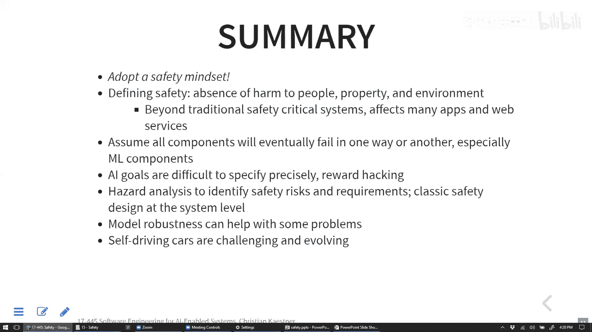

# 【全集】卡内基梅隆大学-AI驱动系统的软件工程-中英字幕-1080P-p21-Lecture-21---系统可靠与事故预防--BV1JS6gBcEBF_p21-

All right， as usual， what do you remember from the last lecture？

Somebody has been pretyping this to area machine learning and describing the security properties。

 all right， threat modeling yep。Anything else， anything specific you'll remember？Any insights？

Different kinds of attacks， riots。 will we talked about poisoning attacks and evasion attacks。

Building a surrogo model to help with the attacks， right when there's a black box model。

 we talked about how you can access or influence the model to different forms of how you might be manipulating the data。

And then one thing maybe also to mention that I try to bring across at least is that it's not just at the model level。

 we talked about robustness， for example， right， but it's really also about how you design the entire system like can you bid in defenses like making predictions？

More expensive that it's harder to just get a large number of predictions to build a surrogate model。

 can you bid in some trust mechanism that you know which input data or telemetry data to trust right。

 for example by checking that long-ter users are more trusted than new users making it harder to attack things like this。

I had one short part that I didn't get to cover， but I want to mention this at least briefly。

 stealing intellectual property and privacy concerns。This was in the reading。

On the prediction machine book that。Bing was called stealing search results essentially from Google right so they intercepted in the Bing search engine or in the Bing search bar search queries and then ask for Google ask the Google search engine what the results were and incorporated this into their own results they were caught by returning essentially with a Ho traprap responding to nonsens a search queries with things that were specifically set up by Google but in general this is an example of how an attacker might steer kind of the model by just having enough queries right so if you have the model public it's possible to build a surrogate model how easy that is depends a little bit on the deployment scenario。

In some cases， you might ship the model with the app and then somebody can just look at。

Decompil it or look at all the parameters of a model， right how the decision is made。

But even if you deploy it online， somebody might just query a model frequently。

 build a surrogate model。You can protect against this to some degree by rate limiting people making it harder to ask lots of queries。

 but in the end you're providing answers for certain inputs so you can't arbitrarily protect against this and then these surrogate models is why we talked about them last time are useful for a bunch of other attacks for example。

 if you try to find adversarial attacks adversarial examples。

 it's much more useful if you have access to the model if you can build a surrogate model right than just blindly trying。

I don't think there is really a much you can do at the model level if you're worried about leaking intellectual property。

 leaking the model itself， this is actually something where you need to think about your system design。

 how much are you exposing an I， how easy do you make it for others to。To excess。

Does somebody remember or have seen this。How Netflix had privacy problems in their competitions。

What the issues were。So Netflix was running these competitions for recommendations where they released information about a large number of their customers anonymized about what movies they were watching and how they were rating this。

 similar to what you're doing kind of。And then the competition was to be a prediction machine that predicts ratings or recommends ratings as best as possible。

And。There were complaints that it was possible to identify users in that data。

 even though they didn't attach name to the rows。Right so the specific case， I think that was。

Liigated here or where the complaint was about was a gay woman who was closeted who didn't want to share this。

 but it was leaking kind of her preferences and the kind of movies that she liked and so on。

 because if you could see a few movies that she liked。

 you could identify the person in the data with high probability and kind of see more information。

So more broadly， it's really hard to really anonymize data sets if you share them。

There's lots of problems with that and it's。Fairly easy often to identify people with a few attributes and kind of leak privacy information。

Even if you don't share the original data， there are certain risks。

 there are things called model inversion attacks， how you even if you don't have access to the data。

 you can ask queries of the model to kind of reproduce or approximate some of the training data。

 there have been multiple examples of this， this is a visual example where they I think this was a training data。

 training image and this was they were able to kind of reverse engineer having the model reverse engineer information about the training data。

 a couple of other examples where it was possible just on the trained model on medical diagnosis or on DNA sequences to reverse engineer some of the input data or at least approximate some of the input data used to train the model。

嗯。This can be pushed pretty far。So there are lots of examples where sharing data。

 even though it was thought to be anonymized， went wrong。This is really hard。

 this is I think more of an academic problem probably。And then model inversion attacks。

 there are lots of these examples as well。Does somebody know how generative adversarial networks work？

I suspect if you've done some machine learning class， they may have come up。

 maybe you've even run some examples。Anybody。These are the kind of things that can generate deep fakes。

So the idea here is that you try to learn how to generate images that look like。Real images。

 So here's an example of a picture that a machine learning system has generated。

 It's not a real photograph。 This woman doesn't exist。

But it's learned to look like a real photograph， like something that we would recognize。

Roughly the idea how this works is that you have two models working against each other and training each other。

 so you start with a set of real images。And a set of fake images。

 So you have some generator that generates fake images。

 this might just be random noise in the beginning。And then you learn a model based on some sample that is able to distinguish real images from fake images。

Right so you're training with some labeled examples of real images and labeled examples of wrong images。

 You learn you're training this discriminator model might be a deep neural network that just this discriminator model essentially decides。

 is this a real image or is this a fake image。You're starting with some training data and maybe some more obvious fakes。

And then you're essentially trying to get into a feedback loop。

 so the generator is trying to attack the discriminator kind of as adversarial examples。

 try to come up with examples that the discriminator accepts as real images。

If the discriminator loses。Then the discriminator gets updated because we have detected a generated image that gets classified as a real image。

And we can retrain the discriminator with another fake image right and the fake image that we're retraining this is probably closer to the things to real images and when we repeat this over and over again。

 this generator will generate better and better images that are closer to real images。

Because the discriminator is getting better at distinguishing good from bad images。

So the generator needs to get better at generating fake examples that pass that。

Kind of gets slipped by the discriminator and so on。Does this general architecture make sense？

This is a fairly standard one that has been developed the last couple of years ago and I think this this is how a lot of kind of the deep fake pictures and kind of artificial pictures that look like we a generator right so what we're doing this way is again with。

Generating fake things that look somewhat similar to the training data that maybe look like prototypical inputs right they are not really training data。

 but we're maybe leaking characteristics， we are having possible other properties because we can imitate people。

 can imitate real things。For privacy there are a couple of protection strategies again this is an area where there's a ton of research mostly very close to the model level like adversarial like these gens generative adversary networks。

 there's a huge amount of research on this， how to make this harder， how to make this better。

 also about privacy， how to avoid inversion attacks， how to avoid leaking and so on。

How to learn in a privacy assuring way， I can't go into this， but I can give you。

And I'm not an expert on any of these， but the main three directions that people seem to work on is federated learning where you learn local models。

 for example， this is actually used in production in some cases like the Android keyboards or Apple emoji prediction where you learn local models on the persons phones。

 so the data of what they're typing on their keyboards which emoji is there using directly doesn't leave the phone。

 you're learning something local， but then you're merging this data in an anonymized way without being able to identify individual people。

 there's a lot of research on this， how you can learn global models without having access to all data without having identifiable access to individuals。

Different privacy is a very broadly researched kind of formal notion where you say if you're looking at data。

 a training data， you're not able to identify any individual。

 so there's different notions of how much how easy or how close you can identify somebody typically the defense happens by injecting specific noise into the training data that you can no longer identify individuals。

And then there's a lot of formal research on homomorphic encryption where you can essentially encrypt the data and still compute unencrypted data。

 so the computation， the machine learning algorithm， never sees the unencrypted data。

 but it still works。嗯。So a lot of this is cutting edge research and very formal research。

Some of the stuff makes it into production into kind of smaller settings like the Android keyboard。

 they're kind of few examples of production use I would expect that there's more to come that there's more attention。

 but this is also very specific where I think this is probably something that，As a software engineer。

 you don't want to take completely over， it's more useful to know that these things exist and and work with a data scientist who specializes in these areas to implement what you need。

And usually you have some accuracy and performance trade off， so a bunch of these。

Add like lower accuracy， like if you introduce noise into the training process。

 right you increase privacy， but lower accuracy， some of them require quite a bit of performance overhead or you need to have a certain architecture of how you're learning and so on。

Does this make sense kind of as a rough overview？All right。This is all I have for security。

 I kind of want to switch to safety now， which is the main focus of today。

Safety just broadly is kind of preventing system failure that results in harm。

 that results in hazards where we typically talk about things like death or serious injury to people。

 but also loss of or severe damage to property。And also harm to society or the environment so pollution for example even noise pollution would be considered as a safety problem kind of causing mental health issues would be considered as a safety problem right so it's not just a safe driving car that might run you over and kill you or the robot uprising safety has kind of a pretty wide net。

And maybe just briefly safety is not the same as reliability。

 reliability typically looks at a single component。

 how often it fades and we can harden a single component safety is much more at the system perspective making sure that if a component fails。

 we still have a fail safe mechanism we have some mechanism to reduce damage it can actually be there are a couple of examples where。

We're pretty good at building safe systems from unreliable components。

 kind of with redundancy with face mechanisms。And just focusing on reliable components might make things more unsafe。

 The typical example is a gas tank。 If you make it with thicker and thicker wars。

You make it less likely to burst， but if it actually bursts， then the damage is much， much bigger。

So it might be better to put in some other phaseas that you safely release some gas or slowly or things like this。

 so safety is really a system concept it's avoiding these different kinds of hazards and harms。

Can we collect a couple of examples？There are a bunch of them in the news。

 a bunch of them that you can probably think about。

 systems with the machine learning components where wrong predictions have some sort of safety implications。

We also talked about some of them earlier， let's collect a bunch。

What are things that you can think of？Safe driving cars， right， The Uber crash is kind of well known。

嗯。Danny， can you expand on fraud detection？I was just thinking like credit cards have some sort of fraud alerting mechanism and with that if you。

Um， since people start trusting it， if you don't identify actual fraud。

 then people could lose money or something。Okay， yep。

Probably also to some degree the other way around， if you have false positives。

 you can really stress out stress out people can。Maybe the police gets caught on you。

 things like this， right？You， bad recidivism prediction。Let's。Medical AI diagnosis machines， right。

 fairly obvious safety cases。What safety issues。Right， so。

They're all kinds of these examples right so the robot uprising is maybe the extreme but it's certainly a safety issue right if AI at some point takes over and wants to control us。

 I think I've shown this earlier with kind of smart home systems if they go offline。

 you might actually have problems where people start freezing in their apartments。

This is an example that just happened last year here in Pittsburgh where these delivery robots blocked the sidewalk or blocked the lower part of the sidewalk the wheelchair user was trying to use so the wheelchair user tried to cross the street and then couldn't get off the street because the robot was blocking it and wasn't leaving and it also wasn't going forward because it was a wheelchair user and then the traffic lights changed and the user was kind of blocked in the middle of the person was blocked in the middle of the street。

えつ。Nobody got hurt in the sense， but it's a dangerous situation and it's a。

It's an AI mechanism here that did the planning and that parked in the wrong way and didn't anticipate that somebody needs to get out of the way things like this right safe driving cars is probably the most commonly cited example it's a huge challenge and this is widely recognized so people who work in the automotive industry or say that it's really important to think about what they all want to use machine learning it's really important to think about safety。

嗯。And it's very challenging to think about safety， and we don't really know how to do it yet。

So for safe driving cars and again， safety is a broad concept。

So we had some examples there are lots of examples of。Maybe damage to mental health。

we talked about in the ethics lecture about polarization or cyber bullying on Facebook。

 which might be even promoted by the ranking algorithm that may lead to mental health problems。

 this has been studied for teenage， just that there's a rise of mental health problems that might actually be related to social network use。

嗯。Systems that are polluting the environment， there's a nice example of an Amazon E device that started playing music very。

 very loudly while nobody was at home and annoying all the neighbors。

Right so the Amazon Echo device was throwing its own party at home。While somebody was traveling。

 this is noise pollution at least right， even though nobody was physically harmed immediately。

 this is causing damage， and then there are lots of these discussions causing harm to society。

 poverty， polarization， we talked about feedback loops in predictive policing and kind of discrimination。

 all kinds of fairness issues， recidivism prediction， if that's biased。

 polarization through recommendation algorithms and social media and so on。So。What都。

Why I'm talking about this is just to make sure that when we're thinking about safety。

 we're not just thinking about airplanes and safe driving cars that might kill somebody。

It's a much broader concept thinking about all kinds of harms that can happen。

Why is it so hard to get safe driving cars， right？What makes safe driving cars so difficult？

And I suspect a bunch of you have probably thought about safe driving cars way more than me and know much more about this than me。

What makes safe driving costs difficult？Via， can you explain this a little bit？I mean。

 if it is all machines， probably they are going to follow a certain path or certain rule。

 but when humans come into picture。Like managedless to say like they can go off the roots or anything。

 so it becomes really difficult for self driving machines to follow the same algorithm so what makes it difficult。

To predict essentially what human behavior is going to be。

Right so we're trying to predict human behavior and humans are maybe hard to predict other things that make it hard。

Are the things that make it hard？Leo can you expand？So。

So self-driving cut based a lot on the sensor data。

 especially so computer vision data to scan the surroundings to identify maybe let's say the cur of the road those kind of edges and boundaries。

 but under a lot of conditions， for example foggy or rainy weather or even just a very bright song。

 the inputada from the camera could be affected and those will cause challenges for for the computer vision component to function properly and sometimes because。

I think as also some paper on computer vision pointed out， even without any those extreme conditions。

 maybe an unexpected expected element that pops up in your camera footage could also screw up the entire computer vision component。

Right。So so we're training these models on training data and we can't really cover all possible cases。

 we can't really test all possible cases and there are lots of these edge cases that。

We may not have any training data for us， so it's kind of hard for a machine to predict what happens right so here are a couple of things that as humans we are probably okay at distinguishing this。

We would recognize this is just a weird looking car there's not actually a plane here that we wouldn't expect and we probably wouldn't have had any training data as humans we can kind of deal with exceptionalist situations。

We might hard code something like this because this is maybe anticipated， but it's still。

As humans we are much better dealing with kind of unanticipated ways right we have a better reasoning mechanism that at least we haven't invented to the same degree for artificial intelligence。

 so the way that most。These mechanisms work right now is supervised machine learning right so it's kind of you give it a bunch of examples and it generalizes。

And if it hasn't seen any examples like this， it wouldn't expect to。

That this is a person or that this is a con。Right。Also classically。

 the way that we made cars safer over this。Kin of last century is design changes in cars that protect humans like headres。

 better windshield safety beds， and then road improvements， center lanes reflectors。

 railguards that usually help humans to make better decisions so we are kind of putting in things that。

We're putting in things safety mechanisms to help humans navigate better。

Some of these safety mechanisms will also help us with safe driving cars。

 but we are taking humans out right so previously the idea was to help the humans to make better decisions now we are completely automating this there have been there's a lot of hype around safe driving cars and there were a lot of very optimistic predictions and it's kind of consistently push back right so we have great successes we had early safe driving and cars including here at Carnegie men driving across the country 20 years ago but kind of really getting this into a production mode right even with a lot of a lot of kind of push warwood is really hard right so it's really hard to really state the requirements that can be automated by a machine。

It seems unrealistic just having lots and lots of training data and getting to save predictions this way。

I to。There's just so many edge cases， so many things that are hard to anticipate what companies are doing these days is just driving more and more mis and demonstrating that the car works in practice。

嗯。But it's kind of hard to give any guarantees， right or kind of showing that this is actually making it safe。

嗯。So to actually demonstrate safety。There many different strategies。

 a bunch of them we have already talked about， so I think a very useful thing is start about thinking about what are the hazards here。

 what kind of safety mechanisms are there what are the requirements。

 what are the assumptions that we have about the environment so we talked about a bunch of these things already so a hazard is the unintended outcome so we want the safety requirement that kind of specifies the condition that we can avoid the hazard。

It helps to think in terms of the distinction of requirements。

 specifications and kind of the environment assumptions。

 we talked about thought I added an extra slide， we talked about the idea between the world and the machine。

Quite a bit， right， So there's a lot of discussion that or hear this。That most safety issues。

Are because of wrong requirements， interactions because between requirements。

Software is never unsafe。Software doesn't do anything， right。

Outputs where we are influencing auators that might cause unsafe conditions， right。

 the unsafe conditions， the hazards all happen in the real world。The software does something。

 but if the requirements are the software might be implemented to specification and still do the wrong thing。

 right we talked about those examples I think a bunch of times like the airplane shooting over the runway。

Because the software didn't realize the way it was implemented whether the airplane was detecting that it was on the ground was 40 right there was aqua planning and kind of lending sideways so the software was implemented correctly。

 but we had the wrong assumption about what it means to be on the ground right and together this resulted in an unsafe condition where the output。

Of the software， which was implemented to specification， didn't match what we were expecting。

 didn't match our assumptions res in an overall unsafe system。So。

A lot of traditional safety work assumes40 components。

And a lot of actual safety problems are wrong requirements， so both of these things are important。

 a lot of safety mechanisms that we have we're talking about some of them deal with redundancies and things like this。

 so this assumes 40 components and reacting to this。

But I think requirements analysis is at least equally important。

It's actually interesting if we're thinking about machine learning components now。

 because there we don't have specifications and we actually assume that we have unreliable components so it actually may make more sense to even more strongly think about consequences of mistakes。

So we've talked about a bunch of these analyses， how we can find hazards in an earlier lecture。

 we talked about fault trees， which is kind of a backward analysis so you think about a problem。

 a potential hazard and think backward what needs to happen to lead to that problem。

And one of the things that might need to happen is a wrong prediction of a machine learning machine and the safeguard not working。

And we talked about this。 We also talked about forward analysis like failure mode and effects analysis。

 which thinks about。Kind of an inspection of every component the component might fail。

 What are possible consequences right so this is going from component failures to hazards。

 whereas the other one is going from hazards to component failures or problems。

We briefly talked about Hop and some other strategies that essentially go through kind of inspection mechanisms Most of these techniques are actually 50 years or older before we controlled most of our stuff with machines these are still very useful for component mistakes。

And I think they are even more useful these days because we have。

Machine learning components that are kind of inherently unreliable， right。

 but it still is very important to think about the requirements about the interactions of components and so on。

 so we talked about this before。 I don't want to kind of go into this all over again。

 but kind of thinking about hazards， thinking about requirements， thinking about fallback mechanisms。

 safety mechanisms is very important， right， And there are lots of techniques for this。Any questions？

Right。If you look into the machine learning literature， again。

 you see a lot of safety work reframed as testing and robustness。

We talked about robustness last lecture is the idea that small perturbations to the input should not lead to a different output right or we want to know that for this specific prediction here。

 we would have gotten the same prediction even around small perturbations of this thing。

The examples that people use for safety and security are slightly different here right so it's different kinds of attacks if you read robustness literature about safety they are often talking about image recognition of street signs。

 for example detecting。Detecting stop signs in different conditions。So， you can simulate。

Like the perturbation might be things like the camera is tilted there's fog in the image right so the image is kind of bad or there's poor lighting you can also think of explicit adversary attacks so this is an example where somebody has successfully attacked some recognition model to figure out where they need to put in stickers。

That this is no longer recognized as a stop sign。 So there's kind of an adversary attack right in the safety setting。

 both kind of adversary attacks where somebody tries to trick you into doing the wrong thing。

And just accidents where kind of pool lighting fog or tiltted camera reside in issues。

 you want to defend against all of those， right they're all relevant for safety。And again。

 the techniques are the things that we talked about last time， potential verification。

 potentially sampling around the neighborhood， a bunch of techniques to harden the model。

 to kind of learn models based on other models， smooth and the model， things like this。

So if you're thinking about using robustness verification for safety， you could， for example。

 handle robust predictions different from unrobust predictions。

This is the idea where you do online verification， even though it's very expensive still these days。

 where you would， if you detect a stop sign， you check whether you would reliably detect this or robustly detect this as a stop sign against different perturbation。

And if yes， then it's clearly a stop sign。If you only may be detected as a stop sign。

 you might want to use a for mechanism。There are other strategies we talked about this detecting outliers and inputs as potential attacks or as potential things that are kind of out of distribution。

 things that you haven't seen in training before， or kind of all these things。

 data augmentation simulation to find better models。So all of that stuff is important。

 same kind of techniques in the security and in the safety world。嗯。

And also the testing stuff that we talked about earlier kind of curating data sets for critical scenarios。

 right， having lots of pictures of stop signs and make sure that on stop signs。

 your quality doesn't degrade， even though it works on other signs better might be very important right。

Create test data specifically for difficult conditions。

Not just for the critical ones and then have different test sets monitor kind of accuracy。

 not just overall data， but on different subsets of data。

And there are a bunch of cases where simulation seems kind of feasible。

 so in safe driving cars a lot of people do a lot of testing in simulation as well where they essentially simulate inputs under a different condition so they synthesize the camera images based on some simulation。

 they see whether it's robust to different settings there。

Shadow deployment is something that we talked about before。And in those cases。

 in the simulation scenario and in shadow deployment。

 you can also see even after the fact all the things that you've seen robust。

If there are things where you had predictions based on things that are not robust。

 can you go back and enhance your training data so those are the kind of things that people are thinking about here。

Makes sense。So I think not fundamentally new compared to what we talked about on Tuesday。

 but kind of similar strategies。And then there are a bunch of safety concerns that are maybe a little bit further out there。

 a bunch of them are relevant for reinforcement learning。So there are a couple of examples where。

You give an AI a task and it does it。But it kind of has negative side effects right so Aimov's laws are kind of lots of stories about essentially giving a machine a task or a robot a task and then it does what you tell it to do。

 but it also。That's other things that you didn't anticipate right and then there's a lot of ways of thinking about what happens Doest somebody know the paper clip scenario that this is a game implementing this。

 but this is also discussed what's this about。Has somebody seen this before？The idea is here。

 this is a thought experiment。This is a thought experiment that you design。

An artificial intelligence that's there to make paper clips， right so something completely benign。

And you give it a lot of autonomy and essentially it makes paper clips and then it gets more efficient at making paper clips and more efficient。

 it automates it， it needs more and more energy to get paper clips。

 it doesn't care about humans so it kind of mines the entire planet for inputs it kind of harvests the entire energy of the sun and at some point it might decide it might leave the planet and create paper clips somewhere else and so on right so the idea is that if you give it a singular goal。

It may have really severe side effects right， it does not care about the benefit of humankind。

If it achieves making more paper clips maybe it kids humans in the process doesn't even think about it right so and this is a game that kind of plays around this you're playing the AI and you're starting by clicking on paper clips and then you're automating things and then automating and so this is in the very beginning of the game where just for the screenshot created 148 paper clips you kind of create a lot of paper clips in the game it's really simple it's very addictive if you want to waste an afternoon。

Anyway。So the problem here is that it can be really hard to define good goal or cost functions for especially more general artificial intelligence system right so you're designing something in the system context。

But the model might not understand it right so you tell as a go function do X。

 but you really mean perform X subject to some common sense constraints。

 which I can't really all list out now right or。Perform X and avoid all kinds of side effects if possible。

Do you have any other examples of kind of machine learning systems giving a task and kind of。

Having really。We had side effects。Wasn't there one in the reading where it was the autonomous vehicle was tricking the sensors or something so it could get a better driving score？

Right， so there were two things， one is the other thing that I'm talking about。

 the one in the reading that relates here is if you go over the speed limit to reach a target faster。

So if you don't specify like stick to all the roots， just get there fast。

 it might just drive at the maximum speed。啊五。Other things？

There are lots of AIs that have learned to play games in really weird ways and exploit all kinds of loopholes。

 but yeah this kind of bleeds into the other problem reward hacking。

 so if you have a specific goal function，AI can be really good at finding shortcuts。

 There are lots of funny examples of。Especially in the game area where kind of reinforcement learning is used a lot。

 for example， a game that doesn't want to lose Teris and learns to pass a game because then it doesn't lose。

So it's kind of breaking the roots in a sense。There's a bunch of things where the systems have learned to exploit bugs。

 the examples of super Mario where it exploits a bug to kind of go somewhere really fast or find these kind of things。

 So this is again， when they are about to lose， they exploit the bug。

 make the other game players disappear and then it's a draw， right。

He's a safe driving cars that's rewarded for speed that learns to spin in circles right that's going very fast the one from the reading was if it has a goal to never get too close to another car。

 it might learn that if it gets close enough to the other car so very close。

 the sensor might actually not realize that it's really close to another car。

And this way it gets really close， but it kind of officially doesn't know it right。

 it's still rewarded。So there are lots of these examples。

AIs can be really good at finding loopholes to achieve goals in unintended ways。

 it's technically correct。But again it's a requirements problem。

 it's really hard to come up with the right reward functions。

 we typically have proxies with feedback loops。嗯。Any other examples you may have seen of this？

Have you seen any of those videos of AIs cheating at games？能。

They're a bunch of them they're fun there's also one where they're learning to play hide and seek and they're learning to kind of put themselves inside a box and then they start cheating and they throw out things out of the game。

 they use exploits in the physics engine and things like this， there are many。

 many of these examples。嗯。And there are a bunch of others。Just in practice。

 kind of safe safe exploration can be hard so if you actually want to。Experiment， try。

 learn in production， how do you do that？For example。

 if you try to learn how to fly a drone in production， how do you do this without being unsafe。

 right or modify something。Robustness to drift scalable oversight。

 How can you kind of keep humans in the loop without kind of。Avoiding the entire point。

 so there are lots of these challenges that go beyond just classic， do we recognize the same image？

Classic design strategies for safety they're lot and they're all relevant here and I don't really want to go into the details。

Essential you assume that components may fail at some point so you kind of try to find mitigation strategies。

 you detect this when they fail， you control this， you prevent this。

 to prevent effects so there's a lot of these examples for detecting when something fails like a heartbeat pattern or do checkout pattern where you essentially request are you still up to date are you monitoring are you giving good predictions and then if that thing fails。

 we take a corrective action， like rebooting something。

 you could think of this also in the machine learning scenario if you have a baseline mechanism that works without machine learning or with a safer version for example you can have a machine learningbased controller and if that fails for whatever it means to fail so for example it might crash entirely but it might also just kind of consistently give wrong predictions or give predictions that seem to be outside of the safety box then you have an alternative controller that hopefully。

He doesn't use machine learning or uses more robust sensors， maybe derives way slower， right。

 but you can kind of fall back on this or it can control the other system。嗯。

So so there are a couple of ideas of how you can do this。

 There are a couple of ideas of graceful degradation。 The video here doesn't work。

 but the idea is that if you have all your sensors， you can drive。

The car can drive with kind of the user。Kind of intended way but if the camera fails。

 you might only use a LiDA sensor or an alternative sensor and maybe you limit that top speed right because and increase the distance to a car because it's less safe。

 you have less higher error margins so you switch over to an alternative system。嗯。

A couple of other things， redundancy is kind of a classic strategy。

Kind of hopes that failures are not correlated right so in machine learning that's already quite common with ensemble learning where you have multiple models that hopefully don't make the same mistake。

 it doesn't really help， it may reduce the chance of an error but it doesn't avoid it。

So there are a couple of different designs here。And then you also want to decouple systems that the wrong prediction doesn't have cascading effects everywhere there are lots of classic examples like this ship there's a divide by zero mistake by entering invalid data and some part of the ship ship and the entire system crashes the entire onboard system crashes and the ship is dead in the water for three hours until everything gets rebooted right so this is clearly not decoupled。

Many traditional car systems are designed with a single bus so a single point of failure。

 single point where you can access everything right So if you can control the the。

The audio system for example， with a midlit MP3 file there have been a text like this you might be able to get into the engine control system right and then clearer design is to actually decoupy things not to listen to things that are not relevant to avoid hacking in this way right so kind of classic decoupling strategies there's a question of how far can you do this with the machine learning task right there was a part of the reading whether they discussed whether you should have one AI learning directly from sensor inputs to actual outputs or whether you should decoup this into smaller systems。

It seems that the trend tends to go towards smaller systems that you have some control of isolating certain failures and understanding certain ones。

Yeah， there are lots of classic examples of how you use those patterns and put in。嗯。Safeguards。

 so all of these head， if you have unreliable components。

 which I think we have with machine learning。But still focus on the requirements as well。Right。

But assume machine learning systems make mistakes， we don't have specifications。

It's hard to predict and understand when the mistakes happen right they are not correlated。

 they're not understandable interpretability helps to some degree because we might have confidence in some predictions。

 but it's probably not a general solution。Because we。

The main problem here is we're trying to do really complicated things。

And we don't understand really what exactly we are doing。So we don't have full specifications。

 it's easy to make mistakes。Yeah。Anyway。Let's talk a little bit about safe driving cars。Again。

 I'm not an expert here， I suspect a bunch of you know more。

Safe driving cars are way easier if you control the environment。

So there have been really successful deployments of safe driving cars for multiple years in。

Scennaos of strip mines and like long dedicated highways in Australia and things like this。

 so if you know that they're not humans in the way behaving。In unexpected， weird ways， right。

 if it's only cars on these roads， it's much， much easier to get this right。

The problem with kind of safe driving cars is that we want to get to full autonomy in interaction with human drivers and in interaction with humans who might walk into the road。

 things like this。嗯。Yeah you read this that kind of current standards are probably not particularly prepared for machine learning。

 right there's a lot of discussion these days， but a lot of companies from my understanding is are trying to figure out what can we do about safety。

 how can we think about safety with machine learning？Let me get back to this in a second。😔。

Has anybody ever looked into what actually happened in the Uber crash？What was causing this？

So to my understanding。I think it was， it was dark at night。

I think was in Arizona and there was a person who I think was on drugs which contributed to their behaving irregularly in the road and then the person riding in the Uber vehicle who was supposed to be acting as a failsafe wasn't paying attention。

 I think they might have been watching Netflix or something。

And so I guess due to the some of all those factors， that car failed to react， I think。

 right so there's。As in all these cases there's lots of things that come together when things actually go wrong。

 you can look this in essentially every single big safety analysis security also to some degree there usually might be fail safes that all failed so in this case yeah it was difficult situations the pedestrian was also pushing a bike which made it harder to detect。

 I think was dark the machine learning model didn't。

Reliably detect the pedestrian and they kind of trajectory early enough。嗯。

They blamed it mostly on human error right so there was a driver in the car who was technically responsible as a face safe。

 but as Jake said， the driver was distracted。Doing stuff on their phone。嗯。

But there were more things that that fed into this。

 So the Volvo that they were using had some safety features that would actually have beeped loudly to remind the driver。

 but they deactivated the safety features of the car。

To kind of because they had their own mechanisms。The the report that came out afterward also blamed Uber for having a lack of a safety culture just in general。

 they weren't taking safety serious， they also had organizational issues like nobody。

Higher up responsible for safety， no organizational structure for safety。

 they blamed also regulators that they allowed people just to or companies just to drive test drive cars without kind of regulations。

嗯。Uber also decided to have fewer drivers in the car。

 so they switched from two drivers to a single driver just a few weeks earlier。

 which might contribute to somebody paying less attention because people are not checking on each other。

嗯。So again， many different problems， there's a wrong prediction certainly in there。

 but there are also a bunch of FA safes that didn't work。

There are a bunch of regulatory and kind of certification things that maybe haven't happened。

And in the end， it's always easy to blame a driver， so I didn't have this in my slides here， but。

In most safety cases， the formal reports blame the operator。

So this has happened two years ago now that this was big news also that everybody in Hawaii received kind of an emergency alert on their phone。

 that there's an incoming ballistic missile。This caused panic for at least half an hour。

 so a lot of people were taking the serious right， this was overwhelming emergency responses and so on。

This was sent by accident。 It was later。Claed this was an operator error right。

 so this is a test system where somebody pushed the wrong button instead of sending the test。

 they sent the real thing。嗯。Then if you actually look at how the system was designed。There was。

 I think what was it， this is a message that got sent。

And this is a test message that they should have clicked。Or the drill one， where the drill one。

 this one。This one was the one that they should have clicked。And there was no kind of confirmation。

 or this was the same confirmation that they clicked the away they do this test regularly， right？

Kind of blaming the operator easy。But this is clearly a system to be designed。

Not to be designed to make it easy for the operators。RightAlso Chernobyl is blamed on the operators。

 and if you look at this setting， what actually happened is。

There were a lot of things that made it really hard for the operators the the Boeing787 max I think is blamed on the pilots right。

 but then if you look into how the pilots were trained or not trained to react to those situations it's kind of questionable。

Whether it's fair to expect them to react correctly in those situations。

In the same way here they blamed the driver。who was distracted and there were certainly faults here。

 but its system is also designed to be autonomous and kind of asking telling somebody that the system is autonomous。

 but you have to pay attention the entire time makes it really hard right it's easy to become compliant with this。

There's a lot of discussion also around the Tesla autopilot feature。

 which is kind of marketed as safe driving。But still。

 all the technical documentation says it's a driver assistant feature it's not actually safe driving you have to pay attention the entire time。

 so if something goes wrong， it's your for as a driver。

but you see lots of videos of people essentially not paying attention。

 letting the thing drive and most of the time it works。

It's part of a liability question and part of this also kind of a system design question how much do you expect people to be in the loop and how do you engage them to have a safe environment where the automation and the human work together were？

Have you seen these safe driving levels？So there's a discussion around different levels of safe driving car features。

Level zero just means no safe driving features。Level one and two are some automation features that support the drivers。

 this is not technically safe driving， this is things like lane assist。In the lower level。

 I think level one it may beep and in the higher level。No， oh wait。嗯。In the lower level。

 it only affects steering or。Speed like lane centering or cruise control。

Adaptive cruise control in level two， you can have both at the same time。

 but still at level one and two it's still the driver is fully responsible for everything that happens。

 these are system features。With level 3，4 and 5， we get into places where we talk about full autonomy。

 So this is where。The driver is no longer driving， it's a car that's taking the action。

The question is。Where can it drive？So level5 essentially says this vehicle can drive under any condition。

Right no bad condition， bad lighting， inner city， highway， everything whereas level three says。

The feature must be request。The system can drive in some condition。

 but it may tell you please take over as a driver when it can no longer function Le four it will only drive under some conditions。

 for example it may drive only in Pittsburgh roads。

 which is maybe a little bit harder or only on highways。

But it's fully autonomous in those situations or only in nice weather condition。

So classic example is a traffic jam chauffeur which is essentially in a traffic jam， it supports it。

 it's fully autonomous， you technically don't need to pay attention。It's intended to be autonomous。

 but as soon as the traffic jam is over， you're supposed to take over。So right now。

So we have deployed these kind of level one and level two features many for many years right so there are lots of cars like adaptive cruise controls super convenient plane centering works where kind of the Tesla stuff is technically in this area I think mostly and it can automate a lot of things but technically they'll drive us in charge。

We have very few systems of higher levels。Technically。

 we are starting to get pretty good at stuff in level three and four。

So in certain conditions like highway driving we can almost entirely automate we don't have pedestrians that we have to worry about the。

We don't have intersections， it's relatively easy for the most part， this is mostly soft。

The thing that we are really struggling with is level five。Which is kind of always the ambition。

But seems something that seems very far out of reach still right this is where you need to think about all the cases。

 rock and all possible conditions， but this is actually what most people I think working towards。

My understanding of the debate is。That we will probably get to level 3 or 4。

And are happy with what we have。Without ever getting to level five。

This might be much easier to just than。Humans driving cars and drive under controlled conditions and try to work in all conditions。

 It might be much easier to have safe driving cars in a specific city where you have very good maps。

That it works that you have backup information and so on right so for example。

 stop sign detection and robustness one one strategy to deal with that is instead of having focusing and relying so much on the visual recognition of the stop sign have a map that tells you where all the stop signs are。

And have GPS as a backup or kind of to correlate those two things right if you have very good maps and you kind of keep humans out it's much easier so kind of safe driving on highways so trucks on highways I think are something that we're probably seeing much earlier than kind of really safe driving cars that work in all situations。

Does this match your understanding， any notes about safe driving cars？No more in this area。

You want to share。No。Usually when I talk about safe driving cars。

 there are some people in the room that know way more about this or are way more optimistic or pessimistic about this。

All right。嗯。嗯。嗯。So。There are a couple of things that I think we can do at the system level。

 this comes out of a follow up paper of what you read。

That much in much more detail goes into strategies that are used。

 so ensemble learning where you for example， use multiple classifiers for pedestrian detection instead of just a single one helps to deal with single points of failure。

right嗯。Again， up to a degree， you still have failures where they kind of。All fail。Safety envelopes。

 I think is something that people are pushing very heavily， try to have a non machine learning based。

Backup mechanism that kind of gives you。Boundaries of what we consider a safe right so kind of worst case like distance sensors also that we use with non machine learning and then we use machine learning on top of that to make decisions within the safe boundaries only。

Thiss kind of for。Classic safety strategy。嗯。Have kind of an architecture where you have both conservative and better approaches and you can decide which ones you're using some runtime verification of some partial specific。

Keeping telemetry for later retraining and better analysis。

 so there are a couple of kind of classic safety patterns that also makes sense here。啱。

Maybe a couple of other interesting things so I talked about this。

 there have been studies of bugs and safe driving cars， which I found quite interesting。

Actually so these were bugs that were filed against the version control system or the buck tracker in some production systems for safe driving cars。

第。Bags that they found were mostly fairly traditional bugs， not a lot of safety bug。

 so a lot of kind of just traditional configuration bug， bid errors， documentation bug。

 but then also all kind of AI components were affected like planning components。

 perception and localization components， often changes to those components included quite significant changes to the implementations so not just one line of code。

嗯。Often nontravia affected many different systems as a wrong speed or wrong direction。

 but most of the bugs that they found in this study were actually not safety critical or not yet maybe they didn't get to that stage。

 right？I think the point here is。That even if we're writing these kind of systems。

 we still have to think about all the traditional software engineering techniques as well。Again。

 this is what I showed earlier， people are very well aware that this is hard and people are struggling mightily with this。

This is another study where they interviewed automotive engineers in a lot of companies。

There's no agreement on how to actually develop these things safely right now。

 at least two years ago when the study was done。The research seems to focus on showcasing attacks and robustness improvements。

Less on safety system level engineering practices， process practices right again safety issues are often kind of requirements issues are often issues with safeguard mechanisms right robustness in the model alone will not help us we still have unreliable components There's a spirit in the AI community of kind of pioneering doing new things with kind of more conservatism in safety engineering in automotive communities and so on and practitioners don't want to do the formal staff and probabilistic proofs they much more prefer simulation and tests。

At least right now but I think that's something that you see in a lot of communities as well that there's kind of resistance against more formal approaches and right now it seems that it's still really hard to figure out how can we ever get certification or what kind of regulation should we have there's a lot of discussion around this how do we ever get to a point where the driver is not liable right and we're not getting sued as a car company if the car crashes。

I think there's a lot of work to be done。嗯。Yeah， all stuff that we can talk。😔。

So if traditional verification doesn't work， what can we do？

I honestly don't know people talk about a bunch of things mostly。Think about system design。

 think about traditional ways to deal with unreliable components。Think about verifications。

 but more importantly， testing testing testing， simulation is something that people seem to like in this area。

 focus on data quality and robustness， adopt a system level perspective， focus on requirements。

Consider the traditional safe design mechanisms for unreliable components。

 but really think about requirements， understand the problem， understand the hazards。

Think about how these pieces interact， but probably also follow。

 follow the current research on safety。There's a lot of stuff that happens thinking about what the safety problems。

 the safety properties， what verification techniques are。

 hopefully at some point they are cheap enough that we can use them at runtime in realistic scenarios。

 think about attacks， think about the defenses， there's a lot of stuff that happens。

 there's some community that's evolving or emerging on human and machine learning interaction that also thinks about compliance problems and kind of getting fatigue of overseeing things and so on。

And really， just don't forget the basics， right don't forget requirements， engineering。

 hazard analysis。Classic configuration management， the kind of things that we talked about versioning and reproducibility。

 right and classic testing approaches。Makes sense。And after talking about safe driving cars and kind of the clear。

inThe typical safety critical systems are always kind of nuclear power plants， cars， airplanes。

 this is what people talk about。But I think I mentioned this in the beginning， I want to come back。

Safety is not just for those systems。Pretty much。Or very many systems you might not go out and actually work on a nuclear power plant or a safe driving car。

 maybe just on a web system， but actually a lot of those systems have some safety component or some safety aspect。

 and I think it's really important to think about this。

 we may not have the legal obligation to think about。

Safety implications of designing a ranking algorithm in Facebook。

 but maybe we have an ethical obligation right so maybe we should think about this。

 maybe we should also regulate this at some point。Many end user applications actually have safety implications I'm going to make you look at your phone in a second but if you think about things when they start Twitter they didn't think about the reach that they have。

 the kind of amplification of speech that they would reach they didn't use machine learning in the beginning to amplify speech that might cause feet aboves that might cause polarization Facebook is the same thing right but there's a stage where it might actually be worth thinking about those things。

 thinking about how does amplification through machine learning through recommendation algorithms actually have an impact on mental health on physical well being on stress on the communities at large。

oh by the way this is a screenshot from the very early days of Twitter this is how they designed it right what are you doing it has changed quite a bit shown I've shown you this before right kind of social media linked to increases in depression and loneliness this is the thing about tu starts going down。

Addicction， kind of simple design mechanisms， machine learning or not how to。

AB testing draws us in causes。Addiction， right how we design applications that are not traditionally safety critical in a way that we we're addicting people。

How we may have implications on society， unemployment engineering and deskilling and polarization energy consumption。

 there's a lot of discussion around how deep learning is really。

Sometimes it's not much more effective， but usually it takes way more energy than alternative learning strategies。

 should we use it for all kinds of things？And in the last five minutes that I have。

 I just want you to look at your phone at a bunch of apps and think about kind of apps that you have that maybe use machine learning somewhere and think about whether you see anything that has any safety implications。

 even if it's relatively small。Anything you're seeing？I was just thinking like Snapchat or Instagram。

 anytime you're like。It can like suggest you like those public videos to watch based on what you've watched and probably can cause narrowminedness because you start just suggesting things that the person's already interested in or what they've watched before and you don't get differing opinions。

 I guess think about it， there's also the case with recommending conspiracy theory videos。哎 on。

Anything else you're seeing？Anybody else。I have an app that it does like transit information so one of the things is it predicts when the next train or bus could come and if they come pretty infrequently and you're waiting for a bus or a train late at night you might be putting yourself in danger if you think it's come it's going to come and you miss it because it takes longer to come where it comes more quickly than you can get to the bus stop etc。

Anybody else？嗯。Well I use a lot of banking apps and today I would try to transfer some money and they stopped me from doing so despite the fact that I've been using this IP address and I've been a loyal customer of theirs for five years。

 largely probably because I performed an action that was highly unusual for like my track record like I transferred money and I never transferred money out of this account before So they said。

Please call to verify yourself。And I thought， okay， that's。Good and bad。

 like it's good security and terrible for customer experience。

 and depends on what situation you're in this might be actually pretty bad。Right， right。

Yeah so I think these are these are all good examples and they kind of go all into the same theme right so it's not immediately killing you any of those things right it's not a safe driving car that kills a person it's not a plane crashing and there's this border line between。

What's。Like none of these things are legal either right but it's easy to design these systems and implement these systems and use machine learning without thinking about the consequences。

 maybe they have thought about the consequences right in the fraud detection mechanism probably somebody has thought about the upsides and downsides and made some tradeoff decision。

But overall， I think it's worth to think about these things， think about hazards upfront。

 think about what can go wrong。And。Even if it's just just pollution， stress。Right。

 but also mental health， discrimination， things like this。All right。That's all I have。所。

I'm not a safety expert， but the whole theme here is really adopt a safety mindset。

 It's a system level property think about requirements， think about。Unreliable components。

 think about safety envelopes， backups， things like this and it's not just killing people right assume that all machine learning components will eventually fail in one way or another it's also really hard to specify goods if you go into more sophisticated AI techniques with outside effects and reward hacking but we have a bunch of techniques sometimes 50 years ago that will help us to understand our requirements that will help us to think about backup strategies。

 safety mechanisms and so on and I think also work on model robustness can help to some degree right so it will not be a full solution but it can give us more confidence。

That's all I have we have one more lecture next week on where I want to talk about teams and kind of interdisciplinary teams and working together and then the last lecture is essentially a summary and then we have presentations on th on Friday。

All right。Let me stop the recording。😔。

