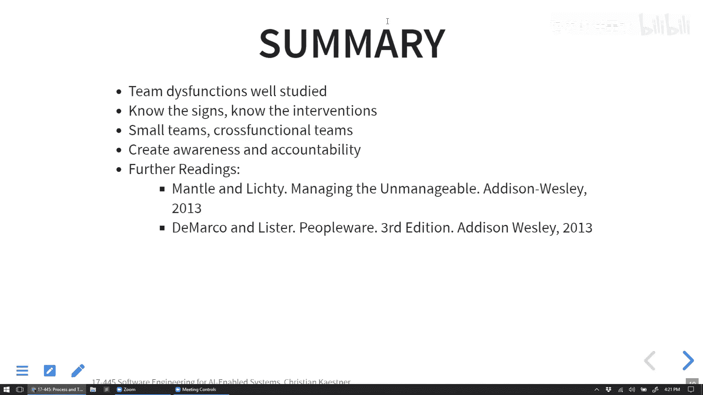

# 【全集】卡内基梅隆大学-AI驱动系统的软件工程-中英字幕-1080P-p22-Lecture-22---跨学科团队的培养与协作--BV1JS6gBcEBF_p22-

All right， we come back two more lectures today on interdisciplinary teams and then on Thursday I'm going to talk。

 I'm essentially just summarizing the class and depending on how far we get today。

 I want to have a discussion about kind of the future of software engineering and machine learning together。

But before I start as usual， what do you remember from the last lecture？

I can give you the safety key。But the key about safety。Does this ring any bear？No。😔。

talkedalked about safe driving cars。I was surprised that nobody had more knowledge about self driving cars。

We repeated that hazard analysis and different forms of kind of looking at requirements。

 looking at risks are useful for understanding possible problems and designing for them。

 we very briefly talked about a couple of kind of traditional safety design techniques such as redundancies and things。

I think kind of monitor controllers， things like this。Anything else？Robustness also。Comes up here。

 I actually debated for quite a while whether I teach safety or security first and where to put robustness because it kind of is discussed for both。

And I also talked a little bit about kind of the importance of requirements that safety issues are often getting requirements wrong right？

Machine learning。Prediction mechanisms are unreliable components that we need to think around that a lot of this is at system level。

 and then maybe the last part also that。Safety is not just for nuclear power plants and self driving cars so there's a broad range of safety issues that might not immediately kill people。

 but that might come up in everyday applications where it's supposed to think about safety。Allright。

Today， I want to talk more about kind of the。I started the class actually with this discussion of。

Data scientists on one side， software engineers on the other side。Them having maybe different focus。

 different specialties and how we can。How we should bring them better together and I want to talk about teamwork today。

 I want to focus mostly。On this part， but also a bit of traditional teamwork strategies before I get there I want to use one last case study that I want to use for discussion today and。

Even though I may not be able to use reuse the TikTok case study in the fall because it has been banned also。

 but let's assume this this is one of the very few social media sites that have merged right so there's not really anything new in this space so let's assume TikTook had a few standards also。

They had a case where somebody committed suicide life whether life tweeting this。

 they deleted the feed， but they only informed the authorities like many hours after they deleted things things like this。

 So let's assume they want to do better right， they want to do something for social good。

 they want to detect depression essentially， let's assume they。我要。

Think about so is anybody here using TikTok？Do you at least have a rough idea of what it is？

Kind of social media site。Mostly movie sharing， I think。

 short movie snippets known for an excellent recommendation algorithm， apparently。

And that's also the extent of my knowledge roughly。So。

But let's take the idea that you want to detect depression。

 maybe also other mental health problems and you might be able to do this with some form of sentiment analysis。

 kind of analyzing what kind of content people have writing。

 maybe look at what people who were diagnosed in the past have written。

 and then you can think also about a bunch of interventions， for example。

 people who you consider may suffer from depression。

 maybe you want to show them slightly different content， modify your ranking mechanism。

Maybe you want to show them some ads for getting ahead， some instructions， something like this。

 right maybe you're specifically designing small group features。

 This is something that has been studied a lot and kind of。Online interactions that kind of。

Things escalate if you have big groups and anonymity。

 but kind of in smaller groups you have much more healthy interactions。

 so if maybe if you find something where you only put like six or seven users in a group or something like this and engage them this way so there are all kinds of things that you can think about that you could do as a social media company if you can detect this so let's assume。

You're running some sort of machine learning to detect this on videos or you transcribe the videos and do this on the text or you use this on the images of the video。

U。They want to be serious， let's assume about this。

 so they are working with mental health professionals as consultants and they bring some machine learning researchers from some top universities into this who might help。

And maybe just for context， when I look this up， the US side of TikTok has about 1。

400 employees that are trying to hire like crazy， and let's just assume I have no idea that they have about 300 developers and data scientists and the rest is doing other things。

Right。Do you have a sense that a project like this， how this might be doable。

 how you would approach this？Is this kind of realistic enough that we can talk about this more？

So we haven't talked about sentiment analysis specifically that that's a form of natural language processing technique where you essentially try to pick up on verbs that are more positive or more negative to it's traditionally trained on movie reviews or so whether from the text of the movie review you can identify whether it's a positive or negative review right there are all kinds of these things that are trained also to detect hate speech and things like this。

 so you could imagine that if we just have enough labeled text like this is a text that a diagnosed depressed person produced in the past or selfproclaimed and here's some control text you might be able to pick up on this with NIP techniques and maybe there's also something that you could do with video data right and there's some profession that's involved who might give you clues。

We're coming back to this a couple of times。So again， as I said。

 I started the lecture kind of with this contrast of data scientists and software engineers， right？

I think。Again， this is。Overly simplified， but we talked about this a bunch of times。

 kind of painted data scientists， maybe as those people who have。

Focus much more on the machine learning side， often kind of narrowly focus on accuracy and maybe prototyping of early things。

 kind of modeling， and they focus mostly on kind of creating the model not so much on deploying it typically right and the software engineer traditionally is kind of more a system building person who deals with the reality of limited constraints and budgets and messiness of the real world。

But you can break this down further so is。嗯。There are a couple of these discussions of kind of a continuum of skills right it doesn't fall easily into separate groups so one thing that I store here is kind of a software engineer the one side that's kind of the person who builds systems and at the very far end maybe a research scientist so a researcher who takes data typically some linear regression to identify correlations to identify insights right and then applied scientist has more more of a not just pure interest in the data but wants to find something and apply it to something data scientist is maybe more involved and a data engineer might be closer to somebody who actually focuses on kind of。

Dealing with data maybe a bit closer to the software engineering side。Does this roughly make sense？

So there are lots of these discussions out there。And one thing that I brought up in the beginning is this notion of a unicorn in hiring so those are the people the people who have both software engineering skills。

 domain skills and machine learning skills are often called kind of unicorns they are the special they are the people that can do everything that have deep expertise and everything and the problem is that we have very few of those there are some people who are known to be really great at this and those are the people that everybody tries to hire and keep right but most of the time people。

Kind of experts in one or the other domain and it's questionable whether we can actually get everybody to have deep expertise in every topic。

So there are a couple of graphics like this。😊，I dislike this one specifically。

 but it's widely shared as kind of an overview of how different disciplines or different expertise fit together and Uniorn is essentially the description for somebody who's in the middle who has a domain expertise as a software engineer knows the fundamentals of computer science and math and statistics and as a researcher and everything essentially。

But again， in reality。And I like the arrogance of putting everything into this data science circle that all of this is data science。

 but anyway， let's not go there。So you read this discussion of data scientists at Microsoft。Right。

Also this discussion， I think。This is maybe a little bit more biased because also data scientists on software teams so they are often maybe a little bit closer already to products。

 but you saw that they have very different notions of kind of tasks right so you have a lot of people who are analyzing product and customer data who are looking at what do people like kind of from telemetry how satisfied are they are they coming to renew their subscription but there's also a lot of kind of data scientists that work directly on software problems this is kind of the machine learning for code or machine learning for software engineering field of bug prioritization back prediction monitoring and then also。

Some people who work on business problems and domain specific problems。

You saw in that paper that people were classified again into different。

 even the data scientists and there kind of were classified into different groups。

 Do you remember some of them？How did some of the people specialize？I remember one was polym。

 those were the guys who could do everything right that's their version of unicorn I think。哎。

Anything else， evangelist， I think these are the people who were。Who would not figure out these data。

 but they were taking decisions from the data。Right。

 or more of a manager type right who gets involved who really want to spread information， right。

And there were also discussions so those were the terms that they used。

 Does anybody remember any of the other ones and how they specialized？

I think one of the not sure which or maybe the data analyzer who is responsible for doing exploratory analysis kind of go through the data to find out patterns or something。

嗯哼。I remember platform builders were these software engineers who would do the telemetry part。

Right specifically to support other data scientists right kind of MOs that kind of thing right they had some roads of data preparer as somebody who focuses mostly on collecting data and maybe cleaning data although that's data shaper。

 I think in their analysis there some people who specialize mostly in kind of cleaning and feature engineering。

And then there are a bunch of people who just do this on the side with overlapping with other activities。

 the moonlighters。I think the main point here is just to show that even when I'm just breaking things down into data scientists and software engineers。

 this is extremely nuanced inside each group again， right people specialize and。

I looked up a couple of other descriptions and there are a bunch of them so kind of data scientists。

 data analysts， data architect， data engineer， statistician。

 and then people on the database side or the business side and so on。

 this was 2015 and then here's a more recent posting。

 again thinking about these are blog posts of how you can specialize and what if you want to go into data science。

 what are the things that you can do product data analyst， business intelligence。Modeling analyst。

 which has to do with financial forecasting mostly machine learning engineer。

 somebody who focuses on applications， so this is kind of classifying this a little bit by who the end user is right who are you doing this for are you trying to build an application are you trying to support the business and then some data visualization expert I thought was interesting as somebody who's really。

Analyzes data to tell the story to convince others， which is maybe the evangellist。

 And then the last role， again， supporting in kind of tool and platform data。嗯。This again。

 aligns with people who do more kind of scienceency things and people who do more product buildinging things。

 and that's fairly diverse there as well。嗯。Let see。

What roles would you identify among software engineers， That's also not a homogeneous group， I guess。

What are some of the different specializations？Like requirements， analyst tester I don't know。

 just broad developer， probably some infrastructure people I think also the front and backend distinction makes sense some Dev up specialists some database engineers or operators。

 maybe you could separate those from kind of。Soft engineering that's kind of a question where you draw the line right also at some point maybe product managers。

 software architects。来一次。Again， you have a large number of different kind of specialties。All right。

第一。Yep。The point when I'm talking about this is that forbidding。

Systems and I should have also put the TikTok thing here。

 we kind of need expertise from different areas。And we probably need expertise in different areas of software engineering and in different areas of data science as well。

And then again， there's a question， do we find somebody who can do it all？Who can do the databases。

 the front end， the back end， the DevOs， the testing， the architecture， the。Data engineering。

 the model building， right the financial forecasting， the building the platform， the MLOs and so on。

 what do we in practice actually have to build teams that consist of people with different specialties？

So you can only get that far。With。Few people at some point you actually need expertise from multiple different disciplines when you're building these projects right you can think of you' certainly need somebody who really knows about natural language processing in this part right and who knows about deep neural networks and audio transcription。

But you also need somebody who' is good at user interface design and actually building a web app and scaling it and distributed systems。

嗯。But now we talked about software engineers and data scientists and all their special roads。

What other people do you need in a project？If you actually want to build a product。Business analysts。

 some managers， probably。Alegal team。T us design us。Consultants forward。For expertise。

Ethics consultants， yeah， use a surrogate， somebody who might provide test inputs， right？Yeah。

 I think this covers also what I thought about mostly maybe UI experts， operations people as well。

 some lawyers， maybe you might not get away with。Right。水。所以。Again。

 kind of building a product is more complicated than just writing the software right or writing the model and you really need to as a system perspective。

 you need to make a business case if you want to have this as a product。

You need to look at requirements broadly with all kinds of different things like safety ethics。

 fairness security that we talked about you really need to think about in the machine learning project where you get the data from what kind of data can we get what data do we have right how can we engineer you need to think about about the entire process you need to think about quality assurance and operation so I'm kind of repeating myself but I think you get the point we need teams right and we typically need teams that have multiple different expertise in there。

So instead of just unicorns， we need people from different races together。

 we also need to do this typically just to scale size， but teams have issues。

And I want to go through some team issues。 So this have been broadly studied。

 So I'm not talking about anything new here。 and a lot of this has been recognized。

 and we' are going to talk about a bunch of interventions。

 So first example first thing I want to talk about process costs。嗯。So。Just off the top of your head。

How many people do you think we would need for this？

Social media detecting depression on TikTok feature， how big of a team would you assign for this？

All right， there's some priming happening， but still I see numbers between5 and 50 so far。嗯。Danny。

 you want to justify your five what kind of people would you put on the team？Sure。

 so I was thinking some one person in the sort of leadership management escal oversight the direction of the project。

 probably one senior developer who's kind of just。嗯。You know。

 more senior and kind of broad development expertise。

 you probably want one person who's more domain specific so lots of sentiment knowledge and then what am I at for and then one sort of junior person just to do some work。

To do the extra work， okay？😊，Jake， do you want to think about a little bit Yeah。

 so most of mine would not be developers either。I'm just thinking that， yeah， you know。

 maybe you'd have a technical manager。And a business analyst。And， you know， somewhere 2 to 5。

 a team of developers。 and then the rest would be some of the。Other other miscellaneous role。

 a lot of it， I think would be。Basically acquiring and engineering the data to a good format and cleaning it and all the kinds of things we talked about just to make sure we have a good reliable set and having testers and QA I just that those people would be cheaper to pay the salaries for but there'd be a lot more of them in this picture but also yeah clinical professionals maybe yes yes a bunch of those。

Researchers， if we want to involve them some you kind of all left out the machine learning specialist。

 maybe to some degree right， we probably want the bunch there or some。嗯。

Right I have a couple of pictures here just to give you a sense of different team sizes right and how this might scale so Twitter was founded with three people in the beginning kind of friends and。

This is easy， maybe you have an office right， you kind of just communicate everybody in one room or one select channel。

 I don't know。嗯。😊，Instagram， when it was acquired in 2012， for 1 billion， had 13 employees。嗯。

This is 15 here I think so this is still I think something where you can think about a fairly cohesive team。

 but then if you start going to 50 or 200 people， which is not unusual for a company even for a startup company right you need to think about so if you want to do an all hands meeting。

 this is what this might look like right this is a lot of people so you probably don't want to communicate with everybody about every decision so you need to start thinking about some structure So this is not actually representative of any real teams I was just looking for for pictures with lots of people right and then this is a picture of about 1200 people which was two or three years ago the size of Uber's technology team right so at this point when you have。

Like 1200 people you really need some sort of structure right so you can't talk with everybody one of the oil it resides is kind of Brooks law。

By Frederick Brooks， after saying adding manpower to late software projects makes it later。

 right So this is broadly accepted。 I suspect this has been studied also， but nobody kind of。

Questions this， really。 What causes the effect， Why is this。

A problem kind of adding people to a late team。I think onboarding is like one of the most expensive。

Processes。Yep。Training them knowledge transfer。 So if you're already behind and then you're bringing in extra people。

 that's one thing。Also just bringing in more and more people， why might this also be a good idea？

I talked about process cost earlier。Why are really small teams sometimes much more effective than larger teams。

The the code may not be the writing of the code may not be parallelizable if a lot of the changes need to happen in a small percentage of the code。

 you're not going to be able to subdivide it and have everyone。Working on non conflicting portions。

Yeah。Rk， what do you mean by communication scale？So in a larger team， it's very tough to。

Tell about the vision and what's going in the project。

 essentially it's very tough to manage that whereas in smaller teams it's much easier。

RightSo if you're sitting in the same room and you can just ask your colleague about or tell them what you're doing right or even if you have a few rooms and you can still have a standup meeting。

 that's very different than if you're starting to introduce hierarchy and some form of organization mechanism so the problem is that the number of communication links。

Scas quadically with a number of developers right so if you add one more person and you don't have any structure。

 they are talking to everybody adss if you're talking adding one more person it adds a link for everybody right so。

And at some point， large organizations tend to have a lot of bureaucracy。

 a lot of meetings to get just everybody on the same page。

So typically what we do is we divide large projects into smaller teams。

And then we make somebody responsible for the communication between the teams right so that not everybody on every team needs to know what everybody else is doing。

 but some people some have the larger picture in mind。

 they know what the individual teams are doing and are coordinating where needed。

And then the teams are communicating within each other and are more effective。

That's the idea setting， at least。What are some of the problems with this kind of approach？

Dupplication of effort siloing right so the developers may not know what everybody else is doing and。

Managers， the coordinators may not be aware in sufficient detail at the lower level right so you might see duplication。

What is。Singer point of failures in terms of communication right so if you have some people who are bad at communicating。

 this might drag down the entire team。It's bit of a telephone game where there's some information lost in the process。

Yeah。And in general， there are arguments against hierarchies that people on the top might be too far away from what is actually happening and people at the bottom don't feel like their voices are heard and so on。

So there's a lot of discussion around what's a good size for a team。

 a software team and there have been many different designs and I'm not sure how far back I should go。

 so this is maybe interesting from Brooke when he wrote about this Myic Amendment month problem what he was suggesting was such a good teams which just looks really weird from today's perspective essentially you have a chief programmer who does most of the programme in the initial documentation and then each programmer has a staff of eight or so people who kind of support the chief programmer so it's kind of very specifically one person。

And then a bunch of people who had cop pilot as somebody who helps and represents the programmer in team meetings。

 that sounds nice。You have some administrators， you have an editor who edits the documentation。

 although the chief program is responsible to write the initial documentation。

 it's so important to secretaries， a program clerk， which would be today a version control system。

 to Smith who writes specialized tools for this programmer。

 a test language lawyer would be a compiler these days， I guess。

Sounds a little bit weird right there this whole focus on one person this is kind of the unicorn story again you have a few people who are kind of good at everything or the 10 x story that you have just some people that are so much better than everybody elses。

Fosters a little bit of arrogance and hierarchy。哎。I mean。

 you can try it whether you find 10 people to support you in what you're doing as a programmer or if you start a company。

 but I think this is。This is maybe not what we're going for these days Most companies talk about small team practices。

It's raining pretty badly， I'm not sure whether he hear this on the microphone。UmSo。

Microsoft talked about how they're doing small teams and give them a lot of autonomy a newer version would be probably Spotify that's copied a lot that has this kind of small team culture with a lot of independence that can take their own risks so in Microsoft they had three to eight developers on the team and then another three to eight testers and a program manager and the product manager that would kind of coordinate things。

Agile practices typically recommends like seven people in the team。

And we haven't really figured out how to do larger things than teams of teams， really。

The question for us is， and there's lots of examples like this。

 how small teams are more effective than large teams， there are lots and lots of stories。

 maybe those are just anecdotes。But lots of examples where large teams create six times as many effects as small teams and obviously burn through a lot more money。

 yet the large team appears to produce the same amount of output and not much less time。

 right and this kind of fits over and over again， like large teams like small teams tend to be more effective。

But then again， did I have a slide for this somewhere。But then again。

 you just said we want to have maybe 50 people on this project， right？

Which means you need to start thinking about smaller teams even for a project like this。

And you not need to start thinking about if we want to have all these different forms of expertise here like。

Like a healthcare professional and a machine learning professional and a devaf ops person and a software engineer and maybe another software engineer and maybe。

Next， but on a lawyer and so on， right， how big is your team growing， how can you design this？

So the typical recommendations are。Well you need some hierarchy at some point or at least some structure of teams of teams and kind of assign different responsibilities typically。

Have you heard of Convoy's law before？That's the idea that the organization structure should align with the code structure。

 otherwise you have a problem。Here's an example， so if。

If the circuits are modules and the lines are connections。Oh no wait。

 those are people and who's talking to each other， so we have two teams。

And this team is responsible for part of module A and module B。

 and this other team is responsible for all three modules to some part。

This is not a very congruent structure， right， because the team structure does not align with the。

Soce code structure actually for module A there are two they are people from two teams responsible so for every change within that module they need to coordinate and module B again two people from two teams are responsible they need to coordinate they don't even have a direct link right so they would coordinate through their managers this is dangerous this creates additional overhead so what you often want is that you kind of。

Decomposes the software into modules and some form like front and back end microservices these days。

 and then assign individual teams to each project right never two teams to the same module。

One team might cover multiple modules and then have clear interfaces between them。

So you separate the software along interfaces and you separate teams along interfaces and if you have a problem with that module。

 you can go to that team。Does this make sense？Any idea how you would structure？

In this specific example， teams， let's assume we're not getting away with five people。

Maybe we don't need Jake's 50， but maybe somewhere in the middle the Vx are just 25 so let's say we have 25 people so we need maybe three。

4 teams。Something like this， how would you？How would you structure this？

Maybe if we were looking top down， one thing we could think about is the machine learning pipeline。

That might not be comprehensive of everything we need to do but。We could start you know。

 with have people to do the data acquisition and people at the other end to build the the final models and you could。

And that way you'd have your functional separation because you'd have people for the subdivided pipeline。

That sounds plausible to me that somebody is really responsible for kind of getting past data annotated。

 right identifying。Diagnosed users and their activities for getting other data。

 helping with labeling and cleaning。What would other teams do or what would be other structures？

One thing which I have seen in my previous work experience， they， they have teams of。

Wwhichch collect the data， essentially they they pull the data from everywhere and store it at one place。

Then there is one team that analyze that data those were called data analysis， at least in my work。

Environment。Then there was one team which were like machine learning experts。

 they would take all this data that has been analyzed and build models on the basis of that。

And then there was one team which was working on the infrastructure part of everything。So again。

 along the pipeline kind of plus a team that provides the infrastructure。

 we left out software engineers kind of， but except for the infrastructure。

 but somebody who integrates us into TikTok，so you probably have some front end and some back end engineers there that you might split。

You might think of this detection feature as a separate microservice right so somebody developing an endpoint for this and then a different team integrating this into the rest of the product。

 thinking about how to do the advertisement or the small group features，Interestingly， I think。

What you discussed so far was mostly splitting data scientists and software engineers into separate teams。

喂。We'll coming back to this in a second。嗯。は。So a different team issue than I want to talk about is having multiple and conflicting goals。

 This is kind of。the basis for DevOs， right where you had developers and operators who had different goals like an operator would try to keep the system running and a developer wants to push new features out quickly。

It gets things into production， gets things used， and those are not necessarily aligning。

 particularly well。Right so the bringing out features quickly does not necessarily mean that they are highest quality and easy to operate in production or to operate with low resources right and DevOs does a lot to kind of share responsibility and。

I think we talked about this earlier， what are some of the conflicting goals that you might expect between data scientists and software engineers？

Accuracy rose efficiency， right so one team。B it's a very high accurate solution。

 even though it's stupidly expensive to run and operate。Yeah。

 training on more data and how long it takes right， so the time it takes to update。Anything else？

It's very abstract， but building better models versus just building better systems。Right to。嗯。

And I think we talked about a bunch of other things like。

Evaluating accuracy across the board versus looking at things like Venness at safety cases at different different forms of different test cases。

 right？Thinking about yeah efficiency we already talked about different model size you kind of talked about。

 but all kinds of different quality right thinking about debugging of the system later building a more accurate model that's harder to debug that's maybe harder to operate so a bunch of these。

Maybe that's easy， but what might be a conflict between kind of a data scientist and a lawyer in the company？

Yeah， how much do you anonymize data right， how much do you not collect data because of privacy issues。

 how much do you protect your models。嗯。Right mostlyly around privacy， some around security。

 what can you do and be。Legally allowed to do， how can you phrase us off things like this， right？嗯。

So what might you see in this TikTok case， what are different roles so data scientists and software engineers probably have a bunch of similar things where maybe the data scientists want to be the most accurate and the software engineers want to run this。

 maybe and some reasonable cost or the operators want to run this with some reasonable cost。

 what are other things that you could see here。Other roads， maybe that might be in conflict。Yeah。

 ethical consent of how how to present this to the users。

 how to it's a sensitive topic right so how do you present this， how do you get the data。嗯。What else？

How might business people have a different opinion or。The medical heads professionals。

The advertisers。Yeah， having a flashy win for marketing rather than a scientifically correct result。

Good idea。You might actually lose advertisement if you implement this right and at some point you need to set a threshold at what point do you detect。

Depression， are you only going for the very sure cases that you don't lose is a lot of advertisers or advertisement money or are you going more broadly because you want to。

Go for more for more impact， right？ So I think there's。

 there's a lot of trade offs and different people in different roles may have different opinions。

 And the problem is， again， if they are on different teams。

This might be harder to coordinate and to agree， right。

 They might be actually working with each other。 It might be harder to coordinate。

 So how can you address。Goal conflicts。How do you negotiate all of these issues that we talked about？

Actually， let me try something that I did in the earlier lectures and then didn't do anymore。

 I type something。Type in answer， think about what you could do， but don't send it yet。

And kind of two thumbs up also when you have written something。Want you all to think about。

If you have people with conflicting gods and different teams and different growers， right。

 how can you bring them？Closer together。Maybe there's something that we can learn from Devops， right。

 This has worked where we brought developers and operators together。

 What are other strategies to bring。People with different roads and different incentives better together。

So type your answer， don't write it yet， don't send it yet， and then say yes， when you're done。

So how do you get the business people to。Work together with the data scientists or the marketing people。

 or the。Ethics。People are the security team。Waiting for a few more yeses。中学。All right， click send。

So have a common organizational goal， have a vision for the organization or for the larger projects。

RightSo a lot of this is management。Advocate for， for each role in a team meeting。

 set communication goals。 right， be clear about this。 show the conflict。 Have an owner。

 a product owner who makes a final decision who adds acts at the bridge， right。

Invite these kind of discussions have right。Maybe try multiple things see which one actually works right so they are a bunch of strategies one thing that I think you didn't talk about is have people that can actually understand each other's concern one hiring strategy is sometimes called higher T shapepe people so you don't only want to hire people who are experts at exactly one thing。

And not only generalists that kind of know a little bit of everything， but people。

Who have this T shape that they' are expert in one area， for example， machine learning。Expert。

 but they also understand the fairness literature， or they understand the concern of。

Of deploying the thing， right， or you have a software engineers that actually knows what the problem with all the data is or how you would test this。

 So I think this is one of the strategies to build teams of people with。Different expertise。

 but overlapping kind of vocabulary， right， so。To to find people who who you can compose that you cover all the team or the areas that you need。

 even in separate teams， but ideally within the scene。

 but then foster communication this is by the way， one way that I think about this course of。

Helping people on one side or the other side to to see the other side。

 not necessarily to completely do the data science part as a software engineer or do all the software engineering as a data scientist。

 but be broad enough that you understand the concept that you can talk to those people that you can understand this。

 I think this was one of the key。Steps and dev ops that you created mutual awareness of the respective problems right also help to create joint goals。

 right， don't create different incentives but have joint incentives right and shared responsibility。

And team organizations more classically theyre these different views of how you organize teams。

 the traditional organization is kind of a matrix organization where you have different departments。

 so you have the machine learning group， you have the system programmer group。

 you have the Teer group， you have the security group and the marketing group。

 and whenever you do a project like this initiative to address mental health issues。

 you kind of grab people from these different departments and bring them together in the team。

The problem with this approach is that。All these individuals have two bosses typically。

 they have one in their department and they have the project lead。

 they're sometimes working on multiple projects at the same time， which can be challenging。

 but there is value in having a dedicated department where all the security people all the machine learning people know each other and can talk to each other rather than being spread out。

At the alternative。Common approach is a project organization where you assign people to a project and they don't have a home department。

 right， So the projects are。covering people from all different departments essentially。

 but they belong to the project and once the project is done。

 you essentially redistribute the people to other projects。

 they're not necessarily going home to their home department。

There are a couple of trade offs between those two， and there are a couple of mixed methods here。

In a centralized。There's lots of stories how how it's complicated to deal with multiple bosses and if you have kind of a studio or kind of project organization you can focus much more on the project right so you don't have the overlap but the disadvantage with this is if you only need like。

A fifth of a security person on your team。Do you want a security person on your team the entire time do you conide with somebody and then you have kind of a hybrid organization so for specialists there are a couple of ways to organize them this could be machine learning specialists or soft engineering specialist on a machine learning project or security peoples often talked about So in the centralized kind of organization you have。

诶。A group of specialists like a security department or a machine learning department and they con with the development teams distributed would be the project organizations where you have a security specialist on every team at home。

And then you have some hybrid models where they have a home organization。

 like the Matrix organization where they have a home。

 but they also work on the teams or they're borrowed to the teams。What are the trade offs。

 why would you pick one over the other of these organizations？Let's see， let's say you have a。

You have a machine learning project and you need some software engineering expertise。

 somebody who can look into requirements into feedback loops and maybe safety。

Would you have a kind of software engineering department。

 would you have a software engineer on every team， would you have some hybrid organization。

 Why would you prefer one or the other。Hybrid in terms of availability it's better so if you are having software engineer in your own team in the machine learning team。

That software engineer is dedicated for your own work。

 whereas if you are asking for software engineering work from any other team。

The availability becomes an issue like the other team may say we don't have time and things like that。

 but one disadvantage which I have felt is like managing such teams is a problem。

 the goals of people are different the work that they do are different so。

Managers may be biased towards certain things。嗯。So if you're actually on the team。

 like in the distributed fashion， you're much more involved with the team。

 this is I think what YT is trying to say。Fm。If you distribute people into the teams and they have very specialized expertise。

 they might be less inclined to keep up with news so if you have somebody on DevOs and who's part of the team。

 they might not talk to all the other DevOs people or MAOs people on different teams kind of to see the latest developments。

 this is where hybrid organization makes sense。at least the specialist network。

And depends a lot on kind of how important the role is right。

 whether you want like only 20% of the time of a person to con。

 but then they're working on multiple of teams or whether you can hire them full time on your team。

Right and again。Often it's better to have specialists that can help out and have everybody else have some awareness。

 So this is for security where this has been studied and this is after a bunch of back and forth。

 this is what a lot of people including Microsoft tended up on you want some security awareness for everybody on the team。

Not everybody becomes a security specialist， we don't want unicorn， everybody to turn into unicorns。

 but they need to buy into the process。And then you want specialists that kind of come and help out。

They're either on the team and can talk to everybody or they come and head out on a time to basis。

Here again， we can think about， so you divided actually the larger teams into smaller teams that have mostly sorted into data scientists or software engineers。

That's fine， right， but the larger organization needs some structure to align goals and to enable some communication here。

嗯。And it's kind of parts projects in a larger project yeah。Teams in a larger project， probably。

It helps。To not avoid conflict， to actually expose our views， to come to a decision。

 but then to commit on it and assign  responsibility。

 there's a lot of literature and conflict management and how to detect conflict and conflicting goalss the couple of agile development techniques that are actually addressing this kind of stuff fairly directly。

So I assume most of you are familiar with a lot of agile development techniques。

 which of those help with teamwork if you have kind of to bring everybody on the same level to avoid kind of conflicting goals。

 things like this。Does sprint planning do it a little because everybody on the team has some input over。

What you're doing a little bit Yeah， everybody has a larger goal right and then you're as a team you're developing or you're dividing the work。

Standup meetings help to kind of keep in touch， right to see what people are doing。

Anying else on on the。I'm just wondering does prioritization help here in terms of even though the team members may have different goals。

 there is another authority， which is product owner who is deciding on the priority of the work must follow according to that So So you're talking about an onsite customer or some of those techniques Yeah。

 so you can have an onsite customer or you can have a product owner within the company who is dealing with the right So so that's another strategy where you have somebody to kind of set the higher goal right and mediate conflict right if you have the customer actually onite。

so that bunch of these。And actually， this is not surprising。

 a lot of agile techniques are really supporting group work in different forms， right？

Two more group issues， but I think I might only get to this one group think。

Does anybody have examples of groupthink in software projects or machine learning projects？

So first of all， group thing I think a comic explains it quite well right is if a group never disagrees on something where you essentially don't question any decisions you just follow。

Often the manager or somebody blindly right or follow the crowd。

 what might be some examples of groupthink in software projects？Yep， story point estimation。

 so in general， time estimation， the first person。Giving a number。

It's very it's priming everybody and people might not actually question that。Other examples？

I don't know if this this counts， but like code reviews。

 there's a lot of like well you did the code so it's probably good or this person looked at it and so it's probably good。

Group think maybe with regard to security。So I like what Jake says that we're just using deep learning without thinking why right were just following the hype everybody is doing deep learning and maybe we actually need explainability or some of those issues not addressing technical debt we need more features we need more features we don't think about this I think those are all examples It's a group thing is the idea of minimizing group conflicts kind of increasing cohesion avoid exploring alternatives suppressing dissenting views and then isolating yourself from outside influences there are lots of examples in business like Swiss Air is in famous one which was called the flying bank like a super solid airline suddenly went bankrupt so everybody was just thinking oh we are the best airline ever and they were not looking for warning signs and they were。

Actually not realizing that they had problems so this often leads to aration and dysfunction of decision making right so cost and time estimation is a very classic example as well use of hype technology in all forms right machine learning you just throw machine learning at a problem because everybody is doing it now might be rational but if that's the way that you get funding as a startup right even though it's just put this in the title but using this actually。

There was a time where everybody put blockchain， did something with blockchain right or everybody needed to put Agile into a project。

 DevOs AIOs， things like this， so just doing this because everybody is doing this without questioning this is a form of grouping right？

So causes are typically that you have high group cohesiveness。

 high homogeneity and you avoid conflict so there are structural faults as well that you have insulation you don't talk to others to talk to other groups or you don't have a。

A way of exploring the design space or youre just under stress。

And don't want to think right so you don't think about more broadly and the symptoms are usually overestimation of ability。

 so this is a Swiss bank example again they said invulnerable， they didn't question this。

 they think they are moral， whatever they are doing they can't really go wrong and then being close minded。

 ignore warnings， ignore stereotyping。Kind of pressure toward uniformity save sensor or push out dissenting opinions。

 but safe censorship is actually much more important that people come to meetings。

 they hear somebody saying something like we should do machine learning and。They might not agree。

 but they don't speak up because they know what they're doing， or I don't want to be fired。

And so this is。Kind of went on in tech。The example here。Quest is from？

I never made it past the first episode of Silicon Valley， but。I mean。

 at plays with a stereotype image， right， big uniformity， law and diversity。

 which is very common form of leading to group thing。嗯。

So diversity is one way of trying to address this， there are lots of studies on this showing that diverse teams are better at problem solving。

 they are looking at problems from different angles。

We this came up multiple times throughout the lectures， for example， in safety issues。

 had nobody thought about possible。Disabled users， wheelshaair users with the robot when they're doing the route planning。

 they actually had involved some disability groups in their planning。

 at least they claimed there are lots of examples of technology that doesn't work with for certain groups right we talked about bias and unfairness and you might avoid some of this maybe if you have some more diverse teams。

嗯。But there's also the article that you read from。About fairness practices that even if you hire more diverse teams。

 you probably that alone will not be a fix， you won't be able to represent everybody on every team。

 so you need also ways to think beyond that， but this is a good start。So。

What could be forms of group think in the TikTok case？

What could be things where you made make bad decisions because you're avoiding conflict because you have a。

Very non diverseverse， homogeneous team。嗯。Any ideas， anything that comes to mind？Yeah。

Defining a label for depression， having a very narrow or very negative view of depression potentially。

That probably helps if they are working with healthcare professionals， right？八。Yeah。

 this is a problem that people who don't have experienced in their life might have a very biased view of this right so actually having somebody on the team who has struggled with depression might actually be helpful to have some perspective on the team right the firsthand account。

Different cultures have different views of mental illness， there might be certain biases。

You might just go in doing this with sentiment analysis because everybody uses sentiment analysis or that's the thing that everybody on the team has used in the past right so maybe there's a better technique。

Maybe the manager suggests a certain intervention like showing ads for getting help， but。

And nobody speaks against us because it's a manager that suggests that this or even the CEO， right。

 but they are medically much more efficient ways maybe than just。

It's showinghowing you an ad do you have depression， here here's how you get ahead。

 maybe there's better ways of doing this， but you might not explore them because you didn't look at different solutions。

Anything else？嗯。Yeah， I think we talked about most of these so one more time。

 what might be mitigation strategies。How can you reduce group think。

You can think of agile techniques， but also other things。嗯。Should I make you type first again。

 let's do this one more time， please all type and say yes when you're done。嗯。

More diverse hiring is is one thing you could write。 It's maybe obvious after what I shown。

 but maybe you have other ideas， maybe some agile techniques， maybe some management techniques。

 maybe some。Teamwork techniques that can help you to break group think。So type your answer。

 say yes when you're done。Doesn't have to be in the TikTok case can be more general。

 but maybe also you have ideas specifically for the TikTok case。Can I get one more。All right。

 present enterer。All right， let's so create a climate where people actually speak out well this is a climate thing right。

 which you can do as a manager where it's not penalized where you actually encourage conflict up to a point。

Shuffling team members here have different perspective。

 anonymous feedback if there's no climate to speak out otherwise， different interviewing practices。

 hire more diverse teams。Have more yeah have more fair meetings or kind of prevent one dominant person it's actually a common recommendation to have the boss not speak in the meeting or not even be present often or at least not speak first because this might bias everybody。

Let everybody explain the rationale and just reaching consensus quickly， right？

Maybe one on one communication with the manager socialize with the team outside of work， yep。

So there's actually a lot of research on this。And I just have a rough summary here of a couple of directions。

 so diversity in team composition， right hiring and how you compose teams and how you think about this。

 a culture of open conflicts， this takes some getting used to but kind of saying that conflict。

 at least up to the point is actually healthy， you want to see different rules。

 a point a devils advocate and a discussion。So in every meeting you have one person who's supposed to poke ho on this and then if that person does it。

 it's not perceived as a kind of a negative thing， right or it's normalized。

 moderate and rotate speaker order， right that you don't have the leaders only starting and doing things involve outside experts。

 always request a second solution， never go with the。First one， unless you exploit alternatives。

Right and then Agile has a bunch of techniques again planning poker helpss onite customer might help to some point to provide an outside perspective。

 right planning poker is the idea that everybody writes down time estimates before they show them to others to avoid bias each other。

Things like this。All right。Anything else on group think？

Only have a few minutes when this is my last point I don't want to go too deep into this social loing is also a very commonly studied team phenomenon I'm not sure how common it is on software teams the。

The issue here is it has been very well shown that the more people you have on a team。

 the smaller the individual contributions it's very easy to hide in a team and there are actually lots of funny experiments so on rope pulling contests。

The more people you have on a team， the lower the individual contribution。So if you have fewer。

 people pull harder。This has been replicated with clapping and with cheering。

 so if you have a group of people that are all clapping or all cheering as loud as they can。

 the larger the group， the lower the result。嗯。This is very common that。

The main reasons here are kind of diffusion of responsibility。

 if there are few people you're responsible for this and if there are more people you can hide in a crowd。

 it's also you get less recognition because it's you're one of many people who contributed to the success。

So you're not individually pointed out and recognized。And。Then if you actually experience。

That you're pulling everybody， then you don't want to be the sucker who puts everybody and you're also tired that this is actually very common on student teams。

I have no idea about your teams， but you have a reflection coming up if you want to write about something like this but。

You probably have seen teams where you've seen some of those effects。What can you do about it？

Let's not do the waiting for everybody step， just any ideas。Smaller teams is one thing， right。

 Small teams are。Are helping to avoid this diffusion of responsibility。

For academics peerre writing my head。That will only go so far inside a company， right。

 You have staff evaluation， but yeah。Right， so subdividing the work into smaller tasks is a very common thing that you actually can recognize the contributions of individual people they can't hide as much right so the whole idea of kind of kanban boards or sprints kind of breaking it into smaller pieces helps people to give。

A specific。Recognition for tasks and responsibilities for tasks。

Right stand up meetings kind of showing what has everybody been doing， right gives recognition gives。

Gives visibility to tasks that this might help。嗯。I'm not sure。

 So the research on incentives is actually。Mostly showing that incentives don't work。

 so if you threaten to fire people quickly or if you try to pay them more for certain things。

 bonuses， that's actually not a great incentive actually。

Slide for this that's actually not a great incentive for creative workers This works if you have somebody who works on an assembly line or at McDonald's or something like a very routine job。

 but for creative people they are not motivated by pay after a certain amount and bonuses don't really help and bonuses actually make have a weird effect that they eliminate intrinsic motivation。

And you game for extrinsic motivation， you start doing things for the money to focus specifically on some goals and not because you want to do them and you enjoy your work less and you're less motivated and might actually work less。

嗯。This book is very interesting， D pink describing the motivation or what drives people and he breaks it down into essentially autonomy。

 mastery and purpose， creative people which applies to essentially all software projects are driven if they have autonomy。

Spotify Netflix is extremely well known for this giving people high autonomy and that they can choose and do and take risks and so on。

 they're also a company that fires people fairly quickly if they're not the on the top of the game。

 but the autonomy can be extremely motivating mastery， if you're actually a specialist and something。

 if you can actually take pride of your work， if you can go deep into something。

 that's something that motivates people the 10，000 hour rule， you spend 10。

000 hours on something to become an expert and something and be proud of it。

And in purpose doing something that you believe and have a mission behind us。

 which might actually work with a Men heads project， for example。

 right where you're not just making the company money。

 but you're actually doing something that you're proud of。So in general， all of these things。

That you mentioned help with mitigating social loafing， so smaller tasks involve everybody。

 make things recognizable， identifiable， smaller teams， reviews， feedback， things like this。

That's all I had today。 So I wanted to talk about。Kind of in general more teamwork。

 but focus specifically we talked about we started talking about data scientists and software engineers and who adss you might need in a project for building these projects right and that you have very interdisciplinary teams and they are a bunch of problems。

That typically come up with is right conflicting goals， process costs， group think。

 you kind of need to think about how to structure teams。嗯。And things like this。

 there's lots more reading on this， you kind of tend to go into management and business literature。

 but there's lots of things that can actually be learned and applied in designing teams and thinking about this。

