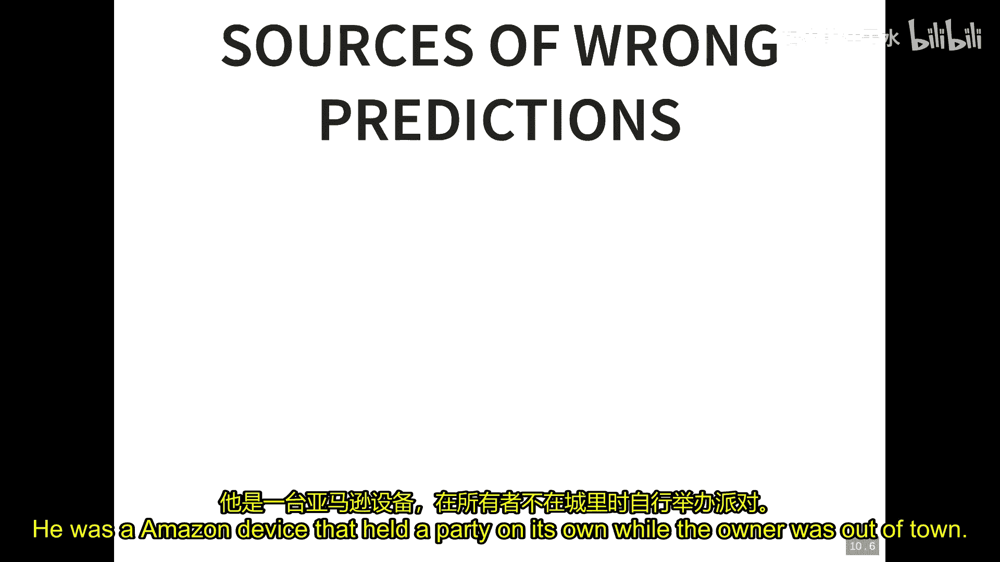
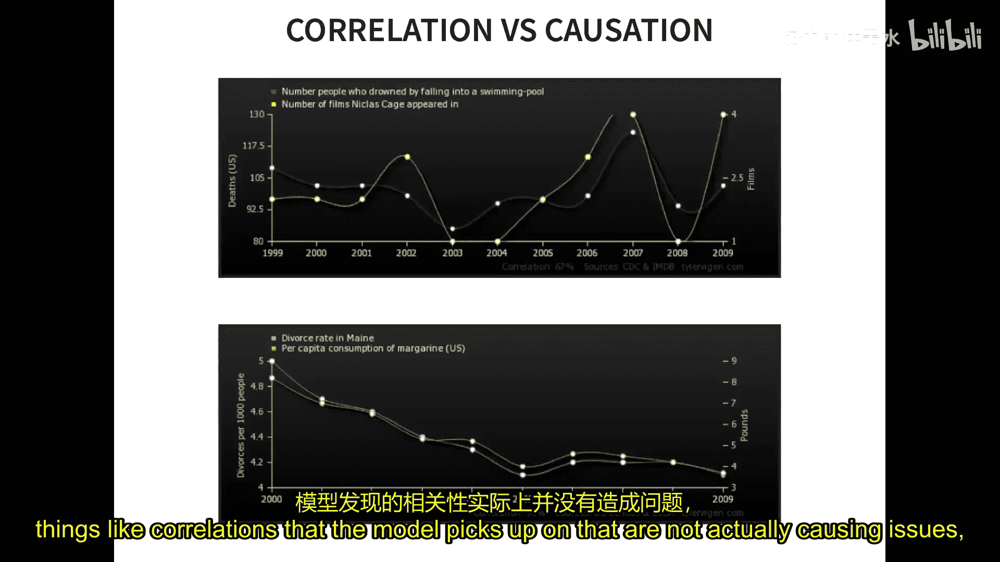
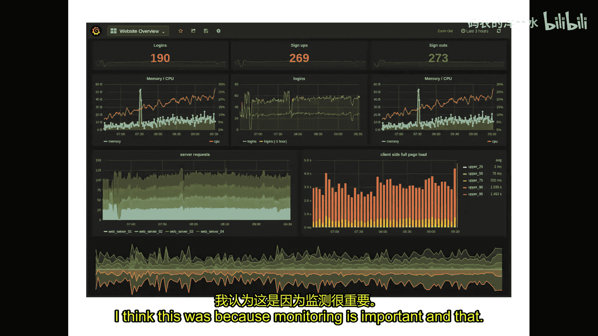
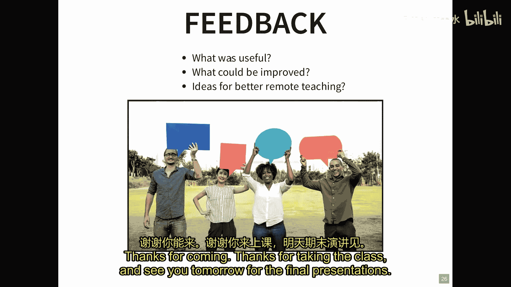

# 【全集】卡内基梅隆大学-AI驱动系统的软件工程-中英字幕-1080P-p23-Lecture-23---总结与反思--BV1JS6gBcEBF_p23-

So for one more last time， what do you remember from the last lecture？

Different forms of team structures， right the matrix structure organizations and alternatives。

 different roads， group things， social dophing， all right， I take it。So what I want to take today is。

I have three parts。i。Posed or this will be posted in two minutes a feedback form on canvas。

 so I would like to get some feedback of how to improve this class in the future in the first part of the lecture though I kind of want to go through the entire semester I picked a bunch of slides。

I couldn't get it below 400 so I'm kind of going through them fairly quickly kind of put the pieces together。

 kind of repeat a little bit what we talked about so essentially what I'm asking you in the beginning of each lecture kind of what you remember from the last time I'm going over a bunch of stuff you up really learning for final but I think it's the useful thing just kind of to kind of look back and see what we talked about and how some of those things might fit together and I have a bit of a discussion after that about。

Where maybe the field might be going， kind of software engineering for AI。

 what kind of open challenges are， how to view this。

 and I would like to hear your opinions there well。So。I'm going to start with this。

Overview and if you have any questions， feel free to interrupt me。

 I try to see whether I can actually do this in 140 minutes。

All right so I essentially just picked a bunch of slides。

 I tend to pick the ones that have graphics in them so it's not super representative but we started the semester with some introduction I kind of introduced the logistics in a pandemic and we kind of get to know each other and then I started pretty immediately with kind of a contrast between data scientists and software engineers and we talked about the different broads and how we care about all kinds of qualities and actually already in the first lecture I used this case study and we talked about how to actually bid such a system you need to do more than just build the machine learning model we talked about the syllabus and the structure I introduced the textbook which actually at this point you read most chapters of a few days ago I kind of went back and thought about should I assigned the remaining ones but this were only kind of a few sparse ones that I think you have the gist anyway。

Talked about the structure of the course and then we did introductions kind of went around the room and I think I covered most of the topics that you mentioned that you were interested in at that point and the last thing we did in this first lecture is talk about the role of specifications more precisely the lack there of with traditionally we may have some but it might be really hard to kind of specify what actually a machine learning model and this may actually have to do more with deductive reasoning and result in design sheets right so the first case study the first homework assignment essentially bid directly on top of this kind of a case study looking into。

A real project thinking about what are engineering issues and kind of detecting malicious advertisement。

And then in the class I actually spent two lectures talking about machine learning and artificial intelligence。

 so we talked about what is machine learning kind of tried to define it。

 had an example of housing price predictions， talked about things like linear regression and decision trees。

 I actually showed you how decision trees work in more detail。

 we talked about overfitting and underfitting and how you detect this and the split of hyper using hyperparameters and model parameters and where all these weird words come from。

 talked about splitting training and validation set right so kind of the basics of data science and fitting models talked more about overfitting。

 talked about how actually you might want to split this into three parts even and be careful with benchmarks。

 and that in practice you actually care about the entire pipeline that data scientists work in a very iterative way。

 kind of a very explorative way， use notebooks， we talked a little bit about advantages and this。

vanages of notebooks and we talked about AI a bit more broadly that there's a bigger umbrella beyond just the machine learning。

 we didn't really go into that much in the class later so kind of popped up here and there but there's actually a pretty broad range of artificial intelligence not just supervised machine learning that kind of act humanely thinking humanely thinking rationally acting rationally and a bunch of different techniques in this area so we talked a bit about different problem classes for machine learning looked into neural networks and how they work。

 how the kind of the step functions work so that you have an idea of why they hard。

 why they're hard to interpret we looked at mighty layer and deep learning and some ideas and talked about how some of the problems are really having this huge number of parameters。

 networks of billions of nodes and weights that are pretty big to store and very briefly。

We also talked about kind of old fashioned artificial intelligence。

 it's not machine learning like buoyant satisfiability that you can use to encode all kinds of problems like configuration issues。

 constrain satisfaction problems， probabilistic programming and how those kind of approaches might actually give you guarantees right so when they give you an answer you may have a guaranteed correct answer at least in a probabilistic sense。

As a homework assignment on top of this was the first kind of was a longer assignment。

 but kind of a warm up assignment to start some modeling right I gave you a dump of a Kauffka stream or not a dump you actually had to get a dump but try to predict movie popularity。

To kind of get familiar with the infrastructure。We then talked about model quality right so kind of talking about how a model is learned。

 we try to think about how models how you can do quality assurance。

 how even to think about this and we talked first about this is a fairly common split that we had later right kind of the machine learning view and then the software engineering view。

First we talked about that machine learning components are kind of these untestable programs。

 we don't know the correct answer right we don't have a specification we talked about this with many。

 many case studies this one was cancer detection and。That the system is much more than the model。

 but really at the machine learning level you talk about things like accuracy。

 we start with the confusion metrics and that even you kind of always want the baseline thinking about just 99% accuracy without context might not tell you much depends a lot on the problem we talked about different kinds of mistakes。

 true positives， what negatives and how they're important。

 how you can derive this kind of binary classifier from the mighty problem class more about true positives towards its negatives and how sometimes one is worse than the other so that if you just blindly look at accuracy that might not actually reflect。

 but we also later talked about that just false its positives and false its negatives might also be too simplistic that you actually might need to look at different classes。

We talked about the issue of kind of different thresholds and how you can have trade offs there about a bunch of other quality criteria like the mean absolute percentage errors。

 ranking errors。Things like this and natural language processing has different things。

And then from a software engineering perspective we looked at how does this relate to software testing right so it kind of feels like software testing。

 but we don't really care about a single wrong prediction more about more systematic problems we talked at lengths about the oracle problem and how this is kind of hard we don't know what the expected outcome is we sometimes have labored data and for different predictions we have different accuracy expectations so we talk that maybe traditional software testing is there is not a direct one to one mapping but maybe there's a better analogy in performance testing I talked a little bit about my PE theory of machine learning as requirements engineering that what we're actually trying to do is come up with the specification it's much more kind of figuring out whether we are learning the right model which is validation rather than checking whether the specification is correctly implemented so machine learning is much more。

Corresponds much more to kind of requirements analysis in a traditional sense where you have some data。

 you learn some roots and then you check whether you have the right roots with your stakeholders。

 which fits quite well with a bunch of kind of safety and robustness and fairness things that we talked about later。

嗯。Right so we talk more about kind of how can we do quality assurance if we have this weird notion of correctness and we talked about that maybe a better way to think about this as curating validation data making sure that you have good validation data with actually is representative of usage data you might need to be careful with kind of temporal dependencies right where you learn on data throughout the entire timeline it's much easier to predict the points in the middle than points at the end so there are lots of ways of cheating where you need to be careful but also that not all inputs are equal right so if you're just across the board look at accuracy or recall and precision。

 you might not identify that you're actually breaking very important use cases or that you're disadvantaging certain minorities and because of this is actually make sense to identify important inputs probably not a single input but multiple inputs so that you may have。

And up with multiple test sets right some of those might be more to regression testing。

 some might be more important for fairness testing。

 setting goals and so on and maybe some of the black box testing techniques provide some inspiration。

And we talked a little bit about invaris， how that's another way to think about this metamorphic testing is a scientific term in this area where you kind of try to come up with invaris that should hold it fairness invaris that we talked about later。

 one example that can test some of them you can test in a software system and simulation based testing was another kind of idea that we talked about here and you should automate your test use continuous integration。

 there are a bunch of systems for this。So after talking about kind of model quality at a more narrow level。

 we try to zoom out to the entire system level right we talked about that。

Building a system like Tamy like the transcription service requires more than just a machine learning model you want to think about the entire product that you're building you involve a bunch of different concerns we had PowerPoint as another example of for detection fraud detection a bunch of different things where we talked about kind of system thinking and most importantly kind of。

Thinking about user interface design and things like how pho for is an interaction。

 does it automate things， does it involve the user right how frequently is it。

 what's the cost for the user， what's the cost of a what's positive。

 where you design things in very different ways depending on。嗯。

On on your problem right so that this is really a very domain specific problem where you need to figure out how do you use the prediction of a model in a larger system。

 we talked about the smart toaster that should not turn down my kitchen and safeguards at the system level and that there's all this kind of infrastructure around the model and it's really about thinking about pipelines。

After this we talked specifically about goals and success measures。

 we also had an assignment about this thinking about Spotifyify case study， but thinking about。

How abstractly can we think of machine learning as prediction machines， what's a business case。

 for example， better predictions。Make it easier for some people to provide a service where predictions were much harder in the past。

 taxi driving was one of them where now setf systems provide much cheaper predictions and just learning routes for years that also predictions are much easier or more reliable in some settings and others。

 And because of this， you can think about the cost and value of data。

 how it enabled cheaper predictions that was the AI canvas kind of thinking about。

What is the data that we can use， what's the business case thinking about this at the larger system？

And cost of predictions we talked a little bit about risks and then maybe the more important part of this lecture was to think about how can we measure success so we talked about different kinds of measures。

 organizational objectives as an ultimate goal probably and then depending on that leading indicators user outcomes and model properties and how you can measure all of this there was also recitational measurement。

嗯。We talked about in class about automatic ranking of admissions to the master program。

 what might be the goals right what are the overall goal。

 how it can we break this down to goals for the system we talked more broadly a little bit about everything is measurable。

 kind of pitfalls and measurement， different scales。And how measurement in general is hard。

After talking about measurements， we looked again a little bit closer at the model and。

Kind of discuss that there are a bunch of qualities that you might care about in picking a modeling technique right。

 which machine learning technique you pick， so the example was Laer assist in this case。

 you care about all kinds of qualities and there are a bunch of properties that you want。

 some properties are more important they constrain the solution and there are a bunch of qualities like the model size。

 explainability， things like this that might actually constrain what kind of models you can pick。

 what kind of solutions you can design。The point is really。

 I think we have at this home a bunch of times accuracy is not everything。

 data scientists might sometimes focus on accuracy very narrowly。

 but there are all kinds of qualities that we care about。Like all of these。

 we talked about a bunch of them here fairly early， we dolve deeper into some of them later。

 like interpretability， robustness， fairness， and then went through a couple of techniques to think about whether linear regression or decision trees or neural networks are most suitable for some tasks and other tasks。

 what are their common properties things like this and that in the end you have a tradeoff analysis of a bunch of different qualities。

 and that people actually make tradeoff decisions in practice as in the example of the network price。

 where they had more accurate solutions but they had added so much complexity that they didn't that they decided not to adopt this。

嗯。I gave you a homework assignment here to look at some of the trade offs measure。

 some of the qualities， compare three different learning techniques and write a short memo about this。

 which ones you actually would recommend。After kind of thinking about the larger system and how can we measure some things we looked more carefully at different mistakes that machine learning systems can make right so this was the first time we talked about risk it had a bit of a safety component without going too deep into this but we talked about a bunch of safety problems already a bunch of problems he was Amazon device that had the party on its own where the owner was out of town。

 a bunch of problems of we talked about possible sources of wrong predictions。

 things like correlations that the model picks up on that are not actually causing issues。

 confounding variables that would explain this hidden confounds where a cancer detection model might actually pick up on certain text in the image that will just indicate the machine and kind of cheat indirectly this is fairly common or a chess playing mechanism that learns。

That sacrificing the queen is a great move because professional chess players make this before they win。

 but it's not causal all kinds of other issues， we talked a little bit about kind how they are things that we know and we don't know and how predictions are good for some tasks better than others and very risky for some and that the models that machine learning models at the mistakes that machine learning models make are kind of all over the place right so they are not correlated necessarily。

 we can't really predict them in any meaningful way they are not like mistakes that humans make they're hard to fix when we fix something we cause another so。

As an end result， you essentially should think of a machine learning prediction model as a。

Unreliable component right it works most of the time。

 but it will make random mistakes more or less random it's prone to a text so that's something that you should consider in the system design so you should accept mistakes and think about how to design for them。

We talked about a bunch of different strategies to handle mistakes like guard rates。

 redundancy voting， humans in the loop， undoable actions kind of in the user interface design。

 maybe interpretable models that you can review。And that to really figure out what you're doing at the system level。

 you want to understand the risk， you want to understand the consequences of bad predictions。

 so this is where we talked about a bunch of these risk analysis or hazard analysis techniques like fory analysis。

 FMEA， these kind of O techniques that you can use to inspect for common problems that I think are very useful because they are designed to detect of kind of unreliable components。

 prediction wrong predictions so you can kind of analyze understand better what a system might do and whether you have the right safeguards。

And we talked about that the word， whethers a machine is kind of a good framework to think about this。

 also think about feedback loops to specifically look into。The interactions， right。

 the inputs to sensors， can we rely on the input data， the outputs。

 can we actually achieve the consequences and what kind of。What kind of side effects might we have？

All right。After looking at risks from a software engineering perspective we looked at software architecture so the design phase kind of getting from requirements so we have some idea what we' want to achieve to some implementation。

 you typically have some sort of larger design in the middle right we talked about Twitter how as a case study of how they completely redesigned their systems because it was too slow it wasn't handling the load and they made some very deep assumptions upfront that weren't compatible with their growth and that architecture is really this fundamental kind of baked and notion that you want to get right and architecture modeling is kind of a domainspec view and specific qualities like we looked at these different maps of Pittsburgh how they represent different aspects and are useful for reasoning about different properties here。

嗯。So in this lecture we talked about augmented reality translation。

 so Google glasses that would translate things in real time in a kind of different but somewhat similar case study as part of a homework assignment on a dashcam right where we ask about questions where should the model live on the phone on the glasses in the cloud we discussed a little bit about what are the different constraints that these design decisions impose like how big can the model be how frequently do we want to update how much data can we transfer things like this right there are a bunch of different designs and they have the advantages disadvantages in different context we also talked about tradeoffs in terms of telemetry and。

Decisions about when to update， how often to update， how to update。

And we talked a little bit about that the space of patterns is rather underdeveloped。

 I think in my view， there's not。Like with distributed systems and so on we have way more patterns how to think about system design。

That doesn't seem to be a great deal of different things beyond kind of a microservice architecture or gateway routing architecture that people think about and share and discuss in this space。

There's a bunch of cloud services it can reuse。So the homework， as I mentioned。

 was looking at the dash cam， which would get a feature to detect missing children where we asked you to think about risks。

 think about requirements， and think about the deployment architecture。So we came back。

After kind of designing everything， we came back to quality assessment and this time essentially testing and production。

 right？This doesn't work， but where production data is kind of the ultimate unseen data。

We want to get some feedback in production， there's a lot large design space， kind of telemetry。

 something that showed up over and over again in this class， but here's a place where we。

Kind of dug in a little bit deeper thinking about different ways to design telemetry。

 that's more invasive or less invasive。 Sometimes you get telemetry data。

 kind of the labels for free， sometimes you need to ask humans。

 sometimes you can have smart user interface design that might actually encourage people to give you good telemetry data。

 good labels that you can improve training I think those was because model monitoring is important and then kind of collecting telemetry may have its own challenges for example。

 you have privacy concerns， you have concerns about the amount of data that you're collecting how do you identify telemetry for rare events。

 Can you identify for its positives and for its negatives both or just one of them。

 We looked at an exercise of which was actually a form midterm question。

Kind of a smart workout solution and how we can detect people getting injured by this right how would you design telemetry for this。

And then beyond basic telemetry， we also talked about experiments in production， like AB testing。

 implementing AB testing with feature Fls， having some infrastructure for doing this。

 having using statistics for determining this， and then like shadow releases and canaryary releases specifically as ideas of kind of AB testing specifically for releases。

 testing and production and chaos experiments as maybe pushing this quite further specifically for reliability。

嗯。And。This came later， but part of the team project， you kind of deployed something。

 you deployed the team and later also did some AV testing or some cannerary releases in your case。

After model quality both offline in the beginning now online in production we talked about data quality and data programming。

 case study of inventory management and we talked about all different kinds of data quality measures so this is often all context content where known from databases there are lots of books on this how we can talk about different forms of quality。

 we talked about accuracy and precision here but more important kind of structured different kinds of quality problem schema level problem instance level problem。

 singer source source we had a bunch of examples where individual entries were ill or where multiple entries together were inconsistent like a schema will help you to have data and consistent form a bunch of different schema formats and then a bunch of techniques that look for kind of redundancies or consistentencies across。

Different data points I talked about hollowloclean here。

 which I don't remember somebody of you tried it for one of the homework assignment and wasn't particularly or Jake and wasn't particularly happy with。

 I think at least with the documentation， but it kind of has a bunch of ways of kind of probabilistic kind of thinking about invariance and enforcing them and using them for repair rulemining is another less probabilistic one data L was another idea that we briefly talked about and then as a specific or important form of data quality we talked about drift and model decay we distinguish different forms of drift concept data drift and kind of upstream data changes but in the end the effect is always the same that something changes over time so your model doesn't fit anymore very well like the training data and。

Data that you're using in production doesn't work very well。

 So what you're typically doing is you're retraining the model with updated training data。

 occasionally， which you also did just now in your last milestone。

Right so we talked a little bit about how you could detect drift by looking at distribution。

 some tools for this and then the last part in this lecture was talking about Snoer as a tool for semi semi supervised learning where you。

Provide small functions to provide partial labels and the system kind of figures out learns a more labeling function。

 so that rather than just manually labeling things。

 you have multiple labeling mechanisms with different reliability and you learn you learn a labeling functions from these partial things。

Wwhichch can be used for all kinds of things， it can be used for automatic labeling of training data。

 but also for data augmentation and for monitoring and detecting certain kinds of issues。

I a guess lecture here talking about the difficulties in production if you're not just thinking about Google's and other big companies but kind of。

Norally companies right so they have a lot of data and lots of different sources。

 it's hard to kind of integrate them， it's how to build moderate， concepts are all over the place。

 it's expensive and sometimes it might not actually be worth or the effort for the value of the predictions。

And。This fit well into the discussion of managing large data sets so we talked a case study here was kind of processing or labeling a lot of images or predicting what's in an image for really a large number of images so that you actually need to paralyze things you have large amounts of input data training data and telemetry data and want to deal with this in some form。

 and so we talked about different forms of databases and including relational databases。

 document databases， large amounts of log filess and different traditional strategies how to scale in databases like parting replication in different forms and so on。

And then the larger part here was probably thinking about different modes of computing。

 large amounts of data， specifically the contrast between batch processing。

 taking a huge amount of data， doing long-run computations， maybe once a night。

 versus stream processing， so this is a map style， versus stream processing where you do things in near real time。

 kind of have cues of things that are just grabbing things and processing things over time。

Event sourcing was one of the larger concepts here， kind of immutable data， aend only data。

 which fits well with a bunch of new kind of newer processing paradigms and helps with certain decisions and scaling and helps with versioning that we talked about later。

The Lambda architecture and the data lake were two of the buzzwords that we talked about that's probably useful to know kind of to think about how to do updates in near real time。

 but also do larger updates regularly with some batch processing。

And some of the techniques around this and distributed learning， but some performance measurements。

Yes。Infrastructure quality was another thing which was much more kind of traditional testing right so most of the infrastructure is more traditional code where kind of data quality and model quality might be quite different we have a lot of infrastructure all these pipelines and need to test them so the danger here is mostly silent mistakes right we learn a model we push it something doesn't work in the pushing so。

We think we update the model every night， but we're using in production very old models。

 these kind of mistakes。So we want all kinds of test automation， we talked about mocking objects。

 how you can test for robustness， how you can test correct error handling。

 even if it depends on data， kind of classic approaches of coverage applied。

 different forms of unit testing， acceptance testing system testing， you can automate this。

You can test your monitoring system， maybe not fully automated。

 but with some sort of fire drill kind of examples， you can do chaos engineering and practice。

And there's a large number of tests that you can think about we had a small exercise kind of applying this from the paper。

 kind of thinking about what all the different test strategies that might be useful if you're actually building a system and then also talked about that their interactions we have actually often multiple components that feed into each other and you can test the model in isolation。

 but we really need to test the they might interact improving one model might actually。

Decrease the quality of other models in the large scheme of things。

 So you actually need to do some into end testing。And in practice。

 a lot of this will lead into DevOs， kind of heavy automation， where we talked about what is DevOs。

 there are tons of tool， and we kind of expand it we talked a bit about DoA and some of those tus and Kubernetes。

slides are not catching up and then we talked about MAOs as kind of the same for bridging kind of machine learning and operations。

 pushing models into production， a bunch of tools that you looked at in one of the homework assignment were actually in this field of how can we actually push models test models and there's again a huge amount of tools concepts fairly similar to DevOs。

This was a homework assignment here where each of you looked at a different tool。

 we talked about this right at least I had fun reading all those blog posts。

 maybe you also learned something out of this。And then you also used a bunch of these things。

 I made you test your models， I made you test your infrastructure right， kind of think about quality。

 automate things and so on。So this was kind of the step in the lecture where we had most of the technical steps of kind of building and deploying the model out of the way so we thought about architecture and requirements and building the system and testing the system whereas now we looked at different qualities in more detail we started with fairness with the intro on ethics where we talked about the difference between legal and ethicalca practices right and how we as software engineers and also data scientists with a few lines of code can actually have a very massive impact on a lot of people which。

Can lead to damage right can lead to all kinds of problems that we may not have foreseen things like addiction。

 this is the depressing lecture right where we talked about all these different kinds of problems that we can enforce right。

 depression and so on if were not care for unemployment， dekilling polarization and so on and so on。

We talked specifically about discrimination， how this is a concept。

It's both has an ethicalca and a legal component that there are different notions。

 and it's actually quite important to distinguish equality and equity and justice because。

Depending on what your goal is what you' kind of aiming for you might adopt different solutions and we talked about different forms of discrimination we started with different forms of harms。

 harms of allocation， harms of representation， and then about different sources like。

Discrimination is a technical concept and that is often kind of harmful and where does it come from right it might come from just historical bias tainted examples that we're using to train things skewed samples and we talked about a bunch of these right synsized disparity where you train on kind of bias data。

And that this can actually have quite massive potential for massive damage right especially if you're triggering feedback loops。

 you have bias training data， you learning a model that encodes this bias has biased outcomes so you get biased telemetry which feeds back into your model the example that we talked about most I think is predictive policing。

 if you have biased data to begin with you send police into neighborhoods that are already disadvantaged and it's kind of picking up on minor crimes and reinforcing itself and you specifically designed for this right so here we talked about how can we what are the actual measures。

 what are the actual tools that we have available again at the model level and at the system level there are a bunch of different notions of fairness。

 fairness through blindness or anti-classification which you can test for or different forms of classification parity especially independence we talked about in separation。

Which are different forms of checking that the acceptance rate or the error rates are similar across groups or that we're not using protected attributes in those groups。

 we talked about how different forms of these。These metrics are mutually exclusive and they correspond with different gos that we might have in the system so the challenge here is actually from my perspective a requirements engineering challenge figuring out what do we want to achieve with the system。

 what other risks， what other potential fairness problems。

 what do we care about and what form of fairness should we use。

And then in more practical setting we talked about what can we do where at the model level you can do some data augmentation。

 some preprocessing and some cleaning， you typically reduce accuracy a little bit but get fairer outcomes but really you need to consider fairness throughout the lifecycle at the system level throughout all stages。

 and we talked about kind of practitioner challenges from the paper and then a bunch of best practices that you can use kind of think about every stage of the process what might be fairness issues in the data source in the data collection in the process in the future engineering in the training in the user interface design and so on。

 data sheets and model cards but two forms of documenting more clearly what you're doing which are things that are currently actually picking up some steam in the community people。

get more sensitive to this the homework on this was looking at credit scoring and your recommendation system and kind of applying these different techniques。

Another lecture that kind of fits with us also and it's very useful for debugging is thinking about interpretability and explainability where're actually explaining some of your predictions may give the user much more meaningful insights so here we predict anomalous commits and if we can say why something is anomalous people might actually pay attention but it's also useful to understand the model to figure out inspected for example。

 is this fair， is this the right model to have humans have trust in it。

 apply it that it's not just black box to debug a problem and there are certain systems you may even have legal requirements and there are certain systems that are inherently。

Interpreable， which is kind of hard to capture because interpretability doesn't really have a mathematical definition it's how where humans can kind of explain a decision or predict the models results which is hard to measure but some of the models we can understand much better rights spars linear models is something that we can understand decision trees is something that we can understand as long as they' are not too big whereas there's a huge amount of research and in practice we often don't use those models we use。

Deep neural networks， we use kind of。Random forests things like this that are much harder to understand or impossible essentially to understand so we typically go for explanations right so there are lots of techniques we looked at a bunch of them like global surrogates local surrogates like lime。

Like partial dependence graphs and all kinds of forms and shapes。

 feature importance anchors as kind of invariance that we're mining right so a whole zoo of different techniques that I actually didn't unfortunately didn't make you use。

 but I think they're interesting to think about counterfactual explanations which linked to adversarial examples that we talked about later。

 right finding。Finding the nearest example essentially that would have the opposite outcome。

 we talked a little bit about isnn't that dangerous providing explanations can't this lead to hacking the model and that this may depend a lot on the use case right so face ID。

Telling somebody how to kind of get to different results is maybe different than from loan applications。

嗯。And yeah a bunch more techniques that we can use that there's a component with user interface design right how do you present this transparency can actually be very powerful right so if you don't tell people that there's a model or explain how the model works they may have misunderstandings there are lots of cases。

And we talked about this argument of maybe we should have a policy。

 at least for high stakes decisions， right， kind of political decisions to always use interpretable models and how there's a whole push and discussion around regulation that companies are presenting themselves as responsible。

 pushing kind of the idea of responsible AI， for AI， investing in research in this area。

 maybe partially to avoid regulation， but also regulation seems to pick up steam。

 there's lots of interest in kind of figuring out what can we allow what should we require how far can we push black box models。

Another part that had to do with debugging and kind of understanding solution of versioning provenance and reproducibility where we talked about if you have one of these PR disasters。

 how can you figure out which model made the wrong prediction which data was used to train that model。

 can we change it， can we test it and especially often we have more complicated pipelines or models where multiple predictions flow into each other and so we really talked a lot about versioning models that there are a bunch of different approaches。

 different tradeoffs versioning data versioning models versioning entire pipelines。

 we looked at a few tus like DVC model DB and MLflow， some of you presented。

 looked a little bit about problems around reproducibility and especially nondeterminism。

And I made you do some of this as part of the last milestone right that you at least track some provenance。

And then nearing the end here we talked about security， privacy， adversary learning and safety。

 so in the security lecture again model level and system level we talked about security properties。

 understanding the attacker and different forms of attack， including poisoning attacks。

 a way to try to make the system essentially unusable by poisoning the training data。

 or we craft specific training data examples to make it mispredict certain examples that you want to get in。

嗯。Defenses against this， but also evasion attacks where you specifically craft inputs that lead to a wrong prediction。

 right independent of the training data， we explained a little bit where this is coming from that the task decision boundary and the model decision boundary is not the same and that you're trying to find ways that kind of lie in between the two。

The way to generate adversarial examples a bunch of machine learning techniques that you can use to specifically search for them so we can randomly search in the neighborhood but often it's much more effective if you know something about the model if you even have access to the model parameters that you can follow the gradient。

 things like this we talked about robustness as one of the measures here like can we measure or guarantee that in the neighborhood around the specific prediction we always have the same outcome about that there's always a decision boundary but for many points we could figure out that they're actually robust around their neighborhoods there's a lot of research on this right now I just gave you a sense of where this is going like formal verification and some sampling and probabilistic reasoning techniques but robustness tools are out there and you can use some of them but using them in practice is still hard you can use them。

You make a prediction， but you have a very high runtime cost typically and current techniques don't scale。

 particularly where you can use them doing testing and debugging on some of your training data。嗯。

So we talked a little bit about privacy issues and that privacy is also hard and you might extract things from the model and there are some defenses against this and generative adversary networks as kind of what's producing deep fakes and how they are working。

 but really。Again， there are defenses for a lot of these things， but it's much。

You get the much more sanity and much more。Resides out of this if you think about this at the system level。

 right not just the model robustness， really thinking about how to integrate this。

 how to integrate this with user interface design， for example。

 give some input data more trust by having a trust mechanism in your system。

 having a crowdsourced mechanisms of labels， especially for malicious data。

 bunch of interface design techniques and actually threat modeling which you also covered in recitation as one common inspection technique that might be useful to just systematically inspect your architecture for potential security problems that you can then think about addressing。

嗯。And maybe some of the more traditional security design principles like this privilege or isolation might also help here。

And finally， AI。Can be used for cyber securityity or for security in general as well right so you can use machine learning to detect attacks。

And this is arms raised， but this is a very common research technique like intrusion detection。

 anomaly detection， things like this。For safety， we talked again about all kinds of problems。

 but then also。about different kinds of solutions so it's hard because we have so many edge cases and unknown cases robustness can help again。

 but really you probably want to understand the risk you want to understand this at the system level。

 not just make sure that the model is robust but understand at a broader system and test test your way through this a bunch of problems and just kind of weird side effects right we talked about it's really hard to specify。

Go functions properly there's lots of examples of reward hacking so you kind of have to be careful about these things again。

 but bunch of kind of traditional safety engineering techniques might be also useful here right if you think of a machine learning component as an unreliable component as a bunch of things you can do。

I talked about safe driving cars where I was surprised that none of you was kind of noddding out on this about that we're getting better。

 but it still seems to be quite a far way off to fully fully automation this is widely recognized。

And again， you should think about ethics and kind of more standard approaches and think about also nontradition safety cases。

 not just the nuclear power plants and safe driving cars， but also all kinds of apps。

 whether they have some sort of safety implication。All right。Almost on here。

Last lecture we talked about interdisciplinary teams right different roles on a team。

 it's not just data scientists and software engineers but more specific roles。

 people often talk about unicorns as a people who can do everything but probably the more useful way to think about this as having interdisciplinary teams and then you need to think about how do you scale teams right if you have big teams you have kind of communication overhead。

 you kind of need to structure this， you have conflicting goals。

 you kind of need to deal with that you might want to hire Tshape people so that people have overlapping expertise but different specialties that can talk to each other different forms of organizations different forms of group thing social loafing。

And that's today。so。This is what we talked about right kind of。The larger perspective。

 kind of software engineering data scientists bring them together。And as I said。

 I have more parts today。I wanted to look back at the semester I've talked a lot。

 so I want you to talk about a little bit， so I want to think a little bit about see what you think。

Where the speed is going right so I try to pitch that we kind of need software engineers and data scientists to work together to have awareness of each other。

嗯。With all of this， let me just ask a very open question what do you think are the main challenges？

Maybe from a software engineering perspective， at least kind of in buildingdding actual systems。

Where are tooling gaps， research gaps？Where do we have maybe methods but need to adapt them。

 any ideas what you think the main problems might be？

It seems like some of it relates to quality and how how difficult it is to measure quality and。

The fact that it's domain specific， it seems like。There might be some way to make it easier to do that。

 whether you kind of。You know group some domains together and and set up some tooling so it's easy if you're doing a recommendation engine where you want to maximize time on the site or something like that like some common stuff。

 but I don't really know， but it seems。Could be a potential direction。Yeah。

 there's quite a bit of interest in of machine learning systems。

I haven't seen much that generalizes on domains， but kind of。

Coverage and test case generation of deep neural networks， often robustness， often fairness。Yeah。

 simulation quite a bit。Anything else？Just going by these software engineering practices。

 I think a lot of work is needed and needs to be done to identify from the beginning part。

 like the requirements itself as we have gone through。People learn。

Only a few people are worried about things like fairness， robustness and things like that。

 as and when machine learning is progressing now we are initially started as like a fun game oh yes we are able to predict something that's fine。

 but now we are making actual systems out of it。Requirements。

 even like I feel management by itself as a software engineering practice needs to evolve a lot in terms of handling these machine learning projects right now。

The things are just being the about Gi， but there is a lot more that be that needs to be handled only which is machine learning specific。

Yeah， I have the impression in the requirements engineering field we're leaving a lot of room kind of there could be way more research and there's a lot of the data scientists。

 data science or machine learning community kind of figures out and kind of。

Starts doing requirements engineering。The soft engineering requirements。

 engineering field and conferences don't seem to have a huge amount of discussion there。

 and I think there's。I don't know whether it's research or just practice， right？

hiriring requirements engineers or training them on this， but from my perspective。

 this is one of the things that I learned through this process through reading this。

That seems really important and kind of under discussed。Other things。

I think we talked about so many important topics throughout the entire course。

It strikes me that explainability。Seems to have a part to play in so many of them。

 almost like gets' a hub explainability will improve your fairness。

 explainability can help your safety reviews， explainability could make sure that your requirements are being met and your quality so it seems like explainability is going to become even more important。

I think also architecture， it just it seems like there should be some patterns very specific to ML and as far as at least we covered it didn't seem like there were many I know when we were talking about like the trade off stuff it seemed like there were a number of use cases where。

We kind of wanted like edge computing like machine learning on your phone。

But the phone wasn't quite powerful enough to do what we wanted。

But then we didn't want to store it on the cloud， so it seems like there's some sort of like in between pattern that might。

Come up or has already or arisen。Yeah and I have the impression that a lot of these things are done in some projects。

 but it's I don't think there's a lot of kind of codified knowledge piece that I'm aware of。Yeah。

 so in a similar vein as well， I've noticed。A gap， I guess。

 with communication between data scientists and software engineers and specifically with architecture。

嗯。architectrchitects don't really understand what is a model。

know from the data science point of view and the data scientists usually don't understand you the architectural language。

 you know what's a component， where does the model fit in and so I think，You know。

 that communication or language needs to improve。嗯。Yeah， I don't。I don't have a。

This is actually interesting so I went into this mostly for teaching and I thought maybe I find tons of research problems and I think there are a bunch of them。

 but I come back to the point that，Maybe a lot of this， we already have techniques。

 maybe it's an education problem first to make people talk to each other and understand the existing techniques。

 maybe to adopt some of the requirements， engineering and safety techniques that we have for a long time。

Not reinvent everything。There's certainly important questions， and I think。

The community picks up on testing quite a bit。 Its a big problem right the fairness work happens mostly outside of software engineering。

 This is something the。Fairness and explainability is essentially all in the machine learning community and kind of few other communities。

嗯。Yeah。So。There's this discussion。I suspect a bunch of you have seen this notion of software 2。0。

I specifically left this out up to this point。The guy here， Henry。Kaparti is the head of AI a Tesla。

He wrote this blog post on software 2。0 which is really broadly cited。

 which essentially says there are lots of problems here where we can。

 this is also widely discussed in natural language translation right that originally you had thousands of lines of codes of roots and so on and now we replaced it with 20 lines of tensor flow code and data。

所以。What do you think are software engineers disappearing？

Are we replacing them by machine learning and automatically written code？

I really don't think so because software engineering is way more than software development。

Just being part of that program， I mean。Like there is a lot more like the thinking that we need to do。

 essentially while building the software， all these trade offs and things like that。

 that that I don't think AI is there yet to meet those straight up essentially。

So maybe there's a magic breakthrough at some point right but right now there's specific things of kind of making predictions for certain tasks that are where it's very suitable right and where it's really。

 really hard to write manual solutions and there it's clearly superior right but in the end you still have a model that you need to integrate into something else。

So I think the rest of the system and the stuff for which we have good specifications or better ideas I haven't seen much success in automating any of that there's a lot of work on synthesis where you give a few examples and it comes up this skates to a few dozen lines of code right so it's we are far from。

Here is the tax code of the US and let's automatically write something like tuurbotax right complete including payment solution and everything so。

I suspect that's quite far。 This is the other discussion。 Have you seen autoM？

So it's a data scientist becoming obsolete bottom is a thing that essentially tries a bunch of deep neural network architectures and will automatically tune things and do some feature engineering for you so a lot of kind of traditional stuff on data cleaning and。

开个。Thinking about the deep neural network architecture。

 like how many layers and so on might become less important over time。

Do we still need data scientists？I think this might start pushing。

Are bridging the gap between data scientists and software engineers because。

It eliminates some of the exploratory role of data scientists and then their focus starts shifting towards。

 okay。The the search produced these sorts of models， are those actually appropriate for my context。

 what sort of mistakes are they making， which seems to be a little more in the software engineering space。

Just to add on to that。I'm not sure like what our capabilities Automl has。

 but I think explain explainability。It's one of the major factors in understanding why that output is coming essentially。

 and we have gone through the processes of correlation versus causation and things like that。

I'm not really sure how much it handles those things。This's an interesting argument。

 This is essentially counter to， kind of。Cinia Ruan's argument about using interpreterability everywhere。

 right， so this makes it even more black box essentially have some data produce a model and。

Don't even try to understand anything。So。I think in both fields。

There are certain tasks that become routine over time right so hyperparameter optimization a few years ago。

 maybe you've wrote some code now you use a framework to do this automatically right some of the feature extraction code maybe you needed a PhD earlier in kind of understanding statistics and distribution and really figuring out how to use it。

 this becomes easier。I think the same is true on the software engineering side right so we had this picture at some point in the Techn De paper about how there was a small box of 50 lines of machine learning code and all these big boxes of lots of lines to deploy the model to monitor the model right so。

It's also no longer the case that we're writing all of those systems from scratch right we are standardizing a lot of things。

 we have lots of frameworks that deploy things automatically that monitor things automatically。

 so with fewer lines of code we also become more powerful。And I think in both cases。

 the nice part is the more we automate， the more we can focus on the interesting parts。

RightThe parts that matter， we kind of get rid of the kind of the routine things and that has a super long history in computer science and software engineering we always abstract we always kind of try to automate right think about writing stuff in asmbler code first and then higherle abstractions right so we're way more productive and then we're using frameworks and we're using libraries and we're way more abstracted these days you can write a web server in a few lines of node JS code that would have taken weeks like a few years ago right to write this kind of stuff and scale it and deploy and distributed system that actually works。

So I think this is probably true also here that。You won't get rid of data scientists but you have data scientists doing more interesting stuff here's a nice quote around this right auto MA does not spare the end of data scientist it does not auto select the business problem。

 it doesn't auto select indicative data it doesn't auto align stakeholders it doesn't auto ethics。

 it doesn't auto integrate with the rest of your products right it doesn't do auto marketing after the fact。

You can argue that some of those are not specifically data science roles right so that maybe the thing that we some of the activities that we think of data science now will probably shift。

 but I think that's also true for software engineering right we also。

Spending less time writing web server code and more time。

 maybe on business logic and can even abstract this or。

I think there's an interesting question here by making things easier。

 we empower people to do more things， right？Are we giving more software engineering power to data scientists。

 for example， a data scientist with kind of MLflow or kind of MLOs kind of techniques can deploy models directly into production。

 right？Or are we giving also more data science power to software engineers？

So maybe before you really depended on a data scientist to build the deep neural network and now you can do a lot of these things and use AutoMA or some techniques to get faster。

So this is a colleague of mine， we had a weird Twitter discussion at some point which I usually avoid。

 but virtually everyone is always soon be bi machine learning applications。

 only if you can afford having a dedicated team of software engineers or software engineering education for themselves。

 it would be more inclusive to build software engineering into the machine learning processes themselves more fundamentally so that everybody can build things better。

What do you think about this？I think it seems reasonable because。

I think currently software engineers are cheaper than data scientists。

 so companies will follow the path of。The least expense。

 And so they'll just start giving software engineers more ml responsibilities or process improvements and higher the cheaper labor。

 Okay， yeah， this argument here was the other direction right so that people are trained on machine learning and they kind of。

Can do the software engineering stuff without being educated in software engineering？

That would be an argument for software engineers taking more of the data science role there。嗯。

Other thoughts or opinions？I would say that I agree with his original premise that everyone will be building ML applications because。

Everyone is collecting data no matter what their mission is， profit， nonprofit。

Everyone's collect through more data and they need to make better insights of it。

 everyone wants to make data driven decisions instead of kind of more arbitrary qualitative decisions。

So it is a challenge that organizations everywhere will have the reason about。

So I like this empowerment story。So can we make it easier for some groups to do more software engineering or do more data science？

嗯。I'm not sure。 I agree with。喂。This is maybe not so directly in here。

 but I think we still need software engineers on the team。

 we can't just forward this into kind of data science responsibilities。嗯。

Because that essentially means we're going off for unicorns again。

 right we're going for people who can do everything。

And then have probably you need some expertise to do this stuff so ideally yes。

 maybe it becomes so easy that everybody can do everything。

 but I think there's some expertise and Ive some analogy here that I just want to。

Test essentially on you so I've been watching weirdly a bunch of these home renovation shows don't judge me。

where they essentially always take down the wars to the stats and then rebuild everything and kind of coming from Germany where we used to stone houses it seems all like easily mendable right and often these are not professional so they kind of do a bunch of these things by themselves。

And if these to me， some of this discussion is like we're inventing better tools， right so doing。

You may have done this with a hammer before now you have a nail gun and it certainly does it better。

And you can do a lot more construction， right even without a lot of training and construction。

But I would still feel uncomfortable just letting people bid whatever without the structural engineer。

 right， So at some point you probably want some expert to。nows what they're doing。

 at least to help them。Its， in my view。Yes， we want to make things easier， but up to a degree。

 I don't think we want to。There is some special knowledge here。 There's some special expertise。

 and I don't think that we should require from everybody who renovates a house to become an expert in structure engineering。

 and I don't think we get far away that。Structure engineering knowledge is no longer needed because the na gun figures out what the weight of the house is or what will collapse。

It's a。This is again。I may always saying this but I think of this as an education problem we want interdisciplinary teams。

 we want people who can talk to each other， maybe you only need a software engineer as a consultant once in a while like a structural engineer in a house right maybe you don't need them on your team permanently but you need at least to understand their concerns understand their language understand when to ask them and I think the way forward is software engineering still I think has a big role here as data science right so。

And I think we shouldn't give away all the requirements engineering and hope that this will automatically hold right thinking about building a larger system。

 everything around the machine learning component right software architecture deployment， automation。

 quality assurance and so on， so I think we have a lot of expertise。

 a lot of things to contribute to， we want to make it easier for others。

But I think we want to maybe I'm biased here， but I think we want to continue playing a role and I mentioned this before I think DevOps is a nice role model here kind of thinking about joint responsibility。

 joint processes joint towards we haven't made the operator' role or the developer's role unnecessary right we empowered both sides a bit but up to the point we still want the experts and the。

对。So that's all I have。maybe some feedback on this。What does it resonate。嗯。I mean。

 you have certainly reduced the number of。Ops people required。你。Since you have given more。

Since you have given more responsibility to developers in that sense， right。

 but I think we still need the expertise right not every developer。

 a unicorn who knows everything about operations and there's，And most developers。

 even though they know Docker containers， don't know how to scale this in a data center。

I have just like another thought over here， I think it's it's going to spawn a new set of development activities that will come in future。

 just going back and thinking about like。I believe a few years back in like。Around 20， 30 years back。

 I think systems was one of the biggest thing that everyone should know at that point of time。

And once we have standardized it and we have built things on top of it。

 it's not like system engineers have died it's just like a new roles have。

Come up like application engineers and we are having more and more application engineers in place。

So I believe like having this amalgamation in place， we will have new set of。

E are that will come like new set of applications that will spawn a new type of engineers as well。

Yeah， I also think that as long as humans are bad at defining goals。

 they'll never be out of the loop because how is a machine supposed to interpret what our goal is when we can't even tell it what we want。

 which is why you can like you can automate the creation of a static website because my goal is to surface some information。

 the machine gets that， but for more complicated things。You know。

 I Netflix probably can't even fully explain what their goals are there's like making money but making money in a movie contact。

 you know， it gets really complicated and as long as we can't communicate well。

 we'll still have jobs， which is nice。Yeah。So it's unpredictability of humans that's saying us。

 right？😊，Allright。食。Yeah， I don't。 I don't have a specific agenda here。 I'm， I'm interested in this。

 Also， if anybody ever。Wants to do something in this area。

 wants to discuss something after this class， I'm always happy to talk about this。

We're doing a little bit of research at kind of this intersection。

 the handover work between data scientists and software engineers mostly at the notebook level。

 we at least have started right now， I think there are lots of other opportunities here。

 but I think also again a lot of this is I think from my perspective more an education problem。

And I think somebody should really look into the requirements engineering anger much more。But。

This is essentially everything I have for this lecture。

I'm going to stop recording here and then I'm happy to talk to you a little bit more four minutes left。

 but whether you have some ideas of what we can change about the class in the future， but otherwise。

Thanks for coming， thanks for taking the class and see you tomorrow for the final presentations。

