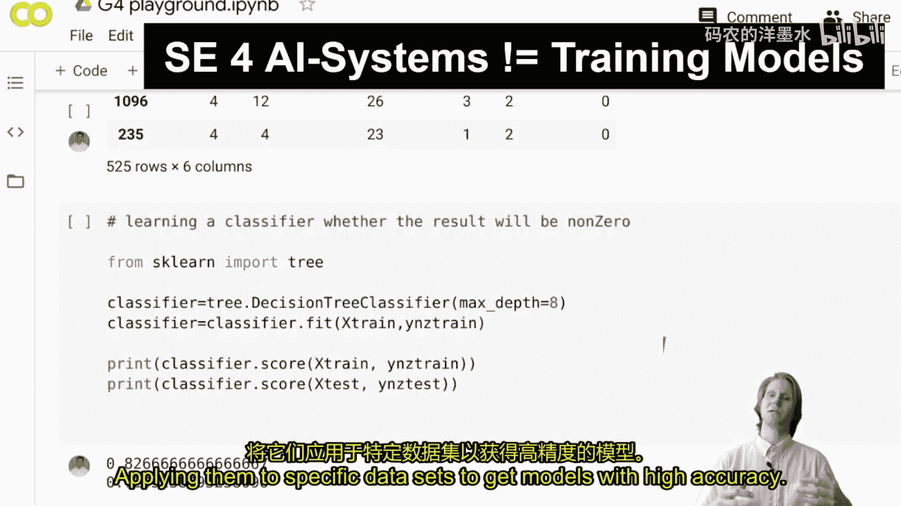
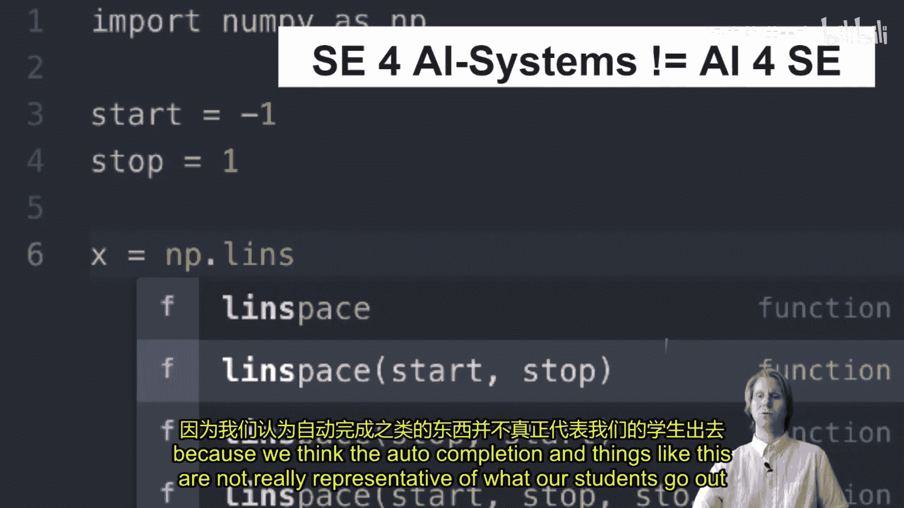
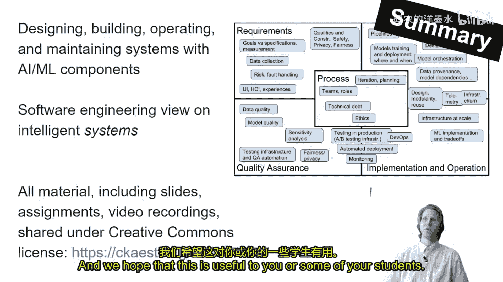

# 【全集】卡内基梅隆大学-AI驱动系统的软件工程-中英字幕-1080P-p24-Lecture-24---面向-AI-驱动系统的软件工程教学--BV1JS6gBcEBF_p24-

Hi in the next couple of minutes I want to talk about a course at Yzekang and I designed software engineering for AI and AviID System。

 it's only going to be a short pitch， but we want to talk about how we teach software engineering for systems that have a machine learning component in that。

So it's specifically not taking the role of the tradition machine learning course where they are mostly focused on either understanding how machine learning techniques work or applying them to specific data sets to get models with high accuracy We want to build real systems We're also not really interested in applications in software engineering like you see at this conference because we think auto completion and things like this are not really representative of what our students go out and do later So the applications that were thinking of are building machine learning components into systems that might actually be used by end users or companies like PowerPoint where they introduce this mechanism of design ideas to automatically lay out your slides So PowerPoint is more than just the AI component this is an AI component in a larger system。

And another example is taming a transcription service where you upload some audio files to get a transcript。

So again， there's a machine learning income component here and it's a very important part of this。

But just building the component doesn't get you there if you want to build a business。

So you need to think about the user interface about scaling and accepting lots of audio filess and storing them and dealing with mistakes and taking payments。

 so all of these things。Correspond to be an extra system around。And to build these kind of systems。

 you need the expertise of data science， who can do the models and software engineers to actually build robust systems。

There are lots of problems that come with AI components like missing specifications。

 feedback loops and so on and so on and so on， but we also argue that software engineers have a lot to contribute to building these systems for example we have a lot of experience of building safe systems from unreliable components we have a lot of experience with risk analysis and requirements at the interface between the world and the machine and so on so things that we can actually teach here to help students to build these kind of systems when they go out into the real world。

The course is structured around the traditional lifecycl thinking about how do requirements and testing and architecture change when you introduce machine learning components and we would argue that a lot of this is much more an education problem really thinking through and applying techniques that we already have rather than the research problem where you need to identify completely new techniques there's some of that is too but the dominant party I think is education。

Just briefly at the end。We want to get away from these notebooks and static data sets and just evaluating accuracy。

 and this is reflected in our assignments。We built an infrastructure to simulate the real world where a million users。

 simulated users are watching movies and students provide a recommendation service。

This way the recommendations that students have actually have an impact on the simulated real world so we can detect feedback loops。

 they also need to run and operate the system in production， we look at availability。

 they need to update this with little downtime and so on。

 so we're creating realism here in terms of actually building a system。

So if any of this is interested， we welcome you to look at our materials， we share our slides。

 assignments， finance， video recordings， and so on under a Cative Commons license。

 and we hope that this is useful to you or some of your students。

