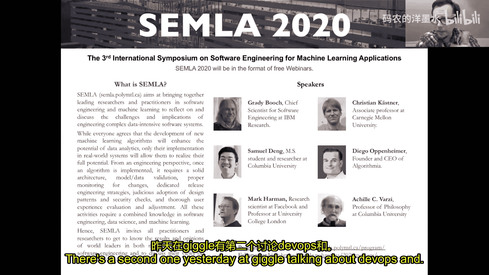
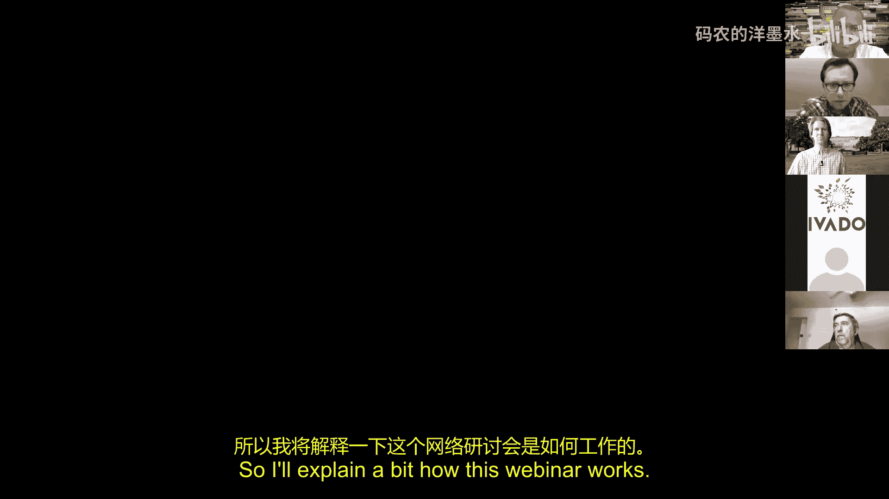
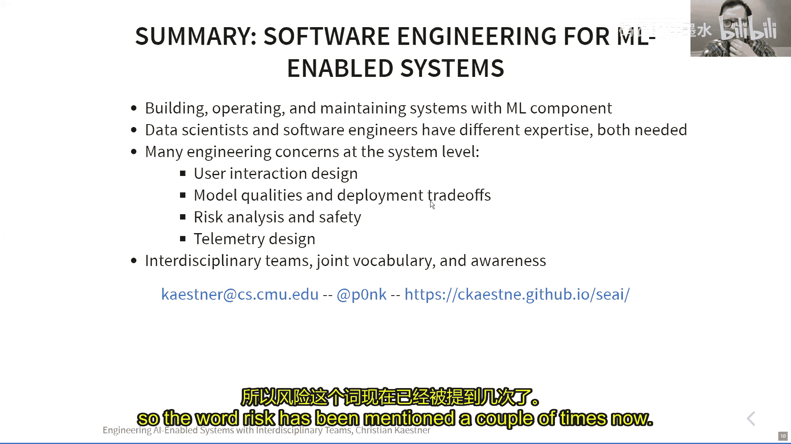

# 【全集】卡内基梅隆大学-AI驱动系统的软件工程-中英字幕-1080P-p25-Lecture-25---构建-AI-驱动系统--BV1JS6gBcEBF_p25-

So welcome everybody to the second webinar of Se Law 2020。

 so Sela stands for Software Engineering for Machine learninging applications。And so if。

Go here if so I'm Bra Adamams， I'm one of the organizers here we have six people organizing Se。

 it's already the third edition。First we were a physical of two years and polytechnic this year due the circumstances online。

And so what is similar about why all these editions。

 so it's about basically engineering AI applications so software applications and why well because on one hand you have the world of software engineering have a long tradition a lot of best practices processes and so on。

 requirements development all the way to deployment production Devs and so on。

And on the other hand of the world of machine learning AI with all these breakthroughs。

 all these innovations that really can change people's lives。

 however since these things are being incorporated into even safety critical systems there's really a need to actually combine to really build these systems with decent practices from software engineering world so the question is how to do that whereas the intersection how do you combine these roles together so the past two years we've been exploring this with speakers from different companies universities and so on and this year we continue this。

This ID so this implic we have like six webinar scheduled is is a second one history at Jgo talking about DevOps and machine learning AI and today we have the pleasure to basically have Christian Kesner as speakers of Christian is associate proof at Carji Mellon he's also director of PhD program on software engineering and he has been working a long time on software variability also of work has been done that area by him and his collaborators he's also very interested in software ecosystems and making them sustainable in the recent couple of years he's really been interested in actually teaching teaching AI how to build AI systems using real and high quality software engineering practices and so we're really looking forward to his talk today so whilell stop sharing this and Christian can stand up I'll also explain a bit。

嗯。Here we go I also I'd like Christian just to start screen sharing so I'll explain a bit how this webinar works so basically Christian will clear presentation at the end there's time for questions so your questions you don't need to win until the end please post all your questions in the Q&A area here in zoom at the bottom you notice you cannot use chat messages but you can actually send the questions and comment on other people's questions vote them up and at the end you start with the highest most popular questions and work our way down until we run out of time and they also be recording of this webinar and if Christians okay there also might be slides being shared for later producers on that thread but let's start with Christian。

Yeah， no problem。 and thanks for the introduction。 I wanted to say a few words about me。

 but I guess I can skip this。I am interested in this mostly from a teaching perspective。

 right to my own background just in kind of research on product lines and comparable assistance。

And interested in kind of teaching how to do software engineering for systems that have a machine learning or an AI component is AI enabled systems。

Today I want to talk about kind of the different perspectives right so you have software engineers and data scientists working together with different backgrounds。

 how we can support this without specific goals and so on。

So just to find this a little bit more that emphasis， this is already kind of。

Brem gave a good introduction right so we care about buildingdding and operating。

 maintaining software systems that have some machine learning components big or smaller。

 and we typically need some sort of interdisciplinary collaborative teams here with different backgrounds。

So I'm specifically not talking about the part where data scientists with models right so kind of in a notebook doing the CA competitions。

 things like this。嗯。Try different microphone I can if you want Yeah its impossible or maybe less moving now it's better actually。

Is this any better， All right， let's try this。So let me know again if you want to try something else。

So。Where was I I'm not talking about the part where data scientists win kind of k competitions or kind of focus on。

Bing the best model， the highest accuracy model but I'm thinking about bidding entire systems right it's also not about I give my mouse back bi the toolkits for machine learning right bi the systems that use those toolkits and since I'm often talking to software engineering audiences they often feel like we're building systems with AI components all the time we're building things like better auto completion tools or tools where we detect duplicate bug reports and so on and we use machine learning for this but I think we are software engineers are kind of bad role models were rarely ever bi production systems we are not representative of really the user community of our students going out into the world and building cool applications that have machine learning in them。

So when I'm thinking about are things like you're contributing to Microsoft PowerPoint where most of the system might not be machine learning focus。

 but they introduce more and more machine learning components so one of these ideas is the slide design mechanism。

 design ideas where you can click on a button and then you see a couple of suggestions of how you could redesign your slide。

AndSo you have a machine learning component， and it's part of a larger system。

 It's integrated into a larger system。Here's an alternative thing that I'm going to talk about more as teamy as a transcription service where you can upload an audio file。

 maybe from an interview or from the podcast and you get the。You get the transcript back。So。

 this thing is。Very heavily focused around an AI component right so the primary focus is there's a big AI component or machine learning component that does a transcription。

 but still you need to build an entire system around this。

 you can think about kind of a scenario where maybe a PhD student has developed this transcription service。

 maybe has improved the accuracy by two more percent and this was a breakthrough and you publish a runs of papers but if you want to commercialize this as a solution。

 you actually need to think about how to build a system where you have a page where can go to you can upload an audio。

 millions of users might upload audio， you want to store this， you want to show the resultss。

 you want to improve this， you need a billing system so lots of additional concerns to actually build a production system even if the machine learning component is an important part。

And to build this we need people of different roles right I'm going to simplify in this talk and I'm going to primarily talk about data scientists and software engineers yesterday you also talked about operations so there are many different people that work together on this。

 but I think to build these systems successfully， at least these two roles we need to really think about。

And they have different backgrounds and different expertise I probably don't need to explain this too much。

 but software engineering is more than just programming right software engineers。

 people that we train in software engineering。They make all kinds of limit of important engineering decisions。

 engineering judgment under limited resources and information right to your building systems to a budget。

 you're making hard tradeoff decisions， you're dealing with the messiness of the real world and you're trading off of many different qualities that you care about。

In our master program on software engineering we have this running joke that the answer to too much pretty much every question is it depends right so we have posed us 20 years of it depends to celebrate like the 20th anniversary of this program but the point is it not just depends but the mark of a good software engineer is that the software engineer will be able to make a judgment call that make。

Given a specific scenario， they will be able what does it depend on and in this specific case。

 what decision should we would take， right kind of making engineering judgments under their specific situations。

And again I'm oversimplifying and I'm probably being slightly unfair to some of the machine learning people。

 but the most of the machine learning courses and talks and blog posts that I've seen kind of getting into data science。

 they're kind of narrowly focused on the modeling techniques or on building models so understanding how deep neural networks work internally or how you would build decision trees or give them a specific data。

 how do you build a model that has the highest accuracy kind of the CAA competition stuff there right so you have the data set multiple people trying to compete for the best solution and by best it means highest accuracy in a notebook。

I've seen almost notebooks or courses that actually go from how to build a model to how to deploy a model。

 how to build a larger system around the model， and think about other engineering aspects beyond accuracy of a model。

Again， I'm simplifying， but what I want to point out here is that we have these two different groups of people that come from different backgrounds that often have different kind of educational backgrounds。

 different specialities， and that's actually a good thing。So to build systems， we need both。

 and I'm going to argue that we need to make them work together。Yesす。😊，Sometimes。

In practice and industry there's a view that we should find people that know all of this together。

 they're sometimes referred to as unicorns right people who are really good at data science and statistics and also have software engineering experience and know how to build systems and actually know all of this together but those people are actually fairly rare right so hard to find so you typically want to build teams that have different people with different specialties。

 different roads and have them work together and I want to talk more about。Where this is going。

And so coming back to this， if you want to build a system like this。

 you need somebody who has a specialty to build the deep neural architecture to do the transcription service。

 build the machine learning component and get it to a high enough accuracy。

 but you also need somebody who can build the system， scale the system， deploy it。

 think about how to do the payment options， how to think about how to get feedback and improve it over time。

So just coming from a software engineering perspective。

 what changes really do we need to change our software engineering practices where there are a couple of things that change let me just go through them the first thing is we don't really have specifications anymore right so as software engineers we kind of are used to reason about specifications and then we say we have a bug if something doesn't match the specifications。

But with machine learning systems。If you have a transcribe function that you're learning from data in some form or you're predicting recidivism or something like this。

What's the specification we don't really know right it's even hard to say what is a bug because we don't have a specification we're kind of okay with being correct 90% of the time and10 wrong 10% of the time and different accuracy levels。

We also start thinking about the environment way more thinking about feedback loops and data drift。

 so for example， for many years YouTube was recommending conspiracy theory videos much more than any other videos on the platform and from the perspective of the machine learning algorithm this was rational the goal was to increase engagement and there were a bunch of people who were watching conspiracy videos a lot right so once people started watching some of them they watched more and more and more so recommending these videos actually was pushing engagement but it was creating this feedback loop where you actually drove people into a spiral of getting really deep into these conspiracy theories so you really need to start thinking about these kind of issues。

You also need to think about that。These machine learning components are hard to think of as a module and that you can reason about in isolation。

 a lot of systems， here has lane assist， very big architecture consists of multiple machine learning components that reason with multiple sensors and the output of one machine learning components close into the next and it might actually be that improving one component will degrade the performance of the entire system。

 it becomes very hard to reason about this。And then also testing with test data gets you only so far so at some point you need to test in production here's an example of Microsoft's stay chat bo turning racist after only a day interacting in production with other people right so this is risky potentially so we need to think about doing this and the last part I'm talking about here is kind of we have to deal way more with data versioning data provenance at scale so many more challenges here。

So lots of things new， but do we really need new new software engineering for bidding AI enabled systems？

I would argue that actually for a lot of these things we actually have tools it's not that completely different so yes we don't have specifications for machine learning components but if we are honest with ourselves we don't have good specifications most of the time that we're bi traditional software systems anyway so very vague specifications are very common we do agile methods precisely because we often don't have upfront specifications and the customer needs to kind of see to know what they want。

And also， we have a long tradition of building safe systems from unreliable components， right。

 even if certain components。Maybe unreliable from hardware or software perspective。

 we know how to build systems that are overall safe and I think we can learn a lot from that。

I was over。Also the environment is important in machine learning yes。

 but not only in machine learning， this is actually very。

 very long very traditional view of requirements engineering Michael Jackson seminar X95 paper talks about the world and the machine。

 the interface， what can the software know about the real world。How to reason about this。

 this is I think the right view to also think about machine learning here so it's not all completely different and new。

 we have a lot of tools to think about these things。Nonmontonic effects， yes。

 but again I come from a background in product lines and we think about feature interactions all the time。

 cyber physical systems， we reason about interactions of things。

 there's a reason that we don't just do unit testing that we do system testing and so on。

And testing and production we have done for a very long time in software engineering。

 right chaos engineering， AB testing continuous deployment feature flex。

 and so unless there's lots of things that we can learn。

 you talked about a bunch of these things also yesterday。

And then also data there's a huge amount of stuff available that we can run on so really what I'm trying to get at yes。

 there are lots of concerns here。But a lot of them are not fundamentally new。To me。

 this is much more an education problem than a research problem。

I think we need to start thinking about much more deliberately about how to build machine learning applications。

 how to build systems that have a machine learning component。

And I think the mistake that we are making is that when building traditional systems。

 we might get away with pretty poor software engineering practices。

 right so you don't do a really critical safety analysis if you're just building a simple web page for something。

But by introducing machine learning component what we're doing is we're raising the complexity of these systems。

 we introduce unreliable components， we very often use this in a setting where there's actually risk and safety issues and so on that we actually need to think about so the argument that I'm trying to make is that we need to get serious about applying software engineering techniques yes we need to adjust some of them。

And yes， some will be new， there will be some new research。

 but I think a lot of time is really about framing software engineers into the loop。

And bringing them into a team and working together。So again， I have this view simplified。

 but yes we have data scientists and stuff engineers and they need to work together and I'm very much coming from a stuff engineering perspective right so my view is certainly biased。

And data scientists and software engineers have different roles。

 but that's okay that's actually really good right they have specialties they bring something to the table。

 they work together so how should we make them work together。So there's one view。

And you see this's a lot in blog posts and then talks kind of looking down on kind of。

Data science practices， especially if you look at notebooks。

 they have a very bad reputation in some communities。

 so all these criticism and like data scientists should pick up better stuff engineering practices。

 they should use an IDE， they should start using abstraction right These notebooks are terrible。

 All global state， no functions， no abstraction， There's no testing whatsoever， heavy copy pasting。

 Li documentation， terribleible version control right and then yeah， out of order execution。

 This seems like kind of why would you even consider this。

But this is maybe an somewhat arrogant outside view right so from a software engineering perspective yes。

 this seems weird， this seems like we have progressed beyond this。

 but if you actually understand how software how data scientists work。

A lot of this starts to make sense， so data science。

Data scientists were quite different from a traditional software engineer。

 they have much more a science mindset， they start with a gold， and they try to solve a problem。

 try to model something where they don't even know whether it's possible when they start right so they have kind of vague goalss。

 nuclear specifications it's very， very exploratory。

The graphic here is the study is quite old but I think it's very interesting it shows 10 participants in it for our experiment trying to sort a data science or modeling task and what you see here over time is how accuracy improves so different participants are more or less effective but what you see is that pretty much everybody starts out with a very simple model it doesn't work particularly well and then they try different things and they get better over time and so it's this very incremental iterative process。

And this is something that's actually。Quite well supported by notebooks notebooks have a few characteristics that make this attractive in this environment。

 it provides very quick feedback similar to rep on the command line and it provides also visual feedback so if you just want to kind of explore something。

 try something， test something that's very nice。Also it's really useful for incremental computation。

 I think this is something that's often underappreciated because you don't need to always reexecute the entire pipeline。

 you reexecute a cell or two。And it's also easy to edit and share the notebook once you're done。

So I think what we should understand is that just blindly recommending software engineering best practices。

Probably not the right solution here we need to understand context documentation and testing is not a priority in the exploratory phase it might be much more useful later the whole idea of literate programming and notebooks makes much more sense once you know what you're doing kind of deck documenting the final product。

And so we've。The place where I think research is much more useful and we need more help is when we once we transition from notebooks to a production system。

 and I think we have pretty poor support there right now。

 we have something like N convert how we can convert it to Python files。

And then often what happens is that somebody rewrites this， puts this into production。

 and then it's also very hard to go back， right。Data scientists。

 once the code leaves the notebook have a very hard time continuing to experiment on the production code things go out of sync。

 so I think here it's much more useful to understand that data scientists actually have a quite different perspective in software engineers。

And that we can support them in their environment。And then also help them getting things into production and helping them。

Make sense of production， get some benefits of production data。And so this's one direction。

They also want to talk about the software engineering mindset。

 so what can a software engineer contribute to building these systems？And so again。

 we want to build these systems that are much more than just building a component right building the entire system around this。

 so we need to start thinking about systems kind of much larger concepts zooming out and there are lots of challenges here and I'm just big four for this talk so I cover a lot of these in my lectures but there are lots of interesting challenges here where。

They're often design challenges， things that software engineers are typically trained at where they may need to adjust a little bit。

 but this is the kind of thinking that we teach software engineers to do。

So one thing is thinking about the user experience， the user interface design。

 So there are lots of things where you think about how to。

Use the predictions of a model how to put them into production and they're very very different designs and they are suitable in different contexts there is not a single design right so if you think about this PowerPoint example the way that they produce productions here predictions is you have to find this button you have to click this button and it doesn't automatically redesign your slide it shows you a preview of a couple of different designs and then you can click one of those designs it changes your slide but you can still go back right you can undo this there's a lot of things that。

There's a lot of steps of how this is really careful， right the predictions are not very forceful。

 not very invasive。And different designs could be much more productive potentially in making your slides。

 helping developers to discover this feature and so on。

 but there's a tradeoff here of how invasive are you， how forceful is the interaction。

 how easy it is to deal with mistakes， and so on。Whereas in different contexts。

 let's say you want to have a smartwatch feature to detect fors and elderly people。

 you can start thinking about。You probably don't want somebody to go out and find in a menu of the watch the right option right so you want a much more forceful interaction so here its sign might be if you detect a board you're not calling an ambulance immediately but maybe you give people 30 seconds to cancel this and kind of visual and audio feedback but you want to take some automated action right and there are lots of design challengers to think about how to design an intelligent experience。

 how forceful is it going to be how often are you going to send notifications is there going to be notification fatigue and things like this。

Yeah。The next step I want to talk about is I mentioned earlier that data scientists tend to focus on accuracy。

 but if you're actually trying to deploy models， a lot of other qualities matter right so yes。

 if you try to win a CAA competition you have a fixed data set go for accuracy but in production it suddenly matters。

 how expensive it is to run the system， how expensive it is to train the system。

 what's the inference time， how long does it take， how much energy does it take if you're running on an edge device how much data you need for training。

 what data quality do you need， do you have in production can you learn incrementally and then all these things that become really irrelevant in a production system internalpre。

 robustness， security privacy， fairness and so on right。Here's a nice example of this。

Many of you will probably know this Netflix price many years ago where they tried to find a better prediction algorithm recommendation algorithm for what movies to watch。

And there were lots of entries and they were doing pretty well。

 they were outperforming Netflix's approach by far。

 but after some evaluation Netflix decided to implement none of them。

 they stuck with their oldD method because the extra complexity。

 the extra engineering effort and the runtime costs were not justifying the marginal or additional accuracy gains。

So accuracy is an important quality， but it's not the only one if you're building a system。

 you actually need to trade off between different qualities。You might take a very different model。

And there are lots of these kind of decisions that you need to think about one thing that I just talked in class two days ago is where should the model live is kind of an architectural decision。

 the example that we had is this instant translation that a lot of these devices have right so you need some OCR component and some translation components do you do this locally on the phone do you do this in the cloud。

 do you do this in some a mixed combination， do you maybe even do this on kind of Google glasses and then augmented reality kind of setting and suddenly it matters a lot what are the qualities of the models。

How much energy they take， how big they are， how often do you need to update them。

 what's the cost of running this if you're running on batteries， if you want quick latency。

 things like this and different models might allow you to build very different kind of systems。

So there's a lot of tradeoff thinking， thinking about the qualities of the system。

 kind of architectureural style thinking that becomes really important and we're understanding the models also is important right so a software engineer needs to understand some of the tradeoffs in the machine learning techniques as well so they can't just use them blindly as black boxes。

And then we can bring in a lot of requirements engineering expertise， right。

You could start with risk analysis What's the worst thing that can happen to a system where robot uprising maybe not this year。

 but some philosophers say one in 10 chance in the next hundred years for human extinction due to artificial intelligence。

 you don't have to believe this right， but even if you think about your own system。

 what are the things that can go wrong that we have a long tradition of risk analysis understanding what are the things that can go wrong in a system。

What's the impact on the system， what's the chance a lot of this comes out of kind of a safety setting right things like hazard analysis。

 faultry analysis， failure mood and effects analysis is kind of thinking systematically through possible mistakes that can happen through steps that lead to mistakes and you can start thinking about fallback mechanisms。

 redundancies， safeguards and so on。And actually to do this。

 you want to step back from the system so machine learning components are kind of annoying in that we don't have specifications and we don't have guarantees right so they may make wrong predictions。

 consider a smart toaster where you try to learn a model whether you should continue toasting based on some sensor inputs。

Most of the time this will work fine， right， 90% or 99% of accuracy is great。

 but it may make mistakes and it may make mistakes in situations that you don't understand that are really weird。

And it's kind of okay that it makes mistakes once in a while So the toaster may occasionally burn my toast I probably fine with this。

 but it should not burn down my kitchen right so there are certain safety mechanisms that you want to think about and you probably don't need to get perfect guarantees from the model you probably want to think about this at the system level things that we traditionally do like hard constraints that overrule the model So outside of the model just check that the temperature reading doesn't go beyond a certain threshold or put in some external faceafe mechanisms and very easy example in this toaster case is a term of use what you see in the picture here this is a tiny cheap hardware device that just stops conducting electricity when things become too hot so a simple thing outside the model this is something that you wouldn't think about in a ca competition right but outside the model you start thinking。

F safe mechanisms， safeguards。And you only get there if you systematically think about risk。

 if you think about what can happen if my modelto makes a wrong prediction。

What other things would counter this， can I undo the action， can I prevent kind of bad consequences。

 can think about humans in the loop， which is also super complicated。

 but that's the kind of thing that requirements engineers tend to think about a lot right kind of safety mechanisms。

 understanding requirements， understanding safeguards and so on。

The last design challenge I want to talk about is telemetry design this is something that actually comes up a lot you need this throughout this is one probably of the big changes to our traditional software system that you want to see in production of how you're doing so let's say in obviously they introduce this feature they want to know is this actually useful do people like this and can we get additional data from practice to train this right can we identify mistakes can we collect additional feedback。

And what often happens is that these systems send information back home right so they might collect how often are you clicking this button。

 if you click this button， how often are you picking one of those designs。

 if you're picking one of those designs， how often are you undoing the selection afterward。

Can also check do people stop using that feature right so all these kind of indications that your model might be doing well or not so great。

 a lot of them are kind of indirect， it's kind of hard to pinpoint specific mistakes。

 but there's lots of ideas of how you can think about this how you can design this。

So they are more obvious and less obvious examples of how to collect telemetry in the simplest case you might just ask users so Skype will ask you after some chors how they're doing right so we just ask you for feedback and it actually doesn't do this for all chs it doesn't more likely for chs that it think it might have been doing poorly and in addition it also has this report a problem button so with this button you will never get positive feedback but you may get some idea of how you're doing。

It's always possible to just collect production data。

 maybe collect some slides from the users they' are trying to improve and then have humans look at the results like other recommendations usable are they not useful right you could scale it to mechanical turk in some cases or kind of crowdsource or labeling effects there are lots of possible designs here is expensive and then there are some cases where it's actually really easy to get ground truth labels and see how you're doing if you're just willing to wait for a bit so if you're predicting for example whether flight prices with rise or not or stock prices you can just wait a couple of days and you see what would have happened right it doesn't give you immediate feedback but you can evaluate after the fact how you were doing。

This is the last time I want to come back to Timmy because so I haven't actually spoken to anybody at the company but I hope that they kind of do the kind of things that I'm thinking they're doing and I think they're doing pretty clever things at the system design level to think about how they're getting feedback how they're getting telemetry image so first of all you see the style writing down here that's straightforward and I don't care about this too much。

But they invested quite a bit。In showing you the results in a nice way and having an editor where you can fix them。

So traditionally you might download the transcription， maybe in a word file。

 and then what often happens is I go through it， I listen to it again and I fix some of the words right before we kind of annotate it or publish it somewhere。

But。😊，Instead of doing this in a Word file， what if I would fix these things inside the editor？

They could actually look at what I'm changing。So if I'm changing a word here that I'm seeing this shouldn't have been needed。

 there should have been a different word。If I make the change。

 they actually have a very precise information where I think the transcription was wrong。

 they could use it as training data to improve it， they could see how often people make changes and where are there different kinds of problems。

And。😊，To achieve this。I think it's important to think about where there's an opportunity to get telemetry data。

 very valuable fine grain telemetry data， but how do I get people to actually use this editor and fix my mistakes？

And this is again where I think you need to think outside the model think about the system at a larger scale so what Timmy does is they actually have a very nice interface where the text and the audio is synchronized so you can jump in the audio。

 start listening in somewhere and it shows you where in the text you are or you can jump in the text and it will jump to the right position in the audio if you just want to listen to a small segment here you can just jump there and listen to this part right this is something that I can't easily do in my word editor。

Also， they highlight words that they're not sure about， that they're more likely to be wrong。

 so they kind of point your attention and all of these things I think are quite useful to keep you in the system to encourage you to provide telemetry data without being invasive without asking you about this without needing human labor。

And so this is the kind of thing that I think by thinking about this from a software engineering perspective。

 thinking about this from a design perspective outside the model。

 taking the larger system into account， this is， I think where this becomes really interesting。

There are lots of challenges about how to do telemetry。

 how to get things about kind of slow feedback， how to deal with privacy it's a really big challenge right and there lots of research happening in。

Kind of machine learning communities， hands of debugging and things like this。

There's lots of work to be done here， but I think there's lots of stuff that both data scientists and software engineers can contribute to。

So I've shown you that we kind of need both expertise and that both can contribute something right and they're both specialized so how do we make them work together as a team right so the question is we don't want them as separate units。

 we want them to work together。And I think education is the key。

I think actually DevOps is a great role model。'mNot talking about DevOs like yesterday as we need to also get machine learning into production yes that's also the case and there's a lot of work there but think of DevOs as a similar problems where you have developers and operators that are kind of coming from different backgrounds。

They have different specialties。 They have different goals。

 They were often kind of working against each other with conflicts。And what we did with DevOs was。

We give them a joint。Responsibility， we give them joint vocabulary， make them understand each other。

 give them some tools so that the developer might already containerize their application to make it easier in operations but the developers by doing this also get some benefits like they get some product they get quicker into production。

 they get quicker feedback right they get some log files。

 maybe and the operations people can use this information and offer more infrastructure that's useful to developers so you have still distinct roads right people in distinct roads。

 but join responsibilities you kind of think about。

Let them work together towards a joint tool and a lot of joint tooling。

 and I think this is where we need to go in building software engineering for machine learning systems。

We need some infrastructure that crosses things right so we we don't need to throw away notebooks。

 but we need to get away。Get a way to get。Data scientists to think about some of the qualities that matter in production。

Beyond just accuracy， we need to help them to transition from a notebook into production。

 give them infrastructure， how production data， telemetry data might help them to get back。Its a。😊。

My view here is that we want interdisciplinary teams。Split expertise， but joint responsibilities。

Just as in DevOs， you need joint vocabulary， joint tools。

We need system thinking at least some awareness of this right they don't need to be fully expert in each other's roles。

 but they need to kind of start communicating， start understanding each other and some awareness of production quality concerns and risk and so on。

So this is all I have， this is what I'm trying to pitch here right so it's kind of from an education perspective what I'm saying is essentially teach people to work together and probably have them build some tools。

I have a class where I'm teaching software engineering for AI enableded systems。

 the materials online if you're interested， if you're also free to copy this class or look at this。

 if you're interested in research in this area of an annotated bibliography and if you just want to get into this。

 I can recommend this book building intelligent systems here which doesn't go super deep but it gives a great overview and the heart is in the right place。

 we're using this as a textbook for the class as well。So。

What I try to do today is kind of give you kind of first of all pitch that we really should focus on building。

 operating and maintaining systems with machine learning components， right。

 not just building the model， but really building the system and that data scientists and software engineers have different expertise that we both need。

There's many engineering concerns that we at the system level typically that we want to reason about and the way forward。

 in my view， is really interdisciplinary teams， kind of keep people with different specialties。

 but bring them together， right， create a joint vocabulary， create awareness。

 maybe just some joint tooling to head them work together。That's all I have。Thanks。

thanks a lot great talk I could hear people clapping at their homes already plus actually during the talk there were quite some questions that have been posted in the Q&A section you can still post questions as well and vote for questions and based on the votes we'll go through the questions now'll start with the number one for the moment and just keep on voting and sending questions in the meantime so number one question here's the following so which software engineering approaches traditional approaches in parenthees do you believe require urgent adaptations to support the development and operation of AI based systems。

😊，Yes。Yeah， I'm not entirely sure so。I kind of started this with an education mission and then thought maybe there's some research challenges along the way right and I feel like。

嗯。Most of the time。We can。Find some fairly straightforward adoption like all the risk analysis techniques they change a little bit because you're focusing on slightly different things。

 you're asking slightly different questions， but you're just assuming that machine learning models could be wrong and then you use for trees in a similar way and so on so I think。

A lot of times。We're just not pushing existing methods far enough。

 but there's certainly a lot of change a lot of things where we can do more research。

 I feel like telemetry is one of them where we don't have a lot of。

Ssystematic knowledge about how to design this， maybe in general architecture kind of architecture patterns。

 there's some early efforts in trying to kind of find what's out there but。

It's not like design patterns or classic architectural tactics that there's a well defined catalog right of kind of best practices。

 So I think there's something And then I think the other big pain point is kind of going from kind of。

Notebooks kind of exploration into production and pack。

Right so I think that's I think a larger of research area that's interesting and I forgot to mention who posted so the question was by Suvio Martinez Ferandez so thank you for the question so let's go to the second question so this one is by Justiceice Boner who asks do you have any best practices to share for the integration of AI and all components in a system for example respect to encapsulation reliability flexibility anderability。

 anything to watch out for in comparison to more traditional components and practices？

So I think think of this as a safety critical system。

 think of this as something saying where you want to look at mistakes between components where you kind of give up the notion that you can get away with unit tests right so you do some unit tests。

 but you need a lot of testing and production system level testing。So that's， I think。

 I mean we do this in some other systems as well， but I think this is much more needed here kind of thinking about this chaos engineering as another one right which I think would fit quite well into kind of another form of testing and production。

 testing complicated systems that are hard to test otherwise。

Thinking about feature interaction thinking about data flow is kind of just modeling this right so we have techniques for architectural modeling architectural data flow modeling and things like this。

 but still in practice a lot of people kind of just did a jungle of pipelines and then don't understand where data sets originate from other data sets。

I think。There are a bunch of these areas I don't know that I have a fixed list right so I think in every single area there's probably a bunch of practices that we can look for in a dot there's a lot to do with data handling there's a lot of to do with safety lots to do with testing and kind of testing and production。

I don't have the sense that we can get very far with encapsulation beyond kind of just deploying something as a service right and having this isolated in that sense。

 but it's not isolated in the sense of data flow。So actually many of these things you mentioned like they go more towards like more。

Like heavy， like more more disciplined quote unquotes， processes that like。嗯。

So like things like agile things， would that still work or？Yeah。Probably right， so also。

I mean even chaos engineering kind of has a flavor of Aure and so on and also all of these things have this notion of don't be stupid right we do things because we know that their risks that we need to iterate quickly right I think what you talked about yesterday kind of pushing things quickly into production having a good infrastructure for testing and production it's probably a very very good foundation to build systems in a more flexible way right so it's not it's not I think kind of heavy weight in the sense of waterfall is not the right thing because you don't know where the model is going you need to update this right it's much more monitoring and production although I think if some system some companies had done more upfront risk analysis。

We would have a lot fewer news stories about AI going bad。嗯。But then again， you have kind of。

It might be better to quickly grow， get something out there， get startup capital。

 and then fix things when you need to， right？But instance because it seems like yeah for traditional system。

 people have an idea what kind of process do they go to。

 but here like this you can actually go either way， it depends on。The focus is basically yeah。

And risk yeah， I suspect Agile is still kind of very much in scope kind of also the startup kind of bidding early prototypes。

 right seeing whether that works。But I think。Thinking about some more disciplined approaches for testing。

 some more disciplined approaches for requirements。

 thinking about fairness early where these kind of things would be useful you so so then next question by Co seniors so it's an empirical question basically do you have any empirical support for the claim that the main problem is the lack of knowledge about software engineering methods amongst teams developing commercial systems with AI components instead of a need to evolve or develop software engineering methods to deal with new challenges introduced by AI as part of systems So is it like they don't know about what exists or is just that there's many new challenges actually and that's why they're overwhelmed and so on I don't have any systematic study this is my impression from talking to people in different places。

If you bring up some of those safety techniques or kind of risk analysis techniques。

 they usually not haven't thought about this， I mean in some places yes。

 like when they do safe driving cars， they are much more careful about safety right。

 but if it's a web service or something like this that an app that often has some sort of safety implication。

 maybe not in the sense of killing people that kind of creating harm， even psychological harm right？

I don't have any hard evidence， this is， I think， more a conjecture from my side。

But in put a different way， that's an opportunity for researchers actually to kind of look into that and see I think so yeah。

嗯嗯。😊，Co that's good news for any PC students in the room there Okay so next question is Viionettaro Kawaada。

 which academic community is the best place to find ML ops or AI ops related academic papers to PSEM Europes and so on。

そあ。不是。There is a I don't have this right now， but I can send you a link afterward there's a reading list from some German company on M LOs that has a very very long list of books and articles and blog posts and so on that would be my first starting point probably in the academic sense。

And I've seen that much ML ops。Actual research， I think this is much more in production and this is again。

What's really new compared to traditional。Devos。I mean， using machine， again。

 there are two parts right so there's using machine learning to improve DevOs。

And then there's devs to deploy machine learning patterns right so for the first part I think there's much more research kind of predicting early whether a bit will fail and things like this for the second part I think there's a lot of practice I haven't seen that much research in this area。

嗯。I think much more in terms of grade literature blog posts， both。

So again an opportunity actually for researchers to look there but of course it requires also collaboration with companies to actually have real data and real observations there and I think the big silence is always what's really new conceptually right and to me often a lot of things seem new and then it seems like traditional approaches if you apply them can get you quite far right so you kind of need to think first of about how far can we push this and then what's left。

I think there are lots of interesting research challenges if you go far enough， right。嗯。

Just not because they haven't thought about safety and risk analysis doesn't mean that there are no techniques to do this right and that it wouldn't be。

Easy， in a sense， to do this。So true so。Now， actually so the word risk has been mentioned a couple of times now and actually the next question。

It's actually about that material comeos， can you please elaborate a bit more on what does risk analysis mean in the context of machine learning systems。

 is it something that should be done during early design stages continuously both offline and online after gaining runtime evidence？

Okay。Right， so， so there there are lots of these examples about。

Machine learning systems doing something wrong right so I showed the chatbot in the beginning and there are lots of examples of robotics application doing something weird like we had some delivery robots in Pittsburgh blocking sidewalks for wheelair users right so this is something that kind of then blew up on Twitter right。

And there' some。To some degree you can think about how much are you willing to just experiment in production and then address it when it happens。

 it might tank your company， but often it may be a reputation hit but then you promise to be better right？

I think， ideally。If you want to be responsible， you probably want to think about risks early and the way to think about risk is what could go wrong right so there's there different forms of risk analysis so for trees are typically going backward from here's a bad reside to what can lead to this bad reside and the other techniques like failure modes and effects analysis they go forward kind of thinking about here are all my components and what if those components fail so you can just think about every single machine learning component that you have think about what if it makes a wrong prediction。

 what's the consequence of this， have you thought of a safeguard what's the chance of that the safeguard can can deal with this right what what's the risk of this specific failure so I think doing that early is probably a good idea to understand what you're doing to think early about safeguards and the entire system right not just。

99% accuracy sounds good， but it still means that you're making mistakes from time to time and there's some work on kind of some verification techniques。

 but simply we don't have specifications， I think we will never get to a space where we can be perfectly confident in anything learned with machine learning from data with however much testing we want to we always need to think about this at the system level to my view。

But actually your point is that actually the existing ways of dealing with risk might actually work out just that you need to be more strict more specific to them I'm not an expert on this。

This is actually when looking at this， this is my feeling that I need to understand requirements engineering way better。

 this is one of the gaps that I think requirements engineers can teach us a lot of how to think about feedback loop。

 how to think about risk， how to think about mitigation strategies and kind of avoiding harm， right。

My impression is that these。Techniques that exist are great starting point。诶 they。

They are designed for kind of aviation systems and so on also a lot of these systems already have humans in the loop that are not always perfect right which is similar to an AI component。

And they're probably extensions。And there are some places， again。

 safe driving cars are more carefully thinking about kind of safety requirements and risks， right？

But my impression is that we are introducing。Machine learning into a lot of applications like Timmi like office and so on without thinking about two without very much careful thinking about what could go wrong。

Extering points so let's have been like some restructuring and the rating of ranking of the questions here so the next one is now is just pop up so it's a Mahmoud Alel where do we stand today for software ecosystem and machine learning in other words。

 what kind of problems related to software ecosystems can be solved by machine learning？嗯。

Not sure how to understand this question。So I think probably just again。

 maybe prediction models to I think it's maybe related to your work on software ecosystems as software engineering researchers。

 we can do a lot where we use machine learning in software ecosystems， for example。

 to predict whether。A dependency is likely to be buggy or something like this right or find bugs and things like this predict the stability。

Yeah。嗯。Yeah， this is not the way that I tend to think about problems in this direction right so I tend to think about is there a problem in software ecosystems and then how can we solve it and machine learning what might be one approach I'm not really thinking about what are all the machine learning things that I could apply to software ecosystems。

So again to be understanding the problem and then choosing the approach Yeah。

 I don't want to put machine learning into everything just because right。Actually。

I avoided the topic for a long time， I'm teaching this because I said somebody has to teach this and I now get a little bit interested in kind of reading about this and all the things。

 but it's not to me it's not machine learning is。The big future that we need to push into everything。

 that's at least not my view of the world。You always might edit this question out of the video numbers I'm not worried about sharing this publicly it might not age very well but so right the next question to She Sharman notebooks are quick prototypes and that's fine but the problem starts when such prototypes are converted into or Swed as products literally more common than a question I completely agree right？

😊，So there's some places where notebooks are used in production as Shascripts and so on。

 like Spotify， I think does this and I think this。This speaks again to the problem of transitioning its a quick prototypes fine and from what we heard from kind of in interviews and so on。

 what typically happens is，After the prototype is finding a notebook somebody reimples this in a proper system right and then the problem is that you can't go back right so the data scientists kind of cut off at this point。

Y， we really need have this ongoing conversation and otherwise reduce the traceability to me right so a bunch of empirical studies show that there are number of studies on problems with notebooks and their bunch versioning is one of them kind of exploration cleaning up and one of the big ones is transitioning into practice。

嗯。So so it's one you still have a couple of minutes for additional questions sure okay because there's still some questions building up there so because example the first one here we have Danny Dick who says Christian when you talk to the data scientists what did they tell you they need from our software engineering community what they aware of their needs from us？

I haven't asked the questions this way。你。And I tend to speak to people who are often already in kind of a position that they talk about software engineering or they recognize software engineering。

嗯。I haven't talked we have talked to some people who are trying to get notebooks into production。

Yeah， I don't think I have a good answer for this。The big questions talking to Pi Uber， for example。

 is how do we do safety certification？RightAny where you want to give some guarantee or have very high confidence。

 but I think that's a very high bar and a long goal， I think that's。That's a clear。

 obvious problem beyond， and I think we might have， but beyond this， I'm not sure。So again。

 this might be room for people to actually do these kind of studies talk to them and see like there were like there there were been some papers that people interviewed software engineers whether their main question might be in the opposite way actually going into data science yeah。

 there are a couple of papers that also interview data scientists。

And they usually look at pain points more than if you had the magic tool。

 if you know a software engineer， how can they help you？And I suspect again。

 if we maybe look a little bit at the DevOs literature of how did we get to those places like bringing people together right so did the software engineers know upfront what they wanted to from operators or was this more something that came up with the opportunities as we shifted paradigms。

 right？So， and I think it's interesting comparison with the all the Dev because it is kind of the same similar challenges there for the collaboration。

And there are a couple of years ahead， right， so I think we can learn from them。

So here we have Michelle Vaconcis who ask， how do you perceive reuse in heavily based machine learning projects。

 he means that all this throw away prototyping when using notebooks。

 like is there something like reuse and how are people doing that？Yeah， I don't know。嗯。

I don't have any any good idea here there's some discussions in the literature about reusing models。

 especially deep learning models right so you train something and then you retrain it for the specific use cases。

 but I don't。I don't have any insights in this area。Because there's always copy paste reuse。

 but probably mean that kind of yeah more so notebook yes， so notebook there's a lot of copy paste。

Instead of abstraction， but as long as you're exploring things as as as long as you're testing this is is essentially just。

Because they have poor versioning mechanisms， it's much more common that people just clone code。

 modify it and then throw it away or throw the old one away right then keep the old one around in case something goes wrong and they need to go back right so copy paste happens a lot in this context。

嗯。I think we're building a lot of models that we're throwing away。

 but that's also normal just because of the exploratory nature， right？

we see a prototyping process where you get the couple and then to arrive at the real problem in the area and I think it's。

Prototyping is one way of looking at that， but I think it's。

It feels much more sciencey actually than prototyping right so with prototyping。

 you often already have a sense that this will work in some way where science you start with a hypothesis and you don't know how you're getting there kind of feels more like。

It's more like research than kind of engineering a lot of the data science。But again。

 I'm not too deeply into this since is often kind of an outside of you。我回。So yeah。

 so we have see we have a couple moreque， so here's Sebatian Moser who says that notebooks are also a perfect example of literal programming paradigm which you mentioned that some isn't that all is a software Engine related meaning I guess。

 is that also like a good practice？Yeah they're often pushed as literate programming right and also there's kind of this is a new version of the academic paper or the lab notebook。

This is not how they are used most of the time， so there are many studies on this not my research。

 but many studies that essentially show the way that people are working with notebooks is they're writing something。

 they're exploring， they're exploring， they're deleting something， and then they're cleaning。

And cleaning is for different purposes for putting this into production or for sharing it with colleagues or putting this on your webpage and in cleaning this is when you start to insert text mostly so if you look at notebooks before them and there's some studies on kind of millions of notebooks they usually don't have a lot of text theyre usually not used in this literate programming style where I think the original idea is develop the text and the code together right so maybe first say what the code is doing that you get a mental model and then you write the code or that you translate the text slowly into code。

 I don't think this is how notebooks are used it's a literate programming environment but they're almost always used that the text is added in the cleaning process later。

有不有。It's an interesting because the concept that goes back away so it's interesting to see what they are different with like traditional Li programming that's and notebooks also go back right so I think the first notebook environment and Mathematica was 89。

So it's fairly old， it has become extremely popular in recent years right and it's used in different ways in different communities I think you can use it as a lab notebook where you essentially always document what you're doing。

 that's not the popular use we're talking about these days I think。TheHI community by the way。

 is really into notebooks these days， so if you look at Ka there usually does。

Yeah probably a dozen of notebook papers and tools and they have a lot of knowledge。

 empirical knowledge and tools about how to improve things and usually not kind of let's introduce testing or let's introduce functions but more can we do a more exploratory kind of undo mechanism like Brett Myers at CMU does some interesting stuff with recording things and undoing or there's some work out of Microsoft using slicing to clean up the notebook that you throw away stuff that you don't need to produce a figure right so those kind of things come out all out of the HCI community these days I think have a pretty good understanding of how people use notebooks。

Which comes down back to your point that we to understand the workflow of data scientists really adapt to their workflow that's I had the same arrogance right so if you look at notebooks it seems so weird if you're used to ideas and kind of programming and kind of functions right？

But I think if you understand what they are for and how people use them， it actually makes sense。

Okay so I suggest that we do two more questions and then give you a break because you think bottom of the question here so and that's also why we do the first one is still a choice to vote to say the last question so the first question here is from Man Shankar Mongd。

😊，What would be the most important thing when there is a collaboration between a data scientist and a software engineer？

Good question。I would think， getting。A good understanding of what the system is。

And the role of the model in that system right so the system has a component in it。

 but there's much more to it， so essentially that you're working towards a joint goal。

 so if you're designing the transcription service， for example。

 start thinking about risk start thinking about telemetry。

 start thinking about user design because it will inform your modeling choices right so kind of I think。

Think about the qualities that are important beyond just accuracy of the model and how this fits into the larger system and I think that's something that these two can do together。

 even though the software engineers will probably drive some of that discussion。

 but I think we need some awareness， some joint goals set up kind of a target。Oh right。

 so so now the final question and that was bit to change there in the ranking。

 so the final question is here for Rpi Sharma。In case of safety critical software systems。

 one can use formal methods for ensuring liability。

 what kind of techniques could be used for verifying systems with machine learning components becomes even more important because we don't have concrete specs for machine learning components。

So with safety critical assistance that's also the question what do you verify and that's usually not the safety property at the end I mean there's a safety property but that means something else so you typically think about kind of redundancies and chances of failures and how failures compound and kind of influence each other and how safeguards work and you can do some quantitative analysis of risk and I think you can do all of those things also with machine learning components pretty much the same way where you just think of the machine learning component as an unreliable part of your system。

So I think that part is the same， I think we will never get to a point where we can verify the correctness。

Of a machine learning component because we don't have a specification。

So we can kind of say how well it's doing with regard to some test set。

Were usually okay with some mistakes in my view， this is actually。喊。

Thinking of this as bugs or as verification is kind of a weird view， I think its much more like。

Specation mining requirements engineering， we are trying to interview the data to figure out kind of what we're building wrote a blog post about this that I didn't talk about here I think。

It's much more validation than verification that we're really concerned about with machine learning components。

嗯。😊，There's some techniques out there quite a bit of research on verification of deep neural networks and so on。

 they usually refer to specific invaris like robustness and variance like the result is stable with a certain area around the training data or around a single input where the result is invariant with regard to a certain fairness property and so there you can give some sometimes probabilistic。

 sometimes formal guarantees that's a bunch of kind of interesting formal methods work to proof some properties。

How to scale。 And it's very limited properties that we are provinging。

 but it's not correctness of the thing。 It's typically some invariant， like robustness。

 right fairness， like privacy and certain privacy properties。

We the clever clever use of formal approaches basically for specific properties yeah。

 so one way you can think of a deep neural network as a simple fairly simple program it has a ton of constants。

 but it's just a few metrics multiplications and a bit of。

Multplications and plus and minus and so on right so technically these are much simpler programs in a lot of other programs that we analyze except for scale and there's kind of cool kind of abstract interpretation work and kind of things like this in this area。

But again， because you don't， the specification that you have is usually just an invariant。

And you prove that invariant， and it's not correctness of the model in the sense that for given input。

 it gives you a certain output。We don't have an orac Okay thank you so so this the last question thanks again Christian for amazing talk and taking time to answer questions in detail that very appreciated Thank everybody to attending have a great weekend Thank you Thank you Christian。

Thank you。