# 【全集】卡内基梅隆大学-AI驱动系统的软件工程-中英字幕-1080P-p26-Lecture-26---面向机器学习驱动系统的软件工程--BV1JS6gBcEBF_p26-

Tonight's presenter is Christian Kostner。He is an associate professor at CMU and he'll be talking about software Engineer for machine learning enabled systems。

 and I'll let him unmute himself now and introduce himself and get on with a talk。All right。

 already ahead of you。嗯。So。You can hear me， right？Yes。

 we can hear this is a little bit awkward I see nobody i'm speaking to an empty room but we're trying to make the best of it i've been teaching this way for the last couple of weeks already so we figured out if you have questions try to use the chat or raise your hand I think Colin will try to help I try to keep an eye on the chat and I want to talk about。

Yeah soft engineering for systems that have a machine learning component in them so really system building building some production systems and how kind of data scientists and software engineers can work together and maybe should work together and I hope this is working yep almost。

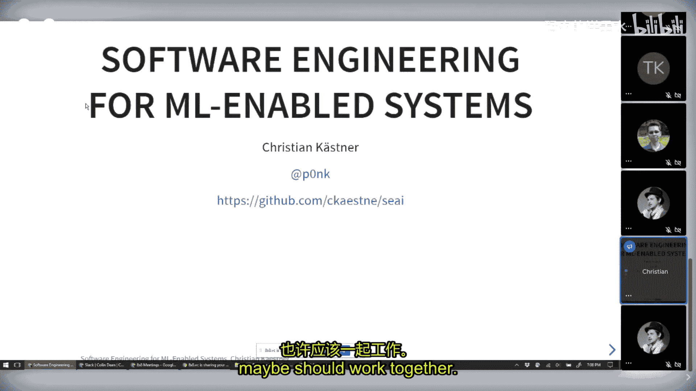

And second，So I teach at Carnegie Man I kind of have a software engineering background my background is research wise in software product lines and configurable systems and I'm also really excited about the heartefacts conference an interest kind of in open source sustainability and stress and things like this and I'm teaching a class on software engineering for machine learning and AID systems so when calling us kind of for talks during these nonphysical meeting times I figured why not let me try it has been quite a while until I made it to one of those meetups in the past even though it's just 700 meters this way。

嗯。

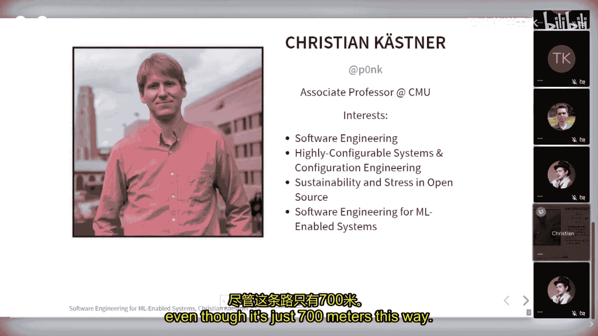

So what I want to talk about is really building and operating and maintaining systems that have a machine learning component。

 So it's not just a machine learning model， but really a system that where machine learning plays a smaller or larger role and to build these things。

 we kind of need interdisciplinary collaborative teams of data scientists。

 software engineers and probably way more people。So just to frame this a little bit better。

When I say software engineering for machine learning and ABD systems。

 I don't mean learning models right so it's not the classic data science thing that you might learn in a machine learning class or talk about this where you work in the notebook。

 you have the data set， you kind of clean data， learn a model， measure accuracy。

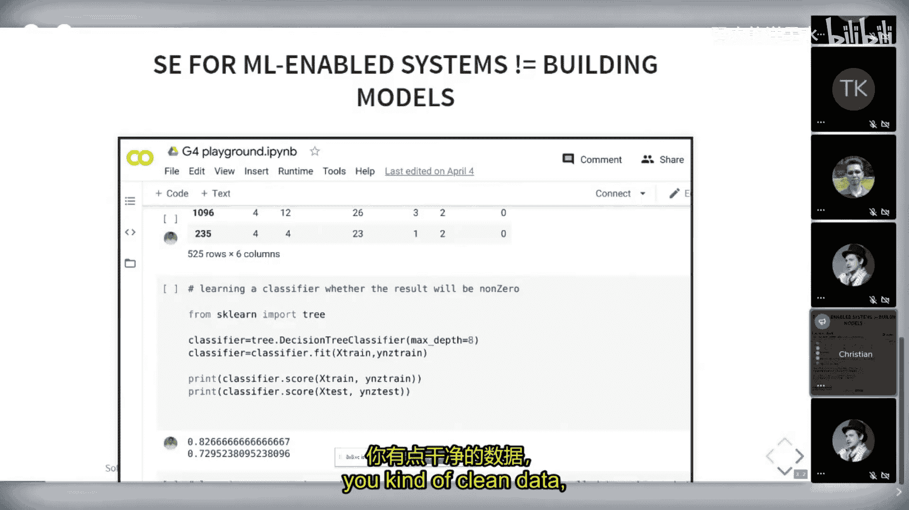

I'm also not talking about building the frameworks that we learn to build those models right。

 not building better psychic learn and when I talk to software engineers。

 especially researchers I often think， oh yeah， we use machine learning too we did these toolss for software engineers like there's a lot of research strangely on making better auto completion with deep learning and things like this。

 but I think software engineering researchers I'm not really representative here but I' really talking about is。

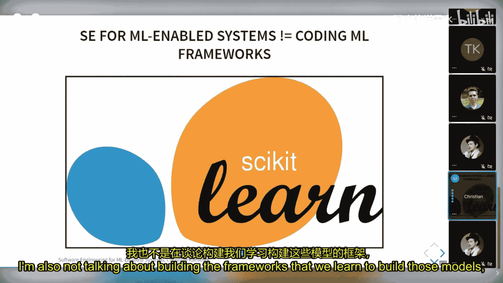

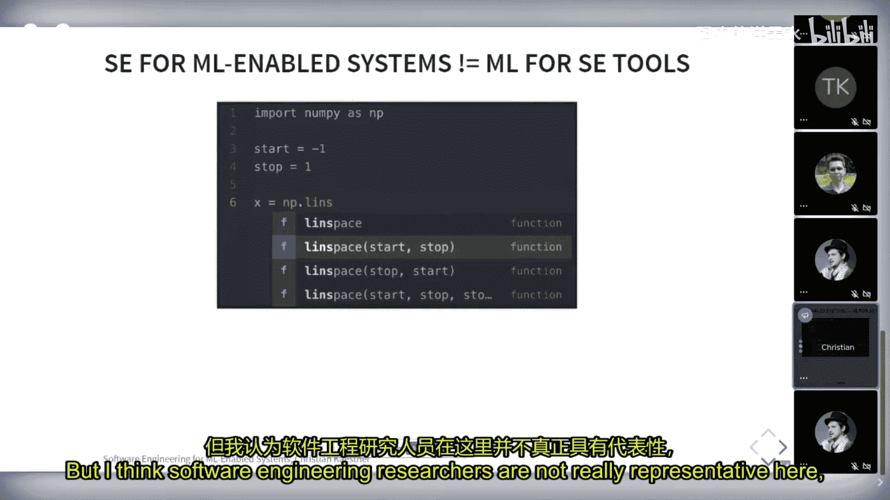

Building a software product， something that you might say that end users might use that have machine learning inside。

 And in this talk I want to use an example of a transcription service。

 This is a screenshot from Timmy， one of those transcription servers where you can upload audio file and you get a transcription back。

 So the kind of stuff that。It's running automatically I guess to transcribe this talk but that we as researchers often use when we interview people and we need a transcript in the past we paid people to do this and we paidsource crowdworkers。

 pennies to do this and now we pay even less to let machine learning do this and what you see here is not just machine learning model but it's actually a software product that somebody built right with a user interface and wait to pay something and you can upload audiofis。

 you can see the transcript， you can listen to it， edit it and so on so it's a whole product right somebody has made this a business。

And there's certainly a lot of machine learning going on here。

 somebody has built a model to do this transcription work。

 probably some deep neural network that has been trained and done here。

 but there's more to this right it's not just the raw model。

 it's actually somebody building a business around this building a service。

And to bid these things， you need people from different roles and I'm going to simplify oversimplify a lot in this talk by only distinguishing kind of data scientists and software engineers。

 but you have people with different backgrounds that contribute to a project like this。

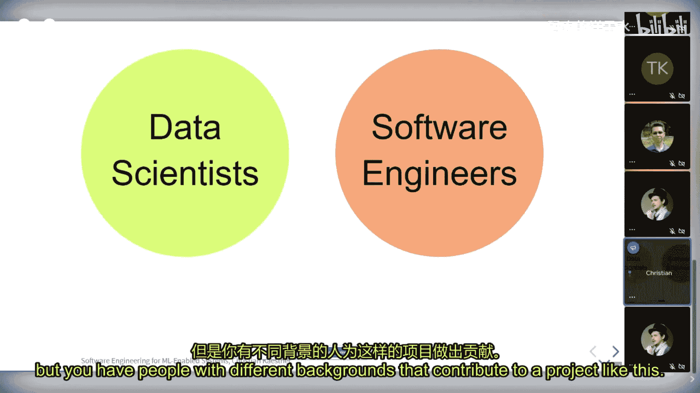

So I come from a soft engineering background and there are many different ways of how he could describe soft engineering we had seen you have kind of a。

Definition that we subscribe to but the key point here is these are not just programmers。

 these are people who can make engineering judgments right the software engineer makes engineering judgments under limited resources or information so you have a budget。

 you have a timeline and you need to create a product and they focus really on design tradeoffs and dealing with the messiness of the real world like customer who doesn't know what they want and they need to make tradeoffs between all kinds of qualities right cost time to delivery correctness performance scalability and so on。

We have a running job kind of in our machine learning software engineering masters program that。

Pretty much whatever we ask the answer is almost always it depends right so how much testing should I do。

 it depends what kind of testing it depends。But the mark of a good software engineer is not just saying it depends。

 but a good software engineer will be able to tell you。

What it depends on and if you give them a concrete scenario。

 they will make a judgment call and explain this， right。

 make a justified decision under the best information that they have and possibly revise later。

So software engineers have a lot of experience， things like ad methods， knowing how to apply。

 when to apply testing methods， things like this， and they play a big role in building these systems。

And again， I'm oversimplifying， but the traditional data scientist often comes from a background more more of statistics。

 a typical machine learning talk or course might either focus on how the statistics work behind the model or how you use a model。

For a given data set to learn something and to predict something。

 So what you typically see is somebody gives you a static data set。

 maybe you download it from Kagle or some other sites。Maybe you look at Titanic survivors right。

 and then you use often work in notebooks， you build a model， you kind of clean the data。

 extract features， build a model， and then you evaluate accuracy。

And typically people are pretty happy at this point。

 right though they show oh 90% accuracy that seems good， you can win k competitions with this。

 you can publish papers and hopefully you're kind of thinking， yeah。

 this could turn into the product somewhere。But most machine learning courses or talks kind of stop at this point。

 right so they don't really。Tend to not think too much about how do I put this into production。

 What As is。Involved in bidding the full system here。

So you have data scientists and software engineers with very different backgrounds and they don't want to。

kindind of make this too much， but they have different expertise。

 different things that they specialize on and it's not this is not a bad thing right so we need people with different expertise to work together。

But they may not always。Really know what the other side is talking about and we really need these groups to work together better。

 So again， in in this transcription service， you need somebody who actually has the expertise to build a deep neural network to trainer to improve it to figure out how to actually do this and your typical software engineer will not be。

Able to do this very well， but you also need somebody who actually bids the site。

 make sure that it's up to date that it's scaled that you can take payments that you deliver the service and so on right and this is typically not what a traditional data scientist is trained to be。

So again， I come from a self engineering background。

 so I think about when I teach software engineers or when we prepare for a self engineering project。

 what changes if we introduce machine learning？And at the basic level。

 it's that you have an extra component in somewhere in your system that makes predictions。

And that's not particularly reliable。And so we can think about a bunch of things that are different here just a few。

 first of all， you don't have any specifications right so we'd like to think in terms of kind of traditional moderates that we have requirements we have good specifications and if something goes wrong we can know oh yeah。

 the specifications set it should have been。Working differently so there's a bug。

We mass machine learning， we're kind of happy if it's 90% accurate and it's actually。

I could spend hours just talking about what's a bug in a machine learning system right that's kind of hard to define even。

嗯。The environment is important so we start thinking more or the machine learning component makes some predictions that may affect the real world which again may affect what we're training in the future might introduce some bias and some feedback loop。

 the classic examples how YouTube tends to recommend conspiracy theories are used to at least recommend conspiracy theory videos a lot because people who start watching those tend to watch them more and more so this is really something if you want people to spend more time on YouTube recommend conspiracy theory videos and some people spend a lot of time there right so kind of really have to think about the environment about kind of feedback loops。

 data drift， things like this。And then often you build systems not just with one machine learning components but dozens and they feed into each other so for example if one model that makes a prediction is there a pedestrian in the system and the next system takes a bunch of these inputs and compute something should I break now or something like this and you have these weird non-loc and nonmononic effects where you improve maybe pedestrian detection it may not improve the overall system and it's kind of hard to debug hard to test。

Then you end up testing and production a lot and you really need to deal with massive amounts of data。

 so a lot of this seems kind of different from traditional software development。

 especially if you're coming from building websites and things like this。

But I would argue if you actually think about this。Not all of this is really new。

 We have built systems with unreliable components before。

 It's actually fairly common and software engineering is's very uncommon actually to have clear specifications。

 It's very common to work in kind of an agile fashion where you work with the customer。

 you figure out， you readad and so on and we know how to build systems from unreli safe systems from unreliable components right you think kind of a fallback strategies of redundancies。

 we have cloud services that are highly reliable， even if you put in really cheap hardware components right so。

We have some experience building these wheel。We know how to build airplanes that don't tend to crash all the time right with software。

不是的。The environment is important， yes， but again， this is not necessarily new。嗯。

This is maybe more on the academic side but one of the classic papers in requirements engineering is actually called the word in the machine and it talks all about how it's really hard for a software system to know the real status of the world and how to influence it and you really need to think hard about sensors and actuators and things like this so it's not that this is a completely new thing。

 we have methods to think about this software engineers are often trained in this especially requirements specialists and so on。

Nonlocal non-montononic effects are not new， there's a reason that we don't stop at unit testing and also do system testing。

 feature interactions are something that have been researched a lot and testing production existed before machine learning or independent of machine learning right continuous deployment。

 AB testing are things that people have developed a lot of experience with and also the database community can tell you a huge amount of information about how to handle big data sets。

 how to do stream processing and event sourcing and things like that。So。😊，The thing that。

You can kind of go through the software engineering lifecycle on all the different parts and think about how does requirements engineering change。

 how does software architecture and design change and you focus a little bit on different things here and yes there are new challenges that testing is really hard in machine learning because we don't have specifications。

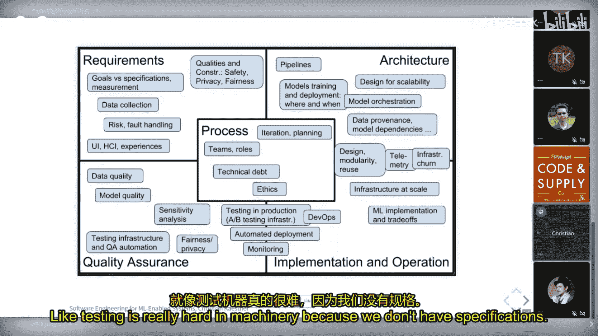

But overall， my view kind of is that。There's lots of things that are different。

 but maybe not fundamentally new， we have a lot of methods to deal with kind of hard systems and unreliable components。

It's just that we tend to treat。Systems as simple and if we just build a bedside。

 we kind of get away with simple practices with not being serious about safety。

 not being serious about reliability and so on。But machine learning enabled systems are often not that simple right so you have this unreliable component。

 many of them have some sort of safety connotation where you want to be aware of。

And we really should start paying more attention to some of the classic software engineering methods and adapt them and use them also in this context。

嗯。So。I think there's a lot of things that we can learn and a lot of things where we can see how can we adjust。

 how can we improve。I just want to， I don't have time to cover everything here。

 I selected for this talk talking about quality assurance a bit。

 And I want to show you how software engineers can help with。Well。

 how classic soft engineering techniques and kind of design thinking and things like this can help think at the bigger level about quality assurance of systems with the machine learning components in some form。

So。😊，I'm starting with a model。 So the traditional data scientist is usually fairly。

Comfortable with thinking about model accuracy kind of thinking about recall and precision accuracy。

 So what you typically do is you take a data set so let's say you're predicting cancer and images and scans So you have a data set with predictions so you already know whether there's cancer in those images or with labels and you're taking most of the data train or classifier and then you。

Try this on the remaining data that you haven't used for training and you predict whether there's cancer and you compare it with whether there was actually cancer in the image。

So this is kind of the traditional sense thing that you might do in notebook that you may report as。

 so you compare kind of the prediction against the actual resultss。

 you talk about two positive for its negatives， we call precision of one scores。

 so if you've ever done anything in this area， this will probably sound very familiar。

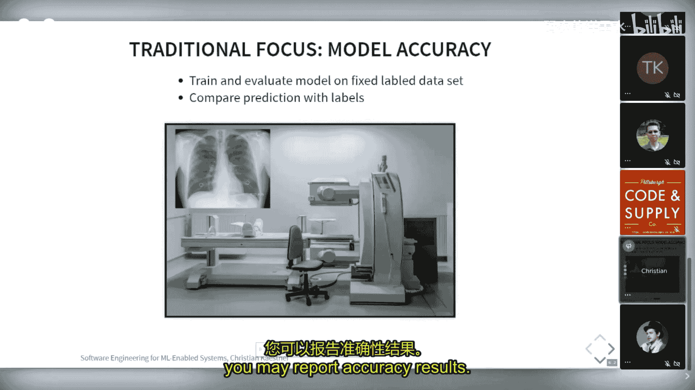

And traditional data scientists with then know a lot about different quality metrics。

 classification versus prediction versus ranking problems。

 and think a lot about kind of generalization and overfitting and how you can split training in data and if you have a hyperparameter optimization that you need to split again into kind of an evaluation set to cross validation and things like this。

And if you're lucky sometimes they start thinking about where not all mistakes are equal right so there's some mistakes that a model can make that are more important than others。

 this typically starts with a discussion around false positives and false negatives。

 so let's say again you're detecting cancer in an image。

SayT somebody that they have cancer is if they actually don't。It's annoying， it's causing stress。

 but it's fairly easy to check up on right so you have actually a human to look at this。

 maybe take a biopsy， have a second check。If you're missing a cancer diagnosis。

 it might be pretty late later for this person and that's something that you might actually really want to avoid so for it's negative might be much more expensive。

 much more worse than if what's positive and in other cases this might be the opposite so you really start thinking about not all mistakes are equal。

They're also not all。Or equally likely。And then。😊，There's a lot of emphasis in the machine learning community these days around fairness where you kind of push this a little bit further and see。

Do I have the same results for cancer prediction， maybe in men and women or across different races。

 things like this Again， not all mistakes are equal。

 Can we kind of figure out how the thing is performing。

And I think there's things that you can push this further and actually there's some recognition that you actually should think more about can we divide the test set further。

 how can we test more representative groups， and there's quite a bit of things that when I teach kind of testing。

 I would talk about equivalence classes， boundary conditions， maybe critical cases。

 and you can start thinking about something here like。

What are the typical classes that we should test， What are the different groups。

 What are critical test cases， I like this example that if you。

If you're doing voice recognition on the phone， there are certain。Frass do。

That are more important than others so you might want to have a regression test to make sure that something like call mom or what's the weather today so those kind of things should always work right even for dialects these are really important and you want to test them whereas if you have some obscure thing of adding something to a shopping list or playing an obscure artist maybe that's less important right so you can really start thinking about different test cases you can bring in kind of common practice of test automation right so things like continuous integration Travis CI and things like this you can translate pretty directly to kind of machine learning testing kind of leading the model tracking the model tracking results over time。

But then I think it's also important to go beyond accuracy。

There are so many more qualities of a model that might be important。

 and I'll come back to some of those later， but if you're actually pushing a model into production。

 it may really matter how long it takes to learn the model。

 if you need weeks to learn a model that's outdated after a few days。

 that's not very useful in production。Can you update the model can you select update it incrementally also what's the inference cost so the cost of making a prediction so you get a cancer image how long does it take to recognize it if you're making millions of predictions per second this starts to matter right how much resources do you need and there are many more questions I like to think of this somebody told me about this cost per prediction as the ultimate metric that you care about and when you're operating a machine learning system。

So the cost per prediction factors in the training cost， the design cost， the maintenance cost。

 and if you're building something。Like this transcription service。

 it actually matters how much you're paying to operate the service because you。

The transcriptions are not expensive for an hour of content that you're transcribing you're paying a couple of cents right so this needs to be a business that you can operate this。

 including training， including updating， including maintenance at reasonably low cost if you might want to make a profit。

But you can zoom out so this was just the model right so how can we evaluate the quality of a model。

 but it's actually interesting to think about not just the model。

 but also the entire infrastructure of how we are building the model This is often called it as infrastructure quality or pipeline quality because if you think about this and this has been described a lot。

 what you should really not think in terms of models but in terms of pipelines that produce models if you're thinking in production system。

It so yeah。Machine learning is often described in these multiple steps first you collect data。

 then you clean it， might label it， you do some feature engineering， you train it。

 you evaluate it and if you're lucky you're deploying it and production monitor it so you have all these steps。

There's things that can go wrong in all of them and you don't really want to do all of them manually right you figure this out once in a notebook maybe。

 but then you want to put it into production that you can actually automate it and repeat it and train again with new data and so on。

And the danger is that if youre not so you can automate all of this。

 but you also want to make sure that the pipeline has high quality， not just the resulting model。

There's a danger of mistakes in the pipeline and especially silent mistakes are problematic。

So let's say you changed something in your data cleaning routine。

And suddenly it just drops half the data because it thinks it's invalid or outliers or something like this right so this will catastrophically affect your model probably maybe bias it in really weird ways。

 that's something that you want to detect well another common example is you retrain your model every day and it grows and grows and at some point it's too big to fit the drive that you're uploading it to and if this is a silent mistake that you don't notice right because it's operating in some Python script that you have never tested it might take weeks until you realize that you're actually running an old model that's performing not particularly well。

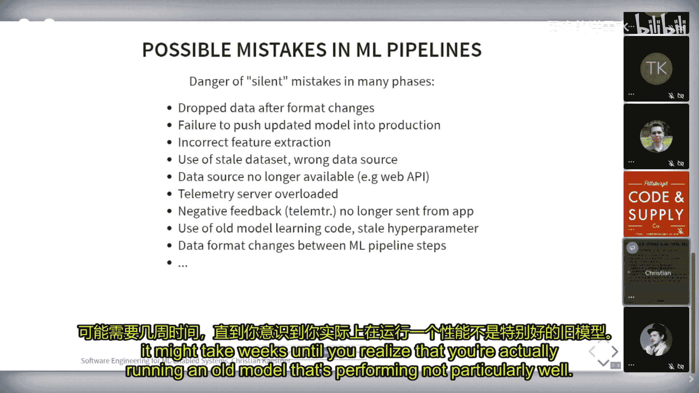

So。😊，Here's I think where you really what becomes important to that software engineers help and really start thinking in terms of pipelines and quality assurance of the entire pipeline。

 so there's so many things that you can test right so you can test the data。

 you can test the data distribution， you can monitor others， you can test your code。

 you can test the individual steps of your pipeline。

 you have unit test integration tests and so on there's a nice paper out of Google that discusses kind of the kind of things that you can test。

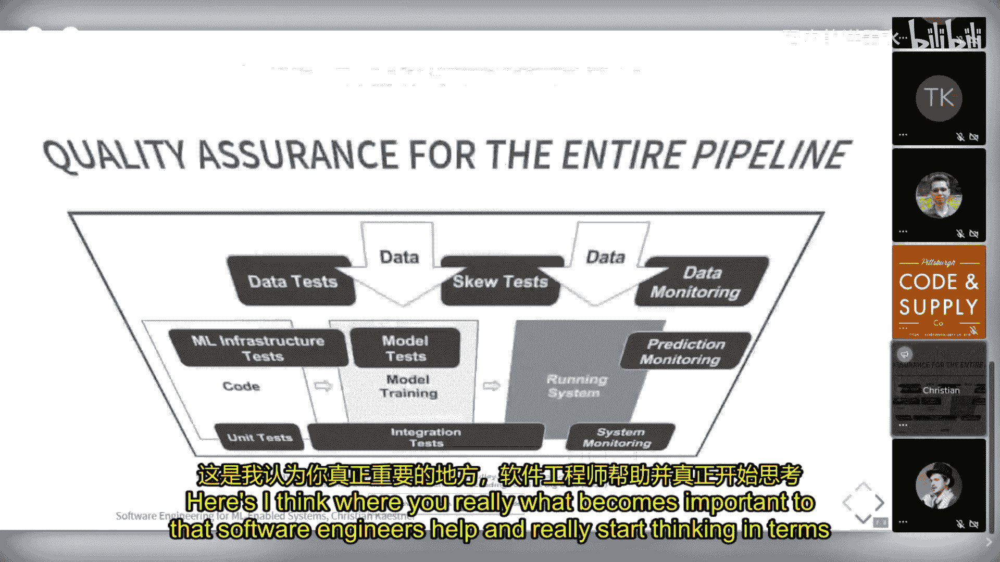

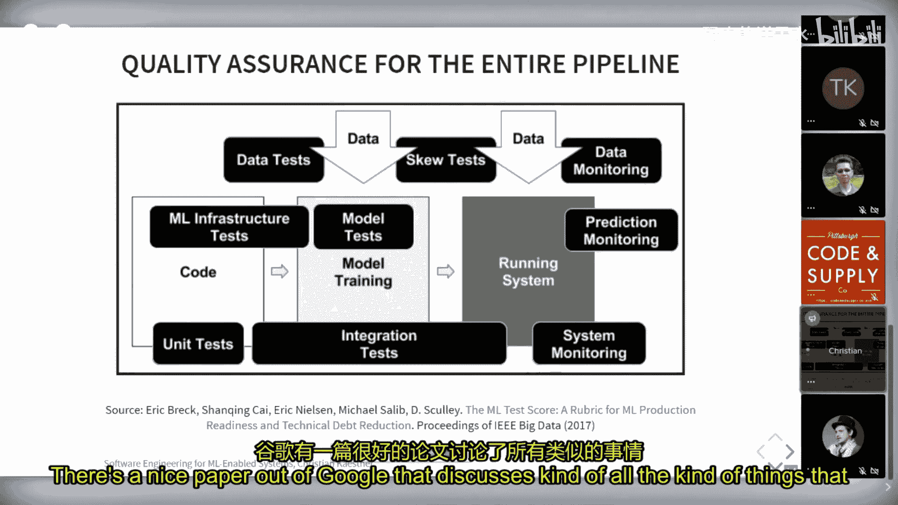

And the simple examples are if you have data cleaning called。

 make sure that you have unit tests for this right It's not common to have unit tests and notebook。

 but once you transition this into a production system into a pipeline。

 you really want to start thinking about this。 Probably also end to end tests for your pipeline。

You probably want to test your error handling routine like that you actually detect when an upload fades and you detect this reliably。

 this is where testing with stops with marks might actually be quite useful right where you can actually test that you handle a dropped connection correctly。

And also the best monitoring infrastructure that doesn't help if it isn't working right so even if you have monitoring you want to test that ors way that for example。

 you get messages when an update doesn't work。So if you think back to the transcription service。嗯。😊。

They probably update their models once in a while， probably not every day。

 but probably they get more training data。 They can update things， make it better。

 and they also update all kinds of other things in their service。

 So they probably want to invest at some point into some kind of continuous deployment infrastructure。

And when they do this， they need to be able to update also the model to automate this to detect problems。

 right to invest in their pipeline。But that's again。

 just one part of the entire system right so I started with a model， the quality of the model。

 then the quality of the pipeline。But in the end， we care about the quality of the entire system。

And again， the machine learning model might just be one component in the system。Maybe a small。

 maybe a big component， but in the end you really care about the quality of the system。

 you're trying to sell a product and that should work。

And it's not magically just because the model in there is highly accurate。

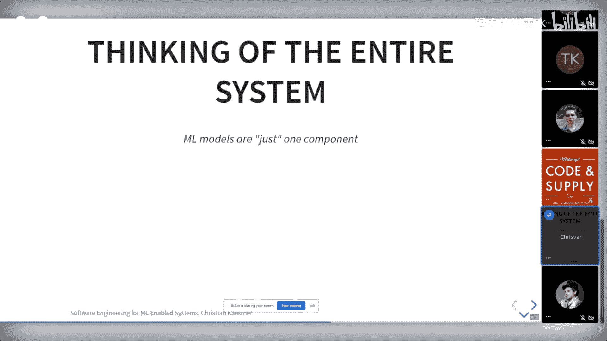

There are a couple of things however you can think about this， for example。

 if you have a machine learning component in there it will make mistakes eventually right even if you have the best modern its 99。

999% accuracy， there will still be some mistakes at some point it's unreliable and it's hard to predict the kind of mistakes probably impossible。

But if you think of the entire system it may not matter you can design around this。

 I like this example of a smart toaster that may burn your toast occasionally if the prediction fails。

 how long it should toast， but it should not burn down your kitchen。

And you're typically not achieving this by making your machine learning model better。

You're achieving this by thinking about the entire system， right。

 think about the rest of the toaster that's not just the machine learning system。

 put in a simple phase save。So just detect that the posta isn't overheating and shut it off that could even be a hardware switch in there。

So think of the entire product， not just the machine learning component。嗯。

And think about how you can deal with mistakes， for example， and how you integrate the predictions。

 There's also a lot of user interface design here。 For example。

 if you have a smart home system that's shutting off your lights at some point automatically or turning them on。

 Do you want it to confirm every time before it's doing this with you， Do you want to just do it。

 I there a way to train it to undo things， right So in a lot of decisions。

 it's really interesting how you think about how the。How the user interface design works。

 how you make it permissive for mistake， how you can undo things， and so on。

And in the end， you really care about the system quality in some white or some system goals that may or may not align with the goals of a specific component。

So typically you care about maximizing sales or income of the money of your sister， right。

 maybe for insurance minimizing loss。If you do something AI for social good some some kind of system there you might want to maximize community growth or kind of the benefits to society if you're Netflix you might want to retain customers if you。

That might be your main priority if you're YouTube or Facebook。

 what you really care about is showing as many ads as possible right and is typically measured as engagement time。

 how long do people spend time on the platform， maybe how many ads are they seeing。

And depending on what you're building better models may help with that。

 right more accurate models may help， but maybe also faster answers from a model might be more useful than slightly more accurate answers right fewer bad mistakes so maybe more mistakes in general。

 but the mistakes aren't that bad well the answers more explainable but less accurate might help with the overall system approach or it easier to evolve。

And so again， if you're thinking about the transcription service。

Maybe I can get it slightly more accurate， but it takes much longer to transcribe or requires way more resources what's the choice that I'm going to make right so I may care much more about the user experience and actually about accuracy of perfect accuracy of the prediction right again it's a component in a larger system and if the component is only a small part like。

Prediction ranking mechanism suggestions in YouTube or so it's an important part。

 but only small parts。You really need to think about how does it fit into the larger picture？

So in the end people tend to test in production a lot because in production you can often observe closer things that are closer to what you really care about。

 you focus more on the system goalss and just model accuracy。

Testing and production is also nice because it's really the ultimate unseen data so you can't cheat。

 you can't overfit and you can monitor performance over time like seeing whether you're doing better。

 you're retaining customers better， can do canary releases AB testing。

 things like this and helps a lot with debugging。

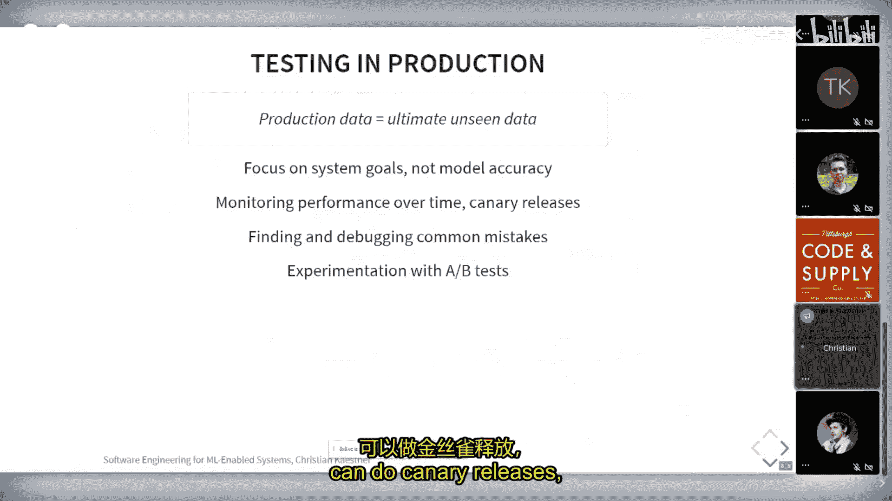

Designing a system that you can test in production though is quite a challenge and I think this is again where software engineers have probably quite a bit of experience can help a lot it's much more a design problem and an engineering problem than just a pure machine learning problem。

So here's an example that I use in class quite a bit of an app。

 I don't think it doesn't really exist， I think， but the idea is that you can take pictures of shoes and it will recognize what shoe you're seeing and then you can buy this for example。

 if you see a shoe somewhere in the street that you like you take a picture of that person it recognizes what shoe it is and you can buy it。

So。😊，This has a machine learning component in their fairly classic image recognition system probably trained on some data。

 you have established some accuracy on some test set。

 but you want to know how well is it in doing a production right so you want to think about how do I detect when my predictions are wrong？

Well， how do I detect how the product overall is doing？Think about this for a second。

 how would you approach this and figure out people are using this？Am I giving good predictions。

 bad predictions。I use as happy with this， is the app fulfilling its goal？

There are lots of things that you can do。The obvious thing might be just to ask the user here I detect this this is Nike issue。

 is this the right one， the user may know or may not know。

 but it might be very annoying if you ask for confirmation every single time。

So maybe not the kind of thing that you do， also if it's wrong。

Can they really tell you what the right answer is， they wouldn't use your tool to begin with， right？

You can probably see how often people are going to buy the shoe afterwards。

 it's not really checking how accurate your model is。

 but it's much closer to what you might care about as the app in general。

 right what the app is doing， you might detect things like whether people stop using the app。

And I think there are also much more creative ways here to think about this。

 So one example that I like that my students come up usually is。

What if people take pictures multiple times of the same shoe or in quick succession。

 that might be a sign that the first prediction was bad and they are trying again。

It's not asking explicitly for feedback， it's not seeing whether they buy the shoe。

 but you're kind of creative in thinking about what kind of feedback can you use。

 what kind of information can you use from the running system to guess how well you're doing。

So this is the design of telemetry。

really figuring out how do I identify mistakes in production or how do I identify how well I'm doing and you can measure all kinds of things。

 how do you find mistakes， false positives， false negatives。

 how do you do this without being intrusive。How much data should you collect should you really look at every interaction or just some of them can we sample this。

 how can we isolate this for specific versions so there are lots of design challenges and if I ask you how to design a telemetry system for any example。

I think the problem is really it depends again right but then you can dig in and design something and think about what would be a good solution and there are lots of mechanisms that are used in production all the time that you could use right so just asking people probably not after every interaction but Skype asked you after some chors mostly chs that they think are bad about feedback right？

Not many people answer this， but you get some results this way。Also in Skype。

 you have a button to report problems。You never get positive feedback that way。

 but you can see how many people are complaining and probably not everybody complains。

You can also just pay people to label data， so kind of take a sample of the shoes that you took pictures of and see how often were they correct by comparing this with human answers。

 probably won to crowdsource in some way。And in some cases， it's super easy。

You could like if if you're looking at you're trying to predict the future。

 you can just wait for the future especially if it's the near future right so if you're looking at whether prices for airline flights with rise or fall right now it's an easier prediction task。

 I think， but if you're trying to predict whether they're rising or falling。

 just wait seven days and see whether they're actually rose or fall。It doesn't help you back then。

 but you can evaluate your prediction after the fact again。

 very different cases for different scenarios and you really need to start thinking creatively of how do you design telemetry？

And here I'm coming back to。To this transcription service。

 because I really like what they' are doing and I hope that they' are doing what I think they are doing and I haven't actually talked to them。

So first of all， you see the five star rating at the bottom， that's pretty simple。But I think。

 and I suspect they're way more creative here。Because this interface is pretty nice they invested a lot of effort to keep you kind of in the editor so for example。

 when you a common thing that you do after you transcribe something is you listen to it again and fix things in the transcription and I could just do this copy this out and do this in a verify。

But this is nice because this interface synchronizes the audio and the text。

 so you can scroll it to a specific point in the text and start listening to the audio from there。

 well jump in the audio and it jumps to the text in the right place。

 so it's super convenient to kind of go back and forth and listen to something。

It also highlights words that it's maybe not so sure about。

And doing this kind of encourages you to stay in the editor and fix things in the editor。

 right so I'm going in there and fixing words。And if I'm fixing words for a specific transcription。

It's a pretty strong indicator that this word was wrong before。

And even better and providing them the right answer right so if they want to retrain later and giving them labeled data of how they can improve their system by doing this。

So I really hope they're doing this kind of stuff， but what you see here is kind of a creative design。

of telemetry， of the entire system to encourage the collection of certain forms of telemetry that allow you to improve in production to learn from a production system and so on。

 and it really depends on the specific system and I think you can achieve a lot here。

Um。It's also really hard for other reasons， how do you deal with privacy issues。

 right there are lots of examples here， but I don't want to go too much into this。

So what I've shown you is kind of。How much quality assurance。

You can add right kind of starting with the model itself then scaling out to other attributes of the model to the pipeline to the entire system。

And I think here you really again see how data scientists and software engineers need to work together right so they have different background。

 different expertise， and I think actually we need to bring them closer together。

 they actually need to work together。This is view that maybe you should hire people who can do both right hire people who are data scientists and software engineers。

 we tend to call them unicorns， they' are hard to find there's some that exists。Very hard to recruit。

嗯。And I think that's not a sustainable model。 I think what we really want is people with distinct expertise。

But people who understand the other side， who can work well together in collaborative teams。

 who can talk each other's language and work together。

And I think the right raw model here is to think about Devops。 I suspect most of you are familiar。

 right So you had this。It's kind of framed similarly you have developers and operators who。

Kind of have different backgrounds， different toolss， different priorities。

They hated each other maybe not quite but they often have a hard time working together。

 lots of conflicts at the interface and then we kind of worked a lot on having a smoother process having joined tools。

 joint vocabulary， joint responsibility so developers package their software in the container。

 they get benefits from it， they make it much easier for the production team。

 the operations team we make some of the telemetry。

 some of the measurements available to developers who can actually then plan based on this and learn from production information so there's really a synergy and we're not merging these two roads。

 we still have people with distinct expertise but we're bringing them closer together。

And I think this is also where machine learning software engineering from machine learning systems should go。

 right so we need interdisciplinary teams。They probably still have different expertise。

But joint responsibilities， right， They work together in building a system。

 be it the transcription service or something else。 It really helps if they understand each other。

诶所以。Data scientists can think more in terms of systems right there's more than just my model this needs to be automated。

 this needs to run in a larger system， there needs to be maybe safety concerns。

Maybe they should be aware of production quality concerns like performance and so on。

 but also the software engineers need to understand the language of the data scientists。

 their problems， how they deal with data， what their needs are and make data available to them right kind of again help them both ways around。

 for example， give telemetry data to the data scientists who can then learn about their models and I think there's more things to think about about risk and safety and so on where they can actually really work together and benefit from joint expertise。

I really think we need to start thinking about training software engineers to understand data science and training data scientists to understand more software engineering and the larger system。

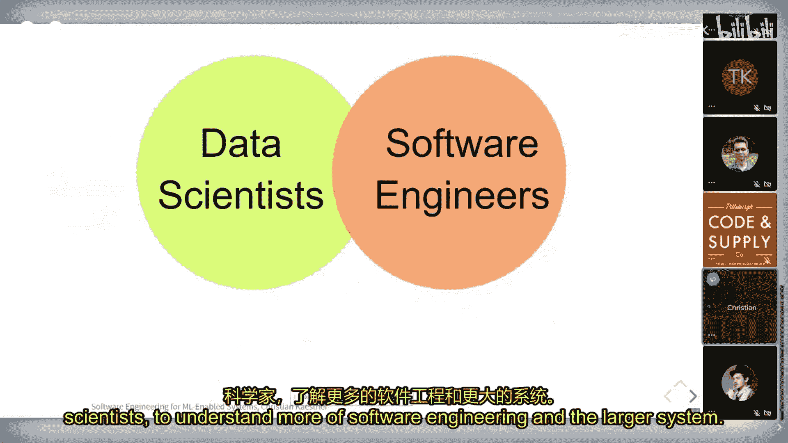

There is not a lot of material that I'm aware of if you're interested in this topic。

 this bookBuilding In System is the closest I can get， I use it as reading as well。

 I can recommend it， it's not going very deep but it covers the entire entire life cycle kind of from a systems perspective。

I'm teaching a course on this or the materials available online I'm teaching it remotely this summer so I' gonna to have recordings as well that I'm probably going to share the students allow it and if you're interested more into the academic side I also have collected quite a few papers so if you're interested there's a lot of stuff that you can read and get into and also this is an area that I'm really interested in was for teaching and figuring out maybe problems helping people so if you're interested in talking about this。

Talk to me， send me an email， I'm happy to also recruit people for interviews and things like this later。

And so on。So with this let me summarize right so I really wanted to talk about building。

 operating and maintaining systems with a machine learning component。

 which is something that we may not always think a lot about when thinking about machine learning。

So there's really， in my view that data scientists and software engineers。

 even though I'm oversimplifying here， different expertise and we kind of need both。

I showed this with quality assurance right kind of going beyond just model accuracy， thinking about。

Testing this thinking about not all mistakes are equal than testing the entire pipeline。

 testing the entire system， being creative about telemetry。

And I think to really pull this off and bid good teams。

 we need to start thinking about how can we bid interdisciplinary teams where people talk to each other。

 understand each other and are aware of what's going on。

That's all I have and I'm happy to stick around and answer questions， whatever you may have， thanks。

Cool， thank you so very much for sharing your content。

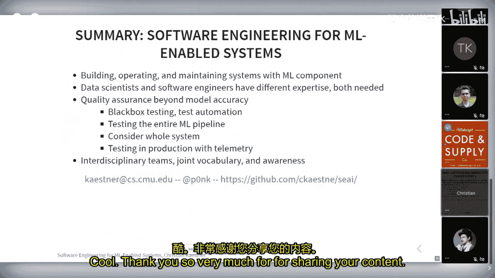