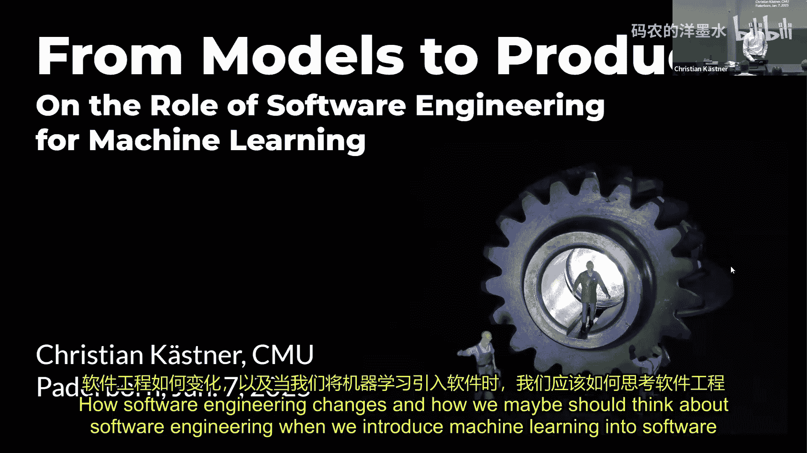
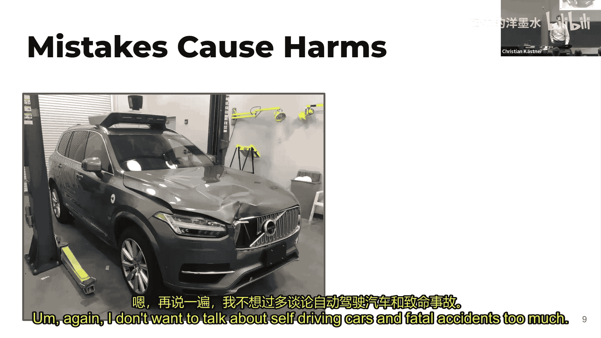
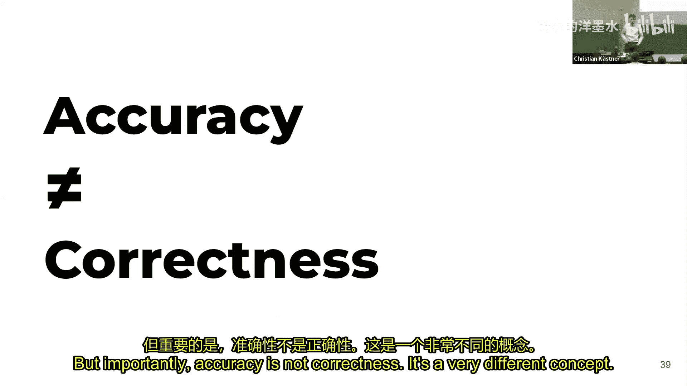
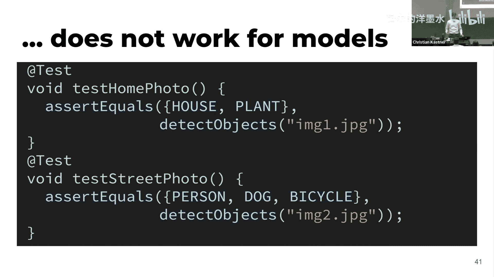
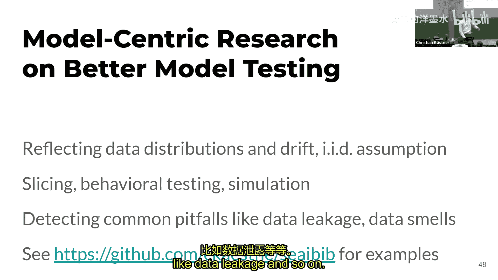
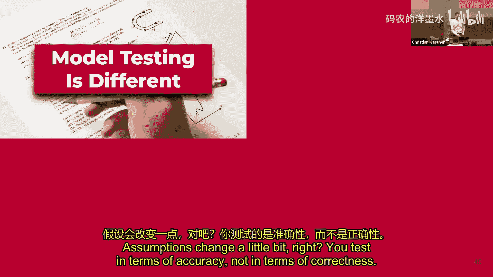
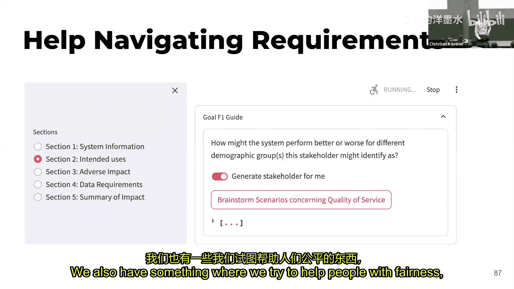
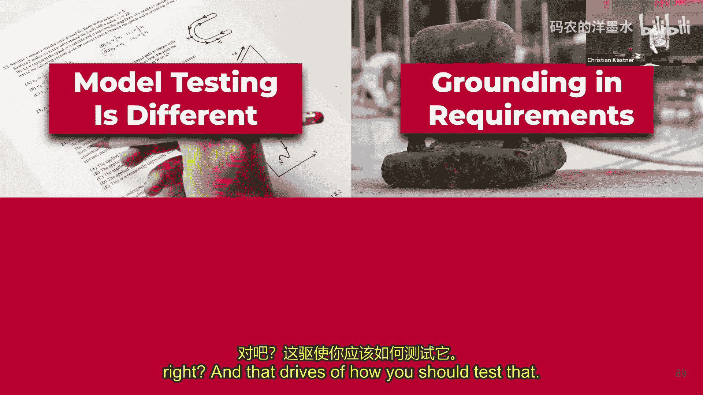
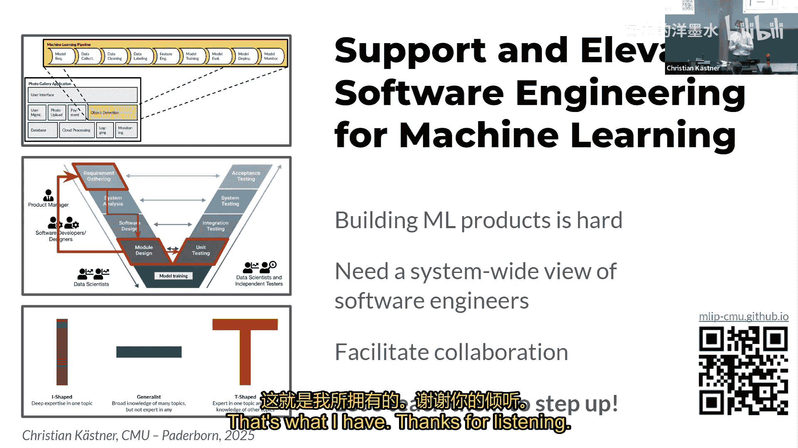

# 【全集】卡内基梅隆大学-AI驱动系统的软件工程-中英字幕-1080P-p27-Lecture-27---软件工程在机器学习中的作用--BV1JS6gBcEBF_p27-

How software engineering changes and how we maybe should think about software engineering when we introduce machine learning into software products and。

I don't think I need to motivate machine learning much。

 We have had crazy advances in machine learning over the recent years， right， objectject detection。

 for example， where we measure how well a model is able to detect various objects and images。

 not so well in this image， actually。But we don't really care about object detection in itself。 Yes。

 we can write papers about this。 Yes， we can write， publish wind benchmarks or similar things。

 but really we want to typically bid products。 Sadiv cars are a product where we use object detection for all kinds of things。

 obstacle detection， street sign detection and so on。

 but I really don't want to talk about safed cars， I hate cars， I think we should abolish them。

 let's talk about sidewalk robots instead as a running example。

 right So these are these delivery robots。 We had some of those on campus too。

 they navigate streets for all kinds of things for food typically these days。But also。

 other products doesn't have to be physical systems that go through the word。 Google Photos。

 for example， uses object detection in the background to index your pictures so that you can use keywords to search on them。

 right， for many years， That's how I found by my vaccine card。 right， This is how you find again。

 it doesn't work perfectly， but you can find a lot of pictures just by keyword search， right。

 This is how we use machine learning。 not just。To win a competition， right。

 to actually build products。 And that's what I want to talk about。 right。

 So I call this software engineering for machine learning， thinking about。

 we don't have a really good term for this。 building software products and air powered systems that have machine learning components in them。

 But that they are end user products。😊，There's a separate field in the software engineering community that's often called machine learning for software engineering。

 This is how you build software engineering towards with machine learning。

 things like helping students to cheat on homework assignments， compiler， these kind of things。

 right， program repair。 I'm not gonna to talk about that at all in this talk。 So this kind of thing。

 machine learning for software engineering has its applications too。 There are products too。

 but the end user here is a software developer， right。

 they are very specialized tools whereas I want to talk much more about。

All our students that go out with a software engineering degree and build apps and websites and mobile phone apps。

 maybe scooters， maybe sidewalk robots and so on。And building these kind of products is hard。

 You find lots of these kind of articles with these alarming statistics that we constantly fail on delivering。

 We have a promising prototype。 And it really is difficult to turn this into a product。

 I think we can debate how much this is different from traditional software。

 we had this whole software crisis thing， I think we got better at software development。

 to what degree is this just a panic to what degree is this real。 But there seems to be a notion。

 And that's repeated over and over again。 And also， if you talk to practitioner。

 people get excited about the technology。 But then have a hard time actually building something with it。

 And then if they build products。They can also cause harms。 Again。

 I don't want to talk about safe driving cars and fatal accidents too much。 This is Uber。

 and they stopped。 They scrapped their entire safe driving car products so did。

 but also sidewalk robots can cause issues。

I going to show you a couple of examples。 sidewalk robots can crowd sidewalks and cause an accessibility nightmare。

 They can get stuck in the snowll。They can get stuck in other places。They can catch on fire。

They can cross railroad tracks at really bad times。This is very recent last week。

 I think robot crossing probably on a red sign。 Maybe they shouldn't having a hard time to get off the street。

Good hiding was a safe driving car。So the robot walls have started。This is the case in Pittsburgh。

 an actual accessibility problem where a sidewalk robot blocked a curb cut。

And there was a wheelchair user trying to cross the street who couldn't get out of the street because there was a robot blocking it。

And one last example。

A sidewalk robot just casually running through a crime scene。Right， not understanding the context。

It was not and actual school shooting was a fake alarm。

 but the road through there and people weren't really sure what to do with this。

So we can cause harms here， whether physical or creating stress or all kinds of other harms and even something simple as indexing photos with Google Photo can cause harms。

And you kind of want to avoid this， right， So it's really hard to build those products。

 And we have certain stakes here。So building these kind of systems。When we think about data science。

 we often think about notebooks and models， right， Data science is model centric。

 If you've ever taken a machine learning class or taught one in some of your cases， you probably had。

In given a data set。 And then one of two things happens。

 Either you use existing libraries to build a model like Tensorflow， circuit learn。

 and then measure accuracy of your model on some given labeled data， see how fast you can get。

 or you build that library， essentially， right， you implement SV G or some other library。

 And then again， you see how well your model does and you measure accuracy in the end。

I doubt that anybody has taken a model and actually used it for something useful。Right。

 so if you're using machine learning is often presented as a pipeline of multiple steps。

 it starts with model requirements， some data collection labeling and so on until you build and evaluate the model。

And typically， course。Where most of the people are trained is really this model。

 feature model building， feature engineering phase and so on。 right。

 It's not figuring out what model do we need in the first place。

 It's also really engaging with the data collection。

And also not really deploying the model and using it for something。Around 2014。

 Google realized that there's actually much more to machine learning when we actually want to use this in production at the time。

 they wanted to。 this was a fraud detection deployed at scale。 and they realized。

Where we have these maybe 100 lines of Tensorflow code。

 and we are really proud of this code that trains the model。

 But then we have all this infrastructure around it。

 These boxes are roughly supposed to represent lines of code for different components that we need to actually put this into production。

 We have so much code just for data collection。 So much code for the serving infrastructure for monitoring。

 all these custom code that we wrote。 The machine learning part is actually。

 at least in terms of code。 It' very complicated code， but not the largest part of the system。😊。

This started kind of the MOs movement that you may have heard about that I talk a little bit more about where focus is much more。

 What does it take to actually deploy a model right So you have these extra steps and pipelines that so you think about model training and so on。

 but now also about model deployment and model monitoring and a lot of focus was put on automating this scaling this and today most of these boxes have shrunk significantly So for models serving。

 for example， instead of writing a lot of code yourself。

 you pick one of 500 different libraries that do that right So complexities there。

 you still need to figure out which one you take and how you configure this。

 but it's gotten much simpler So most of these boxes have been replaced by many different open source projects so many that you have now a lot of complexity just from getting these together And this is what the MOs movement is largely about is kind of how can we automate a lot of these。

Perhaps this infrastructure make it scalable and so on。

But all of this is still there to deploy a model， not a product。

 The end product here is an API to call a model。 If you actually want to build a product。

 let's say Google Photo or something like this， the model is a component in the system。

 And this entire pipeline is there to produce this one component。 maybe multiple components， right。

 But you still， if you want to build an application， you have all the other parts of the system。

 Use front and backend， you probably need to scale it， have some sort of streaming processing。

 you probably need to accept payments， you need to have a business plan all of those things。

 And if you're building this， this is actually quite challenging because all kinds of people unworth with all kinds of different backgrounds。

 they don't necessarily speak the same language。 There's lots of problems there in production。

And in many products， you actually have many different models。

 This is about 20 models for the perception part of a self- driving car。

 They all interact machine learning and non- machineach learning parts that are then fused together and reason about。

 And then this is still just a tiny part of the entire system。

So I think what we need more if we actually want to build products is to think of this as an entire system。

 there's this whole discipline of system thinking， but in general that you have a system composed of many components。

 some of them are now machine learning components， whether it's a model or the code to train the model。

And then fundamentally， this system wants to interact with the environment。

 You want to do something real， right， You have a end user who wants to do something。

 You want to show photos to somebody， right， So display resides or you want to actuate something in the real world like the sidewalk robot。

 So you actually want to interact with the environment and have an impact on the real world eventually。

 That's where you build product。And that's where I think we need much more kind of software engineering expertise。

I want to illustrate how things change。 And I wanted to do this through the lens of testing of these products。

 So I could talk about all kinds of different topics here。

 I teach the entire lecture on this in written book。

 But I want to kind of zoom in to make it manageable for a talk to talk about testing and go through four steps here。

 Let's talk， So let's talk about model testing。And modern testing is different from traditional software testing in a weird way that if you come from software testing might actually。

Not be that surprising， but it's different。 And it takes a moment to recognize。

 So I have a couple of pictures here， and you can run object detection over this。

And the way that we typically evaluate the model。 So I just take two recommendations here is you go through and you essentially check which ones of them are correct and which ones are not。

 and then youll report accuracy， right， So this is most of them are correct，92% accuracy。

This is how essentially all machine learning is evaluated。

 You have some labeled data or somebody manually labeling this。

 determining how many of them are correct。 and then you have some number representing the accuracy of your model and we evaluate。

 compare models with this leader boards are super common machine learning right We have all these tools as an MLOs tool MLflow to compare different experiments and compare them with regard to accuracy on similar data set。

But importantly， accuracy is not correctness， it's a very different concept。

In traditional software engineering， we test for correctness。

 We have an idea what software is supposed to do。 We have a specification。

We pretend typically when we're teaching to students early on that we have a formal specification or something very clear like this。

 in practice we never do。 But we could potentially prove software correct。

 or we have a specification where we know expect exactly for this output input。

 this is the output that we would expect。 And then the way that we test it。

 we just write a bunch of test cases that essentially test this comparison， right， So for this input。

 we expect this output and we have a bunch of them。If a test case fails。

 we say we have found bug what the test was wrong， right。

 but the software does not behave as specified。 It's buggy。We may not fix oil bugs。

 but typically were incentivized to fail， but we don't keep test suites around where 20% of all test cases fail。

 right， We expect it to be。Correct， overall， we wouldn't test machine learning this way。

 It would be really weird to write unit test one at a time for each input。

 These are the outputs that we are expecting， and then expect your entire test suite to always pass。

What we have is different。 We have test data， and we accept some mistakes。 We look for accuracy。

 How good is this model， and 92% might actually be quite decent。We don't expect that。

 This is always correct。We actually have a difficulty determining what correctness might actually mean。

 in some cases。 We don't have a clear specification of here's an image。

 This is what you would expect to see， though。 You have a human judgment here。So in this case。

 for example， the model might say this is a gym and this is juggling。

I know this place I've been there。 You can kind of say it's a gym。

 but it's actually a convention center of fairgrounds。So do we consider Jim as correct， Yeah。

 maybe maybe not。 right， So there's some judgment in here。

 And even two humans might not agree on how to do this。 This is， again。

 very different from the notion we have a formal specification of how the code works。

 and we could proveably call it correct。 This， I think， is a very good abstraction。

 All models are wrong。 This comes from statistics think empirical physics。

 All models are approximations。 Ass， whether impliedant or clearly stated are never exactly true。

 All models are wrong， but some models are useful。So the question you need to ask is not。

 is the model true or is the model correct， It never is。

 But is this model good enough for this particular application。

RightSo accuracy always is a question of， is it good enough or you kind of judging。

 Is this good enough， Is this accuracy good enough， You're not asking whether it's correct。

And that's weird to software engineers。This， I think。

 is a fundamental reason why we often talk past each other and where this comes from。

 It's two different forms of reasoning。In traditional computer science and software engineering。

 we think deductively。 We think in terms of mathy concepts， we have components。

 we can divide and conquer， specify them。 and then we can reason if this and that。

 then the following。And we can prove things。Machine learning uses inductive reasoning。

 That's a science kind of reasoning。 Think again， empirical physics。 right， you do observations。

 you generalize roots and you try to match your observations。 You don't have a notion of a proof。

 You don't have。 You can see how well your theory fits the observations。

But you won't be able to prove that certain things follow from each other。

 Divide and conquer doesn't work the same way。 It's a very different form of reasoning。And were used。

 we're trained in software as software engineers inductive reasoning。

 and all we are facing with this completely different branch that uses inductive reasoning where we don't have this notion of correctness。

So as a software engineer， I think the right abstraction is just to think of a model as an unreliable function。

You have some part of your code that mostly does what you want。But， not always。

You have no guarantees it can make mistakes。 You actually accept 5% of mistakes。

You may have some confidence scores。 Those confidence scores are usually not reliable。

 You can have calibrated models， but usually not the the mistakes are not necessarily predictable。

 They might be very surprising。 They might be very different from the mistakes that a human would make。

And the model itself is often inscrutable， opaque black box。

 You can't really evaluate it or understand it in detail。 And we use it because it works anyway。

 right， So we evaluate this in terms of accuracy， not correctness。 And that's fine。Honestly。

 in traditional software engineering， most of the time we pretend that we deal with correctness。

 Most of the time， this is good enough。 Let's deploy it。 right， The auto update mechanism works。

 Let's ship it。是。For this reason， a bunch of traditional software testing approaches are a little bit weird。

In traditional of software engineering， there's a lot of work on finding bugs。

 These are the rare cases where the software doesn't behave as specified with machine learning it's super easy to write wrong find wrong predictions。

 if your model is 99% accurate， there's 1% wrong predictions， even if you just randomly try。

 if you try 10000 times you expect to find the bug doesn't or so， right。

 So this whole of work on fuzzing and so on， I don't find super exciting because it's obvious that you can find mistakes。

The question is much more， are these mistakes that matter and is does somebody want to fix them。

 There is better research in this space that， in my mind。

 that focuses much more on data distributions and drift and assumptions and slicing and figuring out what we actually test and all kinds of mistakes that people do when they're modelling like data leakage and so on。

 But I don't want to go there so much。

So what I wanted to start with is if you focus on model testing itself。

Assumptions change a little bit， right， You test in terms of accuracy， not in terms of correctness。

The magnetic step is also beyond that you really need to ground that testing and requirements。

 You need to think about what do you actually need。 Again， the model is a part of a system。

 So you think about what the system needs from the model。And in both of these cases， for example。

 your expectations toward object detection might be quite different。Right。

 here you might actually really care detecting having very precise object detection of feet。Right。

 people walking and all kinds of obstacles that are close to the ground。

 I don't care that you detect planes， particularly well， right。

 They are usually northern obstacle here here， you kind of want to detect all kinds of objects。

But also， accuracy is probably not that critical。 You may not find all your photos。

 Sometimes you might get a fourth positive。But it， it really matters to understand what do you actually need from the model in different cases。

 you need different models。 So when is good enough or what kind of accuracy do you actually need。

We usually start by talking about requirements from a goal perspective。

 So what's the goal in building the product。Right，The goal of Google Photos might be a good user experience。

 Some engagements serving ads from Google's perspective， at least， right。

 And then you have the model that has some goal。😊，Accrd object detection。 And hopefully。

 that model goaler supports the product goal， but it's not the same。Right。

 more accurate models don't necessarily improve the good user experience or how many ads you're searching。

 it hopefully supports it， right， but it's not the same。

 Also users have goals that are not necessarily the same as the product goals。

 Uses probably don't care about how many ads they're seeing。And。They are supported， hopefully。

 again by model good。 And then we have organizational goods making money， usually if you have。

Unless it's a non nonprofit， right， But you can decompose them and can start figuring out what do you actually want。

In this way， it makes much more sense to start asking， what accuracy do you actually need。

 What do you need beyond accuracy when youre designing a system。

This is one of my favorite examples in the space。 This is a study at booking dot com a couple of years ago。

 So they have all kinds of models。 Sos a hotel booking site。

 They have all kinds of models of making predictions about you when you come to the site。

 Are you traveling for business or for leisure， Are you traveling with a family or not。

 What kind of hotel are you looking for so that they adjust the rankings。😊。

They run all kinds of experiments in production。 They don't tell us the exact number。

 but relative differences in model accuracy。 So more or less accurate models。

And the system go profit， in their case， How many hotels they are selling conversion rate， right。

 How many people stay around。And you see what you would generally expect， More accurate models。

 produce more profits。But you also see these things here where worse models actually produce more profits。

And this is apparently statistically significant。 And you have these things here where model gets better。

 but profits are lower。And they don't know why。 So they speculate in the paper a little bit。

 My favorite speculation is that there's an uncanny valley effect that their models become so good that they become creepy。

😊，That they know too much about you when you try to book something。 and I go more book here。

 I don't know whether that's true。 They speculate about a few other things。

 but I think it's an important lesson that you don't necessarily need to always just optimize for more accuracy。

 There are more other things that matter。 And in the end。

 you actually care much more about the system going。

Right so the system requirements or the product requirements should really drive how you're testing things。

What you need。嗯。Also target distribution， do we care about outliers。

 Do we care about specific slices like feet or planes。But also。

 other qualities that you might actually care about if you actually want to build a product like inference latency。

 How long does it take to make a prediction， can you afford it， How。

 how much does it cost training latency， if you need to retrain occasionally。

What kind of hardware or software do you need， robustness。

 explainability all kinds of other properties。In software engineering and engineering。

 more generally， we often have this V model， which you may have seen before。

 which essentially maps requirements to test strategies so you want to start with product requirements and already think about maybe even without building the model。

 how am I going to test that later， see that the product is actually useful。Right。

And then you also break it down to component requirements。 You can test those individually。

 This is where your model evaluation would be， right， So you figure out for this product。

 I have the following model requirements。And this is how I want to evaluate the model accuracy in some way。

 maybe， maybe with specific test data。And often what happens is also that we can't do this in this clear water for fashion。

 with machine learning， we often don't know what's possible when we started。

 it's a much more sciencey kind of approach， right。

 You can't tell somebody develop how long will it take to develop me an object detection model with 90% accuracy for feet。

 They will tell you， yeah， I try。 And then maybe they realize I can't detect just why am I talking of feet all the time I can't detect certain kinds of shoes。

 Maybe let's solve the problem in a different way。 So you often have this feedback loop based on what you can actually do with the model or not。

 you learn this。 You might influence your product requirements。Quite a bit。 And then after all。

 again， a lot of people are involved in this who are not necessarily very good at talking to each other in companies。

We've done some work in this space where we try to help people to agree on model requirements。

 This is an approach just to have a domainspecific language to write down model requirements。

 we try to have a graphical interface to But the idea here is to try to keep people get people to actually talk before theirre bi about something。

 what are they expecting a whole process diagram this is pretty terrible to see here。

 But the whole point here is that at the very beginning， when you start modeling something。

 you already want to talk to your customer or the person who's gonna to use your model to figure out what do they actually need。

 what kind of accuracy seems plausible for them， for example， And when you have a prototype。

 you really want to have a second discussion with them to talk about what do you need beyond accuracy。

 what latency is acceptable。 Like we show this is in general possible but what accuracy actually do you need。

 What latency do you need does need to be robust robust。Got to what and so on。 Right。

 So you think much more about requirements。So it's really about kind of this planning。

 this negotiation trying to help this and actually document this at some point。

 We have some tools to help with figuring out some requirements。

 some things that you might worry about So this uses am in the background to help you understand if you care about toxicity here。

 the subsections you might care about different aspects of toxicity and then you can test those separately we have something where we try to help people with fairness brainstorming and there's more work in the space。

 but I don't want to。

Talk too much about this。 The whole point here is that testing of models A is different from software engineering。

 And still， you can't just randomly take data and get an accuracy number。

 You should really think about how am I going to use this model， right？

 And that drives of how you should test that。

All of this was still model centric。 So we only talked about testing the model。

And how the model might contribute or what you need from the model。

 But we really need to start thinking much more beyond the model。mistakes cause harms。

And if we want to think about mitigating these harms， we can try to train more accurate models。

But then it will only get us so far。 The model is always an unreliable component， right。

 even if it's 99。9，9% accurate， Sudden， it will still make mistakes eventually。

 So we should really think about all these mistakes will happen。

What can we do about them that we avoid those harms。

So we can start thinking about mitigation strategies， have another mechanism。

 not purely rely on object detection， but maybe have a separate specialized detector that detects emergency lights。

 flashing lights and maybe if that happens， delegate to a human。

 These robots are half remotely operated anyway， right So there's lots of people sitting in other countries that are operating these when they get stuck So whenever flashing lights are detected。

 maybe delegate to a human to navigate that situation。

 maybe have a physical emergency stop button on that robot so that somebody in the street can stop them when they're about to wander into crime scene。

But you also want to。Balance that with this can be easily abused， right， People try to。

Destroy these robots all the time and if you can just push a button and it shuts down， right？

This might be obvious。 So there's actually really interesting design questions that go beyond just。

 we need a most accurate object detection model， right， How do we integrate this。

 What kind of mechanisms do we use to navigate safely， In this case， also。

 what are you gonna do So you can try to improve your object detection model。

 You can also try to get this human primate boundary much more accurate。😊。

Google tried it for many years， and they've essentially given up。

They have determined they can't guarantee that they won't confuse humans with primates。

And what they did is that they just never show predictions of primates。means that。

It means that you can't really search in your zoo photos quite as well。

But it stopped inciting people， right。And what's true for all of these mitigation strategies is that they are outside the model。

 their system design strategies， human interaction strategies， human in the loop strategies。

 thinking about making actions undoable， Have some redundancy mechanism that you don't rely only on the model。

 right， The model is unreliable。 Do you have another mechanism。对啊。AI safety is an oxymoron。

 That's a word that doesn't make sense in itself， like bitterweet。 AI is never unsafe。

 AI is just code a software。 Soft doesn't burn。 So doesn't hurt anybody。

 It's when you put it into a system。 when it interacts with the real world。

 If you show it to a human， If you actuate something in the real world。

 This is when you can cause harms。Right so you need to think about the system。

 You need to think about the boundary between the system and the environment。

 This is exactly where the harm will happen at this boundary。 right， So safety is a system concept。

 You can't reason about safety at the model level alone。

So if you're doing something stupid like this， you better put on a helmet and protection， right， so。

If you know that you're building software with an unreliable component。

 it's pretty predictable that bad predictions， bad results will happen， right。

 So you should really think about how can you mitigate wrong mistakes。

I'm not an expert in this space， but I think safety engineering has decades of experiences in the space of thinking about what are the worst things that can happen。

 how can we mitigate them， how can we eliminate single points of failures in class we talk about fo trees。

 which is a very old technology So the example here is an automated train and you don't want to stop people and trap people in the doors。

 and you can reason about a very event-based model， how can this bad thing happen。

You need to have a person in the door and the door closes。

We can't really reason about the person in the door， but we can reason about why the door closes。

 We have a vision based detector， whether there's an obstacle that may fail or there's a manual overrite。

 the manual overwrite again， we can't really do much about。

 but we can think about the vision based detector。We have probably multiple reasons。

 and we can further decompose this。 So if the camera is defective。

 we can think about there needs two things like the camera itself is defective and we don't detect that。

 It's defective。 We may have a detection mechanism for this。But when you get to modern mistakes。

 I feel that there's not much of a。Sense of decomposing this further。

 It doesn't really matter why the model is a mix of wrong prediction。 It makes a wrong prediction。

So what we should do is think about mitigations and mitigations typically happen by introducing more end connections。

 right， so camera defective alone is not sufficient。 You also have a detector。

 So both of these need to fail now。So typical idea here for this might be。

Vision based detection may fail for whatever reason。 So let's not rely on this entirely， right。

 So you have the vision based detector， but we also have a door safety system。

 like a pressure sensor in the door。 So now both our visual detector needs to fail and the pressure sensor needs to fail for the bad thing to happen。

 way less likely， right， And we're not relying on the model as a single point of failure。

 And you can use these foil trees as a。Analylysis strategy also has a kind of a design strategy if you want these sort mitigations and there's decades of experience in safety engineering approaches。

 we're currently playing with STPA a little bit more which is a more modern one。

 but there's a bunch of different kind of concepts and they all help you kind of fairly structured brainstorming。

 think through potential problems before they occur rather than catching the system afterward。

And I would argue that pretty much all properties that we care about， safety， security， fairness。

 transparency， accountability。 theyre all system properties。 they're not properties of a model。

 You don't care， I don't care about how fair a model is。

 I care how fair the product is that uses a model。 And if you can mitigate unfair model somehow in the product and it doesn't reach the environment。

 I don't care right， This is a right solution。 And theyre actually for all of these design strategies that you can do things outside the model to make products more secure。

 more fair， more transparent and so on。Just as one specific example。

Where often talk to security people， I find this kind of thing like prompt injection really silly。

 promptmp injection is the idea that with a large language model， you can ask question。

 you can give a secret to a large language model。And then tell the model not to give that secret away。

 And then people find creative ways of writing a prom to reveal that secret anyway。

So the model is an unreliable component。You're giving this unreliable component a secret。

 And then you're trying to make the convince this unreliable component to not to reveal the secret。

 knowing that it may make mistakes from time to time。 What did you expect， Why are we doing this。

 This is not a sensible product to write。To do if you really care about security in this case。

So I think there's a lot of things where I would just say this is irresponsible to release something like this。

 If you actually care about this quality。 and then this whole kind of how can we harden these prompts。

Maybe we've reduced the likelihood， but we don't change the fundamental security problems。

 I would say。So I think the challenges are much more in how can we anticipate mistakes。

 How can we mitigate mistakes， or make that easier， more approachable。

 I would say we have the techniques。 Safe engineering has been around。

 It's just expensive and developers don't usually want to do this。 How can we make this easier。

 How can we teach them thats done， Can we show some success stories。

 We don't talk about mitigations much。 You actually have to really look for them。

So I think we need to study much more products than just components。

 it's very easy to as a software engineer to study notebooks there， millions of them on GiHub。

 but nobody cares about them we've done some analysis you can try to report bugs nobody will fix this because it's the right only software right you publishs on Github for your resume but you don't maintain this。

There are unfortunately， very few open source products to study。

 You typically have to work with companies。 We did a project where we tried to find some of them。

 we found 260 which in the grand scheme of thing is a very small number of end user products。

 but there are some of them to study。 So if somebody is inclined to do anything in this space。

 we share them。所。😊，Coming back to this story， right。

 so I want to talk about model testing or testing of these products with machine learning components。

 Mo testing itself is different。 Mo testing should be grounded in requirements。

 but then we also need to think about beyond the model， right the rest of the product。 And then。

 of course， we need to also test the rest of the product。So unit testing is easy。

 but we really need to focus on the entire test case here。 and we don't do this。

 So if you implement safeguards， you should probably test that they work。

Right if you have humans in your safeguards， you probably need a user study to see that the humans understand this and are not fatigued。

 human in the loop is notoriously hard to design that you don't just take this away We have all these strategies。

 integration testing testing for error handling testing with stops where we can test even if we don't have the entire system。

 whether safety mechanisms work， recovery mechanisms work if you have this big thing。

 many different models， how do you test this And in the end。

 there's a lot of system testing that you probably can't get away from A lot of this is field testing when it comes to robots。

 a lot of this is testing and production these days and I would actually argue testing and production is even more important than ever and how do you run AB experiments in a production system where you deploy a version of a model。

 see how it's doing without causing harm So typically detecting very quickly if things are going bad and rolling it。

things like Grfaa Prometeus。Observability monitoring software。

 I think a key thing that we need to teach， not teaching these tools。

 I would say is pedagogic and misconduct at this point。 So really， the whole suite of testing。

 not just model testing is something we should focus on。Al right。

 so this was the main part that I want to talk about how testing。Both at the model level changes。

 And then you really want to think about the entire system。 And I think we neglect the system a lot。

Where are we going from here？I would argue at this point， we actually know the problems quite well。

 There's lots of studies， including interview studies to see what problems our practitioners facing when they're building products。

 We did the paper recently where we did a survey of 50 papers that each the interviews or surveys with practitioners and kind of they find very similar problems of where are the challenges。

 And I would also argue we have a lot of the ingredients for solutions。

 It's not that we need a complete new software engineering approach or complete new testing approach or safety approach or security approach probably。

We have decades of software engineering experience on process， lifecycls， requirements。

 safety engineering， integration testing， testing and productions on。 I think we need to use it。嗯。

This is a way how I think about this in traditional software engineering。

 We have a whole range of tools， and we build very different systems from very simple kind of low complexity systems to really critical high risk systems。

 and we can build all of these pretty reliably and we can build high risk systems without causing all kinds of accidents。

 It's just super expensive。 We don't build these systems the same way that we build these systems。

 right， We invest increasingly more resources as we go there。

 And I think what happens with machine learning is that we shift our ambitions。

 We build much more complex systems with much more potential for harm。

thingsing like photo search are suddenly much very complicated， as you've seen。

 have potential for harms with mistakes。 We introduce unreliable components into everything。

 but we are still pretending it's。Like a really trivial website that we're developing。 right。

 So I think what we need to do is much more get serious about engineering practices。Investing in。

Anticipating mistakes， mitigating mistakes， doing requirements engineering。

 I think we can't get away with the sloppy practices that we can often get away in traditional simple software systems。

There I think two parts where I would。Personally， for think this is the largest opportunity for improvement。

 One is collaboration。 I think this came up in our studies all the time that there are are these people with different roles in these teams。

 and they don't necessarily talk to each other。 Data scientists and software engineers don't usually speak the same language。

 They have a hard time communicating。 This shows up in so many places in our studies as was。

If you're trying to figure out what you're building， you have the product manager， So engineer。

 data scientist working together， figuring out planning， they don't like to talk there。

 lots of conflicts， figuring out training data。 If it's not just given to you in a homework assignment right。

 figuring out how do we change the system to collect the right data。

 who is responsible for this iss there a separate team， is there a different company involved。

 integration of all these products。 there are all these points where there's。

Really pain points that we see in our studies and other studies， too， of just。

Collaborating across its disciplinary divides。And I think we are not really good at providing support for interdisciplinary collaboration between software engineers and data scientists。

We really want them to be proactive and understand each other so that the data scientists might actually ask proactively。

 how will my model be used so that they did the right thing。 This isn't really happening right now。

I think there are other places where we've been much further。 Devops is a common term。

 probably 20 years old at this point， very standard in software engineering that brought software engineers and operators together。

 right？ They used to have lots of conflicts with each other where operate software engineers will just say works on my machine Vo is so hard to deploy And the operators say。

 can we ship your machine into production then so。And you had to you have these。

 you used to have these release cycles where once a year。

 you would shut down overnight to install a new version of something， right， these days。

 we release in a lot of companies， when you push to Git。

 This is life in production a half an hour later。 and developers found find this super empowering。

 right， You don't wait。A year until your code is in production。

 you actually see very quickly how people are using it。 You see telemetry。

 This is enabled by this whole approach of Devops where we essentially reframe the deploy deployment decision。

 which said joint golds joint responsibilities， Jo tools for wining framing。

 So common example is docker containers。Developers now invest more effort routinely to put their software into containers。

 So the operators don't need to figure out all the dependencies。

 They can just take the container put into production。 right， So the。Developers invest more work。

But now the it frees up the operators to focus on other things like Kubernetes scaling this at large scale or putting in more telemetry。

 which then benefits the developers to who get more telemetry more feedback。

 house is actually used in production， right so。This requires a culture change， not every company。

Change to this successfully initiallynitially， This requires working together across the boundaries。

 This required new learning。 Like how do you use a container， right， things like this。

But it has been largely seen successful。So we have other success stories like this。

 I would say software engineers and security experts get better along than they used to do maybe 20。

30 years ago。 No， things like security development lifecycls。

 I think we have seen some progress on some recognition of how to actually integrate this。

 I think with privacy engineering very recently， we've seen more progress of how to integrate this more deeply。

 And I think also data scientists and operators have seen this whole EmmaOs movement。

But we haven't really made a ton of progress in my mind in this collaboration， right， really。

 this kind of how do we。Figure out what are the real requirements for the model。

 How do we work together， How do we figure out requirements， and so on。I think， the largest leverage。

At least that's where I'm investing my effort as through education at this point。

 I think we need to get these people to work together。

 And the first step there is fostering mutual understanding。

 I like the concept of a tea shaped professional。 A T shape。 So the idea here is an old concept。

 an eye shaped professional is somebody who has deep expertise in one area。

 So data scientists with a PhD in data science focused on this really understand the thing。Its。

The generalist is somebody who knows a little bit of anything manages， but nothing in depth。

And then T shaped is the idea that this is somebody who really knows their specialty。

But knows enough of other fields to be able to talk their language。Right。

 so you don't need to be an expert in。Safety engineering， in addition to data science。

 But you need to know maybe a little bit of safety engineering to know when you should ask for help。

Right so that's the idea here that we， I think it's really important to broaden education。

 both for software engineers and data scientists to recognize the other field that software engineers know these are unreliable components。

 Let's plan for mistakes， right， maybe offer proactively support for changing data collections or testing and production and data scientists recognize。

Maybe I should ask how the model is actually used， right？

 Maybe there's something more than accuracy that actually matters here。

 What distribution do we actually see in production， And maybe we should version things。

 Maybe this will change over time， right， not necessarily。So we don't want to train unicorns。

 That would be great。 But somebody who has all the expertise of all the roles。

 it's often unrealistic， right， But I think this is much more manageable。

And that's what I'm trying to do in my course I don't have the time to go through all topics and all depths right so the whole point here is to cover the whole range of software engineering and data science related concepts here from requirements to operations and responsible engineering to kind of cover what are the important parts right you won't be an expert in safety analysis but you have seen for trees before and how they might be helpful。

We've been teaching this for。Can semester us now， I think。

Wass a little bit challenging figuring out the right prerequisites。 But at this point。

 since we're not trying to make everybody an expert in everything。

 this books actually out quite well and it's a quite popular course。

And I would encourage you to teach something similar。Honestly， I've written a book about this。 as C。

 as Eric mentioned， it's creative Common。 It's online will be available in printed form soon。

And all these materials that are mentioned are online too， so if you want to teach something。

 I'm also be happy to help， there's an annotated bibliography also with a bunch of readings in this space。

So。To wrap up。What I really wanted to encourage you here is to think about。

Really taking software engineering and a system wide perspective series。

 right Bidding products with machine learning components is difficult。

 but we really need a system wide view， a system wide view of the entire system。

 And I think collaboration and education are probably the prime ways to go。That's what I have。

 Thanks for listening。

