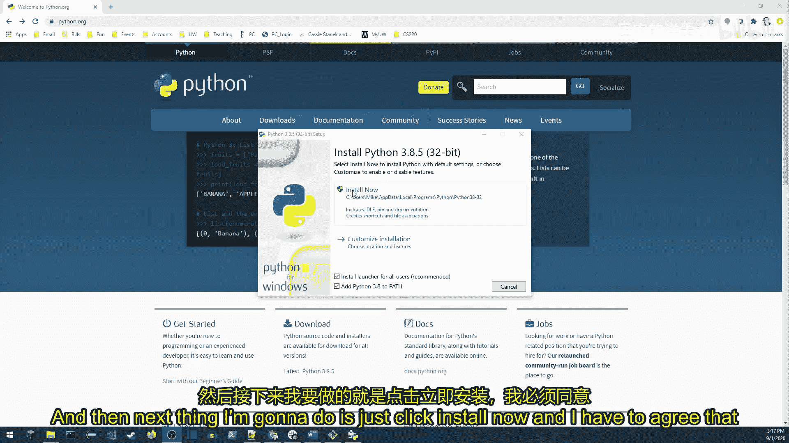
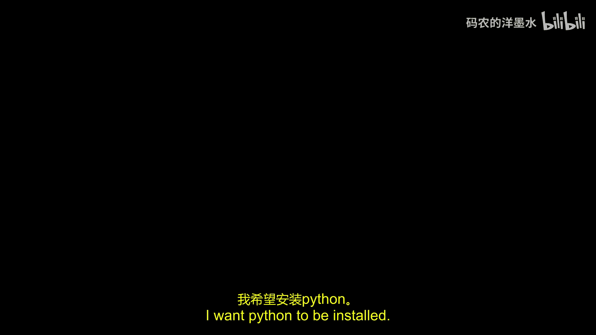
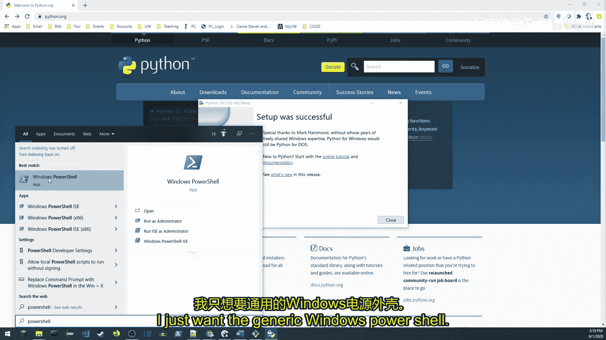
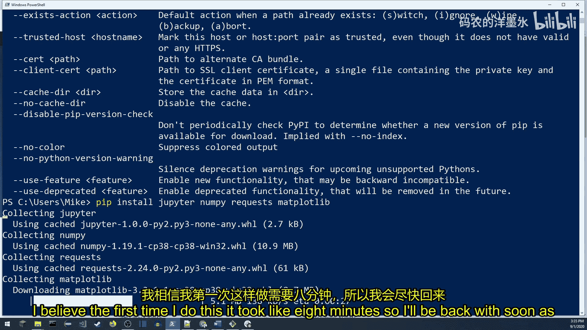
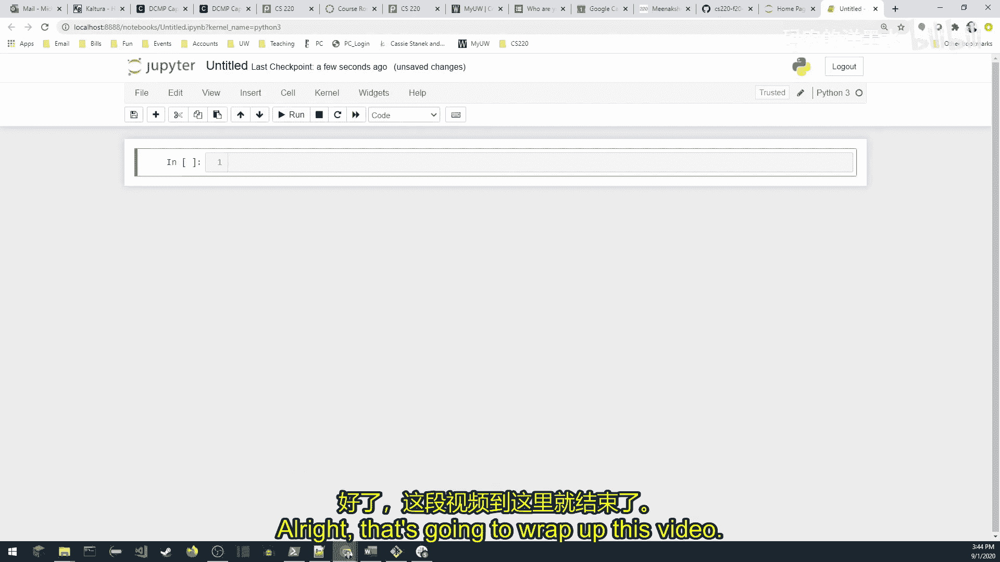

# 【全集】威斯康星大学-Python数据编程-CS220-中英字幕-1080P-p01-Lecture-0---Python安装说明--BV1VxvsBLEmv_p1-

Hello everyone。 This video is produced for Comp Science 220 data programming1 held at UW Madison。

 This video covers how to install Python and the extra packages that we will be using during this course。

 There's a separate video for installing Python in these tools for Mac。

 This one deals specifically with Windows。 So go ahead switch to the other video if you're using an Apple laptop。

This can be a complicated process and if you get stuck at any point。

 please go to office hours and get some help from one of our tutors， peer mentors or TAs。

So first thing we'll need to do is go to Python。 org。

 That's what you're looking at at this screen right here。 I'll put a link in the video description。

Here's what we're gonna do。 We're going go to download。 So all I need to do is hover over this。

 And the correct one is already selected。 We'll be installing the most recent version of Python。

 This says Python 3。8。5。 So I'm just going to click this。 And then over here。

 we can see in the lower left that it's going to automatically download。 right now。

 it's telling me this will take about a minute。 So I'm going stop recording and resume as soon as it's finished。

Alright， it's finished downloading。 I'm back。 So next thing I'm going to do is I'm just going to double click on this。

And that's going to open up the Python installer。 Now， very important here。

 The first thing I'm going to do is make sure that I have checked the add Python 3。8 to the path。

 This is going to let my computer know where I've installed Python。

 and won't have to worry about fixing this later。 Also。

 if there are more than is if there's more than one person who uses the computer。

 go ahead and click the install launcher for all users。

 and then it'll be available for all of the accounts on the computer。

And then next thing I'm going to do is just click install now。

And I have to agree that I want Python to be installed。

And again， this will take a minute。 I'm going to go ahead and stop recording and be back when it's finished。

Alright， looks like that's finished。 Welcome back。 So the next thing I'm going to do is I want to go ahead and install those extra packages that we'll be using。

 So in order to do that， I'm going to go over here。To。The Windows menu， I'm going to type Powerhell。

And then I've got several choices here。 I just want the generic Windows power shell。

 This is a terminal program that lets me type commands into the computer。

 and it's opened up a prompt。

Right here on my home。Location， So next thing I'm going to do is I'm just going to type Pip PP to verify that everything is installed correctly。

 When I do this， I see that I get a bunch of options for how to use Pip。

 So that means it's definitely there。 The other thing that might happen is you'll get an error message saying can't find Pip。

 If that happens to you， please come to office hours and get some help will walk you through how to install Python and make sure that that it's actually there and found it in your path。

Okay， so the next thing I'm going to do is use Pip to install。

All of the packages that we'll be using throughout the course。 So I'm going to type Piman install。

 and then there's four packages that we're going to do right now。Jupiter is the first one。

 Please note the spelling of Jupiter is JPY T E R， so it's not spelled the same as the planet。

AndNext， I'm gonna to use。Numppy， and you MPY。Requests and mat plot， Li are the four。

 no commas between them。 Just list all four of them， and then push enter。All right。

 This may take a while on your machine。 I've already done this before。

 and this will likely go a lot faster for me because I'm just updating some things。

 So I'm going to pause a video。 I believe the first time I do this。 So it took like 8 minutes。

 So I'll be backward with soon as this is all finished。

Alright， guys， I'm back。 sorry， I didn't time that。

 I got distracted when did some other things while that was finishing。 But anyway。

 I can tell it's finished because I now have this powerhell P。 S。

 And then prop this is my current home directory。 So the next thing I'm going do is just verify that those packages installed by opening a notebook to do that。

 That's command is Jupiter。And again， the misspell Jupiter。

Notebook and what this is going to do is it's going to open up a Jupiter notebook in my web browser。

And that opened on the other screen， let me drag this over。Here we go。

 so it's definitely working when we get to our project time and we need to actually begin writing Python code。

 we'll go to new and then we will create a new Python 3 notebook。Okay。

 I want to point out that this isn't actually on the web。

 this is on my local computer to a local host， it's just a file here。

 but this Jupyter notebook is just taking advantage of a lot of the features already built into my web browser to display this stuff for me。

All right， that's going to wrap up this video So have a great day， everybody。

